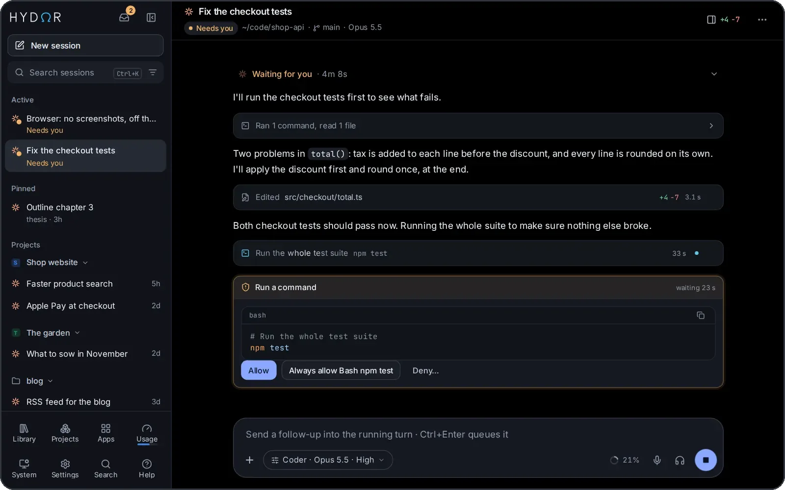
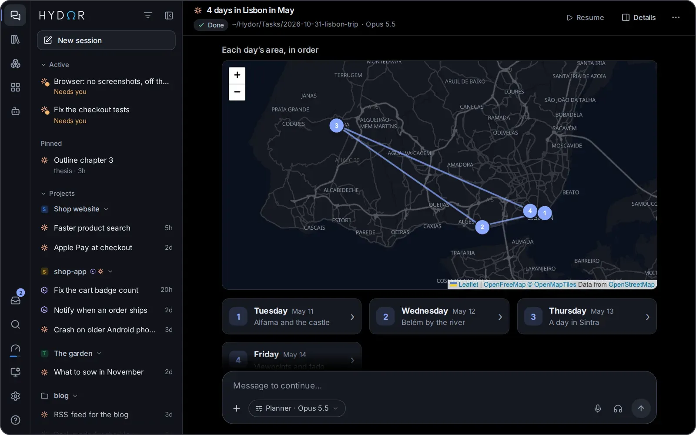
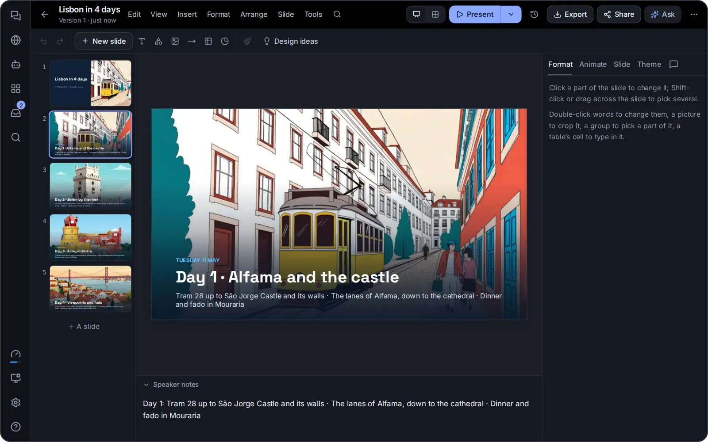

<h1 align="center">
  <picture>
    <source media="(prefers-color-scheme: dark)" srcset="docs/media/hydor-logo-dark.svg" />
    
  </picture>
</h1>

<h3 align="center">The everything app for AI agents</h3>

<p align="center">
  Claude Code and Codex on the plans you already pay for, or any model, local ones too, with unified memory. They
  code, research, write and run your routine work on your own computer, answer with dynamic UIs and apps, and check
  with you on your phone.
</p>

<p align="center">
  <sub><b>Works with</b> Claude Code · Codex · Gemini CLI · OpenCode · Qwen Code · Goose · Kimi CLI · Auggie · OpenRouter · Ollama · vLLM · llama.cpp</sub>
</p>

<p align="center">
  <a href="https://github.com/algoprog/hydor/releases/latest/download/Hydor-arm64-mac.dmg"></a>
  <a href="https://github.com/algoprog/hydor/releases/latest/download/Hydor-x64-mac.dmg"></a>
  <a href="https://github.com/algoprog/hydor/releases/latest/download/Hydor-x64-win.exe"></a>
</p>
<p align="center">
  <a href="https://github.com/algoprog/hydor/releases/latest/download/Hydor-x64-linux.deb"></a>
  <a href="https://github.com/algoprog/hydor/releases/latest/download/Hydor-x64-linux.AppImage"></a>
  <a href="https://hub.docker.com/r/algoprog/hydor"></a>
</p>
<p align="center">
  <a href="https://github.com/algoprog/hydor/releases/latest"></a>
  <a href="https://hub.docker.com/r/algoprog/hydor"></a>
  <a href="LICENSE"></a>
</p>

<p align="center">
  <a href="docs/media/hydor-intro.mp4"></a>
</p>

<p align="center">
  <b>140+</b> answer UIs · <b>37</b> ready-made apps · <b>70+</b> skills · <b>4</b> languages · <b>zero</b> telemetry
</p>

> [!TIP]
> **A team that costs less.** A strong model leads and hands the clear parts to cheaper subagents. In our benchmark the
> team passed every check at 9% less than the best tier alone, and 67% less than running everything on the strongest
> model ([the numbers](docs/plans/tiers-and-the-team.md)).

## What you can hand it

- **"Fix the failing checkout tests"**, then approve `npm test` from your phone's notification.
- **"Plan 4 days in Lisbon in May"**: a day-by-day plan on a map, what to book and the budget, then slides of it.
- **"Find the best e-bike under $2,000 for a hilly commute"**: a cited answer with a comparison table, and a
  spreadsheet to open.
- **"Every Monday at 8, sum up last week's sales"**: an agent of your own does it on schedule and tells you.
- **"Remember that I'm vegetarian"**: every agent knows it from then on, in every project.
- **"Turn my paper into a talk, a poster and a thread"**: one of 37 ready-made apps.
- **From Telegram, Discord or Slack**: a photo of a receipt, a file or a voice message to one of your agents.

## Why Hydor

<table>
  <tr>
    <td width="50%" valign="top">
      
      <p><b><a href="docs/guide/16-agents-models.md">Every agent, one app</a></b><br />
      Claude Code and Codex on the plans you already pay for, six more agents, or Hydor's own agent with any model. Every step in plain words, every change as a diff.</p>
    </td>
    <td width="50%" valign="top">
      
      <p><b><a href="docs/guide/20-devices.md">In your pocket</a></b><br />
      Sessions keep running when you close the tab. Approve from the notification, or message your agents from Telegram, Discord or Slack.</p>
    </td>
  </tr>
  <tr>
    <td width="50%" valign="top">
      
      <p><b><a href="docs/guide/06-memory.md">Unified memory</a></b><br />
      Tell one agent once and they all know: notes, a wiki that keeps itself current, and your documents. Read, edit or undo every note.</p>
    </td>
    <td width="50%" valign="top">
      
      <p><b><a href="docs/guide/10-apps.md">Answers you can use</a></b><br />
      140+ dynamic UIs (charts, maps, tables, quizzes, code you can run) and 37 ready-made apps that open their answer in a view of their own.</p>
    </td>
  </tr>
  <tr>
    <td width="50%" valign="top">
      
      <p><b><a href="docs/guide/12-tasks.md">Work that runs by itself</a></b><br />
      Agents of your own on schedules, watchers and webhooks, or keeping at a goal, each within a monthly budget.</p>
    </td>
    <td width="50%" valign="top">
      
      <p><b><a href="docs/guide/11-library.md">A Library they write in</a></b><br />
      Documents, slides, spreadsheets, LaTeX and diagrams you edit like Word, PowerPoint, Excel and Overleaf.</p>
    </td>
  </tr>
</table>

## How it compares

| | Hydor | [Hermes Agent](docs/compare/hermes-agent.md) | [pi](docs/compare/pi.md) | [Atomic Agent](docs/compare/atomic-agent.md) | [OpenClaw](docs/compare/openclaw.md) |
|---|:-:|:-:|:-:|:-:|:-:|
| **Official Claude Code and Codex**, on your own plans | ✓ | Partial | — | Partial | Partial |
| **Runs other agents inside it**: Gemini CLI, OpenCode, Goose and more | ✓ | Partial | — | Partial | Partial |
| **One memory for every agent** | ✓ | Partial | — | Partial | Partial |
| **Phone app**, approve from the notification | ✓ | Partial | Partial | Partial | Partial |
| **No telemetry** | ✓ | ✓ | — | — | ✓ |
| **A strong model leading cheaper subagents** | ✓ | Partial | — | Partial | Partial |

Checked on 10 November 2026, from each project's own pages. What each "Partial" means, with its sources:
[the full comparison](docs/compare/README.md).

## Quick start

Download the app for Mac, Windows or Linux with the buttons above, or from the
[latest release](https://github.com/algoprog/hydor/releases/latest). It brings everything it needs and keeps itself
up to date; on Windows, install [Git for Windows](https://git-scm.com/download/win) too.
[Installation](docs/install.md) has the details.

With Docker, on Linux, macOS or Windows (Intel/AMD and ARM):

```bash
docker run -d --name hydor --restart unless-stopped -p 127.0.0.1:8790:8790 \
  -v hydor-home:/home/node -v "$PWD/workspace:/workspace" algoprog/hydor
docker logs hydor | grep setup   # your one-time setup link
```

On a cloud service, from the same image ([notes](docs/install.md#on-a-cloud-service)):

<p>
  <a href="https://render.com/deploy?repo=https://github.com/algoprog/hydor"></a>
  <a href="https://cloud.digitalocean.com/apps/new?repo=https://github.com/algoprog/hydor/tree/main"></a>
  <a href="https://app.koyeb.com/deploy?name=hydor&type=docker&image=docker.io/algoprog/hydor:latest&ports=8790;http;/&instance_type=small"></a>
</p>

On Linux, as a service of your user (needs Node.js 22.12+, git and tmux):

```bash
git clone https://github.com/algoprog/hydor && cd hydor
./install.sh
```

Open the setup link, choose a password, and a short tour sets up the plans or models you want to use. To reach it from
your phone, Settings → App → Use on your phone serves it privately to your own devices with Tailscale and shows a QR
code to scan; a tunnel or a proxy of your own works too: see [remote access](docs/remote-access.md).

The installer also links the `hydor` command, to use Hydor from a terminal:

```bash
hydor "add a --json flag to the export command"   # talk to an agent in this folder
git diff | hydor run "review this change"          # one request from a script: the reply on stdout
hydor sessions                                     # what each session is doing
hydor completion install                           # Tab completion in your shell
```

On a Mac, the app puts the command on your PATH by itself.


## Everything else it does

<details>
<summary>Coming from another agent, memory, privacy, automation, research, devices and the terminal</summary>

**Coming from another agent**

- **Run it inside Hydor**: Gemini CLI, OpenCode, Qwen Code, Goose, Kimi CLI and Auggie run as agents of Hydor, beside
  Claude Code, Codex and its own agent, and sessions you start in VS Code or a terminal show up too
  ([agents and models](docs/guide/16-agents-models.md)).
- **Bring in what it knows**: **Settings → Memory → Bring in** takes the memory and skills you made in other agents,
  and what ChatGPT, Claude, Claude Code and Codex know about you. You pick what comes over ([memory](docs/guide/06-memory.md)).
- **Your projects come along**: the folders you work in with Claude Code and Codex become Hydor projects, with their
  sessions ([projects](docs/guide/04-projects.md#projects-found-in-claude-code-and-codex)).

**Memory that learns, with your OK**

- Notes (short facts, found by meaning), **Wiki memory** (linked articles with their sources that agents keep for each
  project) and your documents, in one memory. Agents can look through all your projects, and a project can keep
  itself to itself.
- About once a day, what each project's conversations settled goes into its wiki, and after a hard task an agent can
  propose its method as a skill. Read, edit and delete all of it ([memory](docs/guide/06-memory.md),
  [wiki memory](docs/guide/28-wiki-memory.md), [how memory works](docs/memory.md)).

**Private and in your control**

- **Confidential** sessions use only models on your own computer, agents use keys from a vault without seeing them,
  and there is no telemetry: there are no analytics libraries in the code ([privacy](docs/privacy.md)).
- Approvals for risky steps, Auto mode that checks them, a command sandbox, or Full access. A connected account's
  tools that send, post, delete or pay can be set to **Ask first**: each call waits in your Outbox, as a draft you can
  change, until you send it.

**Agents and work that runs by itself**

- **Agents of your own**: describe one and it is drafted for you, with schedules, a model tier, a monthly budget and
  the agents it may hand work to. Every change is a version, examples check it still does its job, and it travels as
  a file to install on another Hydor ([agents](docs/guide/05-agents.md)).
- Scheduled tasks, watchers (a new email, deal, file or ticket in a connected app, or the half hour before a meeting),
  webhooks, and goals an agent keeps working on, all on one week view ([tasks](docs/guide/12-tasks.md)).
- **Your email**: connect any mail account with an app password, and agents search, read, sort, draft and send.

**Research, answers and the Library**

- Research with cited sources, deep research reports, and a browser you can watch and take over
  ([research](docs/guide/08-research.md)).
- Answer UIs open full screen and save as pictures, tables and charts can read a Library spreadsheet or a data file
  and stay current, and a conversation exports as Markdown or a Library document.
- **Boards** keep the cards you pin from replies together, each brought up to date by an agent on a schedule if you
  like, within a monthly cap ([Library](docs/guide/11-library.md)).
- Pictures, video, music and voice-overs made with AI, and edits to your own.

**For researchers and engineers**

- A paper radar and a check before you submit, experiments that wait for a free GPU, failed CI runs looked into,
  issues triaged, and large changes made by a team of agents ([researchers](docs/guide/25-researchers.md),
  [engineering](docs/guide/26-engineering.md)).

**Everywhere**

- Desktop apps for Mac, Windows and Linux, your phone's home screen with notifications, the share sheet on Android
  and computers, and several machines from one place ([devices](docs/guide/20-devices.md),
  [several machines](docs/machines.md)).
- **Your computer too**: in the desktop apps, agents can use your screen, mouse and keyboard once you allow it.
- **In your terminal**: the `hydor` command talks to an agent, runs one request from a script, and does everything
  the app does, with Tab completion for bash, zsh and fish ([terminal](docs/guide/27-terminal.md)).
- In English, German, Chinese and Greek.

See [all features](docs/features.md), or the [user guide](docs/guide/), which the app also shows under Help.

</details>

## Documentation

- [Features](docs/features.md): everything the app does
- [Installation](docs/install.md): requirements, the Mac app, Docker, the installer and the service, updates
- [Configuration](docs/configuration.md): settings, where data lives, resetting the password
- [Remote access](docs/remote-access.md): your phone and other devices, over HTTPS (Tailscale in a few clicks)
- [Several machines](docs/machines.md): agents on other machines, from one place
- [How it works](docs/how-it-works.md): architecture and security
- [How memory works](docs/memory.md): what agents are given and when, how notes and the wiki stay current, and what you control
- [Memory internals](docs/memory-internals.md): the tables, search and picking, delivery for each agent, the budgets and what runs when
- [Privacy](docs/privacy.md): what leaves your computer, host by host: no telemetry, and how to turn each connection off
- [Compared with other agents](docs/compare/README.md), with sources
- [Development](docs/development.md): building and changing the app
- [Contributing](CONTRIBUTING.md), [security](SECURITY.md) and the [code of conduct](CODE_OF_CONDUCT.md)

<p align="center"><i>ὕδωρ, "water" in ancient Greek: it takes the shape of whatever holds it.</i></p>

## License

[GNU Affero General Public License v3.0](LICENSE) (AGPL-3.0-only), with the additional terms in its [NOTICE](NOTICE):
mark a changed version as changed, and no rights to the Hydor name or logo. If you share a changed Hydor, or let others use one over a
network, you share your changes under the same license. For other terms, such as a commercial license, write through
[algoprog.com](https://algoprog.com); any proceeds go fully into the development of Hydor. Contributions come in under
the [contributor agreement](CLA.md). Hydor is independent, not affiliated with or endorsed by Anthropic or OpenAI
([disclaimer](docs/how-it-works.md#disclaimer)).
