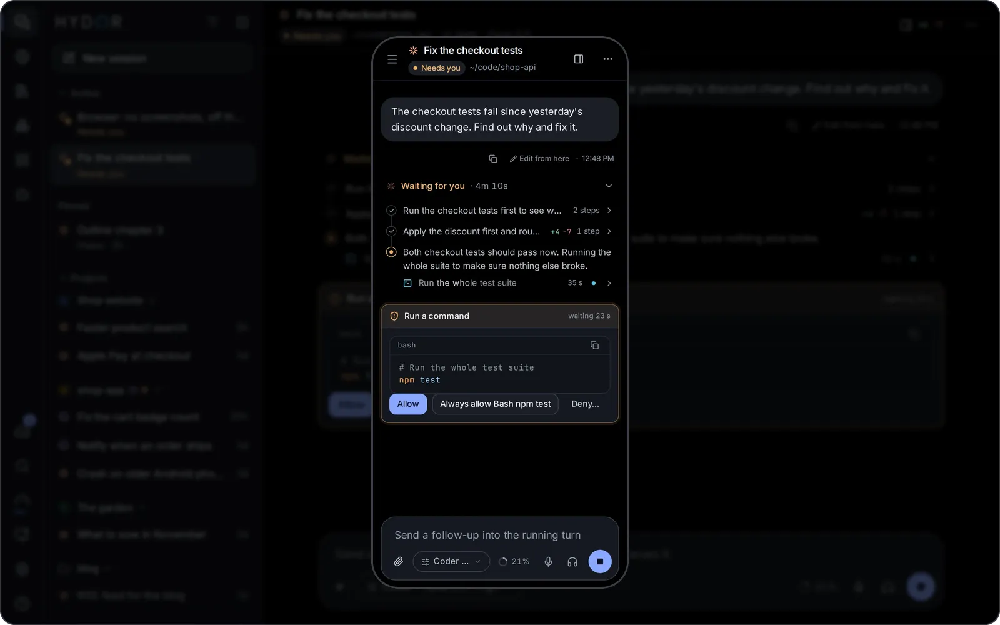
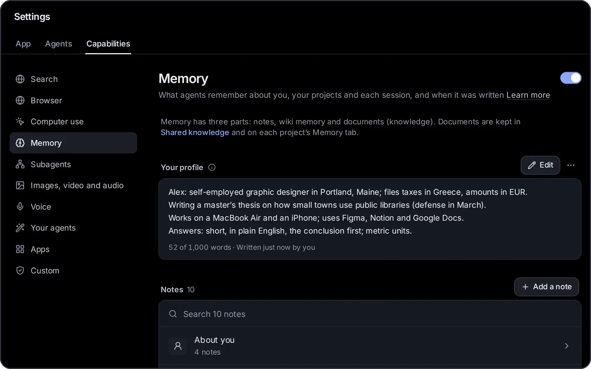
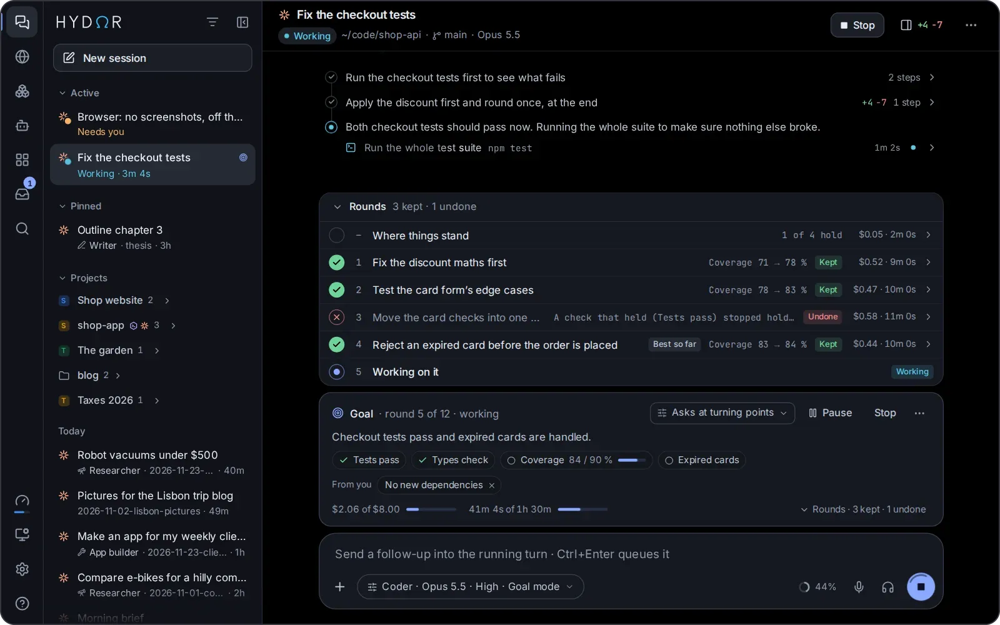
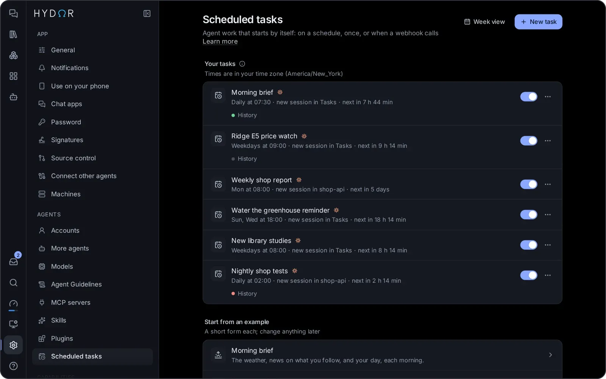
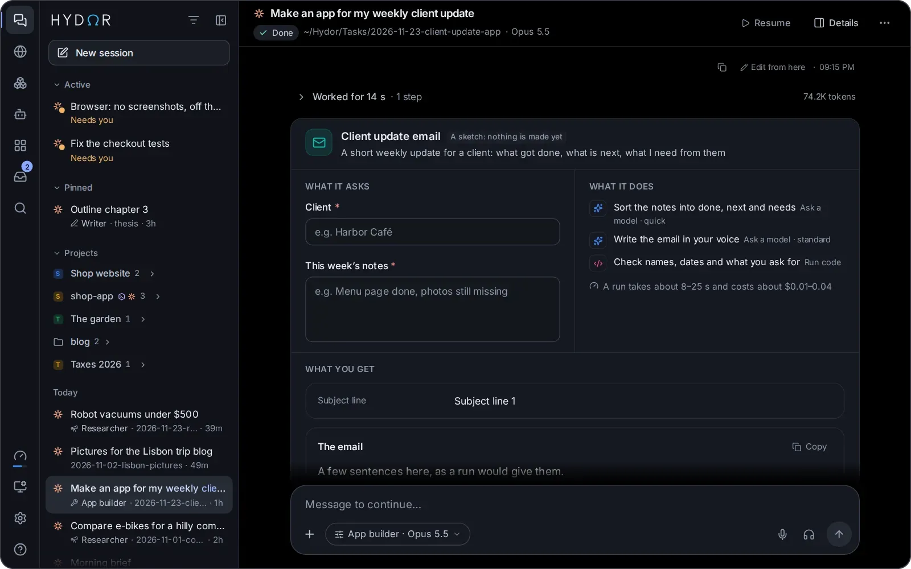
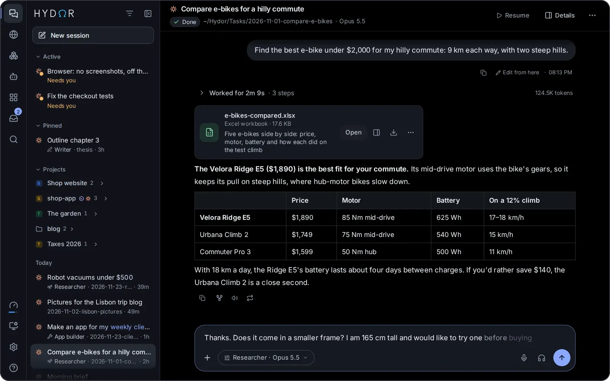
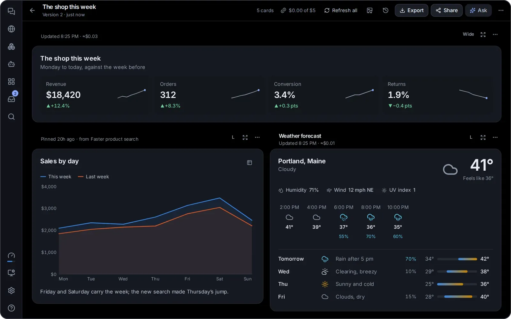
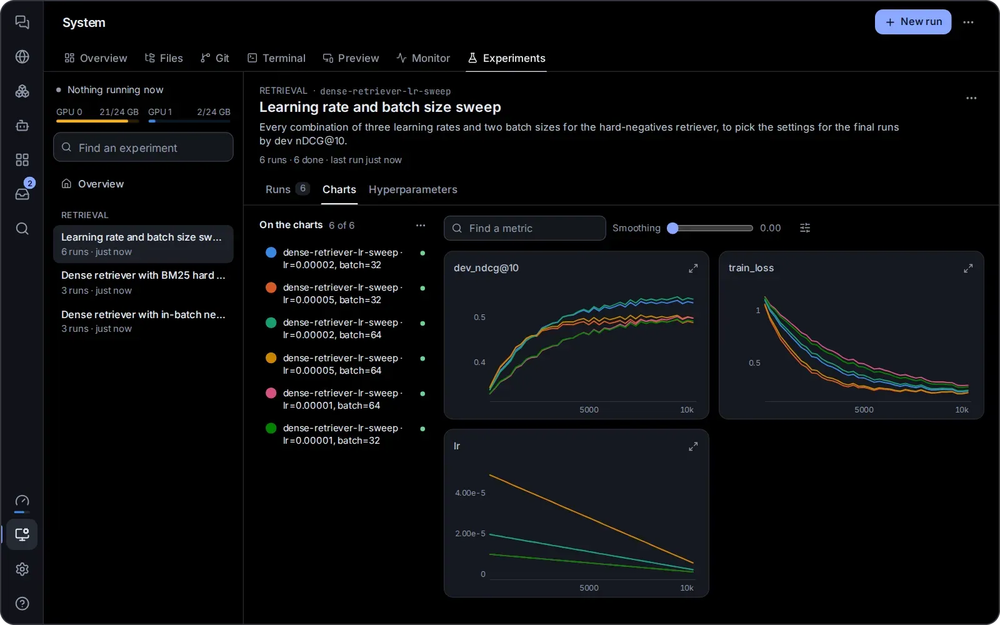
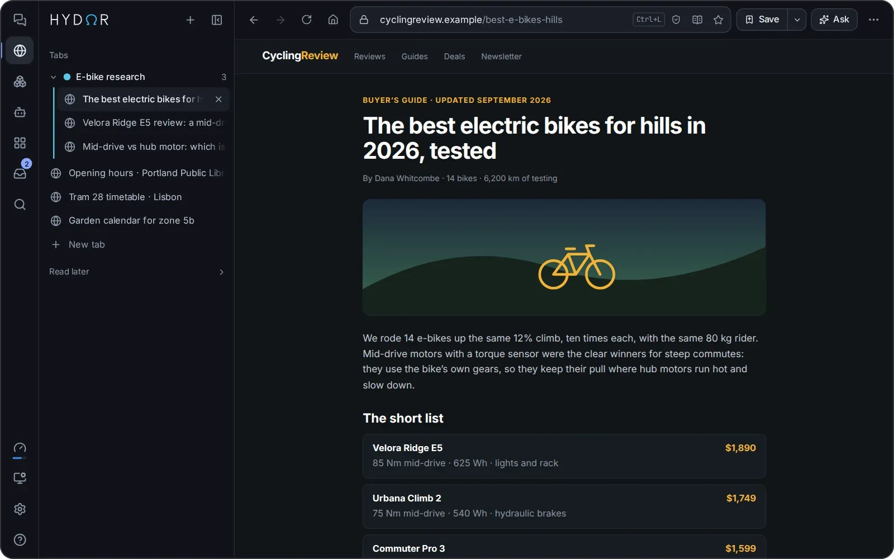

<h1 align="center">
  <picture>
    <source media="(prefers-color-scheme: dark)" srcset="docs/media/hydor-logo-dark.svg" />
    
  </picture>
</h1>

<h3 align="center">The everything app for AI agents</h3>

<p align="center">
  <b>Give Claude Code, Codex or any model a goal, and come back to finished work.</b><br />
  Hydor gives them a shared memory, a browser, subagents on cheaper models, and a schedule to run on. They answer with
  charts, maps and apps, write documents, slides and spreadsheets you can edit in the app, and carry on with your other
  account when one hits its limit. Your OK is a tap away on your phone.
</p>

<p align="center">
  <sub><b>Works with:</b> Claude Code · Codex · Gemini CLI · Antigravity CLI · Kimi CLI · Grok Build · OpenRouter · Ollama · vLLM · llama.cpp <b>and more</b></sub>
</p>

<p align="center">
  <a href="https://github.com/algoprog/hydor/releases/latest/download/Hydor-arm64-mac.dmg"></a>
  <a href="https://github.com/algoprog/hydor/releases/latest/download/Hydor-x64-mac.dmg"></a>
  <a href="https://github.com/algoprog/hydor/releases/latest/download/Hydor-x64-win.exe"></a>
</p>
<p align="center">
  <a href="https://github.com/algoprog/hydor/releases/latest/download/Hydor-x64-linux.deb"></a>
  <a href="https://github.com/algoprog/hydor/releases/latest/download/Hydor-x64-linux.AppImage"></a>
  <a href="https://hub.docker.com/r/algoprog/hydor"></a>
</p>
<p align="center">
  <a href="https://github.com/algoprog/hydor/releases/latest"></a>
  <a href="https://hub.docker.com/r/algoprog/hydor"></a>
  <a href="LICENSE"></a>
</p>

<p align="center">
  <a href="docs/media/hydor-intro.mp4"></a>
</p>

<p align="center">
  <b>150</b> answer UIs · <b>45</b> ready-made apps · <b>70+</b> skills · <b>8</b> languages · <b>zero</b> telemetry
</p>

## Why Hydor

Six reasons to move your work here:

1. **[Every agent, on the plans you already pay for.](docs/guide/16-agents-models.md)** Claude Code on your Claude plan
   and Codex on your ChatGPT plan: the official programs, with nothing more to pay. Gemini CLI, OpenCode, Grok Build
   and more run beside them, and Hydor's own agent takes any model: one in the cloud, or a local model that runs on
   your own computer with Ollama, vLLM or llama.cpp, with the same memory, tools and subagents as the rest.
2. **[A usage limit doesn't stop the work.](docs/guide/16-agents-models.md#use-all-your-accounts-switch-at-a-limit)**
   Sign in more than one Claude, ChatGPT or Grok account, a work and a personal one say. When one hits its limit, the
   session moves to another by itself, with its history, and carries on.
3. **[One memory for all of them.](docs/guide/06-memory.md)** Tell one agent once and every agent knows, on every
   model. Read, edit or undo any note, and bring in what ChatGPT and Claude already know about you.
4. **[Answers you can use.](docs/guide/10-apps.md)** Charts, maps, tables and UIs instead of walls of text, 45
   ready-made apps, and apps of your own that an agent builds from a description. Documents, slides and spreadsheets
   you edit in place.
5. **[Work that gets finished.](docs/guide/29-goals.md)** Agree what "done" means and the agent keeps at it round after
   round, while the app runs the checks itself. Agents of your own work on schedules, and what needs your OK reaches
   your phone.
6. **[It is yours.](docs/privacy.md)** Free and open source, on your own computer, with no telemetry and no account
   with us. Agents use your keys without seeing them, and Confidential sessions use only models on your machine.

<table>
  <tr>
    <td width="50%" valign="top">
      
      <p><b><a href="docs/guide/16-agents-models.md">Every agent, one app</a></b><br />
      Whichever agent or model does the work, you follow it the same way: each step in plain words, every edit with its diff, and a command that waits for your OK.</p>
    </td>
    <td width="50%" valign="top">
      
      <p><b><a href="docs/guide/20-devices.md">In your pocket</a></b><br />
      Sessions keep running when you close the tab. Approve from the notification, or message your agents from Telegram, Discord or Slack.</p>
    </td>
  </tr>
  <tr>
    <td width="50%" valign="top">
      
      <p><b><a href="docs/guide/06-memory.md">Unified memory</a></b><br />
      Tell one agent once and they all know: notes, a wiki that keeps itself current, and your documents. Read, edit or undo every note.</p>
    </td>
    <td width="50%" valign="top">
      
      <p><b><a href="docs/guide/10-apps.md">Answers you can use</a></b><br />
      150 dynamic UIs (charts, maps, tables, quizzes, code you can run) and 45 ready-made apps that open their answer in a view of their own.</p>
    </td>
  </tr>
  <tr>
    <td width="50%" valign="top">
      
      <p><b><a href="docs/guide/29-goals.md">Goals the app checks</a></b><br />
      Agree what "done" means (tests that pass, a number to reach) and the agent keeps at it round after round. The app runs the checks itself.</p>
    </td>
    <td width="50%" valign="top">
      
      <p><b><a href="docs/guide/12-tasks.md">Work that runs by itself</a></b><br />
      Agents of your own on schedules, watchers and webhooks, or keeping at a goal, each within a monthly budget.</p>
    </td>
  </tr>
  <tr>
    <td width="50%" valign="top">
      
      <p><b><a href="docs/guide/10-apps.md#make-your-own-app">Make your own apps</a></b><br />
      Describe a job you do often, and an agent builds an app for it: a form, the work, and a view for its answer. Run it, schedule it or share it.</p>
    </td>
    <td width="50%" valign="top">
      
      <p><b><a href="docs/guide/11-library.md">Documents they write in</a></b><br />
      Documents, slides, spreadsheets, LaTeX and diagrams you edit like Word, PowerPoint, Excel and Overleaf, kept in the files of their project.</p>
    </td>
  </tr>
</table>

<details>
<summary>More to see: word suggestions, boards, experiments and a browser of its own</summary>
<br />

<table>
  <tr>
    <td width="50%" valign="top">
      
      <p><b><a href="docs/guide/09-documents-voice.md#word-suggestions-as-you-type">Word suggestions</a></b><br />
      The rest of the word you are typing in grey, and the next one: Tab takes it. Made on your computer by a small model that learns how you write.</p>
    </td>
    <td width="50%" valign="top">
      
      <p><b><a href="docs/guide/11-library.md#boards">Boards</a></b><br />
      Pin cards from replies to a board, and an agent can keep each one current on a schedule.</p>
    </td>
  </tr>
  <tr>
    <td width="50%" valign="top">
      
      <p><b><a href="docs/guide/24-experiments.md">Experiments</a></b><br />
      Training and evaluation runs that wait for a free GPU, with live charts, sweeps and results tables for your paper. Agents start and watch them.</p>
    </td>
    <td width="50%" valign="top">
      
      <p><b><a href="docs/guide/07-web.md#your-own-browser">A browser of its own</a></b><br />
      In the desktop apps: tabs, an ad blocker, translation and reader view, and agents that work in it while you watch.</p>
    </td>
  </tr>
</table>

</details>

> [!TIP]
> **A team that costs less.** A strong model leads and hands the clear parts to cheaper subagents. On our benchmark of
> 58 coding tasks the team solved the most (96.6%), for 18% less than its lead model doing all the work alone
> ([the numbers](docs/plans/tiers-and-the-team.md)).

## Switch in a few minutes

You keep your plan, and you don't start from nothing.

1. **Keep the plan you pay for.** Sign in with your Claude plan or your ChatGPT plan, and Hydor runs Claude Code and
   Codex on it. Or use any model: pay as you go through OpenRouter, or free and private on your own computer
   ([agents and models](docs/guide/16-agents-models.md)).
2. **Bring what it knows about you.** [**Settings → Memory → Bring in**](docs/guide/06-memory.md#bring-in-from-other-assistants)
   reads the export ChatGPT or Claude emails you, and the memory and skills you made in Claude Code, Codex and other
   agents. You see it all first, and nothing comes over until you pick it.
3. **Find your work already there.** The folders you work in with Claude Code and Codex become projects by themselves,
   with their sessions ([projects](docs/guide/04-projects.md#projects-found-in-claude-code-and-codex)).

## What you can hand it

- **"Fix the failing checkout tests"**, then approve `npm test` from your phone's notification.
- **"Get test coverage to 90%"**, as a goal: the agent works round after round, and the app runs the checks and says
  when it is reached.
- **"Plan 4 days in Lisbon in May"**: a day-by-day plan on a map, what to book and the budget, then slides of it.
- **"Find the best e-bike under $2,000 for a hilly commute"**: a cited answer with a comparison table, and a
  spreadsheet to open.
- **"Every Monday at 8, sum up last week's sales"**: an agent of your own does it on schedule and tells you.
- **"Remember that I'm vegetarian"**: every agent knows it from then on, in every project.
- **"Turn my paper into a talk, a poster and a thread"**: one of 45 ready-made apps.
- **"Make me an app that sums up a job offer and what to ask before signing"**: an agent builds it, with a form and a
  view for its answer, and you run it whenever you like.
- **"Train this on a free GPU and tell me when it's done"**: the run waits for a GPU, then you get live charts and, for
  a sweep, a results table for your paper.
- **From Telegram, Discord or Slack**: a photo of a receipt, a file or a voice message to one of your agents.

## How it compares

**Against the ChatGPT and Claude apps.** Both have grown a lot this year, and do things Hydor doesn't: models and
features first, work that goes on in their cloud with your computer off, shared team workspaces. Hydor's edge is the
combination, and that it is yours.

| | Hydor | ChatGPT | Claude |
|---|:-:|:-:|:-:|
| **Your Claude and ChatGPT plans in one app**: Claude Code and Codex, nothing more to pay | ✓ | — | — |
| **Any model, local ones too** | ✓ | Partial | — |
| **One memory** for every agent and model, which you read, edit and bring the other app's into | ✓ | Partial | Partial |
| **Apps you make** by describing a job, and answers as cards pinned to boards | ✓ | Partial | Partial |
| **Goals with checks the app runs** itself | ✓ | Partial | Partial |
| **Word suggestions as you type**, made on your computer | ✓ | Partial | — |
| **Experiments** for ML research: a GPU queue, sweeps, results tables | ✓ | — | Partial |
| **Open source**, on your own computer, no telemetry | ✓ | Partial | — |

Checked on 24 November 2026, from OpenAI's and Anthropic's own pages. What each cell says, with its sources:
[Hydor vs the ChatGPT and Claude apps](docs/compare/chatgpt-and-claude.md).

**Against other agent apps.**

<details>
<summary>Hermes Agent, pi, Atomic Agent and OpenClaw</summary>

| | Hydor | [Hermes Agent](docs/compare/hermes-agent.md) | [pi](docs/compare/pi.md) | [Atomic Agent](docs/compare/atomic-agent.md) | [OpenClaw](docs/compare/openclaw.md) |
|---|:-:|:-:|:-:|:-:|:-:|
| **Official Claude Code and Codex**, on your own plans | ✓ | Partial | — | Partial | Partial |
| **Runs other agents inside it**: Gemini CLI, OpenCode, Goose and more | ✓ | Partial | — | Partial | Partial |
| **One memory for every agent** | ✓ | Partial | — | Partial | Partial |
| **Phone app**, approve from the notification | ✓ | Partial | Partial | Partial | Partial |
| **No telemetry** | ✓ | ✓ | — | — | ✓ |
| **A strong model leading cheaper subagents** | ✓ | Partial | — | Partial | Partial |

Checked on 10 November 2026, from each project's own pages. What each "Partial" means, with its sources:
[the full comparison](docs/compare/README.md).

</details>

## Quick start

Download the app for Mac, Windows or Linux with the buttons above, or from the
[latest release](https://github.com/algoprog/hydor/releases/latest). It brings everything it needs and keeps itself
up to date; on Windows, install [Git for Windows](https://git-scm.com/download/win) too.
[Installation](docs/install.md) has the details.

With Docker, on Linux, macOS or Windows (Intel/AMD and ARM):

```bash
docker run -d --name hydor --restart unless-stopped -p 127.0.0.1:8790:8790 \
  -v hydor-home:/home/node -v "$PWD/workspace:/workspace" algoprog/hydor
docker logs hydor | grep setup   # your one-time setup link
```

On a cloud service, from the same image ([notes](docs/install.md#on-a-cloud-service)):

<p>
  <a href="https://render.com/deploy?repo=https://github.com/algoprog/hydor"></a>
  <a href="https://cloud.digitalocean.com/apps/new?repo=https://github.com/algoprog/hydor/tree/main"></a>
  <a href="https://app.koyeb.com/deploy?name=hydor&type=docker&image=docker.io/algoprog/hydor:latest&ports=8790;http;/&instance_type=small"></a>
</p>

On Linux, as a service of your user (needs Node.js 22.12+, git and tmux):

```bash
git clone https://github.com/algoprog/hydor && cd hydor
./install.sh
```

Open the setup link, choose a password, and a short tour sets up the plans or models you want to use. To reach it from
your phone, Settings → App → Use on your phone serves it privately to your own devices with Tailscale and shows a QR
code to scan; a tunnel or a proxy of your own works too: see [remote access](docs/remote-access.md).

The installer also links the `hydor` command, to use Hydor from a terminal:

```bash
hydor "add a --json flag to the export command"   # talk to an agent in this folder
git diff | hydor run "review this change"          # one request from a script: the reply on stdout
hydor sessions                                     # what each session is doing
hydor completion install                           # Tab completion in your shell
```

On a Mac, the app puts the command on your PATH by itself.

## Everything else it does

<details>
<summary>Agents and accounts, memory, privacy, automation, research, devices and the terminal</summary>

**Agents and accounts**

- **Other agents run inside Hydor**: Gemini CLI, OpenCode, Qwen Code, Goose, Kimi CLI, Auggie, Grok Build and
  Antigravity CLI run as agents of Hydor, beside Claude Code, Codex and its own agent, and sessions you start in
  VS Code or a terminal show up too ([agents and models](docs/guide/16-agents-models.md)). Antigravity CLI is Google's
  agent for a Google AI Pro, Ultra or Plus plan (Gemini CLI now serves a Gemini API key or a Gemini Code Assist
  Standard or Enterprise licence); it has one sign-in and runs only in sessions you start yourself, as Google's terms
  ask ([Antigravity CLI](docs/guide/16-agents-models.md#antigravity-cli)).
- **Several accounts of each**: sign in to Claude Code, Codex and Grok Build with your subscriptions, and add more than
  one account of each, a work and a personal one say
  ([accounts](docs/guide/16-agents-models.md#sign-claude-code-codex-and-grok-build-in)). When one hits its limit, the
  session moves to another that has usage left, with its history, and a new session starts on one that has. When every
  account is used up, a session can continue by itself once a limit resets, or, for Claude Code, on an API key of
  yours if you turn that on ([switch at a limit](docs/guide/16-agents-models.md#use-all-your-accounts-switch-at-a-limit)).
- **A signed-out account is passed over** the same way, and you're asked to sign in again only when nothing else can
  do the work ([signed out](docs/guide/16-agents-models.md#when-an-account-is-signed-out)).

**Memory that learns, with your OK**

- Notes (short facts, found by meaning), **Wiki memory** (linked articles with their sources that agents keep for each
  project) and your documents, in one memory: a project's Memory tab lists all three together, with one search over them.
  Agents can look through all your projects, and a project can keep itself to itself.
- A project's existing history (files, notes, conversations, commits, documents) can build its wiki in minutes, with progress and Stop.
- About once a day, what each project's conversations settled goes into its wiki, and after a hard task an agent can
  propose its method as a skill. Read, edit and delete all of it ([memory](docs/guide/06-memory.md),
  [wiki memory](docs/guide/28-wiki-memory.md), [how memory works](docs/memory.md)).

**Private and in your control**

- **Confidential** sessions use only models on your own computer, agents use keys from a vault without seeing them,
  and there is no telemetry: there are no analytics libraries in the code ([privacy](docs/privacy.md)).
- Approvals for risky steps, Auto mode that checks them, a command sandbox, or Full access. A connected account's
  tools that send, post, delete or pay can be set to **Ask first**: each call waits in your Outbox, as a draft you can
  change, until you send it.

**Agents and work that runs by itself**

- **Agents of your own**: describe one and it is drafted for you, with schedules, a model tier, a monthly budget and
  the agents it may hand work to. Every change is a version, examples check it still does its job, and it travels as
  a file to install on another Hydor ([agents](docs/guide/05-agents.md)).
- **Goals the app checks**: agree with an agent what "done" means (commands that must pass, a number to reach, a claim
  a reviewer checks, something you confirm) and how far it may go (rounds, money, time). After each round the app runs
  the checks itself, keeps a round that got closer and, in a worktree, undoes one that made things worse, asks you at
  turning points (with a swarm, its members work on what does not hold yet each round), and only it says the goal is reached ([goals](docs/guide/29-goals.md)).
- Scheduled tasks, watchers (a new email, deal, file or ticket in a connected app, or the half hour before a meeting),
  webhooks, and goals an agent keeps working on, all on one week view ([tasks](docs/guide/12-tasks.md)).
- **Your email**: connect any mail account with an app password, and agents search, read, sort, draft and send.

**Research, answers and what you keep**

- Research with cited sources, deep research reports, and a browser you can watch and take over
  ([research](docs/guide/08-research.md)). In the desktop apps that browser runs inside the app, with nothing to install.
- **A browser of your own** in the desktop app: tabs, an address bar that finds your tabs, bookmarks and history by
  what a page is about, an ad and tracker blocker that hides cookie banners, private tabs, pages translated into your
  language, reader view, highlights that are still there when you come back, bookmarks and history brought in from
  your other browsers, Chrome extensions, and a page you can hand to an agent, to ask about or to work on in your
  sign-in, with a stop before it sends or deletes anything ([the browser](docs/guide/07-web.md)).
- Answer UIs open full screen and save as pictures, tables and charts can read a kept spreadsheet or a data file
  and stay current, and a conversation exports as Markdown or a document.
- **Boards** keep the cards you pin from replies together, each brought up to date by an agent on a schedule if you
  like, within a monthly cap ([pages, documents and pictures](docs/guide/11-library.md)).
- Pictures, video, music and voice-overs made with AI, and edits to your own.
- **Word suggestions** as you type: the rest of the word in grey after the cursor, and the next word dimmer (Tab takes it),
  from a small model of the app's own that learns from what you write and, when the computer has the memory,
  Qwen3.5-0.8B beside it, both on your computer (on from the start: about 1.2 GB downloaded the first time you type). Nothing you
  type leaves it ([word suggestions](docs/guide/09-documents-voice.md#word-suggestions-as-you-type)).
- **Everything you keep is in the files of its project**: a project's details (from the sidebar) have a **Files** tab
  with tiles that show each file's picture, an **Upload** button, and the pages, documents, slides, spreadsheets,
  pictures, videos and sounds that agents made for it, next to the files in its folder ([projects](docs/guide/04-projects.md)).

**For researchers and engineers**

- A paper radar and a check before you submit, experiments that wait for a free GPU, failed CI runs looked into,
  issues triaged, and large changes made by a team of agents ([researchers](docs/guide/25-researchers.md),
  [engineering](docs/guide/26-engineering.md)).
- Research you can trust when agents do it: an evaluation that scores every run and every agent the same way, a check
  that tries to break a result before it counts, a check for earlier work, and findings kept with their evidence
  ([experiments](docs/guide/24-experiments.md), [memory](docs/guide/06-memory.md)).

**Everywhere**

- Desktop apps for Mac, Windows and Linux, your phone's home screen with notifications, the share sheet on Android
  and computers, and several machines from one place ([devices](docs/guide/20-devices.md),
  [several machines](docs/machines.md)).
- **Your computer too**: in the desktop apps, agents can use your screen, mouse and keyboard once you allow it.
- **In your terminal**: the `hydor` command talks to an agent, runs one request from a script, and does everything
  the app does, with Tab completion for bash, zsh and fish ([terminal](docs/guide/27-terminal.md)).
- In English, German, Spanish, French, Brazilian Portuguese, Greek, Japanese and Chinese.

See [all features](docs/features.md), or the [user guide](docs/guide/), which the app also shows under Help.

</details>

## Documentation

- [Features](docs/features.md): everything the app does
- [Installation](docs/install.md): requirements, the Mac app, Docker, the installer and the service, updates
- [Configuration](docs/configuration.md): settings, where data lives, resetting the password
- [Remote access](docs/remote-access.md): your phone and other devices, over HTTPS (Tailscale in a few clicks)
- [Several machines](docs/machines.md): agents on other machines, from one place
- [How it works](docs/how-it-works.md): architecture and security
- [How memory works](docs/memory.md): what agents are given, how notes and the wiki stay current, and what you control
- [Memory internals](docs/memory-internals.md): the tables, search and picking, delivery for each agent, the budgets and what runs when
- [Privacy](docs/privacy.md): what leaves your computer, host by host: no telemetry, and how to turn each connection off
- [Compared with ChatGPT, Claude and other agents](docs/compare/README.md), with sources
- [Development](docs/development.md): building and changing the app
- [Contributing](CONTRIBUTING.md), [security](SECURITY.md) and the [code of conduct](CODE_OF_CONDUCT.md)

<p align="center"><i>ὕδωρ, "water" in ancient Greek: it takes the shape of whatever holds it.</i></p>

## License

[GNU Affero General Public License v3.0](LICENSE) (AGPL-3.0-only), with the additional terms in its [NOTICE](NOTICE):
mark a changed version as changed, and no rights to the Hydor name or logo. If you share a changed Hydor, or let others use one over a
network, you share your changes under the same license. For other terms, such as a commercial license, write through
[algoprog.com](https://algoprog.com); any proceeds go fully into the development of Hydor. Contributions come in under
the [contributor agreement](CLA.md). Hydor is independent, not affiliated with or endorsed by Anthropic or OpenAI
([disclaimer](docs/how-it-works.md#disclaimer)).
