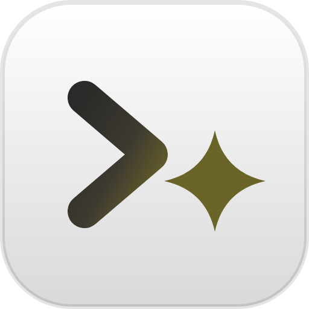

<p align="center">
  
</p>

<h1 align="center">Naget Agent</h1>

<p align="center">
  Run <b>Claude Code</b>, <b>Codex</b> or <b>any model</b> on your own computer, access from any device.
</p>

<p align="center">
  <a href="docs/media/naget-agent-intro.mp4"></a>
</p>

Naget Agent is a self-hosted agent harness. It works on top of the coding agents you already use,
running the official `claude` and `codex` command-line tools with your own subscriptions, and on top of the
models themselves: its own agent, Custom, gives any model, open-weight ones included, the same tools, skills
and MCP servers. All of it in one interface you can open from your desk or your phone. Sessions keep running
when you close the tab, and the ones you start in VS Code or a terminal show up too.

## What you can do

- Start Claude Code, Codex or another [ACP](https://agentclientprotocol.com) agent (Gemini CLI, OpenCode…) in any folder
- Follow every step in plain words, approve commands and edits, and see each change as a diff
- Get a notification when a session finishes or needs you, and carry on from your phone
- Open pull requests on GitHub or Gitea, and review a branch file by file
- Use a terminal, files, git, notebooks, scheduled tasks and your plans' limits in the same app
- Switch between several accounts and machines from the sidebar
- Run Custom, the app’s own agent, with any model: OpenRouter, Ollama, or a Hugging Face model on your GPU with vLLM
- Get help with anything, not just code: assistants for research, writing and planning, web search (Naget Search by
  default) and a browser you can watch and take over, documents in and out, pages and small apps you keep
- Give every agent memory of you and your projects, your apps and services (connected once), skills, child
  sessions, and tasks that run on a schedule or when something changes

See [all features](docs/features.md).

## Quick start

With Docker, on Linux, macOS or Windows (the image runs on Intel/AMD and ARM):

```bash
docker run -d --name naget-agent --restart unless-stopped -p 127.0.0.1:8790:8790 \
  -v naget-agent-home:/home/node -v "$PWD/workspace:/workspace" nagetai/naget-agent
docker logs naget-agent | grep setup   # your one-time setup link
```

Or build the image yourself, with your own user ids for the files the agents create:

```bash
git clone https://github.com/Naget-Inc/naget-agent && cd naget-agent
printf 'UID=%s\nGID=%s\n' "$(id -u)" "$(id -g)" > .env && mkdir -p workspace
docker compose up -d --build
docker compose logs | grep setup
```

Or on Linux, as a service of your user (needs Node.js 22.12+, git and tmux):

```bash
git clone https://github.com/Naget-Inc/naget-agent && cd naget-agent
./install.sh
```

Open the setup link it prints, choose a password, and a short tour sets up what you want to use: Claude Code,
Codex, models through OpenRouter or on your own GPU, or other agents.
To use it from your phone, put HTTPS in front of it: see [remote access](docs/remote-access.md).

## Documentation

- [Features](docs/features.md): everything the app does
- [Installation](docs/install.md): requirements, Docker, the installer and the service, updates
- [Configuration](docs/configuration.md): settings, where data lives, resetting the password
- [Remote access](docs/remote-access.md): your phone and other devices, over HTTPS
- [Several machines](docs/machines.md): agents on other machines, from one place
- [How it works](docs/how-it-works.md): architecture and security
- [Development](docs/development.md): building and changing the app

## License

[MIT](LICENSE). Naget Agent is an independent project, not affiliated with or endorsed by Anthropic or
OpenAI ([disclaimer](docs/how-it-works.md#disclaimer)).
