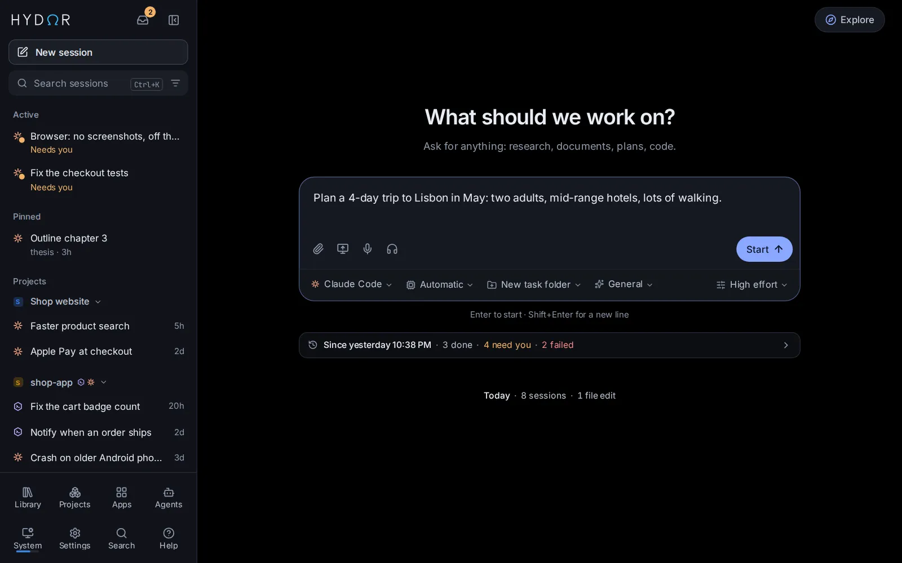

# Getting started

This topic shows you around Hydor: what it is, what is on the screen, how to start your first session, how to find anything with the search box, and how to use the app on a phone. It ends with every keyboard shortcut in one table.

## What Hydor is

Hydor runs AI agents on your own computer, and you use them from any browser, at your desk or on your phone. An agent is a program that works on a task for you: it reads and writes files, runs commands, searches the web and tells you what it did. You can use Claude Code and Codex with your own subscriptions, Custom (the app's own agent, which works with any model, including open models on your own computer), and other agents such as Gemini CLI or OpenCode. Each conversation with an agent is a **session**. Sessions keep running when you close the page, so you can start one at your desk and answer it from your phone. Many people use it for code, but it helps with anything: research, writing, documents, planning and everyday tasks.

## Find your way around

The screen has three parts: the **rail**, a narrow strip of tools at the far left; a **column** beside it on some pages, the **sidebar** with your sessions on the start page and in a session, or the Apps', Agents', Help's or Settings' own list; and the page you are on (the start page, a session, Settings…). The rail is always there on a computer. On a phone there is no rail: the sidebar is a drawer that slides in and holds the tools too (see [Use the app on a phone](#use-the-app-on-a-phone)).

On a computer you can make the column wider or narrower, from 180 to 560 pixels: drag its right edge, or click the edge and press the left and right arrow keys. The width is the same for every column and is kept in this browser.

### The rail

The rail is a column of icons; point at one, or move to it with Tab, and a tooltip beside it gives its name and, where it has one, its shortcut. The icon for the page you are on is lit, with a bar of the accent colour at the edge of the screen beside it. From the top:

- **Sessions**: shows your sessions in the sidebar. While you are on the start page or in a session, it hides or shows the sidebar (the same as Ctrl+B). From any other page it shows the sidebar and takes you back to the session you had open last in this window, or to the start page when there was none. While the sidebar is hidden, a small dot on this tile says something happened on another machine (see [Switch between machines](/guide/devices#switch-between-machines)).

Then the sections of the app (the desktop app has four; the web app and a phone have three, with no **Browser**):

- **Browser**: a browser of your own, only in the desktop app, with tabs, private tabs, a smart address bar, page translation, reader view, bookmarks, history, an ad blocker and Chrome extensions, from which you can hand a page to an agent. See [Your own browser](/guide/web#your-own-browser).
- **Apps**: tasks you run again and again: fill in a form, and an agent does the job. See [Apps](/guide/apps).
- **Projects**: every project as a card, with what it holds and when it was last at work; a click on a card opens the project's details. See [Find all your projects](/guide/projects#find-all-your-projects).
- **Agents**: your agents, each with what it does, where and when it works, what it thinks with and whom it asks, and the ones that come with the app. See [Agents](/guide/agents).

Right under them, always in this place:

- **Inbox**: everything waiting on you, such as approvals, questions and forms, from every session, scheduled task and machine. A number on its corner says how many things wait on you right now. See [Inbox and notifications](/guide/inbox).
- **Search**: opens the search box (the same as Ctrl+K).

Then, after some space, the tools:

- **Usage**: how much of each plan's limits you have used and when they reset, with **Activity** and **Arena** tabs; a thin bar under its icon shows how much is left across your paid subscriptions, or your free ones when you have no paid ones, red when nothing is left. See [Usage, limits and costs](/guide/usage).
- **System**: this computer, with a tab for each of its tools: **Overview** (how it is doing, and what each tool holds now), **Files** (browse, open and edit files), **Git** (your repositories, their changes, branches and history), **Terminal** (shells that keep running when you leave the page), **Preview** (a web app's development server running here; only on this machine's own pages) and **Monitor** (processors, graphics cards, memory, disks and the busiest programs, live). See [System: files, Git, Terminal and Preview](/guide/files-git).
- **Settings**: everything the app can be set to. A dot on it means a newer version is out. See [Every setting](/guide/settings).
- **Help**: opens this guide, where you can also ask an agent about the app. The welcome tour starts from there too.

The sections come in the order Browser, Projects, Agents, Apps, then Inbox and Search, and the tools below them in the order Usage, System, Settings, Help: that is their usual order. To change it, drag a tile to another place among its own group (the sections, or the tools at the bottom); Inbox and Search stay right under the sections. A tile that a newer version brings takes its usual place in the order you set (Projects right before Agents, say), not the end of the list. The tiles keep the order you set on every device, whichever machine you look at. Once you have moved them, right-click a tile and choose **Back to the usual order** to put them all back. In a window too short for every tile, the rail scrolls.

The sidebar with your sessions shows only on the start page, in a session and in its review. The **Apps**, **Agents**, **Help** and **Settings** have a column of the same kind, with the logo, their own list (the places of the Apps page and the Agents page, the guide's topics, Settings' sections) and **Hide sidebar**; the **Browser** page shows its tabs in a column of its own, and the other pages (Projects, Inbox, Usage, System…) use the whole width. **Ctrl+B** hides or shows the column of the page you are on, and every column has the same width. A column that holds more than fits shows its scroll bar, and its foot fades while there is more below. While the page reconnects to the app, a crossed-out Wi-Fi icon shows beside the logo at the top of the column, or at the top of the rail when no column is showing (it is hidden, or the page has none).

### The sidebar

The sidebar is the column beside the rail. It holds:

- The **HYDΩR** logo, with the **Filter and group sessions** button and **Hide sidebar** (Ctrl+B) at the end. While the sidebar is hidden, the button at the top left of the page shows it again, and the rail stays. On a phone the drawer has the logo, the inbox, the filter button and **Close menu** here instead.
- A machine switcher, only once you have added other machines in [Settings → Machines](/settings?s=machines). It names the machine you are looking at, and says what happened on the others: a number on an accent pill for sessions there that finished since you last looked, and an orange dot when sessions there need you. See [Phones, other machines and sharing](/guide/devices).
- **New session** opens the [start page](#the-start-page).
- To find a session, use the search box: **Search** on the rail (on a phone, **Search** among the tools at the bottom of the drawer), or Ctrl+K (⌘K on a Mac). It finds sessions by their title, their folder, the agent they were started as (type Tutor to find the sessions started as Tutor; General is left out) and the words said in them, archived sessions too, marked **Archived** and listed after the others (see [Search everything with Ctrl+K](#search-everything-with-ctrlk)).
- The filter button in the header (**Filter and group sessions**) narrows the list. Its menu has sections: **Agent** (**All agents**, then the agents your sessions were started as, the most used first, up to eight, each with how many sessions it has; it shows once some session was started as an agent), **Runs on** (a switch with **Any**, **Claude Code** and **Codex**) and, once you have projects, **Project** (**Every project**, then up to eight of your projects). **New project…** makes a project. The filters work together, such as one agent's sessions in one project. The button takes the accent colour while a filter is on, and a chip for each filter that is on shows under **New session**, with its icon and name: its × shows all sessions again for that filter. A filtered list with nothing in it says "No sessions match the filter." The last line, **Group by folder or project**, turns the groups for your projects and folders on or off (see [The session list](#the-session-list)). See [Find an agent's sessions](/guide/agents#find-an-agents-sessions) and [Projects and knowledge](/guide/projects).

### The session list

Under **New session** is every session, in groups:

- **Active**: all sessions with activity in the last five minutes, here or in VS Code or a terminal, including ones that have finished. After five minutes without activity they return to their usual group, even if their agent is still open. Sessions stopped by a usage limit stay here while scheduled to resume automatically; cancelling that resume restores the five-minute rule. Sessions whose background agents, commands or monitors are still running stay here too, however quiet, until those end. They keep their places while listed; drag one to move it.
- **Pinned**: the sessions you pinned, in the order you drag them into. Drag a session from the groups below onto it to pin it. Click the heading to fold it; while it is folded, dragging a session shows a **Drop here to pin** box under the heading to drop it on.
- **Projects**: a group for each of your projects that has sessions, and for each folder of yours that two or more sessions work in, under its name; the one used last comes first, until you put them in an order of your own: drag a group by its heading to another place among them (on a phone, hold the heading a moment first). That order is the same on every device, and a group you never moved (a project made since) comes first. Each shows its five newest sessions; **Show 12 more** (or however many there are) lists the rest, and **Show fewer** goes back.
- **Today**, **Yesterday**, **This week**, then month names and years: the rest, by when they were last active.
- **Snoozed**: at the bottom, until their time comes.

Only folders you picked get a group. The home folder, the default folder, new task folders, the folders apps run in and temporary folders get none, so their sessions go by day. A session in a worktree goes in the group of the folder the worktree was made from, and any session working in a project's folder, or in a folder inside it, in the project's group, wherever it was started: in Hydor, Claude Code or Codex. A folder of a Codex project shows under the project's name. The folders the Codex app makes for your ChatGPT projects are named only by an id, so unless Codex knows the project's name they get no group either, and their sessions show **ChatGPT project** as their folder. Give one a name with **Rename folder** in one of its sessions' menus, and it gets a group under that name. Two folders of the same name show as many of the folders above them as it takes to tell them apart ("client/app", "server/app").

The **Active**, **Pinned** and **Projects** headings fold: click one to hide everything under it, and again to show it. Folded, **Active** and **Pinned** show how many sessions they hold, and a dot when one of them finished since you last looked. The session you have open stays in sight under its heading, even when its section is folded. They stay as you left them on this computer, apart from the folding of each project or folder inside **Projects**. Point at the **Projects** heading and a **+** shows (on a touch screen it is always there): **New project…** and **New group of projects…** (see [Make a project](/guide/projects#make-a-project)).

Click a folder's heading to fold it to one line, with how many sessions it holds and a dot when one of them finished since you last looked; click it again to open it. A project's heading works differently: click its name to open its details in a window (see [Open a project's details](/guide/projects#open-a-projects-details)), and use the small arrow beside the name to fold its sessions. Each group starts folded, as its heading with how many sessions it holds; open the ones you want and they stay as you left them. The open session stays in sight in its group, folded or not. How you fold the groups is kept in this browser. The pen at the end of a heading (on a computer, when you point at the heading; on a touch screen it is always there) starts a new session in that folder or project, and the **⋯** beside it (or a right-click on the heading) opens its menu: for a project, **Project details** and **Rename**; for a folder, **Rename**, **Use the folder's own name** (once you renamed it), **Make it a project** and **Open in Files**. To rename a folder, you can also double-click its name: type the new one and press Enter (Esc leaves it as it was). A project is renamed from its ⋯ → **Rename** (or a right-click on its heading). A project's new name is its name everywhere; a folder's is what the app calls it, in the sidebar, under each session and in the folder menus, on every device (the folder itself keeps its name on disk). Empty the name to give a folder its own back.

Sessions you had in Claude Code or Codex outside Hydor (in VS Code, a terminal, Claude's desktop app or the Codex app) are listed too. The folders you work in with them become projects by themselves (see [Projects found in Claude Code and Codex](/guide/projects#projects-found-in-claude-code-and-codex)), so their group is the project's, with the Claude Code or Codex mark after its name (or both). A folder whose sessions came from outside but is not a project (it has one session from outside, or Hydor left it out) keeps its folder group, like any other folder. A folder whose first session was started outside Hydor shows where its sessions came from: the Claude Code or Codex mark after its name, or both when it has sessions from each. Point at the name, or open the heading's **⋯**, to see the apps they were started in, such as **From Codex: VS Code, Terminal**, with the account's name when they are in one you added in [Settings → Agents → Accounts](/settings?s=accounts&find=Accounts). The mark stays when you go on working there from Hydor: it says where the folder's work began.

To list the sessions by day only, as before, untick **Group by folder or project** in the filter button's menu, or find **Group sessions by folder or project** in the search box; it switches back the same way. While the list shows one project, its sessions go by day.

Archived sessions are not listed, but the search box (Ctrl+K) still finds them, marked **Archived**. "No sessions yet." shows before your first one.

Each row shows the agent's icon with a status dot, the session's title, and a second line. While the agent runs, the second line says what it is doing ("Working · 2m 10s", with how long it has worked in all after earlier turns, "Working · 2m 10s (47m)"; "Needs you", "Ready", "Working · 1 in background", "Open in VS Code"). Otherwise it shows the folder ("Home folder" for yours), how long ago the session was active, and how many lines it added and removed. A session started as an agent other than the usual one (its project's own agent for a session in a project that has one, General for every other session) starts its second line with that agent's icon and name: "Planner · web-agent · 5d" when idle, "Researcher · Working · 2m 10s" while it works. The usual agent, sessions started outside Hydor and an agent you have deleted since are not named, so most rows look as before: in a project whose own agent is Coder, Coder sessions are not named, but a Researcher session is, and so is a General one. Under **Projects**, where the group names the folder already, a row takes one line: the title, then how long ago the session was active (after a worktree's branch), or what the agent is doing while it works or needs you; a session started as an agent other than the usual one keeps a second line there, which names it ("Planner · 5d"). Small marks can follow the title:

- a dot in the accent colour: it finished since you last looked (its second line reads "Done · 5m ago"); opening it marks it read on every device;
- a pull request badge with its state;
- a target: the session has a goal;
- a pin: it is pinned (in the **Pinned** group, which says so, there is none).

While Custom works or starts, its working indicator uses the Hydor loading animation (water rising and falling in its Ω) instead of a rotating agent icon. Loading marks sit vertically centred beside their text.

The status dot says how a session is doing:

| Dot | What it means |
| --- | --- |
| Blue, breathing | Working: a turn is running, or background tasks are |
| Amber | Needs you: an approval, a question or a form is waiting |
| Green | Ready: the agent is running and waits for your next message |
| Grey | Open in VS Code or a terminal, and idle there |
| No dot | Stopped: the agent is not running; your next message starts it again |

The browser tab shows how many sessions wait on you, as in "(2) Hydor".

Subagents, the sessions that an agent started for parts of its job (Hydor subagents) and the ones its program ran inside the session (Claude Code's and Codex's own), sit folded under it while they are at work or waiting for you, with a line such as "3 subagents · 1 needs you"; click it to see them. Once one finishes it leaves the sidebar, unless you have it open: it is still in the subagents card in the conversation and in the line above the message box. See [Subagents](/guide/sessions#subagents).

Each session has a menu in the list: point at its row and click **⋯** at the end, or right-click the row (on a phone, tap its **⋯**). It holds **Rename**, **Rename folder** (for a session not in a project), **Pin** (or **Unpin**), **Snooze**, **Settle**, **Archive** and **Delete**, which asks first. Double-click a title, or press F2 on a selected row, to rename it. All of these are explained in [Rename, pin, snooze, settle, archive or delete](/guide/sessions#rename-pin-snooze-settle-archive-or-delete).

### The start page

**New session** opens the start page. It asks "What should we work on?", says "Ask for anything: research, documents, plans, code.", and holds a large message box with a row of choices under it:

- **Runs on**: the program that does the work (Claude Code, Codex, Custom, or another agent you added).
- **Model**: that agent's model.
- **Folder**: where the agent works, or a project, or a new folder made for the task.
- **Agent**: who the session works as (General, Researcher, Writer, Coder, Tutor, Planner, Analyst, App builder, or one of your own; see [Agents](/guide/agents)).
- **Options**: effort, permissions, memory, a spending cap and more. The chip names any of them you set away from the usual.

On a computer, a line under the box reminds you: "Enter to start · Shift+Enter for a new line". When an agent's plan has run out of usage, a banner above the box says so and when it resets.

When something happened since your last visit, **While you were away** sits under the box in one line: what finished, what waits on you, what ran by itself and what runs next (see [While you were away](#while-you-were-away)). When nothing did, it is not there.

While the box is empty, **starter ideas** sit under it: three example requests, two of your apps and an automation.

- Click an example to put it in the box. Change it as you like, then send it: nothing is sent until you do. Where it says "…", your own words go. The examples change each day, and in a folder with code they are about code.
- Click an app to open its form: the two apps you run most, or **Deep research report** and **Trip planner** until you have run some (see [Apps](/guide/apps)).
- Click the automation ("Every Monday at 8:00, send me …") to put it in the box: finish it and send it, and the agent sets it up as a [scheduled task](/guide/tasks).

The ideas fold away as soon as you type. **Hide** puts them away for good, on every device; turn on [Starter ideas](/settings?s=general&find=Starter%20ideas) in Settings → App → General to bring them back. On a phone they are one row you scroll sideways.

Below them, **Today** sums up the day in a line: "Today · 7 sessions · 12 file edits · $0.84", leaving out a part that is zero. The money is what the day's tokens would cost at API prices, the same estimate as **API cost (est.)** on the Activity page: on a plan (Claude Code, Codex) you pay your plan's fee instead. Hover over the line for the lines changed, the tokens and the prompts; click it for the Activity page. On a phone, **Recent** lists your six latest sessions under the box.

At the top right, **Explore** opens a magazine made for you: articles and recent news on what you work on and care about, picked from your profile and your latest sessions (see [Explore](/guide/apps#explore)). A dot on it means a new edition is ready that you haven't opened yet.

The start page keeps its picks for each project, each folder and **New task folder** separately, so a project can open with its own program, model and agent (see [What the start page remembers](/guide/sessions#what-the-start-page-remembers)). Everything on the start page is explained in [Start a session](/guide/sessions#start-a-session).

### While you were away

Coming back to the app, you see in one place what happened while you were away, under the start page's message box (above the starter ideas). It is folded to one line, what matters most first, such as "1 needs you · 1 failed · 3 done · next: Morning brief at 07:30 · Since yesterday 18:40", leaving out a part that is zero. Click the line to open it, or click one of its parts: **needs you**, **failed** or **done** opens it to just those (**Show all** brings back the rest), **next** opens the scheduled tasks, and the time shows everything. On a phone the whole line is one button that opens it, and the time is in the opened block's header.

Open, it shows up to six rows, the most important first (**Show … more** lists the rest):

- **Needs you**: approvals, questions, forms, calls held in the Outbox and anything else waiting on you, as in the [inbox](/guide/inbox). An approval, a question, a form or a held call has **Answer here**, which opens the inbox's own card under the row; click any other row to go where it waits.
- **Done** and **Failed**: sessions that finished since your last visit and that you have not opened since, each with the start of its last reply (or what went wrong) and the files it made. Click a file to open it in Files, or the row to open the session. A session whose turn ended while subagents or background tasks it started still run has not finished: it shows here once they end.
- **Ran by itself**: runs of your [scheduled tasks](/guide/tasks), of your agents' schedules and of your apps (started from the Apps page, a link, the API or a chat app), each with how it went (**Done**, **Failed** or **Nothing new**) and what it cost. Click one to open the session it ran in, or the app's run.
- **Next today**: the scheduled tasks due later today, under the rows.

It stays folded until you open it, even when something needs you. Open or folded, it stays as you left it on this device. **Mark all as seen** clears it: what it lists counts as seen, and the sessions in it as opened, on every device (their dots in the sidebar go too). What happens after that shows again. Runs that found nothing new, and what runs next, never make it appear on their own.

Your last visit is the end of the last time the app was open, in front and in use for more than a minute, on any of your devices: a visit on your phone counts on your computer too. Reloading the page, or a glance of less than a minute, does not move it, and a window left open while you are away from the computer does not count. Opening a session marks it as seen, as before. Until your first visit, it looks back one day. Another machine's start page (Settings → Machines) shows that machine's; one with an older version of Hydor shows none.

In a terminal, `hydor away` lists the same and `hydor away seen` clears it (see [Hydor in a terminal](/guide/terminal)).

## Start your first session

1. Make sure the agent can work. Claude Code and Codex need you signed in: open [Settings → Agents → Accounts](/settings?s=accounts&find=Accounts), find the **Accounts** group, press **Sign in** next to the agent and follow the steps (you open a link, approve, and paste or enter a code). Custom needs a model: add one in [Settings → Agents → Models](/settings?s=models). The welcome tour does this with you the first time. See [Agents, accounts and models](/guide/agents-models).
2. Press **New session** at the top of the sidebar. The app opens on the start page too.
3. Press **Runs on** under the message box and pick the program. **Model** beside it picks its model; the one marked "default" is fine to start with.
4. Press **Folder** and pick where the agent works:
   - a project, under **Projects**, to work in that project's folder with its documents and guidelines;
   - one of the folders you used last, under **Folders**, or another one: **Browse** your folders, or type a folder's name or path in **Find a project or folder, or type a path**;
   - **New task folder**, for a fresh folder named after your task (in `~/Hydor` unless you change it in [Settings → Capabilities → Your agents](/settings?s=assistants&find=Task%20folders)).

   Most agents start in a new task folder unless you pick a folder; Coder works in the folder you pick.
5. Type what you want done in the message box: describe a task or ask a question. Add files with the paperclip, or drop them on the box. Files already on this computer come along from the Files page: **Start a session with it** in a file's menu (see [Start a session with files](/guide/files-git#start-a-session-with-files)).
6. Press Enter, or **Start**. On a phone, tap the round arrow.

The session opens. You see the agent's steps as it works, in plain words, and its reply at the end. When it wants to run a command or change a file that its permissions do not allow on their own, a card asks you to **Allow** or **Deny**. Type in the message box at the bottom to carry on the conversation. Your picks on the start page stay for the next session, on every device.

Next: [Sessions](/guide/sessions) explains everything you can do in a session.

## Search everything with Ctrl+K

The search box finds anything in the app as you type, like Spotlight on a Mac. Open it with Ctrl+K (⌘K on a Mac) from any page, except while you type in a code editor or a terminal. The **Search** tile on the rail (on a phone, **Search** among the tools in the drawer) opens it too. Press Ctrl+K again, or Esc, to close it.

### What it finds

- **Go to**: Hydor's pages, such as New session, Inbox, Files, Search in files, Git, Terminal, Apps, New app, Projects, Shared knowledge, Published, Preview, Usage and limits, Model arena, Activity, System and Settings.
- **Actions**: Take the tour, Talk hands-free, Release notes, Switch between light and dark, Show or hide the sidebar, Group sessions by folder or project, Show or hide the terminal panel.
- **Settings**: every section of Settings and the options in it. Opening one opens its section and points at the option.
- **Themes**: the built-in themes and your own. Opening one switches to it.
- **Sessions**: by title, folder, branch, first message and the agent they started as (General is left out, since most sessions are), archived ones too, marked **Archived** and after the others. Opening one opens it. Its preview lists its **Agent**.
- **In messages**: messages that hold the words you typed. Opening one opens its session at those words, with the find bar ready.
- **Memory**: your memory notes. Opening one opens Settings → Memory at that note.
- **Projects**: your projects, by name and description. Opening one opens the project's details in a window over the page you are on.
- **Apps**, **Scheduled tasks**, **Agents**, **Skills**, **Pages**, **Images, videos and audio** and **Connections**: yours, and the ready-made ones. Each opens where it lives.
- **Files**: up to five files whose names match, in the folder the Files page shows (or the app's default folder).
- **History**, **Bookmarks** and **Downloads**: in the desktop app, the pages you visited in your own [browser](/guide/web#your-own-browser), your bookmarks and the files it downloaded. They match by their words and, with [Search by meaning](/settings?s=memory&find=Search%20by%20meaning) on, by what they are about, even when the words differ. Opening a page opens it in a new tab of the **Browser** page; opening a download shows the file in its folder. They stay on this computer, agents never get them, and the box does not remember what you typed to find them.

### Choose where it looks

**Search in**, at the end of the field, says where the box looks: **Everywhere** until you pick places. Click it for the list: **Sessions**, **Messages** (the words said in sessions), **Projects**, **Kept files** (the pages, pictures, videos and sounds that agents made and you kept), **Apps**, **Files**, **Memory**, **Scheduled tasks**, **Agents**, **Skills**, **Connections**, **Settings** (with the themes), **Go to and actions** (the app's own pages and actions), **Guide** and, in the desktop app only, **Browser** (your history, bookmarks and downloads).

- Tick one or more, and the box looks only there. The button names them ("Sessions, Kept files", or "3 places") in the accent colour. Click a place again to take it out, or **Everywhere** to look in all of them again.
- With nothing typed, it lists what the places you picked hold, the ones you use most first: your recent sessions, projects and pages, the sections of Settings, the topics of the guide. Messages, memory notes and files wait for your words.
- What you pick is kept on every device until you change it. When nothing is found, **Search everywhere** under the message looks in every place again.
- On a phone, **Search in** is the filter icon beside **Cancel** (it names the places once you pick some), and its list opens from the bottom of the screen.

### How the results show

- The **Best match** comes first. Then each kind has its own group of up to four rows; "3 more in Sessions" shows the rest.
- Pictures, videos, sounds, kept pages and files show with a thumbnail and their details: what each one is (a picture, a video, a document, slides, a spreadsheet, a PNG image…), its size or length, where it is (a kept thing says "Files › the project's name", in the project's files) and when it last changed. A page's description follows.
- On a wide screen, a preview beside the list says more about the result you are on, and where opening it goes. A picture or a page shows larger there (click it to open it), and a video or a sound plays right there.
- On a phone the results fill the screen, without the preview: each row says enough to tell the results apart, and is big enough to tap.
- ↑ and ↓ move, Enter opens. Esc clears what you typed, and a second Esc closes the box (with the **Search in** list open, Esc closes the list first).
- With nothing typed, it lists **Recent sessions** and **Suggestions**: the places you use most (a few useful ones until it knows). With places picked in **Search in**, it lists what they hold instead.
- The bottom line says **Words** or **Words and meaning**. With [Search by meaning](/settings?s=memory&find=Search%20by%20meaning) on (it is, unless you turn it off in Settings → Capabilities → Memory), results also match what you mean in other words, and in other languages.

### It learns what you use

- What you pick, with what you typed. Type the same words again and that result comes first, at once.
- The places you visit, however you got there: pages, Settings sections, sessions, apps, files. Among the results that match, the ones you use come up, more the better they match what you typed, and less as time passes.
- The app keeps this for you, so your phone and your computer learn together.

## Use the app on a phone

To reach the app from your phone, it needs an HTTPS address. [Settings → App → Use on your phone](/settings?s=phone) gives it one in a few clicks, privately with Tailscale: only your own devices reach it, and a QR code opens it on the phone. A Cloudflare tunnel or your own proxy works too. See [Phones, other machines and sharing](/guide/devices).

### Add it to your home screen

The app installs like an app and opens full screen:

- **iPhone or iPad**: open it in Safari, then Share → **Add to Home Screen**.
- **Android**: open it in Chrome, then ⋮ → **Add to Home screen** (or **Install app**).

Installed on Android, or with Chrome or Edge on a computer, Hydor is in the share sheet too: share a photo, a file or a link from another app to it, and the start page opens with it in the message box. See [Share to Hydor from other apps](/guide/devices#share-to-hydor-from-other-apps).

On an iPhone or iPad, notifications work only in the app added to the home screen: open it from there, then turn on [Notify this device](/settings?s=notifications&find=Notify%20this%20device) in Settings → App → Notifications. See [Inbox and notifications](/guide/inbox).

### The sidebar is a drawer

- The **Menu** button at the top left of each page opens it. It fills the screen.
- The tools, **Projects** among them, are in a grid at the bottom of the drawer.
- Tapping a session or a tool takes you there and closes the drawer. **Close menu** (the ×) closes it too.
- Hold a session a moment to pick it up, then drag it (to reorder Active or Pinned sessions, or to pin one).
- Hold a tool at the bottom a moment to pick it up, then drag it to another place among them.
- The **⋯** at the end of each row opens the session's menu: **Rename**, **Rename folder**, **Pin**, **Snooze**, **Settle**, **Archive** and **Delete**, which asks first.

### Menus open as sheets

On a phone, the choices under the start page's message box (Runs on, Model, Folder, Agent, Options) open as sheets from the bottom of the screen, clear of the keyboard. The folder sheet's find field waits until you tap it, so the keyboard does not cover the list.

### Typing and sending

- The start page lists your six latest sessions under the message box, as **Recent**; **All sessions** opens the drawer.
- Enter starts a new line. Tap the round arrow to start a session or send a message (with a keyboard attached, Ctrl+Enter or ⌘Enter sends too).
- In a session, the message box shows one chip with the model (and the effort and permissions when they are not the usual). It opens a sheet with **Model**, **Effort**, **Permissions** and how much of the conversation's room is used, with **Compact**.
- To quote part of a reply or of your own message, select it: **Quote** appears just below the selection.
- **Details** opens over the conversation, only when you ask.
- The search box fills the screen; **Cancel** closes it.
- The screenshot button is only on computers.

## Keyboard shortcuts

On a Mac, use ⌘ where this table says Ctrl, except for Ctrl+` and Ctrl+Space, which stay Ctrl.

| Keys | What it does | Where |
| --- | --- | --- |
| Ctrl+K | Opens or closes the search box | Anywhere, except while typing in a code editor or terminal |
| Ctrl+B | Shows or hides the column beside the rail: the sidebar, or the Apps', Agents', Help's or Settings' (the rail stays) | Anywhere on a computer, except in a code editor |
| Ctrl+` | Shows or hides the terminal panel at the bottom | On a computer |
| Ctrl+P | Quick open: jump to a file by part of its name, in the folder the Files page shows | Anywhere |
| Ctrl+Z | Undoes a pin, unpin, archive, unarchive or snooze, within 8 seconds | Outside text fields |
| Enter | Starts the session, or sends the message | The start page and the message box (on a phone: a new line) |
| Shift+Enter | A new line | The message box |
| Ctrl+Enter | While the agent works: the opposite of Enter (queue instead of joining the turn, or the other way round). On a phone: sends | The message box |
| Shift+Tab | Switches to the next permissions mode | The message box, on the start page or in a session |
| ↑ in an empty box | Brings back your earlier messages in this session, one by one (↓ goes forward again) | The message box in a session |
| Ctrl+S | Puts the draft aside; in an empty box, brings it back | The message box in a session |
| @ | Lists files in the session's folder to point at | The message box |
| / at the start | Lists the agent's commands and skills (Claude Code) | The message box |
| ↑ ↓, Enter or Tab, Esc | Move through, insert, or close the @ and / lists | The message box |
| Ctrl+F | Finds text in this session's messages | In a session |
| Enter, Shift+Enter | Older match, newer match | The find bar |
| 1 to 9 | Picks an option of the question the agent asked | A question card, while no text field has the keyboard |
| F2 | Renames the selected session | The sidebar's session list |
| ↑ ↓, Enter, Esc | Move, open, clear then close | The search box |
| ↑ ↓, Enter, Tab | Move, pick, list the folders inside | The folder menu on the start page |
| Ctrl+S | Saves the file | The file editor |
| Ctrl+Space, → | Lists command suggestions; takes the grey suggestion | A terminal |

## Get help

**Help** on the rail (in the drawer on a phone) opens this guide. In a wide window it has a column of the same kind as the sidebar's: the logo and **Hide sidebar** in a row, then **Help home** and every topic, grouped as the first page groups them, each with its icon and the open one marked. The first page then shows just its box and a few questions people often ask. In a narrower window or on a phone the first page's cards open the topics, and **All topics** at the top of a topic goes back; in a wide window with the column hidden, the cards are on the first page too. Type a question or a few words in the box on its first page:

- **Sections that match** show as you type; click one to open it. The search box (Ctrl+K) finds them too.
- **Press Enter**, or click **Ask**, and an agent answers in a panel beside the guide, with links to the right place. It can also change a setting or set something up for you, once you confirm the change on a card. The answer is an ordinary session, with the agent and model you picked last on the start page: ask more in the panel, or open it on its own page with the arrow at the panel's top.

In a narrow window or on a phone, **Ask an agent** at the top right opens the same panel; so does "Ask an agent about the app" in the search box. The topics are grouped under the box as cards, or in the column in a wide window. In a topic, the box at the top right finds sections and asks an agent too. Each topic opens its sections one at a time (**Open all** shows them all) and ends with things to ask an agent: click one to put it in the panel's box, change it if you like, and send it.

- The welcome tour shows you around and sets up the agents you want to use. Start it with **Take the tour** at the top of Help, from [Take the tour](/settings?s=general&find=Take%20the%20tour) in Settings → App → General, or by typing "tour" in the search box. If Hydor finds the folder of another agent you used before (Claude Code, Codex or another) on this computer, the tour has one more step, **Coming from another agent?**: it names what it found, and **Bring in what they know** opens [Bring in](/guide/memory#bring-in-from-other-assistants) over the tour, to bring over what they know about you and the skills you made. With none of them here, there is no such step. In a desktop app, when Hydor finds other browsers on this computer, one more step follows it, **Bring in your bookmarks and history?**: it lists each browser with how many bookmarks and pages of history it has, and **Import** beside one brings in what is switched on, **Bookmarks** and **History** (see [Bring in bookmarks](/guide/web#bring-in-bookmarks) and [History](/guide/web#history)); **Next** goes on without importing. On a Mac, while macOS keeps Hydor from reading Safari, its row has **Open System Settings** in place of **Import**; if Hydor has to reopen after you allow it there, the tour comes back to this step. In a desktop app, one more step asks **Use it on your phone too?**: **Set it up** ends the tour at [Use on your phone](/settings?s=phone), and **Not now** goes on. After it, tips point out the rest of the app, one part at a time, the first time you come to each (see [Take the tour](/guide/app#take-the-tour)).
- **Release notes** (in Settings → App → General, or from the search box) say what changed in each version. After an update, a "What's new" note shows once.
- Agents in the app read this guide too: ask any session "how do I…" and it can answer, or do it for you (see [Let agents work the app for you](/guide/ask-agents)).

## Ask an agent

- "Which of my sessions are waiting on me right now, and what does each one need?"
- "Start a Codex session in ~/code/shop that makes the checkout tests pass."
- "Find the session where we planned the Lisbon trip and pin it."
- "Why is a session waiting for its usage reset still in Active?"
- "List my sessions in the sidebar by day, without the folder groups."
- "Next time I open the start page, have it set to Claude Code with the Researcher agent."
- "Hide the starter ideas under the message box on the start page."
- "What happened while I was away? Anything failed?"
- "Mark everything in While you were away as seen."
- "What did my sessions today cost at API prices?"
- "Make my search box look only in my sessions and pages."
- "Can the search box find the page about Lisbon hotels I visited last month?" (in the desktop app: your history, bookmarks and downloads, by their words or what they are about; agents can't look at them)
- "Put Settings first among the tools at the bottom of my rail."
- "Put Projects first among the sections of my rail."
- "Put my Thesis project first among the groups in my sidebar."
- "Which of my projects did Hydor make from my Claude Code and Codex sessions?"
- "What is in my inbox?"
- "Set the app up so I can use it on my phone."
