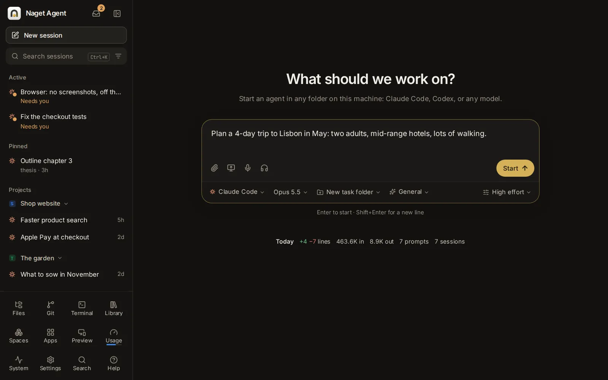

# Getting started

This topic shows you around Naget Agent: what it is, what is on the screen, how to start your first session, how to find anything with the search box, and how to use the app on a phone. It ends with every keyboard shortcut in one table.

## What Naget Agent is

Naget Agent runs AI agents on your own computer, and you use them from any browser, at your desk or on your phone. An agent is a program that works on a task for you: it reads and writes files, runs commands, searches the web and tells you what it did. You can use Claude Code and Codex with your own subscriptions, Custom (the app's own agent, which works with any model, including open models on your own computer), and other agents such as Gemini CLI or OpenCode. Each conversation with an agent is a **session**. Sessions keep running when you close the page, so you can start one at your desk and answer it from your phone. Many people use it for code, but it helps with anything: research, writing, documents, planning and everyday tasks.

## Find your way around

The screen has two parts: the **sidebar** on the left, and the page you are on (the start page, a session, Settings…) beside it. On a phone the sidebar is a drawer that slides in (see [Use the app on a phone](#use-the-app-on-a-phone)).

### The top of the sidebar

- **Naget Agent**, with the logo. A crossed-out Wi-Fi icon appears beside the name while the page reconnects to the app.
- **Inbox** (the tray icon): everything waiting on you, such as approvals, questions and forms, from every session, scheduled task and machine. A number on its corner says how many sessions wait on you right now. See [Inbox and notifications](/guide/inbox).
- **Hide sidebar** (Ctrl+B). While the sidebar is hidden, the button at the top left of each page shows it again. On a phone this button is **Close menu**.
- A machine switcher, only once you have added other machines in [Settings → Machines](/settings?s=machines). It names the machine you are looking at, and shows a dot when sessions on another machine need you. See [Phones, other machines and sharing](/guide/devices).
- **New session** opens the [start page](#the-start-page).
- **Search sessions** finds sessions by their title, their folder and the words said in them, archived sessions included. Escape clears it. On a computer, the **Ctrl+K** badge at the end of the field opens the search box instead (see [Search everything with Ctrl+K](#search-everything-with-ctrlk)).
- The filter button at the end of that field (**Filter and group sessions**) narrows the list: **All agents**, **Claude Code** or **Codex**, and, once you have spaces, **Every space** or one of your spaces (up to eight are listed), with **Spaces** to open the Spaces page. The button takes the accent colour while a filter is on. Its last line, **Group by folder or space**, turns the groups for your spaces and folders on or off (see [The session list](#the-session-list)). See [Spaces and knowledge](/guide/spaces).

### The session list

Under the search field is every session, in groups:

- **Active**: all sessions with activity in the last five minutes, here or in VS Code or a terminal, including ones that have finished. After five minutes without activity they return to their usual group, even if their agent is still open. Sessions stopped by a usage limit stay here while scheduled to resume automatically; cancelling that resume restores the five-minute rule. They keep their places while listed; drag one to move it.
- **Pinned**: the sessions you pinned, in the order you drag them into. Drag a session from the groups below onto it to pin it.
- **Projects**: a group for each of your spaces, and for each folder of yours that two or more sessions work in, under its name; the one used last comes first. Each shows its five newest sessions; **Show 12 more** (or however many there are) lists the rest, and **Show fewer** goes back.
- **Today**, **Yesterday**, **This week**, then month names and years: the rest, by when they were last active.
- **Snoozed**: at the bottom, until their time comes.

Only folders you picked get a group. The home folder, the default folder, new task folders, the folders apps run in and temporary folders get none, so their sessions go by day. A session in a worktree goes in the group of the folder the worktree was made from, and a session started in a space in the space's group, whatever its folder.

Click a group's heading to fold it to one line, with how many sessions it holds and a dot when one of them finished since you last looked; click it again to open it. A group with no session active in the past week starts folded. The open session stays in sight in its group, folded or not. How you fold the groups is kept in this browser. The pen at the end of a heading (on a computer, when you point at the heading) starts a new session in that folder or space.

To list the sessions by day only, as before, untick **Group by folder or space** in the filter button's menu, or find **Group sessions by folder or space** in the search box; it switches back the same way. While the list shows one space, its sessions go by day.

Archived sessions are not listed, but **Search sessions** still finds them. "No sessions yet." shows before your first one.

Each row shows the agent's icon with a status dot, the session's title, and a second line. While the agent runs, the second line says what it is doing ("Working · 2m 10s", "Needs you", "Ready", "Working · 1 in background", "Open in VS Code"). Otherwise it shows the folder ("Home folder" for yours), how long ago the session was active, and how many lines it added and removed. Under **Projects**, where the group names the folder already, a row takes one line: the title, then how long ago the session was active (after a worktree's branch), or what the agent is doing while it works or needs you. Small marks can follow the title:

- a dot in the accent colour: it finished since you last looked (its second line reads "Done · 5m ago"); opening it marks it read on every device;
- a pull request badge with its state;
- a target: the session has a goal;
- a pin: it is pinned (in the **Pinned** group, which says so, there is none).

While Custom works or starts, its working indicator uses the Naget loading animation instead of a rotating agent icon. Loading marks sit vertically centred beside their text.

The status dot says how a session is doing:

| Dot | What it means |
| --- | --- |
| Blue, breathing | Working: a turn is running, or background tasks are |
| Amber | Needs you: an approval, a question or a form is waiting |
| Green | Ready: the agent is running and waits for your next message |
| Grey | Open in VS Code or a terminal, and idle there |
| No dot | Stopped: the agent is not running; your next message starts it again |

The browser tab shows how many sessions wait on you, as in "(2) Naget Agent".

Sessions that an agent started for parts of its job (child sessions) sit folded under it, with a line such as "3 child sessions · 1 needs you · 2 working"; click it to see them. See [Child sessions](/guide/sessions#child-sessions).

Each session has a menu in the list: point at its row and click **⋯** at the end, or right-click the row (on a phone, tap its **⋯**). It holds **Rename**, **Pin** (or **Unpin**), **Snooze**, **Settle**, **Archive** and **Delete**, which asks first. Double-click a title, or press F2 on a selected row, to rename it. All of these are explained in [Rename, pin, snooze, settle, archive or delete](/guide/sessions#rename-pin-snooze-settle-archive-or-delete).

### The tools at the bottom

The bottom of the sidebar holds the app's tools, four to a row:

- **Library**: small tools and pages agents made for you, the images and videos you kept, and what you published. See [Library: pages, images, videos and sites](/guide/library).
- **Spaces**: each project's sessions, documents and guidelines together, and the shared knowledge every session can search. See [Spaces and knowledge](/guide/spaces).
- **Apps**: tasks you run again and again: fill in a form, and an agent does the job. See [Apps](/guide/apps).
- **Usage**: how much of each plan's limits you have used and when they reset, with **Activity** and **Arena** tabs. A thin bar under its icon shows how much is left across your paid subscriptions (or your free ones, when you have no paid ones), red when nothing is left; with no subscriptions there is no bar. See [Usage, limits and costs](/guide/usage).
- **Files**: browse, open and edit files on this computer. See [Files, Git, Terminal and Preview](/guide/files-git).
- **Git**: your repositories, their changes, branches and history.
- **Terminal**: shells on this computer that keep running when you leave the page.
- **System**: this computer's processors, GPUs, memory, disks and busiest processes, live.
- **Preview**: look at a web app's development server running on this computer. It shows only on this machine's own pages, not while you look at another machine.
- **Settings**: everything the app can be set to. A dot on it means a newer version is out. See [Every setting](/guide/settings).
- **Search**: opens the search box (the same as Ctrl+K).
- **Help**: opens this guide, where you can also ask an agent about the app. The welcome tour starts from there too.

That is their usual order. To change it, drag a tool to another place among them (on a phone, hold it a moment first). The tools keep the order you set on every device, whichever machine you look at. Once you have moved them, right-click a tool on a computer and choose **Back to the usual order** to put them all back.

### The start page

**New session** opens the start page. It asks "What should we work on?" and holds a large message box with a row of choices under it:

- **Agent**: who does the work (Claude Code, Codex, Custom, or another agent you added).
- **Model**: that agent's model.
- **Folder**: where the agent works, or a space, or a new folder made for the task.
- **Assistant**: what the session starts as (General, Researcher, Writer, Coder, Tutor, Planner, Analyst, App builder, or one of your own).
- **Options**: effort, permissions, memory, a spending cap and more. The chip names any of them you set away from the usual.

On a computer, a line under the box reminds you: "Enter to start · Shift+Enter for a new line". Below it, **Today** sums up the day so far (lines changed, tokens, prompts, sessions); click it for the Activity page. When an agent's plan has run out of usage, a banner above the box says so and when it resets. On a phone, **Recent** lists your six latest sessions under the box.

Everything on the start page is explained in [Start a session](/guide/sessions#start-a-session).

## Start your first session

1. Make sure the agent can work. Claude Code and Codex need you signed in: open [Settings → Agents → Accounts](/settings?s=accounts&find=Your%20accounts), find **Your accounts**, press **Sign in** next to the agent and follow the steps (you open a link, approve, and paste or enter a code). Custom needs a model: add one in [Settings → Agents → Models](/settings?s=models). The welcome tour does this with you the first time. See [Agents, accounts and models](/guide/agents-models).
2. Press **New session** at the top of the sidebar. The app opens on the start page too.
3. Press **Agent** under the message box and pick the agent. **Model** beside it picks its model; the one marked "default" is fine to start with.
4. Press **Folder** and pick where the agent works:
   - one of the folders you used last, or another one: type its name or its path in **Find a folder, or type its path**;
   - a space, by its name, to work in that project's folder with its documents and guidelines;
   - **New task folder**, for a fresh folder named after your task (in `~/Naget` unless you change it in [Settings → Capabilities → Assistants](/settings?s=assistants&find=Task%20folders)).

   Most assistants start in a new task folder unless you pick a folder; Coder works in the folder you pick.
5. Type what you want done in the message box: describe a task, ask a question or paste an error. Add files with the paperclip, or drop them on the box. Files already on this computer come along from the Files page: **Start a session with it** in a file's menu (see [Start a session with files](/guide/files-git#start-a-session-with-files)).
6. Press Enter, or **Start**. On a phone, tap the round arrow.

The session opens. You see the agent's steps as it works, in plain words, and its reply at the end. When it wants to run a command or change a file that its permissions do not allow on their own, a card asks you to **Allow** or **Deny**. Type in the message box at the bottom to carry on the conversation. Your picks on the start page stay for the next session, on every device.

Next: [Sessions](/guide/sessions) explains everything you can do in a session.

## Search everything with Ctrl+K

The search box finds anything in the app as you type, like Spotlight on a Mac. Open it with Ctrl+K (⌘K on a Mac) from any page, except while you type in a code editor or a terminal. The **Search** tile in the sidebar and the Ctrl+K badge in **Search sessions** open it too. Press Ctrl+K again, or Esc, to close it.

### What it finds

- **Go to**: Naget Agent's pages, such as New session, Inbox, Files, Search in files, Git, Terminal, Apps, New app, Spaces, Shared knowledge, Library, Pictures and videos, Published, Preview, Usage and limits, Model arena, Activity, System and Settings.
- **Actions**: Take the tour, Talk hands-free, Release notes, Switch between light and dark, Show or hide the sidebar, Group sessions by folder or space, Show or hide the terminal panel.
- **Settings**: every section of Settings and the options in it. Opening one opens its section and points at the option.
- **Themes**: the built-in themes and your own. Opening one switches to it.
- **Sessions**: by title, folder, branch and first message (not archived ones). Opening one opens it.
- **In messages**: messages that hold the words you typed. Opening one opens its session at those words, with the find bar ready.
- **Memory**: your memory notes. Opening one opens Settings → Memory at that note.
- **Spaces**: your spaces, by name and description. Opening one opens the space.
- **Apps**, **Scheduled tasks**, **Assistants**, **Skills**, **Pages**, **Images and videos** and **Connections**: yours, and the ready-made ones. Each opens where it lives.
- **Files**: up to five files whose names match, in the folder the Files page shows (or the app's default folder).

### Choose where it looks

**Search in**, at the end of the field, says where the box looks: **Everywhere** until you pick places. Click it for the list: **Sessions**, **Messages** (the words said in sessions), **Spaces**, **Library** (pages, images and videos), **Apps**, **Files**, **Memory**, **Scheduled tasks**, **Assistants**, **Skills**, **Connections**, **Settings** (with the themes), **Go to and actions** (the app's own pages and actions) and **Guide**.

- Tick one or more, and the box looks only there. The button names them ("Sessions, Library", or "3 places") in the accent colour. Click a place again to take it out, or **Everywhere** to look in all of them again.
- With nothing typed, it lists what the places you picked hold, the ones you use most first: your recent sessions, spaces and pages, the sections of Settings, the topics of the guide. Messages, memory notes and files wait for your words.
- What you pick is kept on every device until you change it. When nothing is found, **Search everywhere** under the message looks in every place again.
- On a phone, **Search in** is the filter icon beside **Cancel** (it names the places once you pick some), and its list opens from the bottom of the screen.

### How the results show

- The **Best match** comes first. Then each kind has its own group of up to four rows; "3 more in Sessions" shows the rest.
- On a wide screen, a preview beside the list says more about the result you are on, and where opening it goes.
- ↑ and ↓ move, Enter opens. Esc clears what you typed, and a second Esc closes the box (with the **Search in** list open, Esc closes the list first).
- With nothing typed, it lists **Recent sessions** and **Suggestions**: the places you use most (a few useful ones until it knows). With places picked in **Search in**, it lists what they hold instead.
- The bottom line says **Words** or **Words and meaning**. With [Search by meaning](/settings?s=memory&find=Search%20by%20meaning) turned on in Settings → Capabilities → Memory, results also match what you mean in other words, and in other languages.

### It learns what you use

- What you pick, with what you typed. Type the same words again and that result comes first, at once.
- The places you visit, however you got there: pages, Settings sections, sessions, apps, files. Among the results that match, the ones you use come up, more the better they match what you typed, and less as time passes.
- The app keeps this for you, so your phone and your computer learn together.

The sidebar's **Search sessions** field is a simpler search: it lists only sessions, by title, folder and the words in their messages, archived ones included.

## Use the app on a phone

To reach the app from your phone, it needs an HTTPS address (Tailscale, a Cloudflare tunnel or your own proxy). See [Phones, other machines and sharing](/guide/devices).

### Add it to your home screen

The app installs like an app and opens full screen:

- **iPhone or iPad**: open it in Safari, then Share → **Add to Home Screen**.
- **Android**: open it in Chrome, then ⋮ → **Add to Home screen** (or **Install app**).

On an iPhone or iPad, notifications work only in the app added to the home screen: open it from there, then turn on [Notify this device](/settings?s=notifications&find=Notify%20this%20device) in Settings → App → Notifications. See [Inbox and notifications](/guide/inbox).

### The sidebar is a drawer

- The **Menu** button at the top left of each page opens it. It fills the screen.
- Tapping a session or a tool takes you there and closes the drawer. **Close menu** (the ×) closes it too.
- Hold a session a moment to pick it up, then drag it (to reorder Active or Pinned sessions, or to pin one).
- Hold a tool at the bottom a moment to pick it up, then drag it to another place among them.
- The **⋯** at the end of each row opens the session's menu: **Rename**, **Pin**, **Snooze**, **Settle**, **Archive** and **Delete**, which asks first.

### Menus open as sheets

On a phone, the choices under the start page's message box (Agent, Model, Folder, Assistant, Options) open as sheets from the bottom of the screen, clear of the keyboard. The folder sheet's find field waits until you tap it, so the keyboard does not cover the list.

### Typing and sending

- The start page lists your six latest sessions under the message box, as **Recent**; **All sessions** opens the drawer.
- Enter starts a new line. Tap the round arrow to start a session or send a message (with a keyboard attached, Ctrl+Enter or ⌘Enter sends too).
- In a session, the message box shows one chip with the model (and the effort and permissions when they are not the usual). It opens a sheet with **Model**, **Effort**, **Permissions** and how much of the conversation's room is used, with **Compact**.
- To quote part of a reply or of your own message, select it: **Quote** appears just below the selection.
- **Details** opens over the conversation, only when you ask.
- The search box fills the screen; **Cancel** closes it.
- The screenshot button is only on computers.

## Keyboard shortcuts

On a Mac, use ⌘ where this table says Ctrl, except for Ctrl+` and Ctrl+Space, which stay Ctrl.

| Keys | What it does | Where |
| --- | --- | --- |
| Ctrl+K | Opens or closes the search box | Anywhere, except while typing in a code editor or terminal |
| Ctrl+B | Shows or hides the sidebar | Anywhere on a computer, except in a code editor |
| Ctrl+` | Shows or hides the terminal panel at the bottom | On a computer |
| Ctrl+P | Quick open: jump to a file by part of its name, in the folder the Files page shows | Anywhere |
| Ctrl+Z | Undoes a pin, unpin, archive, unarchive or snooze, within 8 seconds | Outside text fields |
| Enter | Starts the session, or sends the message | The start page and the message box (on a phone: a new line) |
| Shift+Enter | A new line | The message box |
| Ctrl+Enter | While the agent works: the opposite of Enter (queue instead of joining the turn, or the other way round). On a phone: sends | The message box |
| Shift+Tab | Switches to the next permissions mode | The message box, on the start page or in a session |
| ↑ in an empty box | Brings back your earlier messages in this session, one by one (↓ goes forward again) | The message box in a session |
| Ctrl+S | Puts the draft aside; in an empty box, brings it back | The message box in a session |
| @ | Lists files in the session's folder to point at | The message box |
| / at the start | Lists the agent's commands and skills (Claude Code) | The message box |
| ↑ ↓, Enter or Tab, Esc | Move through, insert, or close the @ and / lists | The message box |
| Ctrl+F | Finds text in this session's messages | In a session |
| Enter, Shift+Enter | Older match, newer match | The find bar |
| 1 to 9 | Picks an option of the question the agent asked | A question card, while no text field has the keyboard |
| F2 | Renames the selected session | The sidebar's session list |
| ↑ ↓, Enter, Esc | Move, open, clear then close | The search box |
| ↑ ↓, Enter, Tab | Move, pick, list the folders inside | The folder menu on the start page |
| Ctrl+S | Saves the file | The file editor |
| Ctrl+Space, → | Lists command suggestions; takes the grey suggestion | A terminal |

## Get help

**Help** in the sidebar opens this guide. Type a question or a few words in the box at the top of its first page:

- **Sections that match** show as you type; click one to open it. The search box (Ctrl+K) finds them too.
- **Press Enter**, or click **Ask**, and an agent answers in a panel beside the guide, with links to the right place. It can also change a setting or set something up for you, once you confirm the change on a card. The answer is an ordinary session, with the agent and model you picked last on the start page: ask more in the panel, or open it on its own page with the arrow at the panel's top.

**Ask an agent**, at the top of every Help page, opens the same panel; so does "Ask an agent about the app" in the search box. The topics are grouped under the box. Each one opens its sections one at a time (**Open all** shows them all) and ends with things to ask an agent: click one to put it in the panel's box, change it if you like, and send it.

- The welcome tour shows you around and sets up the agents you want to use. Start it with **Take the tour** at the top of Help, from [Take the tour](/settings?s=general&find=Take%20the%20tour) in Settings → App → General, or by typing "tour" in the search box. After it, tips point out the rest of the app, one part at a time, the first time you come to each (see [Take the tour](/guide/app#take-the-tour)).
- **Release notes** (in Settings → App → General, or from the search box) say what changed in each version. After an update, a "What's new" note shows once.
- Agents in the app read this guide too: ask any session "how do I…" and it can answer, or do it for you (see [Let agents work the app for you](/guide/ask-agents)).

## Ask an agent

- "Which of my sessions are waiting on me right now, and what does each one need?"
- "Start a Codex session in ~/code/shop that makes the checkout tests pass."
- "Find the session where we planned the Lisbon trip and pin it."
- "Why is a session waiting for its usage reset still in Active?"
- "List my sessions in the sidebar by day, without the folder groups."
- "Next time I open the start page, have it set to Claude Code with the Researcher assistant."
- "Make my search box look only in my sessions and pages."
- "Put Settings and Search first among the tools at the bottom of my sidebar."
- "What is in my inbox?"
