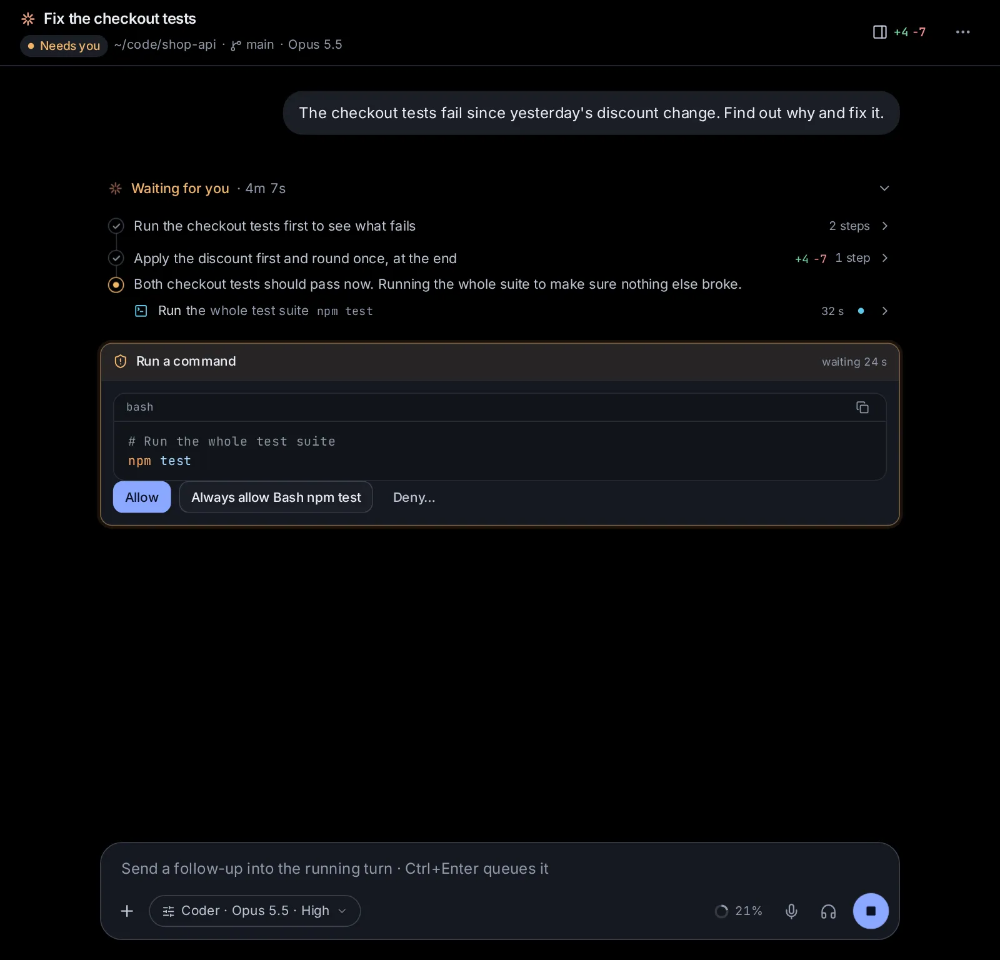

# Sessions

A session is one conversation with an agent, in one folder: you say what you want, the agent works, and you follow along, approve what it wants to do and steer it. This topic covers everything about sessions: the start page and its options, what you see while an agent works, messaging it mid-turn, and everything in a session's menu, from forking and goals to worktrees and sharing.

## Start a session

**New session** at the top of the sidebar opens the start page. Write what you want done in the message box, check the row of choices under it, and press Enter (or **Start**; on a phone, the round arrow). The session's page opens at once, with your message and the agent at work on it (**Working**). If the session can't start, its page says why, and **Back to the start page** puts your message (and what you attached) back in the box.

A moment after it starts, the session gets its title: a few words for what you asked ("Weekend trip to Lisbon", "Fix the checkout tests"), which the helper model ([Settings → Agents → Models](/settings?s=models&find=Helper%20model)) writes on the side, without anything showing in the conversation. The sidebar, the session's header and the search box show it, and Claude Code and Codex get it too, for their own lists. Until it comes, and when the helper model can't answer, the start of your message stands in. A title you give the session yourself with **Rename** is never replaced.

The row under the message box holds **Agent**, **Model**, **Folder** (or **Project**), **Assistant** and, at its end, **Options**. On a phone each of them opens as a sheet from the bottom of the screen.

### Pick the agent and its model

**Agent** lists every agent you can use, side by side:

- **Claude Code**: Anthropic's agent, with a Claude plan or an API key.
- **Codex**: OpenAI's agent, with a ChatGPT plan or an API key.
- **Custom**: the app's own agent, for any model: from OpenRouter, Ollama or vLLM. See [Custom, the app's own agent](/guide/custom).
- Any other agent you added that speaks ACP (Gemini CLI, OpenCode, Qwen Code, Goose…), with its command under its name.

At the bottom, **Models for Custom** opens [Settings → Models](/settings?s=models) and **Add or manage agents** opens [Settings → More agents](/settings?s=agents). See [Agents, accounts and models](/guide/agents-models).

**Model** lists only the chosen agent's own models. The agent's default is marked "default". Older versions of a model wait behind "2 older models"; a long list has a **Search models** field (Enter picks the first match). Custom lists the models you added in Settings → Models; another ACP agent lists the models it offered when it last ran, and the chip appears once it has run.

### Pick a folder, a project or a new task folder

The **Folder** chip says where the agent works. Its menu ("Project or folder to work in") has a field, **Find a folder, or type its path**, over a short list:

- your projects, by name (the three used last, and the one picked). Picking a project sets the folder to the project's own, its assistant, and its guidelines for the session; the chip then reads **Project** and shows the project's name. A group of projects works the same way, with all its projects. See [Projects and knowledge](/guide/projects) and [Agent Guidelines](/guide/guidelines).
- the folder in use and the three folders you picked last;
- **New task folder**: a fresh folder for this task, named by the day and a few words of your message (such as `2026-11-01-plan-trip-lisbon`), in `~/Hydor` unless you set another place in [Task folders](/settings?s=assistants&find=Task%20folders) (Settings → Capabilities → Assistants);
- **New project**: makes a project (sessions, files and memory together) and picks it.

Type in the field to find more:

- A name finds matching projects, and folders among those you used lately, in the folder in use and in your home folder.
- A path (`~/code/`, or `code/` from your home folder) lists the folders there.
- ↑ ↓ and Enter pick. Tab, or the arrow at the end of a row, lists the folders inside it.

When the folder is in a git repository (and you have not chosen a new task folder), the menu ends with a switch: **New worktree from main** (or whichever branch is checked out). With it on, the session works in a copy of its own on a new branch; the chip reads "· new worktree". See [Work in a worktree](#work-in-a-worktree).

Whether a session gets a new task folder by default depends on the assistant: most start in one unless you pick a folder; Coder works in the folder you pick.

### Pick an assistant

**Assistant** sets what the session starts as: **General** (the first time), **Researcher**, **Writer**, **Coder**, **Tutor**, **Planner**, **Analyst**, **App builder**, or one of yours under **Yours**. Point at one to read what it does and which agent and model it uses. Picking one can also set the agent, model and permissions it suggests, and turn on its connected accounts. **Make or change assistants** opens [Settings → Assistants](/settings?s=assistants). See [Assistants](/guide/assistants).

### Options: effort, permissions and more

**Options** holds the rest. Its chip reads "Options", or names what you set away from the usual, such as "High effort · Plan · $5.00 cap". On a computer, its menu ends with a reminder: Shift+Tab in the message box switches permissions.

- **Effort**: how hard the model thinks. **Default** uses the model's own, then the levels the model offers: **Low** (fast, light reasoning), **Medium** (balanced), **High** (deeper reasoning), **Xhigh** (extra-deep reasoning), **Max** (maximum reasoning), and on some models **Minimal**, **None** or **Ultra**. Not offered for Custom and other ACP agents, or for models without levels.
- **Permissions**: what the agent may do without asking you first. Each agent has its own modes; see [What each permissions mode means](#what-each-permissions-mode-means). Shift+Tab in the message box moves to the next one.
- **Account**: only once you have added another account for Claude Code or Codex in [Settings → Accounts](/settings?s=accounts&find=Your%20accounts). **Your sign-in** is the agent's own account; pick another to run this session as it. **Manage accounts** opens Settings.
- **Confidential**, a switch with a lock ("Only models on this computer. Nothing leaves it."): for a paper you review, patient data or a client's code. **Agent** becomes **Custom** and **Model** the best model installed here. See [Keep a session confidential](#keep-a-session-confidential).
- **Memory**: only while memory is on in Settings. **On** uses and adds to what agents remember; **Off for this session** starts fresh and keeps nothing from it. See [Memory](/guide/memory).
- **Spending cap**: the most this session may spend, at API prices. Type an amount and press **Set**, or pick $1, $5, $10 or $25; **No cap** removes it. The session stops at the cap until you raise it. See [Usage, limits and costs](/guide/usage).
- **Swarm**: **Off**, or **Swarm**: a lead agent splits the task into angles of attack and starts a member for each, with as many working at once as **Swarm size** allows ([Settings → Child sessions](/settings?s=children&find=Swarm%20size)). Members share what they find on a board and message each other. For hard problems; it costs several times what one agent does.
- **Research**: **Off**, or **Deep research**: the agent plans the searches, sends researchers after each part, checks key claims against two sources and delivers a cited report. Set **Researchers at a time** (1 to 8), **Rounds** (1 to 5), **Searches in all** (10 to 500) and **The report** (**Page** or **Word**).
- **Arena**: **Off**, or **Compare models**: the same message also goes to one or two more models you tick (a **Find a model** field helps in a long list), each in a session of its own in the same folder. You compare the answers and keep the best; the others are archived. In a git repository, turn on the folder menu's **New worktree** so each model works on its own copy.

Swarm and deep research both lead child sessions, so turning one on turns the other off. **Confidential** turns Swarm, deep research and the arena off, and turning one of them on turns Confidential off. Swarm, deep research and the arena are not kept for the next session, since they cost more; the research numbers and arena models you picked are kept in this browser for when you turn them on again. See [Deep research, second opinions and several agents](/guide/research).

### What each permissions mode means

**Claude Code**

| Mode | What the agent may do |
| --- | --- |
| Ask (its default) | Asks before edits and commands that are not allowed in its settings |
| Accept edits | Edits files freely, asks before other commands |
| Auto | A safety check approves routine actions and asks you about risky ones |
| Plan | Reads and plans only, then proposes a plan for you to approve |
| Bypass | Never asks (full access) |

**Codex**

| Mode | What the agent may do |
| --- | --- |
| Plan | Discusses and plans first; can ask you clarifying questions |
| Read only | Reads files and answers; asks before changing anything |
| Auto (its default) | Edits files and runs commands in its folder; asks to go beyond it |
| Auto review | Like Auto, but a reviewer agent answers its approval requests |
| Full access | No sandbox and no approvals |

Inside Docker, Codex's own sandbox cannot start, so **Full access** is the default there and the menu says why.

**Custom**

| Mode | What the agent may do |
| --- | --- |
| Ask (its default) | Asks before editing files and before running commands; looking around runs freely |
| Accept edits | Edits files in the folder freely, asks before running commands |
| Auto | Routine steps go ahead; a quick check asks you about risky ones |
| Full access | Asks only before risky commands (sudo, deleting outside the folder, running a download…) |
| Plan | Reads and plans only: no edits, no commands |

In every mode Custom asks you before risky commands. In Ask, Accept edits and Plan it also asks before it reads or changes files outside the folder, or files that hold keys or passwords; in Auto, the quick check judges those first. See [Custom, the app's own agent](/guide/custom).

**Other ACP agents** offer their own modes, listed once the agent has run.

### Keep a session confidential

Some work must not leave your computer: a paper you were sent to review (most conferences and journals forbid giving a submission to an online AI), patient or client records, or a company's code you work on under agreement. A confidential session runs on a model on this computer, and nothing of it is sent anywhere.

1. On the start page, open **Options** and turn on **Confidential** ("Only models on this computer. Nothing leaves it."). Its chip then reads "Confidential".
2. **Agent** becomes **Custom** and **Model** the best model installed here; while it is on, their menus offer only those. If there is none yet, it says so: [Settings → Agents → Models](/settings?s=models) installs the ones suggested for this computer with one click.
3. Write what you want, attach the paper or pick its folder, and press Enter. For example: "Review the attached submission as a NeurIPS reviewer: summary, strengths, weaknesses, questions for the authors and a score."

Models on this computer are those of Ollama and vLLM here, and endpoints whose address is this computer or your private network: `localhost`, `127.0.0.1`, `::1`, `10.…`, `192.168.…`, `172.16.…` to `172.31.…`, or a name ending in `.local` (see [Connect Ollama, vLLM or another endpoint](/guide/agents-models#connect-ollama-vllm-or-another-endpoint)). Ollama's cloud models, whose names end in "cloud", run on ollama.com and don't count. The start page keeps the switch on for your next sessions until you turn it off.

A confidential session has a lock beside its title, in its header and in the sidebar, and its message box has a calm green border; a line above the box says what that means until you close it. Click the lock for what is on and off.

- **Off**: web search and web pages, the browser and your screen, connected apps and your keys, apps, publishing, scheduled tasks, making pictures, videos or sound, models elsewhere (deep research, swarm and the arena; a [second opinion](/guide/research) comes only from another maker's model on this computer), handing the conversation to another agent, saving anything to memory, and exporting a page as a file (export it yourself from the Library).
- **Commands without network**: the agent's commands run cut off from the network, in every permissions mode, so nothing can be downloaded, installed from the internet, pushed or sent. Where that can't be done (a Mac, Windows, some containers), each command asks you first, whatever the mode, and the lock's note says so.
- **Still on**: the files in the folder, documents (read on this computer), the Library, shared knowledge, your memory notes and profile (read, never added to), and child sessions, which are confidential too.
- **Nothing sent out about it**: its title comes from the helper model when that runs on this computer, else from the first words of your message; notifications say only "A confidential session" and whether it finished, needs you or failed; there is no read-only link, no pull request from its menu, and no automation or app made from it; agents in other sessions and agents elsewhere can't read it; its replies show no pictures from the web, and the pages it shows load nothing from anywhere (so a chart that needs a library from the web won't draw); dictation works only with speech recognition on this computer ([Settings → Capabilities → Voice](/settings?s=voice)), and replies are read aloud only with a voice on your device.
- **It stays confidential**: forks and **Edit from here** are confidential too, and it can't be turned off, so what was said stays where it is. For work that may leave the computer, start a new session.

What it can't promise: Hydor checks where a model's server is, not what that server does, so an endpoint you set up on your network that passes requests on to an online service is online all the same. What you copy out of the session, or open or send from elsewhere yourself (a link in a reply, a page it made opened from the Library, a push from the Git page), is yours to watch, and so is what you read of it on another device: the app's pages travel to it as they always do (through your tunnel, if you use one).

### Attach files, point at files, use commands

- **Attach files** (the **+** at the left of the box's bottom row), drop files on the message box, or paste pictures and files into it. A message carries up to 25 MB of files. Pictures (PNG, JPEG, GIF, WebP) go to the model as images, up to 8 a message; other files (up to 20) are saved on this computer and listed at the end of your message, so the agent opens them. Remove one with its × before sending. Files you have attached wait in the box until you send them, even while you go to another page (reloading the page clears them).
- **Attach a screenshot** (in the same **+** menu, on computers; where the browser can't take one, the **+** is a paperclip that attaches files): your browser asks which screen, window or tab, and one picture of it is attached.
- **@**: type @ and part of a file's name to list matching files in the folder; ↑ ↓ to move, Enter or Tab to insert it, Esc to close.
- **/**: at the very start of the message, / lists the agent's commands and skills (Claude Code's), with what each does.
- The microphone (dictate your message) and the headphones (hands-free voice mode) sit by the send button when your browser or this computer can recognize speech. See [Documents, images, videos and voice](/guide/documents-voice).

### What the start page remembers

The start page opens with what you picked last, on every device: the agent; for each agent its model, effort, permissions and account; the folder, new task folder or project; the worktree switch; the assistant; memory off; the spending cap; and Confidential. Picking an agent brings back what you last used with it.

A link to the start page can fill it in, for example `/?prompt=Summarize%20my%20notes&agent=codex`; `model=`, `cwd=` (a folder's path) and `confidential=1` (Confidential on) can be added. It only fills the box and the choices; it never starts anything by itself. Invisible characters are removed from a linked message, with a notice.

What you write in the box waits there while you go to other pages: the message, the files you attach, the options for this task alone (**Swarm**, **Deep research**, **Arena**, **Guidelines** for this session) and the folder a link or **New agent session here** opened it in. The box empties when the session starts: while the agent gets going, the arrow on **Start** keeps going up; then the start page becomes the session, the box moving down to its place at the bottom and what you wrote moving up as your first message. The message and those options are kept in this browser, so they are still there after a reload; attached files are not.

## Follow the work in a session

### The header

At the top of a session:

- the agent's icon and the title (double-click it to rename), and a lock for a [confidential session](#keep-a-session-confidential);
- a status: **Working**, **Needs you**, **Ready**, **Starting**, **Stopping**, **Stopped**, or "Open in VS Code" for a session running elsewhere;
- the folder (click it to browse it in Files), a pull request badge, the account when it runs as an added one, and on wider screens the git branch and the model;
- one button for what you can do now: **Stop** while a turn runs, **Resume** when the agent is stopped, or **Continue here** for a Claude Code session open in VS Code or a terminal;
- **Details** (showing the lines added and removed once files changed), which opens [the details panel](#the-details-panel-changes-commands-and-info);
- the session's menu (⋯): see [Everything in the session's menu](#everything-in-the-sessions-menu).

### Turns, steps and replies

The conversation reads like a chat. Each turn is your message, the agent's work, and the reply it ended on:

- **Your message** shows on the right, with its pictures and attached files. A long one folds to its first lines; **Show more** opens it.
- **The work** sits under a line that sums it up: "Worked for 2m 10s · 3 commands", "Thought", "Stopped after 40s" or "Failed after 5s", with the tokens used on the right. While the turn runs, the line says "Working · 1m 2s" (or "Waiting for you") and the work shows as it happens. A finished turn folds its work away; click the line to open it.
- **Steps** are named in plain words: "Run the tests", "Read index.ts", "Searched the web", with the command itself in quieter type. Steps in a row fold into one box that says what was done ("Ran 3 commands, made 2 edits, read 4 files"), showing the step under way while one is. A long turn shows its latest steps; **Show earlier work** shows the rest.
- **Thoughts** show as "Thought for 12s" with their first heading; click to read them.
- **The reply** is what the agent wrote after its last step. Pages the agent showed sit with it.
- **Files changed**: under the reply, a card lists every file the turn changed, with lines added and removed. Click a file for its diff; **Open file** opens it. More than five fold behind "Show 3 more files".
- **Commits**: when the agent made commits in the turn, a chip under the reply says so: **Committed** · the commit's title, or "3 commits" with the branches, and the lines added and removed. Click it (with several, then a commit) to read the whole message, who made it and when, its hash (click to copy), and every file it changed with its diff. **Open in Git** opens it in the session's repository on the [Git page](/git). A commit the agent amended or rebased away in the same turn is left out.

The agent may also keep a checklist (**Plan** or **To-dos**, with how many are done), which ticks off as it works. Notes from the app follow the turn they are about: what memory kept, a second opinion, a spending cap reached, a child session's card. Messages from other sessions show as "From …", a child session's reply as "Reply from …" (click it to read the reply), and a scheduled task's run starts with a line naming the task.

Day lines ("Yesterday", "Today") separate the days; a conversation all from today has none. Older messages load as you scroll up, or with **Show earlier messages**. New messages and replies come in at the end of the conversation, with no empty space left under them. Once a reply is long enough to fill the screen, the view stops at its first line and stays there as it grows, so you read a long reply from its beginning; a short one simply sits under what came before. When you scroll up while the agent works, the view stays where you are; **Latest** takes you back to the end, and also shows while a reply runs on below the screen.

Hover over a reply for **Fork from this reply** (Claude Code and Custom), **Read aloud**, and **Copy message**. Hover over your own message for **Edit from here** and the time it was sent.

### Maths, diagrams, figures and pictures in replies

Agents write their replies for this app, not for a terminal, so a reply can hold more than text. Every agent knows how, and uses these by itself where they make an answer clearer:

- **Formatting**: headings, lists, tables, bold and code, laid out to read.
- **Maths**: equations drawn as in a textbook, inside a sentence or set apart on a line of their own, and chemical equations (2H₂ + O₂ → 2H₂O). Numbers between paired dollar signs (`$1$`, `$0$`) are maths too; ordinary prices such as $4.70 stay money.
- **Diagrams**: flowcharts, sequence and state diagrams, timelines, mind maps, Gantt and pie charts, drawn in the app's colours, light or dark. The bar above one has **Show the code** (what the agent wrote; the same button shows the diagram again), **Save as a picture (SVG)**, **Full screen** and a button that copies its code. A diagram that can't be drawn shows its code, with the reason.
- **Figures and small tools**: a chart, an annotated figure, a calculator, a simulation with sliders or a short quiz runs inside the reply, sealed off from the app and your files like the pages agents show. It takes the app's look and grows to fit (**See all of it** opens a tall one); its bar has **Show the code** (**Show it** goes back), **Save as a file** and **Full screen**. Choices you click on it go to your message box. While the reply is still being written, it builds up in place, and it comes alive once it is complete.
- **Pictures**: photos from the web (a place, a product, a plant, an artwork) and pictures on this computer, fitted to the reply; click one to see it large. Pictures from the web come through this app's server, so the site that has them never sees your browser. One that can't be loaded shows as a link to it.

To get plain text instead, say so in your [Agent Guidelines](/guide/guidelines) ("Answer in plain text, without diagrams or pictures") or in your message. You can also ask for any of these in plain words: "draw the steps as a flowchart", "show me a picture of it", "give me a slider to try other values".

### Open a step to see its output

Click any step to open it:

- a command: the command, the folder it ran in, its exit code and how long it took, a copy button, and its output (**Load full output** when it was cut short);
- a file edit: the diff (**Load the full diff** when it was cut short);
- a file read: a link to the file and what was read;
- a web page: its address and what was read from it;
- a task given to a subagent: **Task given**, and what came back;
- anything else: what the agent sent and what came back.

A step can be marked **background** (it keeps running), **Auto** (Custom's Auto mode decided, with the reason on hover), or show a red exit code. Background tasks also appear as a button by the message box with their number: it lists each task, how long it has run, its latest output (Claude Code) and **Stop**, which asks first.

## Approve or deny what the agent wants to do

When the agent wants to do something its permissions do not let it do alone, it waits and asks with a card at the end of the conversation: what it wants to run, a file change with its diff, or another tool and its details, with how long it has waited. The session's dot turns amber, the inbox counts it, and you get a notification if you turned them on. You can answer from the card, from the [inbox](/guide/inbox), or, for a plain yes or no, from the notification itself where the browser shows buttons.

The buttons come from the agent:

- **Claude Code**: **Allow**, **Deny**, and often a rule such as "Always allow Bash npm test" or "Allow all edits this session".
- **Codex**: **Allow**, **Allow for this session**, **Always allow this command**, **Deny**, **Deny and stop**; for file changes **Allow edits this session**; for wider permissions **Allow for this turn** and **Allow for this session**.
- **Custom**: **Allow**, **Always allow** followed by exactly what it covers (only the command you approved, so nothing can ride along after it), and **Reject**.
- Other agents: the choices they offer.

**Deny** first opens a box, "Optional: tell the agent what to do instead"; press **Deny** again to send, with or without a note. (Custom's **Reject** and Codex's **Deny and stop** answer at once.)

In Claude Code's **Auto** mode, the safety check can refuse a command outright instead of asking. A card above the message box then says "Claude blocked a command" and why. **Approve & retry** switches the session to Ask and has the agent run it again, so it comes back to you as a normal approval; **Dismiss** leaves it.

## Answer questions and approve plans

When the agent asks you something, a card with an amber edge shows the questions and their choices:

- Pick one option, or several where it says "Pick any". **Other — type your own answer** takes your own words.
- **Attach files** adds files to an answer.
- Keys 1 to 9 pick an option of the first question not yet answered.
- **Send answer** sends it as your next message. If the session stopped while asking, **Resume and answer** starts it again with your answer. For a Claude Code session waiting in VS Code or a terminal, **Answer here** ends it there and continues it here with your answer; a Codex session there has to be answered there.

When the question comes as an approval card instead, its buttons are **Send answers** and, for Claude Code, **Skip**.

**Plans.** In Claude Code's **Plan** mode the agent reads and plans, then shows its plan in a card: **Approve, auto-accept edits** (go ahead, editing without asking), **Approve, ask before edits**, or **Keep planning** (it stays in Plan; tell it what to change). In Codex's Plan mode, Codex discusses and plans first and can ask you clarifying questions. Custom's Plan mode ends with a numbered plan; switch the permissions (Shift+Tab) and reply to have it carried out.

## Fill in forms a service asks for

When a service you connected needs something from you partway through a task (a date, a choice, a page to approve on), its form shows as a card, whichever agent is working: "Linear asks you to fill in a form", "… asks you to open a page" or "… asks to go ahead". Fill in the fields and press **Send** (or **Open it**, which opens the page, or **Allow**), or press **Decline** or **Not now**. Codex's own tool servers ask the same way. See [Connected apps, keys and tools](/guide/connections).

## Message the agent while it works

You can type while a turn runs. What Enter does then is set by **Sending while an agent works** in [Settings → App → General](/settings?s=general&find=Sending%20while%20an%20agent%20works), for each browser:

- **Join the turn** (the default): Enter adds your message to the turn in progress, so the agent takes it into account right away. Ctrl+Enter (⌘Enter on a Mac) puts it in the queue instead.
- **Wait for it**: Enter puts your message in the queue, to go out when the turn ends. Ctrl+Enter adds it to the turn instead.

The message box says which: "Send a follow-up into the running turn" or "Queue a message for when this turn ends". On a touch screen the send button does what Enter would. Custom and the other ACP agents take one message at a time, so a message sent while they work always waits in the queue. In Claude Code, a message that went in while the agent worked shows "sent while working" under it.

## Manage the queue

Queued messages wait above the message box, numbered in the order they go out. One goes out each time a turn ends, by itself.

- Drag a message by its handle to change the order.
- **Send now** (the arrow): sends it at once, into the running turn.
- **Edit** (the pencil): change its text, take attachments off, or add more (**Attach**, or paste or drop files). Enter saves, Esc cancels.
- **Remove** (the bin): takes it off the queue; its attachments are deleted.
- When you stop the agent, or the app restarts, the queue pauses: "The queue is paused (the agent was stopped, or the server restarted)." **Resume** lets the messages go out again as the agent becomes free. A spending cap that is reached holds the queue too; raising the cap lets it go on.

## Change the assistant, model, effort or permissions

The message box of a session has the start page's **Assistant** and its three choices **Model**, **Effort** and **Permissions**, in one chip beside the **+** (it opens **Options**, a sheet from the bottom on a phone). The chip names the assistant and the model, and the effort and permissions when they are not the usual; it turns amber while the agent may do anything without asking (**Bypass**, or Codex's **Full access**). Another assistant applies from your next message (see [Switch assistants in a session](/guide/assistants#switch-assistants-in-a-session)). A change of model, effort or permissions applies to the running agent at once and stays with the session. Shift+Tab moves to the next permissions mode. The model menu lists only this agent's models; to move the conversation to another agent, use [Continue in another agent](#continue-in-another-agent).

## Quote part of a reply

Select text in one of the agent's replies, or in one of your own messages: a **Quote** button appears above it (below it on a touch screen). It puts the text in the message box as a quote, with the cursor after it, so you can answer that part or bring back something you said earlier.

## Find text in a session

Press Ctrl+F (⌘F) in a session. **Find in this session** looks through your messages and the agent's, including the parts not loaded yet (not command output). Type two letters or more; it jumps to the newest match and lights up the words, and says "3 of 12". Enter goes to the older match, Shift+Enter to the newer one (or use the arrows), and Esc closes it. A folded long message opens on what was found. A message picked in the search box (Ctrl+K) opens its session with this bar already filled in.

## More in the message box

- ↑ in an empty box brings back your earlier messages in this session, newest first; ↓ goes forward again.
- What you type is kept as a draft for each session in this browser, so it is still there when you come back.
- Ctrl+S (⌘S) puts the draft aside and empties the box; Ctrl+S in an empty box brings it back.
- A very long paste (32,000 characters or more) is attached as a text file instead of filling the box.
- The placeholder tells you what sending will do: "Message Claude…", or "Message to resume this session…" when the agent is stopped.

## The details panel: changes, commands and info

**Details** in the header opens a panel with three tabs. On a wide screen it sits beside the conversation and stays open as you move between sessions; on a narrower one it slides over the page; on a phone it opens only when you ask.

- **Changes**: every file the session changed, the most changed first, with lines added and removed. Click a file for each edit's diff; **Open** opens the file.
- **Commands**: every shell command the agent ran, newest first, with **All**, **Failed** and **Background** filters. Click one for its output.
- **Info**: the agent, status, folder, branch, model and effort, how much of the context is used, when it started and was last active, its activity (prompts, turns, tool calls, commands), tokens (in, cached, out), the API cost (what the same work would cost at API prices), output speed, and where it was started (Hydor, VS Code, a terminal, Claude's desktop app…). Below: its background tasks (open one for its output, or **Stop** it), and **Continue in a terminal**: the command that resumes the session in a terminal, and the session id, each with a copy button (Claude Code and Codex).

## Read the meters: context, cache and speed

A small ring with a percentage by the microphone fills as the conversation uses up the model's context window; the rest is at the foot of the Options chip's menu:

- **Context**: the ring, and the **Context** row in Options ("42% in use"). Point at the ring for the exact number of tokens. It turns amber above 85%. Click the ring, or **Compact** in Options, to compact the conversation (not while a turn runs).
- **cache 4m** (Claude Code): the prompt cache keeps the conversation ready for a while (5 minutes or an hour), so the next message is cheaper and quicker. It counts down while you send nothing; a message before then reuses it and starts the count again. **cache cold** means the next message rebuilds it.
- **85 tok/s**: how fast the last reply was written, in tokens a second.

## Stop a turn, stop the agent or resume

The Stop button by the message box has a rotating ring while the agent is starting or working. The ring pauses when it needs you, and stays still if your device asks for reduced motion.

- **Stop a turn**: press **Stop** in the header, or the round square button by the message box. (Esc doesn't stop it: it only closes what is open, such as the find bar or a list.) The agent stops what it is doing; the turn shows "Stopped after…". The agent stays ready for your next message, and the queue pauses until you resume it.
- **Stop the agent process**: the session's menu (⋯) → **More** → **Stop the agent process**, when no turn is running. The agent's program ends; the session and its history stay, and it shows **Stopped**.
- **Resume**: the header's **Resume** starts the agent again with the whole conversation, or just send a message ("Message to resume this session…"). If the session was written to seconds ago, perhaps from VS Code or a terminal, the app asks first, since two programs writing one session can damage its history.
- An agent left idle stops by itself after three hours (when nothing waits for you and no background task runs); your next message starts it again.

## Give the session a goal

A goal keeps the agent working, turn after turn, until a condition you set holds. Open the session's menu (⋯) → **Set a goal**, or type `/goal` followed by the condition in a Claude Code or Codex session. Say what "done" looks like, for example "npm test passes and the upload page handles 2 GB files", then press **Start working on it** (or Ctrl+Enter).

- **Claude Code** keeps working; after each turn a quick check decides whether the goal holds yet.
- **Codex** keeps working until it judges the goal done.
- **Custom** keeps working; after each turn the helper model checks the evidence and gives it the next step. It pauses when it stops making progress, and runs at most the rounds set in [Settings → Custom → Goals](/settings?s=custom&find=Goals).

While a goal is set, a bar above the message box shows it and how it stands (working on it, paused, stuck: the agent needs you, or stopped at a usage or token limit), how many times it was checked, the time and tokens spent, and the last check's reason. **Pause** and **Resume** work for Codex and Custom; **Clear** stops working towards it. A target mark in the sidebar shows which sessions have a goal.

## Fork a session

A fork is a new session that starts with this conversation and then tries something else; this session stays as it is.

1. Open the session's menu (⋯) → **Fork**, or hover over a reply and press **Fork from this reply** (Claude Code and Custom) to keep the conversation only up to there.
2. Write what the fork should do ("What should the fork try instead?").
3. Press **Fork** (or Ctrl+Enter).

The fork opens, titled "… · fork", with the same agent, model, effort, permissions and account. A line at its top says "Forked from …" with **Open** (a Codex fork shows only what came after; the earlier conversation is in the original). Forks work for Claude Code, Codex and Custom, and not for a session open in another app.

## Edit from here

Go back to one of your messages and say something else instead:

1. Hover over your message and press **Edit from here**.
2. Change the text.
3. Tick **Put the files back as they were before this message** if the agent's changes since then should be undone too.
4. Press **Send from here** (Enter), or **Cancel** (Esc).

The conversation continues in a copy up to just before that message, which takes this session's title; this session is archived. Putting the files back works for Claude Code (from its own checkpoints of messages sent from this app), for Custom (the files its own edits changed; what commands changed stays), and for any session in a worktree (a snapshot is taken each time you send a message). Codex sessions can put files back only in a worktree. Stop the agent first if a turn is running. Edit from here works for Claude Code, Codex and Custom.

## Continue in another agent

Hand the conversation to another agent and carry on there:

1. Open the session's menu (⋯) → **Continue in Codex** (or **Continue in Claude Code**, or **Continue in Custom Agent** once Custom has a model).
2. A note above the message box says your next message goes there; the model, effort and permissions choices now apply to the new agent. Press × ("Stay here") to cancel.
3. Write a message, or just send to continue.

A new session opens in the same folder, with the conversation so far: your first request, then the most recent messages that fit in about 15,000 tokens, and the files changed. The new agent is told where the whole conversation is kept, so it can read what was left out. Its first message shows "Continued from Claude Code", with **Open that session** and a button that shows the messages carried over; the old session shows "This conversation continued in Codex" with **Open**. This works from Claude Code and Codex sessions.

## Compact the conversation

Compacting replaces the history so far with a summary, which frees room in the model's context for what comes next. Use the session's menu (⋯) → **More** → **Compact the conversation**, or click the context meter in the message box, and confirm with **Compact**. It works for Claude Code and Codex, between turns. Custom condenses a long conversation by itself.

## Rename, pin, snooze, settle, archive or delete

Most of these are in the session's menu (⋯), and in its row's menu in the sidebar: point at the row and click **⋯** at its end, or right-click it (on a phone, tap its **⋯**).

- **Rename**: type a new title (up to 200 characters); Enter saves, Esc cancels. Double-clicking the title in the header or the sidebar, or F2 on a selected row, does the same.
- **Rename folder** (in the sidebar, for a session not in a project): a name of yours for the folder it works in, which the sidebar, the session rows and the folder menus show on every device; the folder keeps its own name on disk. Leave it empty for the folder's own.
- **Pin to the top** / **Unpin**: pinned sessions stay in the **Pinned** group, in the order you drag them into. You can also drag a session from the groups below it (a project's or a folder's, Today, Yesterday…) onto Pinned, or onto "Drop here to pin" when nothing is pinned yet.
- **Snooze**: hides the session in the **Snoozed** group at the bottom until **For an hour**, **For 3 hours**, **This evening** (while it is before 5 pm), **Tomorrow morning**, **Next week** (Monday morning), or **Pick a date and time**. It comes back by itself, with a notice, or sooner if it needs you. **Unsnooze** brings it back now.
- **Settle: done for now**: for finished work. The agent stops (it is not offered while a turn runs) and the session counts as read; its history and any worktree stay. For a session in a worktree, the worktree's dialog opens so you can remove it.
- **Archive** / **Unarchive**: takes the session out of the list; nothing is deleted. Archived sessions are found with **Search sessions** in the sidebar; open one and choose **Unarchive** in its menu.
- **Delete session**: after you confirm, the session's history is removed from disk, so it disappears from the agent's own command line and VS Code too. This cannot be undone. **Delete** in its row's menu in the sidebar does the same.

Until you delete it, the app keeps every session, even when the agent's own program deletes its conversation (Claude Code does after 30 days unless told otherwise): it comes back, listed and openable. Sessions nobody used for a year are deleted by themselves, unless you pin them or change that in Settings → General (see [Delete inactive sessions](/guide/app#delete-inactive-sessions)).

Pin, unpin, archive, unarchive and snooze show a notice with **Undo**, and Ctrl+Z undoes them within 8 seconds.

## Share a read-only link

The session's menu (⋯) → **Share a read-only link** makes a link anyone can open without your password (not for a [confidential session](#keep-a-session-confidential)). They see the conversation as it happens (messages, the steps by name, file changes and pages the agent showed), not command output or the agent's thinking, and cannot type or change anything. Choose how long it works (**A day**, **A week**, **A month**, **Until turned off**) and press **Make a link**; the link shows once. The same dialog lists the links that work now, how often each was opened, and turns one off. See [Phones, other machines and sharing](/guide/devices).

## Work in a worktree

A worktree is a separate copy of a repository's files on a new branch, so an agent can change things without touching your own copy, and several agents can work on one repository at once.

- **Start one**: on the start page, open **Folder** and turn on **New worktree from …** (the folder must be in a git repository). The app makes a branch named `agent/` plus a few words of your task, from the branch checked out, and a folder for it in the app's data folder. The switch is kept for next time.
- **Snapshots**: in a worktree, the app keeps a snapshot of the files each time you send a message, so [Edit from here](#edit-from-here) can put them back.
- **See it**: the session's menu (⋯) → **Folder and code** → **Worktree: agent/…** shows the branch and the one it came from, its folder, how many commits it is ahead or behind, and uncommitted changes, with **Review its changes** and **Open in Git**.
- **Remove it** when the work is done: in the same dialog, **Remove worktree**. The folder goes; the session keeps its history. The branch stays, so nothing committed is lost, unless you tick **Delete branch … too** (a branch with nothing new on it goes anyway). With uncommitted changes, tick **Discard the … uncommitted changes** first. The agent stops if it was running, and forks or edits that share the worktree lose it too.

## Open a pull request

From a session's branch, the session's menu (⋯) → **Folder and code** → **Open a pull request** opens a pull request on GitHub or Gitea. **Write it for me** drafts the title and description from the commits and the diff; a box can commit uncommitted changes first; **Draft** marks it as a draft; the branch is pushed when you press **Open pull request**. You need an account in [Settings → Source control](/settings?s=scm). **Link a pull request that already exists…** links one opened elsewhere.

Once linked, its state and checks show as a badge in the sidebar and the header, and update every few minutes, with a notice when it is merged or its checks finish. The same menu item, now **Pull request #12**, has **Open on GitHub** (or Gitea), **Review the changes**, **Check now** and **Unlink**. **Review the changes** in the submenu goes through what the branch changes, file by file. See [System: files, Git, Terminal and Preview](/guide/files-git).

## When a usage limit stops a session

When a Claude Code or Codex plan runs out of usage, a banner above the message box says whose limit it hit, which limit, and when it resets: "You've hit the Claude Code usage limit" with one account of that agent, "All your Claude Code accounts have hit their usage limit" when you have several and none has usage left, or the account by its name ("Work has hit its usage limit") when another still has some.

When another of that agent's accounts still has usage left, you see no banner while **Switch accounts at a limit** is on: the session moves to that account and carries on (new sessions start there). With it off, the banner names that account and offers **Turn on**.

- **Resume at reset** continues the session by itself a minute after the limit resets, with the message "Continue where you left off." The banner then says when, with **Cancel**.
- **Use a reset**: when your account holds limit resets, the banner says how many, and this uses one now.
- [Resume after usage limits](/settings?s=general&find=Resume%20after%20usage%20limits) in Settings → App → General does this for every session a limit stops. With it on, you see no warning in the session: a line above the message box says whose limit it hit (as the banner does), which limit and when it continues ("All your Claude Code accounts have hit their usage limit", then "Current session (5 h) · Continues by itself in 3 h 15 min."), with **Use a reset** when you have one, and **Cancel**. A session you stopped yourself with **Stop** does not continue by itself.

The time follows the limit: if the reset moves, or usage comes back early, the session continues then. See [Usage, limits and costs](/guide/usage).

## Sessions running in VS Code or a terminal

Every Claude Code and Codex session on this computer is listed, also the ones you run in VS Code, a terminal or Claude's desktop app. While they run there, the list shows "Working in VS Code", "Needs you in terminal" or "Open in VS Code" (a grey dot), and you can read along as they work. If one waits for you there, the app tells you only if it is still waiting a minute later.

- **Take over a Claude Code session**: press **Continue here** in its header, or just send a message ("Open in VS Code — sending moves it here"). The app asks first: it ends the session in that app, stopping what it is doing, and resumes it here with its whole history. That app shows it as ended; you can reopen it there later.
- **Codex sessions** open elsewhere are read-only here, because one Codex process there serves all its threads. Continue it there, or close it there and then resume it here.
- Forking is not offered while a session is open in another app.

## Child sessions

An agent can hand parts of a job to new sessions, with any agent and model, and gets their results back. In the sidebar they sit folded under their parent ("3 child sessions · 1 needs you · 2 working"); click the line to see them. It stays open while you look at one of them. A swarm's members show as "swarm members". In the parent's conversation, each child has a card with what it is doing and a way in. A spending cap on the parent covers its children. See [Deep research, second opinions and several agents](/guide/research).

## Everything in the session's menu

The ⋯ button at the top right of a session opens its menu. Some items show only when they apply; a [confidential session](#keep-a-session-confidential)'s has no **Share a read-only link**, **Open a pull request**, **Open a browser**, **Connected accounts**, **Make this an automation** or **Save as an app**, and its memory stays off.

- **Rename**: edit the title in place.
- **Pin to the top** / **Unpin**.
- **Snooze** (a submenu of times), or **Unsnooze (back at …)** while it is snoozed.
- **Settle: done for now**: stops the agent and marks the session read (not while a turn runs).
- **Fork**: a new session from this conversation (Claude Code, Codex, Custom).
- **Continue in Codex**, **Continue in Claude Code**, **Continue in Custom Agent**: carry the conversation to another agent (from Claude Code and Codex).
- **Set a goal**: keep working until a condition holds (Claude Code, Codex, Custom; while no goal is set).
- **Second opinion**: another company's model checks a turn's work against what you asked, and its findings show under that turn. See [Deep research, second opinions and several agents](/guide/research).
- **Share a read-only link**.
- **Folder and code** (a submenu, for sessions with a folder):
  - **Review the changes**: what the branch changes, file by file.
  - **Open a pull request**, or **Pull request #12** once there is one.
  - **Worktree: agent/…**: the worktree's dialog (sessions in a worktree).
  - **Browse the folder**: opens Files at the session's folder.
  - **Open a terminal here**: a new terminal in the folder (in the panel at the bottom on a computer, on the Terminal page on a phone).
- **Session settings** (a submenu):
  - **Memory**, with **On** or **Off** beside it: turns memory on or off for this session ("Off for all" when memory is off in Settings). See [Memory](/guide/memory).
  - **Spending cap**, with the cap beside it: set, change or raise it. See [Usage, limits and costs](/guide/usage).
  - **Connected accounts**: turn each connected account on or off for this session only. See [Connected apps, keys and tools](/guide/connections).
  - **Assistant**, with its name beside it: opens Settings → Assistants (sessions with an assistant). The message box switches it.
- **More** (a submenu):
  - **Open a browser** / **Show the browser**: the agents' browser for this session, which you can watch and take over. See [Search and the browser](/guide/web).
  - **Make this an automation**: the helper model reads the session and drafts a scheduled task from it; change anything, try it with a test run, then save. See [Scheduled tasks](/guide/tasks).
  - **Save as an app**: starts a new app from this session. See [Apps](/guide/apps).
  - **Compact the conversation** (Claude Code and Codex).
  - **Copy the CLI resume command**: the command to continue this session in a terminal.
  - **Stop the agent process** (while the agent runs and no turn is under way).
- **Archive** / **Unarchive**.
- **Delete session**: removes its history from disk, after you confirm.

## Ask an agent

- "Start a Claude Code session in ~/code/blog in a new worktree that adds an RSS feed, with a $5 spending cap."
- "Which sessions finished since this morning? Settle the ones that are done and archive the ones from last week."
- "Snooze the session about the tax forms until Monday at 9."
- "Give the session 'Fix upload' the goal: npm test passes and uploads of 2 GB work."
- "Fork the release-notes session and try a shorter version."
- "Switch the session 'Data cleanup' to Accept edits and send it: carry on with the next file."
- "What does the rotating ring on Stop mean?"
- "Explain how a heat pump works, with a diagram of the cycle and a picture of one."
- "Which of my models can run a confidential session, and which one would it use?"
- "Start a confidential session in ~/reviews/4711 that reviews the paper there for ICLR."
- "Why can't my confidential session search the web, and what still works in it?"
- "Show why attention weights sum to 1, with the equations and a numerical example."
