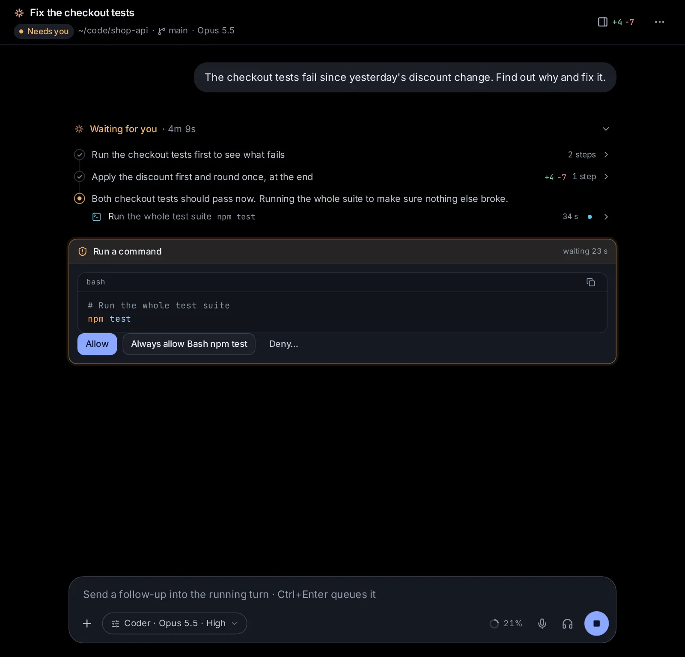

# Sessions

A session is one conversation with an agent, in one folder: you say what you want, the agent works, and you follow along, approve what it wants to do and steer it. This topic covers everything about sessions: the start page and its options, what you see while an agent works, messaging it mid-turn, and everything in a session's menu, from forking and goals to worktrees and sharing.

## Start a session

**New session** at the top of the sidebar opens the start page. Write what you want done in the message box, check the row of choices under it, and press Enter (or **Start**; on a phone, the round arrow). The session's page opens at once, with your message and the agent at work on it (**Working**). If the session can't start, its page says why, and **Back to the start page** puts your message (and what you attached) back in the box.

If the connection drops before the app answers (your phone went to sleep, or the network changed), the page shows **Reconnecting…** and, once it can, asks the app what came of your message: the session opens if it started, and a session never starts twice. If the app stays out of reach for about a minute, the page says **The app could not be reached**; **Try again** asks once more.

A moment after it starts, the session gets its title: a few words for what you asked ("Weekend trip to Lisbon", "Fix the checkout tests"), which the helper model ([Settings → Agents → Models](/settings?s=models&find=Helper%20model)) writes on the side, without anything showing in the conversation. The sidebar, the session's header and the search box show it (in the sidebar, its words come in one after another in place of your message's), and Claude Code and Codex get it too, for their own lists. Until it comes, and when the helper model can't answer, the start of your message stands in. A title you give the session yourself with **Rename** is never replaced. The sidebar lists the session from the moment you send it, at the top of **Active** (**Starting**).

The row under the message box holds **Runs on**, **Model**, **Folder** (or **Project**), **Agent** and, at its end, **Options**. On a phone each of them opens as a sheet from the bottom of the screen.

### Pick the agent and its model

**Runs on** lists every program you can use, side by side:

- **Claude Code**: Anthropic's agent, with a Claude plan or an API key.
- **Codex**: OpenAI's agent, with a ChatGPT plan or an API key.
- **Custom**: the app's own agent, for any model: from OpenRouter, Ollama or vLLM. See [Custom, the app's own agent](/guide/custom).
- Any other agent you added that speaks ACP (Gemini CLI, OpenCode, Qwen Code, Goose…), with its command under its name.

At the bottom, **Models for Custom** opens [Settings → Models](/settings?s=models) and **Add or manage agents** opens [Settings → More agents](/settings?s=agents). See [Agents, accounts and models](/guide/agents-models).

**Model** opens on **Automatic**: the session starts on the Best tier's model, its main agent hands clear parts to subagents on cheaper tiers, and it may move itself to Max's when a problem proves too hard (see [Tiers: a model for each kind of job](/guide/agents-models#tiers-a-model-for-each-kind-of-job)). Under it the menu lists only the chosen agent's own models. The agent's default is marked "default". Older versions of a model wait behind "2 older models"; a long list has a **Search models** field (Enter picks the first match). Custom lists the models you added in Settings → Models; another ACP agent lists the models it offered when it last ran, and the chip appears once it has run.

### Pick a folder, a project or a new task folder

The **Folder** chip says where the agent works. Its menu ("Project or folder to work in") has a field, **Find a project or folder, or type a path**, over two short lists, each row with where it is:

- **Projects**: your projects by name, the five at work most recently (and the one picked), each with its folder. Picking one sets the folder to the project's own, its agent, and its guidelines for the session; the chip then reads **Project** and shows the project's name. A group of projects works the same way, with all its projects. **New**, at the end of the heading, makes a project (sessions, files and memory together) and picks it. See [Projects and knowledge](/guide/projects) and [Agent Guidelines](/guide/guidelines).
- **Folders**: the folder in use and the three folders you picked last, each with the folder it is in. **Browse**, at the end of the heading, lists the folders in your home folder.
- **New task folder** ("a fresh one in ~/Hydor"): a fresh folder for this task, named by the day and a few words of your message (such as `2026-11-01-plan-trip-lisbon`), in `~/Hydor` unless you set another place in [Task folders](/settings?s=assistants&find=Task%20folders) (Settings → Capabilities → Your agents).

A project's own folder is the project: the menu lists it only as the project, and a session started in it works in the project, even when the start page had the folder picked rather than the project.

The menu opens above or below the chip, wherever there is more room, and fits without scrolling: in a small window it shows fewer folders, then fewer projects, and a line such as "2 more" under the projects brings back the rest.

Type in the field to find more:

- A name finds matching projects, and folders among those you used lately, in the folder in use and in your home folder. A project's folder, found by its name, shows as the project.
- A path (`~/code/`, or `code/` from your home folder) lists the folders there, as **Browse** does. The arrow at the end of the field goes up a folder; the cross, or Escape, goes back to the lists.
- ↑ ↓ and Enter pick. Tab, or the arrow at the end of a row, lists the folders inside it.

When the folder is in a git repository (and you have not chosen a new task folder), the menu ends with a switch: **New worktree from main** (or whichever branch is checked out), "A new branch, in a copy of" the repository. With it on, the session works in a copy of its own on a new branch; the chip reads "· new worktree". See [Work in a worktree](#work-in-a-worktree).

Whether a session gets a new task folder by default depends on the agent: most start in one unless you pick a folder; Coder works in the folder you pick, and an agent of one project in that project.

### Pick an agent

**Agent** sets who the session works as: **General** (until you pick another; in a project that has an agent of its own, that agent), **Researcher**, **Writer**, **Coder**, **Tutor**, **Planner**, **Analyst**, **App builder**, or one of yours under **Yours** (those that work everywhere, and those of the project picked). Point at one to read what it does and which program and model it uses. Picking one can also set the program, model and permissions it suggests (the model of its tier, when it thinks with one), and turn on its connected accounts. **Make or change agents** opens the [Agents page](/agents). See [Agents](/guide/agents).

### Options: effort, permissions and more

**Options** holds the rest. Its chip reads "Options", or names what you set away from the usual, such as "High effort · Plan · $5.00 cap". On a computer, its menu ends with a reminder: Shift+Tab in the message box switches permissions.

- **Effort**: how hard the model thinks. **Default** uses the model's own, then the levels the model offers: **Low** (fast, light reasoning), **Medium** (balanced), **High** (deeper reasoning), **Xhigh** (extra-deep reasoning), **Max** (maximum reasoning), and on some models **Minimal**, **None** or **Ultra**. Custom offers it only for an endpoint's model that reasons (Low, Medium and High); other ACP agents offer it when they list levels, and models without levels have none.
- **Permissions**: what the agent may do without asking you first. Each agent has its own modes; see [What each permissions mode means](#what-each-permissions-mode-means). Shift+Tab in the message box moves to the next one.
- **Account**: only once you have added another account for Claude Code or Codex in [Settings → Agents → Accounts](/settings?s=accounts&find=Accounts). **Your sign-in** is the agent's own account; pick another to run this session as it. **Manage accounts** opens Settings.
- **Confidential**, a switch with a lock ("Only models on this computer. Nothing leaves it."): for a paper you review, patient data or a client's code. **Runs on** becomes **Custom** and **Model** the best model installed here. See [Keep a session confidential](#keep-a-session-confidential).
- **Memory**: only while memory is on in Settings. **On** uses and adds to what agents remember; **Off for this session** starts fresh and keeps nothing from it. See [Memory](/guide/memory).
- **Spending cap**: the most this session may spend, at API prices. Type an amount and press **Set**, or pick $1, $5, $10 or $25; **No cap** removes it. The session stops at the cap until you raise it. See [Usage, limits and costs](/guide/usage).
- **Swarm**: **Off**; **Swarm**: a lead agent splits the task into angles of attack and starts a member for each, with as many working at once as **Swarm size** allows ([Settings → Capabilities → Subagents](/settings?s=children&find=Swarm%20size)). Members share what they find on a board and message each other. For hard problems; it costs several times what one agent does. Or **Campaign** ("One big change in parts, each in a worktree"): the lead splits one big change into parts, members each make one on a branch of their own with its tests, and the lead merges them; the folder must be a git repository (see [Campaigns](/guide/engineering#campaigns-a-big-change-in-many-parts)).
- **Research**: **Off**, or **Deep research**: the agent plans the searches, sends researchers after each part, checks key claims against two sources and delivers a cited report. Set **Researchers at a time** (1 to 8), **Rounds** (1 to 5), **Searches in all** (10 to 500) and **The report** (**Page** or **Word**).
- **Goal**: **Off** ("The agent works until it thinks it is done"), or **Until it is done** (the Options chip then reads "Goal mode") ("It works round after round until checks you agree hold"): your first message is the goal, the agent first works out how to check it and shows you, and nothing starts before you agree. Under **How much it asks you** pick how often it asks which way to go. It works for every agent, costs many turns, and stops at the limits you agree (rounds, money, time). See [Give the session a goal](#give-the-session-a-goal).
- **Arena**: **Off**, or **Compare models**: the same message also goes to one or two more models you tick (a **Find a model** field helps in a long list), each in a session of its own in the same folder. You compare the answers and keep the best; the others are archived. In a git repository, turn on the folder menu's **New worktree** so each model works on its own copy.

Swarm (or a campaign) and deep research both lead Hydor subagents, so turning one on turns the other off. **Goal** goes with a swarm (its lead has the goal: [A goal for a swarm](#a-goal-for-a-swarm)) but not with a campaign, deep research or the arena: turning **Goal** on turns those off, turning one of them on turns the goal off, and a session that leads one of them cannot have a goal (its menu has no **Set a goal**). **Confidential** turns Swarm, deep research and the arena off, and turning one of them on turns Confidential off (a goal can run in a confidential session). Swarm, deep research, the arena and a goal are not kept for the next session, since they cost more; the research numbers and arena models you picked are kept in this browser for when you turn them on again. See [Deep research, second opinions and several agents](/guide/research).

### What each permissions mode means

**Claude Code**

| Mode | What the agent may do |
| --- | --- |
| Ask (its default) | Asks before edits and commands that are not allowed in its settings |
| Accept edits | Edits files freely, asks before other commands |
| Auto | A safety check approves routine actions and asks you about risky ones |
| Plan | Reads and plans only, then proposes a plan for you to approve |
| Bypass | Never asks (full access) |

**Codex**

| Mode | What the agent may do |
| --- | --- |
| Plan | Discusses and plans first; can ask you clarifying questions |
| Read only | Reads files and answers; asks before changing anything |
| Auto (its default) | Edits files and runs commands in its folder; asks to go beyond it |
| Auto review | Like Auto, but a reviewer agent answers its approval requests |
| Full access | No sandbox and no approvals |

Inside Docker, Codex's own sandbox cannot start, so **Full access** is the default there and the menu says why.

**Custom**

| Mode | What the agent may do |
| --- | --- |
| Ask (its default) | Asks before editing files and before running commands; looking around runs freely |
| Accept edits | Edits files in the folder freely, asks before running commands |
| Auto | Routine steps go ahead; a quick check asks you about risky ones |
| Full access | Runs tools and commands without approval prompts or the command sandbox, using your computer account's permissions |
| Plan | Reads and plans only: no edits, no commands |

Outside Full access, Custom asks you before risky commands. In Ask, Accept edits and Plan it also asks before it reads or changes files outside the folder, or files that hold keys or passwords; in Auto, the quick check judges those first. See [Custom, the app's own agent](/guide/custom).

**Other ACP agents** offer their own modes, listed once the agent has run.

### Keep a session confidential

Some work must not leave your computer: a paper you were sent to review (most conferences and journals forbid giving a submission to an online AI), patient or client records, or a company's code you work on under agreement. A confidential session runs on a model on this computer, and nothing of it is sent anywhere.

1. On the start page, open **Options** and turn on **Confidential** ("Only models on this computer. Nothing leaves it."). Its chip then reads "Confidential".
2. **Runs on** becomes **Custom** and **Model** the best model installed here; while it is on, their menus offer only those. If there is none yet, it says so: [Settings → Agents → Models](/settings?s=models) installs the ones suggested for this computer with one click.
3. Write what you want, attach the paper or pick its folder, and press Enter. For example: "Review the attached submission as a NeurIPS reviewer: summary, strengths, weaknesses, questions for the authors and a score."

Models on this computer are those of Ollama and vLLM here, and endpoints whose address is this computer or your private network: `localhost`, `127.0.0.1`, `::1`, `10.…`, `192.168.…`, `172.16.…` to `172.31.…`, or a name ending in `.local` (see [Connect Ollama, vLLM or another endpoint](/guide/agents-models#connect-ollama-vllm-or-another-endpoint)). Ollama's cloud models, whose names end in "cloud", run on ollama.com and don't count. The start page keeps the switch on for your next sessions until you turn it off.

A confidential session has a lock beside its title, in its header and in the sidebar, and its message box has a calm green border; a line above the box says what that means until you close it. Click the lock for what is on and off.

- **Off**: web search and web pages, the browser and your screen, connected apps and your keys, apps, publishing, scheduled tasks, making, finding or editing pictures, drawings, plots, videos or sound, models elsewhere (deep research, swarm and the arena; a [second opinion](/guide/research) comes only from another maker's model on this computer), handing the conversation to another agent, saving anything to memory, and exporting a page as a file (export it yourself from the page).
- **Commands without network**: the agent's commands run cut off from the network, in every permissions mode, so nothing can be downloaded, installed from the internet, pushed or sent. Where that can't be done (Windows, some containers), each command asks you first, whatever the mode, and the lock's note says so.
- **Still on**: the files in the folder, documents (read on this computer), the pages, pictures and files you kept, shared knowledge, your memory notes and profile (read, never added to), Hydor subagents, which are confidential too, and answer UIs (without pictures or maps from the web).
- **Nothing sent out about it**: its title comes from the helper model when that runs on this computer, else from the first words of your message; notifications say only "A confidential session" and whether it finished, needs you or failed; there is no read-only link, no pull request from its menu, and no automation or app made from it; agents in other sessions and agents elsewhere can't read it; its replies show no pictures from the web, and the pages it shows load nothing from anywhere (so a chart that needs a library from the web won't draw); dictation works only with speech recognition on this computer ([Settings → Capabilities → Voice](/settings?s=voice)), and replies are read aloud only with a voice on your device.
- **It stays confidential**: forks and **Edit from here** are confidential too, and it can't be turned off, so what was said stays where it is. For work that may leave the computer, start a new session.

What it can't promise: Hydor checks where a model's server is, not what that server does, so an endpoint you set up on your network that passes requests on to an online service is online all the same. What you copy out of the session, or open or send from elsewhere yourself (a link in a reply, a page it made opened from the project's files, a push from the Git page), is yours to watch, and so is what you read of it on another device: the app's pages travel to it as they always do (through your tunnel, if you use one).

### Attach files, point at files, use commands

- **Attach files** (the **+** at the left of the box's bottom row), drop files on the message box, or paste pictures and files into it. A message carries up to 25 MB of files. Pictures (PNG, JPEG, GIF, WebP) go to the model as images, up to 8 a message; other files (up to 20) are saved on this computer and listed at the end of your message, so the agent opens them. Remove one with its × before sending. Files you have attached wait in the box until you send them, even while you go to another page (reloading the page clears them).
- **Attach a screenshot** (in the same **+** menu, on computers; where the browser can't take one, the **+** is a paperclip that attaches files): your browser asks which screen, window or tab, and one picture of it is attached.
- **@**: type @ and part of a file's name to list matching files in the folder; ↑ ↓ to move, Enter or Tab to insert it, Esc to close.
- **/**: at the very start of the message, / lists the agent's commands and skills (Claude Code's), with what each does.
- The microphone (dictate your message) and the headphones (hands-free voice mode) sit by the send button when your browser or this computer can recognize speech. See [Documents, images, videos and voice](/guide/documents-voice).

### What the start page remembers

The start page keeps its picks for each place you work in: each project, each folder and **New task folder**, on every device. A place keeps its **Runs on** (the program), each program's **Model** and, under **Options**, its **Effort** and **Permissions**, the **Agent**, **Memory**, the **Spending cap**, **Confidential** and the **New worktree** switch. The account (**Options → Account**) is not kept per place: it stays the one you picked, everywhere. Picking a program in a place brings back what you last used with it there.

A place keeps its picks once you change one of them there or start a session there; just looking at a place keeps nothing. Pick a place in the **Folder** chip (a project, a folder or **New task folder**) and the box opens with that place's picks, while what you have written and attached stays in it. Starting from a project (**New session** on its card or page, or the project in the sidebar) opens the start page with that project's picks, and **New session in this folder** on a folder (in Files or the sidebar) opens it with that folder's picks. The page opens in the place you picked last.

A place where you have not picked or started anything yet opens with the defaults: the agent is **General**, or the project's own agent when the project has one (and what that agent suggests applies, as when you pick it: its program, the model of its tier and its permissions); the **Model** is **Automatic** where it is offered, else the program's default; **Effort** and **Permissions** are the program's usual ones; memory is on; there is no spending cap; **Confidential** and **New worktree** are off. **Runs on** stays the program you used last. The place you had picked last before this was added keeps the picks you had.

A link to the start page can fill it in, for example `/?prompt=Summarize%20my%20notes&agent=codex`; `model=`, `cwd=` (a folder's path), `assistant=` (an agent's id, such as `app-builder`, which also picks the program, model and permissions it suggests unless the link names a program or a model) and `confidential=1` (Confidential on) can be added. It only fills the box and the choices; it never starts anything by itself. Invisible characters are removed from a linked message, with a notice.

What you write in the box waits there while you go to other pages: the message, the files you attach, the options for this task alone (**Swarm**, **Deep research**, **Arena**, **Guidelines** for this session) and the folder a link or **New agent session here** opened it in. The box empties when the session starts: while the agent gets going, the arrow on **Start** keeps going up; then the start page becomes the session, the box moving down to its place at the bottom and what you wrote moving up as your first message. The message and those options are kept in this browser, so they are still there after a reload; attached files are not.

## Follow the work in a session

### The header

At the top of a session:

- the agent's icon and the title (double-click it to rename), and a lock for a [confidential session](#keep-a-session-confidential);
- a status: **Working**, **Needs you**, **Ready**, **Starting**, **Building memory**, **Stopping**, or "Open in VS Code" for a session running elsewhere; once its agent is no longer running, how the work ended: **Done** when its last turn finished (with "· 2 files made" or "· 3 files changed" when it made or changed files), **Stopped** when you stopped it or it was cut off before it finished, **Failed** when it ended with an error. Point at it for what to do next;
- the folder (click it to browse it in Files), a pull request badge, the account when it runs as an added one, and on wider screens the git branch and the model;
- one button for what you can do now: **Stop** while a turn runs, **Resume** when the agent is not running (after **Stopped** or **Failed**; quieter after **Done**, since a message in the box continues the session anyway), or **Continue here** for a Claude Code session open in VS Code or a terminal;
- **Details** (showing the lines added and removed once files changed), which opens [the details panel](#the-details-panel-changes-commands-and-info);
- the session's menu (⋯): see [Everything in the session's menu](#everything-in-the-sessions-menu).

### Turns, steps and replies

The conversation reads like a chat. Each turn is your message, the agent's work, and the reply it ended on:

- **Your message** shows on the right, with its pictures and attached files, the moment you send it, before the agent has it: the agent shows at work under it, and the message box is free for your next one. Should it not go through (no connection, a spending cap reached), it comes off again and goes back into the message box, with a notice that says why. A long one folds to its first lines; **Show more** opens it.
- **The work** sits under a line that sums it up: "Worked for 2m 10s · 3 commands", "Thought", "Stopped after 40s" or "Failed after 5s", with what the turn cost on the right ("≈ $0.12"): click it for the turn's [time and cost](/guide/sessions#a-turns-time-and-cost). On a plan (Claude Code, Codex) that is what its tokens would cost at API prices, not what you pay; with no price known for the model, the tokens show there instead. While the turn runs, the line says "Working · 1m 2s" (or "Waiting for you") and the work's outline grows as it happens; after earlier turns it adds how long the session has worked in all, all its turns together: "Working · 1m 2s (47m)". A finished turn folds its work away; click the line to open it.
- **The outline of the work**: each short note the agent writes between its steps (what it found, what it does next) starts a part, and the steps it then takes go in it. A finished part is one line with a check: the note in a few words ("Run the checkout tests first to see what fails", "Apply the discount first and round once"), how many steps it took and the lines it changed. Click it for the whole note and each step. The part under way shows the agent's note in full and, under it, the step being taken now, such as "Editing total.ts · 4 s"; click that line for the part's steps so far. Steps taken before the agent's first note make a part named for what they did ("Ran 3 commands, read 2 files"). A long turn shows its latest parts; **Show 12 earlier parts** shows the rest.
- **Steps** are named in plain words: "Run the tests", "Read index.ts", "Searched the web", with the command itself in quieter type. Click one to see what it did. Claude Code runs a command, or another step that changes things, on its own; the steps of Hydor's own that the agent asked for after it in the same message (web searches, page reads…) wait until it ends. Such a step shows **Waiting** in place of its clock, quietly, until it really starts; then its clock counts from that moment, and a finished step shows the time it really took. The outline's line for the step under way names the step really running.
- **Thoughts** show as "Thought for 12s" with their first heading; click to read them.
- **The reply** is what the agent wrote after its last step. Pages the agent showed sit with it. While the agent works, a short note it writes after its last step shows in the outline, as the part under way; if the turn ends there, it becomes the reply.
- **Replies between steps**: what the agent writes between its steps that reads as a reply (its answer to a message you sent while it worked, or what it found before it went on, in several paragraphs, a list or a table) shows as a reply too, in its place, not folded into the work. The work before and after it each sits under a line of its own, such as "Worked for 20s · 2 commands".
- **Files changed**: under the reply, a card lists every file the turn changed, with lines added and removed. Click a file for its diff; **Open file** opens it. More than five fold behind "Show 3 more files".
- **Documents made**: under the reply, the documents the agent made or changed in the turn (PDF, Word, Excel, PowerPoint, LaTeX, notebooks, Markdown and more) show as cards marked **New** or **Updated**, whether or not it handed them over, and file names and paths in the reply are links that open the file in a window over the conversation ([Documents it made or changed](/guide/documents-voice#documents-it-made-or-changed-and-file-names-in-its-reply)).
- **Commits**: when the agent made commits in the turn, a chip under the reply says so: **Committed** · the commit's title, or "3 commits" with the branches, and the lines added and removed. Click it (with several, then a commit) to read the whole message, who made it and when, its hash (click to copy), and every file it changed with its diff. **Open in Git** opens it in the session's repository on the [Git page](/git). A commit the agent amended or rebased away in the same turn is left out.

The agent may also keep a checklist (**Plan** or **To-dos**, with how many are done), which ticks off as it works. Notes from the app follow the turn they are about: what memory kept, a second opinion, a spending cap reached, the card of the subagents a turn started. Messages from other sessions show as "From …", a subagent's reply (a Hydor, Claude Code or Codex subagent's) as "Reply from …" (click it to read the reply), and a scheduled task's run starts with a line naming the task.

Day lines ("Yesterday", "Today") separate the days; a conversation all from today has none. Older messages load as you scroll up, or with **Show earlier messages**. New messages and replies come in at the end of the conversation, with no empty space left under them. Once a reply is long enough to fill the screen, the view stops at its first line and stays there as it grows, so you read a long reply from its beginning; a short one simply sits under what came before. When you scroll up while the agent works, the view stays where you are; **Latest** takes you back to the end, and also shows while a reply runs on below the screen.

Under each finished reply are **Copy message**, **Fork from this reply** and **Read aloud**. **Fork from this reply** works on any reply of Claude Code, and on the last reply of a finished turn for Codex and Custom, since those fork a whole turn. Under the last reply of a turn in which the agent used a tool or showed a card, **Do this again…** (the circling arrows) has that work done again without asking for it again: **Make it an app** drafts an app from the turn, your corrections along the way kept in its task and its cards as its answer ([From a session that went well](/guide/apps#make-your-own-app)), and **Run it every…** opens a new [scheduled task](/guide/tasks) with what you asked. Not in a confidential session. Under each of your own messages, **Copy message**, **Edit from here** and the time it was sent are always shown, not only when you hover.

### A turn's time and cost

The cost on the right of a finished turn's line ("≈ $0.12", or the tokens when no price is known for the model) opens **Time and cost**, to see why a turn took long or cost much:

- **Duration**: a bar of where the turn's time went, each part with its share and length: **The model** (reading what it was given, thinking and writing), **Commands**, **Reading and editing files**, **The web**, **Other steps** (subagents, connected apps' tools), **Waiting for you** (approvals, questions and forms, from when each card came to when you answered it) and **The rest** (starting, and between steps). Steps that ran side by side count once. Under it, "First reply or step after 3 s": how soon the agent began.
- **Tokens**: **Read fresh**; **Written to the cache** (read fresh and kept by the model's provider, so the next request reads it for less); **Read from the cache**, with its share of all that was read; and **Written out** (replies, thoughts and steps).
- **Cost**: the turn's cost and, when the model's price is known, each kind's, with "The cache saved about $0.80.". On a plan (Claude Code and Codex, unless a session runs on API credit) it says "At API prices: on a plan you pay your plan's fee". With no price known for the model, it says its cost is not counted.

Claude Code's turns give the model's own time and the first reply; for other agents, the model's part is its thinking. The cost and this panel show on wider screens.

### Maths, diagrams, figures and pictures in replies

Agents write their replies for this app, not for a terminal, so a reply can hold more than text. Every agent knows how, and uses these by itself where they make an answer clearer:

- **Formatting**: headings, lists, tables, bold and code, laid out to read.
- **Maths**: equations drawn as in a textbook, inside a sentence or set apart on a line of their own, and chemical equations (2H₂ + O₂ → 2H₂O). Numbers between paired dollar signs (`$1$`, `$0$`) are maths too; ordinary prices such as $4.70 stay money.
- **Diagrams**: flowcharts, sequence and state diagrams, timelines, mind maps, Gantt and pie charts, drawn in the app's colours, light or dark. The bar above one has **Show the code** (what the agent wrote; the same button shows the diagram again), **Save as a picture (SVG)**, **Full screen** and a button that copies its code. A diagram that can't be drawn shows its code, with the reason.
- **Figures and small tools**: a chart, an annotated figure, a calculator, a simulation with sliders or a short quiz runs inside the reply, sealed off from the app and your files like the pages agents show. It takes the app's look and grows to fit (**See all of it** opens a tall one); its bar has **Show the code** (**Show it** goes back), **Save as a file** and **Full screen**. Choices you click on it go to your message box. While the reply is still being written, it builds up in place ("Writing…" until it has something to show), and it comes alive once it is complete.
- **Pictures**: photos from the web (a place, a product, a plant, an artwork) and pictures on this computer, fitted to the reply; click one to see it large, where **Edit** opens it in the picture editor ([Edit pictures and videos](/guide/library#edit-pictures-and-videos)). Pictures from the web come through this app's server, so the site that has them never sees your browser. One that can't be loaded shows as a link to it.

To get plain text instead, say so in your [Agent Guidelines](/guide/guidelines) ("Answer in plain text, without diagrams or pictures") or in your message. You can also ask for any of these in plain words: "draw the steps as a flowchart", "show me a picture of it", "give me a slider to try other values".

### Answer UIs: cards, charts and maps in replies

When part of an answer is something to look at, compare, choose from, follow, try or practise rather than read, the agent shows it in one of the app's answer UIs: nearly 150 ready-made cards, tables, charts, maps, galleries, timelines and small tools, filled with the answer's own content. Most answers of more than a few lines have such a part, so you will see them in most of them. Options to compare become a table with the best value in each row marked, a recipe a card whose servings scale its amounts, a forecast the coming hours and days, places a map with numbered pins, a quiz or practice problems questions you answer in place. Each one builds up as the reply comes, in the app's look, light or dark.

- **What you can do in one**: sort and filter a table, switch a chart to its numbers, tick off a checklist, start a recipe's timers, flip flashcards, match pairs or fill in blanks, answer a troubleshooter's questions, spin a wheel to pick for you, move a calculator's or a function plot's sliders, play a video. What you tick or answer is still there when you come back to the conversation on this device (practice answers too). A button that says **Send** (**Send my choice**, **Send my score**, **Send my result**, **Send it** and the like) sends what it names at once as your next message, as if you had typed it and pressed Enter: the option you picked, your quiz score, where the wheel stopped. **Sent** beside it says it went. Whatever you are writing stays in the message box; when the session cannot take a message just then (another one is still on its way), the words go into the box instead, for you to send. Some go further:
  - **Practice problems** you answer in your own words or numbers are checked on the spot (a number within a tolerance, words without minding capitals; a right answer whose only slip is an accent says so). **Show a hint** gives hints one at a time; the worked solution shows after a try, or once every hint is shown. You get a score, and **Send my results** sends it to the agent. Your answer to an open question goes with **Send for checking**, for the agent to check.
  - **Code you can run and change**: a playground runs JavaScript, Python or a small web page in place, sealed off from the app, with its output (and Python's plots) under it. **Run**, **Reset**, **Copy** and **Send my code** (it goes to the agent to look at) are on it, and it may set tasks to try. Python is loaded from the web the first time, so it does not run in a [confidential session](/guide/sessions#keep-a-session-confidential).
  - **A code walkthrough** explains code as a guided tour: numbered steps beside the code, each lighting up the lines it explains while the rest fades. Go through them with the arrows (or the **←** and **→** keys), or tap a line to open the step that explains it. **Ask about this step** puts a question about it in your message box.
  - **A program run step by step** shows where a program is at each step: the line it is on, its variables (what just changed is marked), the calls under way and what it has printed so far. Step back and forth, drag the slider or press play. When it asks you to predict the output first, type your guess and press **Check**. **Ask about this step** works here too.
  - **A network graph** shows how things connect (a concept map, a novel's characters, what depends on what): tap a node to light up its links and read its note, drag nodes around, read the legend, or switch to the **List** view.
  - **Annotated text** marks passages in a text: tap one to read its note (a correction, a comment, a meaning) and the change it suggests, or **Ask about this**. Filter the notes by kind, switch between **Original** and **Corrected** and use **Copy corrected text**, or listen to the text.
  - **A fact check** goes through claims one by one, each with its verdict, why, how sure the agent is and the evidence for and against, with sources. The tally of verdicts on top filters the claims when you tap it.
  - **Follow-ups** are two to five buttons with next questions or steps at the end of an answer: tap one to send it as your next message when your message box is empty, or to add it to what you are writing. A button you used gets a check mark.
- **Pictures**: an entry without a picture, or whose picture cannot load, shows without one, its text taking the space, so no empty box is left.
- **Links**: whatever an answer names that you may want to open (a place, a product, a paper, a book, a film, an event, a page) links to its own page, in the agent's words and in its cards, so you never have to look it up again. In a card, a linked name is underlined with a small ↗ after it, so you can tell it is a link on a phone too: tap or click it to open the page in a new tab (on a card you pick from, it opens the page without picking the option). A place's address opens it in Google Maps, and a table can make a column of names into links.
- **Numbers from a spreadsheet or a file**: a table, a chart, key figures, a ranking, a histogram or values on a map can read its numbers from one of your spreadsheets (see [Spreadsheets](/guide/library#spreadsheets)), or from a CSV, TSV, JSON or JSONL file in the conversation's folder or its project's, instead of holding them. Agents do so when the numbers live there, when there are more than a few dozen rows, or for a card you may want to keep: the card adds up, counts, groups, filters and sorts them itself, so nothing is typed out again, and it shows the latest numbers each time it is shown (rows you add later too, unless it names a fixed range of cells). A line under it says where they came from (**Data from** *Shop numbers · Sales*, a link that opens the spreadsheet or the file), when they were read and, when it shows only part, how much ("1,000 of 12,400 shown"); **Read again** reads them once more, and when you save the spreadsheet the card redraws by itself. If the spreadsheet, its tab, a column or the file is no longer there, the card says so in plain words, with **Try again**. A card reads only files in its conversation's folders, not elsewhere on your computer, of up to 50 MB (a JSON file, 20 MB) and their first 1,000,000 rows; a spreadsheet made in a [confidential session](/guide/sessions#keep-a-session-confidential) is read only by cards in that session.
- **On hover** (or when you reach it with the keyboard), a small bar at its top right: **Show the data** shows what the agent wrote (for a card that reads a spreadsheet or a file, where it reads from and what it shows of it; **Show it** goes back), **Copy as text** copies it as plain text, and **Full screen** shows the card alone over the page, as wide as your window (on a phone, the whole screen), scrolling when it is tall; **Esc**, **Close** or a click beside it brings you back. Under **More** (…): **Pin to a board** keeps a copy of the card on one of your boards, one you pick or a **New board…** you name there, to come back to beside other cards (see [Boards](/guide/library#boards)); **Save as picture** saves a PNG of the card as it looks, in the theme you see it in and at twice its size so it stays sharp, named after its title, and **Copy as picture** puts the same picture on the clipboard, to paste into a message or a document (where your browser lets pages do that). Full screen has the same two at its top. A card with a map, a plot drawn by a charting library, a video player or a code playground's output inside has no picture buttons (it can still be pinned): those parts can't be drawn into a picture.
- **When agents use them**: agents are told to use one for every part of an answer that is something to look at, compare, choose from, follow, try, practise or keep, which is most of the time in an answer of more than a few lines: options to weigh, things with pictures and details (places, products, films, books, people, papers, news), numbers, time and plans, things to do, things to learn, writing to check, claims to verify, and next steps you may want to take. They fill the pictures, and play a video where watching helps more than a photo. What a card cannot say (the reasoning, the advice, the caveats) stays in the agent's words. Plain conversation, a short answer to a short question and code changes stay text. Every answer, the first and each one after it, can hold several, one for each of its parts (a trip's itinerary, its weather and a packing list), so a conversation gathers as many as its answers need; a later answer can show one again with its data brought up to date. The agent finds the ones that fit with one lookup: by name for those it already knows, and with a few words on what each other part shows (by words and, when **Search by meaning** is on in [Settings → Memory](/settings?s=memory), by meaning too), so it is never handed them all. The [built-in agents](/guide/agents#the-built-in-agents) each lean on the ones that suit their work.
- **In your apps**: an app's answer can be such a card too, filled in by the app's agent each run (see [The answer](/guide/apps#the-answer)), and **Do this again…** under a reply that showed cards makes an app whose answer is those cards.
- **See them all**: [Answer UIs](/answers) shows every one with an example, by group: summaries, comparisons, shopping, places and travel, food, plans, work and business, numbers and charts, money, learning, science, media, people and sports, writing, and code. **Play as it streams** shows one coming in as a reply would bring it.

Ask for one in plain words too: "compare them in a table", "put them on a map", "quiz me on it", "give me practice problems on this", "mark up my essay with what to fix". Your [Agent Guidelines](/guide/guidelines) ("Answer in plain text, without cards or charts") or your message can ask for plain text instead.

### Open a step to see its output

Click any step to open it:

- a command: the command, the folder it ran in, its exit code and how long it took, a copy button, and its output (**Load full output** when it was cut short);
- a file edit: the diff (**Load the full diff** when it was cut short);
- a file read: a link to the file and what was read;
- a web page: its address and what was read from it;
- a task given to a subagent: **Task given**, and what came back;
- anything else: what the agent sent and what came back.

A step can be marked **background** (it keeps running), **Auto** (Custom's Auto mode decided, with the reason on hover), or show a red exit code. Background tasks (a command left running, a monitor, a workflow) are listed in a line above the message box, together with the session's subagents; open a task to see its output (Claude Code) and **Stop** it, which asks first; a subagent opens as a session of its own. See [Subagents](/guide/sessions#subagents).

## Build a project's memory before the agent starts

When you start a session on the start page in a project whose [wiki memory](/guide/wiki-memory) is still new (fewer than 10 articles, no build from history run yet), and the project has something to build one from (conversations, commit messages, documents, notes, a README or a docs/ folder), the session asks first. A card under your message says **Build <project>'s memory first?**, with what it would read and about how long it takes before the agent starts. The session shows **Needs you** (and you get the notification) until you choose:

- **Build memory, then start**: the memory starts building, the card turns into its progress, and the session shows **Building memory**. Your message waits ("Sent to the agent when the memory is ready") and goes to the agent as soon as the most important part is written: an overview of the project from its files, its notes and the conversations with the most in them. The rest builds on in the background, and agents find it as it lands. **Start now** sends your message at once and lets the build go on; **Stop building** stops it (what it wrote stays) and starts the agent. You can close the app: the agent starts by itself. If the build fails before that point, the card says so, with **Try again** and **Start anyway**. If the agent ended before it ever got your message (it crashed, or the computer restarted during the wait) and cannot be started again, the card offers **Start in a new session**: a new session with the same settings gets your message, takes over what you sent meanwhile, and the empty one is archived.
- **Start without memory**: the agent starts now, and this project doesn't ask again for a week.
- **Don't ask for this project**: it never asks for this project again. **Build the wiki from history…** stays in the **⋯** menu of the **Memory** tab of the project's details.

Anything you send while it waits goes to the agent after your first message. It asks only when you start a session yourself on the start page, never for scheduled runs, apps, subagents or sessions an agent starts, and not for a project that has had a build.

## Approve or deny what the agent wants to do

When the agent wants to do something its permissions do not let it do alone, it waits and asks with a card at the end of the conversation: what it wants to run, a file change with its diff, or another tool and its details, with how long it has waited. The session's dot turns amber, the inbox counts it, and you get a notification if you turned them on. You can answer from the card, from the [inbox](/guide/inbox), or, for a plain yes or no, from the notification itself where the browser shows buttons.

The buttons come from the agent:

- **Claude Code**: **Allow**, **Deny**, and often a rule such as "Always allow Bash npm test" or "Allow all edits this session".
- **Codex**: **Allow**, **Allow for this session**, **Always allow this command**, **Deny**, **Deny and stop**; for file changes **Allow edits this session**; for wider permissions **Allow for this turn** and **Allow for this session**.
- **Custom**: **Allow**, **Always allow** followed by exactly what it covers (only the command you approved, so nothing can ride along after it), and **Reject**.
- Other agents: the choices they offer.

**Deny** first opens a box, "Optional: tell the agent what to do instead"; press **Deny** again to send, with or without a note. (Custom's **Reject** and Codex's **Deny and stop** answer at once.)

A connected account's tool you set to **Ask first** doesn't ask in the session: the call is held in the Outbox and the agent goes on. A line in the conversation says **Waits for your OK in the Outbox**, and later whether it was sent or dropped ([The Outbox](/guide/inbox#the-outbox-calls-held-for-your-ok)).

In Claude Code's **Auto** mode, the safety check can refuse a command outright instead of asking. A card above the message box then says "Claude blocked a command" and why. **Approve & retry** switches the session to Ask and has the agent run it again, so it comes back to you as a normal approval; **Dismiss** leaves it.

## Answer questions and approve plans

When the agent asks you something, a card with an amber edge shows the questions and their choices:

- Pick one option, or several where it says "Pick any". **Other — type your own answer** takes your own words.
- **Attach files** adds files to an answer.
- Keys 1 to 9 pick an option of the first question not yet answered.
- **Send answer** sends it as your next message. If the session stopped while asking, **Resume and answer** starts it again with your answer. For a Claude Code session waiting in VS Code or a terminal, **Answer here** ends it there and continues it here with your answer; a Codex session there has to be answered there.

When the question comes as an approval card instead, its buttons are **Send answers** and, for Claude Code, **Skip**.

**Plans.** In Claude Code's **Plan** mode the agent reads and plans, then shows its plan in a card: **Approve, auto-accept edits** (go ahead, editing without asking), **Approve, ask before edits**, or **Keep planning** (it stays in Plan; tell it what to change). In Codex's Plan mode, Codex discusses and plans first and can ask you clarifying questions. Custom's Plan mode ends with a numbered plan; switch the permissions (Shift+Tab) and reply to have it carried out.

## Fill in forms a service asks for

When a service you connected needs something from you partway through a task (a date, a choice, a page to approve on), its form shows as a card, whichever agent is working: "Linear asks you to fill in a form", "… asks you to open a page" or "… asks to go ahead". Fill in the fields and press **Send** (or **Open it**, which opens the page, or **Allow**), or press **Decline** or **Not now**. Codex's own tool servers ask the same way. See [Connected apps, keys and tools](/guide/connections).

## Message the agent while it works

You can type while a turn runs. What Enter does then is set by **Sending while an agent works** in [Settings → App → General](/settings?s=general&find=Sending%20while%20an%20agent%20works), for each browser:

- **Join the turn** (the default): Enter adds your message to the turn in progress, so the agent takes it into account right away. Ctrl+Enter (⌘Enter on a Mac) puts it in the queue instead.
- **Wait for it**: Enter puts your message in the queue, to go out when the turn ends. Ctrl+Enter adds it to the turn instead.

The message box says which: "Send a follow-up into the running turn" or "Queue a message for when this turn ends". On a touch screen the send button does what Enter would. Custom picks up follow-ups at the next model step, after any running tools finish; **Send now** does the same for a queued message. If your Custom session was already running before an app update and cannot take live follow-ups yet, your message stays in the queue until the turn ends instead. Other ACP agents take one message at a time, so a message sent while they work always waits in the queue. In Claude Code, a message that went in while the agent worked shows "sent while working" under it. The agent's answer to it shows as a reply under your message, even when the agent then goes on with its work.

## Manage the queue

Queued messages wait above the message box, numbered in the order they go out; one you queue shows there the moment you send it. One goes out each time a turn ends, by itself.

- Drag a message by its handle to change the order.
- **Send now** (the arrow): sends it at once, into the running turn.
- **Edit** (the pencil): change its text, take attachments off, or add more (**Attach**, or paste or drop files). Enter saves, Esc cancels.
- **Remove** (the bin): takes it off the queue; its attachments are deleted.
- When you stop the agent, or the app restarts, the queue pauses: "The queue is paused (the agent was stopped, or the server restarted)." **Resume** lets the messages go out again as the agent becomes free. Messages that agents send each other (a session's messages to its Hydor subagents, and their replies) don't pause for a restart: if the agent they wait for is still at work, they go out when its turn ends. A spending cap that is reached holds the queue too; raising the cap lets it go on.

## Change the agent, model, effort or permissions

The message box of a session has the start page's **Agent** and its three choices **Model**, **Effort** and **Permissions**, in one chip beside the **+** (it opens **Options**, a sheet from the bottom on a phone). Below them are the rest of the start page's options for this session, in the same order: **Account** (another account takes the session over from your next message; shown when the agent has more than one), **Confidential** and **Arena** (shown as they are: both are picked when a session starts, and a click says how to get the other), **Memory**, **Spending cap**, **Swarm**, **Research** and **Guidelines** (the same choices and dialogs as the session menu's [Session settings](/guide/research#turn-it-on); Swarm and Research change from your next message). The chip names the agent and the model, and the effort and permissions when they are not the usual; it turns amber while the agent may do anything without asking (**Bypass**, or Codex's **Full access**). Another agent applies from your next message (see [Switch agents in a session](/guide/agents#switch-agents-in-a-session)). A change of model, effort or permissions applies to the running agent at once and stays with the session. Shift+Tab moves to the next permissions mode. The model menu lists only this agent's models; to move the conversation to another agent, use [Continue in another agent](#continue-in-another-agent).

## Quote part of a reply

Select text in one of the agent's replies, or in one of your own messages: a **Quote** button appears above it (below it on a touch screen). It puts the text in the message box as a quote, with the cursor after it, so you can answer that part or bring back something you said earlier.

## Find text in a session

Press Ctrl+F (⌘F) in a session. **Find in this session** looks through your messages and the agent's, including the parts not loaded yet (not command output). Type two letters or more; it jumps to the newest match and lights up the words, and says "3 of 12". Enter goes to the older match, Shift+Enter to the newer one (or use the arrows), and Esc closes it. A folded long message opens on what was found. A message picked in the search box (Ctrl+K) opens its session with this bar already filled in.

## More in the message box

- ↑ in an empty box brings back your earlier messages in this session, newest first; ↓ goes forward again.
- What you type is kept as a draft for each session in this browser, so it is still there when you come back.
- Ctrl+S (⌘S) puts the draft aside and empties the box; Ctrl+S in an empty box brings it back.
- A very long paste (32,000 characters or more) is attached as a text file instead of filling the box.
- The placeholder tells you what sending will do: "Message Claude…", or "Message to continue…" when the agent is not running: sending starts it again with the whole conversation.

## The details panel: changes, commands and info

**Details** in the header opens a panel with three tabs. On a wide screen it sits beside the conversation and stays open as you move between sessions; on a narrower one it slides over the page; on a phone it opens only when you ask.

- **Changes**: every file the session changed, the most changed first, with lines added and removed. Click a file for each edit's diff; **Open** opens the file.
- **Commands**: every shell command the agent ran, newest first, with **All**, **Failed** and **Background** filters. Click one for its output.
- **Info**: the agent, status (as in the header: **Done**, **Stopped**, **Failed** or what it does now), folder, branch, model and effort, how much of the context is used, when it started and was last active, its activity (prompts, turns, tool calls, commands), tokens (in, cached, out), the API cost (what the same work would cost at API prices), output speed, where it was started (Hydor, VS Code, a terminal, Claude's desktop app…), and while its agent runs, **Its programs**: what they use now (CPU, memory and how many), with the [limits](/guide/app#limit-each-session) it runs under. Below: its background tasks (open one to see what it did, or **Stop** it), and **Continue in a terminal**: the command that resumes the session in a terminal, and the session id, each with a copy button (Claude Code and Codex).

## Read the meters: context, cache and speed

A small ring with a percentage by the microphone fills as the conversation uses up the model's context window; the rest is at the foot of the Options chip's menu:

- **Context**: the ring, and the **Context** row in Options ("42% in use"). Point at the ring for the exact number of tokens. It turns amber above 85%. Click the ring, or **Compact** in Options, to compact the conversation (not while a turn runs). In a Custom session, point at the ring for the tokens and a breakdown of what they go to, and the breakdown is under the arrow of the **Context** row; Custom condenses by itself, so there is no **Compact** and clicking the ring does nothing (see [Long conversations and long output](/guide/custom#long-conversations-and-long-output)).
- **cache 4m** (Claude Code): the prompt cache keeps the conversation ready for a while (5 minutes or an hour), so the next message is cheaper and quicker. It counts down while you send nothing; a message before then reuses it and starts the count again. **cache cold** means the next message rebuilds it.
- **85 tok/s**: how fast the last reply was written, in tokens a second.

## Stop a turn, stop the agent or resume

The Stop button by the message box has a rotating ring while the agent is starting or working. The ring pauses when it needs you, and stays still if your device asks for reduced motion. Once the turn is over, the Stop button stays, with its ring, for as long as background tasks or subagents the agent started are still running, such as a Hydor subagent, a Claude Code subagent, a command left running or a monitor; the send button is beside it, and the box takes your messages as usual. Point at Stop to see what it stops: "Stops this turn, 2 subagents and 1 background task", or "Stops 2 subagents". It stops all of that at once: the turn, each subagent that runs, and each background task that runs, and the ones those started in turn. A Hydor subagent stopped this way does not report back to its parent, and a report that was already on its way waits in the parent's paused queue instead of waking it; press **Resume** to let the queue go.

- **Stop a turn**: press **Stop** in the header, or the round square button by the message box, which also stops what the session started (above). (Esc doesn't stop it: it only closes what is open, such as the find bar or a list.) The agent stops what it is doing; the turn shows "Stopped after…". The session shows it stopped the moment you press **Stop**, even when the agent takes a few seconds to finish (to end a command it was running, say); if the agent is still at work 20 seconds later, the session shows it at work again. The agent stays ready for your next message, and the queue pauses until you resume it.
- **Stop the agent process**: the session's menu (⋯) → **More** → **Stop the agent process**, when no turn is running. The agent's program ends; the session and its history stay, and it shows how its last turn ended (**Done**, **Stopped** or **Failed**).
- **Resume**: the header's **Resume** starts the agent again with the whole conversation, or just send a message ("Message to continue…"): that starts it again too, for Claude Code, Codex and Custom alike. After **Done**, **Resume** is a quieter button, since your next message is all it takes. If the session was written to seconds ago, perhaps from VS Code or a terminal, the app asks first, since two programs writing one session can damage its history.
- An agent left idle stops by itself after three hours (when nothing waits for you and no background task runs); your next message starts it again.

## Give the session a goal

A goal keeps an agent working, round after round, until checks you have agreed hold. You and the agent first agree what "done" means as a short list of checks. Then the app itself runs those checks after every round and decides whether the round got things closer, so the agent saying "done" changes nothing: only the checks can end a goal. It works for every agent (Claude Code, Codex, Custom and the other agents you add), because the app's own loop drives it.

To set one, open the session's menu (⋯) → **Set a goal**, say what is true when the work is done ("npm test passes and the upload page handles 2 GB files"), pick **How much it asks you** and press **Draft the checks** (or Ctrl+Enter). Or start a session with it: on the start page open **Options** → **Goal** → **Until it is done**, and your first message is the goal. A goal cannot be set in a session another session started (a Hydor subagent: its menu has no **Set a goal**), in one that runs in VS Code or a terminal (continue it in the app first), in Plan mode, where the agent changes nothing, in a session that leads a campaign, a deep research or an arena match ("This session leads a campaign: a goal works with a swarm, not with a campaign yet.", and the same for the others), or in a session that has a `/goal` of its program's own (clear it first with `/goal clear`). If a session you start with **Goal** cannot have it, it goes on as a plain session and a notice says why ("The goal was not set: …"). A session has one goal at a time, and a goal costs many turns: the limits you agree below keep it in check. A goal stops by itself when its session is archived, or replaced by **Edit from here**.

A target mark in the sidebar shows which sessions have a goal; point at it to see the round and how many checks hold, and the session's own Options chip says "Goal mode". The first time you turn a goal on from the start page, a short note says what it does and what it costs.

### Agree what "done" means

The agent reads the project and proposes the checks, the paths it may not change and the limits. You see them on a card, **Is this what done means?**, above the message box. **Done when** lists the checks; each has a tag for its kind:

- **Command**: a command that must pass ("npm test").
- **Measured**: a command that prints a number, with a target: at least or at most ("search p95 under 200 ms"). A round may fall a little behind the best value so far (a tenth of it) and still count.
- **Reviewer**: a sentence a reviewer must find true. The reviewer is a model that did none of the work: it reads what changed, the files or the output the check names (a folder named there shows its files), and says whether the sentence holds, with its reason. It is for what no command can show, such as "the settings page has a dark mode". If it cannot tell without seeing a file, it says which, the app shows it that file and asks once more; a file git ignores is never shown that way.
- **You**: something only you can confirm. It waits for you when everything else holds.

**Kept safe** shows the paths the agent cannot change (the tests, the test data, the checks' own scripts) and where it works. **Limits** are the most rounds, money (at API prices) and time it may use; the rounds come from [Rounds a goal may run](/settings?s=goals&find=Rounds%20a%20goal%20may%20run) (30 unless you change it), and money and time are open until you set them. Under **How much it asks you** you can still change how often it asks. If the session's spending has no price (a model without one), the card says the money limit cannot stop it, and the rounds and the time still do.

The app measures where things stand before any round, so the card says "measured 3 min ago · 3 of 5 hold". It does this right after the proposal only when the session's permissions already let the agent run commands without asking (Claude Code's **Bypass**, Codex's and Custom's **Full access**) and the session is not confidential. Otherwise nothing runs yet, the card says "not measured yet" and "The checks run for the first time when you press Start": the commands are the agent's proposal, and you agree to them first. A check that could not run counts as not holding; the card says so and the button reads **Start anyway**.

The checks run as the session's own commands would, never more freely, with the environment agents get. In a confidential session they always run inside the app's sandbox without network, and cannot run at all on a computer with no sandbox (the check says "No sandbox on this computer to run it in"). In a Custom session in Auto mode with the sandbox on, they run in the sandbox too, kept to the folder; in a Codex session below **Full access** they run in the sandbox, kept to the folder and without network unless Codex's own sandbox policy allows it; otherwise they run directly.

- **Start**: agrees the checks. If they all hold already, the goal is reached at once; otherwise round 1 begins.
- **Change…**: turns the rows into fields. Remove a check, edit its label, command, target or sentence, **Add a check** of a kind, edit the protected paths (one per line) and the limits, then **Start**. **Cancel changes** puts the card back.
- **Not now**: stops the goal.

If the agent proposes nothing after being asked twice, the app proposes one check for it: a reviewer reading the change against your goal.

### Rounds: kept or undone

In a round the agent gets what to work on: where each check stands, what the last round did, what you asked of it and what not to change. It works as it would on any message, with the permissions the session has, and ends its turn after telling the app what it did and what remains. Your own messages still go first: they are ordinary turns inside the round.

When the turn ends (and nothing the agent started, such as a Hydor subagent, is still at work), the app runs every check. A command left running, such as a dev server, is waited for 10 minutes after the turn ends, and then the checks run anyway. A command one of its Hydor subagents left running is waited for the same way. What you changed in the files between rounds is never judged as the round's, and never undone with it. A round is **Kept** when things got closer and nothing broke. It is **Undone** when:

- it changed a path it may not change;
- it broke a rule of yours (see [Steer it whenever you want](#steer-it-whenever-you-want));
- a check that held stopped holding;
- a measured number fell far behind its best; or
- nothing got closer.

An undone round goes back to the files as they were when it started (the best round so far, which the list marks **Best so far**, unless you changed something between rounds). This needs a session that works in a worktree (the start page's **New worktree**); the card tells you which you have, "It works on a branch of its own" or "It works in your folder, where a round cannot be undone". In your own folder a worse round is marked **Left as it is** and the next round is told what got worse, to put it right.

The app puts the files back by itself only when nobody else worked in the folder since the round started (another session in the same folder, a fork for example) and this session has been quiet since the round ended. Before it does, it saves everything that is in the folder, the checks' own output and any edit of yours included, as the round's own files, so **Keep anyway…** on that round brings it all back. If another session worked in the folder, or a commit was made, the round is **not undone**: it stays, marked **Left as it is** with the reason ("It was not undone: another session (“…”) was working in the folder"), the goal goes on, and the next round is told the files were not put back. If it was your own message that arrived while the checks ran, the round is simply checked again when the session is quiet (after three times the goal pauses: "Round 4 could not be checked: the session kept working in the folder while its checks ran. Resume to check it again."). The app never tries twice: if putting the files back does not finish (it fails, or the app restarts in the middle), the goal pauses once and says "Putting round 4’s files back did not finish, so the files may be partly put back. Everything that was in the folder is saved: **Keep anyway…** on round 4 brings it back. Resume goes on from the files as they are." A file a kept round deleted stays deleted after a later undo.

A bar above the message box shows the goal, what it is doing ("round 7 of 12 · working", "running the checks", "asking you", "paused"), a pill for each check (a tick when it holds, "0.73 / 0.80" with a small meter for a number, a hollow dot for one that does not hold yet, an amber mark for one that could not run), the money and time against their limits, and **Rounds · 3 kept · 2 undone**. That opens the list of rounds: what each did, what moved ("Relevance 0.61 → 0.68"), whether it was **Kept** or **Undone**, what it cost and how long it took. Open a round to see what the agent reported, each check's result and why it ended as it did. The messages the loop sends the agent show in the conversation as one quiet row, "Goal · round 5 of 12"; click it to read the message.

A check that held and now cannot run (a reviewer that is down, a timeout, a missing tool) has not stopped holding: it runs once more, and if it still cannot, the goal pauses ("“Tests pass” could not run: … Resume to check the round again") and the round is neither kept nor undone. If the reviewer cannot read your rules, the round goes on and its row says "Your rules could not be checked this round".

When every check holds, the app does not trust it at once: it runs the commands and numbers a second time, and a reviewer reads the whole change (and the files the checks name or their reviewers asked for) to see that no test was weakened or skipped, no answer was written into the code and the goal is really met. Only then is the goal reached. If that fails, the next round is told what the final check found, and from then on a round is kept when nothing broke and the files changed, and undone as "No change" when they did not. A **You** check then asks you: **It holds** or **Not yet**, with a note, and "Not yet" works the same way.

### How much it asks you

**How much it asks you** has three settings, on the start page, in the **Set a goal** dialog, on the card and in the bar's chip:

- **On its own** (the chip reads "Works on its own"): only when it cannot go on without you (something only you can give, or a check only you can confirm).
- **At turning points** (the default; the chip reads "Asks at turning points"): when it is about to change its approach, which it does after two rounds in a row without progress.
- **Every round** ("Asks every round"): after each round it shows what it found and its pick for the next.

When it asks, a question card shows two to four ways to go on, each with why, what it should bring, what it costs and **Its pick** on the agent's own. Tick a way, or several, and they are followed one after the other, in the order you ticked them. **Something else: say which way** takes a way of your own, and **A note for the agent (optional)** goes into the next round. The main button reads **Go this way**, or **Follow these 2, in this order**; **Only its pick** takes the agent's pick. Keys 1 to 4 tick a way.

With no answer, it goes on with its pick after 10 minutes (a whole number of minutes, 0 to 1,440, where 0 waits), or waits for you: **If you don’t answer** has both. The card counts down ("goes on with its pick in 9 min") and **Wait for me** stops the clock. A check only you can confirm, or something only you can give, always waits for you.

What a new goal starts from (its rounds, how much it asks you, and the minutes before it goes on with its pick) is set for every new goal in [Settings → Capabilities → Goals](/settings?s=goals); here you change it for one goal.

### Steer it whenever you want

You can steer a goal at any time.

- **Message the agent** as always: your message goes first, and the round carries on from there.
- **Pause** and **Resume** in the bar. A round that is running is finished and checked first, as any round (the bar says "pausing after this round", and **Resume** there takes the pause back); then the goal waits and nothing more is sent until you resume. That is the moment for your say on a round (below). To stop the agent at once instead, stop it in the session: the goal pauses with that round unchecked, and **Resume** checks what it did. The Hydor subagents it started stop with it, and a report one still had on its way waits in the session's queue and goes to the agent when you resume the goal. **Stop** ends the goal (see below).
- **Add a rule…** in the bar's ⋯ menu pins something for every round from now on ("No new dependencies"). The reviewer checks each round against your rules; a round that breaks one is undone. Rules show under **From you**, each with a × to remove it.
- **Change the checks…** in the same menu edits checks, paths and limits while it runs; a check you add or change is measured again. A check you change only in its target (or its unit, its slack, its time limit or its name) keeps its values: it is judged again against the new target, not measured again. A change to limits counts at once. A change to checks or paths while a round runs waits until that round has been judged by the checks it started with (the bar says "Your change to the checks takes effect after this round."), and otherwise takes effect with the next round.
- **Your say** on a round, when the session works in a worktree and the goal is not in the middle of a round (pause it, or wait). It is refused, with a sentence that says what is in the way, while this session's agent is at work ("This session’s agent is at work: wait for its turn to end, then try again."), while another session is at work in the folder, after a commit made in the folder since the goal last left the files (move it to a branch of its own first), and when files were changed outside the goal since it last left them: the message names those files (up to five) and gives the commands, to run in the worktree's top folder, that put your changes to those files aside in a stash and put back the goal's own version of them (`git stash push --include-untracked -- <files>`, then `git restore --source=<checkpoint> --worktree -- <files>`; for more than ten files, the same for the whole folder), so your own changes are never lost. A goal paused while a round ran holds that round's unchecked work in the folder: the message then says so, and **Resume** has the app check that round first:
  - **Keep anyway…** on a round that was undone or left as it is keeps its files and makes it the best. For each measured check that is not met you can keep the target or change it to what the round reached, and give a reason.
  - **Undo** on a kept round puts the files back to the round kept before it, and what it tried is not tried again.
  - **Another way from here** keeps the round's files and has the next round take another way from there; say what to try instead if you like.

### A goal for a swarm

A session that leads a [swarm](/guide/research#set-a-swarm-on-a-hard-problem) can have a goal too: turn on both **Goal** and **Swarm** in **Options** on the start page, set a goal in a session that already leads a swarm, or turn its swarm on while the goal runs. A campaign, a deep research and the arena do not go with a goal.

- **A round is the whole swarm's work.** The app sends the round's message to the lead, which puts its members on what does not hold yet: one angle or one check each. They all work in the lead's folder.
- **A round is over when everyone has finished**: the lead's turn has ended, no member is still at work and nothing between them is on its way. Until then the bar says "waiting for 2 members". Then the app runs the checks on the lead's folder, as for one agent, and the round is kept or undone. An undone round takes the members' changes with it.
- **Members stay between rounds** and remember their work: the lead gives them their next step, starts a new one for a new angle and stops one whose angle is used up. A round's row says how many members worked in it.
- **Limits are the team's.** The money counts what the lead and every member spend, the time is the time the team is at work, and a limit reached in the middle of a round stops the members as well as the lead. What a member reports after the stop waits in the lead's queue instead of waking it, and goes to it when the goal goes on.
- **Pause** waits for the round as always, which here means for every member. **Stop all** on the swarm's board stops the lead and its members at once, and the goal pauses ("You stopped the swarm. Resume checks what it did.").
- Only the lead asks you a question; a member with something to ask posts it to the board.

A round of a swarm costs what all its members spend: several times a round of one agent. Give the goal a money limit that fits.

### When it stops, and giving it more

A goal stops by itself when it is reached, when you press **Stop**, or at a limit (its rounds, its money or its time). It also pauses, and tells you why, when you stop the agent, a turn fails, the app cannot save the files, or putting a round's files back did not finish (as above), a check cannot run, a round could not be checked because the session kept working, its message cannot be sent, a restart of the app cuts the agent's turn short a second time (the first time the app sends the round's message again, saying so), or the app restarted just as a message of the loop was going out (after two minutes with nothing started it sends the message again once, then pauses and says so), or the agent stopped at its plan's usage limit and the app will not carry it on by itself. When the session's queue is on hold, the goal asks you to press **Resume** there. After a restart of the app the goal looks at once at where it stands, without waiting. A card then shows the report: **Goal reached**, **Stopped at its limit** or **Stopped by you**, with the rounds, money and time, a summary, a table of each check at the start, now and what it needs (a check you added or changed while the goal ran shows "—" at the start, with the round after which it was first measured as its title), and the final review's reason. **See the changes** opens the session's changes. **Dismiss** removes the report so you can set a new goal.

A goal that stopped at a limit shows **Give it more…**: raise what ran out (rounds, money or time) and press **Go on**; it carries on from where the files stand, as after any round. While it waits at a limit you can still add or remove a rule and change how much it asks: they count when it goes on. If a limit is still hit, the dialog says what the goal has used ("It has run 4 rounds: give it more than that.", and the same for money and time) and nothing changes. Nothing is put back after a limit: a round that a money or time limit stopped midway stays in the folder as the agent left it. The Hydor subagents the agent started are stopped with it; one still at work when the round's files were saved is named in the report ("The subagent “Cache” was still at work when round 4’s files were saved: what it writes after that is in the folder but not in the round."); what they report after the stop waits in the session's queue until you give the goal more. It is recorded as a round of its own (**Left as it is**, "Stopped at the limit midway") with its files, and the report says "Round 4 was stopped midway and its work is still in the folder. Keep anyway… on round 3 puts the files back to the best round." **Give it more…** goes on from the files as they are. A goal that was reached or that you stopped stays over.

Notices: while a goal is at work you get one when the checks are ready for you, when a check could not run, when it asks you something or needs you, when it pauses, when it stops at a limit and when it is reached ("Goal reached: …"), instead of one "Finished" per round; while it waits for you, "Finished" notices are not held back. See [What each notification says](/guide/inbox#what-each-notification-says).

### A /goal typed in Claude Code or Codex

Typing `/goal` followed by a condition in a Claude Code or Codex chat is that program's own, simpler goal: the program keeps going until it judges the goal met (Claude Code checks after each turn; Codex decides itself). It has no agreed checks, rounds or undo, and shows in the older small bar above the message box with **Pause** and **Resume** (Codex) and **Clear**. The session's menu **Set a goal** is the app's own goal and works for every agent. In a Custom session or another agent's, `/goal` is plain text. A session cannot have both: **Set a goal** is refused while the program's own goal is set, and a `/goal` typed while the app's goal runs goes to the program as any message does, and nothing notices it.

## Fork a session

A fork is a new session that starts with this conversation and then tries something else; this session stays as it is.

1. Open the session's menu (⋯) → **Fork**, or press **Fork from this reply** under a reply (any reply of Claude Code; the last reply of a finished turn for Codex and Custom) to keep the conversation only up to there.
2. Write what the fork should do ("What should the fork try instead?").
3. Press **Fork** (or Ctrl+Enter).

The fork opens, titled "… · fork", with the same agent, model, effort, permissions and account. A line at its top says "Forked from …" with **Open** (a Codex fork shows only what came after; the earlier conversation is in the original). Forks work for Claude Code, Codex and Custom, and not for a session open in another app. A Claude Code reply from before the conversation was compacted can be forked too: the fork starts with the whole conversation up to that reply, as it was before it was compacted.

## Edit from here

Go back to one of your messages and say something else instead:

1. Press **Edit from here** under your message.
2. Change the text.
3. Tick **Put the files back as they were before this message** if the agent's changes since then should be undone too.
4. Press **Send from here** (Enter), or **Cancel** (Esc).

The conversation continues in a copy up to just before that message, which takes this session's title; this session is archived. Putting the files back works for Claude Code (from its own checkpoints of messages sent from this app), for Custom (the files its own edits changed; what commands changed stays), and for any session in a worktree (a snapshot is taken each time you send a message). Codex sessions can put files back only in a worktree. Stop the agent first if a turn is running. Putting the files back is refused while the session's [goal](#give-the-session-a-goal) is checking its files or putting them back ("This session’s goal is checking its files right now: wait for it to finish, or pause the goal first"); the goal itself stops when the session is replaced. Edit from here works for Claude Code, Codex and Custom.

## Continue in another agent

Hand the conversation to another agent and carry on there:

1. Open the session's menu (⋯) → **Continue in Codex** (or **Continue in Claude Code**, or **Continue in Custom Agent** once Custom has a model).
2. A note above the message box says your next message goes there; the model, effort and permissions choices now apply to the new agent. Press × ("Stay here") to cancel.
3. Write a message, or just send to continue.

A new session opens in the same folder, with the conversation so far: your first request, then the most recent messages that fit in about 15,000 tokens, and the files changed. The new agent is told where the whole conversation is kept, so it can read what was left out. Its first message shows "Continued from Claude Code", with **Open that session** and a button that shows the messages carried over; the old session shows "This conversation continued in Codex" with **Open**. This works from Claude Code and Codex sessions.

## Compact the conversation

Compacting replaces the history so far with a summary, which frees room in the model's context for what comes next. Use the session's menu (⋯) → **More** → **Compact the conversation**, or click the context meter in the message box, and confirm with **Compact**. It works for Claude Code and Codex, between turns. Custom condenses a long conversation by itself.

## Rename, pin, snooze, settle, archive or delete

Most of these are in the session's menu (⋯), and in its row's menu in the sidebar: point at the row and click **⋯** at its end, or right-click it (on a phone, tap its **⋯**).

- **Rename**: type a new title (up to 200 characters); Enter saves, Esc cancels. Double-clicking the title in the header or the sidebar, or F2 on a selected row, does the same.
- **Rename folder** (in the sidebar, for a session not in a project): a name of yours for the folder it works in, which the sidebar, the session rows and the folder menus show on every device; the folder keeps its own name on disk. Leave it empty for the folder's own.
- **Pin to the top** / **Unpin**: pinned sessions stay in the **Pinned** group, in the order you drag them into. You can also drag a session from the groups below it (a project's or a folder's, Today, Yesterday…) onto Pinned, or onto "Drop here to pin" when nothing is pinned yet.
- **Snooze**: hides the session in the **Snoozed** group at the bottom until **For an hour**, **For 3 hours**, **This evening** (while it is before 5 pm), **Tomorrow morning**, **Next week** (Monday morning), or **Pick a date and time**. It comes back by itself, with a notice, or sooner if it needs you. **Unsnooze** brings it back now.
- **Settle: done for now**: for finished work. The agent stops (it is not offered while a turn runs) and the session counts as read; its history and any worktree stay. For a session in a worktree, the worktree's dialog opens so you can remove it.
- **Archive** / **Unarchive**: takes the session out of the list; nothing is deleted. Archived sessions are found with the search box (Ctrl+K), marked **Archived**; open one and choose **Unarchive** in its menu.
- **Delete session**: after you confirm, the session's history is removed from disk, so it disappears from the agent's own command line and VS Code too. This cannot be undone. **Delete** in its row's menu in the sidebar does the same.

Until you delete it, the app keeps every session, even when the agent's own program deletes its conversation (Claude Code does after 30 days unless told otherwise): it comes back, listed and openable. Sessions nobody used for a year are deleted by themselves, unless you pin them or change that in Settings → General (see [Delete inactive sessions](/guide/app#delete-inactive-sessions)).

Pin, unpin, archive, unarchive and snooze show a notice with **Undo**, and Ctrl+Z undoes them within 8 seconds.

## Share a read-only link

The session's menu (⋯) → **Share a read-only link** makes a link anyone can open without your password (not for a [confidential session](#keep-a-session-confidential)). They see the conversation as it happens (messages, the steps by name, file changes and pages the agent showed), not command output or the agent's thinking, and cannot type or change anything. Choose how long it works (**A day**, **A week**, **A month**, **Until turned off**) and press **Make a link**; the link shows once. The same dialog lists the links that work now, how often each was opened, and turns one off. See [Phones, other machines and sharing](/guide/devices).

## Export a conversation

The session's menu (⋯) → **Export** takes the conversation out of the chat:

- **Export as Markdown** downloads it as a Markdown file named after the session's title, to keep, send or open in any notes app.
- **Copy as Markdown** puts the same text on the clipboard, to paste into notes, an email or another app.
- **Keep as a document** makes a document of it, kept in the session's project (it shows in the project's **Files**; with no project it stays with this conversation), to read, edit, comment on, print and export as Word or PDF there. A message says when it is ready; **Open** takes you to it.

What goes in: the title and the date, then each of your messages and each of the agent's replies, in order, with their times. The steps of a turn are left out, with one line such as "Worked for 2 min · 5 steps" in their place. Files the agent handed over are listed by name. Answer cards become text you can read, with tables as tables (a comparison, a data table, a chart's numbers). Diagrams stay as their Mermaid code and maths as LaTeX, as the agent wrote them. In the document, the pictures you attached to your messages and the pictures the agent handed over are in it too.

A [confidential session](#keep-a-session-confidential) exports as well, and its document stays on this computer like the rest of its work: pictures from the web are left as links rather than fetched. From a terminal, `hydor sessions export` does the same ([Hydor in a terminal](/guide/terminal)).

## Work in a worktree

A worktree is a separate copy of a repository's files on a new branch, so an agent can change things without touching your own copy, and several agents can work on one repository at once.

- **Start one**: on the start page, open **Folder** and turn on **New worktree from …** (the folder must be in a git repository). The app makes a branch named `agent/` plus a few words of your task, from the branch checked out, and a folder for it in the app's data folder. The switch is kept for next time.
- **Snapshots**: in a worktree, the app keeps a snapshot of the files each time you send a message, so [Edit from here](#edit-from-here) can put them back.
- **See it**: the session's menu (⋯) → **Folder and code** → **Worktree: agent/…** shows the branch and the one it came from, its folder, how many commits it is ahead or behind, and uncommitted changes, with **Review its changes** and **Open in Git**.
- **Remove it** when the work is done: in the same dialog, **Remove worktree**. The folder goes; the session keeps its history. The branch stays, so nothing committed is lost, unless you tick **Delete branch … too** (a branch with nothing new on it goes anyway). With uncommitted changes, tick **Discard the … uncommitted changes** first. The agent stops if it was running, and forks or edits that share the worktree lose it too.

## Open a pull request

From a session's branch, the session's menu (⋯) → **Folder and code** → **Open a pull request** opens a pull request on GitHub or Gitea. **Write it for me** drafts the title and description from the commits and the diff; a box can commit uncommitted changes first; **Draft** marks it as a draft; the branch is pushed when you press **Open pull request**. You need an account in [Settings → Source control](/settings?s=scm). **Link a pull request that already exists…** links one opened elsewhere.

Once linked, its state and checks show as a badge in the sidebar and the header, and update every few minutes, with a notice when it is merged or its checks finish. The same menu item, now **Pull request #12**, has **Open on GitHub** (or Gitea), **Review the changes**, **Check now** and **Unlink**. **Review the changes** in the submenu goes through what the branch changes, file by file. See [System: files, Git, Terminal and Preview](/guide/files-git).

## When a usage limit stops a session

When a Claude Code or Codex plan runs out of usage, a banner above the message box says whose limit it hit, which limit, and when it resets: "You've hit the Claude Code usage limit" with one account of that agent, "All your Claude Code accounts have hit their usage limit" when you have several and none has usage left, or the account by its name ("Work has hit its usage limit") when another still has some.

When another of that agent's accounts still has usage left, you see no banner while **Switch accounts at a limit** is on: the session moves to that account and carries on (new sessions start there). With it off, the banner names that account and offers **Turn on**.

- **Resume at reset** continues the session by itself a minute after the limit resets, with the message "Continue where you left off." The banner then says when, with **Cancel**.
- **Use a reset**: when your account holds limit resets, the banner says how many, and this uses one now.
- [Resume after usage limits](/settings?s=general&find=Resume%20after%20usage%20limits) in Settings → App → General does this for every session a limit stops. With it on, you see no warning in the session: a line above the message box says whose limit it hit (as the banner does), which limit and when it continues ("All your Claude Code accounts have hit their usage limit", then "Current session (5 h) · Continues by itself in 3 h 15 min."), with **Use a reset** when you have one, and **Cancel**. A session you stopped yourself with **Stop** does not continue by itself.

The time follows the limit: if the reset moves, or usage comes back early, the session continues then. See [Usage, limits and costs](/guide/usage).

## Sessions running in VS Code or a terminal

Every Claude Code and Codex session on this computer is listed, also the ones you run in VS Code, a terminal or Claude's desktop app. While they run there, the list shows "Working in VS Code", "Needs you in terminal" or "Open in VS Code" (a grey dot), and you can read along as they work. If one waits for you there, the app tells you only if it is still waiting a minute later.

- **Take over a Claude Code session**: press **Continue here** in its header, or just send a message ("Open in VS Code — sending moves it here"). The app asks first: it ends the session in that app, stopping what it is doing, and resumes it here with its whole history. That app shows it as ended; you can reopen it there later.
- **Codex sessions** open elsewhere are read-only here, because one Codex process there serves all its threads. Continue it there, or close it there and then resume it here.
- Forking is not offered while a session is open in another app.

## Subagents

An agent can hand parts of a job to subagents and get their results back. There are two kinds, and the app says which:

- A **Hydor subagent** is a session of its own that Hydor starts, with any agent and model. It has a line in the subagents card in the parent's conversation, sits under its parent in the sidebar, and you can open it and talk to it. It has its own cost and its own share of the parent's spending cap, and its reply comes back to the parent as a message.
- A **Claude Code subagent** (with Codex, a "Codex subagent": the name of the session's own program) is one that program runs inside the session for a short part of its job. It shows and opens like a Hydor subagent: a line in a card in the conversation, a row in the sidebar and in the tray, and a page of its own with its whole conversation. But you cannot talk to it (its lead can), what it spends counts as the lead's own, and it has no share of a spending cap.

In the sidebar, subagents sit folded under their parent while they are at work or waiting for you, the Hydor ones and the program's own together, in one line ("3 subagents · 1 needs you", "2 subagents"); click the line to see a row for each. One that has finished leaves the sidebar, unless you are looking at it, and the line stays open while you look at one of them. A swarm's members show as "swarm members", a campaign's as "campaign members". In the parent's conversation, the subagents one turn started show together as one card under that turn: the Hydor subagents in one card, the program's own (Claude Code's or Codex's) in another. Its top line says how many there are and of what kind, with what they all share ("6 Claude Code subagents · Sonnet 5.5", "3 Hydor subagents · Claude Code · Sonnet 5.5", "4 researchers" in a deep research), and how they stand ("5 working · 1 done", also "1 needs you", "1 stopped", "1 failed"). Click that line to fold or unfold the card: it is open while any of them works or needs you, and folds to that one line once all have finished.

Under it, each subagent has a line: a dot in its state's colour (blue while it works, gently pulsing; amber when it needs you; green when done; grey when stopped; red when failed), its title, on a wide screen what it has that the others don't (its kind or model, the agent of yours it works as, its tier), and how it stands: how long it has worked so far, "Needs you", when it finished ("3 min ago"), "Stopped" or "Failed". A Hydor subagent's line also shows what it cost, and pointing at one that stepped up shows "Stepped up from" its first tier and why. Click a line to open the subagent. While others still work, the finished ones fold into one line, such as "4 finished: " and their titles: click it to see them. Failed ones stay as lines of their own. With more than six at work, five show, with **Show 3 more**.

A turn that started only one subagent shows it as a one-line card: its icon with a status dot, its title, what it is ("Claude Code subagent · Explore · Sonnet 5.5", or "Hydor subagent · Claude Code · Sonnet 5.5", with the agent it works as and its tier when it has them), and how it stands.

To stop one, point at its line (or reach it with Tab) and **Stop** shows in place of its time; on a touch screen a small stop button is always there. A Claude Code subagent asks first ("Stop this subagent?"), a Hydor subagent stops at once, and a Codex subagent cannot be stopped one by one from here. The card's **⋯** menu has **Stop 5 subagents** (with how many can be stopped), which stops them all without asking. The call that started a subagent stays a step in the turn's folded work.

When a subagent that worked in the background comes back, the parent's conversation shows one line: "Reply from" and its title, or "… was stopped", or "… stopped with an error", with the start of what it wrote. Click it to read the reply, and **Open its session** to go to it. A Codex subagent's reply is fetched from its own conversation when you open the line. A reply that came while the parent was still working shows in place, between the steps before and after it.

Inside a Hydor subagent, a bar above the message box says "Subagent of" and the parent's title ("its replies go back there"), with **Open parent**. A Claude Code or Codex subagent opens as a session too, read-only: it shows the task it was given, its steps and its reply, live while it works, with no message box and no **Resume** or session menu. In place of the message box a bar says "Claude Code subagent of" and the parent's title ("its replies go back there"), with **Open parent**. While a Claude Code subagent works, **Stop** in its header stops it, asking first. Sending it a message, resuming, forking, handing it off or deleting it is refused: its program runs it inside its parent's session, so talk to the parent.

A parent whose own turn is over while its subagents still run is not finished: its dot keeps breathing blue, the ring on the message box's Stop button keeps turning, its status reads "Working · 2 subagents running", it shows no "Done" marker and stays in Active, and you can still send it a message. This holds for a Claude Code session and for a Codex session. A Hydor subagent counts as running too while subagents or background tasks it started (a command, a monitor) still run after its own turn ended, so its parent shows as working, not done. A spending cap on the parent covers its Hydor subagents, and what a Claude Code or Codex subagent spends is already the parent's own. See [Deep research, second opinions and several agents](/guide/research).

Above the message box, one line sums up everything the session started: its subagents and its background tasks (commands, monitors, workflows). It reads "2 subagents and 1 background task running", with "1 needs you" in amber when a Hydor subagent waits for you, or "3 subagents · 2 background tasks · all done" when nothing runs, and it is folded each time you open the session. Click it to list each one: what needs you on top, then what runs, then what ended, newest first, scrolling inside after about five. Every row looks the same: an icon with a status dot, the title, what it is ("Hydor subagent · Claude Code · Sonnet 5.5", "Claude Code subagent · Explore · Haiku 5.5", "Command", "Monitor", "Workflow"), how it stands ("Working · 2m 10s", "Needs you", "Done · 3 min ago", "Stopped", "Failed"), a Hydor subagent's cost (a program subagent shows none: its spending is its parent's), **Open**, and a stop button (a square in a circle) while it runs. Point at what it is to see who runs it: "Hydor started it as a session of its own: open it to watch it or talk to it", or "Claude Code runs it inside this session: open it to watch it". **Open** takes you to the session of a Hydor subagent or of a Claude Code or Codex subagent; a command, a monitor or a workflow opens in a panel over the right of the page (the whole screen on a phone), with its title, kind and state, **Stop** while it runs, and under it its output. It refreshes every two seconds and keeps to the newest lines unless you scroll up. A subagent's stop button reads "Stop this subagent", a task's "Stop this task". **Stop all** at the right of the line stops everything that runs, as the Stop button by the box does. A swarm's or campaign's members are not listed here: its board shows them. Tasks that ended stay listed until the agent's program stops; a session open in VS Code or a terminal lists its tasks but cannot stop them.

How many Hydor subagents one session runs at once is set in [Settings → Capabilities → Subagents](/settings?s=children): those settings are for Hydor subagents, because Claude Code's and Codex's own subagents run inside their session. With [Lead with subagents](/settings?s=models&find=Lead%20with%20subagents) on in Settings → Models → Tiers, a session's main agent plans, hands clear parts to subagents on cheaper tiers and checks their work.

## Everything in the session's menu

The ⋯ button at the top right of a session opens its menu. Some items show only when they apply; a [confidential session](#keep-a-session-confidential)'s has no **Share a read-only link**, **Open a pull request**, **Open a browser**, **Connected accounts**, **Make this an automation** or **Save as an app**, and its memory stays off.

- **Rename**: edit the title in place.
- **Pin to the top** / **Unpin**.
- **Snooze** (a submenu of times), or **Unsnooze (back at …)** while it is snoozed.
- **Settle: done for now**: stops the agent and marks the session read (not while a turn runs).
- **Fork**: a new session from this conversation (Claude Code, Codex, Custom).
- **Continue in Codex**, **Continue in Claude Code**, **Continue in Custom Agent**: carry the conversation to another agent (from Claude Code and Codex).
- **Set a goal**: the agent and you agree checks, and it works round after round until they hold; every agent; while no goal is set. See [Give the session a goal](#give-the-session-a-goal).
- **Second opinion**: another company's model checks a turn's work against what you asked, and its findings show under that turn. See [Deep research, second opinions and several agents](/guide/research).
- **Share a read-only link**.
- **Export** (a submenu): **Export as Markdown**, **Copy as Markdown** and **Keep as a document**. See [Export a conversation](#export-a-conversation).
- **Folder and code** (a submenu, for sessions with a folder):
  - **Review the changes**: what the branch changes, file by file.
  - **Open a pull request**, or **Pull request #12** once there is one.
  - **Worktree: agent/…**: the worktree's dialog (sessions in a worktree).
  - **Browse the folder**: opens Files at the session's folder.
  - **Show in Finder**, **Show in File Explorer** or **Show in folder**: in the desktop app, the session's folder selected in the system's file manager (see [Work with files and folders](/guide/files-git#work-with-files-and-folders)).
  - **Open a terminal here**: a new terminal in the folder (in the panel at the bottom on a computer, on the Terminal page on a phone).
- **Session settings** (a submenu):
  - **Memory**, with **On** or **Off** beside it: turns memory on or off for this session ("Off for all" when memory is off in Settings). See [Memory](/guide/memory).
  - **Spending cap**, with the cap beside it: set, change or raise it. See [Usage, limits and costs](/guide/usage).
  - **Connected accounts**: turn each connected account on or off for this session only. See [Connected apps, keys and tools](/guide/connections).
  - **Swarm**, with **Off**, **On** or **Campaign** beside it: opens a dialog to turn a swarm or a campaign on or off from your next message. See [Deep research, second opinions and several agents](/guide/research#set-a-swarm-on-a-hard-problem).
  - **Deep research**, with **Off** or the number of searches beside it: opens a dialog to turn a deep research on, off or change it from your next message. See [Deep research, second opinions and several agents](/guide/research#turn-it-on). (Swarm and Deep research are not shown for a confidential session, nor for a session another session started.)
  - **Agent**, with its name beside it: opens the agent's page (sessions with an agent). The message box switches it.
- **More** (a submenu):
  - **Open a browser** / **Show the browser**: the agents' browser for this session, which you can watch and take over. See [Search and the browser](/guide/web).
  - **Make this an automation**: the helper model reads the session and drafts a scheduled task from it; change anything, try it with a test run, then save. See [Scheduled tasks](/guide/tasks).
  - **Save as an app**: starts a new app from this session. See [Apps](/guide/apps).
  - **Compact the conversation** (Claude Code and Codex).
  - **Copy the CLI resume command**: the command to continue this session in a terminal.
  - **Stop the agent process** (while the agent runs and no turn is under way).
- **Archive** / **Unarchive**.
- **Delete session**: removes its history from disk, after you confirm.

## Ask an agent

- "Start a Claude Code session in ~/code/blog in a new worktree that adds an RSS feed, with a $5 spending cap."
- "Which sessions finished since this morning? Settle the ones that are done and archive the ones from last week."
- "Why does this session say Failed, and what should I send to try again?"
- "What did the last turn of this session cost, and how much of it was the cache?"
- "Snooze the session about the tax forms until Monday at 9."
- "Put the sales chart and the key figures you just showed me on my Shop board."
- "Give the session 'Fix upload' the goal: npm test passes and uploads of 2 GB work, and propose the checks for me."
- "Why did round 4 of the goal in 'Fix upload' get undone, and what did it try?"
- "Ask less on the goal in 'Fix upload': switch it to On its own, and add a rule: no new dependencies."
- "The goal in 'Fix upload' stopped at its limit: give it 10 more rounds."
- "Fork the release-notes session and try a shorter version."
- "Switch the session 'Data cleanup' to Accept edits and send it: carry on with the next file."
- "Send this correction into my running Custom session; if it predates the update, queue it until the turn ends."
- "What does the rotating ring on Stop mean?"
- "Stop everything this session started: its subagents and its background tasks."
- "What does the line above the message box with subagents and background tasks show?"
- "Which of these subagents did Hydor start, and which did Claude Code?"
- "Open the Claude Code subagent that wrote the tests."
- "Explain how a heat pump works, with a diagram of the cycle and a picture of one."
- "Compare the three e-readers in a table and pick one for me."
- "Keep our conversation about e-bikes as a document in my Thesis project."
- "Show the best ramen places near Shibuya station on a map."
- "Quiz me on the French Revolution: five questions."
- "Give me practice problems on solving quadratic equations, with hints."
- "Mark up my essay with what to fix, and give me the corrected version."
- "Fact-check these five claims from the article."
- "Let me try this Python snippet and change it."
- "Which of my models can run a confidential session, and which one would it use?"
- "Start a confidential session in ~/reviews/4711 that reviews the paper there for ICLR."
- "Why can't my confidential session search the web, and what still works in it?"
- "Show why attention weights sum to 1, with the equations and a numerical example."
- "Chart the Sales tab of my Shop numbers spreadsheet by month, one line per region, and keep it current."
- "Why did my new session ask whether to build the project's memory first, and what happens if I choose Start now?"
