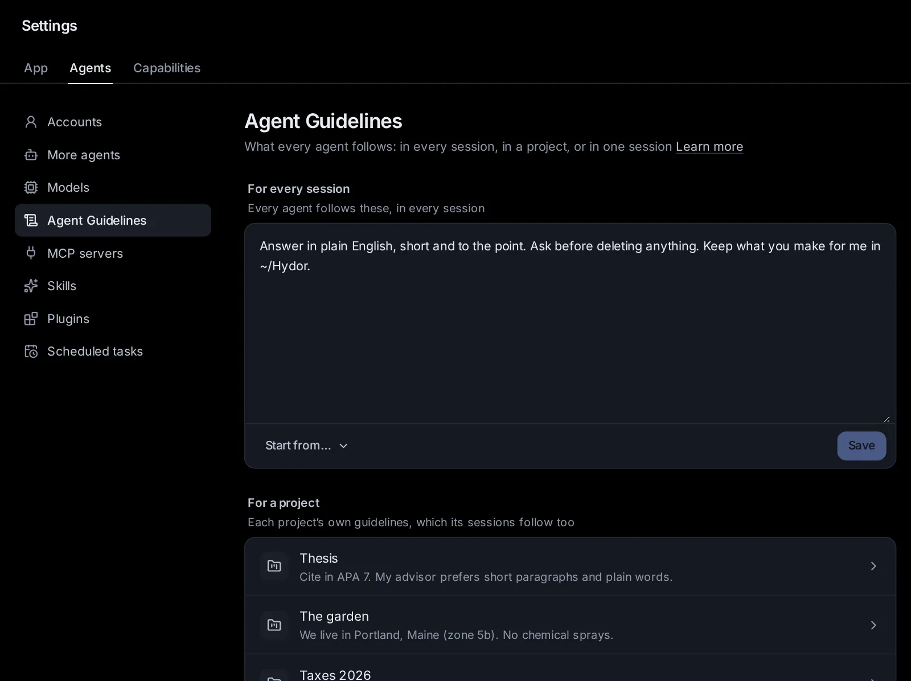

# Agent Guidelines

Agent Guidelines are what you want every agent here to follow: how you like to work, what to always or never do, how to talk to you. One text works for every agent (Claude Code, Codex, Custom and the agents that speak ACP), and you can write it for every session, for a space, or for one session.

## What guidelines are

Guidelines are plain words the app hands to the agent when a session starts, before your first message: "Answer in plain English and explain any jargon", "Ask before deleting anything", "Keep what you make in ~/Work", "Write British spelling". The agent follows them for the whole session.

You don't need to know how each agent reads its instructions. Claude Code and Codex each have files of their own for this (CLAUDE.md and AGENTS.md), and other agents have their own ways; the app gives your guidelines to each of them itself, so one text is enough for all of them.

What you ask in the conversation always comes first: if your guidelines say "short answers" and you ask for a detailed report, you get the report.

## The three levels

Guidelines come at three levels, from the most general to the most specific:

1. **For every session**: every agent, in every session. Set in [Settings → Agents → Agent Guidelines](/settings?s=guidelines).
2. **For a space**: every session in that [space](/guide/spaces). Set on the space's page, in its **Agent Guidelines** field.
3. **For one session**: only that session. Set on the start page (**Options → Guidelines**) before it starts, or later from the session's menu (⋯) → **Session settings → Guidelines**.

An agent gets all the levels that apply to its session, in that order. Where two disagree, the more specific one wins: a session's guidelines over its space's, a space's over the ones for every session.

## Write guidelines for every session

1. Open [Settings → Agents → Agent Guidelines](/settings?s=guidelines).
2. Under **For every session**, write what every agent should know about you and how you work.
3. Click **Save**.

Below the box are a few ready-made ways for agents to talk to you (**Plain English, short answers, explain jargon**, **Warm and encouraging: I am new to this**, **Brief and technical**). A click adds one as a line ("How to talk to me: …"), which you can change before saving.

Each level holds up to 20,000 characters. Keep them short where you can: every session reads all of it, and a few clear lines work better than pages.

## Give a space its guidelines

Every space has guidelines of its own, for the work you keep in it: who it is for, the style to write in, the rules of the project.

1. Open **Spaces** in the sidebar and pick the space.
2. Write in the **Agent Guidelines: what every agent in it follows** field.
3. Save the space.

You can also write them when you make a space: in the **New space** window, click **More options**, then write in **Agent Guidelines**. **Settings → Agents → Agent Guidelines → For a space** lists every space that has guidelines; click one to open it.

In a group (a space that brings several spaces together), its sessions follow the group's own guidelines, and read what each space in the group asks as part of working with that space.

## Guidelines for one session

### Before it starts

1. On the start page, open **Options** (beside the message box).
2. Click **Guidelines**. A dialog opens on **This session**.
3. Write what this session alone should follow, and click **Save**. The Options chip then shows **For this session**.

The same dialog shows the space's guidelines (when you picked a space) and the ones for every session, each on its own tab, so you can see everything the agent will follow, and change those too. A dot on a tab means that level has some.

### In a running session

1. Open the session's menu (⋯) → **Session settings → Guidelines**.
2. Change **This session** (or the space's, or every session's), and click **Save**.

A change takes effect from your next message. Claude Code and Codex read their instructions when they start, so when you send your next message the app starts the agent again quietly with the new guidelines; the conversation carries on where it was. This waits while the agent is in the middle of a turn, works towards a goal, or has work running in the background: it happens once it is idle. Custom reads them before each turn anyway. Other agents (Gemini CLI, OpenCode and the rest) take changed guidelines from their next session.

## What makes good guidelines

- **Say what you want, plainly**: "Ask me before installing anything" is clearer than "be careful".
- **Put the lasting things here, and the task in the message**: guidelines are for what holds every time.
- **Use the right level**: how you like to be talked to belongs in every session's; a project's rules in its space; a one-off constraint in the session's.
- **Keep them current**: when an agent keeps doing something you don't want, add a line.

Some examples:

- For every session: "Answer in plain English. Explain jargon the first time. Ask before deleting files or sending anything outside this computer."
- For a space "Thesis": "Cite in APA style. The thesis is about dairy farming in Greece. Keep drafts in the drafts folder."
- For one session: "Only use Python's standard library."

## How the agents talk to you

The setting that used to be **How the agents talk to you** (in Settings → Capabilities → Assistants) is now part of the guidelines for every session: whatever you had written there was moved into them, as a line that starts "How to talk to me:". Change or remove it there.

## CLAUDE.md and AGENTS.md

Claude Code and Codex also read instruction files of their own: CLAUDE.md (Claude Code) and AGENTS.md (Codex), in your home folder for every session, and in a project's folder for the sessions that work there. They keep working as before. People who keep such files in a repository, to share them with everyone working on it, can still edit them here:

1. Open [Settings → Agents → Agent Guidelines](/settings?s=guidelines).
2. Open **Files Claude Code and Codex read too** at the bottom.
3. Pick the folder, then **Claude Code** or **Codex**, and the file to edit (or **Create** it).

The list shows every file the agent reads for a session in that folder, in the order it reads them. For most people the guidelines are simpler: they work for every agent and need no files.

## Ask an agent

- "Add to my guidelines that you should always answer in Greek."
- "What guidelines does this session follow?"
- "Give my Thesis space the guideline: cite in APA style."
- "Remove the line about British spelling from my guidelines."
- "For this session only, don't use any libraries outside the standard library."
