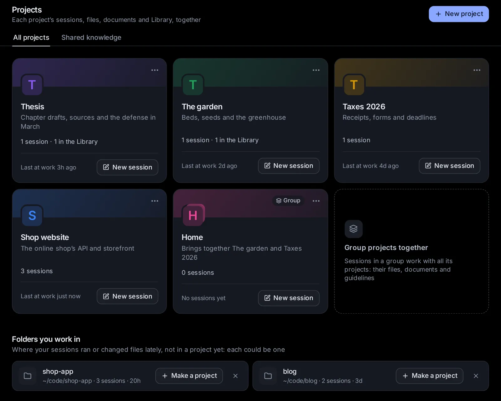

# Projects and knowledge

A project keeps one piece of work together: its sessions, a folder for its files (and other folders of yours it works with), documents of its own, what agents remember about it, the guidelines every agent in it follows, skills of its own and the assistant its sessions start as. Shared knowledge holds the documents and folders you add once so that every session can search them and cite the file and page it read. This topic covers making and using projects and groups of projects, giving a project skills of its own, sharing a project with people, and adding, searching and managing the documents agents search.

## What a project is

A project is one piece of work with everything that belongs to it, like Projects in ChatGPT or Claude. A tax return, a thesis, a garden, a website: each can be a project. On the start page you pick a project by its name instead of a folder, and every session you start in it:

- **works in the project's folder**. The agent is told that this folder holds the project's files, what is in it now (the last changed first), and to keep what it makes for the project there. It also works with the other folders the project works with, where they are: Claude Code works in them as in its own folder, and other agents are told where they are;
- **follows the project's guidelines**: what every agent in the project should know, such as who the work is for, how to work and what to keep in mind (see [Agent Guidelines](/guide/guidelines));
- **gets the project's own skills** with your skill library: written methods for how its work is done, which agents load when a task calls for them (see [Give a project skills of its own](#give-a-project-skills-of-its-own));
- **starts as the project's assistant**, when the project has one (see [Assistants](/guide/assistants));
- **remembers what earlier sessions in the project learned**: agents keep notes about a project by its folder, so the sessions of a project share them (see [Memory](/guide/memory));
- **searches the project's own documents**, and the shared knowledge too unless the project turns that off (see [Which sessions search which knowledge](#which-sessions-search-which-knowledge)).

A project can also bring other projects together. That is a **group**: see [Bring projects together in a group](#bring-projects-together-in-a-group).

## Open the Projects page

Click **Projects** among the tools at the bottom of the sidebar. On a phone, open the sidebar first: it is a drawer. You can also type "projects" in the search box (Ctrl+K, or ⌘K on a Mac).

The page has two tabs:

- **All projects**: your projects, with **New project** at the top right.
- **Shared knowledge**: the documents every session can search (see [Shared knowledge: documents every session can search](#shared-knowledge-documents-every-session-can-search)).

Each project shows as a card:

- a band of its colour with its mark: a rounded square in its colour with the first letter of its name (a group's mark has a second square behind it, and **Group** on its band), and in its corner **More** (⋯), the same menu as at the top of the project's page;
- its name, and under it what it is about, or its folder when it has no description. A group says "Brings together" and the names of its projects;
- what it holds: how many sessions, how many things in the Library, documents and skills;
- how long ago one of its sessions was last at work, and **New session**, which starts a session in it at once.

Click a card to open the project's own page, or type the project's name in the search box (Ctrl+K) to go straight there. With no projects yet, the page says what a project is for in three short parts, with **Make a project**.

Drop files from your computer on a project's card to add them to the project ("Drop to add to “Thesis”" shows while they are over it): documents, spreadsheets, slides, LaTeX and notebooks become pages of the Library, pictures, videos and sounds are kept there, and any other file goes in the project's folder (see [Add files of yours](/guide/library#add-files-of-yours)).

Under the projects, **Folders you work in** lists folders your sessions used lately that could become projects (see [Folders you work in, not in a project yet](#folders-you-work-in-not-in-a-project-yet)).

## Make a project

1. On the [Projects page](/projects), click **New project**. The start page's folder menu has **New project** too (see [Start a session in a project](#start-a-session-in-a-project)).
2. Fill in the window:
   - **Name**: what you call the project, such as "Taxes 2026", "The garden" or "Thesis". Up to 60 characters. It is the only field you must fill in. The square beside it is the project's mark, in the colour it will get: click it to pick another of the eight colours (amber, blue, green, pink, violet, teal, orange, slate). If you pick none, projects take the colours in turn.
   - **Where its files go**: pick one of two.
     - **In a new folder** (the usual choice): the app makes the project a folder of its own, named after it.
     - **In a folder I already have**: a project or a folder of documents on this computer, which stays where it is. Below it, **Used lately, in no project yet** shows folders your sessions worked in lately as one-tap choices; or click **Choose a folder…** and find one by name or type its path. Picked with the name still empty, the folder's name becomes the project's. **Change** picks another.
3. Optionally, click **More options** for the rest (a dot beside it means something there is filled in):
   - **What it is about**: a line shown under the name. Up to 300 characters.
   - **Agent Guidelines**: what every agent in the project should follow, such as who the work is for, how to work and what to keep in mind: "Amounts in EUR. I am self-employed in Greece." Up to 20,000 characters. See [Agent Guidelines](/guide/guidelines).
   - **Other folders it uses**: more folders of yours its agents work with, where they are; nothing is copied. **Add a folder** adds one, up to 12; ✕ leaves one out again.
4. Click **Make the project**, or press Enter in the name field.

A new folder goes in a **Projects** folder where task folders go: "Taxes 2026" gets `~/Hydor/Projects/taxes-2026`, unless you moved task folders elsewhere (see [Move task folders](/guide/assistants#move-task-folders)). If that name is taken, it adds `-2`, `-3` and so on. Made from the Projects page, the new project's page opens. Made from the start page, the new project is picked for the session you are about to start.

Two more things are set on the project's **Settings** tab afterwards: the assistant its sessions start as, and the projects it brings together. Its documents go on its **Knowledge** tab, its skills on its **Skills** tab, and more folders on its **Files** tab.

### A project for a folder you already have

In the **New project** window, pick **In a folder I already have** under **Where its files go**, then the folder: the project works in it, and no new folder is made. An agent can do it too: "Make a project called Shop for ~/code/shop". A project's own folder can't be changed once the project is made, but the folders it works with can: see [Files](#files).

### Folders you work in, not in a project yet

Under your projects on the [Projects page](/projects), the app lists up to six folders you could make projects for: folders your sessions worked in over the last 90 days, or changed files in while working somewhere else, that no project has yet. The ones used most, and most recently, come first. A folder inside a project kept in Git counts as the whole project. Each card shows the folder's name, where it is, how many sessions used it and when one last did.

- **Make a project** opens the **New project** window with that folder picked and its name filled in.
- ✕ (**Not a project**) stops suggesting that folder. The folder itself is untouched.

Your home folder, hidden folders, temporary ones and the folders the app makes for itself (task folders, apps' runs, worktrees) are never suggested. Once a project has a folder, as its own or as one of the folders it works with, it leaves the list. The same folders show under **Used lately, in no project yet** in the **New project** window.

## Start a session in a project

There are two ways:

- **From the project**: click **New session** on its card on the Projects page, or at the top of its own page (on a phone, the pen). The start page opens with the project picked, and with its assistant when it has one.
- **From the start page**: open the folder chip in the row under the message box. Its menu lists your projects first, then the folder in use and the ones you used last, then **New task folder** and **New project**. Until you type, it shows the three projects at work most recently (and the one picked, if it isn't among them). Type part of a name in the field at the top to find any project, or any folder. Each project shows its mark, its name and what it is about.

When you pick a project, the chip shows its mark and name instead of a folder, and the session will work in the project's folder. If the project starts its sessions as an assistant, the **Assistant** chip changes to it, with any agent, model and permissions that assistant suggests. You can still change any of them before you start. Then type your message and click **Start**.

The start page remembers the project for your next session, on any device you use. To work outside it again, pick a folder or **New task folder** in the same menu. If a project you had picked is deleted, the start page keeps its folder but no longer the project.

On a phone, the menu opens as a sheet from the bottom of the screen, titled "Project or folder to work in", and the keyboard waits until you tap the field.

When the project's folder is a Git repository, the end of the menu offers **New worktree**, as for any folder in a repository: the session then works on a branch of its own, in a separate copy of the repository (see [Sessions](/guide/sessions)). Sessions you start by voice in hands-free mode start in the project picked last on the start page (see [Documents, images, videos and voice](/guide/documents-voice)).

## A project's own page

Click a project on the Projects page to open it. The top of its page is in the project's colour: the arrow on the left goes back to all your projects (as on the app's other pages), then come the project's mark and name and what it is about (a group's projects, for a group; its folder, with no description). On the right, **New session** starts a session in the project (on a phone, the pen), and **More** (⋯) has:

- **Open its folder in Files**: the project's folder on the Files page.
- **Only its sessions in the sidebar**: the session list shows only the sessions started in the project, as the sidebar's own filter does (see [Show one project's sessions in the sidebar](#show-one-projects-sessions-in-the-sidebar)). Pick it again to see every session.
- **Share with people**: invite someone (an advisor, a student) to see the project and comment on its documents at a link of their own (see [Share a project with people](#share-a-project-with-people)).
- **Delete the project** (see [Delete a project](#delete-a-project)).

Below them are six tabs: **Overview**, **Library**, **Files**, **Knowledge**, **Skills** and **Settings**. **Library**, **Knowledge** and **Skills** have a count, except on a phone, where the tabs leave their counts out to fit. Each tab shows at once.

### Overview

The project at a glance, in cards:

- **Sessions**: the sessions started in the project, the one at work most recently first, each with its agent's icon, its title, what it is doing while it runs (**Working**, **Needs you**, **Ready**; not on a phone) and how long ago it was at work. Click one to open it. With more than six, **All** shows the rest. With none yet, it says that a new one works in the project's folder, with its guidelines, documents and skills, and has **New session**.
- **In the Library**: what the project holds in the Library, the last changed first (see [Library](#library)). **Open in the Library** shows them there. Files dropped on it are added to the project.
- **Shared with** (beside them, under them on a phone), once you share the project with someone: each person, with their initials and what they did last ("Commented on “Chapter 3” · 2 h ago", "Not opened yet"). Click one, or **Share**, to see and change who it is shared with (see [Share a project with people](#share-a-project-with-people)).
- **Every session here** (beside them, under them on a phone): what every session in the project gets. **Folder** (its folder, and how many more it works with: click for the **Files** tab), **Guidelines** (the start of its guidelines: click for **Settings**), **Knowledge** (how many documents it has), **Skills** (how many of its own), **Starts as** (its assistant) and **Memory** (**What agents remember about it**, which opens [Settings → Memory](/settings?s=memory), where the notes agents kept about the project are listed under its folder).
- **The projects it brings together**, for a group: each of its projects, with how many sessions it has. Click one to open it.

### Library

Everything the project holds in the Library: the pages, slides, documents, spreadsheets and LaTeX documents agents saved in its sessions, and what you kept there or moved there (see [Sort it by project](/guide/library#sort-it-by-project)). Each card opens it, and its **More** (⋯) has what it has in the Library. **Open in the Library** shows the project's things there, with the Library's search and kinds. With nothing yet, the tab says so, with **New page** and **New slides**, made in the project. Drop files on it to add them to the project, each made what it is (see [Add files of yours](/guide/library#add-files-of-yours)).

### Files

The project's folder, and the other folders it works with, as the [Files page](/guide/files-git#browse-a-folder) shows a folder: open, pick several, drag, upload, and each row's menu. A file opens in a window over the page.

- Over the folder, a chip for each: the project's own folder, by the project's name, and each folder it works with, by its name. Click one to show it.
- **Attach a folder** adds a folder of yours for the project to work with, where it is: find it by name or type its path. Nothing is copied. Up to 12.
- ✕ on a folder's chip leaves it out of the project; the folder itself stays as it is. The message has **Undo**.
- **Open in Files** opens the folder on the Files page.

To add files from elsewhere, use **Add to a project** on the Files page, in a file's window or on an agent's file cards: a file is copied into the project's folder, a folder joins those it works with (see [Add files to a project](/guide/files-git#add-files-to-a-project)). Or drop files from your computer on the project's card or its Library: what the Library keeps (documents, spreadsheets, pictures…) goes there, and any other file comes into this folder (see [Add files of yours](/guide/library#add-files-of-yours)).

### Knowledge

The project's own documents, which only its sessions search, and whether they search the shared knowledge too. See [Give a project documents of its own](#give-a-project-documents-of-its-own).

### Skills

Every skill the project's sessions get: its own, your skill library's, and Claude Code's and Codex's own, each with a switch for this project alone. See [Give a project skills of its own](#give-a-project-skills-of-its-own).

### Settings

Everything about the project itself, in four parts, each with a line on what it is for:

- **The project**: its **Name** (beside its mark, in the colour picked), **What it is about** and **Its colour**.
- **What every agent in it follows**: its **Agent Guidelines**, as when you made it.
- **How its sessions start**: under **Its sessions start as**, one choice to tap: **The assistant picked on the start page** (the default: picking the project leaves the start page's assistant as it is), or one of your assistants, built in or your own. Picking the project on the start page then picks that assistant too.
- **The projects it brings together**: pick projects here to turn this project into a group (see [Bring projects together in a group](#bring-projects-together-in-a-group)).

Once you change something, a bar says **Unsaved changes**, with **Undo changes** and **Save**; it stays in view while you scroll. At the bottom, **Delete the project** says what stays, with its button.

## Give a project skills of its own

Skills are written methods that agents load when a task calls for them (see [Skills](/guide/skills)). Your skill library reaches every session; a project can also have skills of its own, which only its sessions get: how its work is done, step by step. "Cite in APA 7 and check every DOI" for a thesis, say, or "ingredients in grams, then numbered steps" for a family cookbook. It can also turn any skill on or off for its own sessions. Both are on the project's **Skills** tab.

The tab lists every skill the project's sessions get, in groups as on [Settings → Skills](/settings?s=skills), with a search box, **New skill**, the **⋯** menu, and filters: **All**, **Its own**, **Built in**, **Yours**, **From plugins**, **Claude Code and Codex** and **Changed here**. The project's own skills come first, under **Its own**; with none yet, that group says what they are for, with **New skill**.

**New skill** opens a window with three fields, then **Add the skill**:

- **Name**: lowercase words with dashes, such as `citation-style`. Spaces and capitals turn into that when you leave the field. Agents know the skill by this name.
- **When to use it**: one line, such as "Use when citing a source in the thesis". Agents see it in every session of the project, and read the rest of the skill only when a task fits.
- **The skill**: the steps in order, the checks and the mistakes to avoid, in Markdown.

To change a skill of your library for this project alone, open it on the tab and click **Change for this project**: it is copied into the project with its other files (examples, scripts), and the window to change it opens. The library's stays as it is for every other session.

A skill needs a name of 2 to 64 characters, a line on when to use it of at least 10 characters, and steps of more than a few words; the whole skill holds at most 20,000 characters. A skill that looks like it holds a password, a key or a token is refused: write where the secret is kept instead.

### Turn a skill on or off for this project

Every skill on the tab has a switch at the end of its row: your library's (built in, yours and your plugins'), the project's own, and Claude Code's and Codex's own. A switch here is for this project's sessions alone; the switches on [Settings → Skills](/settings?s=skills) are for every other session.

- A skill switched the other way from Settings says **On here** or **Off here**, and the filter **Changed here** shows only those. A skill turned off in Settings shows as **Off**: switch it on to have it in this project alone.
- In its window, a skill switched here says what Settings has for every other session, and **Follow Settings** goes back to that. Switching it back by hand does the same.
- In the **⋯** menu, **Reset every switch here** puts every skill back to what Settings says, after you confirm, and **Skills for every project** opens Settings → Skills.

A new session in the project gets the switches as they are when it starts; one already going keeps what it started with, though Custom follows a change from its next turn. Claude Code's and Codex's own skills are switched for the project's sessions without changing those agents' own settings. In Settings → Skills, a skill a project switches the other way says so on its row ("Off in Thesis").

### The list of a project's skills

Each of the project's own skills shows as a row: its name, when to use it, and how often agents in the project (and in groups that bring it in) used it. A skill with the name of one in your skill library has the badge **In place of the library's**: the project's sessions get it instead of the library's.

- Click it to read the skill and its **History** of changes. **Change**, at the bottom of that window, edits its name, when to use it and its text: a new name keeps its other files, its history and its switch.
- **Remove**, in the same window, removes it after you confirm. The project's sessions stop seeing it, or go back to the library's skill of that name. Removed skills are listed under the list, after **Removed:**: click one to bring it back as it was.

In a group, the own skills of each project it brings together follow, under that project's name: the group's sessions get them too. Change them on that project's page. Claude Code's and Codex's own skills are listed for the project's folder: yours, and those in that folder (Claude Code's in its `.claude/skills`).

### How agents get them

Every Claude Code, Codex and Custom session started in the project gets its skills together with your skill library, as the project switches them: Claude Code in the same plugin named "hydor" (hydor:citation-style), Codex in the same extra folder of skills, Custom in its list of skills. The agent is also told which skills are the project's own, and to use one when it fits the task. Custom has a skill you add or change from its next turn; Claude Code and Codex from their next session.

The skills are kept in the app's data folder, not in the project's folder, so your files stay as they are. A group's sessions also get the skills of the projects it brings together (see [What sessions in a group get](#what-sessions-in-a-group-get)).

### Skills agents propose in a project

After a task that took real effort, an agent can propose keeping its method as a skill, or improving one it followed, and you approve, edit or dismiss it (see [Approve, edit or dismiss a proposed skill](/guide/skills#approve-edit-or-dismiss-a-proposed-skill)). When the session is in a project, the card asks where to keep it, under **Keep it for**:

- **Every session**: in your skill library, as outside a project;
- the project's name: in the project's skills alone. For an improvement to a library skill, the project gets its own version with the change, and the library's stays as it was.

The agent suggests one of the two; you choose before you approve. An improvement to one of the project's own skills has no choice: it stays the project's.

## Change a project

Open the project, go to its **Settings** tab, change what you like and click **Save**. Sessions you start in the project from then on get the new name, description and guidelines. A new assistant applies the next time you pick the project on the start page, or click **New session** on its page. The project's folder stays the same: it can't be moved to another folder.

## Delete a project

1. Open the project, and click **More** (⋯) at its top, or go to its **Settings** tab.
2. Click **Delete the project**.
3. The app asks "Delete the *name* project?" Click **Delete**.

Deleting a project keeps everything that was in it:

- **Its folder** and the files in it stay where they are, and so do the folders it worked with.
- **Its sessions** stay, and no longer belong to a project.
- **What it holds in the Library** stays there, in no project.
- **Its documents** move to the shared knowledge, so every session can search them from then on. To keep them apart, move their knowledge base into another project (see [Rename, move, read again or delete a knowledge base](#rename-move-read-again-or-delete-a-knowledge-base)).
- **Its skills** move to your skill library, so every session gets them from then on. One with the name of a skill the library has already takes the project's name after its own: the Thesis project's `research` becomes `research-thesis`.
- **What agents remember** about its folder stays: notes belong to the folder, not to the project.
- It leaves any group it was in. A group left with none of its projects becomes a plain project.

## Bring projects together in a group

A group is a project that brings several projects together, for work that spans them: "Everything for the thesis" bringing in "Thesis" and "Reading notes", say. It has everything a project has: a name, a folder of its own, guidelines, documents, skills and an assistant. Its sessions also work with every project it brings together.

### What sessions in a group get

- **The projects' folders**: Claude Code can work in each of them as in its own folder; other agents are told where each one is. What a session makes goes in the group's own folder, unless you say otherwise.
- **The projects' guidelines**: after the group's own, each project's name, what it is about, its folder and its guidelines.
- **The projects' documents**: searched together with the group's own documents and the shared knowledge (unless the group turns the shared knowledge off). The agent is told which project each knowledge base comes from.
- **The projects' skills**, with the group's own and your skill library. Where two have the same name, the group's own comes first, then that of the project it brought in first.
- **Memory** comes from the group's own folder. The notes agents kept in each project stay with that project.

### Make a group

1. On the [Projects page](/projects), click **Group projects together**. This card shows once you have at least two projects that aren't groups.
2. In **New group of projects**, give it a **Name**, such as "Work" or "Everything for the thesis".
3. Under **The projects it brings together**, tap each project to bring in; tap one again to take it out. Pick at least one.
4. Optionally, fill in **What it is about** and the **Agent Guidelines**, and pick a colour.
5. Click **Make the group**. Like a project, it gets a folder of its own for what is made in it, and its page opens.

You can also turn an existing project into a group: on its **Settings** tab, pick projects under **The projects it brings together** and click **Save**. Change a group's projects the same way. Take all of them out and it is a plain project again.

A group's **Knowledge** tab also shows **Also the documents of the projects it brings together**: each of its projects, with how many documents it has. Click one to open that project's Knowledge tab. Its **Skills** tab shows **Also the skills of the projects it brings together** the same way.

### Limits

- A group brings plain projects together, not other groups: groups are one level deep. A project that is in a group can't bring other projects together itself; its Settings tab says which group it is in instead.
- A project can be in several groups.
- A group brings together at most 12 projects. Once 12 are picked, the others can't be tapped.

## Show one project's sessions in the sidebar

The sidebar gives each project a group of its own, under its name and mark, with its newest sessions; the pen at the end of the group's heading starts a new session in the project. See [The session list](/guide/start#the-session-list).

To list only one project's sessions:

1. In the sidebar, click the filter button at the end of the **Search sessions** field (**Filter and group sessions**).
2. The menu lists **All agents**, **Claude Code** and **Codex**, then **Every project**, up to eight of your projects, and **Projects**, which opens the Projects page. Pick a project.

The session list then shows only the sessions started in that project, by day, and the filter button is coloured while a filter is on. Pick **Every project** to see every session again. The agent filter works at the same time, to show only one agent's sessions in a project. If the project is deleted, the list shows every session again.

On the project's own page, **More** (⋯) → **Only its sessions in the sidebar** does the same, with a check while it is on; pick it again to see every session.

On a phone, open the sidebar (a drawer) first.

## Share a project with people

You can invite people into one project, such as an advisor and the students who work with you, each with a link of their own. Without your password, they see the project's documents, its sessions and, when it has them, its runs and its reading list. They comment on its documents under their own name, and if you let them, they change its documents too. They never reach your agents, your files, your settings or your other projects.

### Invite someone

1. Open the project and click **More** (⋯) at its top, or **More** on its card on the [Projects page](/projects). Click **Share with people**.
2. Under **Invite someone**, type **Their name**. Their comments and changes show under it.
3. Pick what they may do:
   - **View and comment**: they read everything the project shares, and comment on its documents and LaTeX documents.
   - **Edit documents**: they also change its documents, spreadsheets and slides, in the Library's own editors, and its LaTeX documents where this computer typesets them shut in (see [What is never shared](#what-is-never-shared)).
4. Pick how long the link works: **A week**, **A month** or **Until you stop it**.
5. Click **Make their link**. Copy it with the copy button and send it to them, or click the QR code button to show it as a QR code for their phone's camera. The link is shown only now: the app keeps only a fingerprint of it, so it can't show it again. You can always make them a new one.

An agent can make a link too, with your OK each time: "Share my Thesis project with Maria so she can comment, for a month."

### What they see

Their link opens the project on its own, in the app's look, with nothing else of yours around it:

- At the top, the project's mark, its name and what it is about. On the right, their own name: its menu says what they may do and until when, and who shared it with them, and has **Language** (English, 中文, Ελληνικά) and **Theme** (**Light**, **Dark** or **Like this device**) for their browser.
- **Documents**: the project's pages, documents, slides, spreadsheets, LaTeX documents and notebooks, each with its picture. One opens to read as its own address shows it (a LaTeX document typeset into pages, its source a click away), with **Download** for its files: a PDF, a Word document, the LaTeX project and so on. With **Edit documents**, documents, spreadsheets and slides open in their editor instead.
- **Sessions**: the project's sessions, as a [read-only link](/guide/devices#share-a-session-with-a-read-only-link) shows a session: the conversation, the steps by name, file changes and pages the agent showed, following along while an agent works. Never command output, the agent's thinking or what a step was given. A Confidential session never shows.
- **Runs**, when the project has experiments: each run's name, how it went and when, its metrics and its settings. Never its command, its folder, its log or the machine it ran on.
- **Reading list**, when your Reading list app has papers for the project: each paper's title (a link to it), its authors, venue and year, whether it is read, and its tags. Never your notes about it or its files.

The page follows along by itself, every minute while it is open. Agents that work in the project are told who it is shared with and that those people read its sessions, so they keep keys, passwords and private details out of them.

### Comments under their name

On a document or a LaTeX document, **Comments** (beside it, or over it on a phone) lists its comments and their replies, each under who wrote it: theirs as **You**, an agent's as **Agent**, and yours under your name. At the bottom of the Share dialog, **They see your comments as** says that name ("Owner" until you change it); **Change** sets another.

To comment, they click **Add a comment**, then paste the words it is about, copied from the document, or leave them out to comment on the whole document. They can reply to any comment and resolve or reopen one, but change or delete only their own. With **Edit documents**, they comment in the editor itself, as you do.

In your own editor, their comments show under their name, and agents read and answer them as they answer yours: "Answer Maria's comments on Chapter 3." Agents are told to take their comments as requests about the document only, and to do nothing else one asks (run a command, open a file, write to someone) unless you ask them to. When someone comments or replies, you get a notice ("Maria commented: …") and a line in your [inbox](/inbox) ("Maria commented on “Thesis, chapter 3”"), which stays until you or an agent reply, or the comment is resolved.

Each comment is saved as a new version of the document; a run of them in a row is kept as one version. If you save the document in its editor while comments came in, they are kept, on the words they were about.

### Changes under their name

With **Edit documents**, what they save is a new version of the document, with their name in its **Versions** list, and agents are told who changed it last. They can't change who wrote anyone else's comments, or delete them. If the document changed since they opened it, they are asked before saving theirs on top (the other version stays among its versions).

### Change or stop sharing

In the Share dialog, **Shared with** lists each person, with what they may do, until when, and what they did last. Their **More** (⋯) has:

- **View and comment** or **Edit documents**: what they may do, from their next click.
- **For a week from now**, **For a month from now** or **Until you stop it**.
- **Make a new link**: their link stops at once; send them the new one. They stay the same person, and their comments stay theirs.
- **Stop sharing**: their link stops at once. What they wrote stays, under their name.

A link that ran out, was stopped or was made again says so when opened ("This link has expired", "This link was turned off"), and they can ask you for a new one.

### What is never shared

- **Your agents**: people can't start or steer a session, or ask an agent anything. They read sessions and comment on documents.
- **Your files**: not the project's folder, not any folder of yours. Only what the project holds in the Library, and its sessions as read-only links show them.
- **Your settings, your other projects** and everything else in the app. A group's link shows the group's own things, not those of the projects it brings together.
- **Running anything**: a page of HTML (a small app, a tracker) shows with its data as it is, and what it changes is not kept; a notebook shows its cells and outputs and never runs. LaTeX documents are changed through a link only where TeX runs shut in by bubblewrap (Linux); elsewhere people read and comment on them.

Each link is a long random code that opens one project for one person. A code that opens nothing counts as a wrong password from where it came: after ten in an hour, that address can't open links or sign in for an hour (see [Reach the app from another device](/guide/devices#reach-the-app-from-another-device)).

## Shared knowledge: documents every session can search

Agents can search documents you add once: contracts, manuals, notes, papers, a whole folder. They find passages by their words or by what they mean, and cite the file and page they read. Documents are kept in **knowledge bases**: named collections of files you dropped in and folders on this computer.

- **Shared knowledge** ([Projects → Shared knowledge](/knowledge)): every session searches it, in a project too unless the project turns that off.
- **A project's own knowledge**, on its **Knowledge** tab: only that project's sessions search it, and the sessions of a group that brings the project in.

To open the shared knowledge, click the **Shared knowledge** tab on the Projects page, or type "shared knowledge" in the search box (Ctrl+K).

## Add documents

With no shared knowledge yet, the page says "Add your documents once" over a large box to drop documents in. Drop files or a folder there, and a knowledge base called "My documents" is made for them. **Start with a folder on this computer instead** makes an empty "My documents" base, where you then add a folder.

Every knowledge base has its own drop box and its own **Add a folder on this computer** button. To start another base, click **New knowledge base** at the top of the page (**New** on a phone). Separate bases keep things apart, and an agent can search one base by its name, but one is enough to start.

### Drop or choose files

Drag documents or a folder onto a knowledge base's box ("Drop documents or a folder here"), or click **choose files**, or **folder** to pick a whole folder. The files are copied into the app's data folder and read as soon as they are in, so later changes to your originals don't reach the base. A small panel shows the upload. If a file of the same name is already in the base, the panel asks whether to **Replace** it, **Skip existing** or **Cancel**.

The files come from the device you are using. On a phone, **choose files** opens the phone's file picker; picking a whole folder is offered on a computer only.

### Add a folder on this computer

1. On a knowledge base, click **Add a folder on this computer**.
2. In the menu that opens ("A folder to read, and keep up to date"), type a folder's name to find it among the folders you used lately and those in your home folder, or type its path, such as `~/Documents/Manuals`. Pick it.

The folder is read where it is: nothing is copied. It shows as a chip on the base, and the base keeps up with it. A minute after the app starts, and every hour after that, the app reads what is new or changed in the folder and drops what was deleted; after a start, it also tries again the documents that couldn't be read, which a newer version may read. To read it at once, pick **Read again now** in the base's menu.

"This computer" is the one Hydor runs on, which may not be the device in front of you.

To stop reading a folder, click the × on its chip. Its documents leave the base; the folder and its files are untouched.

### What can be read

- **Documents**: PDF, Word, Excel, PowerPoint, OpenDocument, EPUB, CSV and RTF; old .doc, .xls and .ppt files too when LibreOffice is installed on this computer.
- **Text**: plain text and Markdown, web pages (their text, without the markup), and code and data files such as JSON, YAML, Python or JavaScript.

Left out: pictures; files and folders whose names start with a dot (hidden ones); and the folders tools make, such as `node_modules`, `.git`, `dist`, `build`, `target` and `venv`. A folder is read up to 20,000 files and 12 levels deep. Of a text file over 4 MB, such as a big log or data file, the first 4 MB are read, and its last passage says where it was cut. Documents over 300 MB aren't read. A scanned PDF without a text layer has no text to search.

Each document is cut into passages of up to about 1,400 characters, each keeping the page, slide, sheet or heading it came from, so agents can cite it.

## See what a knowledge base holds

Each knowledge base is a card. Under its name, a line counts what it holds: its documents and passages, how much of it is ready to search by meaning (when that is on: "ready to search by meaning", or a percentage while it gets ready, going up as it goes), and how long ago it was last read ("read 25m ago"). While it is being read, the line starts "Reading 12 of 40…".

While search by meaning is on but can't get the passages ready now, a line above the knowledge bases says why, and agents find passages by their words until then:

- **Search by meaning is setting itself up on this computer**, with what it is doing (installing PyTorch, say): once, the first time.
- **Search by meaning is starting**: loading its model (downloading it, the first time).
- **Search by meaning is waiting for memory**, with how much is free and how much it needs. It tries again every few minutes; closing a few programs helps.
- **Search by meaning stopped**, with why. Click **Try again** once you have seen to it (installed Python, say), or try again in [Settings → Memory](/settings?s=memory&find=Search%20by%20meaning).

- **Show the documents** lists every document: its name or path, then how many passages it has and its size. **no text** marks a document with nothing to read in it, and **could not read** one that failed; point at it to see why. Click a document to open it. **Hide the documents** folds the list.
- When some documents couldn't be read, a red line says how many, with the first few and the reason for each.
- A file you dropped in can be removed with the × at the end of its row (on a computer, it shows when you point at the row). This deletes the base's copy. A document from a folder on this computer has no ×: remove it from the folder itself, or stop reading the folder.

## Rename, move, read again or delete a knowledge base

The ⋯ button (**More**) at the top right of a knowledge base opens its menu:

- **Read again now**: reads its files and folders again at once, for files just added or a folder that changed, and tries again the documents that couldn't be read.
- **Rename**: opens **Rename the knowledge base**. Type the new name (up to 60 characters) and click **Save**.
- **Move to**: **Shared knowledge**, or one of your projects; a check marks where the base is now. In a project, only that project's sessions search it; in the shared knowledge, every session does. This item shows once you have projects.
- **Delete**: asks "Delete *name*?" Its passages go, and the files dropped into it with them; folders on this computer stay as they are. Click **Delete** to go ahead.

## Give a project documents of its own

Open the project and go to its **Knowledge** tab.

- **Also search the shared knowledge** is a switch, on unless you turn it off. Turn it off and the project's sessions search only the project's own documents (and, in a group, those of its projects). The line under it says how many shared documents there are, with a **Shared knowledge** link.
- With no documents yet, drop documents or a folder in the box, or choose them: a knowledge base named after the project is made for them. **Start with a folder on this computer instead** makes an empty one, named after the project, to add a folder to.
- Once it has documents, the tab shows a search box (see [Try a search yourself](#try-a-search-yourself)), the project's knowledge bases with the same cards and menus as shared ones, and **New knowledge base** at the bottom.

A shared knowledge base can be moved into a project from its menu (**Move to**), and back.

## How agents search your documents

Once there is at least one knowledge base, agents get tools to search the documents their session may search, to read more of a document around a passage, and to list what the knowledge bases hold. Claude Code, Codex, Custom and the agents that speak ACP and take MCP servers (tool servers) all get them.

At the start of a session, the agent is told which knowledge bases it can search and how many documents each holds; in a project, also whether each is the project's own, shared, or from a project its group brings in. It is told to search there first, before the web or memory, when a question may be answered from them; to answer from what the passages say; to cite each passage it uses with its file and page or part, and its path; and to say so when the documents don't answer the question.

In the conversation, a search shows as a step: **Searched your documents**, what it looked for, and how many passages it found, or "nothing found". Click it to see the passages, each with its file, page and knowledge base. Click a passage to open the file.

### By words, by meaning, or the exact text

Agents search in three ways:

- **By words**: passages that hold the words of the question, the best matches first. Always available.
- **By meaning**: passages that mean what the question asks, even in other words or another language. This needs **Search by meaning**, which is on unless you turn it off in [Settings → Memory](/settings?s=memory&find=Search%20by%20meaning). It runs on this computer, and while it is on, every base gets ready for it in the background (see [Memory](/guide/memory#search-by-meaning)). While it is off, the Shared knowledge tab and each project's Knowledge tab say where to turn it on, and agents find passages by their words.
- **The exact text**: a phrase in quotes ("notice period") or a pattern between slashes (a regular expression, such as `/INV-\d+/`), found as the grep command would find it: for names, numbers and codes. These passages come in the order they appear in the documents.

An agent searches by words and by meaning together unless it asks for one, and a question in quotes or between slashes is searched for exactly. It gets 8 passages at a time unless it asks for more (up to 25), and it can search one knowledge base by its name.

### Try a search yourself

Above the knowledge bases, a field says "Try a search, as agents do: a question, or “exact words” in quotes". Type and press Enter. Up to 10 passages come back, each with its file and page, its knowledge base and how it was found: **by words**, **by meaning**, or both, or **by exact** for exact text. Click one to open the file.

On the Shared knowledge tab, it searches what a session outside any project searches. On a project's Knowledge tab, it searches what a session in that project searches.

## Which sessions search which knowledge

| A session… | searches |
|---|---|
| outside any project | the shared knowledge |
| in a project | the project's own documents, and the shared knowledge unless the project turns it off |
| in a group | the group's own documents, the documents of every project it brings together, and the shared knowledge unless the group turns it off |
| started by another session (a child session) | what the session that started it searches |

The knowledge tools never bring up another project's documents, not even when an agent asks for a file by its path. A knowledge base whose project was deleted is shared.

## Ask an agent

- "Make a project called Taxes 2026 for my receipts and tax return. Its sessions should start as the Researcher, and every agent in it should know that amounts are in EUR."
- "Make a project called Shop for my code in ~/code/shop."
- "What does my Thesis project hold in the Library? Move the reading tracker into it."
- "Which folders have I been working in that aren't in a project yet? Make projects for the two I use most."
- "Copy ~/Downloads/contract.pdf into my Taxes 2026 project, and have it work with ~/Documents/Receipts too."
- "Group my Thesis and Reading notes projects into one called Everything for the thesis."
- "Give my Thesis project a skill: cite in APA 7, and check that every DOI resolves before I hand a chapter in."
- "Copy the writing skill into my Garden project, and change it there to use plain words for children."
- "In my Shop website project, turn the docker skill on and Claude Code's deploy skill off, for that project only."
- "Add the folder ~/Documents/Manuals to my shared knowledge."
- "Move the Contracts knowledge base into the Taxes 2026 project, and stop that project from searching the shared knowledge."
- "Which knowledge bases do I have, and which documents couldn't be read?"
- "Share my Thesis project with Maria so she can comment, for a month, and with Nikos so he can edit the documents."
- "Who is my Thesis project shared with, and what did each of them do last?"
- "Answer Maria's comments on Chapter 3, then resolve the ones you dealt with."
- "Stop sharing my Thesis project with Nikos."
