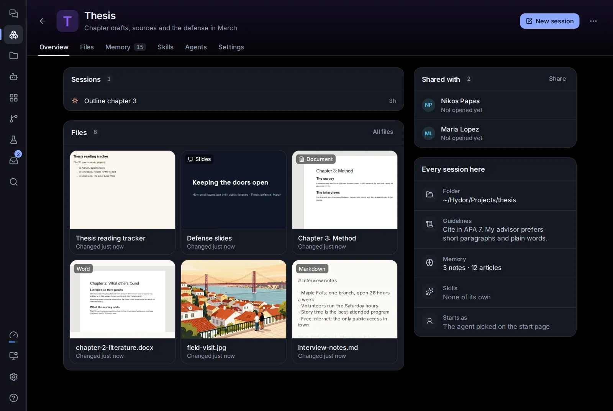

# Projects and knowledge

A project keeps one piece of work together: its sessions, a folder for its files (and other folders of yours it works with), what agents remember about it (notes, a wiki and documents of its own), the guidelines every agent in it follows, skills of its own, the agent its sessions start as, and agents of its own. Shared knowledge holds the documents and folders you add once so that every session can search them and cite the file and page it read. This topic covers the Projects page, a project's details, making and using projects and groups of projects, a project's own skills, sharing a project with people, and adding, searching and managing the documents agents search.

## What a project is

A project is one piece of work with everything that belongs to it, like Projects in ChatGPT or Claude. A tax return, a thesis, a garden, a website: each can be a project. On the start page you pick a project by its name instead of a folder, and every session you start in it:

- **works in the project's folder**. The agent is told that this folder holds the project's files and to keep what it makes for the project there, and with your first message what is in it now (the last changed first). It also works with the other folders the project works with, where they are: Claude Code works in them as in its own folder, and other agents are told where they are;
- **follows the project's guidelines**: what every agent in the project should know, such as who the work is for, how to work and what to keep in mind (see [Agent Guidelines](/guide/guidelines));
- **gets the project's own skills** with your skill library: written methods for how its work is done, which agents load when a task calls for them (see [Give a project skills of its own](#give-a-project-skills-of-its-own));
- **starts as the project's agent**, when the project has one (see [Agents](/guide/agents));
- **remembers what earlier sessions in the project learned**: agents keep notes about a project by its folder, so the sessions of a project share them (see [Memory](/guide/memory));
- **searches the project's own documents**, and the shared knowledge too unless the project turns that off (see [Which sessions search which knowledge](#which-sessions-search-which-knowledge)).

Sessions belong to a project by where they work. Every session that works in the project's folder, or in a folder inside it, is in the project, wherever it was started: in Hydor, in Claude Code or in Codex. When one project's folder is inside another's, the inner project gets it. A session in a worktree counts for the folder the worktree was made from, and a project whose folder is your home folder gets only the sessions in the home folder itself. So making a project for a folder you already work in brings its earlier sessions into it at once (the sidebar shows them under the project, not as a folder group), and a session that Hydor starts in a project's folder (from the start page, a scheduled task, an app or the API) starts in the project, with its guidelines, skills and knowledge from its first turn.

A project can also bring other projects together. That is a **group**: see [Bring projects together in a group](#bring-projects-together-in-a-group).

## Open a project's details

Where a project's details show depends on where you are. In the **Projects** section (the Projects page, or a project's page) they are the project's own page, in the list's place. From anywhere else (a session, Settings…) they open in a window over the page you are on, which stays behind it, dimmed. There are several ways in:

- **From the Projects page**: click a project's card (see [Find all your projects](#find-all-your-projects)). The project's page opens.
- **From the sidebar**: in the session list, click the project's name in its heading (on a phone, open the sidebar first, since it is a drawer, then tap the name; the drawer closes and the details fill the screen). Its ⋯ menu has **Project details** too, as its first item. The small arrow beside the name folds or unfolds the project's sessions.
- **From the search box**: type the project's name in the search box (Ctrl+K, or ⌘K on a Mac) and pick it. In the Projects section its page opens; elsewhere, the window. A project with no sessions yet has no heading in the sidebar, so this and the Projects page are the ways to it (a project you have just made opens by itself).
- **From a link**: a link to a project in a notification or in an agent's answer, followed from another page, opens the window over it, too.
- **By its address**: typing or reloading `/projects/<id>`, with a tab after it if you like, opens the project's page.

The page and the window show the same things:

- **The header**, in the project's colour: on the project's page, an arrow at the top left (**All projects**); then its mark and name, and under them what it is about (its folder when it has no description; a group says "Brings together" and the names of its projects). On the right, **New session** starts a session in the project (on a phone, the pen) and **More** (⋯) has the project's menu (see [The project's menu](#the-projects-menu)). The window also has ✕, which closes it.
- **Its tabs**: **Overview**, **Files**, **Memory**, **Skills**, **Agents** and **Settings** (see [A project's details](#a-projects-details)).

**On the project's page**, the arrow goes back to the Projects page, and so does the browser's Back; there is no ✕. The tab you are on is in the page's address (`/projects/<id>/files`, `/projects/<id>/memory`…), so a reload or a link keeps it. So is a folder you open on the **Files** tab, and Back steps out of it. A link there to another project (one that a group brings together) opens that project's page. Deleting the project takes you back to the Projects page.

**The window** closes with ✕, with Esc, or with a click on the dimmed page outside it. Going to another page closes it too: opening a document from the **Files** tab, say, or following a link. On a phone the window fills the screen. Esc closes a menu or a dialog over the window first, and the window after it.

## Find all your projects

**Projects** on the rail (right before **Files**; on a phone, in the grid of tools in the sidebar drawer) opens the Projects page, or go to [/projects](/projects). It lists every project as a card, on the whole width of the page, with no column beside the rail. The title shows how many there are.

- **New project** makes one (see [Make a project](#make-a-project)). Its ▾ has **New project** and **New group of projects…**, which needs two projects to bring together (see [Make a group](#make-a-group)).
- **Find a project** filters the cards as you type, by name, description and folder.
- The button beside it sorts them: **Recent activity** (the project at work most recently first, the usual order), **Name** or **Most sessions**. This browser keeps your pick.

Each card shows:

- a band in the project's colour with its mark, and chips: **Group** for a group, and **From Claude Code** or **From Codex** for a project Hydor found (see [Projects found in Claude Code and Codex](#projects-found-in-claude-code-and-codex));
- its name, what it is about (a group says "Brings together" and the names of its projects), and its folder;
- what it holds: its sessions, documents, skills and kept files, and "Shared with 2 people" once you share it;
- "2 working" while its sessions are at work, and a dot when a session finished since you last looked;
- when it was last at work, and small bars for the messages of its last four weeks.

Point at a card (on a touch screen they are always there) and **New session** starts a session in the project, and **More** (⋯) has the project's menu: **Open its folder in Files**, in the desktop app **Show in Finder**, **Show in File Explorer** or **Show in folder**, **Only its sessions in the sidebar**, **Share with people** and **Delete the project** (see [The project's menu](#the-projects-menu)). Click anywhere else on a card to open the project's own page, with an arrow back to all projects (see [Open a project's details](#open-a-projects-details)). Drop files from your computer on a card to put them in the project's folder.

Under the cards, **Folders you work in** lists the folders your sessions worked in lately that no project has yet (see [Folders you work in, not in a project yet](#folders-you-work-in-not-in-a-project-yet)). **Make a project** on one opens the **New project** window with that folder picked; ✕ (**Not a project: stop suggesting it**) takes it off the list for good. The list is left out while you search.

With no projects yet, the page says what a project is and offers **New project**. A search that matches nothing says so.

## Make a project

1. On the Projects page, click **New project** (see [Find all your projects](#find-all-your-projects)). Or click the **+** at the end of the sidebar's **Projects** heading (it shows when you point at the heading, and is always there on a touch screen) and pick **New project…**. The sidebar's filter button (**Filter and group sessions**) has **New project…** too, and so has the start page's folder menu, beside its **Projects** heading (see [Start a session in a project](#start-a-session-in-a-project)). A folder's heading in the sidebar has **Make it a project**, and so does each folder under **Folders you work in** on the Projects page (see [Folders you work in, not in a project yet](#folders-you-work-in-not-in-a-project-yet)).
2. Fill in the window:
   - **Name**: what you call the project, such as "Taxes 2026", "The garden" or "Thesis". Up to 60 characters. It is the only field you must fill in. The square beside it is the project's mark, in the colour it will get: click it to pick another of the eight colours (amber, blue, green, pink, violet, teal, orange, slate). If you pick none, projects take the colours in turn.
   - **Where its files go**: pick one of two.
     - **In a new folder** (the usual choice): the app makes the project a folder of its own, named after it.
     - **In a folder I already have**: a project or a folder of documents on this computer, which stays where it is. Below it, **Used lately, in no project yet** shows folders your sessions worked in lately as one-tap choices; or click **Choose a folder…** and find one by name or type its path. Picked with the name still empty, the folder's name becomes the project's. **Change** picks another.
3. Optionally, click **More options** for the rest (a dot beside it means something there is filled in):
   - **What it is about**: a line shown under the name. Up to 300 characters.
   - **Agent Guidelines**: what every agent in the project should follow, such as who the work is for, how to work and what to keep in mind: "Amounts in EUR. I am self-employed in Greece." Up to 20,000 characters. See [Agent Guidelines](/guide/guidelines).
   - **Other folders it uses**: more folders of yours its agents work with, where they are; nothing is copied. **Add a folder** adds one, up to 12; ✕ leaves one out again.
4. Leave **An agent for it** on to have an agent made for the project (see [Agents](#agents)), or turn it off.
5. Click **Make the project**, or press Enter in the name field.

A new folder goes in a **Projects** folder where task folders go: "Taxes 2026" gets `~/Hydor/Projects/taxes-2026`, unless you moved task folders elsewhere (see [Move task folders](/guide/agents#move-task-folders)). If that name is taken, it adds `-2`, `-3` and so on. Made from the Projects page, the new project's page opens. Made from the sidebar, its details open in a window over the page you are on. Made from the start page, the new project is picked for the session you are about to start.

Two more things are set on the project's **Settings** tab afterwards: the agent its sessions start as, and the projects it brings together. Its notes, wiki and documents are on its **Memory** tab, its skills on its **Skills** tab, and more folders on its **Files** tab (see [A project's details](#a-projects-details)).

### A project for a folder you already have

In the **New project** window, pick **In a folder I already have** under **Where its files go**, then the folder: the project works in it, and no new folder is made. An agent can do it too: "Make a project called Shop for ~/code/shop". A project's own folder can't be changed once the project is made, but the folders it works with can: see [Files](#files). Sessions that already worked in that folder join the project at once. If Hydor already made a project of that folder (see [Projects found in Claude Code and Codex](#projects-found-in-claude-code-and-codex)), making a project for it yourself makes that project yours as you make it now, with your name, colour, description and guidelines. It is the same project with its sessions, and it no longer says where it was found.

### Projects found in Claude Code and Codex

Hydor lists the sessions you had in Claude Code and Codex outside Hydor: in a terminal, VS Code, Claude's desktop app or the Codex app (see [The session list](/guide/start#the-session-list)). The folders you work in with them now become Hydor projects by themselves, so your work there is waiting for you as a project, with its sessions.

- **When a folder becomes a project**: once at least two sessions you started yourself in Claude Code or Codex worked in it, in a terminal, VS Code, Claude's desktop app or the Codex app. Sessions that a script or another program ran (such as `codex exec` or the Agent SDK), sessions an agent started for part of its job (subagents) and Hydor's own sessions don't count. A session in a subfolder of a Git repository counts for the whole repository.
- **Codex's own projects**: the projects you keep in the Codex app, including the folders it keeps for your ChatGPT projects, become projects once a session worked in one of their folders. The project takes Codex's name for it, its first folder as the project's own folder, and its other folders as the folders the project works with.
- **What is left out**: your home folder; hidden folders (apart from the folders of Codex's own projects); temporary folders; the folders the app makes for itself (task folders, apps' runs, worktrees and its data); folders you marked **Not a project**; and folders a project already has: its own folder, one it works with, or a folder inside them.
- **When**: once Hydor has read your sessions after it starts, then within about a minute of new sessions there.
- **Its name**: the name you gave the folder in the sidebar (**Rename**), else the Codex project's name, else the folder's own name. If a project already has that name, the name of the folder above goes in front ("client/app"), then a number.
- **In the sidebar**: its group is the project's group, with its mark and name and, after the name, the marks of the programs it was found in. Point at the name, or open the heading's **⋯**, to see where its sessions came from (**Started outside Hydor**), as for a folder's group. Its details open like any project's (see [Open a project's details](#open-a-projects-details)); it does not say where the project was found.
- **A project like any other**: its own folder is the folder where those sessions ran, and nothing is moved or copied. It has documents, skills, guidelines, an agent, files and sharing like any project, and you can rename it, describe it or delete it. Claude Code's own skills in the folder's `.claude/skills` show on its **Skills** tab as before, and the folder's own CLAUDE.md or AGENTS.md is still read by agents as before.
- **If you delete it**, Hydor doesn't make it again, and you can still make a project for that folder yourself (see [Delete a project](#delete-a-project)).

To see which projects came this way, look for the program marks after a project's name in the sidebar, or ask an agent.

### Folders you work in, not in a project yet

A folder that two or more of your sessions work in, and that no project has yet, has a group of its own in the sidebar, under **Projects**, with its folder's name. Point at its heading and open its **⋯** to find **Make it a project**: the **New project** window opens with that folder picked and its name filled in. The same menu has **Rename**, **Use the folder's own name** (once you have renamed it) and **Open in Files**.

When you make a project for a folder yourself (or from the **New project** window), the folders your sessions worked in lately, over the last 90 days, or changed files in while working somewhere else, and that no project has yet, show under **Used lately, in no project yet**, so one tap picks one (see [Make a project](#make-a-project)). The Projects page lists the same folders under its cards, as **Folders you work in**, each with **Make a project** (see [Find all your projects](#find-all-your-projects)). The ones used most, and most recently, come first. A folder inside a project kept in Git counts as the whole project.

Folders you work in with Claude Code and Codex become projects by themselves, so these are mostly folders you worked in from Hydor. Your home folder, hidden folders, temporary ones and the folders the app makes for itself (task folders, apps' runs, worktrees) are never suggested. Once a project has a folder, as its own or as one of the folders it works with, the folder leaves them. To stop Hydor from making a project of a folder by itself, ask an agent: it keeps a list of folders that are not projects, and deleting a project adds its folder to it (see [Delete a project](#delete-a-project)).

## Start a session in a project

There are two ways:

- **From the project**: click the pen at the end of its heading in the sidebar, or **New session** at the top of its details (on a phone, the pen). The start page opens with the project picked and with what you picked in it before; if you have picked nothing there yet, with its agent when it has one.
- **From the start page**: open the folder chip in the row under the message box. Its menu has two short lists: **Projects**, the five at work most recently (and the one picked, if it isn't among them), each with its mark, its name and its folder; then **Folders**, the folder in use and the ones you used last; then **New task folder**. **New**, beside the **Projects** heading, makes a project and picks it. Type part of a name in the field at the top to find any project, or any folder. A project's own folder is never listed as a folder: found by its name or path, or picked on the start page before as a folder, it is the project, and the session works in the project.

When you pick a project, the chip shows its mark and name instead of a folder, and the session will work in the project's folder. In a project where you have not picked anything yet, the **Agent** chip shows the project's own agent when it has one, with any program, model and permissions that agent suggests, else **General**; in one where you have, it shows what you picked there. You can still change any of them before you start. Then type your message and click **Start**.

Each project keeps its own picks on the start page: its program, model, effort, permissions, agent, memory, spending cap, **Confidential** and **New worktree** (see [What the start page remembers](/guide/sessions#what-the-start-page-remembers)). The start page remembers the project for your next session, on any device you use. To work outside it again, pick a folder or **New task folder** in the same menu. If a project you had picked is deleted, the start page keeps its folder but no longer the project.

On a phone, the menu opens as a sheet from the bottom of the screen, titled "Project or folder to work in", and the keyboard waits until you tap the field.

When the project's folder is a Git repository, the end of the menu offers **New worktree**, as for any folder in a repository: the session then works on a branch of its own, in a separate copy of the repository (see [Sessions](/guide/sessions)). Sessions you start by voice in hands-free mode start in the place picked last on the start page, with its picks (see [Documents, images, videos and voice](/guide/documents-voice)).

## A project's details

Open them as described in [Open a project's details](#open-a-projects-details). Their tabs are **Overview**, **Files**, **Memory**, **Research** (only in a project that has research in it: see below), **Skills**, **Agents** and **Settings**. **Memory** and **Skills** have a count, except on a phone, where the tabs leave their counts out. On a phone (or in a narrow window), the tabs that do not fit are under **More** at the end of the row: tap it for a menu of them. While one of them is open, its name shows there in place of **More**. Each tab shows at once.

### The project's menu

**More** (⋯) in the header has:

- **Open its folder in Files**: the project's folder on the Files page.
- **Show in Finder**, **Show in File Explorer** or **Show in folder**: in the desktop app, the project's folder selected in the system's file manager (see [Work with files and folders](/guide/files-git#work-with-files-and-folders)).
- **Only its sessions in the sidebar**: the session list shows only the sessions in the project, as the sidebar's own filter does (see [Show one project's sessions in the sidebar](#show-one-projects-sessions-in-the-sidebar)). Pick it again to see every session.
- **Share with people**: invite someone (an advisor, a student) to see the project and comment on its documents at a link of their own (see [Share a project with people](#share-a-project-with-people)).
- **Delete the project** (see [Delete a project](#delete-a-project)).

### Overview

The project at a glance, in cards:

- **Jobs**, at the top, only while the project has [jobs](/guide/jobs) running or waiting, or servers left running: up to six of them (three on a phone), with their progress, time left and what they wait for. Click one for its panel, with its details and output; its ⋯ menu has **Details and output**, **Open session** (**Open run** for a run of Experiments), **Edit tags…** and **Stop**. **All jobs** (**All** and their number, when there are more than the card shows) opens Jobs with only this project's jobs (see [See one project's jobs](/guide/jobs#see-one-projects-jobs)). A group's card has the jobs of its projects too.
- **Sessions**: the sessions in the project (started in it, or working in its folder, in Hydor, Claude Code or Codex), the one at work most recently first, each with its agent's icon, its title, what it is doing while it runs (**Working**, **Needs you**, **Ready**; not on a phone) and how long ago it was at work. Click one to open it. With more than six, **All** shows the rest. With none yet, it says that a new one works in the project's folder, with its guidelines, documents and skills, and has **New session**.
- **Files**: the project's newest files, up to six, as tiles with their pictures: what was kept in the project (pages, documents, slides, pictures…) and the files at the top of its folder, the last changed first (a kept thing's own file there shows once, as the thing). Click one to open it. **All files** opens the **Files** tab. The card shows only while the project has files.
- **Shared with** (beside them, under them on a phone), once you share the project with someone: each person, with their initials and what they did last ("Commented on “Chapter 3” · 2 h ago", "Not opened yet"). Click one, or **Share**, to see and change who it is shared with (see [Share a project with people](#share-a-project-with-people)).
- **Every session here** (beside them, under them on a phone): what every session in the project gets. **Folder** (its folder, and how many more it works with: click for the **Files** tab), **Guidelines** (the start of its guidelines: click for **Settings**), **Memory** (what it remembers, in a line: "12 notes · 8 articles · 5 documents", with the articles only while its wiki memory is on; click for the **Memory** tab), **Skills** (how many of its own) and **Starts as** (its agent).
- **The projects it brings together**, for a group: each of its projects, with how many sessions it has. Click one to open it.

### Files

The project's files: the things kept in it, its folder, and the other folders it works with. The tab shows a folder as the [Files page](/guide/files-git#browse-a-folder) does: open, pick several, drag, and each tile's or row's menu. A file opens in a window over the page.

- Over the folder, a chip for each: the project's own folder, by the project's name, and each folder it works with, by its name. Click one to show it.
- **Attach a folder** adds a folder of yours for the project to work with, where it is: find it by name or type its path. Nothing is copied. Up to 12.
- ✕ on a folder's chip leaves it out of the project; the folder itself stays as it is. The message has **Undo**.
- **Open in Files** opens the folder on the Files page. In the desktop app, **Show in Finder**, **Show in File Explorer** or **Show in folder** (in the project's menu) shows it in the system's file manager.

**Tiles and the list.** The files show as tiles with pictures, unless you picked **As a list** yourself (the switch at the end of the bar remembers your pick on this browser). Each tile has a picture on top, a small badge with its kind for documents and the like (PDF, Word, Sheet, Slides, Notebook…), its name and when it changed ("Changed 2 h ago"); its ⋯ appears when you point at it. The picture is the picture itself for pictures, a frame for videos, the first page for PDFs, the first page, slide or cells for Word, PowerPoint, Excel and OpenDocument files, how it opens for web pages and notebooks, and the first lines for text, Markdown, code, CSV and JSON files. Anything else shows its kind's icon. The list shows pictures as small thumbnails in place of icons (see [Browse a folder](/guide/files-git#browse-a-folder)).

**What the project keeps.** Each thing kept in the project is also a file of its own in the project's folder, named after its title: the pages, designs, slides, documents, spreadsheets, LaTeX documents, notebooks and diagrams that agents made and you kept, saved web pages, and pictures, videos and sounds you kept. It shows in the grid among the other files, in the folder its file is in, with a badge saying what it is, and a click opens it in its own editor or viewer (see [Kept things are files too](/guide/files-git#kept-things-are-files-too)). Boards, whose cards are live, and anything else with no file of its own show at the top of the project's own folder (not in its subfolders, nor in the folders it works with), after the folders and before the files, the newest first: each shows its picture and its kind on it, and its ⋯ menu has what fits it, such as **Edit**, **Rename**, **Share with people**, **Move to another project**, **Duplicate** and **Delete**. The **Find in** field above filters them with the files. What you keep in a session with no project stays with that conversation (see [Keep a page](/guide/library#keep-a-page)).

**Add files.**

- **Upload** in the bar uploads files into the folder shown, as they are; its arrow (**More ways to upload**) has **Upload files** and **Upload a folder**, which brings the folder with its files. A Word, spreadsheet or LaTeX file opens in the app's own editors, as on the Files page.
- Drop files or folders from your computer anywhere on the tab: "Drop to add to “Thesis”" shows while they are over it. On a phone, the round **+** at the bottom (**Add to this folder**) has the same items.
- **New** has **New folder**, **New file** and **New notebook**, **Upload files** and **Upload a folder**, and under them the things the app makes: **Document**, **Slides**, **Spreadsheet**, **Page**, **Design**, **LaTeX**, **Diagram**, **Board** and **Picture**. Each opens the New dialog for that kind, with this project picked (see [Make a page](/guide/library#make-a-page)). With a folder inside the project's folder open, the new thing is made in that folder.

To add files from elsewhere in the app, use **Add to a project** on the Files page, in a file's window or on an agent's file cards: a file is copied into the project's folder (or a folder you pick inside it), a folder joins those it works with (see [Add files to a project](/guide/files-git#add-files-to-a-project)).

### Memory

What the project remembers, in one list: its notes, its wiki's articles, its documents and its findings. A search box at the top looks through them all at once, **Add** puts in a note, files or a folder to keep up to date, and the chips **All**, **Notes**, **Wiki**, **Documents** and **Findings** narrow the list. Click a row to open it on the right (on a phone it takes the list's place). A link to a chip opens the project on it, and so do the old Knowledge and LLM Wiki tabs' addresses.

- **Notes**: the memory notes agents kept about the project, as [Settings → Memory](/settings?s=memory) lists them, with the project's profile first. They are the short facts every session in the project starts with (see [Memory](/guide/memory)).
- **Wiki**: the articles and sources of the project's wiki memory, to read. Agents write it; you read it here. The **⋯** menu has its jobs and **Wiki updates…** (see [Wiki memory](/guide/wiki-memory#a-projects-memory-tab)).
- **Documents**: the project's own documents, which only its sessions search, and the folders it keeps up to date. See [Give a project documents of its own](#give-a-project-documents-of-its-own). New and changed documents also update the project's notes and wiki while Wiki memory and **Learn from new documents** are on (see [Learn from new documents](/guide/wiki-memory#learn-from-new-documents)). A project with more documents than its wiki reads (100 at first) has the wiki read the pinned ones, the ones agents used most and the newest, up to that number, and the chip says so: "Its wiki reads 100 of its 240 documents: the pinned, the most used and the newest. Agents search all of them." Click a document and turn on **Read into wiki memory** to pin it (see [When a project has too many documents](/guide/wiki-memory#when-a-project-has-too-many-documents)).
- **Findings**: what the project tried and what came of it, dead ends included, each with its verdict and evidence (see [Findings](/guide/memory#findings-what-was-tried-and-what-came-of-it)).

### Research

A project that has research in it has this tab, after **Memory**, as soon as it has some (trials of a command do not count): runs of [Experiments](/guide/experiments) started in its folder or under it, a [finding](/guide/memory#findings-what-was-tried-and-what-came-of-it) of the project, or an [evaluation](/guide/experiments#evaluations-keeping-score-the-same-way) in its folder (an evolution belongs to its evaluation). It is one morning brief of what your agents did and what needs you, top to bottom. It refreshes by itself while you look, when runs change and every half minute.

- **Waiting for you**: cards, at most three, then **N more**; with nothing, "Nothing is waiting for you." What holds runs back (runs held at your limit on agents' GPU hours, then sealed files that differ) comes first, then the rest, newest first.
  - **Runs held at your [limit on agents' GPU hours](/guide/experiments#what-agents-may-use-gpu-hours)**: "3 runs wait: agents have used the 100 GPU hours you allow in seven days", with **Let them run** (those runs, beyond the limit) and **Change the limit…**. A search held at that limit has a card of its own, with **Let it run** (the whole search) and **Open it**.
  - A question, approval or form an agent in the project asked: the question, when it was asked and in which session. A question with a few single choices shows them as buttons that answer it at once; **Answer in the session** opens the session for anything else.
  - A goal that waits for you (its checks to agree, something only you can give, a pause, a question): **Answer in the session** or **Open the session**.
  - **The sealed files of an evaluation differ**: how many files, with **See what changed** (the evaluation's own list of changes, where you can put them back or seal again).
  - **Measure the baseline of an evaluation** that has none: **Measure the baseline** puts its runs in line, as on the evaluation's page; **Open it** shows the evaluation.
  - **Run the final test?** when a goal reached its score and the evaluation's final test has not run since: **Run the final test…** asks as the evaluation's page does before anything starts; **Not yet** hides the card until the evaluation has a new best score. Agents never run the final test or see its numbers.
  - **A search the app paused** (an evolution, with its reason): **Resume** carries on, **Open it** shows the search.
- **Since you last looked**, with when that was at the right; on a first visit, **The last seven days**. Newest first, six lines, then **Show N more**, under the days' names when it spans more than one day. Findings recorded since (with their verdict as in Memory; click one to read it there), the runs that ended since (one line for each experiment, named by its title when it has one; and one more, with **Look at the runs**, when several failed for the same reason: "4 runs ran out of memory with batches of 4096, the same setting each time"), searches that tried more versions, rounds a goal finished and a new best score. A failed run that was started again by an attempt that then finished needs no look: its experiment's line says "2 failed and were started again", and it is not among the failures. Archived runs are left out here and in the rest of the tab. What is new stays marked for this visit; your next visit starts from now.
- **Where it stands**, for each evaluation of the project (chips switch between them, the one scored last first): how its best stands to the baseline, in the evaluation's own words, and whether the final test ran, then a chart of every score over time: a point for each score, the best so far as a stepped line, the baseline dashed, failed scores as small red marks at the bottom, each step named by what was measured (the commit's title, else the branch; on a phone only the best now). Click a point to see that score. A step is named only when its name has room, and a long name is cut. Under it: **Best**, **Baseline**, **Scores** and **Findings** (click it to open them in Memory). A project with no evaluation shows "This project has no way of keeping score yet", with **New evaluation…** (the evaluation editor, for this folder) and **Ask an agent to set one up** (a new session in the project with the request written, not sent).
- **Running and waiting**, with a link to **Experiments**: the project's runs that go (how far, and about how long is left where the app knows it) and wait (for a GPU, a free slot, the cluster's queue or the night; "starts about 14:20" where the app can tell), searches and goals at work. More than four lines fold into counts such as "9 runs wait for a GPU".
- **This week**: GPU hours of the project's runs in the last seven days (GPUs times hours run), and what its sessions' models cost at API prices, with how many sessions. When you [limit agents' GPU hours](/guide/experiments#what-agents-may-use-gpu-hours), the hours shown are instead what all agents' runs on this computer used of that limit ("61 of 100 GPU hours"), with a thin bar.

### Skills

Every skill the project's sessions get: its own, your skill library's, and Claude Code's and Codex's own, each with a switch for this project alone. See [Give a project skills of its own](#give-a-project-skills-of-its-own).

### Agents

The agents that work only in this project, as a team: for each one, what starts it (**You ask**, and its schedules with when they run next) and, under it, the agents it hands work to, joined by lines. Click an agent to see it beside the board: where it works, what it thinks with, what it may do, who asks it and what it spent this month, with **Start a session** (in this project) and **Open** (its page). Under the board, **Also offered here, from Everywhere** lists the agents that work everywhere. **New agent here** makes one that works in this project (see [Agents](/guide/agents)).

A project can have an agent made for it, with **An agent for it** when you make the project, or **Make one for this project** on this tab while it has none:

- When the project says enough about itself (what it is about and its guidelines, or a README or agent notes in its folder), the helper model drafts an agent fitted to it, starting from the template for its kind.
- When it says little, the agent is the template for its kind, from what its folder holds or the words it was described with: an engineer for software, a web developer for a website, an ML researcher for machine learning experiments, an analyst for data, a paper writer for a paper in LaTeX, a researcher for papers and reports to read, a writer for documents, a designer for pictures and videos, or a presenter for slides.
- With nothing to go on, it is the default project agent.

It is named after the project ("Shop engineer"), works only in the project and in its folder, and, unless the project names another agent, the project's sessions start as it. Change it like any agent of yours. When you make a project from the start page, its **Agent** chip switches to this agent once it is ready, unless you picked another agent meanwhile.

### Settings

Everything about the project itself, in six parts, each with a line on what it is for:

- **The project**: its **Name** (beside its mark, in the colour picked), **What it is about** and **Its colour**.
- **What every agent in it follows**: its **Agent Guidelines**, as when you made it.
- **How its sessions start**: under **Its sessions start as**, one choice to tap: **The agent picked on the start page** (the default: the start page keeps the agent you picked in the project, General until you pick another), or one of your agents, built in or your own. A project where you have not picked anything yet then opens on the start page with that agent.
- **Wiki memory**: whether the project keeps a wiki of articles from its documents and its work: **As in Settings (On)** (or **(Off)**, as the default is now), **On** or **Off**. It saves at once. [Settings → Memory](/settings?s=memory&find=Wiki%20memory) has the default for every project (see [Wiki memory](/guide/wiki-memory#turn-it-on-or-off)). Under it, **Most documents to read into its wiki** is **As in Settings (100)** or **A number of its own**: a project with more documents than that has its wiki read only that many (the pinned, the most used and the newest), and agents search all of them (see [When a project has too many documents](/guide/wiki-memory#when-a-project-has-too-many-documents)).
- **Searchable from other projects**: a switch, on by default, and shown for a project, not for a group. On, agents in your other projects can find and read this project's notes, wiki, documents and conversations when they look for them (they never change them); off, the project keeps itself to itself, and they can't. Its own sessions are not affected and can still look into your other projects. It saves at once (see [Search beyond one project](/guide/memory#search-beyond-one-project)).
- **The projects it brings together**: pick projects here to turn this project into a group (see [Bring projects together in a group](#bring-projects-together-in-a-group)).

Once you change something, a bar says **Unsaved changes**, with **Undo changes** and **Save**; it stays in view while you scroll. At the bottom, **Delete the project** says what stays, with its button.

## Give a project skills of its own

Skills are written methods that agents load when a task calls for them (see [Skills](/guide/skills)). Your skill library reaches every session; a project can also have skills of its own, which only its sessions get: how its work is done, step by step. "Cite in APA 7 and check every DOI" for a thesis, say, or "ingredients in grams, then numbered steps" for a family cookbook. It can also turn any skill on or off for its own sessions. Both are on the project's **Skills** tab.

The tab lists every skill the project's sessions get, in groups as on [Settings → Skills](/settings?s=skills), with a search box, **New skill**, the **⋯** menu, and filters: **All**, **Its own**, **Built in**, **Yours**, **From plugins**, **Claude Code and Codex** and **Changed here**. The project's own skills come first, under **Its own**; with none yet, that group says what they are for, with **New skill**.

**New skill** opens a window with three fields, then **Add the skill**:

- **Name**: lowercase words with dashes, such as `citation-style`. Spaces and capitals turn into that when you leave the field. Agents know the skill by this name.
- **When to use it**: one line, such as "Use when citing a source in the thesis". Agents see it in every session of the project, and read the rest of the skill only when a task fits.
- **The skill**: the steps in order, the checks and the mistakes to avoid, in Markdown.

To change a skill of your library for this project alone, open it on the tab and click **Change for this project**: it is copied into the project with its other files (examples, scripts), and the window to change it opens. The library's stays as it is for every other session.

A skill needs a name of 2 to 64 characters, a line on when to use it of at least 10 characters, and steps of more than a few words; the whole skill holds at most 20,000 characters. A skill that looks like it holds a password, a key or a token is refused: write where the secret is kept instead.

### Turn a skill on or off for this project

Every skill on the tab has a switch at the end of its row: your library's (built in, yours and your plugins'), the project's own, and Claude Code's and Codex's own. A switch here is for this project's sessions alone; the switches on [Settings → Skills](/settings?s=skills) are for every other session.

- A skill switched the other way from Settings says **On here** or **Off here**, and the filter **Changed here** shows only those. A skill turned off in Settings shows as **Off**: switch it on to have it in this project alone.
- In its window, a skill switched here says what Settings has for every other session, and **Follow Settings** goes back to that. Switching it back by hand does the same.
- In the **⋯** menu, **Turn on all skills** and **Turn off all skills** switch on or off every skill the tab lists for this project, after you confirm, and **Follow default settings for all skills** puts every skill back to what Settings says, after you confirm. **Change default skill settings for all projects** opens Settings → Skills. Turning all on or off covers every skill on the tab, including the ones the filters hide; skills added later follow their usual setting, and sessions already running keep theirs until they start again. If Codex's own skills could not be read, the confirmation says so, and they stay as they are.

A new session in the project gets the switches as they are when it starts; one already going keeps what it started with, though Custom follows a change to the library's and the project's own skills from its next turn. Claude Code's and Codex's own skills are switched for the project's sessions without changing those agents' own settings, and Custom follows those switches for them too. In Settings → Skills, a skill a project switches the other way says so on its row ("Off in Thesis").

### The list of a project's skills

Each of the project's own skills shows as a row: its name, when to use it, and how often agents in the project (and in groups that bring it in) used it. A skill with the name of one in your skill library has the badge **In place of the library's**: the project's sessions get it instead of the library's.

- Click it to read the skill and its **History** of changes. **Change**, at the bottom of that window, edits its name, when to use it and its text: a new name keeps its other files, its history and its switch.
- **Remove**, in the same window, removes it after you confirm. The project's sessions stop seeing it, or go back to the library's skill of that name. Removed skills are listed under the list, after **Removed:**: click one to bring it back as it was.

In a group, the own skills of each project it brings together follow, under that project's name: the group's sessions get them too. Change them in that project's details. Claude Code's and Codex's own skills are listed for the project's folder: yours, and those in that folder (Claude Code's in its `.claude/skills`).

### How agents get them

Every Claude Code, Codex and Custom session started in the project gets its skills together with your skill library, as the project switches them: Claude Code in the same plugin named "hydor" (hydor:citation-style), Codex in the same extra folder of skills, Custom in its list of skills. The agent is also told which skills are the project's own, and to use one when it fits the task. Custom has a skill you add or change from its next turn; Claude Code and Codex from their next session.

The skills are kept in the app's data folder, not in the project's folder, so your files stay as they are. A group's sessions also get the skills of the projects it brings together (see [What sessions in a group get](#what-sessions-in-a-group-get)).

### Skills agents propose in a project

After a task that took real effort, an agent can propose keeping its method as a skill, or improving one it followed, and you approve, edit or dismiss it (see [Approve, edit or dismiss a proposed skill](/guide/skills#approve-edit-or-dismiss-a-proposed-skill)). When the session is in a project, the card asks where to keep it, under **Keep it for**:

- **Every session**: in your skill library, as outside a project;
- the project's name: in the project's skills alone. For an improvement to a library skill, the project gets its own version with the change, and the library's stays as it was.

The agent suggests one of the two; you choose before you approve. An improvement to one of the project's own skills has no choice: it stays the project's.

## Change a project

Open the project's details, go to its **Settings** tab, change what you like and click **Save**. Sessions you start in the project from then on get the new name, description and guidelines. A new agent applies the next time you pick the project on the start page, or click **New session** in its details. The project's folder stays the same: it can't be moved to another folder.

## Delete a project

1. Open the project's details, and click **More** (⋯) at its top, or go to its **Settings** tab.
2. Click **Delete the project**.
3. The app asks "Delete the *name* project?" Click **Delete**. For a project Hydor found, it adds "Hydor found it in Claude Code’s sessions and won’t make it again." (or Codex’s, or Claude Code’s and Codex’s).

Deleting a project keeps everything that was in it:

- **Its folder** and the files in it stay where they are, and so do the folders it worked with.
- **Its folder goes on the Not a project list**: Hydor won't suggest it again, and won't make it a project again by itself. You can still make a project for it yourself (**New project** → **In a folder I already have**).
- **Its sessions** stay, and no longer belong to a project.
- **What it kept** (pages, designs, documents, pictures…) stays, in no project: with the conversation that made it, and the search box (Ctrl+K) still finds it. Its own page has **Move to a project** to put it in another. The files these had in the project's folder stay there as plain files.
- **Its documents** move to the shared knowledge, so every session can search them from then on. To keep them apart, move their knowledge base into another project (see [Rename, move, read again or delete a knowledge base](#rename-move-read-again-or-delete-a-knowledge-base)).
- **Its skills** move to your skill library, so every session gets them from then on. One with the name of a skill the library has already takes the project's name after its own: the Thesis project's `research` becomes `research-thesis`.
- **What agents remember** about its folder stays: notes belong to the folder, not to the project.
- It leaves any group it was in. A group left with none of its projects becomes a plain project.

## Bring projects together in a group

A group is a project that brings several projects together, for work that spans them: "Everything for the thesis" bringing in "Thesis" and "Reading notes", say. It has everything a project has: a name, a folder of its own, guidelines, documents, skills and an agent. Its sessions also work with every project it brings together.

### What sessions in a group get

- **The projects' folders**: Claude Code can work in each of them as in its own folder; other agents are told where each one is. What a session makes goes in the group's own folder, unless you say otherwise.
- **The projects' guidelines**: after the group's own, each project's name, what it is about, its folder and its guidelines.
- **The projects' documents**: searched together with the group's own documents and the shared knowledge (unless the group turns the shared knowledge off). The agent is told which project each knowledge base comes from.
- **The projects' skills**, with the group's own and your skill library. Where two have the same name, the group's own comes first, then that of the project it brought in first.
- **Memory** comes from the group's own folder. The notes agents kept in each project stay with that project.

### Make a group

1. On the Projects page, open the ▾ beside **New project** and pick **New group of projects…** (it needs two projects). Or, in the sidebar, click the **+** at the end of the **Projects** heading and pick **New group of projects…**. You need at least one project to bring in.
2. In **New group of projects**, give it a **Name**, such as "Work" or "Everything for the thesis".
3. Under **The projects it brings together**, tap each project to bring in; tap one again to take it out. Pick at least one.
4. Optionally, fill in **What it is about** and the **Agent Guidelines**, and pick a colour.
5. Click **Make the group**. Like a project, it gets a folder of its own for what is made in it, and its details open.

You can also turn an existing project into a group: on its **Settings** tab, pick projects under **The projects it brings together** and click **Save**. Change a group's projects the same way. Take all of them out and it is a plain project again.

A group's **Memory** tab, under its **Documents** chip, also lists **Also searched:** each of the projects it brings together, with how many documents it has. Click one to open that project's documents. Its **Skills** tab shows **Also the skills of the projects it brings together** the same way.

### Limits

- A group brings plain projects together, not other groups: groups are one level deep. A project that is in a group can't bring other projects together itself; its Settings tab says which group it is in instead.
- A project can be in several groups.
- A group brings together at most 12 projects. Once 12 are picked, the others can't be tapped.

## Show one project's sessions in the sidebar

The sidebar gives each project a group of its own, under its name and mark, with its newest sessions; the pen at the end of the group's heading starts a new session in the project. See [The session list](/guide/start#the-session-list). A project can have folders of its own there, for sorting its sessions: its **⋯** menu → **New folder**, and they show under its heading before its other sessions. See [Sort sessions into folders](/guide/start#sort-sessions-into-folders). Deleting a project removes its folders; its sessions stay.

To list only one project's sessions:

1. At the top of the sidebar, click the filter button (**Filter and group sessions**).
2. Under **Project**, the menu lists **Every project** and up to eight of your projects (above it are **Agent** and **Runs on**; **New project…** and **Group by folder or project** are below). Pick a project.

The session list then shows only the sessions in that project, by day, the filter button is coloured while a filter is on, and a chip with the project's name shows under **New session**: click its × to see every session again. You can also pick **Every project**. The other filters work at the same time: pick an agent under **Agent** (or a program under **Runs on**) to show only its sessions in the project. If the project is deleted, the list shows every session again.

In the project's details, **More** (⋯) → **Only its sessions in the sidebar** does the same, with a check while it is on; pick it again to see every session.

On a phone, open the sidebar (a drawer) first.

## Share a project with people

You can invite people into one project, such as an advisor and the students who work with you, each with a link of their own. Without your password, they see the project's documents, its sessions and, when it has them, its runs and its reading list. They comment on its documents under their own name, and if you let them, they change its documents too. They never reach your agents, your files, your settings or your other projects. To share one thing alone (a document, a page, a picture, a video…), see [Share with people](/guide/library#share-with-people).

### Invite someone

1. Open the project's details and click **More** (⋯) at its top, then **Share with people**.
2. Under **Invite someone**, type **Their name**. Their comments and changes show under it.
3. Pick what they may do:
   - **View and comment**: they read everything the project shares, and comment on its documents, LaTeX documents, slides, spreadsheets and pages.
   - **Edit documents**: they also change its documents, spreadsheets, slides, pages and designs, in the app's own editors (a page's words, pictures and layout, never its code), and its LaTeX documents where this computer typesets them shut in (see [What is never shared](#what-is-never-shared)).
4. Pick how long the link works: **A week**, **A month** or **Until you stop it**.
5. Click **Make their link**. Copy it with the copy button and send it to them, or click the QR code button to show it as a QR code for their phone's camera. The link is shown only now: the app keeps only a fingerprint of it, so it can't show it again. You can always make them a new one.

An agent can make a link too, with your OK each time: "Share my Thesis project with Maria so she can comment, for a month."

### What they see

Their link opens the project on its own, in the app's look, with nothing else of yours around it:

- At the top, the project's mark, its name and what it is about. On the right, their own name: its menu says what they may do and until when, and who shared it with them, and has **Language** (English, Deutsch, 中文, Ελληνικά) and **Theme** (**Light**, **Dark** or **Like this device**) for their browser.
- **Documents**: the project's pages, documents, slides, spreadsheets, LaTeX documents and notebooks, each with its picture. One opens to read as its own address shows it (a LaTeX document typeset into pages, its source a click away), with **Download** for its files: a PDF, a Word document, the LaTeX project and so on. With **Edit documents**, documents, spreadsheets, slides, pages and designs open in their editor instead.
- **Sessions**: the project's sessions, as a [read-only link](/guide/devices#share-a-session-with-a-read-only-link) shows a session: the conversation, the steps by name, file changes and pages the agent showed, following along while an agent works. Never command output, the agent's thinking or what a step was given. A Confidential session never shows.
- **Runs**, when the project has experiments: each run's name, how it went and when, its metrics and its settings. Never its command, its folder, its log or the machine it ran on.
- **Reading list**, when your Reading list app has papers for the project: each paper's title (a link to it), its authors, venue and year, whether it is read, and its tags. Never your notes about it or its files.

The page follows along by itself, every minute while it is open. Agents that work in the project are told who it is shared with and that those people read its sessions, so they keep keys, passwords and private details out of them.

### Comments under their name

On a document, a LaTeX document, slides, a spreadsheet or a page, **Comments** (beside it, or over it on a phone) lists its comments and their replies, each under who wrote it: theirs as **You**, an agent's as **Agent**, and yours under your name. At the bottom of the Share dialog, **They see your comments as** says that name ("Owner" until you change it); **Change** sets another.

To comment, they click **Add a comment**, then paste the words it is about, copied from the document, or leave them out to comment on the whole document; on slides they pick the slide, and on a spreadsheet the sheet and the cell (as B4). They can reply to any comment and resolve or reopen one, but change or delete only their own. With **Edit documents**, they comment in the editor itself, as you do.

In your own editor, their comments show under their name, and agents read and answer them as they answer yours: "Answer Maria's comments on Chapter 3." Agents are told to take their comments as requests about the document only, and to do nothing else one asks (run a command, open a file, write to someone) unless you ask them to. When someone comments or replies, you get a notice ("Maria commented: …") and a line in your [inbox](/inbox) ("Maria commented on “Thesis, chapter 3”"), which stays until you or an agent reply, or the comment is resolved.

Each comment is saved as a new version of the document; a run of them in a row is kept as one version. If you save the document in its editor while comments came in, they are kept, on the words they were about.

### Changes under their name

With **Edit documents**, what they save is a new version of the document, with their name in its **Versions** list, and agents are told who changed it last. They can't change who wrote anyone else's comments, or delete them. If the document changed since they opened it, they are asked before saving theirs on top (the other version stays among its versions).

### Change or stop sharing

In the Share dialog, **Shared with** lists each person, with what they may do, until when, and what they did last. Their **More** (⋯) has:

- **View and comment** or **Edit documents**: what they may do, from their next click.
- **For a week from now**, **For a month from now** or **Until you stop it**.
- **Make a new link**: their link stops at once; send them the new one. They stay the same person, and their comments stay theirs.
- **Stop sharing**: their link stops at once. What they wrote stays, under their name.

A link that ran out, was stopped or was made again says so when opened ("This link has expired", "This link was turned off"), and they can ask you for a new one.

### What is never shared

- **Your agents**: people can't start or steer a session, or ask an agent anything. They read sessions and comment on documents.
- **Your files**: not the project's folder, not any folder of yours. Only what the project keeps (its pages, documents, pictures and the like), and its sessions as read-only links show them.
- **Your settings, your other projects** and everything else in the app. A group's link shows the group's own things, not those of the projects it brings together.
- **Running anything**: a page of HTML (a small app, a tracker) shows with its data as it is, and what it changes is not kept; with **Edit documents** they change its words, pictures and layout, never its code (its scripts, and what runs when something is clicked); a notebook shows its cells and outputs and never runs. LaTeX documents are changed through a link only where TeX runs shut in by bubblewrap (Linux); elsewhere people read and comment on them.

Each link is a long random code that opens one project for one person. A code that opens nothing counts as a wrong password from where it came: after ten in an hour, that address can't open links or sign in for an hour (see [Reach the app from another device](/guide/devices#reach-the-app-from-another-device)).

## Shared knowledge: documents every session can search

Agents can search documents you add once: contracts, manuals, notes, papers, a whole folder. They find passages by their words or by what they mean, and cite the file and page they read. Documents are kept in **knowledge bases**: named collections of files you dropped in and folders on this computer.

- **Shared knowledge** ([the Shared knowledge page](/knowledge)): every session searches it, in a project too unless the project turns that off.
- **A project's own knowledge**, on its **Memory** tab (the **Documents** chip): only that project's sessions search it, and the sessions of a group that brings the project in.

Shared knowledge is a page of its own, with no column of projects beside it. To open it, click **Shared knowledge** in the text at the top of [Settings → Memory](/settings?s=memory), or type "shared knowledge" in the search box (Ctrl+K).

## Add documents

With no shared knowledge yet, the page says "Add your documents once" over a large box to drop documents in. Drop files or a folder there, and a knowledge base called "My documents" is made for them. **Start with a folder on this computer instead** makes an empty "My documents" base, where you then add a folder.

Every knowledge base has its own drop box and its own **Add a folder on this computer** button. To start another base, click **New knowledge base** at the top of the page (**New** on a phone). Separate bases keep things apart, and an agent can search one base by its name, but one is enough to start.

### Drop or choose files

Drag documents or a folder onto a knowledge base's box ("Drop documents or a folder here"), or click **choose files**, or **folder** to pick a whole folder. The files are copied into the app's data folder and read as soon as they are in, so later changes to your originals don't reach the base. A small panel shows the upload. If a file of the same name is already in the base, the panel asks whether to **Replace** it, **Skip existing** or **Cancel**.

The files come from the device you are using. On a phone, **choose files** opens the phone's file picker; picking a whole folder is offered on a computer only.

### Add a folder on this computer

1. On a knowledge base, click **Add a folder on this computer**.
2. In the menu that opens ("A folder to read, and keep up to date"), type a folder's name to find it among the folders you used lately and those in your home folder, or type its path, such as `~/Documents/Manuals`. Pick it.

The folder is read where it is: nothing is copied. It shows as a chip on the base, and the base keeps up with it. A minute after the app starts, and every hour after that, the app reads what is new or changed in the folder and drops what was deleted; after a start, it also tries again the documents that couldn't be read, which a newer version may read. To read it at once, pick **Read again now** in the base's menu.

"This computer" is the one Hydor runs on, which may not be the device in front of you.

To stop reading a folder, click the × on its chip. Its documents leave the base; the folder and its files are untouched.

### What can be read

- **Documents**: PDF, Word, Excel, PowerPoint, OpenDocument, EPUB, CSV and RTF; old .doc, .xls and .ppt files too when LibreOffice is installed on this computer.
- **Text**: plain text and Markdown, web pages (their text, without the markup), and code and data files such as JSON, YAML, Python or JavaScript.

Left out: pictures; files and folders whose names start with a dot (hidden ones); and the folders tools make, such as `node_modules`, `.git`, `dist`, `build`, `target` and `venv`. A folder is read up to 20,000 files and 12 levels deep. Of a text file over 4 MB, such as a big log or data file, the first 4 MB are read, and its last passage says where it was cut. Documents over 300 MB aren't read. A scanned PDF without a text layer has no text to search.

Each document is cut into passages of up to about 1,400 characters, each keeping the page, slide, sheet or heading it came from, so agents can cite it.

## See what a knowledge base holds

Each knowledge base is a card. Under its name, a line counts what it holds: its documents and passages, how much of it is ready to search by meaning (when that is on: "ready to search by meaning", or a percentage while it gets ready, going up as it goes), and how long ago it was last read ("read 25m ago"). While it is being read, the line starts "Reading 12 of 40…".

While search by meaning is on but can't get the passages ready now, a line above the knowledge bases says why, and agents find passages by their words until then:

- **Search by meaning is setting itself up on this computer**, with what it is doing (installing PyTorch, say): once, the first time.
- **Search by meaning is starting**: loading its model (downloading it, the first time).
- **Search by meaning is waiting for memory**, with how much is free and how much it needs. It tries again every few minutes; closing a few programs helps.
- **Search by meaning stopped**, with why. Click **Try again** once you have seen to it (installed Python, say), or try again in [Settings → Memory](/settings?s=memory&find=Search%20by%20meaning).

- **Show the documents** lists every document: its name or path, then how many passages it has and its size. A pin marks a document you pinned for wiki memory, and, while wiki memory is on, its row's **More** menu has **Read into wiki memory** (pin it) or **Don’t read into wiki memory** (see [When a project has too many documents](/guide/wiki-memory#when-a-project-has-too-many-documents)). **no text** marks a document with nothing to read in it, and **could not read** one that failed; point at it to see why. Click a document to open it. **Hide the documents** folds the list.
- When some documents couldn't be read, a red line says how many, with the first few and the reason for each.
- A file you dropped in can be removed with the × at the end of its row (on a computer, it shows when you point at the row). This deletes the base's copy. A document from a folder on this computer has no ×: remove it from the folder itself, or stop reading the folder.

## Rename, move, read again or delete a knowledge base

The ⋯ button (**More**) at the top right of a knowledge base opens its menu:

- **Read again now**: reads its files and folders again at once, for files just added or a folder that changed, and tries again the documents that couldn't be read.
- **Rename**: opens **Rename the knowledge base**. Type the new name (up to 60 characters) and click **Save**.
- **Move to**: **Shared knowledge**, or one of your projects; a check marks where the base is now. In a project, only that project's sessions search it; in the shared knowledge, every session does. This item shows once you have projects.
- **Delete**: asks "Delete *name*?" Its passages go, and the files dropped into it with them; folders on this computer stay as they are. Click **Delete** to go ahead.

## Give a project documents of its own

Open the project's details, go to its **Memory** tab and pick the **Documents** chip.

- Add documents with **Add** → **Files…**, or drop files or a folder anywhere on the tab: a knowledge base named after the project is made for them, and the documents join the list. **Add** → **A folder to keep up to date…** (or **Add a folder** under the chip) reads a folder on this computer where it is, as in [Add a folder on this computer](#add-a-folder-on-this-computer); a × beside a folder stops reading it, after asking. With no documents yet, the chip is a drop zone, with **Add a folder to keep up to date** under it.
- Each document is a row ("Document · 12 passages · 2.1 MB · read yesterday"). Click it to see where it is from, its format, size and passages, when it was read, **Open**, **Remove** (for a file you added: this deletes the copy Hydor kept) and **Read into wiki memory**. **Read the documents again**, in the **⋯** menu, reads the files and folders again at once.
- The search box above the list looks through the documents together with the project's notes and wiki (see [Try a search yourself](#try-a-search-yourself)).
- Whether the project's sessions also search the shared knowledge is a switch on its **Settings** tab, **Also search the shared knowledge**, on unless you turn it off: turned off, they search only the project's own documents (and, in a group, those of its projects). The line under it says how many shared documents there are, with a **Shared knowledge** link.

A knowledge base can be moved into a project from its menu on the Shared knowledge page (**Move to**), and back. The wiki's own search index, a base called "Project wiki", is not listed among a project's documents.

## How agents search your documents

Once there is at least one knowledge base, agents get tools to search the documents their session may search, to read more of a document around a passage, and to list what the knowledge bases hold. Claude Code, Codex, Custom and the agents that speak ACP and take MCP servers (tool servers) all get them.

At the start of a session, the agent is told which knowledge bases it can search and how many documents each holds; in a project, also whether each is the project's own, shared, or from a project its group brings in. It is told to search there first, before the web or memory, when a question may be answered from them; to answer from what the passages say; to cite each passage it uses with its file and page or part, and its path; and to say so when the documents don't answer the question.

In the conversation, a search shows as a step: **Searched your documents**, what it looked for, and how many passages it found, or "nothing found". Click it to see the passages, each with its file, page and knowledge base. Click a passage to open the file.

### By words, by meaning, or the exact text

Agents search in three ways:

- **By words**: passages that hold the words of the question, the best matches first. Always available.
- **By meaning**: passages that mean what the question asks, even in other words or another language. This needs **Search by meaning**, which is on unless you turn it off in [Settings → Memory](/settings?s=memory&find=Search%20by%20meaning). It runs on this computer, and while it is on, every base gets ready for it in the background (see [Memory](/guide/memory#search-by-meaning)). While it is off, the Shared knowledge page and each project's Knowledge tab say where to turn it on, and agents find passages by their words.
- **The exact text**: a phrase in quotes ("notice period") or a pattern between slashes (a regular expression, such as `/INV-\d+/`), found as the grep command would find it: for names, numbers and codes. These passages come in the order they appear in the documents.

An agent searches by words and by meaning together unless it asks for one, and a question in quotes or between slashes is searched for exactly. It gets 8 passages at a time unless it asks for more (up to 25), and it can search one knowledge base by its name.

### Try a search yourself

On the Shared knowledge page, above the knowledge bases, a field says "Try a search, as agents do: a question, or “exact words” in quotes". Type and press Enter. Up to 10 passages come back, each with its file and page, its knowledge base and how it was found: **by words**, **by meaning**, or both, or **by exact** for exact text. Click one to open the file.

On the Shared knowledge page, this field searches what a session outside any project searches. In a project, the search box on its **Memory** tab searches the project's own notes, wiki and documents together, and never the shared knowledge.

## Which sessions search which knowledge

| A session… | searches |
|---|---|
| outside any project | the shared knowledge |
| in a project | the project's own documents, and the shared knowledge unless the project turns it off |
| in a group | the group's own documents, the documents of every project it brings together, and the shared knowledge unless the group turns it off |
| started by another session (a Hydor subagent) | what the session that started it searches |

The knowledge tools never bring up another project's documents, not even when an agent asks for a file by its path. A knowledge base whose project was deleted is shared.

## Ask an agent

- "Make a project called Taxes 2026 for my receipts and tax return. Its sessions should start as the Researcher, and every agent in it should know that amounts are in EUR."
- "Make a project called Shop for my code in ~/code/shop."
- "What does my Thesis project keep in its files? Move the reading tracker into it."
- "Save this report in my Thesis project, in its reports folder."
- "Which folders have I been working in that aren't in a project yet? Make projects for the two I use most."
- "Which of my projects came from Claude Code or Codex?"
- "Open the Projects page and sort my projects by most sessions."
- "Which of my projects has had no session for a month?"
- "What needs me in my Dense retriever project?"
- "What happened in my Dense retriever project since I last looked?"
- "Don't make a project for ~/code/scratch by itself."
- "Copy ~/Downloads/contract.pdf into my Taxes 2026 project, and have it work with ~/Documents/Receipts too."
- "Group my Thesis and Reading notes projects into one called Everything for the thesis."
- "Give my Thesis project a skill: cite in APA 7, and check that every DOI resolves before I hand a chapter in."
- "Copy the writing skill into my Garden project, and change it there to use plain words for children."
- "In my Shop website project, turn the docker skill on and Claude Code's deploy skill off, for that project only."
- "Add the folder ~/Documents/Manuals to my shared knowledge."
- "Make my Taxes 2026 project private: other projects should not be able to search it."
- "Move the Contracts knowledge base into the Taxes 2026 project, and stop that project from searching the shared knowledge."
- "Which knowledge bases do I have, and which documents couldn't be read?"
- "Share my Thesis project with Maria so she can comment, for a month, and with Nikos so he can edit the documents."
- "Who is my Thesis project shared with, and what did each of them do last?"
- "Answer Maria's comments on Chapter 3, then resolve the ones you dealt with."
- "Stop sharing my Thesis project with Nikos."
