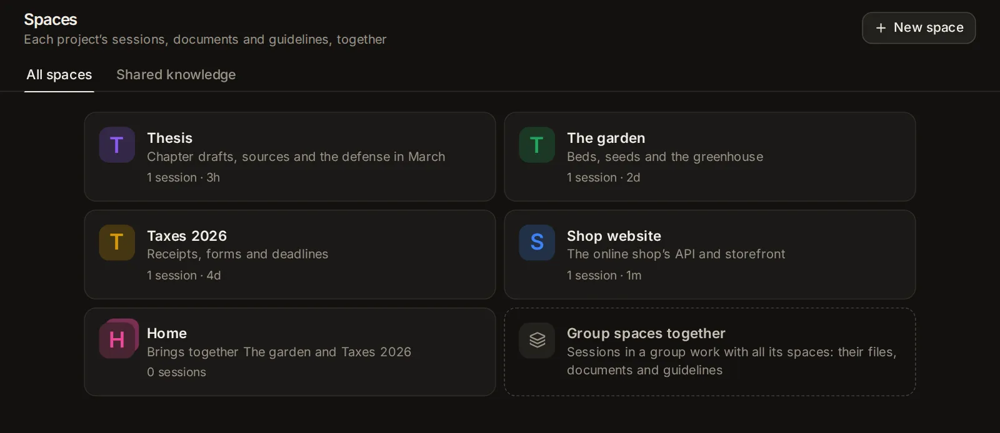

# Spaces and knowledge

A space keeps one project together: its sessions, a folder for its files (and other folders of yours it works with), documents of its own, what agents remember about it, the guidelines every agent in it follows, skills of its own and the assistant its sessions start as. Shared knowledge holds the documents and folders you add once so that every session can search them and cite the file and page it read. This topic covers making and using spaces and groups of spaces, giving a space skills of its own, and adding, searching and managing the documents agents search.

## What a space is

A space is a project with everything that belongs to it, like Projects in ChatGPT or Claude. A tax return, a thesis, a garden, a website: each can be a space. On the start page you pick a space by its name instead of a folder, and every session you start in it:

- **works in the space's folder**. The agent is told that this folder holds the space's files, what is in it now (the last changed first), and to keep what it makes for the space there. It also works with the other folders the space works with, where they are: Claude Code works in them as in its own folder, and other agents are told where they are;
- **follows the space's guidelines**: what every agent in the space should know, such as who the work is for, how to work and what to keep in mind (see [Agent Guidelines](/guide/guidelines));
- **gets the space's own skills** with your skill library: written methods for how its work is done, which agents load when a task calls for them (see [Give a space skills of its own](#give-a-space-skills-of-its-own));
- **starts as the space's assistant**, when the space has one (see [Assistants](/guide/assistants));
- **remembers what earlier sessions in the space learned**: agents keep notes about a project by its folder, so the sessions of a space share them (see [Memory](/guide/memory));
- **searches the space's own documents**, and the shared knowledge too unless the space turns that off (see [Which sessions search which knowledge](#which-sessions-search-which-knowledge)).

A space can also bring other spaces together. That is a **group**: see [Bring spaces together in a group](#bring-spaces-together-in-a-group).

## Open the Spaces page

Click **Spaces** among the tools at the bottom of the sidebar. On a phone, open the sidebar first: it is a drawer. You can also type "spaces" in the search box (Ctrl+K, or ⌘K on a Mac).

The page has two tabs:

- **All spaces**: your spaces, with **New space** at the top right.
- **Shared knowledge**: the documents every session can search (see [Shared knowledge: documents every session can search](#shared-knowledge-documents-every-session-can-search)).

Each space shows as a card:

- a band of its colour with its mark: a rounded square in its colour with the first letter of its name (a group's mark has a second square behind it, and **Group** on its band);
- its name, and under it what it is about, or its folder when it has no description. A group says "Brings together" and the names of its spaces;
- what it holds: how many sessions, how many things in the Library, documents and skills;
- how long ago one of its sessions was last at work, and **New session**, which starts a session in it at once.

Click a card to open the space's own page, or type the space's name in the search box (Ctrl+K) to go straight there. With no spaces yet, the page says what a space is for in three short parts, with **Make a space**.

Under the spaces, **Folders you work in** lists folders your sessions used lately that could become spaces (see [Folders you work in, not in a space yet](#folders-you-work-in-not-in-a-space-yet)).

## Make a space

1. On the [Spaces page](/spaces), click **New space**. The start page's folder menu has **New space** too (see [Start a session in a space](#start-a-session-in-a-space)).
2. Fill in the window:
   - **Name**: what you call the project, such as "Taxes 2026", "The garden" or "Thesis". Up to 60 characters. It is the only field you must fill in. The square beside it is the space's mark, in the colour it will get: click it to pick another of the eight colours (amber, blue, green, pink, violet, teal, orange, slate). If you pick none, spaces take the colours in turn.
   - **Where its files go**: pick one of two.
     - **In a new folder** (the usual choice): the app makes the space a folder of its own, named after it.
     - **In a folder I already have**: a project or a folder of documents on this computer, which stays where it is. Below it, **Used lately, in no space yet** shows folders your sessions worked in lately as one-tap choices; or click **Choose a folder…** and find one by name or type its path. Picked with the name still empty, the folder's name becomes the space's. **Change** picks another.
3. Optionally, click **More options** for the rest (a dot beside it means something there is filled in):
   - **What it is about**: a line shown under the name. Up to 300 characters.
   - **Agent Guidelines**: what every agent in the space should follow, such as who the work is for, how to work and what to keep in mind: "Amounts in EUR. I am self-employed in Greece." Up to 20,000 characters. See [Agent Guidelines](/guide/guidelines).
   - **Other folders it uses**: more folders of yours its agents work with, where they are; nothing is copied. **Add a folder** adds one, up to 12; ✕ leaves one out again.
4. Click **Make the space**, or press Enter in the name field.

A new folder goes in a **Spaces** folder where task folders go: "Taxes 2026" gets `~/Naget/Spaces/taxes-2026`, unless you moved task folders elsewhere (see [Move task folders](/guide/assistants#move-task-folders)). If that name is taken, it adds `-2`, `-3` and so on. Made from the Spaces page, the new space's page opens. Made from the start page, the new space is picked for the session you are about to start.

Two more things are set on the space's **Settings** tab afterwards: the assistant its sessions start as, and the spaces it brings together. Its documents go on its **Knowledge** tab, its skills on its **Skills** tab, and more folders on its **Files** tab.

### A space for a folder you already have

In the **New space** window, pick **In a folder I already have** under **Where its files go**, then the folder: the space works in it, and no new folder is made. An agent can do it too: "Make a space called Shop for ~/code/shop". A space's own folder can't be changed once the space is made, but the folders it works with can: see [Files](#files).

### Folders you work in, not in a space yet

Under your spaces on the [Spaces page](/spaces), the app lists up to six folders you could make spaces for: folders your sessions worked in over the last 90 days, or changed files in while working somewhere else, that no space has yet. The ones used most, and most recently, come first. A folder inside a project kept in Git counts as the whole project. Each card shows the folder's name, where it is, how many sessions used it and when one last did.

- **Make a space** opens the **New space** window with that folder picked and its name filled in.
- ✕ (**Not a project**) stops suggesting that folder. The folder itself is untouched.

Your home folder, hidden folders, temporary ones and the folders the app makes for itself (task folders, apps' runs, worktrees) are never suggested. Once a space has a folder, as its own or as one of the folders it works with, it leaves the list. The same folders show under **Used lately, in no space yet** in the **New space** window.

## Start a session in a space

There are two ways:

- **From the space**: click **New session** on its card on the Spaces page, or at the top of its own page (on a phone, the pen). The start page opens with the space picked, and with its assistant when it has one.
- **From the start page**: open the folder chip in the row under the message box. Its menu lists your spaces first, then the folder in use and the ones you used last, then **New task folder** and **New space**. Until you type, it shows the three spaces at work most recently (and the one picked, if it isn't among them). Type part of a name in the field at the top to find any space, or any folder. Each space shows its mark, its name and what it is about.

When you pick a space, the chip shows its mark and name instead of a folder, and the session will work in the space's folder. If the space starts its sessions as an assistant, the **Assistant** chip changes to it, with any agent, model and permissions that assistant suggests. You can still change any of them before you start. Then type your message and click **Start**.

The start page remembers the space for your next session, on any device you use. To work outside it again, pick a folder or **New task folder** in the same menu. If a space you had picked is deleted, the start page keeps its folder but no longer the space.

On a phone, the menu opens as a sheet from the bottom of the screen, titled "Space or folder to work in", and the keyboard waits until you tap the field.

When the space's folder is a Git repository, the end of the menu offers **New worktree**, as for any folder in a repository: the session then works on a branch of its own, in a separate copy of the repository (see [Sessions](/guide/sessions)). Sessions you start by voice in hands-free mode start in the space picked last on the start page (see [Documents, images, videos and voice](/guide/documents-voice)).

## A space's own page

Click a space on the Spaces page to open it. The top of its page is in the space's colour: the arrow on the left goes back to all your spaces (as on the app's other pages), then come the space's mark and name and what it is about (a group's spaces, for a group; its folder, with no description). On the right, **New session** starts a session in the space (on a phone, the pen), and **More** (⋯) has:

- **Open its folder in Files**: the space's folder on the Files page.
- **Only its sessions in the sidebar**: the session list shows only the sessions started in the space, as the sidebar's own filter does (see [Show one space's sessions in the sidebar](#show-one-spaces-sessions-in-the-sidebar)). Pick it again to see every session.
- **Delete the space** (see [Delete a space](#delete-a-space)).

Below them are six tabs: **Overview**, **Library**, **Files**, **Knowledge**, **Skills** and **Settings**. **Library**, **Knowledge** and **Skills** have a count, except on a phone, where the tabs leave their counts out to fit. Each tab shows at once.

### Overview

The space at a glance, in cards:

- **Sessions**: the sessions started in the space, the one at work most recently first, each with its agent's icon, its title, what it is doing while it runs (**Working**, **Needs you**, **Ready**; not on a phone) and how long ago it was at work. Click one to open it. With more than six, **All** shows the rest. With none yet, it says that a new one works in the space's folder, with its guidelines, documents and skills, and has **New session**.
- **In the Library**: what the space holds in the Library, the last changed first (see [Library](#library)). **Open in the Library** shows them there.
- **Every session here** (beside them, under them on a phone): what every session in the space gets. **Folder** (its folder, and how many more it works with: click for the **Files** tab), **Guidelines** (the start of its guidelines: click for **Settings**), **Knowledge** (how many documents it has), **Skills** (how many of its own), **Starts as** (its assistant) and **Memory** (**What agents remember about it**, which opens [Settings → Memory](/settings?s=memory), where the notes agents kept about the space are listed under its folder).
- **The spaces it brings together**, for a group: each of its spaces, with how many sessions it has. Click one to open it.

### Library

Everything the space holds in the Library: the pages, slides, documents, spreadsheets and LaTeX documents agents saved in its sessions, and what you kept there or moved there (see [Sort it by space](/guide/library#sort-it-by-space)). Each card opens it, and its **More** (⋯) has what it has in the Library. **Open in the Library** shows the space's things there, with the Library's search and kinds. With nothing yet, the tab says so, with **New page** and **New slides**, made in the space.

### Files

The space's folder, and the other folders it works with, as the [Files page](/guide/files-git#browse-a-folder) shows a folder: open, pick several, drag, upload, and each row's menu. A file opens in a window over the page.

- Over the folder, a chip for each: the space's own folder, by the space's name, and each folder it works with, by its name. Click one to show it.
- **Attach a folder** adds a folder of yours for the space to work with, where it is: find it by name or type its path. Nothing is copied. Up to 12.
- ✕ on a folder's chip leaves it out of the space; the folder itself stays as it is. The message has **Undo**.
- **Open in Files** opens the folder on the Files page.

To add files from elsewhere, use **Add to a space** on the Files page, in a file's window or on an agent's file cards: a file is copied into the space's folder, a folder joins those it works with (see [Add files to a space](/guide/files-git#add-files-to-a-space)).

### Knowledge

The space's own documents, which only its sessions search, and whether they search the shared knowledge too. See [Give a space documents of its own](#give-a-space-documents-of-its-own).

### Skills

The space's own skills, which only its sessions get, with your skill library. See [Give a space skills of its own](#give-a-space-skills-of-its-own).

### Settings

Everything about the space itself, in four parts, each with a line on what it is for:

- **The space**: its **Name** (beside its mark, in the colour picked), **What it is about** and **Its colour**.
- **What every agent in it follows**: its **Agent Guidelines**, as when you made it.
- **How its sessions start**: under **Its sessions start as**, one choice to tap: **The assistant picked on the start page** (the default: picking the space leaves the start page's assistant as it is), or one of your assistants, built in or your own. Picking the space on the start page then picks that assistant too.
- **The spaces it brings together**: pick spaces here to turn this space into a group (see [Bring spaces together in a group](#bring-spaces-together-in-a-group)).

Once you change something, a bar says **Unsaved changes**, with **Undo changes** and **Save**; it stays in view while you scroll. At the bottom, **Delete the space** says what stays, with its button.

## Give a space skills of its own

Skills are written methods that agents load when a task calls for them (see [Skills](/guide/skills)). Your skill library reaches every session; a space can also have skills of its own, which only its sessions get: how its work is done, step by step. "Cite in APA 7 and check every DOI" for a thesis, say, or "ingredients in grams, then numbered steps" for a family cookbook. They are on the space's **Skills** tab.

With none yet, the tab says what they are for, with two buttons:

- **New skill** opens a window with three fields, then **Add the skill**:
  - **Name**: lowercase words with dashes, such as `citation-style`. Spaces and capitals turn into that when you leave the field. Agents know the skill by this name.
  - **When to use it**: one line, such as "Use when citing a source in the thesis". Agents see it in every session of the space, and read the rest of the skill only when a task fits.
  - **The skill**: the steps in order, the checks and the mistakes to avoid, in Markdown.
- **From the library** lists the skills of your skill library that the space doesn't have yet, with a field to find one by name or by what it is for. Until you type, eight show, and how many more there are. Pick one: it is copied into the space with its other files (examples, scripts), and the window to change it opens. Change it for the space alone: the library's stays as it is for every other session.

A skill needs a name of 2 to 64 characters, a line on when to use it of at least 10 characters, and steps of more than a few words; the whole skill holds at most 20,000 characters. A skill that looks like it holds a password, a key or a token is refused: write where the secret is kept instead.

### The list of a space's skills

Each skill shows as a row: its name, when to use it, how often agents in the space (and in groups that bring it in) used it, and how long ago it was saved. A skill with the name of one in your skill library has the badge **In place of the library's**: the space's sessions get it instead of the library's.

- Click a name to read the skill and its **History** of changes; **Change** at the bottom of that window edits it.
- The pencil changes it: its name, when to use it and its text. A new name keeps its other files and its history.
- The bin removes it, after you confirm. The space's sessions stop seeing it, or go back to the library's skill of that name. Removed skills are listed under the list, after **Removed:**: click one to bring it back as it was.

**New skill** and **From the library** stay under the list.

### How agents get them

Every Claude Code, Codex and Custom session started in the space gets its skills together with your skill library: Claude Code in the same plugin named "naget" (naget:citation-style), Codex in the same extra folder of skills, Custom in its list of skills. The agent is also told which skills are the space's own, and to use one when it fits the task. Custom has a skill you add or change from its next turn; Claude Code and Codex from their next session.

The skills are kept in the app's data folder, not in the space's folder, so your files stay as they are. A group's sessions also get the skills of the spaces it brings together (see [What sessions in a group get](#what-sessions-in-a-group-get)).

### Skills agents propose in a space

After a task that took real effort, an agent can propose keeping its method as a skill, or improving one it followed, and you approve, edit or dismiss it (see [Approve, edit or dismiss a proposed skill](/guide/skills#approve-edit-or-dismiss-a-proposed-skill)). When the session is in a space, the card asks where to keep it, under **Keep it for**:

- **Every session**: in your skill library, as outside a space;
- the space's name: in the space's skills alone. For an improvement to a library skill, the space gets its own version with the change, and the library's stays as it was.

The agent suggests one of the two; you choose before you approve. An improvement to one of the space's own skills has no choice: it stays the space's.

## Change a space

Open the space, go to its **Settings** tab, change what you like and click **Save**. Sessions you start in the space from then on get the new name, description and guidelines. A new assistant applies the next time you pick the space on the start page, or click **New session** on its page. The space's folder stays the same: it can't be moved to another folder.

## Delete a space

1. Open the space, and click **More** (⋯) at its top, or go to its **Settings** tab.
2. Click **Delete the space**.
3. The app asks "Delete the *name* space?" Click **Delete**.

Deleting a space keeps everything that was in it:

- **Its folder** and the files in it stay where they are, and so do the folders it worked with.
- **Its sessions** stay, and no longer belong to a space.
- **What it holds in the Library** stays there, in no space.
- **Its documents** move to the shared knowledge, so every session can search them from then on. To keep them apart, move their knowledge base into another space (see [Rename, move, read again or delete a knowledge base](#rename-move-read-again-or-delete-a-knowledge-base)).
- **Its skills** move to your skill library, so every session gets them from then on. One with the name of a skill the library has already takes the space's name after its own: the Thesis space's `research` becomes `research-thesis`.
- **What agents remember** about its folder stays: notes belong to the folder, not to the space.
- It leaves any group it was in. A group left with none of its spaces becomes a plain space.

## Bring spaces together in a group

A group is a space that brings several spaces together, for work that spans them: "Everything for the thesis" bringing in "Thesis" and "Reading notes", say. It has everything a space has: a name, a folder of its own, guidelines, documents, skills and an assistant. Its sessions also work with every space it brings together.

### What sessions in a group get

- **The spaces' folders**: Claude Code can work in each of them as in its own folder; other agents are told where each one is. What a session makes goes in the group's own folder, unless you say otherwise.
- **The spaces' guidelines**: after the group's own, each space's name, what it is about, its folder and its guidelines.
- **The spaces' documents**: searched together with the group's own documents and the shared knowledge (unless the group turns the shared knowledge off). The agent is told which space each knowledge base comes from.
- **The spaces' skills**, with the group's own and your skill library. Where two have the same name, the group's own comes first, then that of the space it brought in first.
- **Memory** comes from the group's own folder. The notes agents kept in each space stay with that space.

### Make a group

1. On the [Spaces page](/spaces), click **Group spaces together**. This card shows once you have at least two spaces that aren't groups.
2. In **New group of spaces**, give it a **Name**, such as "Work" or "Everything for the thesis".
3. Under **The spaces it brings together**, tap each space to bring in; tap one again to take it out. Pick at least one.
4. Optionally, fill in **What it is about** and the **Agent Guidelines**, and pick a colour.
5. Click **Make the group**. Like a space, it gets a folder of its own for what is made in it, and its page opens.

You can also turn an existing space into a group: on its **Settings** tab, pick spaces under **The spaces it brings together** and click **Save**. Change a group's spaces the same way. Take all of them out and it is a plain space again.

A group's **Knowledge** tab also shows **Also the documents of the spaces it brings together**: each of its spaces, with how many documents it has. Click one to open that space's Knowledge tab. Its **Skills** tab shows **Also the skills of the spaces it brings together** the same way.

### Limits

- A group brings plain spaces together, not other groups: groups are one level deep. A space that is in a group can't bring other spaces together itself; its Settings tab says which group it is in instead.
- A space can be in several groups.
- A group brings together at most 12 spaces. Once 12 are picked, the others can't be tapped.

## Show one space's sessions in the sidebar

The sidebar gives each space a group of its own, under its name and mark, with its newest sessions; the pen at the end of the group's heading starts a new session in the space. See [The session list](/guide/start#the-session-list).

To list only one space's sessions:

1. In the sidebar, click the filter button at the end of the **Search sessions** field (**Filter and group sessions**).
2. The menu lists **All agents**, **Claude Code** and **Codex**, then **Every space**, up to eight of your spaces, and **Spaces**, which opens the Spaces page. Pick a space.

The session list then shows only the sessions started in that space, by day, and the filter button is coloured while a filter is on. Pick **Every space** to see every session again. The agent filter works at the same time, to show only one agent's sessions in a space. If the space is deleted, the list shows every session again.

On the space's own page, **More** (⋯) → **Only its sessions in the sidebar** does the same, with a check while it is on; pick it again to see every session.

On a phone, open the sidebar (a drawer) first.

## Shared knowledge: documents every session can search

Agents can search documents you add once: contracts, manuals, notes, papers, a whole folder. They find passages by their words or by what they mean, and cite the file and page they read. Documents are kept in **knowledge bases**: named collections of files you dropped in and folders on this computer.

- **Shared knowledge** ([Spaces → Shared knowledge](/knowledge)): every session searches it, in a space too unless the space turns that off.
- **A space's own knowledge**, on its **Knowledge** tab: only that space's sessions search it, and the sessions of a group that brings the space in.

To open the shared knowledge, click the **Shared knowledge** tab on the Spaces page, or type "shared knowledge" in the search box (Ctrl+K).

## Add documents

With no shared knowledge yet, the page says "Add your documents once" over a large box to drop documents in. Drop files or a folder there, and a knowledge base called "My documents" is made for them. **Start with a folder on this computer instead** makes an empty "My documents" base, where you then add a folder.

Every knowledge base has its own drop box and its own **Add a folder on this computer** button. To start another base, click **New knowledge base** at the top of the page (**New** on a phone). Separate bases keep things apart, and an agent can search one base by its name, but one is enough to start.

### Drop or choose files

Drag documents or a folder onto a knowledge base's box ("Drop documents or a folder here"), or click **choose files**, or **folder** to pick a whole folder. The files are copied into the app's data folder and read as soon as they are in, so later changes to your originals don't reach the base. A small panel shows the upload. If a file of the same name is already in the base, the panel asks whether to **Replace** it, **Skip existing** or **Cancel**.

The files come from the device you are using. On a phone, **choose files** opens the phone's file picker; picking a whole folder is offered on a computer only.

### Add a folder on this computer

1. On a knowledge base, click **Add a folder on this computer**.
2. In the menu that opens ("A folder to read, and keep up to date"), type a folder's name to find it among the folders you used lately and those in your home folder, or type its path, such as `~/Documents/Manuals`. Pick it.

The folder is read where it is: nothing is copied. It shows as a chip on the base, and the base keeps up with it. A minute after the app starts, and every hour after that, the app reads what is new or changed in the folder and drops what was deleted. To read it at once, pick **Read again now** in the base's menu.

"This computer" is the one Naget Agent runs on, which may not be the device in front of you.

To stop reading a folder, click the × on its chip. Its documents leave the base; the folder and its files are untouched.

### What can be read

- **Documents**: PDF, Word, Excel, PowerPoint, OpenDocument, EPUB, CSV and RTF; old .doc, .xls and .ppt files too when LibreOffice is installed on this computer.
- **Text**: plain text and Markdown, web pages (their text, without the markup), and code and data files such as JSON, YAML, Python or JavaScript.

Left out: pictures; files and folders whose names start with a dot (hidden ones); and the folders tools make, such as `node_modules`, `.git`, `dist`, `build`, `target` and `venv`. A folder is read up to 20,000 files and 12 levels deep. Text files over 4 MB and documents over 300 MB aren't read. A scanned PDF without a text layer has no text to search.

Each document is cut into passages of up to about 1,400 characters, each keeping the page, slide, sheet or heading it came from, so agents can cite it.

## See what a knowledge base holds

Each knowledge base is a card. Under its name, a line counts what it holds: its documents and passages, how much of it is ready to search by meaning (when that is on: "ready to search by meaning", or a percentage while it gets ready), and how long ago it was last read. While it is being read, the line starts "Reading 12 of 40…".

- **Show the documents** lists every document: its name or path, then how many passages it has and its size. **no text** marks a document with nothing to read in it, and **could not read** one that failed; point at it to see why. Click a document to open it. **Hide the documents** folds the list.
- When some documents couldn't be read, a red line says how many, with the first few and the reason for each.
- A file you dropped in can be removed with the × at the end of its row (on a computer, it shows when you point at the row). This deletes the base's copy. A document from a folder on this computer has no ×: remove it from the folder itself, or stop reading the folder.

## Rename, move, read again or delete a knowledge base

The ⋯ button (**More**) at the top right of a knowledge base opens its menu:

- **Read again now**: reads its files and folders again at once, for files just added or a folder that changed.
- **Rename**: opens **Rename the knowledge base**. Type the new name (up to 60 characters) and click **Save**.
- **Move to**: **Shared knowledge**, or one of your spaces; a check marks where the base is now. In a space, only that space's sessions search it; in the shared knowledge, every session does. This item shows once you have spaces.
- **Delete**: asks "Delete *name*?" Its passages go, and the files dropped into it with them; folders on this computer stay as they are. Click **Delete** to go ahead.

## Give a space documents of its own

Open the space and go to its **Knowledge** tab.

- **Also search the shared knowledge** is a switch, on unless you turn it off. Turn it off and the space's sessions search only the space's own documents (and, in a group, those of its spaces). The line under it says how many shared documents there are, with a **Shared knowledge** link.
- With no documents yet, drop documents or a folder in the box, or choose them: a knowledge base named after the space is made for them. **Start with a folder on this computer instead** makes an empty one, named after the space, to add a folder to.
- Once it has documents, the tab shows a search box (see [Try a search yourself](#try-a-search-yourself)), the space's knowledge bases with the same cards and menus as shared ones, and **New knowledge base** at the bottom.

A shared knowledge base can be moved into a space from its menu (**Move to**), and back.

## How agents search your documents

Once there is at least one knowledge base, agents get tools to search the documents their session may search, to read more of a document around a passage, and to list what the knowledge bases hold. Claude Code, Codex, Custom and the agents that speak ACP and take MCP servers (tool servers) all get them.

At the start of a session, the agent is told which knowledge bases it can search and how many documents each holds; in a space, also whether each is the space's own, shared, or from a space its group brings in. It is told to search there first, before the web or memory, when a question may be answered from them; to answer from what the passages say; to cite each passage it uses with its file and page or part, and its path; and to say so when the documents don't answer the question.

In the conversation, a search shows as a step: **Searched your documents**, what it looked for, and how many passages it found, or "nothing found". Click it to see the passages, each with its file, page and knowledge base. Click a passage to open the file.

### By words, by meaning, or the exact text

Agents search in three ways:

- **By words**: passages that hold the words of the question, the best matches first. Always available.
- **By meaning**: passages that mean what the question asks, even in other words or another language. This needs **Search by meaning**, turned on in [Settings → Memory](/settings?s=memory&find=Search%20by%20meaning). It runs on this computer, and once it is on, every base gets ready for it in the background (see [Memory](/guide/memory#search-by-meaning)). While it is off, the Shared knowledge tab and each space's Knowledge tab say where to turn it on, and agents find passages by their words.
- **The exact text**: a phrase in quotes ("notice period") or a pattern between slashes (a regular expression, such as `/INV-\d+/`), found as the grep command would find it: for names, numbers and codes. These passages come in the order they appear in the documents.

An agent searches by words and by meaning together unless it asks for one, and a question in quotes or between slashes is searched for exactly. It gets 8 passages at a time unless it asks for more (up to 25), and it can search one knowledge base by its name.

### Try a search yourself

Above the knowledge bases, a field says "Try a search, as agents do: a question, or “exact words” in quotes". Type and press Enter. Up to 10 passages come back, each with its file and page, its knowledge base and how it was found: **by words**, **by meaning**, or both, or **by exact** for exact text. Click one to open the file.

On the Shared knowledge tab, it searches what a session outside any space searches. On a space's Knowledge tab, it searches what a session in that space searches.

## Which sessions search which knowledge

| A session… | searches |
|---|---|
| outside any space | the shared knowledge |
| in a space | the space's own documents, and the shared knowledge unless the space turns it off |
| in a group | the group's own documents, the documents of every space it brings together, and the shared knowledge unless the group turns it off |
| started by another session (a child session) | what the session that started it searches |

The knowledge tools never bring up another space's documents, not even when an agent asks for a file by its path. A knowledge base whose space was deleted is shared.

## Ask an agent

- "Make a space called Taxes 2026 for my receipts and tax return. Its sessions should start as the Researcher, and every agent in it should know that amounts are in EUR."
- "Make a space called Shop for my project in ~/code/shop."
- "What does my Thesis space hold in the Library? Move the reading tracker into it."
- "Which folders have I been working in that aren't in a space yet? Make spaces for the two I use most."
- "Copy ~/Downloads/contract.pdf into my Taxes 2026 space, and have it work with ~/Documents/Receipts too."
- "Group my Thesis and Reading notes spaces into one called Everything for the thesis."
- "Give my Thesis space a skill: cite in APA 7, and check that every DOI resolves before I hand a chapter in."
- "Copy the writing skill into my Garden space, and change it there to use plain words for children."
- "Add the folder ~/Documents/Manuals to my shared knowledge."
- "Move the Contracts knowledge base into the Taxes 2026 space, and stop that space from searching the shared knowledge."
- "Which knowledge bases do I have, and which documents couldn't be read?"
