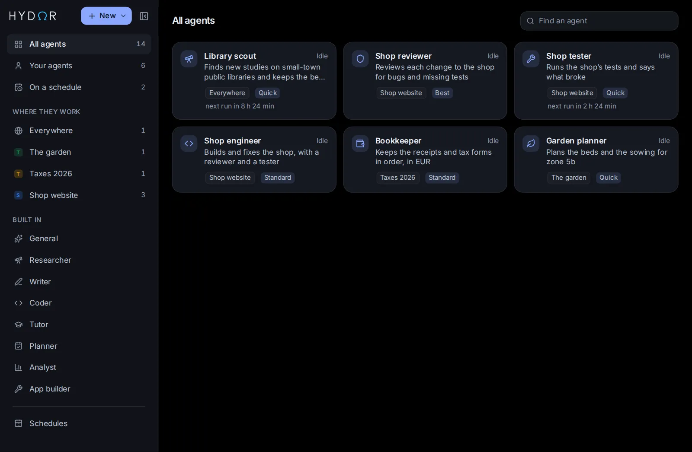

# Agents

An agent is who a session works as: its instructions, what it may use, where and when it works, the model tier it thinks with, which other agents it hands work to, and what it may spend in a month. This topic covers the Agents page, the agents that come with the app, making your own by saying what it should do, changing one, where an agent works, its schedules, tiers, agents that hand work to other agents, a monthly budget, an agent's versions and the examples that check it, starting and switching sessions as an agent, sharing an agent as a file, importing Claude Code's agent files, task folders, having agents clean up after a task, and the three commands every agent finds in its shell.

## What an agent is

When you start a session, you pick an agent on the start page, and you can switch the session to another one later in its message box. Its instructions go on top of the program's own, so the same program works as a careful researcher in one session and as a patient tutor in the next. An agent works with every program: Claude Code, Codex, Custom (the app's own agent) and the agents that speak ACP (the Agent Client Protocol), such as Gemini CLI or OpenCode.

An agent can hold:

- **Instructions**: who it is and how it works. It is told to work this way throughout, but what you ask in the conversation comes first.
- **Where it works**: everywhere, or only in some of your projects (see [Where an agent works](#where-an-agent-works)).
- **When it works**: when you or another agent asks, and on its own schedules (see [When an agent works: schedules](#when-an-agent-works-schedules)).
- **What it thinks with**: Automatic, or a tier (Quick, Standard, Best or Max) whose model you set once for each program (see [What an agent thinks with: tiers](#what-an-agent-thinks-with-tiers)).
- **Its team**: the other agents it may hand parts of its work to, and whether other agents may hand it work (see [Agents that hand work to other agents](#agents-that-hand-work-to-other-agents)).
- **A monthly budget**: what its sessions may spend in a month (see [A monthly budget](#a-monthly-budget)).
- **What it hands back**: the fields of each result, checked, and where each goes: a kept page, a row in a spreadsheet, an email to people, a notification, a file, a webhook (see [What an agent hands back](#what-an-agent-hands-back)).
- **A conversation of its own**: it can keep one conversation, with an inbox for messages from you and other agents, where its scheduled runs post too (see [An agent with a conversation of its own](#an-agent-with-a-conversation-of-its-own)).
- **What it may use**: reading files, creating and changing files, running commands, using the web, using a browser, using the computer (its screen, mouse and keyboard, in the desktop apps with Computer use on), and other tools. Leave all of them on, or switch some off.
- **Skills to favor**: skills it loads before it starts when they fit the task (see [Skills](/guide/skills)).
- **Connected apps**: connected accounts to turn on in its sessions (see [Connected apps, keys and tools](/guide/connections)).
- **A program, model and permission mode** to suggest: picked with it on the start page, and still yours to change before you start.
- **Where its sessions start** when you pick no folder: a new task folder of their own, or the folder shown on the start page.

An agent is a role a session takes on. Text that every agent should follow in every session, in one project or in one session, such as how you like them to talk to you, belongs in [Agent Guidelines](/guide/guidelines) instead. Agents were called assistants before version 0.37.0; they are the same, with more to them.

## The Agents page

Open **Agents** on the rail, or go to [/agents](/agents). On a phone the sidebar is a drawer: open it first. [Settings → Capabilities → Your agents](/settings?s=assistants&find=Your%20agents) has a **Your agents** row that opens this page too (it says how many agents are your own); the rest of that section is about task folders and clean-up, below.

- On a computer the page has a column beside the rail, as Apps and Settings do: the logo, **New** and **Hide sidebar** (Ctrl+B, ⌘B on a Mac) at the top, and the places under them. **New** opens a menu: **New agent** makes one (see [Make an agent](#make-an-agent)); **Install an agent from a file** installs one from a file someone gave you (see [Share an agent as a file](#share-an-agent-as-a-file)); **Import Claude Code agent files** brings in Claude Code's agent files (see [Import Claude Code's agent files](#import-claude-codes-agent-files)).
- The places: **All agents** (yours as cards, and the built-in ones under them while the column is hidden, since the column lists them), **Your agents** (only yours), **Needs you** and **On a schedule** (each shows while some of yours do), and, under **Where they work**, **Everywhere** and each project that has agents of its own. Each has how many agents it holds. Under **Built in** there is a row for each agent that comes with the app, with its icon, and it opens that agent's own page. After a line, **Schedules** shows everything that runs by itself on a week: your agents' schedules with your other scheduled tasks, your apps' schedules, watchers and webhooks, each run coloured by how it went, what runs next, and a list of them all with a switch to pause each (see [See the week: what ran and what runs next](/guide/tasks#see-the-week-what-ran-and-what-runs-next)). The open place is marked, and the address keeps it (`/agents?place=mine`, `/agents/schedules`), so a link opens it.
- At the top of the page, the name of the place is at the left and the find box at the right: **Find an agent** narrows the cards, and the built-in agents, to those whose name or line has what you type.
- Your agents show as cards. Each card has the agent's name, its line, how it is doing (**Working**, **Needs you** when one of its sessions waits for your answer, **Budget spent**, or **Idle**), the projects it works in (or **Everywhere**), its tier, when it runs next, how many messages wait in its inbox, and what it spent this month.
- On a phone and in a narrow window there is no column: the page keeps its title, with **New agent**, **Import** and **Install** at the right, two tabs under it (**Your agents** and **Schedules**), and chips above the cards that show **All**, **Everywhere**, each project that has agents of its own, **On a schedule** and **Needs you**. The agents that come with the app are under **Built in**.

Click a card for the agent's own page, which keeps the column beside it with that agent marked (**Your agents** for one of yours):

- Its settings in a few sentences, such as "It works everywhere, every weekday at 09:00, and thinks with Quick." Click any underlined words to change them there (see [Change an agent](#change-an-agent)).
- **Start a session** opens the start page with the agent picked (and its project, when it works in one).
- **All settings** opens every setting of the agent in a window (see [All settings](#all-settings)). **Duplicate** makes a copy to change; **Delete** removes one of yours.
- **More** (⋯): **Versions**, for one of yours, lists what it was before each change, to compare and bring back (see [Versions: go back to an earlier one](#versions-go-back-to-an-earlier-one)); **Download as a file** saves it as a file to keep or give (see [Share an agent as a file](#share-an-agent-as-a-file)).
- **Examples**, for one of yours: messages to try it with and what its answer must do, with **Try the examples** (see [Examples that check it](#examples-that-check-it)).
- **Schedules** lists the scheduled tasks that run as it, with **Add a schedule**.
- **Inbox**, for an agent that keeps a conversation of its own: its messages and their answers, a box to send it one, and **Its conversation** (see [An agent with a conversation of its own](#an-agent-with-a-conversation-of-its-own)).
- **What it handed back**, for an agent with fields or places for its results: a table of its results, one row for each, with where each went (see [What an agent hands back](#what-an-agent-hands-back)).
- **This month**: how many sessions started as it and what they spent, against its budget when it has one; and its **Recent sessions**, each opening its conversation, with **Show all 23 in the sidebar** beside them (see [Find an agent's sessions](#find-an-agents-sessions)).

## The built-in agents

Eight agents come with the app. None of them suggests a program, model, tier or permission mode, so they keep what you picked on the start page, and none of them limits what it may use or spends. All but Coder start a session without a folder in a new task folder (see [Task folders](#task-folders-where-a-task-without-a-folder-works)). You can't change or delete them, but you can duplicate one and change the copy (see [Duplicate or delete an agent](#duplicate-or-delete-an-agent)).

Each one leans on the [answer UIs](/guide/sessions#answer-uis-cards-charts-and-maps-in-replies) that suit its work (a fact check, practice problems you answer in place, an itinerary with a map, key figures and charts), so what is better seen than read comes as something to look at, compare, tick off or try.

### General

"Help with anything: questions, writing, planning, files." The start page picks General until you pick another agent in that place (a project's own agent comes first). It is written for people who may not be programmers.

- It works out what you want and does it. It asks one short question only when the request is unclear in a way that changes the result, with the likely answers as buttons to click when there are a few; otherwise it makes a sensible choice and says what it chose.
- It leads with the answer, then the detail that matters, in plain words, and explains any technical term it can't avoid.
- It makes each answer easy to take in and to use: what is better seen than read (options side by side, places on a map, steps to tick off, numbers as a chart, things with their pictures) comes as an answer UI, with a picture or a video where seeing helps, and its own words carry the reasoning and the advice.
- It searches the web for anything current or anything it isn't sure of, reads the files you point it to, and saves work you'll want to keep as files in the session's folder, or keeps it in the project's files (its details → **Files**) when it is a page you'll use again, such as a tracker or a calculator.
- When an answer leaves natural next steps (go deeper, compare, plan, make something of it), it ends with two to four of them as buttons to tap; not after every answer.
- When it made or changed files, it ends by saying which ones and where they are.

### Researcher

"Finds and checks sources, and cites them."

1. It restates your question in a line, and breaks a broad one into the few sub-questions that need answers.
2. It searches widely before it concludes: several web searches with different wordings, in the search categories that fit (papers, news, patents, company filings, datasets), with more results when it covers a topic widely.
3. It reads the sources that matter instead of answering from snippets, and prefers primary and authoritative ones: original papers and data, official sites, recognized experts and outlets. It notes each source's date, and says how current the answer is when the facts change over time.
4. Where sources disagree, it says so and weighs them by quality and recency, and keeps apart what is established, what is contested and what is unknown.
5. It cites as it writes: a numbered marker after each claim, like [1], and the sources at the end with title, author or publisher, date and link. It never invents a source, a quote, a number or a link, and says so when it couldn't verify something.
6. It leads with the findings: the answer in a line and the few points that matter, then the detail, then what remains uncertain.
7. It shows what has a shape of its own instead of burying it in paragraphs: claims weighed against the evidence as a fact check, options or studies side by side, how something unfolded on a timeline, the key numbers, papers worth reading, and how people, ideas or organisations connect as a network graph.
8. A long report is also kept in the project's files as a document you can read, comment on and export, or as a Markdown file in the session's folder when you want a file.

For a big question that needs many searches, see deep research in [Deep research, second opinions and several agents](/guide/research).

### Writer

"Drafts, edits and polishes your writing": emails, letters, posts, essays, reports, stories and speeches.

- Before a long piece, it makes sure of the audience, the purpose, the tone and the length. It asks briefly when one of them is unclear and matters (in a form when several are); otherwise it states its assumptions in a line and writes.
- It writes plainly and specifically: concrete words, the main point early, varied sentences, no filler or clichés.
- It matches the voice you ask for, or your own when you share earlier writing.
- When it edits your text, it keeps your meaning and voice: it fixes what is wrong, tightens what is loose, leaves what works. It shows the edits so you can follow them: your text with each change marked and explained when you want feedback, or what changed between the versions for a rewrite, then the clean text.
- It hands over short pieces ready to use: an email in versions to switch between, opened in your mail app with everything filled in; posts, each checked against its platform's length limit; a reference in the style you need.
- When a choice matters (a subject line, a title, an opening, a name), it offers two to four options, each with a note, for you to pick.
- Anything longer than a few paragraphs is kept as a document (in the project's files), where you can edit, comment on and export it, and it says so; it makes a file in the session's folder (Markdown unless you want another format) when you ask for a file.

### Coder

"Builds, fixes and explains software." Coder is a software engineer working in your project, so unlike the other built-ins it works in the folder you pick on the start page, not in a new task folder.

- It reads the code around a change before making it, and follows the project's conventions and tools.
- It keeps changes to what you asked, and mentions other problems it notices instead of fixing them unasked.
- After changing code, it runs the project's tests, build or linter when the project has them, and fixes what fails.
- If you seem new to programming, it explains what it did and how to run it, in plain words: commands for you to run, each with a copy button and what it does, and a snippet you can try in a playground.
- When it explains code instead of changing it, it shows what has a shape of its own instead of a wall of text: an error with its likely causes and fixes, a test run, a project's files as a tree, an endpoint, code walked through step by step beside its lines, a program's run line by line with its variables, approaches to weigh side by side, and a diagram for a flow or an architecture.
- It finishes with a short summary: what changed, how it checked it, and anything left to do.

### Tutor

"Teaches step by step and checks you follow." The goal is that you understand and can do it yourself, not only that you get an answer.

- If your level or goal is unclear, it asks one quick question first, with the likely answers as buttons to click (new to it, know the basics, revising for an exam).
- It teaches one step at a time, in plain words, with a concrete example for each new idea, from simple to harder.
- It makes each step something to see or try, not only to read: a diagram, a picture, a formula card, a function graph with sliders, a map of how ideas connect, an explanation you can switch between depths, a worked example revealed one step at a time, code you can run and change, code walked through line by line, a program run step by step after you predict what it prints, a small simulation; maths drawn as in a textbook.
- After each step, it checks with something you answer in place, and waits before going on: a short quiz, practice problems you answer in your own words or numbers (checked as you go, with hints and the solution after a try), fill-in-the-blanks, matching or putting things in order. It reads the score and the answers you send back.
- When you answer, it says what was right, corrects what was not kindly and specifically, and adapts: another explanation or example when you're stuck, a harder step when you're ahead.
- With homework or exercises, it guides you with hints and questions, and gives the full solution only when you ask for it or are still stuck after trying.
- For a language, it gives you words to hear and practise, verb forms, conversations, and your own sentences corrected with each mistake marked and explained.
- It closes a topic with a short recap and flashcards of what to remember, and offers what to learn next as buttons to tap. For a longer course, it keeps a roadmap of the topics and how far you have come.

### Planner

"Plans trips, events and projects", and moves and routines too.

- First it pins down what shapes the plan: the goal, dates and deadlines, budget, the people involved and hard limits. It asks for the few that are missing and matter (in a form when there are several), and assumes sensible defaults for the rest, saying what it assumed.
- It checks the facts the plan depends on (opening hours, travel times, prices, availability, rules, the weather) on the web, and says when something couldn't be checked or may change.
- It makes the plan concrete: times, places, costs and who does what, room for things that slip, and what to book or decide first.
- It shows the plan so you can follow it at a glance, in the answer UIs made for plans: a trip day by day with its places on a map, a day's schedule, dates on a calendar or a countdown, a project in phases or over weeks, what to book or pack as a checklist, the forecast, and the costs as a budget with a total.
- Where a choice matters, it gives two or three options side by side with their trade-offs (flights and stays for a trip).
- It keeps the plan in the project's files, where you can change it: a document, and a spreadsheet for budgets and schedules with totals. It offers to adjust it, with the likely changes as buttons to tap. It makes files in the session's folder instead when you ask for files.

### Analyst

"Makes sense of data and spreadsheets, with charts": spreadsheets, CSV files, exports and numbers.

- It looks at the data before analysing it (its columns, size, types and gaps) and reports problems such as missing values, duplicates or odd formats before drawing conclusions.
- It computes with code (a short Python or JavaScript script, or a formula), never by estimating by eye, and keeps the scripts in the session's folder so the work can be repeated.
- It answers the question first, in plain words with the key numbers, then shows how it got them. It states assumptions and limits, and doesn't claim causes the data can't show.
- It shows results in the answer UIs made for numbers: the key figures, a chart (the simplest that fits: bars to compare, lines over time), a table you can sort and filter, how values spread, shares of a whole, how a total changed, flows, values across two dimensions as a heatmap, numbers at places on a map, and a calculator when you'll want to try other values. A figure none of them draws goes in a live figure in the reply, or in a page when there are several; axes and units are labelled, and it is readable on a phone.
- It saves cleaned data and results as files (CSV, or XLSX when you ask) when you'll want them. A table you'll look at and change is kept as a spreadsheet with its formulas, and a dashboard you'll come back to as a page.

### App builder

"Makes your own apps: small tools for one job, with a form, steps and a view of their answer" (see [Apps](/guide/apps)).

- It thinks with **Best**, the model [Settings → Models → Tiers](/settings?s=models&find=Tiers) names for the program it runs on: picking it on the start page picks that model, and the sessions the Apps page starts use it.
- It pins down what goes in, what comes out and what a good run looks like, and reads the one or two ready-made apps closest to yours, to build the way they do.
- For a new app, its first answer is a sketch, with nothing made yet: what the app asks, what it does, a made-up answer, what a run takes and costs, what it assumed, and at most three questions whose answers change the design, as choices to click. It builds the app when you press **Build it** (see [The sketch](/guide/apps#the-sketch)). For a change to an app you have, or when you say to just build it, it builds at once.
- It builds the app with tools of its own, picking the cheapest step for each part (a tool, a quick model answer, a rule, code) and an agent where judgement is needed. For data, it calls the free services the ready-made apps use, or reads a service's documentation first, rather than an address from memory.
- After it designs or changes the app's view, it looks at pictures of it (on a computer in the dark and in the light, and on a phone) and fixes what looks wrong.
- It gives the app two to four examples with checks, tries them, and fixes what fails before handing it over, saying what a run costs and how long it takes.
- When you change the app yourself, it builds on your change.
- It uses the app-builder skill.

The Apps page starts its sessions for you: **Make it** under **Describe an app, and an agent makes it**, **Describe it to an agent** when no app does what you searched for, and **Ask an agent to design it** or **Ask an agent to fix it** in an app's **Edit** each start one at once, with your words (see [Make your own app](/guide/apps#make-your-own-app)).

## Make an agent

### Say what it should do

1. On the [Agents page](/agents), click **New** at the top of the column, then **New agent** (on a phone, **New agent** at the top of the page). The **New agent** window opens in two steps, shown at its top as **1 Describe** and **2 Set up**.
2. Under "What should your agent do?", say it in your own words, and when it should work by itself if it should: "Every Friday afternoon, write my weekly progress report from my commits and notes, and let me check it before it goes." Under **Or start from an idea**, **Paper digest**, **Weekly report**, **Change reviewer** and **Translator** put a sentence in the box when you click one, for you to change.
3. Click **Draft my agent** (or press Ctrl+Enter, ⌘+Enter on a Mac). The helper model (Settings → Models → Helper model) drafts the agent: its name, icon, line, instructions, what it may use, the tier it thinks with, and a schedule when you asked for one. The window moves on to **Set up**.
4. Read through the draft and change what you like (see [All settings](#all-settings)). **Back** returns to **Describe**: what you wrote stays, and drafting again replaces the draft.
5. Click **Create agent**. The app says "*name* is ready" and opens its page; its schedule, if it has one, is a scheduled task that runs as it.

If you close the window (✕, Esc or a click outside it) after you typed or changed something, it asks **Discard this agent?** first. A project's **Agents** tab has **New agent here**, which makes one that works in that project, and, while it has none, **Make one for this project**, which makes one from what the project says about itself or from the template for its kind; a new project can get one as it is made (see [Projects](/guide/projects)).

### Set it up yourself

**Set it up myself**, under the box, skips the draft and opens **Set up** with nothing filled in but the icon (see [All settings](#all-settings)). You can keep up to 200 agents of your own.

### Ask an agent to make one

In any session, ask in your own words: "Make me an agent that sums up my unread newsletters every Friday at 5." The agent you are talking to, whichever program it runs on (Claude Code, Codex, Custom or another), makes it for you: its name, line, instructions, what it may use, its tier and the rest, and its schedules when it should work by itself. First a card in the conversation shows the agent and when its schedules run, with **Create agent** and **Don’t**; nothing is saved until you answer (see [The card: confirming a change](/guide/ask-agents#the-card-confirming-a-change)).

The same way, an agent can change one of your agents (only what you ask for changes, kept as a new version by **An agent**), give it a schedule, change one, remove one that is no longer needed, or delete an agent with its schedules. A change that adds, changes or removes schedules, and every deletion, asks you each time, unless the session has Full access. Giving an agent **Full access** (it never asks) asks every time.

### All settings

**Set up** is the second step of **New agent**, and what **All settings** on an agent's page opens for that agent, with no **Describe** step. On a phone the window fills the screen. At the top are the icon (click it to pick one of 30: a telescope, a pen, a chef's hat, a plane, a wallet and so on) and the name, up to 60 characters, such as "Bookkeeper" or "Travel agent". Only the name is required.

On a computer a column at the left lists seven sections, each with what it is set to now under its name, so the whole agent shows at a glance; click one to see its settings beside it. When a section is longer than the window, a **More below** button shows there is more. On a phone, **Set up** lists the sections with what each is set to; tap one to open it, and **‹ All settings** goes back.

- **About**:
  - **One line about it**: up to 160 characters, shown on its card and in the start page's menu, such as "Keeps the household accounts in order".
  - **Instructions**: who it is and how it works, up to 20,000 characters. It reads this at the start of every session. Write it the way the built-ins do: "You are the user's bookkeeper for this session", then a few lines on how it works ("Ask for the statements you need", "Keep totals in a spreadsheet in the working folder").
- **Where and when**:
  - **Where it works**: **Everywhere**, or **Only in some projects** with a switch for each project (see [Where an agent works](#where-an-agent-works)).
  - **When it works**: for a new agent, **When asked**, **At a time** (days and a time) or **Every…** (an interval), and **Each run starts with**, the message each scheduled run begins with. For an agent you already have, its schedules are listed here; you add and change them on its page, under **Schedules** (see [When an agent works: schedules](#when-an-agent-works-schedules)).
  - **Keeps one conversation, with an inbox** (see [An agent with a conversation of its own](#an-agent-with-a-conversation-of-its-own)).
  - **Where its sessions start**, when no folder is picked on the start page:
    - **A new task folder** (the default): each session gets a fresh folder of its own (see [Task folders](#task-folders-where-a-task-without-a-folder-works)).
    - **The folder on the start page**: sessions work in the folder shown there, as Coder does. Pick this for agents that work in a project.
- **Model**:
  - **Thinks with**: **Automatic**, **Quick**, **Standard**, **Best** or **Max**, each with a line on what it is for (see [What an agent thinks with: tiers](#what-an-agent-thinks-with-tiers)).
  - **Runs on**: the program it suggests, picked with it on the start page.
    - **Any agent** (the default) keeps the program picked on the start page.
    - **Claude Code**, **Codex**, **Custom** ("Any model"), or any agent you added in [Settings → Agents → More agents](/settings?s=agents).
    - Once you pick a program, a model menu appears next to it with that program's models (for programs that offer a choice); left alone, it is the program's default model. A tier above picks the model instead.
  - **Permission mode**: when it asks you first.
    - **As picked** (the default): keeps the mode picked on the start page.
    - **Ask**: asks before changing files and running commands.
    - **Accept edits**: changes files freely, asks before commands.
    - **Full access**: never asks.
    - **Plan**: reads and plans only, until you approve.

    Claude Code, Codex and Custom each have a mode that matches these. Other agents (Gemini CLI, OpenCode…) keep their own.
  - **Subagents it starts**: **Any**, or never above a tier.
  - **Step up when a check fails**: on unless you turn it off.
- **Tools**: **What it may use** (seven switches, all on for a new agent, with **Turn all on** when some are off; see below), **Skills to favor** (see below) and **Connected apps**, shown when you have connected accounts (see below).
- **Team**: **Other agents may hand it work**, and **It may hand work to** with a switch for each other agent (see [Agents that hand work to other agents](#agents-that-hand-work-to-other-agents)).
- **Results**: what it hands back: the fields of each result and where each goes (see [What an agent hands back](#what-an-agent-hands-back)).
- **Budget**: **No limit**, or **A monthly limit** in dollars; for an agent you have, it says what it spent this month (see [A monthly budget](#a-monthly-budget)).

**Create agent** makes a new agent. For one you have, **Save** keeps your changes ("*name* is saved") and **Cancel** closes the window without saving; closing it after a change asks **Discard your changes?**.

### What it may use

Each switch covers a kind of tool:

- **Read files**: open, list and search files and folders.
- **Create and change files**: write new files and edit existing ones.
- **Run commands**: programs and scripts on this computer.
- **Use the web**: search and read web pages.
- **Use a browser**: open websites, click and fill in forms in a real browser.
- **Use the computer**: see the screen and use the mouse and keyboard in any app (the desktop apps, with Computer use on).
- **Other tools**: MCP servers (tool servers) and plugins set up for the agents.

What happens to the ones you switch off depends on the program:

- **Claude Code and Custom** have those tools switched off. With **Other tools** off, Claude Code gets only the app's own tools and your connected accounts, none of the MCP servers you set up yourself.
- **Codex** is told not to use them. With **Use the web** off, its own web search is turned off too. With **Run commands** off but **Read files** on, Codex is told to use its shell only to read and search files, since it reads files through the shell.
- **Claude Code, Codex and Custom** also have the browser and the computer's tools switched off when **Use a browser** or **Use the computer** is off.
- **Other agents** are told not to use them.

The app's own tools (pages, memory and the like) stay on, except those that fall under a switch you turned off: with **Use the web** off, the app's web search and page reading go too; with **Use a browser** off, its browser goes; with **Use the computer** off, its screen, mouse and keyboard tools go; with **Read files** off, its document reader. Connected accounts are not "other tools": the **Connected apps** below decide those. When a task needs something the agent can't use, it is told to say so instead of working around it.

### Skills to favor

In **Tools**, type a skill's name and press Enter (or a comma) to add it. The field suggests Claude Code's and Codex's own skills, as [Settings → Agents → Skills](/settings?s=skills) lists them for the folder open in Files; you can also type the name of a skill in the skill library, such as research. Click the bin next to a name to take it off. Up to 30. When one of these skills fits the task, the agent loads it before it starts and follows it. See [Skills](/guide/skills) for the skills that come with the app and how to add more.

### Connections

**Connected apps**, in **Tools**, shows only when you have connected accounts (set up in [Apps → Connected apps](/apps/connected)). Each one has a switch: on means it is on in this agent's sessions. One that is already on for every session says "On for every session" instead. If an account the agent names is no longer connected, it shows with "Not connected" under its name and a button to remove it. See [Connected apps, keys and tools](/guide/connections).

## Change an agent

On an agent's page, its settings read as sentences: what it does, "It works *everywhere*, *every weekday at 09:00*, and thinks with *Quick*. It may *read files and use the web*, and asks *no other agents* for help. It hands back *its reply*. It spends at most *$3* a month." Each underlined part opens what changes it, and the change is saved at once:

- **Where it works**: **Everywhere**, or a switch for each project.
- **When it works**: its schedules, each opening its editor, **Add a schedule**, and **Keeps one conversation, with an inbox**.
- **What it thinks with**: Automatic or a tier, **Subagents it starts, never above**, and **Step up when a check fails**.
- **What it may use**: the seven switches.
- **Whom it asks for help**: a switch for each other agent, and **Other agents may hand it work**.
- **What it hands back**: its fields and where each result goes.
- **Its monthly budget**: dollars a month, or none.

**All settings** has the rest (see [All settings](#all-settings)). Each change is kept as a version, so you can go back (see [Versions: go back to an earlier one](#versions-go-back-to-an-earlier-one)). Sessions you start from then on use the new version, and so do the sessions with it that are already going, from your next message: Custom reads it before each turn, and Claude Code and Codex start afresh once they are free (the conversation carries on).

## Versions: go back to an earlier one

Each save that changes what one of your agents is keeps a version: a change on its page, in **All settings**, from the command line, by an agent you asked (through the app's API), and the draft or file that made it. Open its page, then **More** (⋯) → **Versions**:

- The list shows each version, newest first: **v1**, **v2**…, what changed in a few sentences ("It thinks with Best now (it was Quick). Its monthly budget is $5 now (it was $3).") or what the agent that changed it said it did, who saved it (**You**, **An agent**, **Drafted**, **Installed**, **Imported**) and when; **Now** marks the current one. A version its examples were tried with says how many passed ("Examples: 2 of 3 passed"), so you can see whether a change made it better.
- Click one to compare it with the one before it, or pick any two in **Compare** … **with** …: what changed between them, in sentences, and its **Instructions** side by side, lines taken out in red and lines put in in green.
- **Bring it back** makes the picked version the current one again. It is saved as a new version that says "Brought back version 3.", so the one it had stays in the list, to go back to. Agents it handed work to and projects that are gone since are left out.

An agent keeps its latest 50 versions; they go when you delete it. Its examples are not part of a version: bringing an old version back keeps the examples it has now. An agent made before versions were kept gets the way it was as its first version ("Before versions were kept") at its first change.

## Examples that check it

Examples let you check that one of your agents still does its job after you change it, as an app's examples do. Each is a message to try it with and what its answer must do. On the agent's page, under **Examples**:

1. **Add an example**: give it a name if you like, write **The message to try it with** as you would write it to the agent, and add a check for each thing a good answer does. A check is a plain sentence, such as "It names both pull requests" or "It says plainly when it found nothing new", which the helper model reads its answer against; or a rule on what it gave, as an app's check is: `{{reply}} contains Lisbon`, or, for an agent that hands back results, `{{result.count}} > 0` on one of its fields. **Save the example**. An agent has up to 10 examples, each with up to 8 checks.
2. **Try the examples** (or the flask button beside one, for that one alone) first says what it will do and cost: how many sessions it starts as the agent and on which tier, about what that costs (from what its last tries cost, or what its sessions cost this month; nothing to go on yet before its first try), and what is left of its monthly budget, which the tries count towards. Press **Try them**.
3. Each example runs in a session of its own, started as the agent on its tier, in an empty folder of its own (removed once its result is kept; its conversation stays), kept out of your sessions list. It sends nothing: what it would send through your connected apps is kept as what it would have sent, and what it hands back goes nowhere but the try. When it ends, its checks are read. An agent with fields to hand back also has to hand back a result.

Each example then shows how its last try went: **Passed**, how many checks failed, **Did not finish**, or **Waiting for you** (its session asks you something: open it), with when and what it cost. Click one for its message, each check with what was seen (✓ or ✗), what it handed back, its reply, and **Open its session**. When you change the agent after its examples were last tried, the page says so with **Try them again**. Examples never run by themselves.

## Where an agent works

An agent works **Everywhere** unless you pick projects for it. One that works in some projects:

- is offered only there: the start page's agent menu lists it when one of its projects is picked, and other agents can hand it work only in sessions of its projects;
- works in the project's folder when it works in one project, with the project's knowledge, memory, guidelines and skills;
- shows on each of its projects' **Agents** tab (see [Projects](/guide/projects)).

If you pick a project on the start page where the agent picked doesn't work, the start page picks the project's own agent instead, else General.

## When an agent works: schedules

An agent works when you start a session as it, when another agent hands it work, and on its schedules. A schedule is a scheduled task that runs as the agent: at a time, every so often, once, when a page or feed changes, or when another service calls its webhook (see [Scheduled tasks](/guide/tasks)).

- On the agent's page, **Add a schedule** opens the task editor with the agent picked and a time filled in: give it a name and the message each run starts with, and save.
- Each schedule in the list has a switch that pauses it or turns it on, and a bin that deletes it after asking "Delete *name*?". Click its name to change it: the form has **Delete** too, beside **Test run**. This holds for the built-in agents as well: a schedule on the Researcher can be paused or deleted like any other. The same switch and **Delete** are in [Schedules](/agents/schedules), on its calendar's menu and in its list.
- A schedule drafted with a new agent is made with it.
- A schedule an agent adds to one of your agents starts on **Automatic** where it is offered (see [Scheduled tasks](/guide/tasks#model-effort-permissions-and-other-options)), unless that agent names a model of its own. An agent that thinks with a tier still runs on its tier.
- An agent in any session can add, change or remove an agent's schedules for you (see [Ask an agent to make one](#ask-an-agent-to-make-one)).
- A schedule that is no longer needed goes by itself: a one-off schedule after a run that went well, and a schedule whose run finds its job done (what it waited or watched for has happened, as its message said to stop then), which the run's notification says. An agent's schedules are deleted with it.

Every schedule is also in [Settings → Agents → Scheduled tasks](/settings?s=tasks), with all the others; a task's **Agent** option is the agent its runs work as. The [**Schedules**](/agents/schedules) place in the Agents page's column (a tab at the top on a phone) shows them on a week with every other task: what ran, how it went and what runs next, with **Agent ·** and the agent's name on each in its list; its pencil opens the agent's page.

## What an agent thinks with: tiers

Tiers pick a model by the job instead of by its name:

- **Quick**: the cheapest, for small, very clear jobs whose result can be checked, such as a targeted edit, pulling out facts, sorting, formatting and short summaries.
- **Standard**: clear tasks of medium size: a change that is spelled out, tests, research on a set question, a draft to an outline.
- **Best**: a session's main agent. It works out what is asked, plans, leads subagents and checks their work.
- **Max**: the strongest, for the hardest problems: stubborn bugs, proofs, designs with many constraints.

An agent set to a tier starts on that tier's model for the program it runs on, unless a model was picked for the session; set to **Automatic** (the default), it uses the model picked where it starts: the start page, the scheduled task (which can itself be on **Automatic**), or the agent that hands it work. On the start page that pick can itself be **Automatic**: Best, moving up to Max if the problem proves too hard (see [Tiers: a model for each kind of job](/guide/agents-models#tiers-a-model-for-each-kind-of-job)).

[Settings → Agents → Models → Tiers](/settings?s=models&find=Tiers) says what each tier means, in a table with a column for each program: for **Claude Code** a model (Haiku, Sonnet, Opus and the newest Fable to start) and an effort; for **Codex** a model and an effort (Luna, Terra, Sol and Astra to start; on a plan without one of them, the nearest it offers, with more effort for the higher tier where two share a model); for **Custom** one of your Custom models: a tier you leave alone takes the newest model of its kind from the models Custom has (see [Tiers: a model for each kind of job](/guide/agents-models#tiers-a-model-for-each-kind-of-job)), and with only small or local models it stays empty, which keeps the model the session picked. A tier you leave alone follows its program's newest model of that kind. **Back to the defaults** puts them back.

**Subagents it starts, never above** caps the tiers of the Hydor subagents an agent starts: asked for a higher one, a subagent gets this one. A subagent never thinks with a tier above the one its lead thinks with either. A model named outright is used as named.

**Step up when a check fails** (on unless you turn it off): a Hydor subagent the agent starts on a tier, whose reply does not pass a quick check (the helper model reads its brief and its reply) or that stops with an error, runs again one tier up, as far as Best and never above the highest the agent allows. Only its reply to the brief is checked: a later reply, to a message from its lead or from you, never sends the whole job round again. The lead hears that it did and why, and the new subagent is told why the first fell short. A scheduled run of the agent that fails on its tier runs again one tier up too, up to Best. A lead can also step a subagent up itself when it finds the result not good enough.

## Agents that hand work to other agents

An agent can hand a part of its work to a new session that works on it beside it: a Hydor subagent (see [Deep research, second opinions and several agents](/guide/research)). It can start:

- **a plain subagent**, with a tier for its part: Quick for a small, very clear job, Standard for a clear task of medium size (what a subagent gets when none is asked for), Best for a hard part that stands on its own;
- **one of your agents**, by name: it works with its own instructions, tools, connections, mode and tier, and its reply comes back to the agent that asked.

Who may hand work to whom:

- A session that works as a built-in agent (or none) may hand work to any of your agents that works there.
- An agent of yours may hand work only to the agents its **Team** lists.
- An agent with **Other agents may hand it work** off takes work from none.
- A named agent works in its own projects only, and never with a freer permission mode than the session that asked.

In the conversation, the Hydor subagents a turn started show together as one card under that turn, a line for each, with its title, the agent it works as (or "Hydor subagent"), its tier, program and model, how it stands, and what it cost, and, when it stepped up, from which tier and why (point at the line); click a line to open its conversation. See [Subagents](/guide/sessions#subagents). A project's **Agents** tab shows which of its agents hand work to which.

An agent that keeps a conversation of its own takes the work in its inbox instead of a new session, and its answer comes back when it gets to it (see [An agent with a conversation of its own](#an-agent-with-a-conversation-of-its-own)).

## A monthly budget

An agent's monthly limit (**Budget** in **All settings**, or its sentence on its page) caps what its sessions spend in a month (from the first of the month, in this computer's time):

- Each session started as it gets a spending cap of what is left of the budget (the lower one, when the session has a cap of its own).
- What its plain subagents spend counts towards it; a named agent's work counts towards that agent's own budget.
- Once the budget is spent, no session starts as it until the next month: a scheduled run says why it could not start, and its card says **Budget spent**.

What each session spends is worked out as in [Usage and costs](/guide/usage). Leave it at **No limit** for none.

## What an agent hands back

Without anything set, an agent hands back its reply in the conversation. Give it fields and places in **Results** (in **All settings**, or from its sentence "It hands back *its reply*"), and at the end of each task it hands back a result with those fields, checked before it goes anywhere:

- **Fields of each result**: a name and a kind for each (text, long text, number, yes or no, date, link, list, or table with its columns), and whether it is required. The agent fills them in with its hand_back tool; a result that does not fit goes back to it with what to fix.
- **Where each result goes**, besides the conversation:
  - **A kept page**: **The same page, updated** (the one new agents get): its first run makes a page named after the agent, in its project when it works in one, and each run after puts a new version of that page, so you always open the latest and the earlier ones wait in its versions. A page you rename keeps its name. Pick **A new page each run** instead for a page of its own each time, named after the agent and the day (agents made before this choice keep doing so).
  - **A row in a spreadsheet**: each run adds one row to the same spreadsheet: a **Date** column for when it ran, then a column for each field, in the fields' order. Numbers go in as numbers, dates as dates and links as links, so totals, formulas and charts work on them; a list or a table goes in one cell as readable text ("milk; eggs"). Leave the spreadsheet as **A new one** and the first run makes one named after the agent, or pick one of yours and the tab it goes in (a tab not there is added). See [A row in a spreadsheet](#a-row-in-a-spreadsheet).
  - **An email**: the result as an email to the people you name (one address or more), with a subject (`{date}`, `{time}` and `{agent}` fill in; left empty, the agent's name and the day), from one of your connected mail accounts (**From**; the first one if you pick none; see [Connected apps, keys and tools](/guide/connections#connect-your-email)). It reads well in any mail program, each field under its name, tables as tables. Since you chose the people here yourself, it goes out as soon as each result is ready, without waiting in the Outbox.
  - **A notification**, with the result's first line;
  - **A file in the folder it works in**, such as `reports/{date}.md`: `{date}`, `{time}` and `{agent}` fill in, a name ending in `.json` gets the fields as JSON and any other Markdown, and a path never leads out of the folder;
  - **A webhook**: the result as JSON in a POST to an https address, signed with a key from the vault when you name one, only to the hosts that key is allowed for (see [Connected apps, keys and tools](/guide/connections)).

What you type in these boxes counts once you leave the box or press Enter. The settings show the page and the spreadsheet its first run made, with a link to open them.

### A row in a spreadsheet

The columns are found by their headings in the table's first row, so the spreadsheet stays yours to arrange: move columns, restyle them (a column you format as euros stays in euros), and add columns of your own beside them. A formula in a column of your own (a running total, say) is carried down to each new row, as in a spreadsheet's table, and a chart that reads the rows so far takes in the new one too. Totals under the table get in the way of new rows: put them in a column of their own or on another tab, over whole columns (`=SUM(B:B)`). When you add a field to the agent later, it gets a new column at the end, and the old ones stay where they are; a heading you rename no longer matches its field, which then gets a new column (name the field the same to keep them together). Each run's row is a new version of the spreadsheet, as any change is, so its formulas, charts and comments stay as they were.

### Its history of results

The agent's page shows **What it handed back** as a table: a row for each result, newest first, with when it came, a column for each field, and where it went (**Went to**: a mark for each place, red where it could not go; point at one for what happened, click a kept page to open it). Click a row to see the whole result, every field in full, with **Open its session**. The table scrolls, and **Show older** brings earlier results. An agent keeps its results for a year, up to 500 of them (a daily agent keeps a whole year; one that runs every hour about three weeks); a field too long to keep there says so, and is whole in the places it went. The page and the spreadsheet it fills show as links above the table.

## An agent with a conversation of its own

Most agents start a new session each time. Turn on **Keeps one conversation, with an inbox** (in **All settings** under **Where and when**, or in the "when" part of its sentence), and the agent keeps one conversation of its own instead, made the first time it is needed, in its project's folder when it works in one project:

- Messages for it wait in its **Inbox** and go into its conversation one at a time, each when the one before has its answer: what you send from its page and what other agents hand it.
- Its scheduled runs post into the same conversation, waiting for a turn under way to end; each shows in its schedule's history, as any run does.
- Each answer goes back to whoever sent it: another agent hears it as a message, and you get a notification for yours.
- It remembers what came before, as any conversation does.
- Its monthly budget is checked as each message goes in.

On its page, **Inbox** lists the messages, each with how it stands (**Waiting its turn**, **With it now**, **Answered**, **No answer**) and its answer, with a box to send it one, and **Its conversation**, which opens it.

## Start a session as an agent

1. Open the [start page](/). Under the message box, a row shows who does the work: the program, the model, the folder and the **Agent** chip, which names the agent picked now.
2. Click **Agent**. Under **Start as**, the built-in agents come first, then your own under **Yours**: those that work everywhere and in the project picked.
   - On a computer, the names sit in a grid, two to a row. Point at one to see its line under the grid: its description and, when it suggests a program, "Uses" followed by that program and its model.
   - On a phone, the menu opens as a sheet from the bottom of the screen and lists each agent with its line.
3. Pick one. Then type your task and press Enter, or **Start**.

**Make or change agents**, at the end of the menu, opens the [Agents page](/agents). **Start a session** on an agent's page opens the start page with it picked.

What picking an agent does on the start page:

- **Program, model and permissions**: if the agent suggests a program, the start page switches to it, with the model of its tier when it thinks with one, else the agent's model when it names one. If it has a permission mode, the start page's **Permissions** (under **Options**) changes to the matching mode of that program. You can still change any of them before you start.
- **Connections**: the connected accounts the agent turns on are on for the new session.
- **Folder**: unless you picked a folder yourself, the agent decides. Most agents start in **New task folder**; Coder, and agents set to "The folder on the start page", use the folder shown. In a project, picking an agent never takes you out of it. When the agent changes the folder, the box shows the picks kept for that place, with the agent you picked.

The start page keeps the agent for each place (each project, each folder and **New task folder**), on any device you use, with the place's other picks. A place where you have not picked one yet opens with the project's own agent when the project has one, else General. An agent that no longer exists, or that does not work in the project picked, gives way to that default too.

Picking a project in the folder menu opens the box with that project's picks; in a project where you have picked nothing yet, that includes the agent the project starts its sessions as, when it has one (see [Projects](/guide/projects)).

## Switch agents in a session

A session's message box shows the agent it works as, and you can switch to another one at any time: from **Researcher** to **Writer** once the facts are in, say.

1. It is the first row of the chip under the message box that opens **Options**, and that chip names it first, such as "Researcher · Opus 5.5".
2. Click it. Under **Switch to**, pick another one: the same menu as on the start page, a grid on a computer and a sheet from the bottom on a phone.
3. The app says "The agent works as *name* from your next message".

From your next message on, the session works as the new agent, and the conversation carries on:

- The program is told of the switch with your message (the conversation doesn't show this).
- **Claude Code and Codex** read their instructions when they start, so when the session is free, its program starts afresh before your message, with the new agent's instructions and limits; that message takes a moment longer. In the middle of a turn, or while it works towards a goal or has work in the background, it gets the new instructions with your message instead, and starts afresh at a later message, once it is free.
- **Custom** reads its instructions before each turn. Other agents (Gemini CLI, OpenCode…) get the new agent's instructions with your message.
- The connected accounts the new agent turns on are on in the session, in place of the previous one's; what you turned on or off for the session yourself stays. If it has a permission mode, the session switches to the matching mode, and to its model when it suggests the session's own program. The program itself stays the same: to move the conversation to another one, see [Continue in another agent](/guide/sessions#continue-in-another-agent).

A session started without an agent (in VS Code or a terminal, or before agents came to the app) shows **No agent** there: pick one to give it one. The session's menu (⋯) → **Session settings** → **Agent** names it too; clicking it opens the agent's page.

## Find an agent's sessions

A session started as an agent other than the usual one says so in the sidebar: the second line of its row begins with the agent's icon and name ("Planner · web-agent · 5d", or "Researcher · Working · 2m 10s" while it works). The usual one is the project's own agent for a session in a project that has one (**Its sessions start as**, in the project's details), and General for every other session. Sessions started outside Hydor and an agent you have deleted since are not named either. The filter and the search go by the agent each session really started as, the usual one included. To see only one agent's sessions:

- Click the filter button at the top of the sidebar (**Filter and group sessions**) and pick the agent under **Agent**. It lists the agents your sessions were started as, the most used first (up to eight), each with how many sessions it has; **All agents** shows every session again. The section shows once some session was started as an agent.
- Or open the agent's page and click **Show all 23 in the sidebar** beside **Recent sessions** (it says **Show them in the sidebar** when the agent has eight sessions or fewer). It opens the start page with the sidebar showing only that agent's sessions, other filters cleared; on a phone the menu opens.
- Or type the agent's name in the search box (Ctrl+K): "Tutor" finds the sessions started as Tutor. General is left out of this, since most sessions are. A session's preview there lists its **Agent**.

While a filter is on, a chip under **New session** names it, with its icon: click its × to show all sessions again. The agent filter works with the others (**Runs on** and **Project**), such as one agent's sessions in one project. If the agent is deleted, the list shows every session again. See [The sidebar](/guide/start#the-sidebar).

## Duplicate or delete an agent

On an agent's page:

- **Duplicate** (on every agent): opens the window at **Set up** as a new agent with everything filled in and the name "*name* (copy)". Change what you like and click **Create agent**; its page opens. This is how you make your own version of a built-in.
- **Delete** (your own only): asks "Delete *name*?" first. Sessions started as it keep going without its instructions; its schedules are deleted with it, since they were written for it; agents that could hand it work no longer list it. Projects that started their sessions as it are cleared of it: their sessions start as General (or the agent you pick) again. Its history of results goes with it; the pages and spreadsheets it filled stay where they were kept.

The search box (Ctrl+K, ⌘K on a Mac) finds agents by name and description too; picking one opens its page.

## Share an agent as a file

One of your agents can travel as one file, to keep or to give to a colleague, who installs it on their Hydor.

- **To download one**: open its page, then **More** (⋯) → **Download as a file**. Built-in agents download too, to install as someone's own. The file (`.hydor-agent`) holds its instructions, what it may use, its tier, program and model, the skills it favors, its permission mode, budget and other settings, the agents it hands work to (by name), what it hands back and the kinds of place its results go, its schedules that run by the clock (as suggestions), and its examples. Nothing of yours goes in it: the projects it works in, the connected accounts it uses, the page and spreadsheet its results went to, who its results are emailed to and from which account, and its webhook's address and key are left out, and its schedules that start on a watch, a webhook or a date stay here. The file lists in words what was left out, to set again.
- **To install one**: on the [Agents page](/agents), open **New** and pick **Install an agent from a file** (on a phone, press **Install**), then **Choose a file** and pick a `.hydor-agent` file (or drop it there). Before anything is saved, a card shows it: its name and line, **What it brings** (its instructions, what it may use, its tier, what it hands back, its examples, its suggested schedules), **What it needs from you** (what was left out, and the agents it hands work to that you don't have), and **Its instructions** to read. An agent of yours with the same name is not touched: the new one installs beside it as "Name (2)", unless you pick **Replace mine**, which makes yours this one as a new version (the way it was stays in its **Versions**, and your examples stay, after the file's). **Add the schedules it suggests, paused** adds its schedules, turned off until you turn them on. Press **Install**, and its page opens.

Some things change on the way in, and the card says which: an agent that never asked before acting (**Full access**) starts with **Accept edits**, a program not set up here gives way to the one picked on the start page, and a file from a newer Hydor brings what this one knows (update Hydor for the rest). A file that is not an agent's file, or is broken, is refused with what is wrong; an app's file installs on the [Apps page](/guide/apps#share-an-app-as-a-file) instead, and Claude Code's agent files come in with **Import** (below).

## Import Claude Code's agent files

Claude Code can keep agents of its own as Markdown files in a `.claude/agents` folder: a short header with the agent's name, description, model and tools, and its instructions below. The app turns these files into agents of yours, so every program here can work that way.

1. Open the [Agents page](/agents), then **New** and **Import Claude Code agent files** (on a phone, click **Import** at the top).
2. **Import Claude Code agents** lists the agent files it finds: yours in `~/.claude/agents` (marked **Yours**) and those in the `.claude/agents` folder of the folder open in [Files](/files) (marked **This folder**). To see a project's own agents, open that project in Files first.
3. Click **Import** next to a file. Its agent is ready on the Agents page and in the start page's agent menu.
4. For a file somewhere else, click **Choose a file** ("Or an agent file from this device") and pick the `.md` file.

The file must be Markdown (`.md`) and at most 256 KB. What the app takes from it:

| In the agent file | In the agent |
|---|---|
| `name` (or the file's name when there is none) | **Name**: "code-reviewer" becomes "Code reviewer" |
| `description` | **One line about it**: its first sentence, without the examples |
| `model` | **Runs on**: Claude Code with that model ("inherit" keeps the start page's) |
| `tools` | **What it may use**, by kind; a file without a tools line may use everything |
| `permissionMode` | **Permission mode**: default → Ask, acceptEdits → Accept edits, bypassPermissions → Full access, plan → Plan |
| `skills` | **Skills to favor** |
| The text below the header | **Instructions** |

The icon is chosen from the agent's name and description (a telescope for research, a pen for writing, code for reviewing and testing, and so on). Imported agents work in the folder on the start page, as Claude Code's agents work in a project.

An imported file shows **Update** instead of **Import** in the list. **Update** reads the file again into the same agent: its fields become the file's again, and only the icon you chose stays. Choosing a file from your device always makes a new agent.

## Task folders: where a task without a folder works

Many tasks don't belong in any folder: a trip plan, a letter, a question. For those, the folder chip on the start page shows **New task folder**, and when you press **Start** the app makes a fresh folder for the session, named by the day and a few words of your message, such as `~/Hydor/2026-10-31-plan-trip-lisbon`. The agent saves its work there, and you find it again in [Files](/files).

How the name is made:

- The date, in your time zone.
- Up to five words of your message, leaving out little words (a, the, please, help, me…), links and a leading `/command`, with accents dropped, at most 40 characters. With no words left, it is `task`.
- If that name is taken, `-2`, `-3` and so on is added.

### Choose a task folder or a folder of your own

Open the folder chip on the start page:

- **New task folder** ("a fresh one in ~/Hydor") makes a fresh folder for each session.
- Pick a project, a folder you used lately, or any folder you find with **Browse** or by typing its name or path, and the session works there instead (see [Projects](/guide/projects) and [Sessions](/guide/sessions)).

Until you choose, the agent decides: the built-ins other than Coder, and your own set to "A new task folder", use a task folder; Coder and agents set to "The folder on the start page" use the folder shown, and an agent that works in one project uses that project. The start page remembers what you chose. Picking another agent hands the choice back to it, unless you picked a folder since the page opened or you are in a project. When it changes the folder, the box shows the picks kept for that place, with the agent you picked.

Task folders don't crowd the folder menu: the folders used lately that it lists leave them out. Sessions started by voice in hands-free mode get a task folder too, unless the start page was last set to a folder or a project (see [Documents, images, videos and voice](/guide/documents-voice)).

### Move task folders

1. In [Settings → Capabilities → Your agents](/settings?s=assistants&find=Task%20folders), find **Task folders** in the **Tasks** group (its (i) says that a session started without a folder gets a new one here, named by the day and the task, and that Coder works in the folder you pick instead).
2. Click the folder's name. Under **Folder to work in**, type a path (it suggests folders as you type, and folders you used lately) and click **Use this folder**. Give a full path, or one starting with `~` for your home folder.

New task folders go there from then on; folders already made stay where they are. **Back to ~/Hydor** appears once you've changed it, to go back to the default. The line under it shows what new ones look like. New projects that get a folder of their own get it here too, in a **Projects** folder inside (see [Projects](/guide/projects)).

## Clean up after a task

[Settings → Capabilities → Your agents](/settings?s=assistants&find=Clean%20up%20after%20a%20task), has a switch in the **Tasks** group: **Clean up after a task** (its (i) says what the agent removes). It is on unless you turn it off, and it applies to every session, whatever agent it works as.

With it on, an agent's last step in a task is to remove what it made along the way and no longer needs:

- scratch and test files, temporary folders and data, debug output and screenshots;
- git branches, worktrees (extra copies of a repository, each on a branch of its own) and stashes it created that are merged or abandoned;
- processes, servers or containers it started, unless you want them kept running.

It keeps what you asked for and work someone still has to review or merge (such as a branch with unmerged commits), never removes anything it didn't make, and asks you first when something is large or unclear (a big download, anything shared). It names each thing it removes instead of deleting by pattern, and says in a line what it removed and what it left. The clean-up skill that comes with the app has the method (see [Skills](/guide/skills)).

Turn it off and agents leave what they made in place. Either way, agents follow the change from their next session (Custom from its next message).

## Three commands every agent has

Every session the app starts, whether it works with Claude Code, Codex or Custom, finds three small commands in its shell, and is told what they are for. You do nothing to get them: the app puts them there itself, in the desktop apps for Mac, Windows and Linux, in Docker and in a copy you run from the repository, and they need nothing installed on your computer.

- **`waitfor`** waits for a long job to finish in one call, where an agent would otherwise check again and again every few seconds. It can wait for a program to exit, a file to appear, a line to show up in a log, a web address to answer, a Slurm job on a cluster to leave its queue, or a command to succeed. It can stop at the first line of a log that says the job crashed, show the end of the log when it is done, and give up after a time you set. It can also start a command itself and wait for it. An agent runs it as a background command when the wait may take more than a few minutes, so the conversation carries on meanwhile.
- **`edits`** makes several exact search-and-replace changes, in as many files as needed, in one call. Nothing is written unless every change finds its text exactly once, so a change that does not fit leaves your files as they were. It prints the lines it changed with their numbers, so the agent does not have to read the files again.
- **`sym`** finds where something is defined (a function, a class, a type) and prints all of it with its exact line numbers, in TypeScript, JavaScript, Python and Rust files. It can also list where a name is used and the declarations in a file. It reads the code, so a brace in a string or a comment does not confuse it, and it needs no index. For plain text and other languages, agents keep using grep.

A fourth command is for proofs: **`leancheck`** says whether the proofs in a Lean file hold (it builds, nothing is left as `sorry`, each theorem rests only on Lean's standard assumptions, and Lean's core checker accepts every step). It succeeds only then, so it can be a goal's command check (`leancheck Proofs/Main.lean`). It needs Lean set up (see [Proofs: checking them with Lean](/guide/researchers#proofs-checking-them-with-lean)).

In short, agents spend fewer calls on waiting, on editing in several places and on reading code. Each command explains itself with `--help`, which is what an agent reads when it wants an option. Agents are also told to take fewer, fuller steps (to send independent lookups together, and to check on a long job at intervals that fit how long it should take); this is part of how the app instructs agents, not a guideline you edit.

A few limits:

- Waiting for a systemd service works on Linux only.
- On Windows, waiting for a program by its name needs PowerShell, and waiting on a command or a Slurm job needs [Git for Windows](https://git-scm.com/download/win), which agents' commands need anyway (they run in Git's bash).
- `sym` knows definitions in TypeScript, JavaScript, Python and Rust files, and says so when it cannot tell where one ends.
- A session that works in one browser tab has no shell, so it does not get them.

The app tries each command once when it starts, the way an agent's shell runs it, and tells agents only about the ones that worked, so a command that cannot run on your computer is never offered. Agents follow a change from their next session (Custom from its next message).

To turn this off, start the app with the environment variable `HYDOR_SHELL_TOOLS=0` (in `~/.config/hydor.env` for the desktop apps and the service, or in `.env` for Docker). Agents then get no extra commands and hear nothing about them. There is no switch for it in Settings. Sessions already running keep the commands they started with.

## Where else agents come in

- **Projects**: a project can say which agent its sessions start as ("Its sessions start as"); picking the project on the start page picks it. Its **Agents** tab shows the agents that work in it. See [Projects](/guide/projects).
- **Apps**: an app can name an **Agent**, and its runs start as it (runs from a public page don't); an app's agent steps can each name one. See [Apps](/guide/apps).
- **Scheduled tasks**: a task runs as the agent its **Agent** option names; a task an agent sets up for you from a session runs as that session does. See [Scheduled tasks](/guide/tasks).
- **Hands-free voice**: sessions you start by voice start in the place picked last on the start page, with its picks, as the agent picked there (else the project's own agent, else General).

## Ask an agent

- "Make me an agent called Paper scout that finds new papers on my research topics every weekday at 8 and keeps the five best in a page, thinking with Quick."
- "Make an agent called Bookkeeper that keeps my household accounts in a spreadsheet, can't run commands, and may spend at most $5 a month."
- "Make an agent that checks every hour whether Python 3.15 is out, tells me when it is, and then stops."
- "My Paper scout's Saturday schedule is no longer needed: remove it." "Delete my Bookkeeper agent."
- "Let my Release manager agent hand work to Translator and Test runner."
- "Make my Translator agent work only in the Hydor project."
- "Make Quick mean Haiku for Claude Code and my local Qwen model for Custom."
- "Turn off Max for hard problems, so sessions on Automatic stay on Best."
- "Import my Claude Code agent file ~/.claude/agents/code-reviewer.md as an agent."
- "Which agents do I have, what does each think with, and what did they spend this month?"
- "Make my Paper scout hand back a list of papers, each with a title, a link and why it matters, as a kept page and a notification."
- "Make my Bookkeeper add a row with this week's spending and its biggest items to my Household budget spreadsheet every Friday."
- "Have my Weekly report agent email its report to maria@example.com every Monday, with the subject Weekly report {date}."
- "What did my Bookkeeper hand back this month, and how much did it add up to?"
- "Which of my agents run by themselves tomorrow morning, and when?"
- "Let my Docs keeper keep one conversation of its own, and send it: update the guide for the new Agents page."
- "Switch my session about the Lisbon trip to the Planner agent."
- "What changed in my Paper scout this week? Bring back the version from before Monday if its examples did better then."
- "Give my Weekly report agent two examples, one for a quiet week and one for a busy one, with what a good report must say, and try them."
- "Download my Bookkeeper agent as a file, and tell me what I'll need to set again on my laptop."
- "Put new task folders in ~/Documents/Tasks from now on."
- "Which commands do my agents get in their shell, and how do I turn them off?"
- "Run the training script and wait for it to finish, stopping early if the log shows an error."
