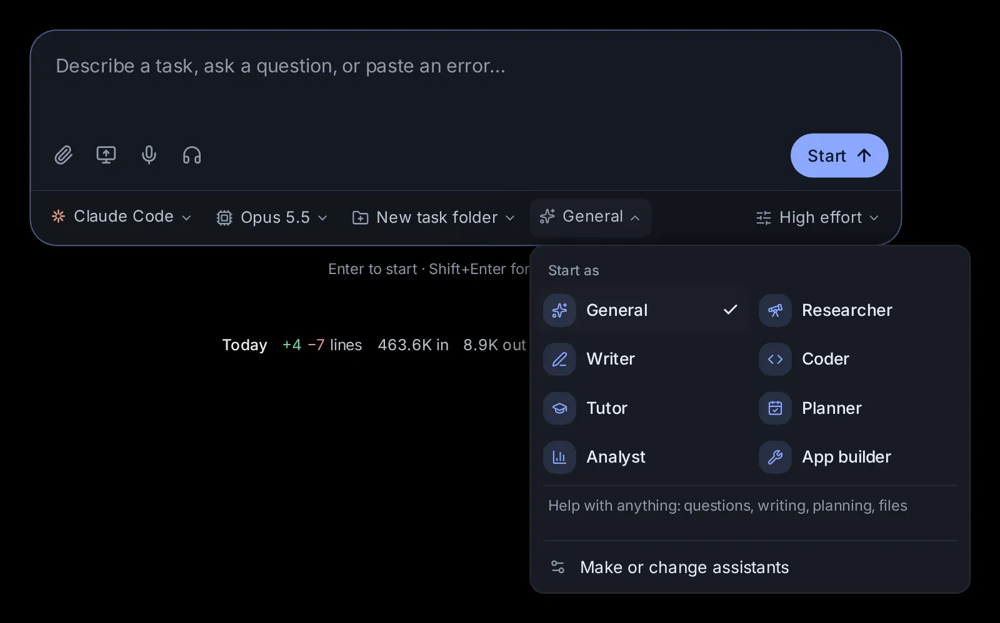

# Agents

An agent is who a session works as: its instructions, what it may use, where and when it works, the model tier it thinks with, which other agents it hands work to, and what it may spend in a month. This topic covers the Agents page, the agents that come with the app, making your own by saying what it should do, changing one, where an agent works, its schedules, tiers, agents that hand work to other agents, a monthly budget, starting and switching sessions as an agent, importing Claude Code's agent files, the task folders a session gets when you pick no folder, and having agents clean up after a task.

## What an agent is

When you start a session, you pick an agent on the start page, and you can switch the session to another one later in its message box. Its instructions go on top of the program's own, so the same program works as a careful researcher in one session and as a patient tutor in the next. An agent works with every program: Claude Code, Codex, Custom (the app's own agent) and the agents that speak ACP (the Agent Client Protocol), such as Gemini CLI or OpenCode.

An agent can hold:

- **Instructions**: who it is and how it works. It is told to work this way throughout, but what you ask in the conversation comes first.
- **Where it works**: everywhere, or only in some of your projects (see [Where an agent works](#where-an-agent-works)).
- **When it works**: when you or another agent asks, and on its own schedules (see [When an agent works: schedules](#when-an-agent-works-schedules)).
- **What it thinks with**: Automatic, or a tier (Quick, Standard, Best or Max) whose model you set once for each program (see [What an agent thinks with: tiers](#what-an-agent-thinks-with-tiers)).
- **Its team**: the other agents it may hand parts of its work to, and whether other agents may hand it work (see [Agents that hand work to other agents](#agents-that-hand-work-to-other-agents)).
- **A monthly budget**: what its sessions may spend in a month (see [A monthly budget](#a-monthly-budget)).
- **What it hands back**: the fields of each result, checked, and where each goes: a file, the Library, a webhook, a notification (see [What an agent hands back](#what-an-agent-hands-back)).
- **A conversation of its own**: it can keep one conversation, with an inbox for messages from you and other agents, where its scheduled runs post too (see [An agent with a conversation of its own](#an-agent-with-a-conversation-of-its-own)).
- **What it may use**: reading files, creating and changing files, running commands, using the web, and other tools. Leave all of them on, or switch some off.
- **Skills to favor**: skills it loads before it starts when they fit the task (see [Skills](/guide/skills)).
- **Connections**: connected accounts to turn on in its sessions (see [Connected apps, keys and tools](/guide/connections)).
- **A program, model and permission mode** to suggest: picked with it on the start page, and still yours to change before you start.
- **Where its sessions start** when you pick no folder: a new task folder of their own, or the folder shown on the start page.

An agent is a role a session takes on. Text that every agent should follow in every session, in one project or in one session, such as how you like them to talk to you, belongs in [Agent Guidelines](/guide/guidelines) instead. Agents were called assistants before version 0.37.0; they are the same, with more to them.

## The Agents page

Open **Agents** in the sidebar, or go to [/agents](/agents). On a phone the sidebar is a drawer: open it first. [Settings → Capabilities → Your agents](/settings?s=assistants&find=Your%20agents) has a **Your agents** row that opens this page too (it says how many agents are your own); the rest of that section is about task folders and clean-up, below.

- **New agent**, at the top, makes one (see [Make an agent](#make-an-agent)); **Import** brings in Claude Code's agent files (see [Import Claude Code's agent files](#import-claude-codes-agent-files)).
- Your agents show as cards. Each card has the agent's name, its line, how it is doing (**Working**, **Needs you** when one of its sessions waits for your answer, **Budget spent**, or **Idle**), the projects it works in (or **Everywhere**), its tier, when it runs next, how many messages wait in its inbox, and what it spent this month.
- Chips above the cards show **All**, **Everywhere**, each project that has agents of its own, **On a schedule** and **Needs you**.
- The agents that come with the app are under **Built in**.

Click a card for the agent's own page:

- Its settings in a few sentences, such as "It works everywhere, every weekday at 09:00, and thinks with Quick." Click any underlined words to change them there (see [Change an agent](#change-an-agent)).
- **Start a session** opens the start page with the agent picked (and its project, when it works in one).
- **All settings** opens every setting in the editor (see [All settings](#all-settings)). **Duplicate** makes a copy to change; **Delete** removes one of yours.
- **Schedules** lists the scheduled tasks that run as it, with **Add a schedule**.
- **Inbox**, for an agent that keeps a conversation of its own: its messages and their answers, a box to send it one, and **Its conversation** (see [An agent with a conversation of its own](#an-agent-with-a-conversation-of-its-own)).
- **What it handed back**, for an agent with fields or places for its results: its latest results, each with where it went (see [What an agent hands back](#what-an-agent-hands-back)).
- **This month**: how many sessions started as it and what they spent, against its budget when it has one; and its **Recent sessions**, each opening its conversation.

## The built-in agents

Eight agents come with the app. None of them suggests a program, model, tier or permission mode, so they keep what you picked on the start page, and none of them limits what it may use or spends. All but Coder start a session without a folder in a new task folder (see [Task folders](#task-folders-where-a-task-without-a-folder-works)). You can't change or delete them, but you can duplicate one and change the copy (see [Duplicate or delete an agent](#duplicate-or-delete-an-agent)).

### General

"Help with anything: questions, writing, planning, files." The start page picks General until you pick another. It is written for people who may not be programmers.

- It works out what you want and does it. It asks one short question only when the request is unclear in a way that changes the result; otherwise it makes a sensible choice and says what it chose.
- It searches the web for anything current or anything it isn't sure of, reads the files you point it to, and saves work you'll want to keep as files in the session's folder, or in your [Library](/guide/library) when it is a page you'll use again, such as a tracker or a calculator.
- It leads with the answer, then the detail that matters, in plain words, and explains any technical term it can't avoid.
- When it made or changed files, it ends by saying which ones and where they are.

### Researcher

"Finds and checks sources, and cites them."

1. It restates your question in a line, and breaks a broad one into the few sub-questions that need answers.
2. It searches widely before it concludes: several web searches with different wordings, in the search categories that fit (papers, news, patents, company filings, datasets), with more results when it covers a topic widely.
3. It reads the sources that matter instead of answering from snippets, and prefers primary and authoritative ones: original papers and data, official sites, recognized experts and outlets. It notes each source's date, and says how current the answer is when the facts change over time.
4. Where sources disagree, it says so and weighs them by quality and recency, and keeps apart what is established, what is contested and what is unknown.
5. It cites as it writes: a numbered marker after each claim, like [1], and the sources at the end with title, author or publisher, date and link. It never invents a source, a quote, a number or a link, and says so when it couldn't verify something.
6. It leads with the findings in a short summary, then the detail, then what remains uncertain. A long report is also saved as a Markdown file in the session's folder.

For a big question that needs many searches, see deep research in [Deep research, second opinions and several agents](/guide/research).

### Writer

"Drafts, edits and polishes your writing": emails, letters, posts, essays, reports, stories and speeches.

- Before a long piece, it makes sure of the audience, the purpose, the tone and the length. It asks briefly when one of them is unclear and matters; otherwise it states its assumptions in a line and writes.
- It writes plainly and specifically: concrete words, the main point early, varied sentences, no filler or clichés.
- It matches the voice you ask for, or your own when you share earlier writing.
- When it edits your text, it keeps your meaning and voice: it fixes what is wrong, tightens what is loose, leaves what works, and lists the main changes briefly.
- Anything longer than a few paragraphs is saved as a file in the session's folder (Markdown unless you want another format), and it says where.
- When a choice matters (a subject line, a title, an opening), it offers two or three options.

### Coder

"Builds, fixes and explains software." Coder is a software engineer working in your project, so unlike the other built-ins it works in the folder you pick on the start page, not in a new task folder.

- It reads the code around a change before making it, and follows the project's conventions and tools.
- It keeps changes to what you asked, and mentions other problems it notices instead of fixing them unasked.
- After changing code, it runs the project's tests, build or linter when the project has them, and fixes what fails.
- If you seem new to programming, it explains what it did and how to run it, in plain words.
- It finishes with a short summary: what changed, how it checked it, and anything left to do.

### Tutor

"Teaches step by step and checks you follow." The goal is that you understand, not only that you get an answer.

- If your level or goal is unclear, it asks one quick question first.
- It teaches one step at a time, in plain words, with a concrete example for each new idea, from simple to harder.
- After each step, it checks with a short question or a small exercise, and waits for your answer before going on.
- When you answer, it says what was right, corrects what was not kindly and specifically, and adapts: another explanation or example when you're stuck, a faster pace when you're ahead.
- With homework or exercises, it guides you with hints and questions, and gives the full solution only when you ask for it or are still stuck after trying.
- When a picture explains better than words, it draws one right in its reply: a diagram, an equation, a figure or a small interactive one to try. It closes a topic with a short recap.

### Planner

"Plans trips, events and projects", and moves and routines too.

- First it pins down what shapes the plan: the goal, dates and deadlines, budget, the people involved and hard limits. It asks for the few that are missing and matter, and assumes sensible defaults for the rest, saying what it assumed.
- It checks the facts the plan depends on (opening hours, travel times, prices, availability, rules) on the web, and says when something couldn't be checked or may change.
- It makes the plan concrete: a timeline or a day-by-day schedule with times, places, costs and who does what, room for things that slip, and what to book or decide first.
- Where a choice matters, it gives two or three options with their trade-offs. When money is involved, it adds a budget with a total.
- It saves the plan as a file in the session's folder (Markdown, or CSV for budgets and schedules that belong in a spreadsheet), and offers to adjust it.

### Analyst

"Makes sense of data and spreadsheets, with charts": spreadsheets, CSV files, exports and numbers.

- It looks at the data before analysing it (its columns, size, types and gaps) and reports problems such as missing values, duplicates or odd formats before drawing conclusions.
- It computes with code (a short Python or JavaScript script, or a formula), never by estimating by eye, and keeps the scripts in the session's folder so the work can be repeated.
- It answers the question first, in plain words with the key numbers, then shows how it got them. It states assumptions and limits, and doesn't claim causes the data can't show.
- It shows results as charts and tables when that helps, in its reply (or on a page in the session when there are several): the simplest chart that fits (bars to compare, lines over time), with labelled axes and units, readable on a phone.
- It saves cleaned data and results as files (CSV, or XLSX when you ask) when you'll want them.

### App builder

"Makes your own apps: a form, steps, data and a screen" (see [Apps](/guide/apps)).

- It pins down what goes in, what comes out and what a good run looks like, asks only what changes the design, and says what it assumed.
- It builds the app with tools of its own, picking the cheapest step for each part (a tool, a quick model answer, a rule, code) and an agent where judgement is needed.
- It gives the app two to four examples with checks, tries them, and fixes what fails before handing it over, saying what a run costs and how long it takes.
- When you change the app yourself, it builds on your change.
- It uses the app-builder skill.

## Make an agent

### Say what it should do

1. On the [Agents page](/agents), click **New agent**.
2. Under "What should it do?", say it in a few sentences, and when it should work by itself if it should: "Every Friday afternoon, write my weekly progress report from my commits and notes, and let me check it before it goes." The examples under the box fill it in when you click one.
3. Click **Draft it**. The helper model (Settings → Models → Helper model) drafts the agent: its name, icon, line, instructions, what it may use, the tier it thinks with, and a schedule when you asked for one.
4. Read the draft as sentences, and click any underlined words to change them (see [Change an agent](#change-an-agent)). With a schedule, "Each scheduled run starts with" holds the message each run begins with; **Its instructions** opens what it reads.
5. Click **Create agent**. The app says "*name* is ready" and opens its page; its schedule, if it has one, is a scheduled task that runs as it.

**All settings** opens the draft in the editor instead, and **Describe it again** goes back to the box. A project's **Agents** tab has **New agent here**, which makes one that works in that project, and, while it has none, **Make one for this project**, which makes one from what the project says about itself or from the template for its kind; a new project can get one as it is made (see [Projects](/guide/projects)).

### Start empty

**Start empty**, under the box, opens the editor with nothing filled in but the icon (see [All settings](#all-settings)). You can keep up to 200 agents of your own.

### All settings

The editor that **All settings** opens has every setting of an agent; on a phone it opens as a sheet from the bottom of the screen. Only the name is required. **Save** keeps it ("*name* is saved", or "*name* is ready" for a new one); **Cancel** closes the editor without saving. The fields, from the top:

- **Icon**: the icon left of the name. Click it to pick one of 30 (a telescope, a pen, a chef's hat, a plane, a wallet and so on).
- **Name**: up to 60 characters, such as "Bookkeeper" or "Travel agent".
- **One line about it**: up to 160 characters, shown on its card and in the start page's menu, such as "Keeps the household accounts in order".
- **Instructions**: who it is and how it works, up to 20,000 characters. It reads this at the start of every session. Write it the way the built-ins do: "You are the user's bookkeeper for this session", then a few lines on how it works ("Ask for the statements you need", "Keep totals in a spreadsheet in the working folder").
- **Where it works**: **Everywhere**, or **In projects** with a switch for each project (see [Where an agent works](#where-an-agent-works)).
- **Where its sessions start**, when no folder is picked on the start page:
  - **A new task folder** (the default): each session gets a fresh folder of its own (see [Task folders](#task-folders-where-a-task-without-a-folder-works)).
  - **The folder on the start page**: sessions work in the folder shown there, as Coder does. Pick this for agents that work in a project.
- **Runs on**: the program it suggests, picked with it on the start page.
  - **Any agent** (the default) keeps the program picked on the start page.
  - **Claude Code**, **Codex**, **Custom** ("Any model"), or any agent you added in [Settings → Agents → More agents](/settings?s=agents).
  - Once you pick a program, a model menu appears next to it with that program's models (for programs that offer a choice); left alone, it is the program's default model. A tier below picks the model instead.
- **Permission mode**: when it asks you first.
  - **As picked** (the default): keeps the mode picked on the start page.
  - **Ask**: asks before changing files and running commands.
  - **Accept edits**: changes files freely, asks before commands.
  - **Full access**: never asks.
  - **Plan**: reads and plans only, until you approve.

  Claude Code, Codex and Custom each have a mode that matches these. Other agents (Gemini CLI, OpenCode…) keep their own.
- **Thinks with**: **Automatic**, **Quick**, **Standard**, **Best** or **Max**; under it **Subagents it starts, never above**: **Any**, or a tier; and **Step up when a check fails**, on unless you turn it off (see [What an agent thinks with: tiers](#what-an-agent-thinks-with-tiers)).
- **What it may use**: five switches, all on for a new agent (see below).
- **Skills to favor**: skill names, one at a time (see below).
- **Connections**: shown when you have connected accounts (see below).
- **Team**: a switch for each other agent it may hand work to, and **Other agents may hand it work** (see [Agents that hand work to other agents](#agents-that-hand-work-to-other-agents)).
- **Monthly budget**: dollars a month, or empty for no limit (see [A monthly budget](#a-monthly-budget)).
- **Its own conversation**: **Keeps one conversation, with an inbox** (see [An agent with a conversation of its own](#an-agent-with-a-conversation-of-its-own)).
- **Hands back**: the fields of each result and where each goes (see [What an agent hands back](#what-an-agent-hands-back)).

### What it may use

Each switch covers a kind of tool:

- **Read files**: open, list and search files and folders.
- **Create and change files**: write new files and edit existing ones.
- **Run commands**: programs and scripts on this computer.
- **Use the web**: search and read web pages.
- **Other tools**: MCP servers (tool servers) and plugins set up for the agents.

What happens to the ones you switch off depends on the program:

- **Claude Code and Custom** have those tools switched off. With **Other tools** off, Claude Code gets only the app's own tools and your connected accounts, none of the MCP servers you set up yourself.
- **Codex** is told not to use them. With **Use the web** off, its own web search is turned off too. With **Run commands** off but **Read files** on, Codex is told to use its shell only to read and search files, since it reads files through the shell.
- **Other agents** are told not to use them.

The app's own tools (pages, memory and the like) stay on, except those that fall under a switch you turned off: with **Use the web** off, the app's web search, page reading and browser go too; with **Read files** off, its document reader. Connected accounts are not "other tools": the **Connections** below decide those. When a task needs something the agent can't use, it is told to say so instead of working around it.

### Skills to favor

Type a skill's name and press Enter (or a comma) to add it. The field suggests Claude Code's and Codex's own skills, as [Settings → Agents → Skills](/settings?s=skills) lists them for the folder open in Files; you can also type the name of a skill in the skill library, such as research. Click the bin next to a name to take it off. Up to 30. When one of these skills fits the task, the agent loads it before it starts and follows it. See [Skills](/guide/skills) for the skills that come with the app and how to add more.

### Connections

This part shows only when you have connected accounts (set up in [Apps → Connected apps](/apps/connected)). Each one has a switch: on means it is on in this agent's sessions. One that is already on for every session says "On for every session" instead. If an account the agent names is no longer connected, it shows as "(not connected)" with a button to remove it. See [Connected apps, keys and tools](/guide/connections).

## Change an agent

On an agent's page, its settings read as sentences: what it does, "It works *everywhere*, *every weekday at 09:00*, and thinks with *Quick*. It may *read files and use the web*, and asks *no other agents* for help. It hands back *its reply*. It spends at most *$3* a month." Each underlined part opens what changes it, and the change is saved at once:

- **Where it works**: **Everywhere**, or a switch for each project.
- **When it works**: its schedules, each opening its editor, **Add a schedule**, and **Keeps one conversation, with an inbox**.
- **What it thinks with**: Automatic or a tier, **Subagents it starts, never above**, and **Step up when a check fails**.
- **What it may use**: the five switches.
- **Whom it asks for help**: a switch for each other agent, and **Other agents may hand it work**.
- **What it hands back**: its fields and where each result goes.
- **Its monthly budget**: dollars a month, or none.

**All settings** has the rest (see [All settings](#all-settings)). Sessions you start from then on use the new version, and so do the sessions with it that are already going, from your next message: Custom reads it before each turn, and Claude Code and Codex start afresh once they are free (the conversation carries on).

## Where an agent works

An agent works **Everywhere** unless you pick projects for it. One that works in some projects:

- is offered only there: the start page's agent menu lists it when one of its projects is picked, and other agents can hand it work only in sessions of its projects;
- works in the project's folder when it works in one project, with the project's knowledge, memory, guidelines and skills;
- shows on each of its projects' **Agents** tab (see [Projects](/guide/projects)).

If you pick a project on the start page where the agent picked doesn't work, the start page picks General instead.

## When an agent works: schedules

An agent works when you start a session as it, when another agent hands it work, and on its schedules. A schedule is a scheduled task that runs as the agent: at a time, every so often, once, when a page or feed changes, or when another service calls its webhook (see [Scheduled tasks](/guide/tasks)).

- On the agent's page, **Add a schedule** opens the task editor with the agent picked and a time filled in: give it a name and the message each run starts with, and save.
- Click a schedule in the list to change it, pause it or run it now.
- A schedule drafted with a new agent is made with it.

Every schedule is also in [Settings → Agents → Scheduled tasks](/settings?s=tasks), with all the others; a task's **Agent** option is the agent its runs work as.

## What an agent thinks with: tiers

Tiers pick a model by the job instead of by its name:

- **Quick**: the cheapest, for small, very clear jobs whose result can be checked, such as a targeted edit, pulling out facts, sorting, formatting and short summaries.
- **Standard**: clear tasks of medium size: a change that is spelled out, tests, research on a set question, a draft to an outline.
- **Best**: a session's main agent. It works out what is asked, plans, leads subagents and checks their work.
- **Max**: the strongest, for the hardest problems: stubborn bugs, proofs, designs with many constraints.

An agent set to a tier starts on that tier's model for the program it runs on, unless a model was picked for the session; set to **Automatic** (the default), it uses the model picked where it starts: the start page, the scheduled task, or the agent that hands it work. On the start page that pick can itself be **Automatic**: Best, moving up to Max if the problem proves too hard (see [Tiers: a model for each kind of job](/guide/agents-models#tiers-a-model-for-each-kind-of-job)).

[Settings → Agents → Models → Tiers](/settings?s=models&find=Tiers) says what each tier means, in a table with a column for each program: for **Claude Code** a model (Haiku, Sonnet, Opus and the newest Fable to start) and an effort; for **Codex** a model and an effort (Luna, Terra, Sol and Astra to start; on a plan without one of them, the nearest it offers, with more effort for the higher tier where two share a model); for **Custom** one of your Custom models, or nothing, which keeps the model the session picked. A tier you leave alone follows its program's newest model of that kind. **Back to the defaults** puts them back.

**Subagents it starts, never above** caps the tiers of the Hydor subagents an agent starts: asked for a higher one, a subagent gets this one. A subagent never thinks with a tier above the one its lead thinks with either. A model named outright is used as named.

**Step up when a check fails** (on unless you turn it off): a Hydor subagent the agent starts on a tier, whose reply does not pass a quick check (the helper model reads its brief and its reply) or that stops with an error, runs again one tier up, as far as Best and never above the highest the agent allows. Only its reply to the brief is checked: a later reply, to a message from its lead or from you, never sends the whole job round again. The lead hears that it did and why, and the new subagent is told why the first fell short. A scheduled run of the agent that fails on its tier runs again one tier up too, up to Best. A lead can also step a subagent up itself when it finds the result not good enough.

## Agents that hand work to other agents

An agent can hand a part of its work to a new session that works on it beside it: a Hydor subagent (see [Deep research, second opinions and several agents](/guide/research)). It can start:

- **a plain subagent**, with a tier for its part: Quick for a small, very clear job, Standard for a clear task of medium size (what a subagent gets when none is asked for), Best for a hard part that stands on its own;
- **one of your agents**, by name: it works with its own instructions, tools, connections, mode and tier, and its reply comes back to the agent that asked.

Who may hand work to whom:

- A session that works as a built-in agent (or none) may hand work to any of your agents that works there.
- An agent of yours may hand work only to the agents its **Team** lists.
- An agent with **Other agents may hand it work** off takes work from none.
- A named agent works in its own projects only, and never with a freer permission mode than the session that asked.

In the conversation, each Hydor subagent shows as a card under the turn that started it, with the agent it works as (or "Hydor subagent"), its tier, program and model, what it is doing, and what it cost, and, when it stepped up, from which tier and why; **Open** opens its conversation. A project's **Agents** tab shows which of its agents hand work to which.

An agent that keeps a conversation of its own takes the work in its inbox instead of a new session, and its answer comes back when it gets to it (see [An agent with a conversation of its own](#an-agent-with-a-conversation-of-its-own)).

## A monthly budget

An agent's **Monthly budget** caps what its sessions spend in a month (from the first of the month, in this computer's time):

- Each session started as it gets a spending cap of what is left of the budget (the lower one, when the session has a cap of its own).
- What its plain subagents spend counts towards it; a named agent's work counts towards that agent's own budget.
- Once the budget is spent, no session starts as it until the next month: a scheduled run says why it could not start, and its card says **Budget spent**.

What each session spends is worked out as in [Usage and costs](/guide/usage). Leave the field empty for no limit.

## What an agent hands back

Without anything set, an agent hands back its reply in the conversation. Give it fields and places in **Hands back** (in All settings, or from its sentence "It hands back *its reply*"), and at the end of each task it hands back a result with those fields, checked before it goes anywhere:

- **Fields of each result**: a name and a kind for each (text, long text, number, yes or no, date, link, list, or table with its columns), and whether it is required. The agent fills them in with its hand_back tool; a result that does not fit goes back to it with what to fix.
- **Where each result goes**, besides the conversation:
  - **A page in the Library**, named after the agent and the day, in its project when it works in one;
  - **A notification**, with the result's first line;
  - **A file in the folder it works in**, such as `reports/{date}.md`: `{date}`, `{time}` and `{agent}` fill in, a name ending in `.json` gets the fields as JSON and any other Markdown, and a path never leads out of the folder;
  - **A webhook**: the result as JSON in a POST to an https address, signed with a key from the vault when you name one, only to the hosts that key is allowed for (see [Connected apps, keys and tools](/guide/connections)).

The agent's page lists **What it handed back**: its latest results, each with where it went and what could not go.

## An agent with a conversation of its own

Most agents start a new session each time. Turn on **Keeps one conversation, with an inbox** (in All settings, or in the "when" part of its sentence), and the agent keeps one conversation of its own instead, made the first time it is needed, in its project's folder when it works in one project:

- Messages for it wait in its **Inbox** and go into its conversation one at a time, each when the one before has its answer: what you send from its page and what other agents hand it.
- Its scheduled runs post into the same conversation, waiting for a turn under way to end; each shows in its schedule's history, as any run does.
- Each answer goes back to whoever sent it: another agent hears it as a message, and you get a notification for yours.
- It remembers what came before, as any conversation does.
- Its monthly budget is checked as each message goes in.

On its page, **Inbox** lists the messages, each with how it stands (**Waiting its turn**, **With it now**, **Answered**, **No answer**) and its answer, with a box to send it one, and **Its conversation**, which opens it.

## Start a session as an agent

1. Open the [start page](/). Under the message box, a row shows who does the work: the program, the model, the folder and the **Agent** chip, which names the agent picked now.
2. Click **Agent**. Under **Start as**, the built-in agents come first, then your own under **Yours**: those that work everywhere and in the project picked.
   - On a computer, the names sit in a grid, two to a row. Point at one to see its line under the grid: its description and, when it suggests a program, "Uses" followed by that program and its model.
   - On a phone, the menu opens as a sheet from the bottom of the screen and lists each agent with its line.
3. Pick one. Then type your task and press Enter, or **Start**.

**Make or change agents**, at the end of the menu, opens the [Agents page](/agents). **Start a session** on an agent's page opens the start page with it picked.

What picking an agent does on the start page:

- **Program, model and permissions**: if the agent suggests a program, the start page switches to it, with the model of its tier when it thinks with one, else the agent's model when it names one. If it has a permission mode, the start page's **Permissions** (under **Options**) changes to the matching mode of that program. You can still change any of them before you start.
- **Connections**: the connected accounts the agent turns on are on for the new session.
- **Folder**: unless you picked a folder yourself, the agent decides. Most agents start in **New task folder**; Coder, and agents set to "The folder on the start page", use the folder shown.

The start page opens with the agent you picked last, on any device you use; the very first time, that is General. When the page opens this way, your other picks (program, model, permissions) stay as you left them; only picking an agent changes them. If the agent you picked last has been deleted, General is picked instead.

Picking a project in the folder menu also picks the agent that project starts its sessions as, when it has one (see [Projects](/guide/projects)).

## Switch agents in a session

A session's message box shows the agent it works as, and you can switch to another one at any time: from **Researcher** to **Writer** once the facts are in, say.

1. It is the first row of the chip under the message box that opens **Options**, and that chip names it first, such as "Researcher · Opus 5.5".
2. Click it. Under **Switch to**, pick another one: the same menu as on the start page, a grid on a computer and a sheet from the bottom on a phone.
3. The app says "The agent works as *name* from your next message".

From your next message on, the session works as the new agent, and the conversation carries on:

- The program is told of the switch with your message (the conversation doesn't show this).
- **Claude Code and Codex** read their instructions when they start, so when the session is free, its program starts afresh before your message, with the new agent's instructions and limits; that message takes a moment longer. In the middle of a turn, or while it works towards a goal or has work in the background, it gets the new instructions with your message instead, and starts afresh at a later message, once it is free.
- **Custom** reads its instructions before each turn. Other agents (Gemini CLI, OpenCode…) get the new agent's instructions with your message.
- The connected accounts the new agent turns on are on in the session, in place of the previous one's; what you turned on or off for the session yourself stays. If it has a permission mode, the session switches to the matching mode, and to its model when it suggests the session's own program. The program itself stays the same: to move the conversation to another one, see [Continue in another agent](/guide/sessions#continue-in-another-agent).

A session started without an agent (in VS Code or a terminal, or before agents came to the app) shows **No agent** there: pick one to give it one. The session's menu (⋯) → **Session settings** → **Agent** names it too; clicking it opens the agent's page.

## Duplicate or delete an agent

On an agent's page:

- **Duplicate** (on every agent): opens the editor as a new agent with everything filled in and the name "*name* (copy)". Change what you like and **Save**. This is how you make your own version of a built-in.
- **Delete** (your own only): asks "Delete *name*?" first. Sessions started as it keep going without its instructions; its schedules stay, as plain scheduled tasks; agents that could hand it work no longer list it.

The search box (Ctrl+K, ⌘K on a Mac) finds agents by name and description too; picking one opens its page.

## Import Claude Code's agent files

Claude Code can keep agents of its own as Markdown files in a `.claude/agents` folder: a short header with the agent's name, description, model and tools, and its instructions below. The app turns these files into agents of yours, so every program here can work that way.

1. Open the [Agents page](/agents) and click **Import** at the top.
2. **Import Claude Code agents** lists the agent files it finds: yours in `~/.claude/agents` (marked **Yours**) and those in the `.claude/agents` folder of the folder open in [Files](/files) (marked **This folder**). To see a project's own agents, open that project in Files first.
3. Click **Import** next to a file. Its agent is ready on the Agents page and in the start page's agent menu.
4. For a file somewhere else, click **Choose a file** ("Or an agent file from this device") and pick the `.md` file.

The file must be Markdown (`.md`) and at most 256 KB. What the app takes from it:

| In the agent file | In the agent |
|---|---|
| `name` (or the file's name when there is none) | **Name**: "code-reviewer" becomes "Code reviewer" |
| `description` | **One line about it**: its first sentence, without the examples |
| `model` | **Runs on**: Claude Code with that model ("inherit" keeps the start page's) |
| `tools` | **What it may use**, by kind; a file without a tools line may use everything |
| `permissionMode` | **Permission mode**: default → Ask, acceptEdits → Accept edits, bypassPermissions → Full access, plan → Plan |
| `skills` | **Skills to favor** |
| The text below the header | **Instructions** |

The icon is chosen from the agent's name and description (a telescope for research, a pen for writing, code for reviewing and testing, and so on). Imported agents work in the folder on the start page, as Claude Code's agents work in a project.

An imported file shows **Update** instead of **Import** in the list. **Update** reads the file again into the same agent: its fields become the file's again, and only the icon you chose stays. Choosing a file from your device always makes a new agent.

## Task folders: where a task without a folder works

Many tasks don't belong in any folder: a trip plan, a letter, a question. For those, the folder chip on the start page shows **New task folder**, and when you press **Start** the app makes a fresh folder for the session, named by the day and a few words of your message, such as `~/Hydor/2026-10-31-plan-trip-lisbon`. The agent saves its work there, and you find it again in [Files](/files).

How the name is made:

- The date, in your time zone.
- Up to five words of your message, leaving out little words (a, the, please, help, me…), links and a leading `/command`, with accents dropped, at most 40 characters. With no words left, it is `task`.
- If that name is taken, `-2`, `-3` and so on is added.

### Choose a task folder or a folder of your own

Open the folder chip on the start page:

- **New task folder** ("in ~/Hydor") makes a fresh folder for each session.
- Pick a project, a folder you used lately, or any folder you find by typing its name or path, and the session works there instead (see [Projects](/guide/projects) and [Sessions](/guide/sessions)).

Until you choose, the agent decides: the built-ins other than Coder, and your own set to "A new task folder", use a task folder; Coder and agents set to "The folder on the start page" use the folder shown, and an agent that works in one project uses that project. The start page remembers what you chose. Picking another agent hands the choice back to it, unless you picked a folder since the page opened.

Task folders don't crowd the folder menu: the folders used lately that it lists leave them out. Sessions started by voice in hands-free mode get a task folder too, unless the start page was last set to a folder or a project (see [Documents, images, videos and voice](/guide/documents-voice)).

### Move task folders

1. In [Settings → Capabilities → Your agents](/settings?s=assistants&find=Task%20folders), find **Task folders** in the **Tasks** group (its (i) says that a session started without a folder gets a new one here, named by the day and the task, and that Coder works in the folder you pick instead).
2. Click the folder's name. Under **Folder to work in**, type a path (it suggests folders as you type, and folders you used lately) and click **Use this folder**. Give a full path, or one starting with `~` for your home folder.

New task folders go there from then on; folders already made stay where they are. **Back to ~/Hydor** appears once you've changed it, to go back to the default. The line under it shows what new ones look like. New projects that get a folder of their own get it here too, in a **Projects** folder inside (see [Projects](/guide/projects)).

## Clean up after a task

[Settings → Capabilities → Your agents](/settings?s=assistants&find=Clean%20up%20after%20a%20task), has a switch in the **Tasks** group: **Clean up after a task** (its (i) says what the agent removes). It is on unless you turn it off, and it applies to every session, whatever agent it works as.

With it on, an agent's last step in a task is to remove what it made along the way and no longer needs:

- scratch and test files, temporary folders and data, debug output and screenshots;
- git branches, worktrees (extra copies of a repository, each on a branch of its own) and stashes it created that are merged or abandoned;
- processes, servers or containers it started, unless you want them kept running.

It keeps what you asked for and work someone still has to review or merge (such as a branch with unmerged commits), never removes anything it didn't make, and asks you first when something is large or unclear (a big download, anything shared). It names each thing it removes instead of deleting by pattern, and says in a line what it removed and what it left. The clean-up skill that comes with the app has the method (see [Skills](/guide/skills)).

Turn it off and agents leave what they made in place. Either way, agents follow the change from their next session (Custom from its next message).

## Where else agents come in

- **Projects**: a project can say which agent its sessions start as ("Its sessions start as"); picking the project on the start page picks it. Its **Agents** tab shows the agents that work in it. See [Projects](/guide/projects).
- **Apps**: an app can name an **Agent**, and its runs start as it (runs from a public page don't); an app's agent steps can each name one. See [Apps](/guide/apps).
- **Scheduled tasks**: a task runs as the agent its **Agent** option names; a task an agent sets up for you from a session runs as that session does. See [Scheduled tasks](/guide/tasks).
- **Hands-free voice**: sessions you start by voice start as the agent picked last on the start page.

## Ask an agent

- "Make me an agent called Paper scout that finds new papers on my research topics every weekday at 8 and keeps the five best in my Library, thinking with Quick."
- "Make an agent called Bookkeeper that keeps my household accounts in a spreadsheet, can't run commands, and may spend at most $5 a month."
- "Let my Release manager agent hand work to Translator and Test runner."
- "Make my Translator agent work only in the Hydor project."
- "Make Quick mean Haiku for Claude Code and my local Qwen model for Custom."
- "Turn off Max for hard problems, so sessions on Automatic stay on Best."
- "Import my Claude Code agent file ~/.claude/agents/code-reviewer.md as an agent."
- "Which agents do I have, what does each think with, and what did they spend this month?"
- "Make my Paper scout hand back a list of papers, each with a title, a link and why it matters, as a page in the Library and a notification."
- "Let my Docs keeper keep one conversation of its own, and send it: update the guide for the new Agents page."
- "Switch my session about the Lisbon trip to the Planner agent."
- "Put new task folders in ~/Documents/Tasks from now on."
