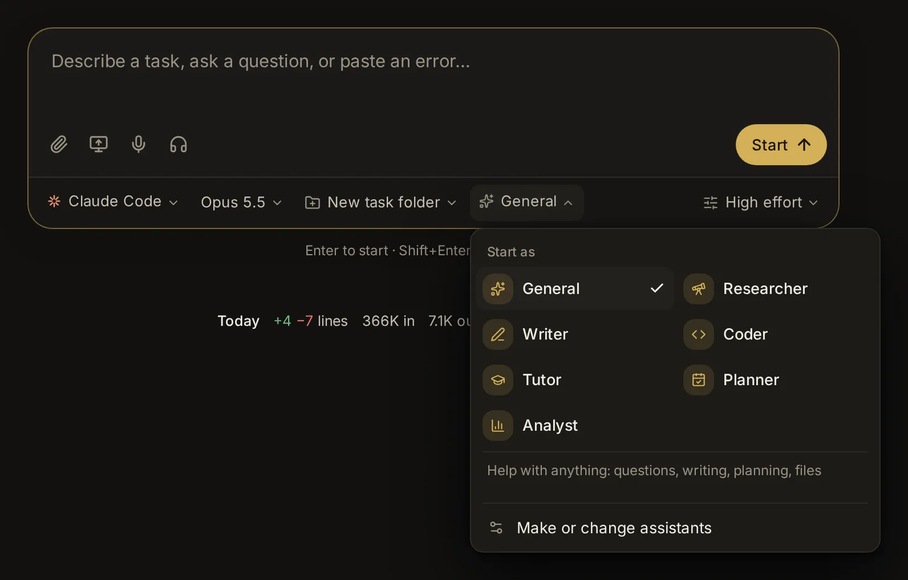

# Assistants

An assistant is a preset a session works as: it tells the agent who it is for this session and how to go about the work, and can limit what the agent may use, favor some skills, turn on connected accounts, and suggest an agent, model and permissions. This topic covers the seven assistants that come with the app, picking one on the start page, switching a session to another one, making, changing, deleting and importing your own, the task folders a session gets when you pick no folder, and having agents clean up after a task.

## What an assistant is

When you start a session, you pick an assistant on the start page, and you can switch the session to another one later in its message box. Its instructions go on top of the agent's own, so the same agent works as a careful researcher in one session and as a patient tutor in the next. It works with every agent: Claude Code, Codex, Custom (the app's own agent) and the agents that speak ACP (the Agent Client Protocol), such as Gemini CLI or OpenCode.

An assistant can hold:

- **Instructions**: who the agent is for the session and how it works. The agent is told to work this way throughout, but what you ask in the conversation comes first.
- **What it may use**: reading files, creating and changing files, running commands, using the web, and other tools. Leave all of them on, or switch some off.
- **Skills to favor**: skills the agent loads before it starts when they fit the task (see [Skills](/guide/skills)).
- **Connections**: connected accounts to turn on in its sessions (see [Connected apps, keys and tools](/guide/connections)).
- **An agent, model and permission mode** to suggest: picked with it on the start page, and still yours to change before you start.
- **Where its sessions start** when you pick no folder: a new task folder of their own, or the folder shown on the start page.

An assistant is a role for one session. Text that every agent should follow in every session, in one project or in one session, such as how you like them to talk to you, belongs in [Agent Guidelines](/guide/guidelines) instead.

## The built-in assistants

Seven assistants come with the app. None of them suggests an agent, model or permission mode, so they keep what you picked on the start page, and none of them limits what the agent may use. All but Coder start a session without a folder in a new task folder (see [Task folders](#task-folders-where-a-task-without-a-folder-works)). You can't change or delete them, but you can duplicate one and change the copy (see [Change, duplicate or delete an assistant](#change-duplicate-or-delete-an-assistant)).

### General

"Help with anything: questions, writing, planning, files." The start page picks General until you pick another. It is written for people who may not be programmers.

- It works out what you want and does it. It asks one short question only when the request is unclear in a way that changes the result; otherwise it makes a sensible choice and says what it chose.
- It searches the web for anything current or anything it isn't sure of, reads the files you point it to, and saves work you'll want to keep as files in the session's folder, or in your [Library](/guide/library) when it is a page you'll use again, such as a tracker or a calculator.
- It leads with the answer, then the detail that matters, in plain words, and explains any technical term it can't avoid.
- When it made or changed files, it ends by saying which ones and where they are.

### Researcher

"Finds and checks sources, and cites them."

1. It restates your question in a line, and breaks a broad one into the few sub-questions that need answers.
2. It searches widely before it concludes: several web searches with different wordings, in the search categories that fit (papers, news, patents, company filings, datasets), with more results when it covers a topic widely.
3. It reads the sources that matter instead of answering from snippets, and prefers primary and authoritative ones: original papers and data, official sites, recognized experts and outlets. It notes each source's date, and says how current the answer is when the facts change over time.
4. Where sources disagree, it says so and weighs them by quality and recency, and keeps apart what is established, what is contested and what is unknown.
5. It cites as it writes: a numbered marker after each claim, like [1], and the sources at the end with title, author or publisher, date and link. It never invents a source, a quote, a number or a link, and says so when it couldn't verify something.
6. It leads with the findings in a short summary, then the detail, then what remains uncertain. A long report is also saved as a Markdown file in the session's folder.

For a big question that needs many searches, see deep research in [Deep research, second opinions and several agents](/guide/research).

### Writer

"Drafts, edits and polishes your writing": emails, letters, posts, essays, reports, stories and speeches.

- Before a long piece, it makes sure of the audience, the purpose, the tone and the length. It asks briefly when one of them is unclear and matters; otherwise it states its assumptions in a line and writes.
- It writes plainly and specifically: concrete words, the main point early, varied sentences, no filler or clichés.
- It matches the voice you ask for, or your own when you share earlier writing.
- When it edits your text, it keeps your meaning and voice: it fixes what is wrong, tightens what is loose, leaves what works, and lists the main changes briefly.
- Anything longer than a few paragraphs is saved as a file in the session's folder (Markdown unless you want another format), and it says where.
- When a choice matters (a subject line, a title, an opening), it offers two or three options.

### Coder

"Builds, fixes and explains software." Coder is a software engineer working in your project, so unlike the other built-ins it works in the folder you pick on the start page, not in a new task folder.

- It reads the code around a change before making it, and follows the project's conventions and tools.
- It keeps changes to what you asked, and mentions other problems it notices instead of fixing them unasked.
- After changing code, it runs the project's tests, build or linter when the project has them, and fixes what fails.
- If you seem new to programming, it explains what it did and how to run it, in plain words.
- It finishes with a short summary: what changed, how it checked it, and anything left to do.

### Tutor

"Teaches step by step and checks you follow." The goal is that you understand, not only that you get an answer.

- If your level or goal is unclear, it asks one quick question first.
- It teaches one step at a time, in plain words, with a concrete example for each new idea, from simple to harder.
- After each step, it checks with a short question or a small exercise, and waits for your answer before going on.
- When you answer, it says what was right, corrects what was not kindly and specifically, and adapts: another explanation or example when you're stuck, a faster pace when you're ahead.
- With homework or exercises, it guides you with hints and questions, and gives the full solution only when you ask for it or are still stuck after trying.
- It shows a diagram or a small interactive page in the session when a picture explains better than words, and closes a topic with a short recap.

### Planner

"Plans trips, events and projects", and moves and routines too.

- First it pins down what shapes the plan: the goal, dates and deadlines, budget, the people involved and hard limits. It asks for the few that are missing and matter, and assumes sensible defaults for the rest, saying what it assumed.
- It checks the facts the plan depends on (opening hours, travel times, prices, availability, rules) on the web, and says when something couldn't be checked or may change.
- It makes the plan concrete: a timeline or a day-by-day schedule with times, places, costs and who does what, room for things that slip, and what to book or decide first.
- Where a choice matters, it gives two or three options with their trade-offs. When money is involved, it adds a budget with a total.
- It saves the plan as a file in the session's folder (Markdown, or CSV for budgets and schedules that belong in a spreadsheet), and offers to adjust it.

### Analyst

"Makes sense of data and spreadsheets, with charts": spreadsheets, CSV files, exports and numbers.

- It looks at the data before analysing it (its columns, size, types and gaps) and reports problems such as missing values, duplicates or odd formats before drawing conclusions.
- It computes with code (a short Python or JavaScript script, or a formula), never by estimating by eye, and keeps the scripts in the session's folder so the work can be repeated.
- It answers the question first, in plain words with the key numbers, then shows how it got them. It states assumptions and limits, and doesn't claim causes the data can't show.
- It shows results as charts and tables on a page in the session when that helps: the simplest chart that fits (bars to compare, lines over time), with labelled axes and units, readable on a phone.
- It saves cleaned data and results as files (CSV, or XLSX when you ask) when you'll want them.

### App builder

"Makes your own apps: a form, steps, data and a screen" (see [Apps](/guide/apps)).

- It pins down what goes in, what comes out and what a good run looks like, asks only what changes the design, and says what it assumed.
- It builds the app with tools of its own, picking the cheapest step for each part (a tool, a quick model answer, a rule, code) and an agent where judgement is needed.
- It gives the app two to four examples with checks, tries them, and fixes what fails before handing it over, saying what a run costs and how long it takes.
- When you change the app yourself, it builds on your change.
- It uses the app-builder skill.

## Start a session as an assistant

1. Open the [start page](/). Under the message box, a row shows who does the work: the agent, the model, the folder and the **Assistant** chip, which names the assistant picked now.
2. Click **Assistant**. Under **Start as**, the built-in assistants come first, then your own under **Yours**.
   - On a computer, the names sit in a grid, two to a row. Point at one to see its line under the grid: its description and, when it suggests an agent, "Uses" followed by that agent and its model.
   - On a phone, the menu opens as a sheet from the bottom of the screen and lists each assistant with its line.
3. Pick one. Then type your task and press Enter, or **Start**.

**Make or change assistants**, at the end of the menu, opens [Settings → Assistants](/settings?s=assistants).

What picking an assistant does on the start page:

- **Agent, model and permissions**: if the assistant suggests an agent, the start page switches to it, with the assistant's model when it names one. If it has a permission mode, the start page's **Permissions** (under **Options**) changes to the matching mode of that agent. You can still change any of them before you start.
- **Connections**: the connected accounts the assistant turns on are on for the new session.
- **Folder**: unless you picked a folder yourself, the assistant decides. Most assistants start in **New task folder**; Coder, and assistants set to "The folder on the start page", use the folder shown.

The start page opens with the assistant you picked last, on any device you use; the very first time, that is General. When the page opens this way, your other picks (agent, model, permissions) stay as you left them; only picking an assistant changes them. If the assistant you picked last has been deleted, General is picked instead.

Picking a project in the folder menu also picks the assistant that project starts its sessions as, when it has one (see [Projects](/guide/spaces)).

## Switch assistants in a session

A session's message box shows the assistant it works as, and you can switch to another one at any time: from **Researcher** to **Writer** once the facts are in, say.

1. It is the first row of the chip under the message box that opens **Options**, and that chip names it first, such as "Researcher · Opus 5.5".
2. Click it. Under **Switch to**, pick another one: the same menu as on the start page, a grid on a computer and a sheet from the bottom on a phone.
3. The app says "The agent works as *name* from your next message".

From your next message on, the agent works as the new assistant, and the conversation carries on:

- The agent is told of the switch with your message (the conversation doesn't show this).
- **Claude Code and Codex** read their instructions when they start, so when the session is free, its agent starts afresh before your message, with the new assistant's instructions and limits; that message takes a moment longer. In the middle of a turn, or while the agent works towards a goal or has work in the background, it gets the new instructions with your message instead, and starts afresh at a later message, once it is free.
- **Custom** reads its instructions before each turn. Other agents (Gemini CLI, OpenCode…) get the new assistant's instructions with your message.
- The connected accounts the new assistant turns on are on in the session, in place of the previous one's; what you turned on or off for the session yourself stays. If it has a permission mode, the session switches to the matching mode, and to its model when it suggests the session's own agent. The agent itself stays the same: to move the conversation to another one, see [Continue in another agent](/guide/sessions#continue-in-another-agent).

A session started without an assistant (in VS Code or a terminal, or before assistants came to the app) shows **No assistant** there: pick one to give it one. The session's menu (⋯) → **Session settings** → **Assistant** names it too; clicking it opens [Settings → Assistants](/settings?s=assistants).

## Make your own assistant

1. Open [Settings → Capabilities → Assistants](/settings?s=assistants&find=New%20assistant) and click **New assistant** (or, on the start page, the **Assistant** chip → **Make or change assistants**).
2. Fill in the fields below. Only the name is required.
3. Click **Save**. The app says "*name* is ready to pick on the start page", and it shows under **Yours** in the start page's assistant menu.

On a phone, the editor opens as a sheet from the bottom of the screen. You can keep up to 200 assistants of your own.

The fields, from the top:

- **Icon**: the icon left of the name. Click it to pick one of 30 (a telescope, a pen, a chef's hat, a plane, a wallet and so on).
- **Name**: up to 60 characters, such as "Bookkeeper" or "Travel agent".
- **One line about it**: up to 160 characters, shown in the start page's menu, such as "Keeps the household accounts in order".
- **Instructions**: who it is and how it works, up to 20,000 characters. The agent reads this at the start of every session with it. Write it the way the built-ins do: "You are the user's bookkeeper for this session", then a few lines on how it works ("Ask for the statements you need", "Keep totals in a spreadsheet in the working folder").
- **Where its sessions start**, when no folder is picked on the start page:
  - **A new task folder** (the default): each session gets a fresh folder of its own (see [Task folders](#task-folders-where-a-task-without-a-folder-works)).
  - **The folder on the start page**: sessions work in the folder shown there, as Coder does. Pick this for assistants that work in a project.
- **Agent and model**: the agent it suggests, picked with it on the start page.
  - **Any agent** (the default) keeps the agent picked on the start page.
  - **Claude Code**, **Codex**, **Custom** ("Any model"), or any agent you added in [Settings → Agents → More agents](/settings?s=agents).
  - Once you pick an agent, a model menu appears next to it with that agent's models (for agents that offer a choice); left alone, it is the agent's default model.
- **Permission mode**: when the agent asks you first.
  - **As picked** (the default): keeps the mode picked on the start page.
  - **Ask**: asks before changing files and running commands.
  - **Accept edits**: changes files freely, asks before commands.
  - **Full access**: never asks.
  - **Plan**: reads and plans only, until you approve.

  Claude Code, Codex and Custom each have a mode that matches these. Other agents (Gemini CLI, OpenCode…) keep their own.
- **What it may use**: five switches, all on for a new assistant (see below).
- **Skills to favor**: skill names, one at a time (see below).
- **Connections**: shown when you have connected accounts (see below).

**Cancel** closes the editor without saving.

### What it may use

Each switch covers a kind of tool:

- **Read files**: open, list and search files and folders.
- **Create and change files**: write new files and edit existing ones.
- **Run commands**: programs and scripts on this computer.
- **Use the web**: search and read web pages.
- **Other tools**: MCP servers (tool servers) and plugins set up for the agents.

What happens to the ones you switch off depends on the agent:

- **Claude Code and Custom** have those tools switched off. With **Other tools** off, Claude Code gets only the app's own tools and your connected accounts, none of the MCP servers you set up yourself.
- **Codex** is told not to use them. With **Use the web** off, its own web search is turned off too. With **Run commands** off but **Read files** on, Codex is told to use its shell only to read and search files, since it reads files through the shell.
- **Other agents** are told not to use them.

The app's own tools (pages, memory and the like) stay on, except those that fall under a switch you turned off: with **Use the web** off, the app's web search, page reading and browser go too; with **Read files** off, its document reader. Connected accounts are not "other tools": the **Connections** below decide those. When a task needs something the assistant can't use, the agent is told to say so instead of working around it.

### Skills to favor

Type a skill's name and press Enter (or a comma) to add it. The field suggests Claude Code's and Codex's own skills, as [Settings → Agents → Skills](/settings?s=skills) lists them for the folder open in Files; you can also type the name of a skill in the skill library, such as research. Click the bin next to a name to take it off. Up to 30. When one of these skills fits the task, the agent loads it before it starts and follows it. See [Skills](/guide/skills) for the skills that come with the app and how to add more.

### Connections

This part shows only when you have connected accounts (set up in [Apps → Connected apps](/apps/connected)). Each one has a switch: on means it is on in this assistant's sessions. One that is already on for every session says "On for every session" instead. If an account the assistant names is no longer connected, it shows as "(not connected)" with a button to remove it. See [Connected apps, keys and tools](/guide/connections).

## Change, duplicate or delete an assistant

Each assistant has its buttons on its row in [Settings → Assistants](/settings?s=assistants). Built-in ones carry a **Built in** badge; imported ones an **Imported** badge.

- **Edit** (the pencil, your own only): opens the same editor. **Save** keeps the changes ("*name* is saved"). Sessions you start from then on use the new version, and so do the sessions with it that are already going, from your next message: Custom reads it before each turn, and Claude Code and Codex start afresh once they are free (the conversation carries on).
- **Duplicate** (two squares, on every assistant): opens the editor as a new assistant with everything filled in and the name "*name* (copy)". Change what you like and **Save**. This is how you make your own version of a built-in.
- **Delete** (the bin, your own only): asks "Delete *name*?" first. Sessions started with it keep going without its instructions.

The search box (Ctrl+K, ⌘K on a Mac) finds assistants by name and description too; picking one opens Settings → Assistants at it.

## Import Claude Code's agent files

Claude Code can keep agents of its own as Markdown files in a `.claude/agents` folder: a short header with the agent's name, description, model and tools, and its instructions below. The app turns these files into assistants, so every agent here can work that way.

1. Open [Settings → Assistants](/settings?s=assistants) and click **Import**.
2. **Import Claude Code agents** lists the agent files it finds: yours in `~/.claude/agents` (marked **Yours**) and those in the `.claude/agents` folder of the folder open in [Files](/files) (marked **This folder**). To see a project's own agents, open that project in Files first.
3. Click **Import** next to a file. Its assistant is ready to pick on the start page.
4. For a file somewhere else, click **Choose a file** ("Or an agent file from this device") and pick the `.md` file.

The file must be Markdown (`.md`) and at most 256 KB. What the app takes from it:

| In the agent file | In the assistant |
|---|---|
| `name` (or the file's name when there is none) | **Name**: "code-reviewer" becomes "Code reviewer" |
| `description` | **One line about it**: its first sentence, without the examples |
| `model` | **Agent and model**: Claude Code with that model ("inherit" keeps the start page's) |
| `tools` | **What it may use**, by kind; a file without a tools line may use everything |
| `permissionMode` | **Permission mode**: default → Ask, acceptEdits → Accept edits, bypassPermissions → Full access, plan → Plan |
| `skills` | **Skills to favor** |
| The text below the header | **Instructions** |

The icon is chosen from the agent's name and description (a telescope for research, a pen for writing, code for reviewing and testing, and so on). Imported assistants work in the folder on the start page, as Claude Code's agents work in a project.

An imported file shows **Update** instead of **Import** in the list. **Update** reads the file again into the same assistant: its fields become the file's again, and only the icon you chose stays. Choosing a file from your device always makes a new assistant.

## Task folders: where a task without a folder works

Many tasks don't belong in any folder: a trip plan, a letter, a question. For those, the folder chip on the start page shows **New task folder**, and when you press **Start** the app makes a fresh folder for the session, named by the day and a few words of your message, such as `~/Naget/2026-10-31-plan-trip-lisbon`. The agent saves its work there, and you find it again in [Files](/files).

How the name is made:

- The date, in your time zone.
- Up to five words of your message, leaving out little words (a, the, please, help, me…), links and a leading `/command`, with accents dropped, at most 40 characters. With no words left, it is `task`.
- If that name is taken, `-2`, `-3` and so on is added.

### Choose a task folder or a folder of your own

Open the folder chip on the start page:

- **New task folder** ("in ~/Naget") makes a fresh folder for each session.
- Pick a project, a folder you used lately, or any folder you find by typing its name or path, and the session works there instead (see [Projects](/guide/spaces) and [Sessions](/guide/sessions)).

Until you choose, the assistant decides: the built-ins other than Coder, and your own set to "A new task folder", use a task folder; Coder and assistants set to "The folder on the start page" use the folder shown. The start page remembers what you chose. Picking another assistant hands the choice back to it, unless you picked a folder since the page opened.

Task folders don't crowd the folder menu: the folders used lately that it lists leave them out. Sessions started by voice in hands-free mode get a task folder too, unless the start page was last set to a folder or a project (see [Documents, images, videos and voice](/guide/documents-voice)).

### Move task folders

1. In [Settings → Capabilities → Assistants](/settings?s=assistants&find=Task%20folders), find **Task folders** ("A session started without a folder gets a new one here, named by the day and the task").
2. Click the folder's name. Under **Folder to work in**, type a path (it suggests folders as you type, and folders you used lately) and click **Use this folder**. Give a full path, or one starting with `~` for your home folder.

New task folders go there from then on; folders already made stay where they are. **Back to ~/Naget** appears once you've changed it, to go back to the default. The line under it shows what new ones look like. New projects that get a folder of their own get it here too, in a **Projects** folder inside (see [Projects](/guide/spaces)).

## Clean up after a task

[Settings → Capabilities → Assistants](/settings?s=assistants&find=Clean%20up%20after%20a%20task), **When a task is done**, has one switch: **Clean up after a task**. It is on unless you turn it off, and it applies to every agent, whatever the assistant.

With it on, an agent's last step in a task is to remove what it made along the way and no longer needs:

- scratch and test files, temporary folders and data, debug output and screenshots;
- git branches, worktrees (extra copies of a repository, each on a branch of its own) and stashes it created that are merged or abandoned;
- processes, servers or containers it started, unless you want them kept running.

It keeps what you asked for and work someone still has to review or merge (such as a branch with unmerged commits), never removes anything it didn't make, and asks you first when something is large or unclear (a big download, anything shared). It names each thing it removes instead of deleting by pattern, and says in a line what it removed and what it left. The clean-up skill that comes with the app has the method (see [Skills](/guide/skills)).

Turn it off and agents leave what they made in place. Either way, agents follow the change from their next session (Custom from its next message).

## Where else assistants come in

- **Projects**: a project can say which assistant its sessions start as ("Its sessions start as"); picking the project on the start page picks it. See [Projects](/guide/spaces).
- **Apps**: an app can name an **Assistant**, and its runs start as it (runs from a public page don't). See [Apps](/guide/apps).
- **Scheduled tasks**: a task an agent sets up for you from a session runs as that session does, with its assistant. See [Scheduled tasks](/guide/tasks).
- **Hands-free voice**: sessions you start by voice start as the assistant picked last on the start page.

## Ask an agent

- "Make me an assistant called Bookkeeper that keeps my household accounts in a spreadsheet, can't run commands, and suggests Claude Code."
- "Make a copy of the Researcher assistant called Patent scout that favors the research skill and has the web and file reading only."
- "Import my Claude Code agent file ~/.claude/agents/code-reviewer.md as an assistant."
- "Which assistants do I have, and what agent and model does each one suggest?"
- "Switch my session about the Lisbon trip to the Planner assistant."
- "Put new task folders in ~/Documents/Tasks from now on."
- "Turn off cleaning up after a task."
