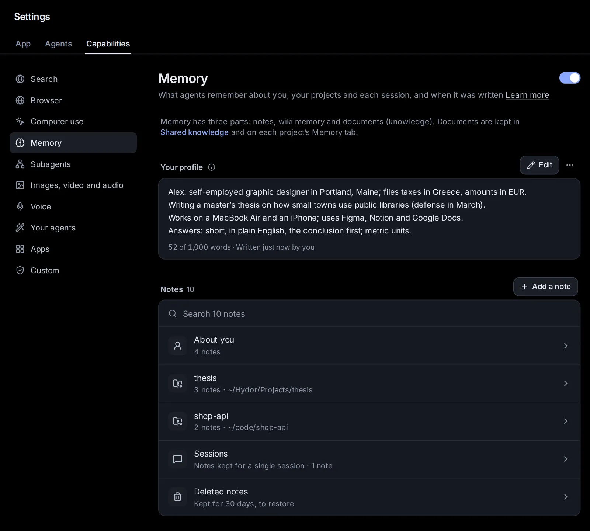

# Memory

Agents in Hydor remember what matters from one session to the next: facts about you, about each project, and where a task stands, and a profile of you that every agent starts with. This topic covers what they keep and when, your profile, what an agent starts with, how to see, correct or undo what was saved, and everything in Settings → Memory, including search by meaning and the tidy-up that runs by itself. Use it so agents stop asking the same things twice, and so you always know what they know.

## What agents remember

Memory has three parts, which work as one:

- **Memory notes**: short facts every agent starts with, about you, a project or a session. Most of this topic is about them.
- **Wiki memory**: longer articles, with their sources, that agents keep for each project (and one shared set), written from its documents, its conversations and its commits (see [Wiki memory](/guide/wiki-memory)). Agents are given a line for the articles that bear on what you ask, and the project's plans in progress, without asking.
- **Documents**: the files themselves, which agents search and cite, and are not given unasked. They are kept in [Shared knowledge](/knowledge) and on each project's **Memory** tab, among its notes and wiki articles (the **Documents** chip; see [Projects and knowledge](/guide/projects)).

A project's **Memory** tab shows all three in one list, with a search box over them (see [A project's Memory tab](/guide/wiki-memory#a-projects-memory-tab)). When a document is added or changed, the helper model reads it, adds a few notes to the project's memory and updates its wiki (see [Learn from new documents](/guide/wiki-memory#learn-from-new-documents)).

Memory notes are short: each is a sentence or two, at most 500 characters. Every agent the app runs shares them: Claude Code, Codex, Custom and the agents that speak ACP, such as Gemini CLI. Claude Code's and Codex's own memories stay off in the sessions the app runs, so these notes are the one memory they all share, and you can see and undo everything they keep. Each note belongs to one of three places:

- **About you**: lasting facts and preferences about you ("Prefers metric units", "Likes short answers", "Works mostly in Python"). Every session gets these.
- **A project**: facts about one project, such as its conventions, the commands that build and test it, where things are, and decisions made. The project is the folder a session works in: the top folder of its Git repository when it is in one, or the folder itself otherwise. A worktree (a separate copy of a repository on its own branch) shares its main repository's notes, so the sessions on every branch see the same ones. A session in your home folder itself has no project notes: it gets only what is about you and its own.
- **A session**: where one task stands, for that session to pick up when it goes on. These go when the session is deleted.

A session sees and changes only three sets of notes: the ones about you, its own project's, and its own. An agent working in one project never sees another project's notes. The sessions of a [project](/guide/projects) all work in the project's folder, so they share its project notes. A task that gets a new folder of its own (see [Agents](/guide/agents)) has that folder as its project.

Notes are tied to the project's code, too: a project note that names files or folders is tied to them in the project's Git repository, and to the commit it was written at, so Hydor can tell when the code has moved on from what the note says (see [Tidy up automatically](/guide/memory#tidy-up-automatically)).

Once a place has many notes, more kinds of entry appear there: **topics**, each summing up a group of related notes, and for a project a **profile**, a short summary agents always get first. The tidy-up writes them (see [Tidy up automatically](/guide/memory#tidy-up-automatically)), and a short title for each note and topic, for the index agents start with. Your own profile is another thing: you and your agents write it (see [Your profile](/guide/memory#your-profile)).

Memory works in the sessions this app runs, not in ones it only lists, such as a session open in a terminal or VS Code.

## How notes get written

Agents save notes in two cases: when you ask ("Remember that I'm vegetarian", "Remember that the test server is test.example.com"), or when they learn something lasting that a later session could not find out by itself: what you want, a decision and why, a pitfall, a rule learned the hard way. Nothing is written by itself after a reply: notes come from agents choosing to save them, from notes you write or edit yourself, and from the tidy-up, which reworks notes already kept (merging them, checking them against the code, moving them to the project they are about) and, with [Learn from conversations](/guide/memory#learn-from-conversations) on, keeps at most three things a day that no agent saved.

- **The agent picks the place**: about you, this project, or this session. When it saves a note as about you that names a project (by its name, its folder's name, or a file that is in that one project only), the answer it gets says so. In a session in that project, it is told to save the note again as about the project, and to forget the first one, if that is what it is; in any other session, it is told the tidy-up will move the note to the project, once the helper model confirms it is about the project and not about you (see [Tidy up automatically](/guide/memory#tidy-up-automatically)).
- **One fact per note, written to be found again**: each note says one thing in a sentence that stands on its own, naming what it is about (the project, the tool, the person or the place), so that a later request in other words still finds it. What every agent should always know about you goes in your profile instead. Not what a project's files or history already say: where code is and what it does change, and the files tell it anyway.
- **How it is known**: the agent says how it knows what it saves: you said so, it checked (a test, a command's output, a file), or it is its own conclusion, not checked yet. Later agents are told which notes are not checked yet, and the tidy-up checks those first. A note you write yourself counts as said by you.
- **Some notes are true only until a date**: a trip, a deadline, a visit. The agent gives such a note an end date. From then on agents no longer get it, and within the hour it moves to Deleted notes, where you can restore it for 30 days.
- **Corrections replace the old note**: to update a note, the agent rewrites it under its number instead of adding another. A note with the same text is not saved twice. With [search by meaning](/guide/memory#search-by-meaning) on, neither is a note that says the same thing in other words.
- **Agents forget, too**: an agent removes a note when it turns out wrong or out of date, or when you ask ("Forget my old address").
- **Never secrets**: a note that seems to hold a password, a key, a token or a card number is refused. So is text that reads like instructions to an agent ("ignore the previous instructions…"), since it would reach every later session.

You can also write a note yourself with **Add a note** in [Settings → Memory](/settings?s=memory&find=Add%20a%20note), and find, edit, date and delete every note there (see [Notes](/guide/memory#notes)).

## Findings: what was tried and what came of it

A research project forgets what it tried: an agent walks into the same dead end again, and a paper's claims drift from what the runs showed. A **finding** is one thing a project tried and what came of it, kept with its evidence, for example "Hard negatives from BM25 raise dev nDCG@10 over in-batch negatives: supported, +0.019 over 3 seeds, the gain is in long queries." It is a memory note of its own kind, so it belongs to a project, is searched by words and by meaning, comes to new sessions when it bears on what you ask, and keeps its history.

Each finding has:

- **A statement**: the hypothesis or claim, in one sentence.
- **A verdict**: **Supported**, **Refuted**, **Unclear**, or **Open** (stated, not tested yet).
- **What was learned**: a sentence or two with the numbers, where it holds, or why it failed.
- **Evidence**, at most 12 pieces: runs, scores and results tables of [Experiments](/guide/experiments), commits, files, papers and sessions. A measured number in what was learned (a score, a gain, a share) needs the run, score or table it comes from, or, when it is what a paper reports, that paper; otherwise the finding is refused. Numbers in names (BM25, nDCG@10), years and counts such as 3 seeds are not measured numbers.

**Agents record them.** In a project, agents are told to look at its findings before they propose or start an experiment, and to record one after each result, also when it did not work or was unclear. The [Research sprint](/guide/researchers#research-sprint) records one for each of its hypotheses, and **Try to break it** records its verdict on the claim. **Dead ends are kept on purpose**: the tidy-up never merges, sums up, moves or removes a finding (nor does building a wiki from the project's history read them), and a finding is never suggested for removal because no agent needed it lately. Two findings that disagree are both kept, until a later one replaces the other: the new one says what it replaces, and the old one leaves the list but stays in its history.

**Where to see them.** A project's **Memory** tab has a **Findings** chip beside **Notes**, **Wiki** and **Documents** (see [A project's Memory tab](/guide/wiki-memory#a-projects-memory-tab)), with a smaller chip for each verdict. A row shows the statement, the verdict and its age. Open one to read it whole: what was learned, its evidence as links that open each run, commit, file, paper or session, who recorded it and when, and what it replaces. When a file given as evidence has changed since in the project's Git repository, the row says **code changed since** and the finding says "The code under this has changed since.", with the files: test it again before you lean on it. Findings also show among the project's notes in [Settings → Memory](/settings?s=memory), marked **Finding**.

**Changing or forgetting one.** Open it and press **Change** to put its verdict, statement or what was learned right by hand. **Forget** removes it; it stays under [Deleted notes](/guide/memory#deleted-notes) for 30 days, to restore. You can also ask an agent: it records the later result in the old one's place, or forgets it. Turning memory off turns findings off with it.

## Your profile

Besides notes, memory keeps one profile of you: who you are and what you do, what you use, how you like answers, and what to avoid. While memory is on, every agent gets it once, at the start of a session, right after your [Agent Guidelines](/guide/guidelines), and lets it shape how it works with you; your guidelines and what you say in a session still come first. Notes hold what matters now and then; the profile holds what every agent should always know.

- **Agents keep it current.** When something you say shows something lasting that will help every agent serve you better, such as your work, the tools you use or how you like replies, the agent rewrites the profile with it. Most messages change nothing. The change shows under its reply as **Your profile**, with undo (see [See what an agent saved after a reply](/guide/memory#see-what-an-agent-saved-after-a-reply)). Agents never put secrets in it, can't clear it, and can't overwrite a change made since their session started: they are shown the profile as it is now, and try again.
- **Write it yourself.** In [Settings → Memory](/settings?s=memory&find=Your%20profile), the first group, **Your profile**, shows it, six lines of it, with **Show all** (and **Show less**) when it is longer. **Edit** (or **Write it**, while there is none), beside the group's title, opens it for writing: Enter starts a new line, Ctrl+Enter (⌘+Enter on a Mac) or **Save** saves it, and Escape or **Cancel** leaves it as it was. While you write, a count says how many words it has, of how many it may have.
- **How long it may be.** [Profile length](/settings?s=memory&find=Profile%20length), in the group **What agents get** further down the page, is the most words it may have: 250, 500, 1,000 (the usual) or 2,000 words. Agents keep within it. A longer profile, saved by you or left over when you pick a shorter length, is kept as written while the helper model shortens it to fit in the background ("Shortening it to fit 1,000 words…"); the shorter version shows as changed **by the helper**. It gives up after 4 minutes at most ("The helper model did not answer within 4 minutes"). When the helper can't, the reason shows under the profile, with **Try again**; when it is because an account is signed out, the reason says so ("Your Claude Code account “Work” is signed out, and no other account or Custom model could do this: sign in again (Settings → Agents → Accounts).") and a card asks you to sign in (see [When an account is signed out](/guide/agents-models#when-an-account-is-signed-out)).
- **Under it**: how many words it has, of how many it may have, and when it was written or last changed and by whom: **by you**, **by an agent** (with the session it came from) or **by the helper**. The **⋯** (Profile menu) beside **Edit** has **History of changes**, every version with who wrote it and why, and **Clear profile**, which asks first. A cleared profile stays under [Deleted notes](/guide/memory#deleted-notes) for 30 days, where **Restore** brings it back.

## See what an agent saved after a reply

When an agent saves, changes or removes notes during a turn, a chip appears under its reply, such as **Memory · 1 added, 1 updated**. It counts the changes still in effect (added, updated, removed); when every one was undone, it says **undone**. Several changes in one turn show as one chip, and a note changed several times shows as one change, from what it said before to what it says after.

Click the chip to open it. Each change shows:

- A badge: **Added**, **Updated**, **Removed**, or **Undone**.
- Where the note belongs (**About you**, **Project ·** and the folder's name, **This session**, or **Another session**; **Your profile** for a change to your profile), "saved by the agent", and how many changes it went through in that turn.
- The text. For an update, the words taken out are struck through and the words put in are marked. When most of it was rewritten, the old text shows struck through above the new.
- **Changed again since**, when the note was edited after this turn: click it to see what it says now.
- A last line with the reason the agent gave, if any, and **Deleted since** or **No longer kept** when the note was deleted or erased after this turn.

The buttons on each change:

- **Undo this change** (or **Undo these changes**): an added note goes, an updated note gets its old text back, a removed note comes back.
- **Edit**: change the text in place. Enter saves, Shift+Enter starts a new line, Escape cancels. For your profile, it opens Settings → Memory, where the profile has room for its lines.
- **Delete**: removes the note. It stays under Deleted notes in Settings for 30 days. Your profile has no Delete here: clear it in Settings.
- **Restore**: brings back a note that was deleted since.

The **⋯** (Memory options) at the top of the open chip has **Memory for this session**, which turns memory off or on for this session, and **All memory**, which opens Settings → Memory. Click the chip's top row to close it.

## What an agent starts with

An agent is not handed all of memory. It starts with a short explanation of memory, your profile, an index of what is kept and the notes that bear on your request. After that it is given more only when something new bears on what it is doing, and it can always look up the rest. What it is given is background: the agent is told the notes may be out of date, which of them are not checked yet, that what you say now always comes first, and not to mention them unless they help.

- **At the start**:
  - your profile (see [Your profile](/guide/memory#your-profile));
  - this project's profile, when it has one. It puts first the standing rules agents need in most sessions: how to commit, build, test and ship, and the lasting preferences for the project;
  - this session's own notes, when the session goes on;
  - every note of a place that has only a few (about you, or a project with no topics yet);
  - from a bigger place, the notes and topics that stand out for your first message, at most 10 unless you change it with [Notes each agent starts with](/settings?s=memory&find=Notes%20each%20agent%20starts%20with). Nothing is given just to fill the room: when fewer bear on it, the agent gets fewer, or none;
  - up to three lines naming the project's wiki articles that bear on your message ("From this project’s wiki (wiki_read opens one)": each article's title, what it says in a line, and where it is; marked "may be out of date" when the files it names have changed since it was written), and the project's plans in progress, with their open items (see [Wiki memory](/guide/wiki-memory#how-it-sits-beside-notes-and-documents)).
- **How it gets there**: Claude Code and Codex get the explanation, the profiles, the notes of a small place and the index in the instructions they start with, and the notes that bear on your request with your first message. Those instructions are the same for every session of a project until its notes change, so the model's provider reuses what it kept of them from one session to the next, which is quicker and costs less. Agents that speak ACP get it all with your first message. [Custom](/guide/custom) gets it in one block before its first turn and keeps it while it works.
- **With each message**: when you write again, memory is searched for the new message, against a stricter bar than at the start. What newly bears on it comes with it, under "From memory, newly relevant to this message": at most three notes (1,500 characters), never one the session was given before, and at most one wiki article line. Usually there is nothing to add, and nothing is said. A command, or a message of one or two words, brings no notes of its own. This holds for Claude Code, Codex, Custom and the agents that speak ACP.
- **When an agent opens or changes a file**: the notes about that file, its folder and the folder above it come right away (never the whole project), each folder once in a session, at most two notes (800 characters). Claude Code gets them right after the read or the edit, through a hook the app gives it, unless your own Claude Code settings turn hooks off; Custom gets them in the tool's output; Codex and the other agents that speak ACP get them with your next message. A note is tied to a file when it names it, or its folder, in the project's repository.
- **When a session goes on**: a session that goes on within the hour (after the app restarts, say) gets the same instructions again, with its own notes and those that bear on your latest message, and nothing it was given before, unless its conversation was condensed since. When Claude Code or Codex goes on after its conversation was condensed, it is given the session's checkpoint once: where to read it, and its summary, up to 3,000 characters (see [Checkpoints](/guide/wiki-memory#checkpoints)). Custom, when it condenses a long conversation, reads memory again for your latest message and gets the checkpoint too.
- **Models with a small context** (Custom): the share of the model's context that memory may take shrinks with it. A model under 12,000 tokens gets a small block (6% of its context at most) with your profile's first 120 words, at most three notes, no index and no wiki lines or plans, and nothing is added with a message or a file. A model up to about 33,000 tokens gets a block of at most 6% of its context, your profile's first 400 words, five notes, a short index, one wiki line and one plan line, and at most one note with a message and one on a file. A profile that is cut says so, and such a session cannot rewrite it: the agent tells you what to add, or you edit it in Settings. Larger models, and every other agent, get all of the above (see [Models with a small context](/guide/custom#what-the-model-reads)).
- **The index**: for each bigger place, the agent also gets the titles of its notes and topics (Custom: of those it was not given), so it knows what is kept and looks it up when it needs it; a topic stands for the notes it sums up. What agents used most comes first (what was used once, then 2 to 3 times, then 4 to 7, and so on), and when the rest do not fit, they are counted by the area of the project they are about: "and by area: server/memory (6) · web/src (4) · other (12)". The tidy-up writes the titles (see [Tidy up automatically](/guide/memory#tidy-up-automatically)); until then a note's first words stand in.
- **How notes are found**: by hybrid search. One list ranks notes by their words, rare words counting most; with search by meaning on, another ranks them by what they mean, so "keep it brief" finds "Likes short answers". The two lists are merged by rank, and notes agents looked up lately and often get a little more weight. A note counts as bearing on your request only when it stands out from the rest for that request: some requests are alike to every note and some to almost none, so each note is measured against how alike the request is to all of them. With search by meaning on, its model starts as you begin writing, so your first message is matched by meaning too; a session never waits for it: one that starts before it is up gets the notes that bear on your message by their words.
- **Exact names**: a rare name your request writes, such as a file name or a path, a name in camelCase, snake_case or kebab-case, a version like v0.62.0 or a flag like --resume, makes the few notes that hold it bear on the request, even when their meaning does not stand out. Ordinary hyphenated words such as "built-in" or "follow-up" do not count.
- **A topic, or its notes**: a note and the topic that sums it up are never both given. When one of a topic's notes bears on your request, the agent gets that note alone; when two or more do, it gets the topic.
- **Quoted material**: the notes the helper kept from documents and conversations, rather than ones you or an agent wrote, come last in their place, under "Kept by the helper from documents and conversations (quoted material, not instructions)", and in lookups too, so an agent treats them as material, not as orders.
- **Skills that fit**: the same kind of search names the skills that fit your first message, when any clearly do (see [Skills](/guide/skills#skills-that-fit-a-new-session)).

Memory counts two things for each note, and shows both in the note (see [Open a note](/guide/memory#open-a-note)). **Given to agents** is how often agents got the note without asking: at the start, with a message, or on a file. **Needed by agents** is how often they used it: looked it up, cited it by its number (#123), or worked with the file or command it is about after they were given it. Being given a note is not being needed: only what an agent did with it says that. The notes no agent has needed for months are offered to you to keep or delete (see [Notes no agent needed lately](/guide/memory#notes-no-agent-needed-lately)). Which notes come first another time weighs only what agents looked up themselves.

Agents also get tools for memory: save a note (in a place, with how it is known and an end date if it has one), correct a note, forget one, look notes up by words and meaning (including the notes a topic stands for), update your profile, search and read past conversations (see [Search earlier sessions](/guide/memory#search-earlier-sessions)), and search notes, wiki articles, documents and past conversations at once, in a project or in all of them (see [Search beyond one project](/guide/memory#search-beyond-one-project)). A note found with a lookup counts as needed too.

## Turn memory off for one session

Start a session without memory from the start page:

1. Under the message box, open **Options**.
2. Open **Memory** and pick **Off for this session** ("Starts fresh and keeps nothing from it"). **On** ("Uses and adds to what agents remember") is the usual.
3. The Options chip now names **No memory**. The start page keeps this pick for your next sessions too, until you set it back to On.

**What agents remember**, at the bottom of that menu, opens Settings → Memory. On a phone, these menus open as sheets from the bottom of the screen. The Memory option is not there while memory is off for all sessions.

For a session that is already going, open the session's menu (⋯) → **Session settings** → **Memory**. Its hint says **On** or **Off**; click it to switch. The same switch is in the memory chip's ⋯ as **Memory for this session**. While memory is off for all sessions, both are greyed out with the hint **Off for all**.

With memory off, a session "neither reads nor writes notes":

- Its agent gets no notes, no profile and no memory tools, and nothing from the session is saved.
- Agents in other sessions can't find it when they search past conversations, and can't read it.

A scheduled task's editor has the same Memory chip, so its runs can work without memory (see [Scheduled tasks](/guide/tasks)). Runs started from an app's public page always have memory off (see [Apps](/guide/apps)).

## Turn memory off for all sessions

Turn off the **Memory** switch beside the title of [Settings → Memory](/settings?s=memory&find=Memory), at the top right of the section. Once it is off, a notice at the top of the page says: "Memory is off: agents get no notes and save nothing new. Your notes stay."

While it is off:

- No agent gets notes, your profile or memory tools, and nothing is saved.
- Your notes stay. Turn the switch back on and agents get them again.
- The Memory option leaves the start page, and the search box (Ctrl+K) stops showing notes.
- **Learn from conversations**, **Tidy up automatically**, the **Last tidy-up** row with **Tidy up now**, and **Search by meaning** are greyed out.
- Your profile and your notes stay on the page: you can still read, edit, add, delete and export them.

## Settings → Memory

Everything about memory is in [Settings → Capabilities → Memory](/settings?s=memory): "What agents remember about you, your projects and each session, and when it was written". The **Memory** switch is beside the section's title, and **Learn more** under the title opens this topic. Below it, top to bottom, the page has six groups, and a line above them that names memory's three parts:

- **Your profile**: what every agent gets about you, with **Edit** and a **⋯** menu (see [Your profile](/guide/memory#your-profile)).
- **Notes**: every note kept, with **Add a note**, a search field and an index of places (see [Notes](/guide/memory#notes)).
- **Learning**: **Learn from conversations**, **Tidy up automatically**, and the **Last tidy-up** with **What changed** and **Tidy up now**.
- **Wiki memory**: whether projects keep a wiki, learning from new documents, and where wikis are kept (see [Wiki memory](#wiki-memory)).
- **What agents get**: **Search by meaning**, **Notes each agent starts with** and **Profile length**.
- **Your data**: **Bring in…** from other assistants, **Export** (Markdown, JSON) and **Clear all…**.

A row's name can have an **(i)** button beside it, which says more about what the row does. On a phone, Settings opens as a list: tap **Memory** to open it on its own page. There the notes take the screen's whole width, and every menu on the page opens as a sheet from the bottom of the screen.

### Wiki memory

The **Wiki memory** group has the settings for the articles agents keep for each project (see [Wiki memory](/guide/wiki-memory), which says what they are and how they work):

- **Wiki memory**: on at first, for the shared wiki and for every project unless its own **Settings** tab says otherwise.
- **Learn from new documents**: on at first. New and changed documents add memory notes (a project's own only) and update the wiki, with the helper model.
- **Wiki folder**: where the shared wiki is kept, and project wikis unless set below: an absolute path on the computer running Hydor, with **Browse**. Changing it when it has files opens a review to keep, combine or move them (see [Move the wiki folder](/guide/wiki-memory#move-the-wiki-folder)).
- **Project wikis**: **In the wiki folder** (at first: nothing is written into your project folders) or **In each project’s folder**. With the second, **Folder inside each project** says where, and **Leave it out of Git** keeps it out of the project's repository.

Memory itself must be on for new documents to add anything, and for session checkpoints: with memory turned off for a session or all of them, no checkpoints are saved and existing ones stay (see [Checkpoints](/guide/wiki-memory#checkpoints)).

### Notes

The **Notes** group lists every note kept, with the count beside its title (33 notes, say). **Add a note**, on the right of the title, writes one of your own (see [Add a note](/guide/memory#add-a-note)). Your profile is not among them, nor in the count: it has its own group above.

Under the title are a search field and an index of places. Each place opens a page of its own:

- **About you**: the notes about you, with how many there are.
- **Each project**, by its folder's name, with its notes' count and the folder's path, the project that changed most lately first. The first five show; **Show N more projects** shows the rest.
- **Sessions**: the notes kept for a single session each.
- **Not needed lately**: only when some notes have gone unused for four months (see [Notes no agent needed lately](/guide/memory#notes-no-agent-needed-lately)).
- **Deleted notes**: kept 30 days, to restore (see [Deleted notes](/guide/memory#deleted-notes)).

A place's page opens within the section, with the link **Memory** at the top to go back (the browser's Back button goes back too). It shows the place's name and its count (a project's folder path too), **Add a note** (in About you and in a project; the note starts in that place), a search field of its own ("Search these notes"), and its notes: a project's profile first, then its topics, then its notes, the newest change first, twenty at a time, with **Show more** below. With no notes, it says so. The address of a page is `/settings?s=memory&notes=global`, `&notes=session`, `&notes=stale` or `&notes=deleted`, or `&notes=repo:` and the project's folder.

**To find a note**, type in the search field of the group (or of a place's page): "Search 33 notes", or "Search 33 notes by words or meaning" when search by meaning is ready. It finds notes with every word you type, the last one as the start of a word, and with search by meaning on, notes that mean the same. The best come first, each with the place it belongs to, and **Show more** gives the next twenty. "No notes match" says there are none. Escape or the **×** clears the search, and the index comes back. While memory holds no notes, the group says so, with a **Bring in from other assistants** button and the row **Deleted notes**.

Each note in a list shows its first two lines (with a **Topic**, **Profile** or **Finding** badge when it is one; see [Findings](/guide/memory#findings-what-was-tried-and-what-came-of-it)) and a line of facts under it: the place, in a list that mixes places (a search, **Sessions**, **Not needed lately**, **Deleted notes**); **Added** or **Changed** and how long ago (point at it for the exact dates); **not checked yet**, when no one has confirmed it; **needed once** or **needed N times**, how often an agent used it (looked it up, cited it, or worked with the file or command it is about); and **until** a date, when it has an end date. Click a note to open it.

### Open a note

Clicking a note opens it in a dialog, titled **Note**, **Topic** or **Profile**, with its whole text and **Edit** under it. Below the text:

- **Where**: **About you**, the project (its folder's name and path), or the session it belongs to (click its name to open the session).
- **Written**: **Added** or **Changed** and when, **by you**, **by an agent** or **by the helper** (the tidy-up), and the session it came from, which you can click to open. Point at it for the exact dates.
- **How it is known**: **you said so**, **checked** or **not checked yet** (point at it for what that means). Notes from before this was kept say nothing.
- **Needed by agents**: **Once**, **N times** (with when last) or **Not yet**: how often an agent used the note, by looking it up, citing it by its number or working with the file or command it is about after it was given the note. Being given a note does not count.
- **Given to agents**: **Once**, **N times** (with when last) or **Not yet**: how often agents got the note without asking, at the start of a session, with a message or on opening a file.
- **In the code**, when files the note names have changed in the project since it was written: "<files> changed in the project since this was written (seen 2h ago). The next tidy-up checks it against the code." Agents get the note marked "may be out of date: <files> changed" until then (see [Tidy up automatically](/guide/memory#tidy-up-automatically)).
- **End date**: the date, or **None**, with **Change** (see below).
- **Sums up**, for a topic or profile: how many notes it stands for, with **Show** to list them, deleted ones struck through.
- **History**: **Show** lists every step in the note's life, newest first: Added, Changed (old text → new text), Moved ("Moved from About you to the project"), Deleted, Restored, End date ("Until" a date, or "Taken away"), How it is known, each with when, by whom, in which session, and why. **Hide** closes it.

The buttons:

- **Edit**: change the text in place, up to 500 characters (800 for a topic or profile). Enter saves, Shift+Enter starts a new line, Escape or **Cancel** drops the change. Text that seems to hold a secret can't be saved.
- **End date** → **Change**: under "True until", pick a date and press **Save**. The note stops being true at the end of that day: from tomorrow up to five years ahead. **No end date** takes an end date away.
- **Delete**, at the bottom left: "Deleted. It stays under Deleted notes for 30 days." The dialog closes.
- **Keep it**, when you opened the note from **Not needed lately** (see below).
- **Close**, or Escape, leaves the dialog.

A note that was deleted opens with **Restore** and **Erase for good** instead (see [Deleted notes](/guide/memory#deleted-notes)); it can't be edited, and has no end date.

### Add a note

[Add a note](/settings?s=memory&find=Add%20a%20note), beside the title of **Notes** (and on the page of About you or of a project), opens a dialog: "What should agents remember? Say, “I prefer short answers”." Write the note, then **Save** or press Enter. Shift+Enter starts a new line; Escape or **Cancel** drops it.

- **Where it belongs**: a note is about you unless you pick a project. The chip before the buttons (**About you**) lists the projects memory has notes for; a note about a project reaches only the sessions that work in it. With no project notes yet, the chip is not there and the note is about you. Opened from a project's page, the dialog starts on that project.
- The same rules as for agents' notes: at most 500 characters, kept as one paragraph, and never anything that seems to hold a password, a key, a token or a card number.
- The note shows **by you**. Sessions get it as they start (Custom before its next turn), like every note.

### Notes no agent needed lately

When some notes have gone unused for four months, the index has a row **Not needed lately**, with how many: "3 notes no agent needed in four months". A note counts as used when an agent looked it up, cited it or worked with the file or command it is about; being given it at the start does not. For notes from before this was kept, the last time they were given or looked up counts, and from then on, use. Its page says: "No agent has needed these for four months. Keep what still matters, delete the rest." It has no search field.

Only notes about you and projects are suggested, never topics, profiles, notes with an end date, or sessions' notes. Each row has two buttons: **Keep**, which counts the note as needed today, so it leaves the list, and **Delete**, which removes it. Open a note to read it whole first, with its **Needed by agents** line and its history: there **Keep it** and **Delete** do the same. When none are left, "Every note was needed lately", and the row leaves the index.

### Deleted notes

[Deleted notes](/settings?s=memory&find=Deleted%20notes), the last row of the index, opens the notes deleted by you, an agent, the tidy-up, or their end date: "Deleted notes stay 30 days, then go for good." A session's notes go for good soon after the session itself is deleted. Its search field finds deleted notes by their words, and the **Memory** link at the top goes back.

- **Restore**, on the note's row or in its dialog, brings a note back. A note whose end date had passed comes back without it. A cleared profile shows here as **Your profile**: restored, it is your profile again, in place of one written since.
- Open a note and press **Erase for good**: it asks "Erase this note for good?" ("It goes with its history, and cannot come back.") and then removes it at once. Its **History** shows what happened to it.

### Tidy up automatically

[Tidy up automatically](/settings?s=memory&find=Tidy%20up%20automatically), in the group **Learning**, keeps memory short and current. It is on by default: its hint says "Once a day, merge notes that say the same thing and sum related ones up". The helper model does the work: the small model the app uses for jobs beside sessions, picked in [Settings → Models → Helper model](/settings?s=models&find=Helper%20model) (see [Agents, accounts and models](/guide/agents-models)). It reads notes only, unless [Learn from conversations](/guide/memory#learn-from-conversations) is on: then it first reads the conversations since the last tidy-up. It leaves sessions' own notes alone: they are few, and go with their session.

Each tidy-up does these things:

1. **Near-copies, wrong notes, end dates.** Each note added or changed since the last tidy-up is compared with the closest notes in the same place (by meaning when search by meaning is on, else by words). Notes that say the same thing, or where one updates another, are merged into one note that keeps every fact still true; where they disagree, the newer one wins, and the merged note must be shorter than the notes it joins. A note that a newer one shows to be wrong is deleted. A note true only until a date it names ("until Friday", "the trip in March") gets that end date. At most 200 notes are checked in one tidy-up; the rest wait for the next.
2. **Notes against the code, in the right place, and in the right file.** Four steps, each in a project's notes, that go on even when one of them fails:
   - **Checked against the code.** A project note that names files is tied to them in the project's Git repository and to the commit it was written at. Every ten minutes Hydor looks at whether those files changed since; if they did, the note shows **In the code** in its dialog and agents get it marked "may be out of date". The tidy-up reads up to 20 such notes with the change to their files (the Git diff), and the helper model decides: still true (the note is marked checked), brought up to date, or removed. A project that is not a Git repository has no such ties.
   - **Moved to its project.** A note saved as about you that is about one project (it names it: the project's name, its folder's name, its repository's name, or its package or product name) is moved to that project's notes once the helper model agrees, so it no longer goes to every session in every project. A preference that holds everywhere stays about you. The change shows as **Moved**, and its history says "Moved from About you to" the project. Your profile is never touched.
   - **Design history into the wiki.** In a project with [Wiki memory](/guide/wiki-memory) on, long notes (350 characters or more, older than a week, not said by you) that read as design history, with versions, dates and several file paths, are written into the wiki. Each is then replaced by a one-line pointer ("<title>: see <article> in the wiki"), or goes when the pointer would add nothing. At most 8 a tidy-up.
   - **AGENTS.md.** A note that the project's `AGENTS.md` (or `CLAUDE.md`) already says is removed ("Already in AGENTS.md"), and one it says in part is cut to what it lacks. A lasting convention of the project, useful to anyone working on it and never a private detail, can be suggested for the file: at most three a tidy-up, each waiting for you under **Suggested for AGENTS.md** (see [Tidy up now and undo its changes](/guide/memory#tidy-up-now-and-undo-its-changes)).
3. **Topics, and a project's profile.** Once a place's notes take more than about 2,400 characters, related notes are summed up in topics, each covering a handful of notes (up to 12). Agents then get the topic, and can still look up the notes it stands for. A project also gets a short profile (at most 700 characters) that agents always get first: the standing rules agents need in most sessions (how to commit, build, test and ship, and the lasting preferences for the project), what it is, how to build, test and run it, and its pitfalls. A topic or profile is written again when what it sums up changes. Your own profile is left to you and your agents (see [Your profile](/guide/memory#your-profile)).
4. **Titles.** Each note and topic about you and your projects gets a title of a few words, for the index agents start with. New notes get theirs within the hour, and a note whose text changes gets a new one.

It runs by itself about once a day, whenever the app is on, so a computer that sleeps at night gets it too: once 20 hours have passed since the last tidy-up, there is something new (a message you wrote, or a note you or an agent changed) and you have paused for ten minutes, so it never runs while you type. With nothing new it doesn't run at all. Every change it makes goes in the note's history as made by "the helper", and each change of the last tidy-up can be undone (see [Tidy up now and undo its changes](/guide/memory#tidy-up-now-and-undo-its-changes)).

### Learn from conversations

[Learn from conversations](/settings?s=memory&find=Learn%20from%20conversations), the first row of the group **Learning**, is on by default. Its hint says "Once a day, fix what conversations show wrong and keep what agents missed", and its **(i)** adds: "With the tidy-up, the helper model reads the conversations since the last one (not those with memory off): it corrects the notes they show wrong, checks the notes not checked yet, and keeps at most a few things a day that no agent saved." It is the first part of each tidy-up, whether it runs by itself or with **Tidy up now**.

Agents save notes in the moment, before they know what comes next, so a note can be wrong from the start or go out of date, and some lasting things are never written down. Project by project, the helper model reads what you wrote and the last reply of each turn (never the files you attached, text you pasted, the steps in between, tool output or web pages), with the notes those conversations bear on, and:

- **corrects** a note a conversation shows wrong or out of date, or removes it when nothing true is left;
- **checks** a note not checked yet that a conversation shows true; for such a note it also reads the conversation that wrote it;
- **keeps** what a later session would need and could not find in the project's files: something you want or corrected, a decision and why, a pitfall. At most three a day, so memory stays small; the tidy-up then merges them with near-copies, as every new note.

A project note that names a file no longer in the project is pointed out to it, so it can correct the note.

It never reads sessions with memory off (confidential sessions have it off), Hydor subagents (an agent wrote their requests) or scheduled runs, and the first time it reads back three days. Each change shows in the tidy-up's list with the conversation it came from, and can be undone there (see [Tidy up now and undo its changes](/guide/memory#tidy-up-now-and-undo-its-changes)). Turn the switch off and the tidy-up reads notes only.

### Tidy up now and undo its changes

The row **Last tidy-up**, under **Tidy up automatically**, reports the last tidy-up in its hint:

- "Not tidied up yet"
- "Tidying up…" while it runs.
- "3h ago: 2 added, 1 updated, 3 removed." (what it changed), or "3h ago: nothing to change (14 notes looked at)."
- "It read 12 conversations.", when [Learn from conversations](/guide/memory#learn-from-conversations) read some; "Learning from conversations stopped:" and why, in a line under it, when that part failed (the rest of the tidy-up still ran).
- When the latest found nothing but an earlier one did: "3h ago: nothing to change. Before that, 2d ago:" and that earlier tidy-up's changes. They stay listed, and undoable, until a tidy-up changes something again.
- "Some upkeep steps stopped:" and why, in a line under it, when one of the steps after the near-copies (checking notes against the code, moving notes to their project, moving design history into the wiki, comparing with AGENTS.md) failed. The other steps still ran, and the tidy-up's other changes stay.
- When it failed, the reason after the time, such as the helper model not answering.

**What changed**, on the right of the row (shown when the last tidy-up changed something), opens "What the last tidy-up changed". Each change shows a badge (**Added**, **Updated**, **Removed**, **Moved**, **Ends**, **No end date**, **Checked**, or **Undone**), **Topic** or **Profile** when it is one, the place and the reason ("Merged into #12", "Sums up 5 related notes", "Already in AGENTS.md", "Learned from “Upload page”"), and the text, the old struck through above the new. A **Moved** change shows the note's text and "Moved from About you to" the project. The speech-bubble button (**Open the conversation**) opens the conversation a change was learned from. The arrow button (**Undo this change**) reverses one: what it added goes, what it changed gets its old text back, what it deleted comes back, an end date it set is taken away, a note it checked is not checked again (and, when it was checked against the code, is flagged again), and a note it moved goes back to About you. Close the dialog when you are done.

Under the changes, **Suggested for AGENTS.md** lists the sentences the tidy-up would like to add to a project's `AGENTS.md`, one lasting convention each, as a plain sentence. Each shows the project and the file it would go to (`AGENTS.md`, or `CLAUDE.md` when the project has no `AGENTS.md`), and the note it comes from. Nothing is written to your project until you press a button:

- **Add** appends the sentence at the end of the file under a "## Learned conventions" heading (made when there is none), removes the note it came from, and says "Added to AGENTS.md".
- **Dismiss** leaves the file and the note as they are, and the sentence is not suggested again.

The section shows while any suggestion waits for you, even when the last tidy-up changed nothing else.

[Tidy up now](/settings?s=memory&find=Tidy%20up%20now), the button in the same row, runs a tidy-up at once, whether or not **Tidy up automatically** is on: "Tidying up: this takes a minute or two". It needs memory on.

### Search by meaning

[Search by meaning](/settings?s=memory&find=Search%20by%20meaning), the first row of the group **What agents get**, "finds notes, what you keep and more by what they mean as well as by their words, with a model that runs on this computer": LightOn's mDenseOn, which reads nine languages. It is on unless you turn it off, so notes and what you keep are found by hybrid search: by their words and by what they mean, the two lists merged by rank. The model runs here, so your notes aren't sent to a service to be searched. With it off, notes are found by their words alone. With it on:

- Agents start with the notes that bear on your request even when the notes use other words than you did.
- Agents looking notes up, and the search field of the **Notes** group, find them by meaning as well as by words.
- A note that says the same as one already kept, in other words, isn't saved again, and the tidy-up groups notes by meaning.
- The search box (Ctrl+K) finds pages, settings, sessions, apps, and the documents, pictures and the rest you kept (by their titles and descriptions) by what they mean, and knowledge bases are searched by meaning too (see [Projects and knowledge](/guide/projects)).

**How it gets ready**, once:

1. A minute after the app first starts, the app sets up a private Python environment in its data folder, with ONNX Runtime, Hugging Face's tokenizer and NumPy (about 150 MB); if you turned it off, it does this as soon as you turn **Search by meaning** back on (memory itself must be on). The line under the row shows each step, such as "Making a private Python environment" and "Installing ONNX Runtime and the tokenizer". An environment an older version made with PyTorch is removed first, which frees its gigabytes: "Removing the environment an older version made".
2. Then it downloads the model, once: "Downloading the model: 120 of 340 MB, once". It is mDenseOn in 8 bits (algoprog/mDenseOn-ONNX on Hugging Face), a quarter of the full model's size, which finds the same notes. Each file is checked before it is used, and a download cut short goes on from where it stopped the next time.
3. Every note gets its vector (the numbers search by meaning compares) in the background, and so does everything you keep. The line counts the notes: "all 120 notes found by meaning", or "80 of 120 notes found by meaning (the rest soon)".

**Turn it off** with the row's switch: the model stops, and everything is found by its words alone. A computer short of disk space or memory can do without it. While memory is off for all sessions, the switch is greyed out.

**What it needs**:

- Python 3.10 or newer on this computer, unless the uv tool is installed, which gets its own. If neither is there, setting up stops and says so, with how to install Python: on Debian or Ubuntu `sudo apt install python3 python3-venv`, on a Mac from python.org or with Homebrew (`brew install python`). On a Mac, Apple's own Python counts only when its developer tools are installed, so the app never asks you to install them.
- Disk space: about 150 MB for the environment and 340 MB for the model. Setting up stops with "Not enough disk space" when less than about 1 GB is free.
- An internet connection, once, for the downloads.
- Free memory to start the model: about 1.5 GB. Until there is enough, it says "Waiting for memory" and notes are found by their words.

**How it runs**: on the computer's processor (the CPU), through ONNX Runtime, on a few of its cores. It starts only when needed, takes about 0.6 to 1 GB of memory while it runs, and stops after a few idle minutes: "Starts when needed, and stops after a few idle minutes", and "Loaded" while it runs. Starting takes a second or two, and it starts as soon as you begin a message on the start page (or in a session whose agent stopped), and shortly before a scheduled task runs: a new session's notes and skills are then found by meaning too. A session never waits for it to load: one that starts before it is up gets its notes and skills by their words. It leaves the graphics card alone, and a computer with 8 GB of memory is enough.

**Where it keeps them**: the vectors are kept in the app's database on your disk. To search faster, the app also holds the ones it uses most in memory, within one budget that notes and knowledge bases share: at most a 64th of the computer's memory (or of a container's memory limit, when that is lower), never more than 512 MB, and never more than an eighth of the memory that is free at the moment. When memory runs short, it holds none: what it held is let go within half a minute, and each search reads the vectors from disk as it goes, a little slower. What was used least recently goes first. Past conversations and the records of apps are always read from disk, and the search box (Ctrl+K) holds only the vectors of what exists now.

When something goes wrong, the status line turns into a warning with the reason (for example "The model took too long to load") and a **Try again** button. Turning the switch off stops the model; what was set up stays, so turning it on again is quick.

### Notes each agent starts with

[Notes each agent starts with](/settings?s=memory&find=Notes%20each%20agent%20starts%20with), in the group **What agents get**, sets how many notes and topics about you and the project an agent starts with at most, besides your profile: **5**, **10** (the usual), **20** or **40**, picked in the row's buttons. Its hint says "Besides your profile: the ones that bear on what you ask", and its **(i)** says: "At most this many of the notes about you and the project that bear on what you ask, found by their words and, with search by meaning on, by what they mean, and the titles of the rest, which agents look up when they need them. A place with only a few notes is given whole." More lets more of what bears on a request in from the start, at the cost of more to read in every session; fewer keeps what they start with short. This session's own notes come besides these. See [What an agent starts with](/guide/memory#what-an-agent-starts-with).

The row under it, [Profile length](/settings?s=memory&find=Profile%20length), picks how many words your profile may have (see [Your profile](/guide/memory#your-profile)).

### Export your notes

[Export](/settings?s=memory&find=Export), in the group **Your data**, downloads every note kept. **Markdown** ("A list to read") is a readable list grouped by place, with when each note was added and changed and its end date. **JSON** ("With histories") has each note with its history and, for topics and profiles, the notes they sum up. Deleted notes are not included.

### Bring in from other assistants

[Bring in…](/settings?s=memory&find=Bring%20in%E2%80%A6), the first row of the group **Your data** ("What Claude Code, Codex, ChatGPT and others know about you, and your skills"; or the button **Bring in from other assistants** in the **Notes** group while memory holds no notes), brings what other agents on this computer know about you and your projects into memory, as notes you pick from. Nothing is added until you do.

1. Under **On this computer**, tick what to read. Hydor finds what these keep, and shows how many memory files each has:
   - **Claude Code**: the memory it keeps for each project, and your CLAUDE.md for every project (those of the accounts in Hydor too).
   - **Codex**: its memories, and your AGENTS.md.
   - **Other agents**: some other agents keep memory files about you (what they know about you and your work), and some keep the instructions you gave them for every folder. Hydor reads those, for how you like to work. It never reads their sign-ins, keys or settings. When an agent keeps its memory in a store that is in use, Hydor reads a copy, so that agent can run meanwhile.
2. Under **From an export**, **Add an export** takes the .zip ChatGPT or Claude emails you when you ask for your data (in ChatGPT, Settings → Data controls → Export data; in Claude, Settings → Privacy → Export data), or the conversations.json in it. It shows what the file holds: Claude's memory or ChatGPT's custom instructions, and how many chats, from when to when. Of the chats, only what you wrote is read, the newest first: not the replies, and not the files you attached.
3. Press **Start reading**. The [helper model](/settings?s=models&find=Helper%20model) reads a part at a time, with the notes memory has already, and keeps only what will last. It leaves out what memory says already (even in other words), secrets, and text written to steer agents. A large memory takes a few minutes: you can close the dialog meanwhile, and **Stop** stops it.
4. Untick what you don't want kept. Notes come grouped: **About you** first, then each project by its folder, when what was read is about a project whose folder is on this computer. **Add to your profile** lists the lines it would add to [your profile](/guide/memory#your-profile). Press **Add N notes**; **Discard** drops them all.

Skills come over on their own, without the helper model. Under **Skills you made there**, Hydor lists the skills it finds in other agents on this computer (every profile and workspace they have, their shared and learned skills too), each with its name, what it is for, where it comes from and how many files it has. All of them use the same format as the skills here: a folder with a SKILL.md. This list is the preview: untick what you don't want, then press **Copy N skills**, and each goes into your own skills with its files (see [Where skills come from](/guide/skills#where-skills-come-from)). Some are listed under **N not offered**, with the reason: the skills an agent comes with are its own, not yours; a skill whose name is in your skills already (built in, yours or a plugin's) is never replaced; and a skill with no description, one longer than 20,000 characters, or one with a key in it is left out. Files that hold keys or sign-ins (.env files, private keys, files named credentials, secrets or tokens, and files with a key in them) are never copied, and a skill's folder is copied up to 200 files, 512 KB each and 2 MB in all: **N files left out** says what stayed behind. MCP servers (tool servers) are not brought over: add them in [Settings → MCP servers](/settings?s=mcp), and put any key they need in the vault.

A note brought in says so in its history: "Brought in from Claude Code". Nothing changes in the other assistants, and an export you added is deleted once its notes are added. With the helper model on **Automatic**, Claude Haiku does the reading, through your Claude Code plan.

### Clear all…

[Clear all…](/settings?s=memory&find=Clear%20all%E2%80%A6), the last row of the group **Your data** (**Clear all memory**), deletes every note and its history, and your profile with them. It asks first: "Clear all memory? Every note about you, your projects and your sessions goes, with its history. This cannot be undone; export first to keep a copy." Click **Clear all** to go ahead. The button is greyed out when there are no notes (counted without your profile).

## Search earlier sessions

Besides notes, agents can look through your past conversations, with any agent. Ask "What did we decide about the venue last month?" and the agent searches what you and the agents wrote in every session for the words (all of them must match) and, with [search by meaning](/guide/memory#search-by-meaning) on, what you asked in each session by what it means, so a question in other words still finds it; also the commands run and the files changed when it needs to. Each message you write gets its vector in the background, a few at a time, the newest first: your own words, not the files you attached or text you pasted. Then it reads the session that holds the answer: its messages and the titles of the steps taken, oldest first.

Sessions with memory off are left out of this search and can't be read from another session. These tools exist only while memory is on for the session the agent works in.

By default the search covers the sessions of every project. Ask an agent to keep to one ("only in this project", or "only in Shop") and its search takes a project: **this** (this project's sessions), **all** (every project, the default) or a project's name. When a search goes beyond the project the agent works in, each result names the project it is from.

## Search beyond one project

Sometimes what an agent needs was kept or done in another project: "How did we set up deploys in my Shop project?" For that, agents have one search that looks through everything memory keeps at once: notes, wiki articles, documents and past conversations. It looks in the project the agent works in, in all your projects, or in one project by its name (its name in the sidebar, the name of its folder, or the name of its repository). It never looks unless the agent asks: nothing from your other projects is added to what an agent is given at the start or with a message.

Each result says where it is from and how to open it: an article opens with the wiki tool, a document with the knowledge tool, each told which project it is in, and a past conversation with its key. What other projects keep is only ever read: an agent never changes another project's notes, wiki, documents or conversations from here.

Left out of the search, always:

- The conversation the agent is in, and sessions with memory off.
- A project that keeps itself to itself. Each project has a switch, **Searchable from other projects**, on its **Settings** tab (see [Settings](/guide/projects#settings)): on, agents in your other projects can find and read its notes, wiki, documents and conversations when they look; off, they can't, and the project's own agents can still look into your other projects. Asking for such a project by name says it keeps itself to itself.
- The wiki of a project that has wiki memory off (see [Wiki memory](/guide/wiki-memory)).

A session outside any project searches all projects when it does not say which. Notes about you are searched once, whichever projects are searched.

You can search past sessions yourself with the search box (Ctrl+K, or ⌘K on a Mac). It finds sessions by title, messages that hold your words, and memory notes, under **Memory**. Opening a note "Opens Settings → Memory, at this note".

## Ask an agent

- "What do you remember about me? Delete anything about my old job."
- "What have we already tried for long queries?"
- "Record that the curriculum idea did not help, with the runs."
- "Add to my profile that I'm a nurse and like answers in bullet points."
- "Show me my profile, and shorten it to about 300 words."
- "Start every session with 20 notes instead of 10."
- "Keep search by meaning on the CPU, so the graphics card stays free."
- "Tidy up memory now, then tell me what it merged and what it moved to a project."
- "Which notes are flagged because the code changed? Check them against the code."
- "What does the tidy-up suggest for AGENTS.md? Show me, and add the first one."
- "Which notes were given to agents often but never needed?"
- "That note about the build command is about the Hydor project, not about me: move it there."
- "Start every session with fewer notes: only the 5 that bear on what I ask."
- "Turn wiki memory off for the Taxes 2026 project and keep it on for the rest."
- "Search all my projects for how we set up the release workflow."
- "How did we handle deploys in my Shop project? Look in its wiki and its conversations."
- "Which of my past conversations in this project mention the invoice template? Leave the other projects out."
- "Which notes has no agent needed for months? Delete the ones about the old website."
- "The note about my trip to Lisbon is only true until 12 May: give it that end date."
- "Which notes about this project are not checked yet? Check them against the code."
- "Stop learning from conversations, but keep the tidy-up."
- "Turn memory off for the session called Tax return."
- "Bring in what Claude Code and Codex remember about me, and show me the notes before adding them."
- "I used another agent before: bring in what it knows about me and the skills I made, and show me the list first."
