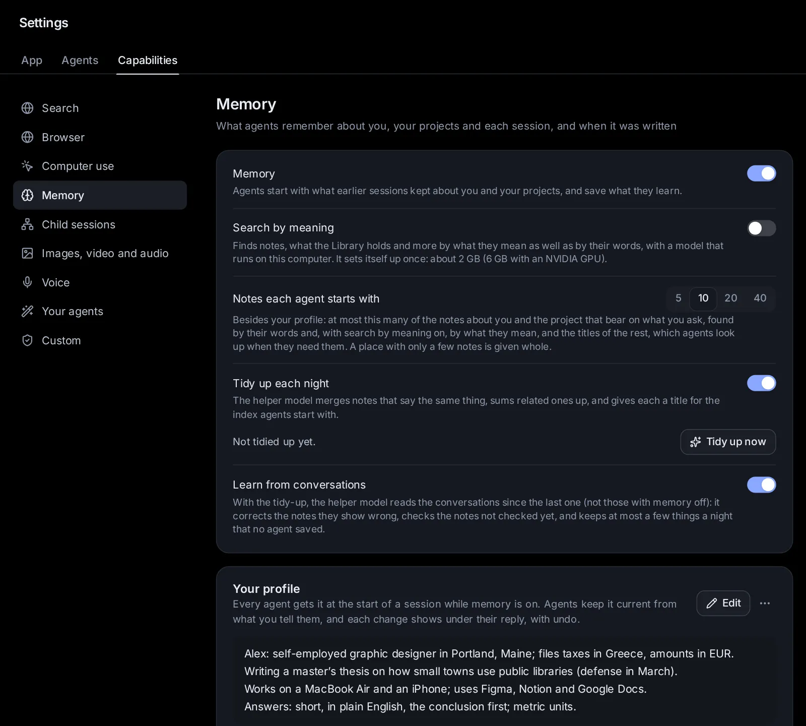

# Memory

Agents in Naget Agent remember what matters from one session to the next: facts about you, about each project, and where a task stands. This topic covers what they keep and when, what an agent starts with, how to see, correct or undo what was saved, and everything in Settings → Memory, including search by meaning and the nightly tidy-up. Use it so agents stop asking the same things twice, and so you always know what they know.

## What agents remember

Memory is a set of short notes, called memory notes. Each is a sentence or two, at most 500 characters. Every agent the app runs shares them: Claude Code, Codex, Custom and the agents that speak ACP, such as Gemini CLI. Each note belongs to one of three places:

- **About you**: lasting facts and preferences about you ("Prefers metric units", "Likes short answers", "Works mostly in Python"). Every session gets these.
- **A project**: facts about one project, such as its conventions, the commands that build and test it, where things are, and decisions made. The project is the folder a session works in: the top folder of its Git repository when it is in one, or the folder itself otherwise. A worktree (a separate copy of a repository on its own branch) shares its main repository's notes, so the sessions on every branch see the same ones. A session in your home folder itself has no project notes: it gets only what is about you and its own.
- **A session**: where one task stands, for that session to pick up when it goes on. These go when the session is deleted.

A session sees and changes only three sets of notes: the ones about you, its own project's, and its own. An agent working in one project never sees another project's notes. The sessions of a [space](/guide/spaces) all work in the space's folder, so they share its project notes. A task that gets a new folder of its own (see [Assistants](/guide/assistants)) has that folder as its project.

Once a place has many notes, two more kinds of entry appear there: **topics**, each summing up a group of related notes, and a **profile**, a short summary agents always get first. The nightly tidy-up writes them (see [Tidy up each night](/guide/memory#tidy-up-each-night)).

Memory works in the sessions this app runs, not in ones it only lists, such as a session open in a terminal or VS Code.

## How notes get written

Agents save notes in two cases: when you ask ("Remember that I'm vegetarian", "Remember that the test server is test.example.com"), or when they learn something lasting that will matter later. Nothing is written by itself after a reply: notes come from agents choosing to save them, from notes you write or edit yourself, and from the nightly tidy-up, which only reworks notes already kept.

- **The agent picks the place**: about you, this project, or this session.
- **Some notes are true only until a date**: a trip, a deadline, a visit. The agent gives such a note an end date. From then on agents no longer get it, and within the hour it moves to Deleted notes, where you can restore it for 30 days.
- **Corrections replace the old note**: to update a note, the agent rewrites it under its number instead of adding another. A note with the same text is not saved twice. With [search by meaning](/guide/memory#search-by-meaning) on, neither is a note that says the same thing in other words.
- **Agents forget, too**: an agent removes a note when it turns out wrong or out of date, or when you ask ("Forget my old address").
- **Never secrets**: a note that seems to hold a password, a key, a token or a card number is refused. So is text that reads like instructions to an agent ("ignore the previous instructions…"), since it would reach every later session.

You can also write a note yourself with **Add a note** in [Settings → Memory](/settings?s=memory&find=Add%20a%20note), and edit, date and delete every note there.

## See what an agent saved after a reply

When an agent saves, changes or removes notes during a turn, a chip appears under its reply, such as **Memory · 1 added, 1 updated**. It counts the changes still in effect (added, updated, removed); when every one was undone, it says **undone**. Several changes in one turn show as one chip, and a note changed several times shows as one change, from what it said before to what it says after.

Click the chip to open it. Each change shows:

- A badge: **Added**, **Updated**, **Removed**, or **Undone**.
- Where the note belongs (**About you**, **Project ·** and the folder's name, **This session**, or **Another session**), "saved by the agent", and how many changes it went through in that turn.
- The text. For an update, the words taken out are struck through and the words put in are marked. When most of it was rewritten, the old text shows struck through above the new.
- **Changed again since**, when the note was edited after this turn: click it to see what it says now.
- A last line with the reason the agent gave, if any, and **Deleted since** or **No longer kept** when the note was deleted or erased after this turn.

The buttons on each change:

- **Undo this change** (or **Undo these changes**): an added note goes, an updated note gets its old text back, a removed note comes back.
- **Edit**: change the text in place. Enter saves, Shift+Enter starts a new line, Escape cancels.
- **Delete**: removes the note. It stays under Deleted in Settings for 30 days.
- **Restore**: brings back a note that was deleted since.

The **⋯** (Memory options) at the top of the open chip has **Memory for this session**, which turns memory off or on for this session, and **All memory**, which opens Settings → Memory. Click the chip's top row to close it.

## What an agent starts with

Each agent starts with a short explanation of memory and the notes that fit in 4,000 characters:

- **When**: Claude Code and Codex get them when the session starts or is resumed. Agents that speak ACP get them with your first message. [Custom](/guide/custom) gets them again before every turn, so it always has the notes that bear on your latest message.
- **Which**: the places take turns, one note at a time, so a long list about one place can't crowd out the others: about you, then this project, then this session (when the session goes on). From each place come its profile first, then the topics and notes that bear on what you asked, then the latest. Notes that bear on your request are found by their words, and by what they mean when search by meaning is on. A note that a topic already given sums up is left out: the agent can still look it up.
- **How it treats them**: as background. The agent is told the notes may be out of date, that what you say now always comes first, and not to mention them unless they help.

The notes an agent got because they bear on your request count as **needed**. Settings shows how often each note was needed and when last, and suggests removing the ones no agent has needed for months.

Agents also get tools for memory: save a note (in a place, with an end date if it has one), correct a note, forget one, look notes up by words and meaning (including the notes a topic stands for), and search and read past conversations (see [Search earlier sessions](/guide/memory#search-earlier-sessions)). A note found with a lookup counts as needed too.

## Turn memory off for one session

Start a session without memory from the start page:

1. Under the message box, open **Options**.
2. Open **Memory** and pick **Off for this session** ("Starts fresh and keeps nothing from it"). **On** ("Uses and adds to what agents remember") is the usual.
3. The Options chip now names **No memory**. The start page keeps this pick for your next sessions too, until you set it back to On.

**What agents remember**, at the bottom of that menu, opens Settings → Memory. On a phone, these menus open as sheets from the bottom of the screen. The Memory option is not there while memory is off for all sessions.

For a session that is already going, open the session's menu (⋯) → **Session settings** → **Memory**. Its hint says **On** or **Off**; click it to switch. The same switch is in the memory chip's ⋯ as **Memory for this session**. While memory is off for all sessions, both are greyed out with the hint **Off for all**.

With memory off, a session "neither reads nor writes notes":

- Its agent gets no notes and no memory tools, and nothing from the session is saved.
- Agents in other sessions can't find it when they search past conversations, and can't read it.

A scheduled task's editor has the same Memory chip, so its runs can work without memory (see [Scheduled tasks](/guide/tasks)). Runs started from a template's public page always have memory off (see [Templates](/guide/templates)).

## Turn memory off for all sessions

Turn off the **Memory** switch at the top of [Settings → Memory](/settings?s=memory&find=Memory). The line under it says what it does: "Agents start with what earlier sessions kept about you and your projects, and save what they learn." Once it is off: "Off: agents get no notes and save nothing new. Your notes stay."

While it is off:

- No agent gets notes or memory tools, and nothing is saved.
- Your notes stay. Turn the switch back on and agents get them again.
- The Memory option leaves the start page, and the search box (Ctrl+K) stops showing notes.
- **Search by meaning** and **Tidy up each night** are greyed out, and the tidy-up report and **Tidy up now** are hidden.
- Above the notes, a line says "Memory is off: agents don’t get these notes, and save no new ones."

## Settings → Memory

Everything about memory is in [Settings → Capabilities → Memory](/settings?s=memory): "What agents remember about you, your projects and each session, and when it was written". At the top are three switches (**Memory**, **Search by meaning**, **Tidy up each night**), each with a line on what it does, and the last tidy-up. Below them is **Notes**, the list of every note. On a phone, Settings opens as a list: tap **Memory** to open it on its own page. There the notes take the screen's whole width, and every menu on the page opens as a sheet from the bottom of the screen.

### Search by meaning

[Search by meaning](/settings?s=memory&find=Search%20by%20meaning) "finds notes by what they mean, not only their words, with a model that runs on this computer": LightOn's mDenseOn, which reads nine languages. The model runs here, so your notes aren't sent to a service to be searched. Without it, notes are found by their words alone. With it on:

- Agents start with the notes that bear on your request even when the notes use other words than you did.
- Agents looking notes up, and the search field in the Notes list, find them by meaning as well as by words.
- A note that says the same as one already kept, in other words, isn't saved again, and the tidy-up groups notes by meaning.
- The search box (Ctrl+K) finds pages, settings, sessions, templates and more by what they mean, and knowledge bases are searched by meaning too (see [Spaces and knowledge](/guide/spaces)).

**Turn it on**:

1. In Settings → Memory, turn on **Search by meaning** (memory itself must be on).
2. The app sets up a private Python environment in its data folder, with PyTorch (its smaller CPU build when there is no NVIDIA GPU) and Transformers. This takes a few minutes, and the line under the switch shows each step, such as "Making a private Python environment" and "Installing PyTorch (CPU build): a few minutes".
3. The first time the model starts, it downloads: "Downloading the model (1.2 GB, once)". After that, starting says "Loading the model".
4. Every note gets its vector (the numbers search by meaning compares) in the background. The line counts them: "all 120 notes found by meaning", or "80 of 120 notes found by meaning (the rest soon)".

**What it needs**:

- Python 3.10 or newer on this computer, unless the uv tool is installed, which gets its own. If neither is there, setting up stops and says so, with the command to install Python on Debian or Ubuntu (`sudo apt install python3 python3-venv`).
- Disk space: PyTorch takes about 1 GB, or about 5 GB with an NVIDIA GPU, and the model 1.2 GB. Setting up stops with "Not enough disk space" when less than about 3 GB is free (9 GB with an NVIDIA GPU).
- An internet connection, once, for the downloads.
- Free memory to start the model: about 2.5 GB on the CPU, or 1.5 GB with a GPU. Until there is enough, it says "Waiting for memory" and notes are found by their words.

**Where it runs**: under the switch, pick **Automatic** or **CPU only**.

- **Automatic** runs it on the NVIDIA GPU with the most free memory, when one has more than 2 GB free; otherwise on the CPU. On a GPU it loads at once and stays loaded ("Loaded on" and the GPU's name).
- **CPU only** keeps it off the GPUs, to leave them to other work, such as models you run on this computer.
- On the CPU it starts only when needed, takes about 1.4 GB of memory while it runs, and stops after a few idle minutes: "Starts on the CPU when needed, and stops after a few idle minutes". Starting takes a few seconds; what comes up before then is found by its words. A computer with 8 GB of memory is enough.

When something goes wrong, the line turns into a warning with the reason (for example "The model took too long to load") and a **Try again** button. Turning the switch off stops the model; what was set up stays, so turning it on again is quick.

### Tidy up each night

[Tidy up each night](/settings?s=memory&find=Tidy%20up%20each%20night) keeps memory short and current. It is on by default. The helper model does the work: the small model the app uses for jobs beside sessions, picked in [Settings → Models → Helper model](/settings?s=models&find=Helper%20model) (see [Agents, accounts and models](/guide/agents-models)). It reads notes only, never conversations, so it learns nothing new. It leaves sessions' own notes alone: they are few, and go with their session.

Each tidy-up does two things:

1. **Near-copies, wrong notes, end dates.** Each note added or changed since the last tidy-up is compared with the closest notes in the same place (by meaning when search by meaning is on, else by words). Notes that say the same thing, or where one updates another, are merged into one note that keeps every fact still true; where they disagree, the newer one wins, and the merged note must be shorter than the notes it joins. A note that a newer one shows to be wrong is deleted. A note true only until a date it names ("until Friday", "the trip in March") gets that end date. At most 200 notes are checked in one tidy-up; the rest wait for the next.
2. **Topics and a profile.** Once a place's notes take more than about 2,400 characters (agents get 4,000 in all), related notes are summed up in topics, each covering a handful of notes (up to 12). Agents then get the topic, and can still look up the notes it stands for. The place also gets a short profile (at most 700 characters) that agents always get first: about you, who you are and how you like to work; about a project, what it is, how to build, test and run it, and its pitfalls. A topic or profile is written again when what it sums up changes.

It runs once a night, between 2 and 5 o'clock by this computer's clock. If the app was not running then, it catches up once two days have passed since the last tidy-up. Every change it makes goes in the note's history as made by "the helper", and each change of the last tidy-up can be undone (below).

### Tidy up now and undo its changes

Under **Tidy up each night**, a line reports the last tidy-up:

- "Not tidied up yet."
- "Tidying up…" while it runs.
- "Last tidied up 3h ago: 2 added, 1 updated, 3 removed." (what it changed), or "nothing to change (14 notes looked at)."
- When the latest found nothing but an earlier one did: "nothing to change. Before that, 2d ago:" and that earlier tidy-up's changes. They stay listed, and undoable, until a tidy-up changes something again.
- When it failed, the reason, such as the helper model not answering.

**What changed (N)** opens the list of those changes. Each shows a badge (Added, Updated, Removed, Ends, No end date, or Undone), **Topic** or **Profile** when it is one, the place and the reason ("Merged into #12", "Sums up 5 related notes"), and the text, the old struck through above the new. **Undo this change** reverses one: what it added goes, what it changed gets its old text back, what it deleted comes back, and an end date it set is taken away. **Hide** closes the list.

[Tidy up now](/settings?s=memory&find=Tidy%20up%20now) runs a tidy-up at once, whether or not the nightly one is on: "Tidying up: this takes a minute or two". It needs memory on.

### The Notes list

[Notes](/settings?s=memory&find=Notes) lists every note kept, with the count under its title: "42 kept: 12 about you, 25 in projects, 5 in sessions". **Add a note**, beside the title, writes one of your own (below).

- **Search**: the field at the top ("Search the notes", or "Search the notes, by words or meaning" when search by meaning is ready) finds notes with every word you type, the last one as the start of a word, and with search by meaning on, notes that mean the same. The best come first. Escape clears it.
- **Tabs**: **All**, **About you**, **Projects** and **Sessions**. Where there is room, each shows its count.
- **Groups**: notes come grouped by place: About you first, then each project (its folder's name and path), then the sessions' notes together, each naming its session (click the name to open the session). Each group shows how many notes it holds. A place's profile comes first, then its topics, then its notes, newest change first; when you search, the best match comes first.
- When some notes have gone unused for months, a line above the list says how many, with **Review** (see [Notes no agent needed lately](/guide/memory#notes-no-agent-needed-lately)).
- At the bottom of the list: **Deleted notes**, **Export** and **Clear all…** (below).

Each note shows its text (with a **Topic** or **Profile** badge when it is one) and a line under it:

- **Added** and when, or **Changed** and when if it changed since, and who did it: **by you**, **by an agent** or **by the helper** (the tidy-up). Point at the time to see the exact dates.
- **in** the session it came from, which you can click to open.
- For a topic or profile, how many notes it **sums up**.
- **needed** once or N times: how often an agent got it as bearing on a request, or found it by looking it up. Point at it to see when last.
- **until** a date, when it has an end date.

The **⋯** button beside each note (Note menu) holds what you can do with it. On a phone it opens as a sheet from the bottom of the screen, with the note's first words at the top.

- **Edit**: change the text in place, up to 500 characters (800 for a topic or profile). Enter saves, Shift+Enter starts a new line, Escape cancels. Text that seems to hold a secret can't be saved.
- **End date** (with the date beside it, when the note has one): "True until" a date, then **Save**. The note stops being true at the end of that day: from tomorrow up to five years ahead. **No end date** takes an end date away.
- **What it sums up** (topics and profiles only): the notes it stands for, deleted ones struck through.
- **History of changes**: every step in the note's life, newest first: Added, Changed (old text → new text), Deleted, Restored, End date ("Until" a date, or "Taken away"), each with when, by whom, in which session, and why.
- **Delete**: "Deleted. It stays under Deleted notes for 30 days."

What opens under a note (its end date, its history, or what it sums up) closes with its **×**, or by picking the same item in the menu again.

### Add a note

[Add a note](/settings?s=memory&find=Add%20a%20note) opens a field at the top of the list: "What should agents remember? Say, “I prefer short answers”." Write the note, then **Save** or press Enter. Shift+Enter starts a new line; Escape or **Cancel** drops it.

- **Where it belongs**: a note is about you unless you pick a project. The chip before the buttons (**About you**) lists the projects memory has notes for; a note about a project reaches only the sessions that work in it. With no project notes yet, the chip is not there and the note is about you.
- The same rules as for agents' notes: at most 500 characters, kept as one paragraph, and never anything that seems to hold a password, a key, a token or a card number.
- The note shows **by you**. Sessions get it as they start (Custom before its next turn), like every note.

### Notes no agent needed lately

When some notes have gone unused for four months, a line above the list says how many ("One note no agent has needed for four months"). **Review** opens them: "No agent has needed these for four months: not changed, not found, not given as bearing on a request. Keep what still matters; delete the rest."

Only notes about you and projects are suggested, never topics, profiles, notes with an end date, or sessions' notes. **Keep it** counts the note as needed today, so it leaves the list. **Delete** removes it. The list shows up to 100, the longest unneeded first. **All notes**, at the top, goes back.

### Deleted notes

[Deleted notes](/settings?s=memory&find=Deleted%20notes), at the bottom of the list, opens the notes deleted by you, an agent, the tidy-up, or their end date: "Deleted notes stay here for 30 days, then go for good." A session's notes go for good soon after the session itself is deleted. The search field finds deleted notes by their words, and **All notes**, at the top, goes back.

- **Restore** brings a note back. A note whose end date had passed comes back without it.
- The **⋯** menu has the note's **History of changes**, and **Erase for good**, which asks "Erase this note for good?" ("It goes with its history, and cannot come back.") and then removes it at once.

### Export your notes

[Export](/settings?s=memory&find=Export), at the bottom of the list, downloads every note kept. **Markdown** ("A list to read") is a readable list grouped by place, with when each note was added and changed and its end date. **JSON** ("With histories") has each note with its history and, for topics and profiles, the notes they sum up. Deleted notes are not included.

### Clear all…

[Clear all…](/settings?s=memory&find=Clear%20all%E2%80%A6), at the bottom of the list, deletes every note and its history. It asks first: "Clear all memory? Every note about you, your projects and your sessions goes, with its history. This cannot be undone; export first to keep a copy." Click **Clear all** to go ahead. The button is greyed out when there are no notes.

## Search earlier sessions

Besides notes, agents can look through your past conversations, with any agent. Ask "What did we decide about the venue last month?" and the agent searches what you and the agents wrote in every session for the words (all of them must match), and also the commands run and the files changed when it needs to. Then it reads the session that holds the answer: its messages and the titles of the steps taken, oldest first.

Sessions with memory off are left out of this search and can't be read from another session. These tools exist only while memory is on for the session the agent works in.

You can search past sessions yourself with the search box (Ctrl+K, or ⌘K on a Mac). It finds sessions by title, messages that hold your words, and memory notes, under **Memory**. Opening a note "Opens Settings → Memory, at this note".

## Ask an agent

- "What do you remember about me? Delete anything about my old job."
- "Turn on search by meaning, and keep it on the CPU."
- "Tidy up memory now, then tell me what it merged."
- "Which notes has no agent needed for months? Delete the ones about the old website."
- "The note about my trip to Lisbon is only true until 12 May: give it that end date."
- "Turn memory off for the session called Tax return."
