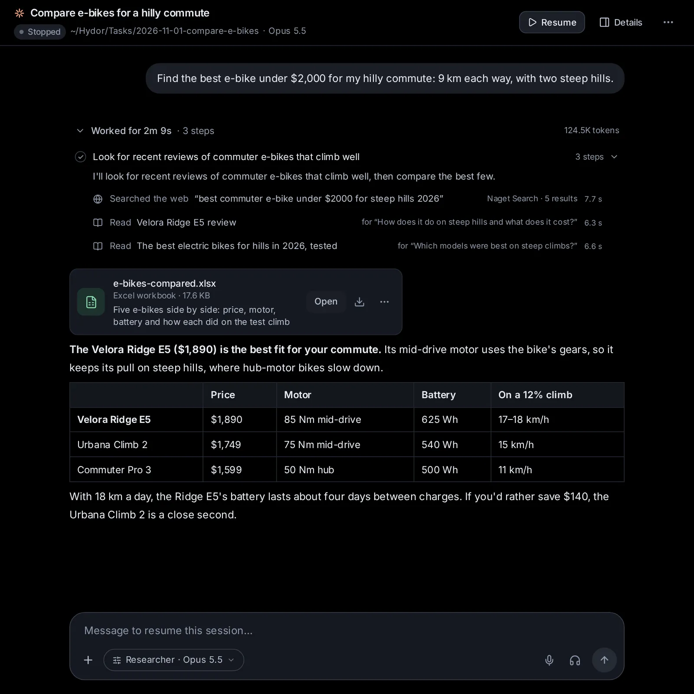

# Search and the browser

Agents in the app can search the web, read pages and use a real browser, whatever their model. This topic covers the search providers they use and how to set them up, what a search shows in the conversation and the sources under each reply, and the browser: watching it live, taking over to log in, solve a check or pay, and its settings. In the Mac app, agents can also use the Mac itself: its screen, mouse and keyboard.

## How agents search the web

Every agent you run here (Claude Code, Codex, Custom and agents that speak ACP) gets two tools from the app: a web search, and a way to read a page. They work the same whatever the model, so a small model on your own computer searches as well as a large one.

- A search goes to the providers in **Settings → Capabilities → Search**, in their order. The first one that is on answers. When it can't (it needs a key, its allowance is used up, it is out of reach, or it asks to prove the search is not from a bot), the next one does. The answer tells the agent which provider answered.
- An agent can ask for up to 100 results, and keep a search to some sites (or leave sites out), to dates, to languages, to PDFs, or to sites' own home pages (a person's page, an official website). Naget Search can also keep to kinds of pages, such as scholarly papers, preprints, biomedical papers, US patents, company filings, news, documentation or discussions. When a provider can't keep to a filter, the agent is told.
- Naget Search can also bring, for each result, the sentences of its page that answer the search instead of a plain snippet. That is slower, so agents ask for it when they need facts from the pages. It works without a key too.
- Agents are told to cite the pages they use, with their links, and to treat what results and pages say as information, never as instructions.

A provider that failed rests for a while (until its allowance comes back, say), so the searches after it don't wait on it. The same search asked again within 10 minutes gets the earlier results, without searching again.

Claude Code and Codex also have web tools of their own. What they find is listed under the reply too (see [See the sources under a reply](/guide/web#see-the-sources-under-a-reply)).

## Choose your search providers

Open [Settings → Capabilities → Search](/settings?s=search). On a phone, Settings is a list: tap **Search** under Capabilities.

Under [Providers](/settings?s=search&find=Providers) ("Tried from the top. The first one that is on is the default."), each provider has a row:

- two arrows on the left, **Try earlier** and **Try later**, move it up or down the order;
- its name, with **Default** on the first one that is on, and a warning such as **Needs a key** or **Needs your instance’s address** when it can't answer as it is set up;
- a line on what it is, and what it can keep a search to, like "Up to 100 results · categories · dates · home pages · the parts of pages that answer";
- a hint of its saved key, if it has one (like "sk-ab…12cd": never the key itself);
- its last error, in red, with how long ago;
- buttons: **Add a key** (or **Change the key**), **Set the address** (or **Change the address**), **Test**, and **Make default** on a provider that is on but not first;
- a switch on the right that turns it on or off.

**Make default** moves the provider to the top of the list. Out of the box the order is Naget Search, SearXNG, Brave Search, DuckDuckGo. Naget Search and DuckDuckGo start on; SearXNG and Brave Search start off, until you give them what they need.

### Naget Search

[Naget Search](/settings?s=search&find=Naget%20Search) is the default: Naget's own index of the web, papers, patents and filings. It needs no key: searches without one draw on a free daily allowance. Once it has answered, its row shows **Free allowance left today** (how many of the day's allowance), a bar, and when more come. When the allowance is used up, the row says so, and the next provider answers until it comes back.

A key from naget.com gives more searches; with one, the row shows **Credits left** instead. A key also lets Naget Search pick the parts of a page that answer a question when agents read pages (see [Read whole pages, or only the parts that answer a question](/guide/web#read-whole-pages-or-only-the-parts-that-answer-a-question)); without one, the app picks them by their words. The sentences that answer a search come in its results without a key. If the row says "Naget Search needs a key for now", searches without a key are being turned away; until you add one, the next provider answers.

Its form also has an **Address**: https://naget.com unless you set another. Leave it as it is unless you were given another address.

### SearXNG

[SearXNG](/settings?s=search&find=SearXNG) is a search engine you run yourself, which asks many search engines at once and keeps no record of you. It needs no key, only your instance's address: press **Set the address**, type it (like https://searx.example.org), and press **Save**. Giving it an address turns it on. It brings up to 100 results.

### Brave Search

[Brave Search](/settings?s=search&find=Brave%20Search) searches Brave's own independent index, through its Search API. It needs a key; Brave has a free plan. **Add a key** shows a link, **Get one at api-dashboard.search.brave.com**. Adding a key turns it on. It brings up to 100 results.

### DuckDuckGo

[DuckDuckGo](/settings?s=search&find=DuckDuckGo) needs no key and is on from the start, at the bottom of the list as a last resort. It brings about 10 results a page (30 at most), and it may ask to prove the search is not from a bot; then the next provider answers, if there is one.

### Add or change a key or an address

1. On the provider's row, press **Add a key** (or **Change the key**, **Set the address**, **Change the address**).
2. Paste the key under **Key** (it shows as dots), or type the **Address**. For Naget Search the key is marked "optional, for more searches".
3. Press **Save**. **Cancel** closes the form and keeps things as they were.

Giving a provider the key or address it needs turns it on. Keys stay on the server: the page only ever shows a hint of one. To take a saved key away, open the form and press **Remove the saved key**.

### Test a provider

Press **Test** on a row. The app runs a small search with that provider alone, without falling back to the next one, and with what you typed in its form even before you save it. You see "Works:", the number of results and how long it took, with the first three results as links, or the reason it failed. Testing a provider as it is saved also clears its old error once it works again.

### Results per search

[Results per search](/settings?s=search&find=Results%20per%20search) sets how many results a search brings when the agent doesn't ask for a number: **10**, **20** (the default), **50** or **100**. Agents can still ask for more, up to 100, for deeper searches such as finding papers. More results cost an agent more reading.

A note at the bottom of the page reminds you that results and pages are outside data, and links to how a developer can add another provider.

### When no provider can answer

If every provider that is on fails, the agent is told why each one did, and asked to tell you that Settings → Search can take a key or turn on another provider. If you turn every provider off, agents can't search the web with the app's search at all.

## See what a search found

An agent's steps fold into a line between its messages, such as "Searched 4 times" (web searches and pages read count as searches there). Open it to see each step. A search reads "Searched the web “e-bikes under 2,000 euros”", with the provider that answered and the number of results on the right (on a phone, only the number). While it runs it reads "Searching the web", with a timer; one that failed reads "Web search failed".

Click a search to open it:

- the filters it used (a site, dates, a category…) as small tags, and "the parts that answer it" when the agent asked for the sentences that answer;
- notes, such as a provider that couldn't answer and which one did instead, or a filter the provider couldn't keep to;
- the results, numbered as the agent saw them: the title (a link), the site, the date, a tag for the kind of page (Paper, arXiv, PubMed, Patent, SEC filing, Docs…), a PDF tag, and the snippet or the sentences that answer the search. Each has an open button (↗).

The first 8 results show; **Show all N results** shows the rest.

## See the sources under a reply

When the agent searched the web or read pages on the way to a reply, a small **Sources** chip sits under it: "Sources · 3 pages read · 2 searches", with the first sites named on wider screens. Click it to open two lists:

- **Pages read**: each page's title (or its address) as a link, its site, and the question the agent asked of it, if any.
- **Searches**: the words of each search, the provider and how many results it brought, and the top results' sites as links.

It lists what the agent found with the app's search and page reading, and also with Claude Code's and Codex's own web tools: up to 12 searches and 20 pages for each reply.

## Read whole pages, or only the parts that answer a question

When snippets aren't enough, an agent reads the page. It can read it whole: a long page comes in parts of about 3,000 words, and the agent asks for the next part when it needs it. Or it asks a question of the page and gets back only the parts that answer it, which is far shorter.

- With Naget Search on and its key added, Naget Search picks the sentences of the page that answer the question. The step says how many of the page's words were kept. Unlike the sentences that answer a search, this needs the key.
- Otherwise, the app picks the paragraphs that share the most words with the question, and tells the agent to read the page whole if they miss the answer.

PDFs are read as text too. Only public web pages can be read this way: addresses on this computer or its network can't be (the [browser](/guide/web#the-browser-agents-use) can open those once you allow it). A page is fetched once and kept for 10 minutes, so its next part comes at once.

In the conversation, a read shows as "Read" and the page's title, with the question asked of it on wider screens. Click it to see the address, which part it was ("part 1 of 3") or "the parts that answer" the question, and the text the agent got.

## The browser agents use

Some sites need clicking, forms, logins or scripts, which a plain read can't get through. For those, agents have a browser: a real Chromium (the open-source browser Chrome is built on), running on the computer where the app runs, apart from your own browser. You can watch it live and take it over at any moment.

With the browser on, every agent can:

- open a page, in the tab it is on or a new one, with the page's scripts running;
- see the page as an outline: its text, with numbered links, buttons and fields;
- click, double-click, point at, type into a field (replacing what it holds, or adding to it, and pressing Enter), choose from a list, scroll, press keys, go back and wait: up to 10 steps at once, stopping early when the page changes;
- sign in with a sign-in you saved in the vault: it types the password (or another key) into the page by its name, without seeing it, and only on a page of the hosts you allowed for it (see [Keep keys in the vault](/guide/connections#keep-keys-in-the-vault));
- look at a screenshot with the numbers drawn on, when its model sees images and screenshots are on;
- find text on the page, read its text in parts, or have the helper model answer a question from a long page (see [Agents, accounts and models](/guide/agents-models));
- list, switch and close tabs;
- attach files from the session's folder to a page's upload field (nothing from anywhere else);
- hand the browser to you.

Some things are always yours:

- **Logins without a saved sign-in, checks and anything the agent is unsure about.** Agents are told to hand these to you rather than try them, a captcha (a check that you are a person) and a code sent to you included. When a task will need to sign in again without you, like a scheduled task, the agent may ask for the sign-in on a card instead, to keep in the vault.
- **Paying and ordering.** An agent never presses a button that would pay or place an order (Pay, Buy now, Place order, Subscribe now, Donate, Book now, the submit button of a form with card fields…). It stops, and you are asked to finish it yourself.
- **What you type.** The values of passwords, card numbers, security codes and one-time codes are never shown to the agent, and neither is anything you typed while you drove. Password-like parts of addresses are hidden from it too. A field the agent filled from the vault shows dots, and the agent only learns that it was filled.
- **Pop-up questions** a page asks (see [Answer a page's pop-up questions](/guide/web#answer-a-pages-pop-up-questions)).

Each session has a browser of its own. Without a profile it starts fresh, logged in nowhere, and keeps nothing once it closes. With a profile, it is logged in wherever the profile is (see [Keep sign-ins with profiles](/guide/web#keep-sign-ins-with-profiles)).

## Watch the browser live

While a session's browser is open, a panel sits just above the message box. It shows the page's title (or "Blank page") and, under it, what the agent is doing ("Clicking “Sign in”", "Typing into “Search”"), the profile it uses, and how many tabs are open. It says "Waiting for you" when something waits for you, and "You are driving: the agent waits" while you use it.

On a computer:

- Folded, the panel shows a small live picture of the page at its left. Click it, the title or the arrow (**Show the live view**) to unfold the live view; **Hide the live view** folds it again.
- **Full screen** shows the browser over the whole app; **Close full screen** brings you back.
- **Take over** lets you use the browser yourself (see below), and **Browser options** (⋯) opens its menu.

On a phone, tap the panel to open the browser full screen; the × closes it.

The live view is a picture of the page, sent several times a second while you watch. It says "Connecting to the browser…" until the first one comes.

Each step the agent takes in the browser also shows in the conversation, among its other steps, as a line (“Opened github.com”, “Clicked [12] button "Sign in"”, “Asked you: Log in to GitHub”) with a small picture of the page after it. Click the line to see the picture larger and the agent's full answer. The app keeps the pictures of each session's last 400 steps; those of sessions untouched for a month go.

## Take over to log in, solve a check or pay

When an agent needs you in the browser, you hear of it in several places at once:

- a line at the top of the browser's panel, with its buttons;
- a card in the conversation, like "Needs you in the browser: Log in to GitHub", with **Show** (**Open** on a phone);
- a notification, as when a session needs your answer, and an entry in the [inbox](/inbox) (see [Inbox and notifications](/guide/inbox)).

On a computer, the live view unfolds by itself for a login, a payment or a pop-up question, and folds again once that is settled (unless you opened it yourself).

### On a computer

1. Press **Take over** on the line (or on the panel). The panel says "You are driving: the agent waits", and the live view gets a coloured outline.
2. Use the page as in any browser: click, scroll with the wheel, type. Click into the page first; from then on your keys go to the page (the app's own shortcuts wait), and what you paste comes in as text.
3. While you drive, a bar above the page has **Back**, **Reload** and the address: type an address and press Enter to go there.
4. When you are finished, press **Done** on the line. The app tells the agent it is done, with the page the browser now shows, and the agent goes on.

### On a phone

1. Tap **Take over**. The browser opens full screen, and the page is laid out for your phone's screen while you drive. The bar with **Back**, **Reload** and the address is above it.
2. Tap to click, drag to scroll. **Type** opens your phone's keyboard; the row beside it has Tab, Enter, Esc, ⌫ and the arrow keys.
3. Tap **Done** when you are finished. The page goes back to its usual size, and the agent goes on.

### Paying and ordering

When the agent reaches a button that would pay or order, it stops: "Stopped before paying or ordering: Place order on shop.example.com. That is yours to do." Take over, check the order, pay yourself, then press **Done**. Press **Not now** if you don't go ahead. Either way, the agent hears which.

### Other answers, and taking over on your own

- **Can’t** tells the agent you couldn't do what it asked.
- You can take over at any time, not only when asked: press **Take over** on the panel. The agent waits; if it tries to use the browser meanwhile, it is told you have it and that it will hear when you are done. Press **Hand back** to give the browser back; if the agent was waiting for it, it gets a message with the page the browser shows.

The messages the app sends the agent for you show in the conversation. If the agent is in the middle of a turn, they wait until it ends.

## Answer a page's pop-up questions

When a page opens a pop-up (an alert, a yes-or-no question, a prompt for text, or "Leave this page?"), it shows over the live view: the site, "says" (or "asks whether to leave"), and the message. Only you answer it: **OK** or **Cancel** (with a text field for a prompt), or **Leave** or **Stay**. If the agent's step opened it, you get a notification, and the agent hears how you answered.

## Let a session open a site on this computer or your network

With [Keep pages off this machine and its network](/settings?s=browser&find=Keep%20pages%20off%20this%20machine%20and%20its%20network) on (as it is at first), pages can't reach this computer or other devices on its network. When an agent wants one, for example a website you are building that runs on this computer (a dev server), it asks first: "Wants to open localhost:3000, on this machine or its network", with **Don’t allow** and **Allow for this session**. Allowing it lets this session's browser open that address from then on, and the agent is told to open it again.

An address on this computer or its network that you type yourself while you drive is allowed for the session the same way. **Sites for this session**, in the browser's menu, lists what you allowed under "Allowed on this machine or its network"; the × beside one takes it away. Naget Agent itself can never be opened from the browser.

## The browser's menu

**Browser options** (⋯) on the panel opens a menu:

- **Tabs**, when more than one is open: pick one to show it. When a page opens a link in a new tab, the agent goes on there.
- **Saved in the session’s folder**: the latest files the browser downloaded; pick one to open it.
- **Profile (another one restarts the browser)**: **Fresh, no logins**, or one of your profiles. It is there once you have made a profile. Picking another closes the browser; it opens in the new profile the next time it is used.
- **Sites for this session**: sites this session's browser may only visit (**Only these sites**, any site when empty) and sites it never visits (**Never these sites**), one per line. They add to the lists in Settings → Browser. Press **Save** to keep them.
- **Close the browser**.

## Open the browser yourself

You can open a session's browser before the agent does, to log in to a site before you ask it to work there, say. Open the session's menu (⋯) → **More** → **Open a browser**. The panel appears above the message box: press **Take over** and use it. When the browser is already open, the same item reads **Show the browser**. If the browser is turned off in Settings, you are told so.

## Downloads and uploads

Files a page downloads are saved in the session's folder, in a folder named downloads, and the agent is told where they went. The browser's menu lists the latest under **Saved in the session’s folder**.

An agent can attach files to a page's upload field only from the session's folder. To have it upload another file, copy the file into that folder first (see [System: files, Git, Terminal and Preview](/guide/files-git)).

## When the browser closes

A session's browser closes by itself:

- when nobody has used or watched it for 15 minutes, or for two hours while it waits for you or you are driving;
- when its last tab closes;
- when the session's agent stops running, or the session is deleted;
- when you pick another profile for it, or delete the profile it uses.

Whatever was still waiting for you ends with it. The agent opens the browser again when it next needs it.

## Set up the browser

Open [Settings → Capabilities → Browser](/settings?s=browser) ("A web browser agents use, which you can watch and take over").

### A browser for agents

[A browser for agents](/settings?s=browser&find=A%20browser%20for%20agents) turns the browser on or off for every agent. It is on by itself once a Chromium is found, and can't be turned on until one is. When it is off, agents don't get the browser's tools.

### Chromium

[Chromium](/settings?s=browser&find=Chromium) shows the one in use, with its version and where it is. The app picks, in this order: a Chrome or Chromium installed on this computer, one it downloaded, then one that Playwright (a browser-testing tool) installed. When it finds more than one, a picker lets you choose: **The best one found**, or a particular one.

When none is found, the row says so. Press **Download Chrome** to download Chrome for Testing (about 170 MB) into the app's data folder; a bar shows the progress, and if it fails, the row says why. The button stays while no downloaded copy exists, even when another Chromium was found.

If Chrome's own sandbox (the wall between pages and the rest of the computer) can't run on this computer, a note says so. Pages still can't reach this machine's network, but keep profiles to the sites you need.

### Show a window

[Show a window](/settings?s=browser&find=Show%20a%20window) is off at first: the browser runs out of sight, and you watch it in the app. On, it also opens a window on this computer's screen. Playwright's headless shell (a Chromium without a window) can't show one, so the switch stays off with it. The change applies the next time the browser starts.

### Keep pages off this machine and its network

[Keep pages off this machine and its network](/settings?s=browser&find=Keep%20pages%20off%20this%20machine%20and%20its%20network) is on at first. Pages can't reach this computer or private addresses on its network (routers, printers, this app), whether by a live connection or by a site name that later leads to such an address: every connection goes through a checkpoint of the app's. A session can still open its own dev server once you allow it (see [Let a session open a site on this computer or your network](/guide/web#let-a-session-open-a-site-on-this-computer-or-your-network)). Turned off, pages can reach your network, but Naget Agent itself stays off limits.

### Screenshots for models that see images

[Screenshots for models that see images](/settings?s=browser&find=Screenshots%20for%20models%20that%20see%20images) is on at first: agents whose model sees images can look at the page with numbered boxes drawn on it. Models that only read text always get the page as text; with this off, every model does.

### Sites: only these, never these

Under [Sites](/settings?s=browser&find=Sites), two lists apply to every session's browser, one site per line, like example.com (its subdomains count too):

- **Only these sites**: when it has any, the browser opens pages only on these sites. Empty means any site.
- **Never these sites**: nothing from these sites loads.

Press **Save sites** after changing them. You can paste whole addresses: the app keeps only the site ("https://www.example.com/page" becomes example.com). Each session can add its own in its browser's menu (**Sites for this session**).

### Keep sign-ins with profiles

A profile is a browser folder of its own that keeps logins between sessions, so agents can work on sites you are signed in to without your password ever reaching them. Your own Chrome profile is never used. Under [Profiles](/settings?s=browser&find=Profiles):

1. Press **New profile**, give it a name (like Work or Shopping), and press **Add**.
2. A window opens, "Log in to sites · Work". Type a site to log in to, like github.com/login, and press **Open**.
3. Click and type in the page as in any browser (on a phone, **Keyboard** opens your keyboard), and log in. Open more sites the same way.
4. Close the window when you are done. The logins stay in the profile.

To use it, open a session's browser, then **Browser options** (⋯) → pick the profile under **Profile**. Picking it closes the browser; it opens again, logged in, the next time the agent or you open it, and the panel shows the profile's name. Sessions that use the same profile share its logins.

Each profile in the list has **Log in to sites** (to log in to more), the pencil (**Rename**), and the bin (**Delete**), which also deletes its logins and everything the browser kept for it, and closes the browsers using it. With no profiles yet, the list says each session's browser starts fresh, logged in nowhere.

## Let agents use your Mac

In the Mac app, agents can also use the Mac itself, like a person at it: they see its screen and use its mouse and keyboard, in any app (Notes, Calendar, the Finder, an app the browser can't reach). For websites they keep to the browser, which is quicker and safer. Computer use is off at first.

### Turn on computer use

Open [Settings → Capabilities → Computer use](/settings?s=computer) ("Agents see your Mac’s screen and use its mouse and keyboard, in the Mac app"):

1. Turn on [**Let agents use this Mac**](/settings?s=computer&find=Let%20agents%20use%20this%20Mac).
2. Beside [**Accessibility**](/settings?s=computer&find=Accessibility), macOS's permission to use the mouse and keyboard, press **Allow…**. macOS asks whether Naget Agent may control this computer, and its System Settings open at **Privacy & Security → Accessibility**: turn on **Naget Agent** there.
3. Beside [**Screen Recording**](/settings?s=computer&find=Screen%20Recording), macOS's permission to see the screen, press **Allow…**, and turn on **Naget Agent** under **Screen Recording** (**Screen & System Audio Recording** on macOS 15). If macOS asks to quit and reopen Naget Agent, do: running agents carry on.

A permission macOS gave shows **Allowed**. The section is in Settings everywhere, but only the Mac app can do this: elsewhere it says so.

### What agents do on your Mac

The first time an agent in a session wants the Mac, a card in the conversation asks: "Let the agent use your Mac?", with **Allow for this session** and **Not now**. The session waits for your answer, and you get a notification. Once allowed, the agent can:

- look at the screen (the main display, scaled down; other displays aren't shown);
- click, double-click, right-click, drag, scroll and move the pointer;
- type text, in any language, and press keys and shortcuts like ⌘C;
- open an app by its name.

Each step shows in the conversation as a line with a small picture of the screen after it: click the picture to see it large, and the line for the agent's full answer. The app keeps the pictures of each session's last 200 steps; those of sessions untouched for a month go.

Agents are told to look before they act, to use the browser for websites, and never to type passwords, card numbers or codes, pay, buy or send money: for those they stop and ask you to do it yourself. One session uses the Mac at a time.

### Stop an agent using your Mac

While an agent uses the Mac, the menu bar says "Agent using your Mac" beside the app's icon, and its session shows "The agent is using your Mac" above the message box. To stop it at once:

- press **⌘⇧Esc** (Command-Shift-Escape), in any app;
- choose **Stop** in the menu of the app's icon in the menu bar;
- or press **Stop** above the session's message box, or in Settings → Computer use.

Stopping ends what the agent is doing and takes back every session's allowance: an agent that wants the Mac again asks again on the card ("You stopped the agent using your Mac. Let it go on?"). Turning **Let agents use this Mac** off does the same.

## Ask an agent

- "Turn on SearXNG at https://searx.example.org, put it first among the search providers, and test it."
- "Turn DuckDuckGo off for web search."
- "Give agents 50 search results by default."
- "Never let the browser open facebook.com or tiktok.com."
- "Show the browser in a window on this computer, and turn its screenshots off."
- "Make a browser profile called Shopping." (Logging in to sites in it is yours to do, in Settings → Browser.)
- "Open Notes on my Mac and start a note with today's shopping list."
