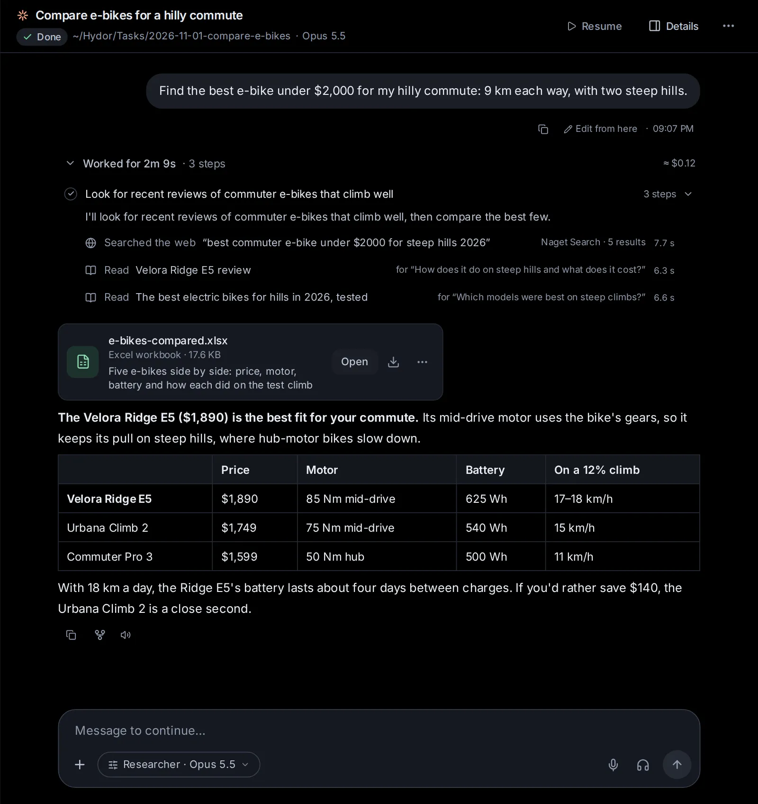

# Search and the browser

Agents in the app can search the web, read pages and use a real browser, whatever their model. This topic covers the search providers they use and how to set them up, what a search shows and its sources, and the browser: watching it live, taking over to log in, solve a check or pay, and its settings. It also covers the Browser page, a browser of your own in the desktop app (tabs, private tabs, a smart address bar, bookmarks, history, an ad blocker, translation, reader view, extensions), and handing a page of it to an agent. In the desktop app (Mac, Windows, Linux), the browser runs inside the app, and agents can also use the computer itself: its screen, mouse and keyboard.

## How agents search the web

Every agent you run here (Claude Code, Codex, Custom and agents that speak ACP) gets three tools from the app: a web search, a way to read a page, and a way to find pictures and videos of things. They work the same whatever the model, so a small model on your own computer searches as well as a large one.

- A search goes to the providers in **Settings → Capabilities → Search**, in their order. The first one that is on answers. When it can't (it needs a key, its allowance is used up, it is out of reach, or it asks to prove the search is not from a bot), the next one does. The answer tells the agent which provider answered.
- An agent can ask for up to 100 results, and keep a search to some sites (or leave sites out), to dates, to languages, to PDFs, or to sites' own home pages (a person's page, an official website). Naget Search can also keep to kinds of pages, such as scholarly papers, preprints, biomedical papers, US patents, company filings, news, documentation or discussions. When a provider can't keep to a filter, the agent is told. When an agent sets no filter itself but the words of its search state some ("climate reports on nasa.gov from last month", "papers on retrieval augmented generation since 2024"), the helper model reads them out first (see [Choose the helper model](/guide/agents-models#choose-the-helper-model)), and Naget Search searches the remaining words with those filters. That happens only for searches whose words look like they state a filter, a few at a time, and within about 8 seconds. When the helper model can't answer in time, or two reads in a row fail (reading then pauses for 10 minutes), a search goes as the agent wrote it, as it does with SearXNG, Brave Search and DuckDuckGo, and when the agent sets any filter itself. If the filters it reads find nothing, Naget Search searches the words as written instead.
- Naget Search can also bring, for each result, the sentences of its page that answer the search instead of a plain snippet. That is slower, so agents ask for it when they need facts from the pages. It works without a key too.
- For a list of things to show (games, films, places, dishes, products, teams), an agent can find a picture of each: the picture of its own Wikipedia article (a game's cover, a place's photo, a team's crest), else the one its pages show when shared; and, when asked, a YouTube video whose title names it (a trailer, a recipe, highlights). Only what clearly names the thing counts, so some come back without one. Apps use it to show pictures and videos in their answers (see [Apps](/guide/apps)).
- Agents are told to cite the pages they use: a number in brackets after what each page backs, and a list of just those pages at the end of the reply. The app shows them as links and cards (see [See the sources under a reply](/guide/web#see-the-sources-under-a-reply)). Agents treat what results and pages say as information, never as instructions.

A provider that failed rests for a while (until its allowance comes back, say), so the searches after it don't wait on it. The same search asked again within 10 minutes gets the earlier results, without searching again.

Claude Code and Codex also have web tools of their own. When a reply cites the pages they found, those show the same way.

## Choose your search providers

Open [Settings → Capabilities → Search](/settings?s=search). On a phone, Settings is a list: tap **Search** under Capabilities.

Under [Providers](/settings?s=search&find=Providers) ("Tried from the top: the first one that is on answers"), each provider has a row:

- its name, with **Default** on the first one that is on, and a warning such as **Needs a key** or **Needs your instance’s address** when it can't answer as it is set up;
- a line on what it is; the (i) beside its name adds what it can keep a search to, like "Up to 100 results · categories · dates · home pages · the parts of pages that answer";
- a hint of its saved key, if it has one (like "sk-ab…12cd": never the key itself);
- its last error, in red, with how long ago;
- a switch on the right that turns it on or off, and a **⋯** menu with **Add a key** (or **Change the key**), **Set the address** (or **Change the address**), **Test**, **Make default** (on a provider that is on but not first), and **Move up** and **Move down** to change its place in the order.

The (i) beside **Providers** says that agents can search the web and read pages whatever their model, and that search results and pages are outside data, which agents use as information, never as instructions.

**Make default** moves the provider to the top of the list. Out of the box the order is Naget Search, SearXNG, Brave Search, DuckDuckGo. Naget Search and DuckDuckGo start on; SearXNG and Brave Search start off, until you give them what they need.

### Naget Search

[Naget Search](/settings?s=search&find=Naget%20Search) is the default: Naget's own index of the web, papers, patents and filings. It needs no key: searches without one draw on a free daily allowance. Once it has answered, its row shows **Free allowance left today** (how many of the day's allowance), a bar, and when more come. When the allowance is used up, the row says so, and the next provider answers until it comes back.

A key from naget.com gives more searches; with one, the row shows **Credits left** instead. A key also lets Naget Search pick the parts of a page that answer a question when agents read pages (see [Read whole pages, or only the parts that answer a question](/guide/web#read-whole-pages-or-only-the-parts-that-answer-a-question)); without one, the app picks them by their words. The sentences that answer a search come in its results without a key. If the row says "Naget Search needs a key for now", searches without a key are being turned away; until you add one, the next provider answers.

Its form also has an **Address**: https://naget.com unless you set another. Leave it as it is unless you were given another address.

### SearXNG

[SearXNG](/settings?s=search&find=SearXNG) is a search engine you run yourself, which asks many search engines at once and keeps no record of you. It needs no key, only your instance's address: open its **⋯** menu, pick **Set the address**, type it (like https://searx.example.org), and press **Save**. Giving it an address turns it on. It brings up to 100 results.

### Brave Search

[Brave Search](/settings?s=search&find=Brave%20Search) searches Brave's own independent index, through its Search API. It needs a key; Brave has a free plan. **⋯ → Add a key** opens a form with a link, **Get one at api-dashboard.search.brave.com**. Adding a key turns it on. It brings up to 100 results.

### DuckDuckGo

[DuckDuckGo](/settings?s=search&find=DuckDuckGo) needs no key and is on from the start, at the bottom of the list as a last resort. It brings about 10 results a page (30 at most), and it may ask to prove the search is not from a bot; then the next provider answers, if there is one.

### Add or change a key or an address

1. On the provider's row, open the **⋯** menu and pick **Add a key** (or **Change the key**, **Set the address**, **Change the address**).
2. Paste the key under **Key** (it shows as dots), or type the **Address**. For Naget Search the key is marked "optional, for more searches".
3. Press **Save**. **Cancel** closes the form and keeps things as they were.

Giving a provider the key or address it needs turns it on. Keys stay on the server: the page only ever shows a hint of one. To take a saved key away, open the form and press **Remove the saved key**.

### Test a provider

Open a row's **⋯** menu and pick **Test**. The app runs a small search with that provider alone, without falling back to the next one, and with what you typed in its form even before you save it. You see "Works:", the number of results and how long it took, with the first three results as links, or the reason it failed. Testing a provider as it is saved also clears its old error once it works again.

### Results per search

[Results per search](/settings?s=search&find=Results%20per%20search) sets how many results a search brings when the agent doesn't ask for a number: **10**, **20** (the default), **50** or **100**. Agents can still ask for more, up to 100, for deeper searches such as finding papers. More results cost an agent more reading.

A note at the bottom of the page links to how a developer can add another provider.

### When no provider can answer

If every provider that is on fails, or you turned them all off, the agent is told why each one did. Claude Code and Codex then search with their own built-in web search instead (Claude Code's WebSearch, Codex's web search), for that search and the rest of the task, and cite its pages as usual: they tell you about Settings → Search only if their own search fails too. Other agents, such as Custom, have no web search of their own: they are asked to tell you that Settings → Search can take a key or turn on another provider. In a [deep research](/guide/research) the agents' own web search is off, so that every search counts against its budget: there, too, you are told what to fix.

## See what a search found

An agent's steps fold into a line between its messages, such as "Searched 4 times" (web searches and pages read count as searches there). Open it to see each step. A search reads "Searched the web “e-bikes under 2,000 euros”", with the provider that answered and the number of results on the right (on a phone, only the number). While it runs it reads "Searching the web", with a timer; one that failed reads "Web search failed".

Click a search to open it:

- the filters it used (a site, dates, a category…) as small tags, those read from the words of the search too, with a note naming the words that were searched, and "the parts that answer it" when the agent asked for the sentences that answer;
- notes, such as a provider that couldn't answer and which one did instead, or a filter the provider couldn't keep to;
- the results, numbered as the agent saw them: the title (a link), the site, the date, a tag for the kind of page (Paper, arXiv, PubMed, Patent, SEC filing, Docs…), a PDF tag, and the snippet or the sentences that answer the search. Each has an open button (↗).

The first 8 results show; **Show all N results** shows the rest.

## See the sources under a reply

When an agent cites the pages it used, its reply shows them in two places, instead of a numbered list at its end:

- **In the text**: where it cites a page, a small chip with the site's icon and name, like **ign**. A chip that stands for several pages says how many more (**ign +1**). On a computer, point at a chip to see its pages, with their titles and sites; click it to open its page (one of several from the card). On a phone, tap it to see them, then tap one to open it.
- **Under the reply**: a **Sources** line with the first sites' icons and how many pages the reply cites. Click it to open a card for each page: its title, its site and a link.

Only the pages the reply cites show, by the numbers the agent gave them, not every search it ran: what it searched and read is in its steps (open **Worked for…** above the reply). **Copy message** (under the reply) copies it as the agent wrote it, with its list of sources; reading it aloud leaves the numbers and the list out. A site's icon comes from the site itself the first time it shows, and is kept; a site without one shows its first letter.

## Read whole pages, or only the parts that answer a question

When snippets aren't enough, an agent reads the page. It can read it whole: a long page comes in parts of about 3,000 words, and the agent asks for the next part when it needs it. Or it asks a question of the page and gets back only the parts that answer it, which is far shorter.

- With Naget Search on and its key added, Naget Search picks the sentences of the page that answer the question. The step says how many of the page's words were kept. Unlike the sentences that answer a search, this needs the key.
- Otherwise, the app picks the paragraphs that share the most words with the question, and tells the agent to read the page whole if they miss the answer.

PDFs are read as text too. Only public web pages can be read this way: addresses on this computer or its network can't be (the [browser](/guide/web#the-browser-agents-use) can open those once you allow it). A page is fetched once and kept for 10 minutes, so its next part comes at once.

In the conversation, a read shows as "Read" and the page's title, with the question asked of it on wider screens. Click it to see the address, which part it was ("part 1 of 3") or "the parts that answer" the question, and the text the agent got.

## The browser agents use

Some sites need clicking, forms, logins or scripts, which a plain read can't get through. For those, agents have a browser, apart from your own: it has none of the sign-ins of the Chrome, Edge, Firefox or Safari you use. You can watch it live and take it over at any moment. Which browser it is depends on where the app runs:

- **In the desktop app** (Mac, Windows, Linux) it is the app's own browser, built on Chromium (the open-source browser Chrome is built on) and running inside the app. Nothing needs to be installed, and the app picks it unless you choose another (see [Chromium](/guide/web#chromium)). Its pages draw fast in the app's window, you click into one to use it, and it keeps working with the window closed.
- **Anywhere else** (the app in Docker or on a server, and a phone or any web page looking at it) it is a real Chromium that the app starts on the computer where it runs, which you see as a live picture.

With the browser on, every agent can:

- open a page, in the tab it is on or a new one, with the page's scripts running;
- see the page as an outline: its text, with numbered links, buttons and fields;
- click, double-click, point at, type into a field (replacing what it holds, or adding to it, and pressing Enter), choose from a list, scroll, press keys, go back and wait: up to 10 steps at once, stopping early when the page changes;
- sign in with a sign-in you saved in the vault: it types the password (or another key) into the page by its name, without seeing it, and only on a page of the hosts you allowed for it (see [Keep keys in the vault](/guide/connections#keep-keys-in-the-vault));
- look at a screenshot with the numbers drawn on, when its model sees images and screenshots are on;
- find text on the page, read its text in parts, or have the helper model answer a question from a long page (see [Agents, accounts and models](/guide/agents-models));
- list, switch and close tabs;
- attach files from the session's folder to a page's upload field (nothing from anywhere else);
- hand the browser to you.

Some things are always yours, or wait for your OK:

- **Logins without a saved sign-in, checks and anything the agent is unsure about.** Agents are told to hand these to you rather than try them, a captcha (a check that you are a person) and a code sent to you included. When a task will need to sign in again without you, like a scheduled task, the agent may ask for the sign-in on a card instead, to keep in the vault.
- **Paying and ordering.** An agent never presses a button that would pay or place an order (Pay, Buy now, Place order, Subscribe now, Donate, Book now, the submit button of a form with card fields…). It stops, and you are asked to finish it yourself.
- **Buttons that send, post, delete or transfer, on a site the browser is signed in to.** Before an agent presses one, you are asked to allow it (see [Buttons that send, post or delete](/guide/web#buttons-that-send-post-or-delete)). You can turn that off in Settings.
- **What you type.** The values of passwords, card numbers, security codes and one-time codes are never shown to the agent, and neither is anything you typed while you drove. Password-like parts of addresses are hidden from it too. A field the agent filled from the vault shows dots, and the agent only learns that it was filled.
- **Pop-up questions** a page asks (see [Answer a page's pop-up questions](/guide/web#answer-a-pages-pop-up-questions)).

Each session has a browser of its own. Without a profile it starts fresh, logged in nowhere, and keeps nothing once it closes. With a profile, it is logged in wherever the profile is (see [Keep sign-ins with profiles](/guide/web#keep-sign-ins-with-profiles)). Your own browser, on the Browser page, is a separate one that agents never use, unless you hand them a page of it (see [Hand a page to an agent](/guide/web#hand-a-page-to-an-agent)).

## Watch the browser live

While a session's browser is open, a panel sits just above the message box. It shows the page's title (or "Blank page") and, under it, what the agent is doing ("Clicking “Sign in”", "Typing into “Search”"), the profile it uses, and how many tabs are open. It says "Waiting for you" when something waits for you, and "You are driving: the agent waits" while you use it.

On a computer:

- Folded, the panel shows a small live picture of the page at its left. Click it, the title or the arrow (**Show the live view**) to unfold the live view; **Hide the live view** folds it again.
- **Full screen** shows the browser over the whole app; **Close full screen** brings you back.
- **Take over** lets you use the browser yourself (see below), and **Browser options** (⋯) opens its menu.

On a phone, tap the panel to open the browser full screen; the × closes it.

In the desktop app, the live view is the page itself, drawn by the app and kept up as fast as the page changes, so scrolling and typing feel like any browser. Elsewhere it is a picture of the page, sent several times a second while you watch; it says "Connecting to the browser…" until the first one comes.

### See where the agent points

The browser runs out of sight, so the live view draws the agent's pointer for you: a large arrow in the app's colour, with a soft halo and an **Agent** tag beside it.

- Before the agent clicks, types or scrolls, its pointer glides from where it was to that place, in about a third of a second, so your eye can follow it. While you watch, the agent waits for it; when nobody watches the browser, it doesn't wait.
- Where it clicks, a ring spreads (two for a double click). The field it types into, or the list it chooses from, gets an outline for a moment. A scroll shows its way with arrows beside the pointer, and the keys it presses (Enter, Tab, Ctrl+A) show beside the tag.
- The pointer stays where the agent last acted. On the small picture of the folded panel, it shows as a small arrow.
- While you drive, the agent's pointer goes from the live view: yours is the only one. It comes back when you hand the browser back.

Each step the agent takes in the browser also shows in the conversation, among its other steps, as a line (“Opened github.com”, “Clicked [12] button "Sign in"”, “Asked you: Log in to GitHub”) with a small picture of the page after it. Click the line to see the picture larger and the agent's full answer. On the larger picture, a ring marks where the step clicked and a dashed outline the field it typed into, numbered when the step did several things. The app keeps the pictures of each session's last 400 steps; those of sessions untouched for a month go.

## Take over to log in, solve a check or pay

When an agent needs you in the browser, you hear of it in several places at once:

- a line at the top of the browser's panel, with its buttons;
- a card in the conversation, like "Needs you in the browser: Log in to GitHub", with **Show** (**Open** on a phone);
- a notification, as when a session needs your answer, and an entry in the [inbox](/inbox) (see [Inbox and notifications](/guide/inbox)).

On a computer, the live view unfolds by itself for a login, a payment or a pop-up question, and folds again once that is settled (unless you opened it yourself).

### On a computer

1. Press **Take over** on the line (or on the panel). The panel says "You are driving: the agent waits", and the live view gets a coloured outline.
2. Use the page as in any browser: click, scroll with the wheel, type. Click into the page first; from then on your keys go to the page (the app's own shortcuts wait), and what you paste comes in as text. In the desktop app, clicking or typing in the page is enough to take over: the panel switches to "You are driving: the agent waits" by itself, and while the agent drives, a line under the address says "Click into the page to use it yourself".
3. While you drive, a bar above the page has **Back**, **Reload** and the address: type an address and press Enter to go there.
4. When you are finished, press **Done** on the line. The app tells the agent it is done, with the page the browser now shows, and the agent goes on.

### On a phone

1. Tap **Take over**. The browser opens full screen, and the page is laid out for your phone's screen while you drive. The bar with **Back**, **Reload** and the address is above it.
2. Tap to click, drag to scroll. **Type** opens your phone's keyboard; the row beside it has Tab, Enter, Esc, ⌫ and the arrow keys.
3. Tap **Done** when you are finished. The page goes back to its usual size, and the agent goes on.

### Paying and ordering

When the agent reaches a button that would pay or order, it stops: "Stopped before paying or ordering: Place order on shop.example.com. That is yours to do." Take over, check the order, pay yourself, then press **Done**. Press **Not now** if you don't go ahead. Either way, the agent hears which.

### Other answers, and taking over on your own

- **Can’t** tells the agent you couldn't do what it asked.
- You can take over at any time, not only when asked: press **Take over** on the panel. The agent waits; if it tries to use the browser meanwhile, it is told you have it and that it will hear when you are done. Press **Hand back** to give the browser back; if the agent was waiting for it, it gets a message with the page the browser shows.

The messages the app sends the agent for you show in the conversation. If the agent is in the middle of a turn, they wait until it ends.

## Buttons that send, post or delete

On a site the browser is signed in to, an agent asks before it presses a button that sends, posts, publishes, shares, replies, deletes, removes, transfers or withdraws something. That is a browser that uses a profile (see [Keep sign-ins with profiles](/guide/web#keep-sign-ins-with-profiles)), and a page you handed an agent (see [Hand a page to an agent](/guide/web#hand-a-page-to-an-agent)). A browser that starts fresh, logged in nowhere, has nothing to protect and does not ask. Paying and ordering stay yours alone (see above).

The agent knows these buttons by their words, in English, German, Greek, Chinese, French and Spanish: Send, Post, Publish, Delete, Transfer and the like, and a bare "Confirm" or "Yes" when the page is about one of them (a pop-up asking "Delete this post?"). "Sign in", "Next", "Save draft", "Cancel", a search button, and sending a code to yourself (Resend code) are not stopped.

When it reaches one, it stops, ends its turn and waits. You see "Wants to press “Delete” on mail.example.com" in the same places as other questions (the line on the browser's panel and a card in the conversation), with **Don’t allow** and **Allow**. The live view does not open by itself.

- **Allow** tells the agent it may press the button now. It lets through one press of a button with the same words, on that site, in the next two minutes; after that the agent asks again.
- **Don’t allow** tells the agent not to press it. It carries on without, or tells you what it could not do. The card then reads "Allowed" or "Not allowed".

It is on at first. To turn it off, see [Ask before sending on signed-in sites](/guide/web#ask-before-sending-on-signed-in-sites).

## Answer a page's pop-up questions

When a page opens a pop-up (an alert, a yes-or-no question, a prompt for text, or "Leave this page?"), it shows over the live view: the site, "says" (or "asks whether to leave"), and the message. Only you answer it: **OK** or **Cancel** (with a text field for a prompt), or **Leave** or **Stay**. If the agent's step opened it, you get a notification, and the agent hears how you answered.

## Let a session open a site on this computer or your network

With [Keep pages off this machine and its network](/settings?s=browser&find=Keep%20pages%20off%20this%20machine%20and%20its%20network) on (as it is at first), pages can't reach this computer or other devices on its network. When an agent wants one, for example a website you are building that runs on this computer (a dev server), it asks first: "Wants to open localhost:3000, on this machine or its network", with **Don’t allow** and **Allow for this session**. Allowing it lets this session's browser open that address from then on, and the agent is told to open it again.

An address on this computer or its network that you type yourself while you drive is allowed for the session the same way. **Sites for this session**, in the browser's menu, lists what you allowed under "Allowed on this machine or its network"; the × beside one takes it away. Hydor itself can never be opened from the browser.

## The browser's menu

**Browser options** (⋯) on the panel opens a menu:

- **Tabs**, when more than one is open: pick one to show it. When a page opens a link in a new tab, the agent goes on there.
- **Saved in the session’s folder**: the latest files the browser downloaded; pick one to open it.
- **Profile (another one restarts the browser)**: **Fresh, no logins**, or one of your profiles. It is there once you have made a profile. Picking another closes the browser; it opens in the new profile the next time it is used.
- **Sites for this session**: sites this session's browser may only visit (**Only these sites**, any site when empty) and sites it never visits (**Never these sites**), one per line. They add to the lists in Settings → Browser. Press **Save** to keep them.
- **Close the browser**.

## Open the browser yourself

You can open a session's browser before the agent does, to log in to a site before you ask it to work there, say. Open the session's menu (⋯) → **More** → **Open a browser**. The panel appears above the message box: press **Take over** and use it. When the browser is already open, the same item reads **Show the browser**. If the browser is turned off in Settings, you are told so. For a browser of your own, not tied to a session, see [Your own browser](/guide/web#your-own-browser).

## Downloads and uploads

Files a page downloads are saved in the session's folder, in a folder named downloads, and the agent is told where they went. The browser's menu lists the latest under **Saved in the session’s folder**.

An agent can attach files to a page's upload field only from the session's folder. To have it upload another file, copy the file into that folder first (see [System: files, Git, Terminal and Preview](/guide/files-git)).

## When the browser closes

A session's browser closes by itself:

- when nobody has used or watched it for 15 minutes, or for two hours while it waits for you or you are driving;
- when its last tab closes;
- when the session's agent stops running, or the session is deleted;
- when you pick another profile for it, or delete the profile it uses.

Whatever was still waiting for you ends with it. The agent opens the browser again when it next needs it.

In the desktop app, an agent's browser does not need the app's window: it keeps working while the window is closed or hidden, as long as the app is running (it stays in the menu bar, the notification area or the tray). Open the window and its pages are there to watch.

## Your own browser

The **Browser** page is a browser of your own inside the desktop app (Mac, Windows, Linux), next to the one agents use: open **Browser** on the rail, or go to [Browser](/browser). It is part of the desktop app only: the web app in a browser, and a phone, have no **Browser** button, and the address [Browser](/browser) there says so. The agents' browsers work everywhere, and you can watch them in their sessions.

It has a bar across the top with a box that searches, opens, asks and tells an agent what to do; a column of your tabs, with the sites you pinned and the agents at work, at the left of the page; and, at the right, a column for asking about the page, for an agent's conversation and for the history, downloads, bookmarks, extensions and settings. It has back, forward and reload, bookmarks, history, Chrome extensions, an ad and tracker blocker that hides cookie banners too, find in page, zoom, print and downloads. It also has [private tabs](/guide/web#private-tabs) that forget everything when you close them, [translation of a page](/guide/web#translate-a-page) into your language, [reader view](/guide/web#reader-view) for articles, [dark pages](/guide/web#dark-pages), [screenshots and saving a page as a PDF](/guide/web#screenshots-and-pdfs), and sites that may not play sound by themselves. Pointing at a link shows where it goes in a small box at the bottom left of the page (at the bottom right while the mouse is there), as in Chrome. Its tabs are real pages in the app's window, with the speed and keys of any browser, and they connect to sites directly, as in any browser. A menu or dialog of the app that opens over the page takes it away for a moment (a picture of it shows until it closes). It keeps your sign-ins between visits, in a profile of its own that no agent can pick, and it opens again with the tabs you had (up to 30; blank ones and private ones are left out). Your tabs can open addresses on this computer and its network too (a website you are building, say). If the browser can't start, the page says why, with **Try again** and **Browser settings**, which opens [Settings → Browser](/settings?s=browser).

### The bar and the box

A bar runs across the top of the page. At its left, over the tab column, are the app's logo, **New tab** (+) and **Hide tabs** (the same as Ctrl+B), which folds the tab column away until **Show tabs** brings it back. The rest of the bar is for the page you are on:

- **Back**, **Forward**, **Reload** and **Home** are at the left of the box. While a page loads, Reload is **Stop**. **Home** opens your home page in the tab you are on, as **New tab** does in a new one.
- The box in the middle is the address bar. At rest it shows the page's address as its site, with the rest of the address in a paler colour, and the reminder **Ctrl+L**. Click it, or press Ctrl+L, and it shows the whole address to change. Type an address, with or without https:// (`example.com`, `localhost:3000`, `192.168.1.5`, a `file://` address), and press Enter to open it. Anything else you type is searched for with your search engine (Google at first; see [Browser settings](/guide/web#browser-settings)). **Alt+Enter**, or Ctrl+Enter (⌘+Enter on a Mac), opens it in a new tab instead (a private one, when you are in a private tab). What it offers as you type is under [Suggestions](/guide/web#suggestions). Its padlock is at the left (in a private tab a purple **Private** chip comes first: see [Private tabs](/guide/web#private-tabs)). At the right are a button that translates the page when it is in another language than yours (see [Translate a page](/guide/web#translate-a-page)), a book button for reader view when the page has an article, with **Aa** beside it while it is on (see [Reader view](/guide/web#reader-view)), and its star.
- The star at the end of the box bookmarks the page on the bookmarks bar; filled, it is bookmarked, and pressing it again takes the bookmark away. The sites on the bar show as tiles at the top of the tab column.
- **Save** keeps a readable copy of the page in the Library, as a reader view shows it: the article's text with its pictures and videos, without the site's menus, ads, comments and scripts (see [Web pages from your browser](/guide/library#web-pages-from-your-browser)). A note says "Saved to the Library" (or "Saved to" and the place), with **Open**. It lands among the Library's **Web pages**. The **▾** beside Save lists where it can go: **Not in a project**, each project, and the Library's folders in them. The place Save uses is marked in that menu: the one you picked last on this computer (**Not in a project** at first). The Library's **Bookmarks**, **Read later**, **Downloads**, **History** and **Highlights** chips list the same bookmarks, pages to read later, downloads, history and highlights as this page (see [Library](/guide/library)).
- **Ask** opens the column beside the page to ask about it (see [Ask beside the page](/guide/web#ask-beside-the-page)); it shows lit while that column is there.
- The buttons of your extensions come next, then, when the open tab is a Chrome Web Store page of an extension, **Add to Hydor** (see [Chrome extensions](/guide/web#chrome-extensions)).
- **Menu** (⋯) has **New private tab** (see [Private tabs](/guide/web#private-tabs)), then **Find in page**, **Translate page…** (**Show original** while the page is translated; see [Translate a page](/guide/web#translate-a-page)), **Reader view** and **Dark pages** (ticked while they are on; see [Reader view](/guide/web#reader-view) and [Dark pages](/guide/web#dark-pages)), then **Print…**, **Screenshot of what you see**, **Screenshot of the whole page** and **Save as PDF…** (see [Screenshots and PDFs](/guide/web#screenshots-and-pdfs)), then **Open in your default browser**, **Read this page later** (see [Read later](/guide/web#read-later)), **Do this here…** (see [Do this here](/guide/web#do-this-here)) and **Group my tabs with AI** (see [Group my tabs with AI](/guide/web#group-my-tabs-with-ai)), then **History**, **Downloads**, **Bookmarks**, **Highlights** (with how many the page has), **Extensions**, **Site permissions** and **Settings**, which open in the column at the right of the page (see [The column beside the page](/guide/web#the-column-beside-the-page)). **Open in your default browser** opens the page in the browser your computer uses for links. In a private tab, **Ask** and **Do this here…** are greyed out: agents never get a private tab.

A link to `/browser?url=https://example.com` opens the Browser page with that address in a new tab, and [/browser?private=1](/browser?private=1) opens a new private tab (add `&url=https://example.com` to open that address in it).

### Suggestions

As you type in the address bar, a list under it offers, with the words you typed in bold:

- your open tabs ("Switch to tab": pick one to go to it instead of opening the page again; your private tabs are among them while they are open, and nothing about them is kept afterwards),
- your bookmarks and the pages of your history that match the words in their titles and addresses, the ones you go to often and lately first (addresses you typed yourself count most),
- with [Search by meaning](/settings?s=memory&find=Search%20by%20meaning) on, bookmarks and pages of your history that are about what you typed even when their titles and addresses do not hold its words, after the ones that do (they show without bold words). The model that finds them runs on this computer, from a vector made of each page's title and address (without its query string) and kept in the app's database apart from everything else; it goes when the page does,
- what you typed, as a search ("Search Google") or, when it looks like an address, as that address,
- the search engine's own suggestions, when [Search suggestions](/guide/web#browser-settings) is on,
- below those, when the open tab is a web page (and not a private tab, which agents never get), **Ask about this page: “…”**, which opens Ask beside the page with what you typed as the question, and **Do it in a tab of its own: “…”**, which gives the tab to an agent that does what you typed there (see [Do this here](/guide/web#do-this-here)); it is the one of Claude Code and Custom you used last, Claude Code at first,
- last, **Ask an agent: “…”**, which starts a session with what you typed as its first message, on the agent and model the start page used last, and takes you to it.

The list shows as many as fit on the screen, with at least two of your pages and two of the engine's suggestions among them when there are that many. The arrow keys move through it and **Enter** opens the one marked (what you typed, when none is); **Alt+Enter**, or Ctrl+Enter (⌘+Enter on a Mac), opens it in a new tab (a private one, when you are in a private tab). The address bar also completes in place: when something you went to starts with what you typed, the rest shows selected after your cursor (found by the words you typed, never by meaning), and **Tab** or **→** takes it. Deleting what you typed turns the completion off. **Shift+Delete** on a history suggestion forgets that page, and **Esc** closes the list.

### The tab column

The column at the left of the page lists, from the top (**Hide tabs**, or Ctrl+B, folds it away):

- **Pinned sites**: the items of your bookmarks bar as tiles, five to a row and two rows at most (a **…** tile lists the rest). Click one to open it in the open tab; Ctrl+click (⌘+click on a Mac) or a middle click opens it in a new tab. A folder opens a list of what is in it. Right-click a tile for **Open**, **Open in a new tab**, **Edit** (**Rename** for a folder) and **Delete**. With nothing on the bookmarks bar there are no tiles; the star puts the page there (see [Bookmarks](/guide/web#bookmarks)).
- **Agents at work**, while an agent has a browser open: a row for each, with its icon and a dot (blue while it works, amber when it waits for you or you drive), the session's title and what it is doing. Click one to see it (see [Agents at work](/guide/web#agents-at-work)). Its arrow folds the list.
- **Private**, while you have private tabs open: a purple section with a mask and how many there are, and a row for each private tab (a tinted row, with a small mask on its icon). Click its label to fold the section; **Close private tabs** (×, when you point at the label) closes them all, and **New private tab** at its end opens another (see [Private tabs](/guide/web#private-tabs)). Private tabs are not in any group and can't be dragged into one.
- **Tabs**: a row for each tab, with its icon, title, **⋯** and **×** (on the open tab, and on the one you point at). A title too long for the column fades out at its end, and rolls along to show the rest while you point at its row. The open tab is the marked row; click a row to show that tab, and a middle click closes it. Right-click a row, or press its **⋯**, for the tab's menu (see [Tab groups and the tab menu](/guide/web#tab-groups-and-the-tab-menu)). Tabs you put in a group sit under the group's header, and the sparkles button at the end of the **Tabs** label groups your tabs with AI. A tab that plays sound shows a speaker: click it to mute the tab, and again to hear it. A muted tab keeps its speaker. **New tab** at the end opens your home page. Closing the last tab leaves a blank one.
- **Read later**, under the tabs: the pages you set aside (see [Read later](/guide/web#read-later)), newest first, each with its icon and title, and the number waiting. It is folded while nothing waits; its arrow opens it. Click a row to open that page in a new tab. Point at a row for **Mark as read** (it leaves the list) and **Remove**. **Show read** at the end brings the pages you have read back (**Hide read** puts them away again).

### Tab groups and the tab menu

Right-click a tab (or press the **⋯** on a row you point at, or the menu key on a row you have focused) for its menu:

- **Close tab**, **Close other tabs** and **Close tabs below** (the tabs under it in the column, as they are listed). Your browser always keeps one tab open.
- **Duplicate** opens the same address in a new tab beside it, in the same group, and shows it (a private tab's copy is private). **Reload** reloads that tab, not only the one you have open.
- **Copy address** and **Bookmark** (**Remove the bookmark** when it is bookmarked), which puts the page on the bookmarks bar.
- **Add to group**, which lists your groups (the one the tab is in is ticked) and **New group…**, which makes a group of the tab and opens its name for you to type; and **Remove from group**. A private tab's menu has neither: private tabs can't be grouped.

A group keeps tabs that belong together. It has a name, one of seven colours (grey, blue, green, amber, orange, red or purple) and is open or folded. In the column it is a header with its colour, its name ("Unnamed group" until you give one) and how many tabs it has; its tabs sit under it with a line in its colour down their side, and the tabs that are in no group come after the groups. Click the header to fold the group away or open it again; a folded group hides its tabs, except the one you have open. Double-click the name (or press F2) to rename it. You can drag a tab onto a group to put it in, and onto the tabs in no group to take it out. Right-click the header, or press its **⋯**, for the group's menu:

- **Rename** and **Colour**.
- **New tab in group** opens your home page in a new tab in it.
- **Ungroup** takes the group apart and leaves its tabs where they are.
- **Close group** closes the group and all its tabs.

A group with no tab left is gone. Groups are kept with your tabs, so they come back with them when the browser opens again. On a phone the tabs are a list in the bar, without groups.

### Group my tabs with AI

When you have many tabs open, the sparkles button at the end of the **Tabs** label (it shows when you point at the label), or **Menu** (⋯) → **Group my tabs with AI**, sorts the tabs that are in no group by what they are for. It needs at least three of them; tabs already in a group stay where they are, and private tabs are left out: they are never counted, never grouped and never sent anywhere.

**What is sent, and to which model.** Only when you press the button, the title and address of each of those tabs (up to 60) go to the app's helper model, the one that writes session titles and memory notes ([Settings → Agents → Models → Helper model](/settings?s=models&find=Helper%20model)). On Automatic that is Claude Haiku through Claude Code, else Codex, both online; a model of your own on this computer keeps them here. An address goes without anything after a **?** or **#**, and a file's address as its name only. The pages' text and pictures are never sent, and nothing is sent at any other time. If a title is private, do not press it (or put a model on this computer as the helper).

The model answers with groups of tabs, each with a short name and a colour, and the app makes them at once. A message says how many groups it made, with **Undo**, which puts the groups back as they were. If no tabs go together, it says so and changes nothing. Agents never see your tabs, and the app does not let them use this.

### The column beside the page

At the right of the page there is a column, shown only when something is in it, with one of these at a time: **Ask** about the page (see [Ask beside the page](/guide/web#ask-beside-the-page)); an agent's conversation, while you watch its tab (see [Agents at work](/guide/web#agents-at-work)); or the panel of **History**, **Downloads**, **Bookmarks**, **Highlights**, **Extensions**, **Site permissions** or **Settings**. Each has a **×** to close it, and picking another replaces it. Nothing is laid over the page: it gets narrower to make room, and wide again when the column closes. The addresses [History](/browser?panel=history), [Downloads](/browser?panel=downloads), [Bookmarks](/browser?panel=bookmarks), [Highlights](/browser?panel=highlights), [Extensions](/browser?panel=extensions), [Site permissions](/browser?panel=permissions) and [Settings](/browser?panel=settings) open the Browser page with that panel there. In a narrow window the tabs are a list in the bar, and the column is a sheet over the page.

### Ask beside the page

**Ask** in the bar (or **Ask about this page: “…”** in the box's list, or **Ask an agent about** in the right-click menu) opens the column for the tab you are on. Write what you want to know, or press **Summarise**, **Key points** or **Explain it simply**, then **Ask** (**Ctrl+Enter**, ⌘+Enter on a Mac). Words you picked in the page and sent with **Ask an agent about** show above the box, and go with your question (up to 4,000 characters of them); so does a picture sent with **Ask about this image** (see [Right-click menu](/guide/web#right-click-menu)), which shows above the box too, with quick questions such as **Describe this picture**. The line under the box says which agent and model answer: the ones the start page used last. A new session starts on a copy of the page as it is now (see [Ask about this page](/guide/web#ask-about-this-page)), and its conversation fills the column, so you can go on asking there.

Each tab has its own question: switch tabs and the column shows that tab's conversation. **Open as a session** takes you to it among your sessions, and **New question** forgets this tab's conversation here (the session stays) so you can ask again. It works on pages of websites and files.

### Keyboard shortcuts

On the Browser page, from inside a page too, with Ctrl on Windows and Linux and ⌘ on a Mac:

- **Ctrl+T** opens a new tab, and **Ctrl+W** closes the open one.
- **Ctrl+Shift+T** opens the tab you closed last again; press it again for the one before (private tabs are not on that list).
- **Ctrl+Shift+N** opens a new private tab (**⇧⌘N** on a Mac).
- **Ctrl+Tab** goes to the next tab and **Ctrl+Shift+Tab** to the one before. **Ctrl+1** to **Ctrl+8** go to that tab, and **Ctrl+9** to the last.
- **Ctrl+L** goes to the address bar.
- **Ctrl+R** (**F5** too) reloads.
- **Alt+←** and **Alt+→** go back and forward (**⌘[** and **⌘]** on a Mac too).
- **Ctrl+F** opens find in page, and **Esc** closes it.
- **Ctrl+D** bookmarks the page.
- **Ctrl+H** opens the history, and **Ctrl+J** the downloads.
- **Ctrl+B** folds the tab column away, and brings it back. Drag its edge to make it wider or narrower: it keeps the width every column in the app shares.
- **Ctrl+P** prints the page.
- **Ctrl+Shift+Delete** opens the settings at **Clear browsing data**.
- **Ctrl** with **+**, **−** and **0** zoom in, zoom out and go back to 100 % (see [Zoom, print and full screen](/guide/web#zoom-print-and-full-screen)).

### Find in a page

**Ctrl+F**, or **Find in page** in the menu, opens a bar under the address bar. Type, and the first match is found and scrolled into view as you pause. **Enter** goes to the next match and **Shift+Enter** to the one before (so do the arrows), and the bar says which match you are at ("3 of 12", "1000+" past a thousand) or "No matches". Case does not matter, unless you press **Match case**, and it wraps round. **Esc**, or **×**, closes the bar and clears what was found.

### Zoom, print and full screen

- **Zoom**: **Ctrl** with **+** zooms in, **−** zooms out and **0** goes back to 100 %, in the steps Chrome uses (25 % to 500 %). Ctrl and the mouse wheel zoom too. A zoom other than 100 % shows as a chip at the end of the address bar, such as "125%": click it to go back to 100 %.
- **Print**: **Ctrl+P**, or **Print…** in the menu or the right-click menu, opens your computer's print dialog for the page, with its backgrounds.
- **Full screen**: when a video or a page asks to fill the screen, the app's window goes full screen and the page fills it. The page's own way out (Esc) brings the window back.

### Screenshots and PDFs

**Menu** (⋯) has three items that keep the page you are on as a file, for a web page or a file shown in the tab:

- **Screenshot of what you see**: a picture of the part of the page that shows in the tab.
- **Screenshot of the whole page**: a picture of the page from top to bottom, however far it scrolls (up to 16,384 pixels tall; when that cannot be taken, you get what you see).
- **Save as PDF…**: the page as a PDF, with its backgrounds, as if you printed it.

A screenshot is a PNG. It is saved in your Downloads folder, named after the page's title with the date and time ("Example 2026-11-18 at 14.30.05.png"), and put on the clipboard too, so you can paste it straight into a message or a document. A note says "Screenshot saved to Downloads and copied", with **Show in folder**. A PDF is saved in Downloads, named after the page's title, with a note "Saved as PDF in Downloads" and **Show in folder**. A name that is taken gets a number after it, and nothing is overwritten. They work in a private tab too.

### Right-click menu

A right click in a page opens a menu with what applies where you clicked, in the app's own look and language like its other menus (**Esc** or a click outside closes it):

- In a text field: spelling suggestions for a misspelt word, with **Add to dictionary**; then **Undo**, **Redo**, **Cut**, **Copy**, **Paste** and **Select all**.
- On a link: **Open link in new tab**, **Open link in private tab** (see [Private tabs](/guide/web#private-tabs)), **Open link in your default browser**, **Copy link address** and **Read link later** (see [Read later](/guide/web#read-later)).
- On a picture: **Open image in new tab**, **Save image as…** (into your Downloads folder), **Save image to Library**, **Ask about this image**, **Copy image** and **Copy image address**.
- On a video: **Play** or **Pause**, **Mute** or **Unmute**, **Loop** and **Show controls** (ticked while they are on), **Picture in picture** (ticked while it shows), **Open video in new tab**, **Save video as…** (into your Downloads folder) and **Copy video address**. A sound has the same, as **Open audio in new tab**, **Save audio as…** and **Copy audio address**, without picture in picture. An item shows only when that video or sound can do it.
- With text selected: **Copy**, **Search** with your search engine for it (it opens in a new tab) and **Ask an agent about** it, which opens **Ask** beside the page with the selected words (up to 4,000 characters of them) and the page's address ready to go with your question (see [Ask beside the page](/guide/web#ask-beside-the-page)), **Translate “…”**, which shows the words translated into your language in a box (see [Translate a page](/guide/web#translate-a-page)), and **Highlight**, which marks the words on the page and keeps them (see [Highlights](/guide/web#highlights)).
- On a highlight of yours: **Remove highlight**.
- On the page itself, away from a field or selected text: **Back**, **Forward** and **Reload**, and **Translate to German** (the language you translate into; **Show original** while the page is translated).
- Always: **Bookmark this page**, **Read this page later** (on a web page), **Print…** and **Inspect**, which opens the page's developer tools.

In a private tab the menu has no **Open link in private tab**, **Open link in new tab** and the other "in new tab" items open a private tab, and none of the **Ask** items (**Ask an agent about**, **Ask about this image**) are there, since agents never get a private tab.

**Save image to Library** reads the picture with the tab's own sign-ins, so a picture behind a login works, and keeps it in the Library with the page as the place it came from. A note says "Saved to your Library", with **Open** (or "That picture is in your Library already" when you kept it before). It keeps PNG, JPEG, WebP, GIF and AVIF pictures of up to 50 MB; a bitmap or an icon becomes a PNG, and other kinds, such as SVG, are refused. The picture needs an http, https, data or blob address. Agents can read what is in the Library, so keep a picture there only when you are fine with that. **Ask about this image** reads the picture the same way and opens **Ask** beside the page with it ready to go with your question, together with a copy of the page.

An extension's own items are never shown (see [What may not work](/guide/web#what-may-not-work)).

### Private tabs

A private tab is a tab that forgets. Open one with **Ctrl+Shift+N** (**⇧⌘N** on a Mac), **Menu** (⋯) → **New private tab**, **New private tab** at the end of the **Private** section in the tab column, or [/browser?private=1](/browser?private=1) (add `&url=https://example.com` to open that address in it). On a link, right-click → **Open link in private tab**; in a private tab itself that item is not there, and **Open link in new tab** opens a private tab (so do the other "in new tab" items, **Search** for selected words, and **Alt+Enter** in the address bar).

A private tab looks like this:

- Its row is in the purple **Private** section of the tab column, which says how many there are. **Close private tabs** (the × at the end of the label) closes them all.
- A purple **Private** chip is at the start of the address bar. Press it to see what a private tab is and keeps, with **Close private tabs**.

What a private tab keeps apart, and forgets:

- **Sign-ins, cookies, site data and cached files** are kept in memory, apart from your other tabs: a site you are signed in to in a normal tab does not know you in a private one, and the other way round. All of them are forgotten when the last private tab closes, or when the app quits.
- **Its pages are not kept** in your [history](/guide/web#history), in the **Recently closed** list (**Ctrl+Shift+T** skips them), or among the tabs that open again the next time you start the browser. Tabs you close are gone for good.
- **Extensions do not run in it.** The ad blocker and the cookie banner hiding work as in any tab.
- **Permissions** a site asks for (camera, location and the like) are asked again each time, and your answer is forgotten when the tab closes. A site you blocked in your normal tabs stays blocked.
- **Downloads are saved** in your Downloads folder, but they are not added to the list of downloads that the Library's **Downloads** and the search box (Ctrl+K) keep.
- What you ask for is still kept: **bookmarks**, **Read later**, **highlights**, and **Save** (to the Library). These stay after the private tab is gone, and show the page, so ask for them only when you are fine with that.
- **Translating** works in a private tab as in any tab, so the page's words go to the helper model (see [Translate a page](/guide/web#translate-a-page)); leave a private page untranslated if that matters.
- A private tab can't be put in a group, and **Group my tabs with AI** never counts or sends it.
- **Agents never get a private tab.** **Ask** and **Do this here…** are greyed out, the address bar's **Ask about this page** and **Do it in a tab of its own** rows and the right-click menu's **Ask an agent about** and **Ask about this image** are not there, and the server refuses to copy its page for an agent (see [Hand a page to an agent](/guide/web#hand-a-page-to-an-agent)).

Closing the last normal tab while private tabs are open leaves just the private ones; otherwise your browser always keeps one tab open. Private tabs are about this computer's own record: the sites you visit, your internet provider and your network can still see where you go, and a site you sign in to knows who you are.

### Translate a page

When a page is in another language than the one you read, a translate button (a small **Languages** icon) shows at the right of the address bar. It is lit while the page is translated, and pulses while it is on its way. Press it:

- It says which language the page was found to be in ("Detected: German"), which the app works out on this computer from the page's words and its own language tag.
- **Translate into** is the language to translate to. It is the app's own language at first; picking another one keeps it as your choice (it is also **Translate into** in [Browser settings](/guide/web#browser-settings)), and a page that is translated already is translated again into it.
- **Translate** starts. While it works the line under it says "Translating… 12 of 40 parts", and the button turns into **Show original**, which puts every word of the page back as it was. When it is done the line says which language it was translated from and with which model. If it could not, the line says why, and the button reads **Try again**.
- **Always translate German** (for the language found) translates pages in that language as soon as they load, from then on. **Never translate German** stops the button showing for it. **Never translate example.com** (the page's site) does the same for that site, whatever its language.
- **Translation settings** opens [Browser settings](/guide/web#browser-settings) at **Translation**.

What is on screen is translated first, then the rest of the page, and then whatever comes later, as you scroll or as the page changes itself, so it stays in your language. The page's layout, links and pictures stay as they are: only its words change, in place. Text fields, code and parts a site marks as not to be translated are left alone. A very long page is translated as far as about 150,000 characters past what is on screen.

You can also use **Menu** (⋯) → **Translate page…** (**Show original** while it is translated), which opens the same box under the menu when the button is not shown, such as for a page that is in your language already. Right-click the page, away from a link, picture or selected words, and pick **Translate to German** (the language you translate into) or, while it is translated, **Show original**. Select some words, right-click and pick **Translate “…”** to translate just those (up to 5,000 characters): a **Translation** box shows them with their translation, a **Translate into** choice to try another language, and **Copy**.

The language names, in the button and the lists, are in the app's language, with each language's own name beside them.

**What is sent, and to which model.** Translating sends the words of the page, in pieces, to the app's helper model, the one that writes session titles and memory notes ([Settings → Agents → Models → Helper model](/settings?s=models&find=Helper%20model)); words you select to translate go there too. On Automatic that is Claude Haiku through Claude Code, else Codex, both online; a model of your own on this computer keeps the words here. Pictures and sign-ins are never sent. It happens when you press **Translate** or the menu items, and, for a language you set to **Always translate**, by itself as each page loads: if a page holds words you want to keep private, do not translate it (or put a model on this computer as the helper). Agents never see any of it, and are refused its routes.

A translated page shows translated in [reader view](/guide/web#reader-view) too.

### Reader view

On a page that has an article, such as a news story, a blog post or a recipe, a book button (**Reader view**) shows at the right of the address bar. Press it and the article shows alone over the page, in a clean column: the site, the title, the author, how long it takes to read ("5 min read") and the date, then the text with its pictures, without the site's menus, ads and comments. Press the button again (**Leave reader view**) to go back to the page, or pick **Menu** (⋯) → **Reader view**, which is ticked while it is on. Opening a link in it leaves it, as going to any other page does. A page with no article to show has no button (and the menu item is greyed out; if a page turns out to have none, a note says "This page has no article to show in reader view").

While reader view is on, **Aa** (**Reader view style**) opens how the article looks:

- **Text size**, with **Smaller text** and **Larger text**: from 14 to 28 (19 at first).
- **Colours**: **Auto** (follows the app's light or dark look), **Dark**, **Light** or **Sepia**.
- **Font**: **Serif** or **Sans**.

A change shows at once and is kept for every article. The arrow keys, **Page Down** and **Space** scroll the article. Nothing leaves the tab to make it: the page is read where it is, and no agent or model is involved.

### Dark pages

**Menu** (⋯) → **Dark pages** (ticked while it is on), or **Dark pages** in [Browser settings](/guide/web#browser-settings), shows web pages dark. A site that has a dark look of its own uses it, as it does when your computer is set to dark; a page without one is darkened by the browser's own automatic dark mode, so its light backgrounds turn dark and its text light. It is off at first, applies to every tab at once, and leaves the agents' browsers alone.

Some pages look odd darkened (pictures, charts, colours that meant something). To show one site as it is, click its padlock and turn off **Dark pages on this site** (the switch is there while Dark pages is on). Such sites are listed under **Sites shown as they are** in the browser's settings, where the × beside one shows that site dark again.

### Read later

Set a page aside for when you have time: right-click it and pick **Read this page later**, or a link and pick **Read link later**, or use **Read this page later** in the **Menu** (⋯). A note says "Added to Read later"; a page already on the list goes back to waiting, at the top. Only web pages (http and https) can be set aside.

The list shows in two places: in the tab column, as **Read later** (see [The tab column](/guide/web#the-tab-column)), and in the Library, as the **Read later** chip beside **Bookmarks** (see [Lists of what your browser keeps](/guide/library#lists-of-what-your-browser-keeps)). Newest first, each row has the site's icon, the page's title and, in the Library, its site and when you added it. Click a row to open the page. **Mark as read** takes it off the list; **Show read** brings the pages you have read back, where **Mark as unread** puts one back to waiting. **Remove** forgets it.

Like your bookmarks, the list is yours alone: agents never see it, and are refused the routes that serve it.

### History

Press **Ctrl+H**, or **Menu** (⋯) → **History**, or go to [History](/browser?panel=history). The panel lists the pages you visited in your own browser, newest first, by day ("Today", "Yesterday", then the date), each with its time, site icon, title and address.

- The search box, **Search your history**, finds pages by the words in their titles and addresses.
- Click a page to open it in the open tab, or Ctrl+click (⌘+click on a Mac) for a new tab. **×** beside one takes it out of the history. **Show older** loads more.
- **Recently closed** (when you are not searching) lists tabs you closed lately: click one to open it again. **Ctrl+Shift+T** opens the newest.
- **Clear browsing data…** opens the settings at that part.

Your history stays on this computer, in the app's own database, and only your own browsing adds to it: web pages and files, the page each tab ends up on, its title as it settles. Pages in [private tabs](/guide/web#private-tabs) are never added, and a private tab you close is not in **Recently closed**. The last 20,000 pages are kept; the oldest go first. Agents never see it. It is what the address bar's [suggestions](/guide/web#suggestions) draw on.

To bring in the history of your other browsers, use **Import** at the foot of the panel (it shows when you are not searching), as the Bookmarks panel has. It lists the browsers on this computer that have a history, the same ones as for [bookmarks](/guide/web#bring-in-bookmarks), one row for each profile when a browser has several, each with how many pages would come in ("8,931 pages"). Press **Import** and its latest 20,000 pages come in: each keeps its title, when you last visited it, how often, and how often you typed its address, so the address bar's [suggestions](/guide/web#suggestions) rank them as that browser did. Pages you already have keep the later visit and the larger counts, so importing again adds nothing twice. Your history still keeps only the last 20,000 pages, the oldest going first, and everything stays on this computer: agents never see it. A note says "Brought in 8,931 pages" when it is done (or "Your history has all of it already"), and the panel says "No other browser with history was found on this computer." when there is none to bring in from.

A browser that locks its history while it is open says "Close Google Chrome, then try again: it locks its history while it is open"; close it and press **Import** again. Firefox can stay open. Safari keeps its history where macOS guards it, as it does its bookmarks: until you allow it, its row says "Hydor may not read Safari’s history: allow it in System Settings → Privacy & Security → Full Disk Access". Add Hydor there, and bring it in again.

The files your browser downloads are kept in a list too: each one's name, where it was saved and the address it came from, the last 5,000. **Clear browsing data** with **Browsing history** ticked clears that list as well, for the same time range (the files stay where they were saved), and a page, bookmark or download that goes takes its place in search by meaning with it. The search box (Ctrl+K) finds your history, bookmarks and downloads, by their words and by what they are about, under **Browser** in **Search in** (see [Search everything with Ctrl+K](/guide/start#search-everything-with-ctrlk)). Agents never see any of it.

### Highlights

Mark words on a page and they stay marked. Select some words, right-click and choose **Highlight**: they are marked at once, in a soft yellow that reads well on dark pages too, and kept. Each time you open that page again the words are found and marked, and again a moment later for a page that builds its content after it loads. Right-click inside a highlight and choose **Remove highlight** to take it away. The page's own words are not changed, only wrapped, so copying text from a page gives the same words.

- A page is the same page whatever follows its address: a `#fragment` or tracking parameters (`utm_…`, `fbclid` and the like) do not matter, and `http`, `https` and `www.` count as one. Each highlight keeps its words, a little of the text before and after them (to find the right place when the same words come up twice), the page's title, when you made it and, if you add one, a note.
- A page that has highlights shows a small yellow mark on **Menu** (⋯), and **Menu** (⋯) → **Highlights** says how many. It opens the column beside the page with that page's highlights, or go to [Highlights](/browser?panel=highlights). **Show on the page** scrolls to one, **Copy** copies its words, **Add a note** (or **Edit the note**) writes a note that shows when you point at the highlight on the page, and **Delete** takes it away. **Ask an agent about these** starts a session with the page's address and its highlights quoted, with your notes.
- The Library's **Highlights** chip lists all of them by page, newest first (see [Lists of what your browser keeps](/guide/library#lists-of-what-your-browser-keeps)).
- Words that cannot be found any more (the page changed) stay in the list and are just not marked. A highlight holds up to 5,000 characters and a page up to 500 highlights. Words in a text field, and the parts of a page that are hidden, are not marked. Nor are words in a frame inside the page (another page shown in it): there the menu has no **Highlight**. Words inside a page's own components are marked as any others.

Your highlights stay on this computer, in the app's own database, and agents never see them: the routes for them refuse agents. They reach an agent only when you press **Ask an agent about these**, and then only that page's address and its highlights go.

### Browser settings

**Menu** (⋯) → **Settings**, or [Settings → Browser → Your own browsing → Browser settings](/settings?s=browser&find=Browser%20settings), or [Browser settings](/browser?panel=settings), opens a panel with:

- **Home page**: the web address the Home button and new tabs open (https://www.google.com/ at first). **Use the current page** sets it to the page you are on.
- **Search engine**: what the address bar searches with: Google (at first), DuckDuckGo, Bing, Brave, Ecosia, Startpage, or **Custom**, an address of your own with %s where your words go, such as `https://example.com/search?q=%s`.
- **Search suggestions** (on at first): what you type in the address bar goes to your search engine as you type, as in any browser, so it can suggest searches. Startpage and a custom address give none. Turn it off to keep what you type on this computer; your open tabs, bookmarks and history still show.
- **Block ads and trackers** (on at first), see below.
- **Hide cookie banners** (on at first; it needs **Block ads and trackers** on, and is greyed out without it), see below.
- **Translation**, for [translating pages](/guide/web#translate-a-page):
  - **Translate into**: the language pages are translated into. It is the app's own language until you pick one.
  - **Offer to translate pages in other languages** (on at first): shows the translate button in the address bar on a page in another language. Off, the button shows only on a page that is translated already; **Menu** (⋯) → **Translate page…** still works.
  - **Always translate**: languages whose pages are translated as soon as they load. **Add a language** picks one; the × on a language takes it off.
  - **Never translate**: languages the button is never shown for. A language is in one of these two lists at most.
  - **Never translate these sites**: sites the button is never shown for and that are never translated by themselves ("No sites" until you add one with **Never translate** in the translate box); the × on a site takes it off.
  - A note says what translating sends and to which model.
- **Pages**:
  - **Dark pages** (off at first): pages with no dark look of their own are shown in dark colours (see [Dark pages](/guide/web#dark-pages)).
  - **Sites shown as they are**: the sites you turned **Dark pages on this site** off for, with a × to show one dark again.
  - **Let sites play sound by themselves** (off at first): off, a page's sound waits until you click or type in it, while videos without sound still play; on, a page may start its sound at once, as it does in older browsers. It applies to tabs opened after you change it.
- **Clear browsing data**: tick **Browsing history**, **Cookies and site data** (you are signed out of sites) and **Cached files**, pick a time range (**Last hour**, **Last 24 hours**, **Last 7 days** or **All time**) and press **Clear data**. The time range is for the history (and the list of downloads kept with it) alone: cookies, site data and cached files are always cleared for all time.

### Block ads and trackers

Your own browser blocks ads and trackers, as an ad blocker does: it keeps the requests of known ad and tracking servers from going out, and hides the empty places that are left. It uses Ghostery's lists of ads and trackers (EasyList, EasyPrivacy and others), which the app downloads from GitHub when your browser first starts and refreshes every week (when it can't, it keeps the lists it has); nothing about you is sent with them. It blocks nothing in the agents' browsers, and works in private tabs. **Block ads and trackers** in the [browser's settings](/guide/web#browser-settings) turns it off.

With it on, a Chrome extension that blocks requests (an ad blocker of your own) may not run; turn the blocker off to give it the page.

To let one site show its ads, click the padlock in the address bar and press **Allow ads on this site** (its subdomains too); the page reloads. **Block ads on this site** takes it back.

**Hide cookie banners** (on at first, in the browser's settings, and only while the blocker is on) also hides the cookie notices many sites show, with EasyList's list of them added to the lists above. It hides a notice and does not answer it for you, so a site that waits for your answer may hold some of its content back: allow ads on that site from its padlock to see its notice again.

### The padlock

The padlock at the start of the address bar shows whether the connection to the site is secure ("Not secure", with an open padlock, for an http page). Click it to see the site, whether its connection is secure, what you allowed or blocked for it (each with **Forget**, so it asks again), and, with the blocker on, how many ads and trackers were blocked on this page, with **Allow ads on this site** or **Block ads on this site**. On a web page it also has:

- **Dark pages on this site**, a switch that shows while [dark pages](/guide/web#dark-pages) is on: turn it off to show this site as it is.
- **Cookies and site data**, with **Delete**. It asks first ("Delete the cookies and site data of example.com? You’ll be signed out of it."); pressing **Delete** removes the cookies and stored site data of that site, its subdomains too (for `mail.example.com`, those of example.com), from this tab's own sign-ins (a private tab's are its own), and loads the page again. A note says what was deleted. Cached files stay: **Clear browsing data** in the browser's settings clears those, and everything of every site.

### Downloads

A file a page downloads is saved in the Downloads folder of the computer where the app runs, and lists under **Menu** (⋯) → **Downloads** as "Downloading…", "Done" or "Failed", with its path. A download from a private tab is saved the same way and shows here, but it is not added to the list the Library's **Downloads** and the search box keep. Click a finished one to see it in its folder: the desktop app opens the system's file manager with the file selected (**Show in Finder**, **Show in File Explorer** or **Show in folder**; see [Work with files and folders](/guide/files-git#work-with-files-and-folders)).

### When a site asks for a permission

When a page in your own browser asks to use your camera, your microphone, your location, notifications, your clipboard or the like, a bar above the page says so ("example.com wants to use your camera") with **Don’t allow** and **Allow**. Your answer is remembered for that site, so it asks only once; to see what you allowed or blocked, or to be asked again, open the padlock, or **Menu** (⋯) → **Site permissions**, and press **Forget** beside an answer. The agents' browsers there refuse every such request themselves, except to fill the screen and to copy to your clipboard. In a private tab the bar asks every time: your answer is forgotten when the tab closes, and an Allow you gave in a normal tab does not carry over (a site you blocked stays blocked). A page's pop-up question (an alert, a yes-or-no or a text prompt) shows above the page, as in the agents' browser (see [Answer a page's pop-up questions](/guide/web#answer-a-pages-pop-up-questions)).

## Bookmarks

The sites on the bookmarks bar are pinned at the top of the tab column once you have a bookmark on it (on a phone there is no tab column; your bookmarks are in the menu). Click one to open it in the open tab; Ctrl+click (⌘+click on a Mac) or a middle click opens it in a new tab. A folder opens a list of what is in it, and ten tiles are the most it shows (a **…** tile lists the rest). Right-click a tile for **Open**, **Open in a new tab**, **Edit** (**Rename** for a folder) and **Delete**.

For all of them, press **Menu** (⋯) → **Bookmarks**, or go to [Bookmarks](/browser?panel=bookmarks). The panel has two places, **Bookmarks bar** and **Other bookmarks**, and the folders in them open and close.

- **New folder** (at the top) adds a folder to the bar and asks for its name.
- Point at a row for **Move up**, **Move down**, **Edit** (**Rename** for a folder) and **Delete**. You can also drag a row: onto the middle of a folder to put it inside, or between rows to place it there. A folder can't go into itself. Deleting a folder asks first, and takes what is in it.
- A bookmark's address starts with http://, https://, file:// or chrome-extension://. You can keep up to 20,000.

### Bring in bookmarks

Under **Import** in the panel, the app lists the browsers on this computer that have bookmarks, each with how many: Chrome (and Chrome Beta), Chromium, Edge, Brave, Vivaldi, Opera, Firefox, and, on a Mac only, Arc and Safari. A browser with several profiles is listed once for each, by the profile's name. Press **Import** on one and its bookmarks come into one new folder at the end of the bookmarks bar, called "Imported from Chrome" ("Imported from Chrome (Work)" when the browser has several profiles). It keeps the browser's own folders: what was on its bookmarks bar first, then its other bookmarks, mobile ones and Firefox's menu as folders named as that browser names them. Links that aren't web pages, such as javascript: ones, and empty folders are left out. Firefox can stay open. In the desktop app, the welcome tour offers it too, on a page of its own, **Bring in your bookmarks and history?**, when Hydor finds other browsers on this computer (see [Take the tour](/guide/app#take-the-tour)).

Safari keeps its bookmarks where macOS guards them. Until you allow it, its row says "Hydor may not read Safari’s bookmarks: allow it in System Settings → Privacy & Security → Full Disk Access". Add Hydor there, and bring them in again.

To bring in a file instead, press **From a file** and choose a bookmarks file exported from any browser (an .html file, up to 20 MB). It comes into a folder called "Imported bookmarks".

### Take your bookmarks out

**Export**, under **Import**, saves all your bookmarks as `bookmarks.html`, which Chrome, Firefox and Safari can import.

## Chrome extensions

Your own browser can run Chrome extensions: a password manager, a dark mode, a translator. Press **Menu** (⋯) → **Extensions**, or go to [Extensions](/browser?panel=extensions). Extensions run in the desktop app's own browser. Elsewhere the panel keeps them and says so ("Extensions run in the desktop app’s own browser. They are kept here and run there."). An extension runs with your sign-ins and can read the sites it asks for, so add only ones you trust.

### Add an extension

- **From the Chrome Web Store**: paste the extension's link (a chromewebstore.google.com or chrome.google.com/webstore address) or its id (32 letters from a to p) under **From the Chrome Web Store**, and press **Add**. Or open the extension's page in your own browser and press **Add to Hydor** in the top bar. The app downloads it from the Chrome Web Store (a request to Google) and keeps its Web Store id.
- **From a folder**: press **Choose a folder** (in the desktop app) or type the folder's path (elsewhere: a folder on the computer where the app runs), for an unpacked extension that has a manifest.json. It is used where it is, not copied, so a developer's changes show.
- **From your other browsers**: the extensions installed in Chrome, Edge, Brave and other Chromium-based browsers on this computer are listed with a tick box each. Tick the ones you want and press **Bring in**. Those already here say "Already here", and those that are off in their browser say "Off there".

Extensions are not updated by themselves. Add one again from the Chrome Web Store to get its newest version; it replaces the old one.

### Turn one off, or take it away

Each extension in the panel shows its icon, name and version, and a switch that turns it on or off. **Remove** deletes it (a folder's own files stay). When an extension has a button on the toolbar, it shows to the right of the address bar while it is on: click it to open its popup under the button, and a badge on it, a number or a few letters, shows what the extension reports. **Options** opens its options page in a tab.

**Also in agents’ browsers** is off at first. Turned on, the extension also runs in the agents' browsers that keep sign-ins, those using a profile (see [Keep sign-ins with profiles](/guide/web#keep-sign-ins-with-profiles)), and those only. Browsers that start fresh never get extensions. (On a server, a Chromium or Chrome for Testing loads them; Google Chrome does not any more.)

### What may not work

The desktop app's browser has part of what Chrome gives extensions. Content that an extension adds to pages, popups, options pages, stored settings, messages, badges, notifications (shown as the system's) and alarms work. Things that may not: blocking or changing requests (which many ad blockers rely on), the side panel, signing in with an account, cookies, history, bookmarks and downloads of the browser, tab groups, background pages that Chrome makes for them (offscreen), keyboard shortcuts of an extension, and the items an extension adds to the right-click menu (accepted, never shown). The extension's row says which it asks for, on a line like "Some parts may not work here: blocking or changing requests, cookies". It goes by what the extension asks for, so it may still work well.

## Hand a page to an agent

An agent never gets your own browser. You can give it one page of it, in two ways (a [private tab](/guide/web#private-tabs) can't be given: **Ask** and **Do this here…** are greyed out there, and the app refuses the copy of its page): **Ask about this page** gives it a copy to read, and **Do this here** gives it the tab. They work on a page of a website. **Ask** in the bar asks about the page (see [Ask beside the page](/guide/web#ask-beside-the-page)); **Do this here…** is in **Menu** (⋯) and opens a small box under the menu where you write what you want and send with **Ctrl+Enter** (⌘+Enter on a Mac). The box in the bar does both with what you type: its rows **Ask about this page: “…”** and **Do it in a tab of its own: “…”**.

### Ask about this page

The agent gets a copy of the page, a file with its title, address, what you had selected on it and its readable text (up to 200,000 characters), and a new session starts with your question, on the agent and model the start page used last. The answer shows in the column beside the page, and **Open as a session** takes you to it. The agent can't touch the page or see your sign-ins: it reads the copy. Let the page finish loading first, since the copy is what the tab shows now.

### Do this here

The box asks "What should an agent do on this page?", and says what the agent gets. Pick **Claude Code** or **Custom** as the **Agent** (only these two can be kept to the browser; the app refuses the others) and press **Start**. The agent gets:

- **A tab of its own**, in the browser that keeps your sign-ins, opened at your page's address: it is signed in as you on that site. Your own tab stays where it is.
- **Only that site**: pages elsewhere won't open for it. For a page on this computer, it is that address only.
- **Only the browser**: no commands, no files, no web search, no other apps, no memory and no subagents. A session like this can't be continued in another agent, and a fork of it stays kept to the browser.
- **A stop before sending**: it asks, as above, before it presses a button that sends, posts, deletes or transfers something, and it is told to ask you when it is unsure (see [Buttons that send, post or delete](/guide/web#buttons-that-send-post-or-delete)). Paying is yours, as always.

The agent's first message tells it that your page is open in its browser, and that it works there alone. The browser has to be on in Settings (**A browser for agents**). After you press **Start**, the agent's tab shows in the page's place, with its conversation beside it (see [Agents at work](/guide/web#agents-at-work)).

### Take the page back

On an agent's browser that got your page, the panel above its message box says "Your tab from example.com" with **Take back**, and so does the bar while you watch it. Press it to close the agent's tab and open the page as a new tab of yours, in front. The agent is told "I took the page back: it is mine again". Its browser closes with its last tab, and otherwise as any session's does when the session ends (see [When the browser closes](/guide/web#when-the-browser-closes)).

## Agents at work

While an agent has a browser open, the tab column lists it under **Agents at work**, one row for each, with the session's title and what it is doing ("Clicking “Sign in”", "Waiting for you", "You are driving: the agent waits"). The list is kept up to date, and there is no such part when no agent has a browser open. Click a row to see that browser in the page's place:

- The page shows with the agent's questions above it, as in [Take over to log in, solve a check or pay](/guide/web#take-over-to-log-in-solve-a-check-or-pay), and a ring round it: amber while it waits for you, blue while you drive. The box shows a chip with the agent and the session's title (its **×**, **Back to your tabs**, goes back) and the address of the agent's tab.
- The bar has **Stop** while the agent works, **Take over** (or **Hand back**, when you drive), **Take back** for a page you handed it, and **Open the session**. In the desktop app, click into its page to use it yourself; the agent waits.
- The column at the right shows the session's conversation, live, with its message box: watch it work, answer it, or send it a message. **Open the session** and **×** are at its top.

**Esc**, the chip's **×**, **Back to your tabs** or a click on one of your tabs goes back to your own tabs; the column at the right shows what it showed before, or closes.

## Set up the browser

Open [Settings → Capabilities → Browser](/settings?s=browser) ("A web browser agents use, which you can watch and take over").

### A browser for agents

[A browser for agents](/settings?s=browser&find=A%20browser%20for%20agents) is the switch beside the section's title. It turns the browser on or off for every agent. It is on by itself once a Chromium is found, and can't be turned on until one is. When it is off, agents don't get the browser's tools. Each agent also has its own **Use a browser** switch, under [What it may use](/guide/agents#what-it-may-use): an agent with it off doesn't get the browser's tools, whatever is set here.

### Chromium

[Chromium](/settings?s=browser&find=Chromium) shows the one in use, with its version, and where it is in its (i). The app picks, in this order: in the desktop app, **The desktop app’s own browser**; a Chrome or Chromium installed on this computer; one it downloaded; then one that Playwright (a browser-testing tool) installed. When it finds more than one, a picker lets you choose: **The best one found**, or a particular one.

The desktop app's own browser needs no download and has no path to show. While it is the one in use, the row says "Pages show in the app’s window.", and **Download Chrome** and **Show a window** are not shown, since neither means anything for it. Choose another Chromium and they come back. The Browser page (your own browser) uses the same engine.

When none is found, the row says so, and offers to download Chrome for Testing (about 170 MB) into the app's data folder: press **Download Chrome**; a bar shows the progress, and if it fails, the row says why. The button stays while no downloaded copy exists, even when another Chromium was found.

If Chrome's own sandbox (the wall between pages and the rest of the computer) can't run on this computer, a note says so. Pages still can't reach this machine's network, but keep profiles to the sites you need.

### Show a window

[Show a window](/settings?s=browser&find=Show%20a%20window) is off at first: the browser runs out of sight, and you watch it in the app. On, it also opens a window on this computer's screen. Playwright's headless shell (a Chromium without a window) can't show one, so the switch stays off with it. The change applies the next time the browser starts. It is not there while the desktop app's own browser is in use.

### Keep pages off this machine and its network

[Keep pages off this machine and its network](/settings?s=browser&find=Keep%20pages%20off%20this%20machine%20and%20its%20network) is on at first. Pages can't reach this computer or private addresses on its network (routers, printers, this app), whether by a live connection or by a site name that later leads to such an address: every connection goes through a checkpoint of the app's. A session can still open its own dev server once you allow it (see [Let a session open a site on this computer or your network](/guide/web#let-a-session-open-a-site-on-this-computer-or-your-network)). Turned off, pages can reach your network, but Hydor itself stays off limits.

### Screenshots for models that see images

[Screenshots for models that see images](/settings?s=browser&find=Screenshots%20for%20models%20that%20see%20images) is on at first: agents whose model sees images can look at the page with numbered boxes drawn on it. Models that only read text always get the page as text; with this off, every model does.

### Ask before sending on signed-in sites

[Ask before sending on signed-in sites](/settings?s=browser&find=Ask%20before%20sending%20on%20signed-in%20sites) is on at first. Before an agent sends, posts, deletes or transfers anything on a site it's signed in to, you are asked (see [Buttons that send, post or delete](/guide/web#buttons-that-send-post-or-delete)). Off, agents press such buttons without asking, on sites a profile is signed in to and on a page you handed them. Payments still stop either way.

### Sites: only these, never these

Under [Sites](/settings?s=browser&find=Sites), two lists apply to every session's browser, one site per line, like example.com (its subdomains count too):

- **Only these sites**: when it has any, the browser opens pages only on these sites. Empty means any site.
- **Never these sites**: nothing from these sites loads.

**Save sites** appears beside the group's title once you change them: press it. You can paste whole addresses: the app keeps only the site ("https://www.example.com/page" becomes example.com). Each session can add its own in its browser's menu (**Sites for this session**).

### Keep sign-ins with profiles

A profile is a browser folder of its own that keeps logins between sessions, so agents can work on sites you are signed in to without your password ever reaching them. Your own Chrome profile is never used. Under [Profiles](/settings?s=browser&find=Profiles):

1. Press **New profile**, give it a name (like Work or Shopping), and press **Add**.
2. A window opens, "Log in to sites · Work". Type a site to log in to, like github.com/login, and press **Open**.
3. Click and type in the page as in any browser (on a phone, **Keyboard** opens your keyboard), and log in. Open more sites the same way.
4. Close the window when you are done. The logins stay in the profile.

To use it, open a session's browser, then **Browser options** (⋯) → pick the profile under **Profile**. Picking it closes the browser; it opens again, logged in, the next time the agent or you open it, and the panel shows the profile's name. Sessions that use the same profile share its logins.

Each profile in the list has **Log in to sites** (to log in to more), and a **⋯** menu with **Rename** and **Delete**, which also deletes its logins and everything the browser kept for it, and closes the browsers using it. With no profiles yet, the list says each session's browser starts fresh, logged in nowhere.

### Your own browsing

In the desktop app, [Settings → Browser](/settings?s=browser) also has a **Your own browsing** group ("The Browser page: pages you use yourself, which agents never get"), with three rows that open the Browser page's panels: [Bookmarks](/settings?s=browser&find=Bookmarks) ("Yours, with those from the other browsers on this computer"), [Extensions](/settings?s=browser&find=Extensions) ("Chrome extensions, in the desktop app") and [Browser settings](/settings?s=browser&find=Browser%20settings) ("Home page, search engine, translation, dark pages, ad blocker, history and clearing what it kept"). Elsewhere the group is not shown. See [Bookmarks](/guide/web#bookmarks), [Chrome extensions](/guide/web#chrome-extensions) and [Browser settings](/guide/web#browser-settings).

## Let agents use your computer

In the desktop app, on a Mac, on Windows and on Linux, agents can also use the computer itself, like a person at it: they see its screen and use its mouse and keyboard, in any app (Notes or Calendar on a Mac, Notepad or Excel on Windows, Files on Linux, an app the browser can't reach). For websites they keep to the browser, which is quicker and safer. Computer use is off at first. Each agent also has its own **Use the computer** switch, under [What it may use](/guide/agents#what-it-may-use): an agent with it off can't use the computer, even with Computer use on.

### Turn on computer use

Open [Settings → Capabilities → Computer use](/settings?s=computer) ("Agents see your screen and use the mouse and keyboard, in the desktop app") and turn on the [**Computer use**](/settings?s=computer&find=Computer%20use) switch beside the section's title. Then, as your system needs:

- **On a Mac**, give Hydor macOS's two permissions. Beside [**Accessibility**](/settings?s=computer&find=Accessibility), macOS's permission to use the mouse and keyboard, press **Allow…**. macOS asks whether Hydor may control this computer, and its System Settings open at **Privacy & Security → Accessibility**: turn on **Hydor** there. Beside [**Screen Recording**](/settings?s=computer&find=Screen%20Recording), macOS's permission to see the screen, press **Allow…**, and turn on **Hydor** under **Screen Recording** (**Screen & System Audio Recording** on macOS 15). If macOS asks to quit and reopen Hydor, do: running agents carry on. A permission macOS gave shows **Allowed**, and keeps when the app updates. If System Settings shows **Hydor** on but Settings still says **Allow…**, that switch is from an earlier version (before 0.28.1, each update needed the permissions again): press **Allow…**, which clears it, and turn **Hydor** on once more.
- **On Windows** there is nothing to allow. Programs running as administrator are out of the agent's reach, and so is the screen while it is locked.
- **On Linux** it works on an X11 (Xorg) desktop with Python 3, which nearly every system has. A desktop on Wayland, as GNOME and KDE are on most systems now, lets no app see the screen or use the mouse and keyboard of the others: the section says so, and how to log in to an X11 session instead (on Ubuntu, the gear on the login screen → **Ubuntu on Xorg**).

When something keeps computer use from working on this computer, the section says what, in a yellow box at its top (with the switch off, a note says agents cannot use this computer). The section is in Settings everywhere, but only the desktop app can do this: elsewhere it says so.

### What agents do on your computer

The first time an agent in a session wants the computer, a card in the conversation asks: "Let the agent use your Mac?" ("your PC" on Windows, "your computer" on Linux), with **Allow for this session** and **Not now**. The session waits for your answer, and you get a notification. Once allowed, the agent can:

- look at the screen (the main display, scaled down; other displays aren't shown);
- click, double-click, right-click, drag, scroll and move the pointer;
- type text, in any language, and press keys and shortcuts like ⌘C on a Mac or Ctrl+C on Windows and Linux;
- open an app by its name, as the Start menu or the applications menu shows it.

While an agent works, a glow lines the edges of your screen, on every display, and a note at the bottom says "An agent is using your Mac" (your PC, your computer) and "Press Esc to stop". Clicks go through it, and it never takes the keyboard. It is for you only: the agent's screenshots never show it (it is hidden for the moment a screenshot takes, and comes back). On Linux it needs a desktop that composites its windows, as GNOME, KDE, Xfce, Cinnamon and MATE do; without one there is no glow, and the tray icon still says an agent is at work.

### See where the agent points on your screen

The agent moves your own mouse pointer, which is small and easy to lose. So while it works, a large ring with a soft halo, in the glow's colours, circles the pointer, with an **Agent** tag beside it:

- the pointer glides to each place in a quarter of a second instead of jumping there, and the ring goes with it, so your eye can follow;
- where it clicks, a ripple spreads (a dashed one for a right click, two for a double click), and while it holds the button down (a drag), the ring tightens and follows the drag;
- the words it types, and the keys it presses (Ctrl+S, Enter), show beside the tag for a moment, and a scroll shows its way with arrows.

The ring is part of the glow: clicks go through it, it never takes the keyboard, the agent's screenshots never show it, and on Linux it needs a desktop that composites its windows.

Each step shows in the conversation as a line with a small picture of the screen after it: click the picture to see it large, and the line for the agent's full answer. Opened, the picture marks where the step acted: a ring where it clicked (two for a double click, dashed for a right click), a line along a drag, an arrow where it scrolled, numbered when the step did several things. The app keeps the pictures of each session's last 200 steps; those of sessions untouched for a month go.

Agents are told to look before they act, to use the browser for websites, and never to type passwords, card numbers or codes, pay, buy or send money: for those they stop and ask you to do it yourself. One session uses the computer at a time.

### Stop an agent using your computer

While an agent uses the computer, the glow and its note show, the app's icon says so (on a Mac, "Agent using your Mac" beside it in the menu bar), and its session shows "The agent is using your Mac" (your PC, your computer) above the message box. To stop it at once:

- press **Esc**, in any app (on a Mac, **⌘⇧Esc** works too). Esc stops the agent only while one is at work, and the agent pressing Escape itself, to close a dialog say, does not stop it;
- choose **Stop** in the menu of the app's icon: in the menu bar on a Mac, the notification area on Windows, the system tray on Linux;
- or press **Stop** above the session's message box, or in Settings → Computer use.

Stopping ends what the agent is doing and takes back every session's allowance: an agent that wants the computer again asks again on the card ("You stopped the agent using your Mac. Let it go on?"). Turning **Computer use** off does the same.

## Ask an agent

- "Turn on SearXNG at https://searx.example.org, put it first among the search providers, and test it."
- "Turn DuckDuckGo off for web search."
- "Give agents 50 search results by default."
- "Never let the browser open facebook.com or tiktok.com."
- "Show the browser in a window on this computer, and turn its screenshots off."
- "Make a browser profile called Shopping." (Logging in to sites in it is yours to do, in Settings → Browser.)
- "Stop asking me before agents press Send or Delete on sites they're signed in to." (it is Settings → Browser → Ask before sending on signed-in sites; turn it back on the same way)
- "Is my agents' browser the desktop app's own or a Chromium?"
- "How do I give an agent the page I'm looking at in the Browser page?" (**Ask about this page** gives it a copy; **Do this here** gives it the tab)
- "Add example.org/reports to my bookmarks bar in a folder called Work."
- "How do I change my browser's search engine or home page?" (it is **Menu** → **Settings** on the Browser page: yours to change, agents can't)
- "How do I allow ads on one site in my browser?" (the padlock's **Allow ads on this site**)
- "How do I clear my browsing history and cookies?" (**Browser settings** → **Clear browsing data**; the time range counts for the history, and the list of downloads kept with it, alone)
- "Why does the address bar suggest a page I visited that has none of the words I typed?" (with search by meaning on, it also offers pages about what you typed)
- "How do I put my tabs in groups, and what does Group my tabs with AI send?" (right-click a tab → **Add to group**; the AI button sends tab titles and addresses, without what follows a ? or #, to the helper model, only when you press it)
- "How do I reopen a tab I closed?" (**Ctrl+Shift+T**, or **Recently closed** in the history)
- "How do I highlight words on a page and find them again?" (select them, right-click, **Highlight**; **Menu** → **Highlights** or the Library's **Highlights** list has them)
- "Does my browser block ads, and where do its lists come from?"
- "What does a private tab keep, and what does it forget?" (sign-ins, cookies and site data are kept apart and forgotten when the last private tab closes; its pages are not in history; downloads, bookmarks and what you save still are kept)
- "Translate this page into English, and always translate Japanese pages." (the translate button in the address bar; **Always translate** is in **Browser settings** → **Translation**; the page's words go to the helper model)
- "How do I read an article without the clutter, in a bigger font?" (the book button in the address bar, then **Aa**)
- "Show web pages dark, except one site." (**Menu** → **Dark pages**, then that site's padlock → **Dark pages on this site**)
- "How do I save a whole web page as a picture or a PDF?" (**Menu** → **Screenshot of the whole page** or **Save as PDF…**; both go to Downloads)
- "Bring my Chrome and Firefox bookmarks into the Browser page." (or: "Why can't I import my Safari bookmarks?")
- "Bring my Chrome history into the Browser page." (or: "Why can't I import my Safari history?")
- "Which Chrome extensions are in my browser, and which of them run in the agents' browsers too?"
- "Add the extension at https://chromewebstore.google.com/detail/… to my browser." (the app asks you first, every time)
- "Fill in the library card form at riverside.example.org for me; I'll watch." (its pointer shows in the live view where it clicks and types)
- "Open Notes on my Mac and start a note with today's shopping list."
- "Open Notepad and write down today's shopping list." (on Windows; the glow around the screen shows while it works, its ring shows where it points, and Esc stops it)
