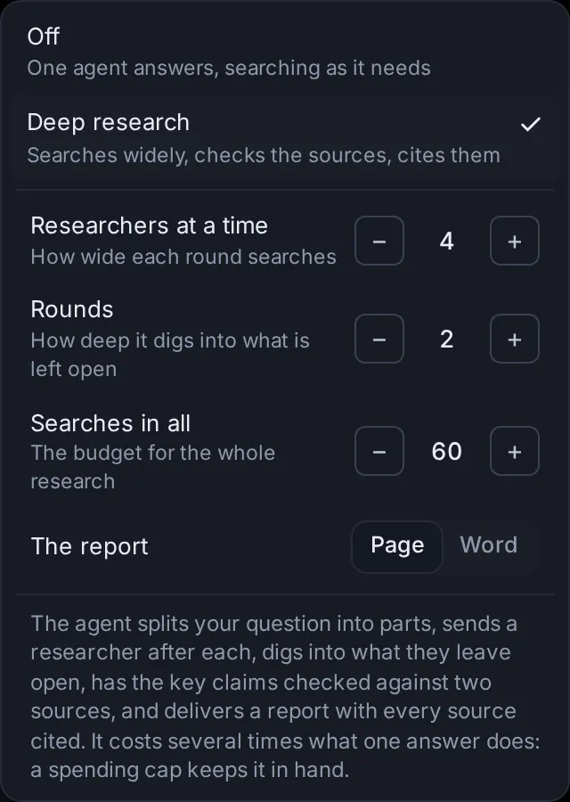

# Deep research, second opinions and several agents

When one agent working alone is not enough, the app can put several on the job: a deep research that sends researchers after every part of a question and hands back a cited report, child sessions that take parts of a task off an agent's hands, and a swarm that attacks a hard problem from several angles at once. You can also have another company's model check a turn's work, send one prompt to several models and keep the best answer, and cap what a session may spend so none of this runs away with your money.

## Run a deep research

A deep research is for questions that need many sources: comparing options, checking a claim, surveying a topic, finding what is known about something. The agent you start leads it. It plans the searches, sends researchers after each part of the question, digs into what they leave open, has the key claims checked against two sources, and delivers a report with every source cited.

### Turn it on

1. On the start page, open **Options** (the chip at the right of the row under the message box) and pick **Research**.
2. Choose **Deep research** ("Searches widely, checks the sources, cites them"). Its settings appear below it.
3. Set the numbers and the kind of report you want (see below).
4. Type your question in the message box and press **Start**.

The Research row now reads "Deep · 60 searches" (your search budget), and the Options chip names it ("Deep research"). Pick **Off** ("One agent answers, searching as it needs") to go back to a single agent.

On a phone, Options opens as a sheet from the bottom of the screen, and Research opens over it.

A deep research and a swarm both work through a team of child sessions, so you get one or the other: turning one on turns the other off.

A scheduled task can run a deep research each time it runs: its editor has the same **Research** setting ([Scheduled tasks](/guide/tasks)).

### Its settings

- **Researchers at a time** (1 to 8; 4 to start): how many researchers search at once in each round, which is how wide each round goes.
- **Rounds** (1 to 5; 2 to start): how many rounds of research, each going after what the last one left open. One round of checking comes after them.
- **Searches in all** (10 to 500, in steps of 10; 60 to start): the web searches the whole research may use, the lead's and the researchers' together.
- **The report**: **Page** or **Word**.

This browser remembers the numbers for your next deep research. The mode itself is not kept: each new session starts with Research off, because a deep research costs several times what one answer does.

### What happens, step by step

1. **Plan.** The lead works out what the question really asks and what a complete answer covers. It splits it into sub-questions and writes a few searches for each, in varied wording, in other languages where that helps, and aimed at the sources that settle it (official data, papers, primary documents, reputable reporting). If something crucial is unclear, it asks you once, briefly; otherwise it states its assumptions and goes on.
2. **First round.** It starts up to your number of researchers, one per sub-question. Each researcher is a child session with a brief of its own: the whole question, its part, the searches to start from, about how many searches are its share, and what to report. The lead then waits; each researcher's report comes back to it as a message.
3. **More rounds.** The lead reads the reports and sends new researchers after the gaps, the contradictions and the claims that rest on a single source. It skips a round when nothing important is left open. After each round it tells you in a line what was found and what comes next.
4. **Check.** It lists the claims the answer rests on. Each needs two independent sources, or is marked as resting on one, or as disputed. A researcher (or the lead itself) opens the cited pages to confirm that each key claim and number is really there; what fails is corrected or dropped.
5. **Report.** It writes the report: a clear title, the answer in a few sentences first, then sections, a numbered citation after each claim, and the sources at the end (title, site, date and link). It says what is uncertain or disputed and why, and gives you a short summary in the conversation.

Researchers search with the app's own web search and read pages with its page reader ([Search and the browser](/guide/web)). So that every search counts against the budget, Claude Code's and Codex's built-in web search is turned off in a deep research. When the budget is spent, a search is refused and the agent is told to write its report from what it has. In the same way, once the rounds you set and the checking round are done, the lead cannot start more researchers.

### Follow it in the session

A bar above the lead session's message box shows what the research is doing: **Deep research** · "Planning", then "Round 1 of 2 · 4 researchers at work", "Reading the reports" between rounds, "Checking the sources" while researchers check the key claims, "Writing the report", and at the end "Report ready" · and how much of the budget is used ("12 of 60 searches"). Once the report is there, **Open report** at the right of the bar opens it: the page in the Library, or the Word document. Point at the bar to see the research's settings and what the report will be.

Each researcher shows as a card marked "Researcher" in the lead's conversation and sits under the lead in the sidebar, like any [child session](/guide/research#follow-child-sessions). What each one reports back shows as a line, "Reply from" and its title, with the start of what it found: click the line to read it. Open a researcher to watch it work: its bar says "Researching for" and the lead's title, with **Lead** to go back.

### The report

- **Page**: the report is saved as a page you keep. It shows in the conversation and stays in your Library ([Library: pages, images, videos and sites](/guide/library)).
- **Word**: the report is a Word document (.docx) in the session's folder, made with the app's **word-documents** skill, and shows as a file card you can open or download ([Documents, images, videos and voice](/guide/documents-voice#open-or-download-the-files-an-agent-made)).

A deep research runs many agents at once. Set a spending cap in the same Options menu before you start: it covers the lead and all its researchers ([Put a spending cap on a session](/guide/research#put-a-spending-cap-on-a-session)).

## Let an agent hand work to child sessions

Any agent can hand a self-contained part of its job to a new session, a child session, which works on it at the same time and reports back. There is nothing to switch on: ask in plain words ("have three child sessions each research one supplier", "let Codex write the tests while you do the docs"), or let the agent decide when a job splits well.

For each child, the agent picks:

- **The agent and model**: Custom with any of its models (from [Settings → Models](/settings?s=models)), Claude Code, Codex, or another agent you added (Gemini CLI, OpenCode…). By default a child runs the same agent as the session that started it. A cheaper or local model suits bulk work; Claude Code or Codex suits a hard part.
- **The folder**: the parent's, unless it names another.
- **A worktree** if it wants one: a separate copy of the folder's git repository on a new branch, so the child's changes do not mix with anyone else's.
- **A short title**, which is the name you see.

The child sees nothing of the parent's conversation, so the agent writes it a brief with everything it needs. Nobody watches a child as it works: it decides small questions itself, says what it decided, and stops to ask only when it cannot go on.

### How replies come back

When a child's turn ends, its reply goes back to the parent as a message, which wakes the parent. If the parent is busy, the message waits in its queue until its turn ends.

In the parent's conversation, the reply shows as one line: "Reply from", the child's title and the start of what it wrote. Click the line to read the reply (its summary, when it was long), then **Open its session** or **Read the whole reply** to go to the child. A child stopped before it finished shows as "… was stopped", and one that failed as "… stopped with an error".

- A reply longer than about 4,000 characters arrives as a short summary written by the helper model ([Agents, accounts and models](/guide/agents-models)); the parent can still read it whole.
- If a child stops with an error, or is stopped before it finishes, the parent is told that too.
- The parent can check on its children at any time (what each is doing, its agent and model, what it has spent, the start of its latest reply) and send one of them more to do.
- Replies from turns that ended while the app was stopped are passed on when it starts again.

You can open a child and talk to it like any other session. Whatever it replies at the end of a turn goes back to the parent as well.

### Follow child sessions

- **In the parent's conversation**: a card for each child, under the turn that started it. It shows the child's title, "Child session" ("Researcher" in a deep research), its agent and model, what it is doing now ("Not running" or "Stopped with an error" when it has stopped), when it was last active and what it has spent. Click it (**Open**) to go to the child. While the child works, the square button beside it stops the child's turn.
- **In the sidebar**: children sit under their parent, folded into one line such as "3 child sessions · 1 needs you · 2 working". Click the line to unfold them; it stays open while you are in one of them. On a phone, where the sidebar is a drawer, tapping the line unfolds it without closing the drawer.
- **In the child**: a bar above the message box says "Child of" and the parent's title ("its replies go back there"), with **Open parent**.

A child that needs your approval or an answer waits for you like any session, and shows in the Inbox ([Inbox and notifications](/guide/inbox)).

### What child sessions can and cannot do

- **One level.** A child cannot start children of its own: it does the part itself and says what else is needed.
- **Never freer permissions.** A child never gets freer permissions than the session that started it. When it runs another of Claude Code, Codex and Custom, it gets the freest of that agent's permissions that is no freer than the parent's; other agents (Gemini CLI and the like) start with their own default.
- **A share of the cap.** If the parent has a spending cap, each new child gets a share of what is left of it, and the parent's cap covers them all ([Caps for child sessions](/guide/research#caps-for-child-sessions)).
- **The same account.** A child that runs the same agent as its parent (Claude Code or Codex) uses the parent's account.
- **A few at a time.** Only so many of one session's children work at once; the agent waits for one to finish before it starts another.

### Set how many work at once

In [Settings → Capabilities → Child sessions](/settings?s=children), set **Working at once, per session** with − and + ([go there](/settings?s=children&find=Working%20at%20once%2C%20per%20session)): from 1 to 12, 4 to start. It counts each session's children separately, not the whole app's. A deep research uses its own **Researchers at a time** instead, and a swarm its **Swarm size**.

## Set a swarm on a hard problem

A swarm puts a team of agents on one problem. A lead agent splits it into genuinely different angles of attack (different methods, assumptions or ways of looking at it) and starts a member for each. Members post what they try and find to a shared board, read each other's posts and message each other; the lead steers, starts more members as some finish, and has the answer checked before it gives it to you.

It is meant for hard problems with many possible routes: a proof, a stubborn bug, a question nobody has a clear way into. It costs several times what one agent does.

### Start a swarm

1. On the start page, open **Options** and pick **Swarm**.
2. Choose **Swarm** ("Up to 5 agents at once, each from its own angle"; the number is your swarm size).
3. Type the task and press **Start**.

The Swarm row reads "On · 5 at once", and the Options chip names it. **Swarm size** at the bottom of that menu takes you to its setting. As with a deep research, the mode is not kept for your next session, and only one of the two can be on. A spending cap set in the same Options menu covers the lead and every member. A scheduled task's editor has the same **Swarm** setting, for a swarm on each run.

### How a swarm works

1. The lead works out what the task asks and what a checked answer looks like, and chooses up to your swarm size of different angles (for a proof: a direct argument, contradiction, induction, small cases and a computer search, known results).
2. It starts one member per angle. Each member is a child session with a brief: the whole problem, its angle, what counts as done and how to check it, titled by its angle. Members run the lead's own model and effort unless the lead picks others.
3. Members post to the board as they go: **Progress** (what they tried and where they are), **Finding** (a result the others can use now), **Question** (something they need answered) and **Note**. They read the board every few steps, build on each other's findings, skip what someone has ruled out, and answer questions put to them.
4. The lead hears of the board in batches: a finding, a question or a message for the lead reaches it within about a minute; progress alone, every few minutes. It passes useful findings on, turns a member that is stuck or repeating another to a new angle, asks one member to check another's result, and starts members for ideas nobody has tried as others finish.
5. Before it concludes, the lead has the answer checked independently: by another member, by a computation, or by its own careful check.
6. When the problem is solved or the angles are used up, it stops the members still working and gives you the answer: the result, how it was found and checked, and which angles failed and why.

A member that finishes its angle sends its report to the lead. A message for a member that is not working wakes it up.

### Follow it: the bar and the board

The lead's session has a bar above the message box: **Swarm** · "choosing its angles" at first, then something like "3 working · 2 done · 14 posts", and **Board**. Each member's session has a bar too: "In the swarm of" and the lead's title ("its posts and report go there"), with **Board** and **Lead**. In the sidebar the members sit under the lead, folded into a line like "5 swarm members · 3 working".

**Board** opens the swarm board (from the bottom of the screen on a phone):

- **Members**: how many are working and how many may work at once, then each member with what it is doing now, or "Finished its turn", "Stopped" or "Stopped with an error". Click a member to open its session; **Open the lead** goes to the lead. Before the lead has chosen its angles, the list says none have started yet.
- **Posts**: everything posted, newest first. Each post shows who wrote it (Lead, or the member's title), who it was for when it went to one member or to the lead, its kind (Progress, Finding, Question, Note) and how long ago. Switch between **All**, **Findings** and **Questions**. New posts appear as they come.

### Stop members

**Stop all** on the board (there while members are working) stops every member still working. Stopped members keep what they did, and new posts no longer wake them. The lead is told you stopped them, and it can still give one of them more to do. The lead stops members itself once the problem is solved.

### Set the swarm size

In [Settings → Capabilities → Child sessions](/settings?s=children), **Swarm size** ([go there](/settings?s=children&find=Swarm%20size)) sets how many members of one swarm work at once: from 1 to 16, 5 to start. Each member costs about what one agent does; the lead starts more as some finish.

## Get a second opinion on a turn

A second opinion has another company's model check what an agent did in one turn against what you asked: the files it changed, the commands it ran and its reply. The reviewer looks for what is missing (asked for but not done, or claimed but not done), wrong (bugs, wrong facts or numbers, a misread request), risky (changes that could break something, lose data or leak secrets) and extra (changes nobody asked for that get in the way). It treats the agent's reply as claims to check, not as evidence.

### Ask for one

1. Open the session's menu (⋯) and choose **Second opinion**.
2. Under **Who checks it**, pick the reviewer. The suggested one comes first.
3. Under **Which turn**, pick the turn to check. The latest finished turn is picked for you; up to 12 recent ones are listed, each with when it was and how many files it changed.
4. Press **Ask** (the button names the reviewer: **Ask Codex**, for example).

A card shows under that turn at once and fills in when the reviewer answers, usually within a minute or two. A turn that is still running cannot be checked until it ends. On a phone, the dialog opens from the bottom of the screen.

### Who can check the work

Only a model from a different company than the one whose model did the work, so nobody checks their own:

- A **Claude Code** session, or any session running an Anthropic model, can be checked by **Codex** (through the Codex program) or by one of Custom's models that is not Anthropic's.
- A **Codex** session, or any session running an OpenAI model, can be checked by **Claude** (Sonnet, through Claude Code) or by one of Custom's models that is not OpenAI's.
- Any other session (Custom or another agent with another maker's model) can be checked by Claude, Codex, or one of Custom's models from a different maker than the session's model.

Custom's models are the ones you added in [Settings → Models](/settings?s=models). The reviewer only reads: Claude and Codex may open files in the session's folder to check something specific, but they change nothing. Besides the turn itself, the reviewer sees your first message in the session and your message before that turn, for context. When the changes are too large to show in full, part of them is left out, and the card says so.

### What the card shows

The card's heading reads **Second opinion** and the reviewer's name, then:

- While it works: "Checking the work" and how long it has taken, with a line saying what the reviewer is reading.
- When it is done: the findings by severity ("1 critical · 2 important"), **Looks good** (with a count of minor points, if any), or **No clear verdict** when the answer could not be read as findings.
- If it failed: **No answer**, with the reason (the reviewer's program is not installed here, it gave no answer within 8 minutes, or the app restarted meanwhile) and **Try again**.

Click the heading to open or fold the card. Inside are the reviewer's summary and its findings, worst first. Each finding has:

- its severity: **Critical** (wrong, broken or unsafe as it stands), **Important** (fix it before relying on the work) or **Minor** (worth a look, fine to leave);
- a short title, and the file and line it concerns (click it to open the file there);
- what is wrong, why it matters and how to fix it.

When there are worse findings, the minor ones fold under **Show N minor** (**Hide minor ones** folds them again). The × dismisses the card.

### Send its points to the agent

- The send button beside a finding (a paper plane: **Send to agent**) puts it in the message box, ready to send or edit.
- **Send all to agent** puts all the findings shown in the message box at once.
- While the agent is working, **Queue all** (or **Queue it**) adds them to the session's queue, to go to the agent when its turn ends.

The message names the reviewer, lists each point with its severity and file, and asks the agent to check each one against its work, fix what holds up, and say which it leaves and why.

## Compare models in the arena

The model arena sends the same prompt to two or three models at once, so you can compare their answers side by side and keep the best. Each answer you keep counts toward a rating that shows which models win on your own tasks.

### Start a match

1. On the start page, pick the agent and model as usual: that is the first model in the match.
2. Open **Options** → **Arena** and choose **Compare models** ("The same prompt to more models, side by side").
3. Under "Beside the model you picked, also ask (up to 2)", tick one or two more models. The list offers a few models each of Claude Code, Codex and Custom, and the other agents you added; when it is long, a **Find a model** field narrows it.
4. Type the prompt and press **Start**.

The Arena row reads "+1 model" or "+2 models", and the Options chip names it. This browser remembers your last picks, but the arena is not kept on for your next session.

Each model works in a session of its own, with the same prompt, attachments, folder and session settings (assistant, memory, spending cap), and its agent's usual effort and permissions. In a git repository, turn on **New worktree** in the folder menu so that each model gets its own copy of the code instead of all of them changing one folder. If a model cannot start, the app says so and the match goes on without it.

### Compare the answers and keep the best

Each session in a match has a bar above the message box: **Arena** · "the same prompt went to other models", with **Compare the answers**. That opens the compare page: the prompt at the top and a column per model with its latest reply, filling in as it comes. The columns sit side by side on a wide screen and one under another on a phone.

- **Keep this one** (once that model has replied) keeps its answer. Its session wins the match, and the other sessions are archived: out of your session list, but still there to open. The columns then say **Kept** and **Archived**.
- **Open** goes to a model's session. On the kept one it reads **Go on here**, to carry on the conversation with the winner.
- **Which models win** (**Board** on a phone) opens Usage → Arena.

### See which models win

[Usage → Arena](/arena) (in the search box, Ctrl+K, it is "Model arena") shows **Which models win on your tasks**: each model with its **Rating**, how many times it was **Kept** out of the matches it played, and its **Win rate** (not shown on a phone). The rating is an Elo rating, the kind used to rank chess players, starting at 1000: in each match you decided, the answer you kept beat each of the others.

Below it, **Matches** lists your latest matches (up to 100): the prompt, the models and when, marked with the winner, or **Open** for a match you have not decided. Click one to compare its answers.

## Put a spending cap on a session

A spending cap is the most a session may spend, at API prices: what its tokens would cost through the API, whatever plan you actually pay with. When it gets there, the agent stops until you raise the cap. It is a good companion to anything that runs many agents: a deep research, a swarm, child sessions, an arena match.

### What counts

- The session's own model calls, including its agent's own helpers (Claude Code's subagents, for example).
- The child sessions it started: its cap covers them too.
- Models on this computer (through Ollama or vLLM) cost nothing.
- Tokens with no known price cannot be counted. The cap dialog says so when the session may have spent more for that reason.

See [Usage, limits and costs](/guide/usage) for what sessions cost overall.

### Set a cap when you start

On the start page, open **Options** → **Spending cap**. Type an amount in dollars and press **Set** (or Enter), or pick $1.00, $5.00, $10.00 or $25.00. **No cap** removes it. The Options chip then names the cap ("$5.00 cap").

Unlike a deep research, a swarm or the arena, the cap you pick stays: your next sessions start with it, on any device, until you change it.

### Set or change the cap of a session

Open the session's menu (⋯) → **Session settings** → **Spending cap** (the current cap shows beside it). The dialog shows **Spent so far**, split between this session and its child sessions when it has any, and, for a child session, how much of its parent's cap is spent. Type an amount in **Cap** or pick $1.00, $5.00, $10.00 or $25.00, then press **Set the cap** (or **Change**). **Remove the cap** takes it off.

A cap can be from $0.01 to $100,000. If it is not more than the session has already spent, the dialog warns that the session stays stopped. On a phone, the dialog opens from the bottom of the screen.

### The bar above the message box

While a session has a cap, a bar above its message box shows what it has spent of it ("$1.20 of $5.00") with a line that fills up: amber from 80%, red at the cap, where it says **Cap reached**. When child sessions have spent some of it, it adds "with children" (on a wider screen); point at the amounts to see the split. **Change** (or **Raise**, once it is reached) opens the cap dialog.

### What happens at the cap

The cap is checked after each model call, so a turn stops right after the call that reaches it (the total can end a little above the cap):

- The agent stops, and a note under the turn says "Stopped at the spending cap" with what was spent of the cap, and **Raise the cap…**. A notice names the session that stopped.
- Its child sessions that are running stop too. Their note says that the session that started them reached its spending cap, with **Open it** to go there.
- New messages wait. A message you send is not sent: a notice says the cap is reached, and your text stays in the message box. Messages in the queue are held ("The queue is on hold") until you raise or remove the cap.

### Raise or remove the cap

Click **Raise** on the bar or **Raise the cap…** on the note (or use the session's menu), then set a cap above what the session has spent, or remove it. Messages held in its queue then go out. A child stopped by its parent's cap takes messages again once the parent's cap is raised.

### Caps for child sessions

Each new child session gets a cap of its own: an equal share of what is left of the parent's cap, kept for the parent and as many children as may work at once. The parent's cap still covers them all, so when it is reached, all of them stop. When nothing is left of it, the agent cannot start more children and is told to finish with what it has.

### Caps on scheduled tasks and apps

- **Scheduled tasks**: a task's editor ([Settings → Scheduled tasks](/settings?s=tasks), **New task**, or a task's menu → **Edit**) has the start page's **Spending cap** in its row of settings, and **Stops past $** under **Each run** sets the same cap; leave it empty for no cap. Each run's session stops at it. It applies to runs that start a new session; a run that posts into an existing session works within that session's own cap. A task an agent sets up for you from a conversation starts each run with that conversation's settings, its cap included. See [Scheduled tasks](/guide/tasks).
- **Apps**: an app's **Limits** have **Most one run may spend (US$)**. See [Apps](/guide/apps).

## Ask an agent

- "Start a deep research on heat pumps for a 1930s house, with 6 researchers at a time, a Word report and a $10 cap."
- "How far along is the deep research in my 'EV chargers compared' session?"
- "Put a $5 spending cap on this session, and tell me what it has spent so far."
- "Let up to 6 child sessions work at once per session, and make swarms 8 agents."
- "Get a second opinion on the last turn of my 'Billing refactor' session, and tell me what it found."
- "Which models win in my arena? In the latest match, keep the Claude Code answer."
