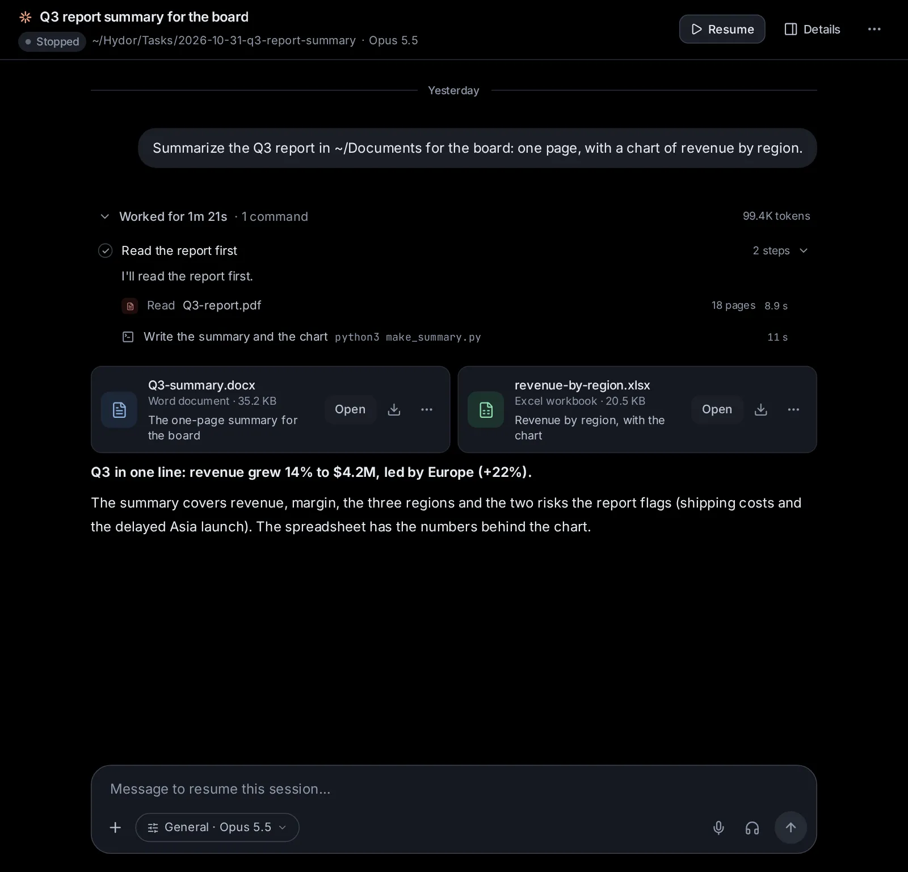

# Documents, images, videos and voice

Agents in Hydor read PDFs, Word, Excel, PowerPoint and other documents, make new ones for you, and hand them over as cards you open or download; they can also make pictures, drawings, plots and short videos, find free photos, change your pictures and videos (crop, cut out, erase, trim), and make songs, voice-overs and sounds, with image, video and audio models and tools on this computer, and you can keep what they make in your Library. And you can speak instead of typing, have replies read aloud, or talk to the app hands-free while you walk.

## Give an agent a document to read

Every agent the app runs can read documents: Claude Code, Codex, Custom, and the agents that speak ACP and take MCP servers. You don't need to convert anything first. Give it the document in one of these ways:

1. **Attach it to your message**: the paperclip (**Attach files**) in the message box, or drag the file onto the box, or paste it. Pictures go to the model as pictures; any other file is saved on the computer that runs Hydor, and its path is added to your message so the agent can open it. One message carries up to 25 MB of files.
2. **Name a file on this computer**: "Summarize ~/Documents/lease.pdf". A path that doesn't start with `/` or `~` starts in the session's folder.
3. **Keep documents in a project or in the shared knowledge**, so that sessions can search them and cite the page: see [Projects and knowledge](/guide/projects).

While the agent reads, its work shows **Reading lease.pdf**, then **Read lease.pdf**. On a wider screen the line also says what the document is (the kind, its pages, sheets or slides) and which lines were read. Click the line to see the text the agent got, and **Open lease.pdf** to see the file itself.

A long document is read in parts, about 1,200 lines at a time, and the agent is told when there is more. Agents are told to treat what a document says as information, not as instructions. Nothing in a document runs: macros never run, and only web and mail links are kept.

Custom also reads PDFs, Office documents and pictures with its ordinary file reading: see [Custom, the app's own agent](/guide/custom).

## What agents can read in a document

### PDF

- The text of each page, laid out as on the page.
- This works best with the pdftotext program (in poppler-utils). Without it, the app fetches pdf.js once (about 35 MB, which needs the internet that first time), and the layout is only approximate.
- Scanned pages have no text, and the agent is told which ones ("Pages 3, 5–7 have no text"). With the **pdf** skill it then looks at those pages as images and reads them itself, or runs OCR on them when tesseract is installed.
- A PDF locked with a password can't be read. Give the agent the password, and the **pdf** skill makes an unlocked copy. One that opens without a password but limits changes (many official forms) is read as any other.
- **Forms**: the agent lists a PDF's form fields, each with the words printed beside it (which say what a field named "f1_02" is for), and looks at its pages as pictures with the fields numbered and a ruler in points.
- **Your highlights and notes**: what you highlighted in Files' reader, page by page, with your notes and pictures of the figures and equations you picked ([Read and highlight a PDF](/guide/files-git#read-and-highlight-a-pdf)), to sum them up or check them against the paper. Asked to, it highlights words for you too, which then show in the reader.

### Word, Excel and PowerPoint

- **Word** (.docx, and its macro and template kinds): headings, paragraphs, numbered and bulleted lists, tables, links, text boxes, pictures by their description, footnotes, endnotes and comments.
- **Excel** (.xlsx, and its macro and template kinds): every sheet as a table with its row numbers and column letters, numbers roughly as formatted (dates, percentages, money), and up to 40 of each sheet's formulas. Hidden sheets are marked. Each sheet gives its first 2,000 rows and 60 columns, and the agent is told when there are more; for the whole of a bigger sheet, the **spreadsheets** skill loads it another way.
- **PowerPoint** (.pptx, and its macro, template and slide-show kinds): each slide's title, text, tables, pictures (by their description), charts (their title and series) and speaker notes. Hidden slides are marked. Up to 1,000 slides.

### OpenDocument, EPUB, CSV and RTF

- **OpenDocument** (LibreOffice's own .odt, .ods and .odp, their templates, and .odg): text with headings, lists, tables, links and footnotes; sheets as they display; slides with their titles, text and notes.
- **EPUB** books: the chapters in reading order, with headings, lists, tables and quotes.
- **CSV** and **TSV** tables, and **RTF** text.

### Old Office files, locked files and very large ones

- Old .doc, .xls and .ppt files are read through LibreOffice, which turns them into the current kind first. Without LibreOffice they can't be read, and the agent is told to ask you for the file saved as .docx, .xlsx or .pptx, or to have LibreOffice installed.
- Word, Excel and PowerPoint files locked with a password can't be read.
- Files up to 300 MB are read. A document gives up to about 1,000,000 characters of text (about 250,000 tokens); past that it is cut, and the agent is told.

## Have an agent make a document

The app comes with four document skills that every agent can load: **word-documents**, **spreadsheets**, **presentations** and **pdf**. You find them in [Settings → Skills](/settings?s=skills&find=Built%20in), under **Documents** (see [Skills](/guide/skills)). You don't pick them: ask in plain words ("Make a one-page CV from my notes as a Word document", "Put these expenses in a spreadsheet with monthly totals and a chart", "Make 8 slides for my talk on bees", "Merge these three PDFs"), and the agent loads the right skill when the task calls for it.

Each skill works the same way:

1. The agent plans the document first: its outline, sheets or slides.
2. It writes the file with a short script in the session's folder.
3. It looks at the result as page images, checks for text running off the page, tables that don't fit and crowded slides, and fixes what's off.
4. It hands the file over as a card under its reply, with a short caption (see [Open or download the files an agent made](/guide/documents-voice#open-or-download-the-files-an-agent-made)).

When it changes a file of yours, it saves the result under a new name, unless you asked it to overwrite yours.

### Word documents

Reports, letters, CVs, memos, contracts, forms, handouts and notes, to open in Word, Google Docs or Pages.

- Real structure: headings (which work in Word's navigation pane and with screen readers), bulleted and numbered lists, tables with a header row, pictures and page breaks.
- A table of contents (Word fills it in when the file opens), page numbers ("Page 1 of 3"), links and shaded table cells.
- A4 or US Letter, and fonts that look the same on any computer (Calibri, Arial, Cambria, Times New Roman).
- Your own documents changed in place, keeping their styles, headers and layout; text replaced without losing its formatting; comments added.
- Signed with your saved signature: in place of {{signature}}, right after words such as "Signature:", in a table's cell or at the end, once you allow it on a card ([Signatures](/guide/library#signatures)).
- A PDF of it too, through LibreOffice.

### Spreadsheets

Budgets, trackers, schedules, invoices and data tables (.xlsx).

- Your numbers as values and the results as formulas, so you can change a number and see the rest follow.
- Number formats for money, percentages and dates; a bold header row that stays in view; column widths; filters on lists.
- Bar, line and pie charts beside the data.
- A check of every formula. With LibreOffice installed, the check works the formulas out and lists any errors (#REF!, #DIV/0!, #NAME?), which the agent then fixes.
- Your own workbooks changed, keeping their formulas, styles and most of their layout (pivot tables are not kept, and charts only when the agent builds them again). A CSV file instead, when you ask for one.

### Presentations

Pitch decks, talks, lessons and summaries (.pptx), to show in PowerPoint, Keynote or Google Slides.

- Clean 16:9 slides with one look throughout and your brand colour: a title slide, bullets with levels, two columns, pictures fitted to the slide, tables, charts (column, bar, line, pie, stacked), section slides, and speaker notes for what you say.
- One idea per slide, with titles that say the point ("Sales grew 12%"), usually 6 to 12 slides for a talk.
- Pictures from you, from the web, or made with an image model (see [Let agents make images](/guide/documents-voice#let-agents-make-images)).
- A new deck on your own template, or your deck changed, keeping its theme and layouts.
- A PDF of the slides, through LibreOffice.

### PDFs

Reports, invoices, certificates, flyers, letters and forms.

- Mostly text, or something you'll want to edit: the agent makes a Word document, then a PDF from it with LibreOffice.
- Laid out exactly (invoices, certificates, tickets, forms): it draws the PDF directly.
- Slides or a sheet as a PDF: made with their skill, then turned into a PDF.
- **Fill in a form**: its fields by name (text, ticks, choices, in Greek, Chinese or any script), so any viewer shows them and they can still be changed there; or, for a form that is only printed lines and boxes, the words written on the page beside the words printed ("Date of birth:") and ticks in its boxes; on a scanned one, which has no words to find, where the agent sees the blanks in a picture of the page. The agent asks you for what it doesn't know, and looks at the pages before and after. A digitally signed form stays valid when only its fields are filled in. XFA forms (Adobe LiveCycle) fill in only in Adobe's own apps: the agent says so, and can still write on their pages.
- **Write on pages**: words, ticks and crosses, pictures, white boxes over what is there (they hide words from the eye only: the words stay in the file, so this is no redaction), outlines and lines, and highlights and comments as the PDF's own, which other viewers list and can take away.
- **Change pages**: rotate them, delete them, move them, put in blank pages, merge PDFs, take some pages into a file of their own or split one into several. A file changed this way can't keep a digital signature, and the agent says so.
- What the agent writes goes in a copy beside the file ("name (filled).pdf"), unless you ask for the file itself to change; then its old version goes to the Trash. You can also fill in and sign a PDF yourself: [Fill in and sign a PDF](/guide/files-git#fill-in-and-sign-a-pdf).
- Big faint words such as DRAFT across every page, and a copy without its password (you give the password), with the **pdf** skill.
- Signed with your saved signature, beside words on a page or at a spot it shows you first, once you allow it on a card; added to the PDF without changing what was in it ([Signatures](/guide/library#signatures)).
- Office files turned into PDFs.

### What the computer needs

These are about the computer that runs Hydor, not the device you use it from.

- **Python 3**, with its venv module: needed to make documents. The first time, the skills install a few Python libraries for Office files and PDFs into a private folder of the app (about 30 MB, once, from the internet); nothing is installed system-wide. If Python is missing, the agent tells you the one command to run (on Debian or Ubuntu `sudo apt install python3 python3-venv`; on a Mac `brew install python`).
- **LibreOffice** (optional): previews as laid-out pages in the file viewer, reading old .doc, .xls and .ppt files, agents looking at Office documents as pages, formula checks, and PDFs from Office files. On Debian or Ubuntu: `sudo apt install libreoffice-writer-nogui libreoffice-calc-nogui libreoffice-impress-nogui`; on a Mac: `brew install --cask libreoffice`.
- **poppler-utils** (optional): the best PDF reading, and pictures of PDF pages for agents and for **Fill & sign**. Without it, the app draws them with what the computer has (a Mac's or Windows' own way of drawing PDFs), or with the browser of **Settings → Browser**. On Debian or Ubuntu: `sudo apt install poppler-utils`; on a Mac: `brew install poppler`.
- **tesseract** (optional): OCR for scanned PDFs.

Without LibreOffice or poppler-utils, agents read their files back as text to check them, and keep the layout simple.

## Open or download the files an agent made

When an agent has made files for you (a document, a spreadsheet, slides, a PDF, pictures, an archive), it hands them over as cards under its reply, up to 12 at a time. Each card has:

- an icon by type, in its colour (Word blue, Excel green, PowerPoint orange, PDF red), or a small picture for an image;
- the file's name, what it is and its size ("Word document · 24 KB");
- the agent's caption ("The budget, a sheet per quarter");
- **Open**, a download button, and **More** (⋯).

**Open** shows the file in the file viewer, in a window over the conversation, which stays where it was (on a phone the window comes up from the bottom of the screen). **Open in Files** at its top takes the file to the Files page; the cross, or Escape, closes the window. The download button saves the file on your device.

**More** (⋯), on a card and at the top of the window, has **Start a session with it** (the start page, with the file in its message box), **Add to a project** (copies it into a project's folder), **Save to Library** (a Jupyter notebook, a PowerPoint deck, a Word or Markdown document, a spreadsheet or a LaTeX file: a copy kept in your Library, in its editor there, in the project you pick when you have projects, the session's first), **Show in Files** (on a card) and **Copy path**. See [Start a session with files](/guide/files-git#start-a-session-with-files) and [Add files to a project](/guide/files-git#add-files-to-a-project).

A file deleted or moved since shows as **No longer there**. If an agent names a file that doesn't exist, you see "Could not show the files" with the reason, and the agent is told to fix it.

## Preview a document in the file viewer

The file viewer shows documents from a card, from the Files page, or from a link in a reply (see [System: files, Git, Terminal and Preview](/guide/files-git)).

- **PDFs** show as they are, in the browser's own PDF view, with **Fill & sign** to fill them in and sign them ([Fill in and sign a PDF](/guide/files-git#fill-in-and-sign-a-pdf)).
- **Word, Excel, PowerPoint, OpenDocument, EPUB and RTF** files (old .doc, .xls and .ppt too) show as a preview. When LibreOffice is installed, a switch at the top offers two views:
  - **Pages**: "As LibreOffice lays it out", each page as it would print. The first time takes a moment ("Laying out the pages…"); after that the pages open at once until the file changes.
  - **Text**: "Its text, sheets and slides", as the app reads them. A text document shows as a page of paper; a workbook as a grid with column letters, row numbers and a tab for each sheet at the bottom (hidden sheets marked with a crossed-out eye); slides as cards, each with its number and its speaker notes under it. Pictures show as a box with their description. A line at the top says when something was left out ("Shows the first 1000 rows").
- Without LibreOffice there is only the **Text** view. EPUB books always open in it.
- On a phone the preview opens on **Text**, which scrolls and zooms better on a small screen; the switch shows the pages.

If LibreOffice can't lay a file out, the viewer says so and its text is still under **Text**. A file with no preview says "No preview for this file": download it to open it on your device. The viewer's download button is always there.

## Let agents make images

Ask any agent for a picture ("make a logo for my bakery", "turn this photo into a watercolour") and it makes it with an image model through OpenRouter, saves it in the session's folder and shows it with its reply. Set it up in **[Settings → Capabilities → Images, video and audio](/settings?s=images)** (on a phone: Settings, then **Images, video and audio**).

- **[Making images](/settings?s=images&find=Making%20images)**: the switch **Let agents make images** gives every agent its tools for pictures: making pictures, drawings and plots, and taking a background out of a picture or erasing part of it. It is on unless you turn it off; off, agents are not offered them.
- **The OpenRouter key**: image, video and audio models are reached through OpenRouter, and each image, video or sound is paid for with your OpenRouter key. Without one, this section says so, with **Get one at openrouter.ai** and **Add the key**, which opens [Settings → Agents → Models → OpenRouter](/settings?s=models&find=OpenRouter) where the key goes (see [Agents, accounts and models](/guide/agents-models)). An agent that needs it asks you for it on a card instead ([When an agent needs the OpenRouter key](#when-an-agent-needs-the-openrouter-key)).
- **[For most pictures (Best)](/settings?s=images&find=For%20most%20pictures%20%28Best%29)**: the model that makes scenes, photos, people, words inside a picture and diagrams, and every change to a picture. It shows with its maker, about what one image costs (for a picture of about a megapixel), the month OpenRouter listed it and its id, with tags: **New** (listed in the last 30 days), **Edits** (it takes pictures to change or follow) and **Text too** (it writes text with its images). Until you pick one, it is the app's choice ("The app’s choice, until you pick one"): the first of a short list that OpenRouter still offers: ByteDance's Seedream 5.0 Pro and Flash, then Google Gemini, OpenAI and FLUX image models.
- **[For simple pictures (Quick)](/settings?s=images&find=For%20simple%20pictures%20%28Quick%29)**: a cheaper, quicker model for icons, backgrounds, textures and simple pictures, shown the same way. Until you pick one, it is the app's choice: the first of a short list of quick models OpenRouter still offers, ByteDance's Seedream 5.0 Flash first, then quick ones from Google, Recraft, FLUX and OpenAI (when OpenRouter offers none of them, the Best model makes simple pictures too).
- **[Picture tools on this computer](/settings?s=images&find=Picture%20tools%20on%20this%20computer)**: taking a picture's background out and erasing part of it on this computer instead of through OpenRouter: free, and your pictures stay here. **Set up** downloads them once, the line under it says what they are doing, and **Remove** takes them off this computer again (see [The picture tools on this computer](/guide/library#the-picture-tools-on-this-computer)).

To pick the Best or the Quick model:

1. Click **Change** beside it: a list of OpenRouter's image models opens (**Image model for most pictures (Best)** or **Image model for simple pictures (Quick)**).
2. Search it by name ("seedream", "flux", "gemini"), and sort it **Suggested** (the app’s suggestions first), **Newest** or **Cheapest**.
3. Click a row to use that model. **Let the app choose instead** goes back to the app's choice.

The lists come from OpenRouter and need no key; when they can't be reached, the list says so.

## Let agents make videos

Agents can make short videos too ("ten seconds of waves at dusk", "make this photo of my dog run through a field"), with a video model through OpenRouter, in the same section, **[Settings → Capabilities → Images, video and audio](/settings?s=images)**:

- **[Making videos](/settings?s=images&find=Making%20videos)**: the switch **Let agents make videos** gives every agent the tool for it. It is on unless you turn it off.
- **[Video model](/settings?s=images&find=Video%20model)**: the model that makes them, shown with its maker, what a second of video costs (from its lowest resolution without sound to its highest with sound, as "$0.03 to $0.08 a second"), the lengths it makes ("4 to 8 s"), its highest resolution ("up to 1080p") and the month OpenRouter listed it, with tags: **Sound** (it makes sound with the picture), **From a picture** (it can start from a picture you give) and **Edits videos** (it changes a video you give it instead of making one from words). Until you pick one, it is the app's choice: the first of a short list of models with sound that OpenRouter still offers: ByteDance's Seedance 2.5, then cheaper, quicker ones such as Google Veo 3.1 Lite. **Change** opens the list to search ("seedance", "veo", "kling") and sort **Suggested**, **Newest** or **Cheapest**.

Videos cost far more than pictures: from a few cents to dollars a second, and a video of 8 seconds with sound from a top model can cost several dollars. Each one is paid for with your OpenRouter key, and you see its price on a form before anything is made.

## Let agents make audio

Agents can make sound too: songs and jingles ("a 30-second jingle for my podcast"), voice-overs and narration in a voice you describe ("read this welcome in a warm, slow voice") or in a voice copied from a recording you have, and sound effects and ambience ("rain on a tin roof"). Set it up in the same section, **[Settings → Capabilities → Images, video and audio](/settings?s=images)**:

- **[Making audio](/settings?s=images&find=Making%20audio)**: the switch **Let agents make audio** gives every agent the tool for it. It is on unless you turn it off.
- **[Music model](/settings?s=images&find=Music%20model)**: the model that makes songs and music, shown with its maker, its price ("$0.08 a song"), the longest it makes ("up to 3:00") and the month OpenRouter listed it, with the tag **Music**. Until you pick one, it is the app's choice: Google's Lyria 3 Pro, which makes whole songs of up to about 3 minutes, with singing or without; else Lyria 3 Clip, which makes 30-second clips.
- **[Voice and sound model](/settings?s=images&find=Voice%20and%20sound%20model)**: the model that speaks and makes other sounds, shown with its price ("$0.0025 a second", "$0.08 per 1,000 characters", "about $0.014 a minute"), the longest it makes and how many voices it has, with tags: **Sounds too** (it makes sound effects and ambience as well as voices, from a description), **Copies voices** (it speaks in a voice copied from short recordings you give it), **Conversations** (it voices several speakers, each in their own voice) and **Directed** (it takes directions for the delivery: tone, pace, emotion). Until you pick one, it is the app's choice: ByteDance's Seed Audio 1.0, which does all of these from a description, up to 2 minutes at a time; else Google's Gemini 3.8 Flash TTS, else ElevenLabs v3.

**Change** opens each model's list, to search ("lyria"; "seed", "elevenlabs", "gemini") and sort **Suggested**, **Newest** or **Cheapest** (voices by about what a minute of speech costs); **Let the app choose instead** goes back to the app's choice. When the voice model you picked only reads words aloud, a sound effect or a copied voice is made with the app's choice that can, and the form says so.

Voice models are mostly sold by the character read, Seed Audio by the second of sound it makes, Lyria by the song. Each is paid for with your OpenRouter key, and you see its price on a form before anything is made.

## Check the settings before anything is made

Before an agent makes a picture, a detailed drawing, a video or a sound, a short form shows in the conversation with the settings that model takes and what the result costs, filled in with what you asked for and the app's defaults:

- for a picture: **Shape** (square, wide, tall…, as many as the model takes), **Resolution** (1K, 2K, 4K…), **Quality**, **How many pictures** (for models that make several at once) and **Transparent background** (for a logo or an icon);
- for a detailed drawing (by Recraft's vector model): its **Shape**;
- for a video: **Video length** (the lengths the model makes, or **Length, in seconds**), **Shape**, **Resolution** and **Sound**;
- for a sound: for a song, **Instrumental, no singing** and, with a model that makes long songs, **Length, in seconds** (leave it empty for the song to take as long as it needs); for a sound effect, its **Length, in seconds** (Seed Audio is paid by the second); for speech, the **Voice** (for a model with voices of its own); and the **File** (**MP3, smaller** or **WAV, uncompressed**), where the model makes both.

Above the fields are the model's name, its price ("about $0.08 an image", "$0.03 to $0.08 a second, by resolution and sound", "$0.08 a song", "$0.0025 a second of sound"; for a video or a sound, what it comes to with the settings shown) and what the agent will ask for, whole and in its own words. Change what you like and click **Make it**; **Not now** closes the form, and nothing is made or spent. The form shows only the settings the model offers.

The form comes once per model in a session: later pictures, videos and sounds in that session use the settings you picked (for a sound, its voice and its file), unless you ask for others ("now a tall one"). Say "show me the settings again" for the form, or "go ahead, choose for me" for the agent to make it without one. Scheduled tasks and apps' runs make theirs without a form, with the app's defaults, since nobody is there to answer.

## When an agent needs the OpenRouter key

Pictures, detailed drawings, videos, music and voices are made by models through OpenRouter, paid for with your OpenRouter key. When an agent goes to make one and no key is set, a card comes first in the conversation, **This needs an OpenRouter key**, saying which model would make it, about what it costs, and that you pay OpenRouter for what is made, with a field for the key:

- Paste it and click **Save the key** (or press Enter). OpenRouter checks it first; it goes straight to [Settings → Agents → Models → OpenRouter](/settings?s=models&find=OpenRouter), never into the conversation, and the agent goes on (to the form with the settings, as always). The card then says "Your OpenRouter key is saved in Settings → Models."
- **Get a key** opens OpenRouter's page where you make one.
- **Skip**: that model does not run, nothing is made or spent, and the agent goes on without it, another way where one needs no key (a simple drawing it writes, the [picture tools on this computer](/guide/library#the-picture-tools-on-this-computer)), or none. The session doesn't ask again for six hours.

The card waits up to nine minutes; then the agent goes on without the key, and hears of it if you add it later. Scheduled tasks and apps' runs get no card, since nobody is there to answer: they say the key is missing ("Images need an OpenRouter key", with **Add an OpenRouter key**). The editors' own AI tools ask for the key in their dialog instead ([Make pictures, drawings, plots and videos with AI](/guide/library#make-pictures-drawings-plots-and-videos-with-ai)).

## Ask for a picture, or have one changed

Describe what you want: the subject, the setting, the style (a photo, an illustration, a watercolour), the colours, the light, and any words that should appear in it. The agent can also:

- **change or combine your pictures**: picture files on this computer (PNG, JPEG, WebP or GIF, up to 20 MB each; most models take up to 4, some more), in the session's folder or by their path, or the pictures already in a deck, a document or a page of your Library; say what to change. (A picture attached to a message goes to the model to look at; for the image model to work from it, it needs to be a file: upload it on the Files page.) This needs a model with the **Edits** tag; with another, the agent is told to describe the change in words or to have you pick a model that edits pictures;
- **use the Quick or the Best model**: the agent takes the Quick one for simple pictures (a background, a texture, an icon) and the Best one for scenes, photos, words in a picture, diagrams and every change, or decides from what you ask; say so to have the other ("a quick one is fine", "use the Best model");
- **make the background see-through** (a logo, an icon): a model that cannot make one hands it to one that can, or, with the [picture tools](/guide/library#the-picture-tools-on-this-computer) set up, the picture is made on a plain background and its background taken out on this computer;
- **use another model** for one picture, when you name it ("make it with FLUX 2 Pro"), without changing Settings.

Pictures are saved in an **images** folder inside the session's folder, named after what they show, and never over a file that is already there.

In the conversation:

- While the model works, a placeholder in the shape asked for says "Making an image" with the time so far, and the description under it.
- Then the pictures show with the reply, with the description and the model's name under them, and **Save to Library** (see [Keep what an agent made](#keep-what-an-agent-made)). Click one to see it large: click again for full size, the arrows (or arrow keys) step through several, **Open in a new tab** opens it alone, **Edit** opens it in the picture editor (what you save there goes into your Library as a new picture: [Edit pictures and videos](/guide/library#edit-pictures-and-videos)), and Escape closes. Over each picture, **Show in the files**, **Download** and **More** (⋯: **Start a session with it**, **Add to a project**, **Copy path**) appear when you point at it (on a phone they are always there); with several pictures, **Save to Library** is there too.
- With no OpenRouter key set, a card asks you for one first ([When an agent needs the OpenRouter key](#when-an-agent-needs-the-openrouter-key)); in a run nobody watches (a scheduled task's, an app's) you see "Images need an OpenRouter key" instead, with **Add an OpenRouter key**. When nothing is made (you skipped the key or closed the form, or the model refused), you see "No image this time" with the reason.

## Ask for a drawing or a plot

Some pictures are better drawn from shapes or worked out from numbers than painted by an image model:

- **A drawing** (an SVG: shapes rather than pixels, sharp at any size): an icon, a logo, a diagram, a pattern that repeats, a shape or a flat illustration, in the colours you give (a deck's or a document's own, say). A simple one is written by Claude (or the [helper model](/settings?s=models&find=Helper%20model) you picked), with no image model to pay, in under a minute; a detailed one (an illustration, or when you ask for the best) is drawn by Recraft's vector model through OpenRouter, about $0.08 a drawing, after the form with its price. Scripts, links and anything a drawing would load from elsewhere are taken out of every drawing before it is kept.
- **A plot** of your data or of maths, for what a slide's chart cannot draw: scatter plots, histograms, box plots, error bars, several axes or panels, heat maps, functions, fits and notes on the points that matter. Claude (or the helper model) writes it in Python with matplotlib, it runs on this computer, and what goes wrong goes back to it to fix (up to three tries); it takes about half a minute and costs only that answer. Give the numbers in your message or as a file (CSV, TSV or JSON, up to 20 MB), and say the point it should make ("show that spring doubled"). It comes as a drawing (SVG; a PNG for very many points), 960 by 540 pixels unless you ask for another size, with its Python beside it, so "now with a log scale" changes that plot; for a web deck it can also come as a plot that moves and answers the pointer. It needs Python with matplotlib on the computer the app runs on: the picture tools' own once they are set up ([The picture tools on this computer](/guide/library#the-picture-tools-on-this-computer)), or one that is there already.

Both are saved in the **images** folder inside the session's folder and show with the reply as pictures do; while one is being made, its placeholder says "Making a drawing" or "Drawing the plot".

## Find free photos

Ask for photos rather than pictures made by a model ("find two photos of Lisbon's trams for my title slide"), and the agent searches openly licensed photos, free to use and to change, for business too: Openverse's catalogue (Flickr, Wikimedia Commons, museums and more), or Wikimedia Commons' own search when Openverse can't answer. It saves a few of the best (4 unless you say, at most 10) in the session's **images** folder with each one's credit (its title, author, licence and link) in a file beside them, looks at them before it uses one, and credits them as their licence asks: in the slide's speaker notes, or under the picture in a document or a page, and for licences other than CC0 and the public domain in a small caption by the photo ("Photo: “Title” by Author, CC BY 2.0"). It is free and takes a few seconds; while it searches, the placeholder says "Finding free photos".

## Cut out, erase and edit

Agents also change your pictures and videos without having them made again:

- **Take the background out** of a picture: its subject (a person, a product, an animal, a logo) on a see-through background, as a PNG. On this computer, once the [picture tools](/guide/library#the-picture-tools-on-this-computer) are set up, it is free and private, keeps the subject's own pixels, and takes a few seconds; a cutout that looks poor is done again by an image model. Without them, an image model through OpenRouter does it (about $0.01 to $0.04), drawing the picture again without its background, so small details may differ.
- **Erase something** from a picture (a person in the background, a sign, a watermark, a stain, a cable): it is taken away and filled in as what is around it goes on. The agent marks where it is, or describes it for an image model to find. Small areas are erased on this computer for nothing; large ones, ones reaching across the picture, and ones among detailed things such as words go to an image model (about $0.01 to $0.04).
- **Edit a picture**: crop it, turn or flip it, size it, change its light and colours (exposure, contrast, warmth and the rest), give it a filter (**Vintage**, **Black and white**…), write words on it, draw arrows and boxes, and blur or pixelate parts of it (a face, a number plate, a name). Free, on this computer; a JPEG, WebP or GIF picture, or words on one, needs ffmpeg or the picture tools there.
- **Edit a video**: trim it, cut parts out, crop it to a shape (16:9, 9:16, square, 4:5), turn or mirror it, speed it up or slow it down, change its brightness, contrast and colour, fade it in and out, take its sound out or change its volume, put words on it (titles, captions) and lay music under it; or make a GIF of it, or take a frame as a picture. Free, with ffmpeg on this computer (the picture tools bring one), while **Let agents make videos** is on.

Each works from a file in the session's folder, or from a picture or a video already in a deck, a document or a page, and saves what it makes in the session's **images** folder (an edited video in **videos**), never over the original. A picture of your Library can be edited too, and put back in its place or beside it as a new one, as the picture editor's **Save** and **Save a copy** do ("brighten the harbour photo in my Library"). It shows with the reply as a picture the agent made does, its placeholder saying "Taking the background out", "Erasing", "Editing the picture" or "Editing the video" while it works. For a cutout or an erasing, the reply says which way it was made and why: if it is not right, say "do it with AI" and the agent asks the image model. To do it yourself, open the picture or the video in the editor ([Edit pictures and videos](/guide/library#edit-pictures-and-videos)).

## Ask for a video

Describe the scene, what moves and how, the camera ("a slow push-in", "it follows the cyclist"), the style and the light, and any sound or words spoken. The agent can also:

- **start from a picture**: a picture file to be the video's first frame ("make this photo come alive"), and for some models one to end on, for models with the **From a picture** tag;
- **follow pictures**: up to 4 pictures of a character, a product or a style for the video to keep to, without being its frames;
- **change a video**: a video file (MP4, WebM or MOV, up to 40 MB) for a model with the **Edits videos** tag to edit, extend or sharpen.

A video takes from under a minute to several. The agent waits for it, about nine minutes at most; when it takes longer, the app keeps it coming and saves it when it is ready, and the agent shows it once it checks again. Nothing more is spent by waiting.

Videos are saved in a **videos** folder inside the session's folder, named after what they show.

In the conversation:

- While the model works, a placeholder in the video's shape says "Making a video" with the time so far.
- Then the video shows with the reply, ready to play (full screen too, from its controls), with the description and the model's name under it, and **Save to Library**. Over it, **Edit** (the video editor: what you save goes into your Library), **Show in the files**, **Download** and **More** (⋯) appear when you point at it.
- "Still being made" means the agent stopped waiting before the video was ready: it shows once the agent checks again (ask it to, if it does not). "No video this time" gives the reason: you closed the form, or the model refused (its words say why).

## Ask for music, a voice or a sound

Tell the agent what you want to hear:

- **Music**: the genre and mood, the instruments, the tempo, the voice that sings and how it goes ("a 2-minute upbeat synth-pop song about Monday mornings, with a woman singing and a catchy chorus"). Give your own lyrics, or let the model write them; ask for an instrumental when you want no singing. Lyria 3 Clip always makes 30 seconds; Lyria 3 Pro makes up to about 3 minutes, as long as you ask. A song takes a minute or two.
- **A voice-over**: the words to say, exactly, and how they should sound ("read this in a calm, deep voice, slowly"). With a model that has voices of its own, you pick one on the form; Seed Audio makes the voice you describe. A conversation between several speakers works too ("a short podcast intro with two hosts"), with models that voice them.
- **A voice copied from a recording**: give the agent 1 to 3 recordings of the voice, files on this computer (WAV, MP3, M4A, OGG or FLAC, up to 30 MB each; the first 30 seconds of each are used), for a model that **Copies voices** (Seed Audio). Use only a voice you may use: your own, or one whose owner agreed. With ffmpeg on the computer any of those files works; without it, WAV and MP3 only.
- **A sound effect or ambience**: what it is, what happens and when ("heavy rain on a tin roof, thunder rolling in at the end, no voices"), and how long.
- **Another model** for one sound, when you name it ("read it with ElevenLabs v3"), without changing Settings.

Sounds are saved in an **audio** folder inside the session's folder, named after what they are, as MP3 (or WAV, when you ask for it).

In the conversation:

- While the model works, a card says "Making music", "Making a voice-over" or "Making a sound", with the time so far.
- Then the sound shows with the reply, in a player: the round button plays and pauses it (one sound plays at a time), its shape is the bar to move along (click or drag it), then the time and the speed (**1×**, **1.25×**, **1.5×**, **2×** or **0.75×**). While the player has focus, Space or K plays and pauses, and ← → move 5 seconds. Its title comes from the file's name, with **Show in the files**, **Download** and **More** (⋯) beside it. Under it are the words it was made from, the model's name and **Save to Library** (see [Keep what an agent made](#keep-what-an-agent-made)); a song's **Lyrics** open under them.
- Without an OpenRouter key you see "Audio needs an OpenRouter key", with **Add an OpenRouter key**. "No sound this time" gives the reason: you closed the form, or the model refused (its words say why).

The agent cannot hear what it made: it knows the sound by what it asked for. If it does not sound right, say what to change, and it makes another.

## Pictures in what agents make

When an agent makes or changes slides, a document or a page for you, it illustrates them by itself where a picture adds something (a title slide, a section, an idea; not every slide), in their colours and look, as a designer would: a Quick picture for a background, a texture or an icon, a Best one for a scene, a photo or a diagram, a drawing for an icon, a logo or a diagram that must stay sharp, a plot for numbers, free photos of real places and things, and its pictures cut out, erased or edited to fit. It works from the pictures already in what you have open as well as from files, and, asked to, writes a description for each picture of a deck that has none, for people who can't see them (the model that describes your Library's pictures does it). What costs money is priced on the form before it is made ([Check the settings before anything is made](#check-the-settings-before-anything-is-made)); say "no pictures", or "only free photos", when you want it otherwise.

When you ask for a known kind of thing by its name (a SWOT slide, a pitch deck, a cover letter, an executive summary, a habit tracker, a pricing table, a budget), the agent first reads how the app makes that kind well: what goes in it, in what order, how it looks and where pictures help, as the gallery's kinds are made ([Made with AI from a kind](/guide/library#made-with-ai-from-a-kind)). That costs nothing.

In a [confidential session](/guide/sessions#keep-a-session-confidential) none of this is there: its agent makes, finds and edits no pictures or videos.

## Keep what an agent made

**Save to Library**, under a picture, a video or a sound an agent made, keeps a copy of it in your [Library](/guide/library#images-and-videos-in-the-library), where a model writes a title and a description for it (for a sound, from the words it was made from, since no model can hear it), and where it stays after the session's folder is cleaned up. The button then reads **In your Library** and opens it there.

## Dictate a message

The microphone in the message box (on the start page and in every session) turns what you say into text in your message. Nothing is sent by itself: you read it over and send it as usual.

1. Click or tap the microphone.
2. Speak. A panel above the message box shows the time, the words heard so far (or, when the server recognizes speech, "Recording…" with bars that follow your voice), and the language it listens for.
3. Click **Done**, or the microphone again. The words join what you have already written (with the server, "Turning your words into text…" shows for a moment first).

The language chip on the panel ("DE", "PT-BR") changes the language while you speak; it carries on in the new one. When the server recognizes speech, a recording stops by itself after 10 minutes.

The microphone shows only where dictation can work: when the browser recognizes speech itself (Chrome, Edge, Safari), or when the server does (see [Speech recognition on the server](/guide/documents-voice#speech-recognition-on-the-server)). When it can't start, it says why and what to do:

- **The microphone needs a secure connection**: browsers allow it only on an HTTPS address, or at localhost on the computer itself. Open Hydor through an HTTPS address (see [Phones, other machines and sharing](/guide/devices)).
- **The microphone is blocked for this site**: allow it in the browser's site settings (on an iPhone: **aA** in the address bar, then **Website Settings → Microphone**), then try again.
- **No microphone was found**, or **The microphone is busy** (another app uses it).
- **Speech recognition is off here**: on an iPhone, turn on Dictation in Settings → General → Keyboard; or let the server recognize speech.
- **This browser cannot record**: use a current Chrome, Edge, Firefox or Safari.

Each of these notes has a **Voice settings** button, which opens Settings → Voice.

## Set up voice

Everything about voice is in **[Settings → Capabilities → Voice](/settings?s=voice)** (on a phone: Settings, then **Voice**). It has three parts.

### Dictation

**[Dictation](/settings?s=voice&find=Dictation)** first says what this browser can do:

- A browser that recognizes speech itself shows your words as you speak. It may send your voice to its maker to do it (Chrome to Google, Safari to Apple). To keep your voice on your machine, turn on whisper.cpp below and choose the server.
- A browser that can't recognize speech itself dictates through the server, once speech recognition on the server is on.

Then:

- **[Language you speak](/settings?s=voice&find=Language%20you%20speak)**: **Same as this browser**, or one of 56 languages and regions. Dictation listens for it, and hands-free mode speaks and listens in it.
- **Recognize with**: **This browser** (the words show as you speak) or **The server** (private with whisper.cpp; the words come when you stop). It shows only when both can.

The language and **Recognize with** are kept in this browser, so each of your devices has its own.

### Speech recognition on the server

**[Speech recognition on the server](/settings?s=voice&find=Speech%20recognition%20on%20the%20server)** is for browsers that can't recognize speech themselves, or to keep your voice on your machine. It is off until you turn it on, and nothing is downloaded before. It is set once for the app, on every device. Pick one of three:

- **Off**.
- **On this machine**: whisper.cpp runs on the computer that runs Hydor, on its processor, and your voice stays there.
  - **Model**: **Tiny** (74 MB; the fastest, it mishears a word now and then), **Base** (141 MB; quick and good enough for most dictation, the default), **Small** (465 MB; hears better, a few seconds per sentence on a CPU) or **Medium** (1.4 GB; hears best, slow without a fast CPU).
  - **Languages**: **Any language** (it follows the language you speak) or **English only** (a little more accurate in English).
  - **Turn on · download …** says how much it downloads: the model, and whisper.cpp itself the first time (when everything is already there, picking **On this machine** turns it on at once). A bar shows the download; **Cancel** stops it and turns recognition on the server off. On Linux the app downloads a ready-made whisper.cpp; where that doesn't run, it builds whisper.cpp on this computer, which needs a C++ compiler (on Debian or Ubuntu: `sudo apt install build-essential cmake`). A whisper.cpp of your own on the computer (one built for your GPU, say) is used as it is.
  - When it is ready: "Ready: whisper.cpp … with the Base model, on this machine's processor. Your voice stays here." **Test** checks that it answers and how fast. If something failed, the reason shows with **Try again**.
  - Picking another model while it is on downloads that model.
- **A service**: any service with OpenAI's speech-to-text address (`/audio/transcriptions`): OpenAI itself, or a server on your network (Speaches, LocalAI, whisper.cpp's server, one on a GPU). Recordings are sent to it.
  - **Address** (like `https://api.openai.com/v1`), **API key** (most servers on your network need none) and **Model** (`whisper-1` unless you give another).
  - **Save and turn on** (then **Save**), **Test**, and **Remove the key** once a key is saved. Once a service is saved, picking **A service** again switches to it at once.

Under **On this machine · …** the section lists what whisper.cpp left on this computer: whisper.cpp itself and each model with its size, the one in use marked "in use". The bin beside a model removes it (removing the one in use turns recognition on the server off, after you confirm). **Remove all** removes whisper.cpp and its models; it shows while recognition on the server is off or uses a service.

### Read aloud

**[Read aloud](/settings?s=voice&find=Read%20aloud)**: "The speaker on a reply reads it to you, leaving out its code. Each browser keeps its own voice and speed."

- **Voice**: **Automatic** (the browser's voice for the language you speak), or any voice this browser has, those for your language first. Each says its language, and "online" when it needs the internet.
- **Speed**: from 0.5× to 2×.
- **Try it**: **Play a sample** reads a sentence in that voice and speed.

If the browser can't read text aloud, the section says so.

## Have a reply read aloud

1. Point at a reply: a speaker shows at its top right, beside the copy button.
2. Click it. A bar above the message box shows **Reading aloud**, which part of how many, and the reply's first words.
3. Pause and resume it from the bar, or stop it there or with the speaker.

It reads the reply as plain words: code is left out, links are read by their words, web addresses by their site, and tables row by row. Starting another reply stops the first, and leaving the conversation stops it. The speaker shows when you point with a mouse; on a phone, hands-free mode reads replies to you ("Read me the answer").

## Talk to the app hands-free

Hands-free mode is for when you can't look at the screen, such as while walking: you speak, the app does it and says what it did, then listens again. It starts sessions, passes your words to them, says how they are doing, answers their approvals and reads you their results.

### Start and end it

- In a session, the headphones button in the message box (**Hands-free**, beside the microphone) opens it, following that session.
- On the start page, the same button opens it following no session in particular.
- In the search box (Ctrl+K, ⌘K on a Mac), the action **Talk hands-free** opens it too.

It fills the screen, says "I'm listening", and asks the device to keep the screen on while it is open. At the top you see the session it follows (or "Talk to Hydor"). The big round button shows what it is doing: **Listening…**, **Working on it…**, **Speaking** or **Paused: tap to listen**. Under it you see what it heard, in quotes, and its answer.

- Tap the round button while it speaks to cut it short; tap it at other times to pause or go on listening.
- To end it, say "Goodbye" (or "Bye", "That's all", "Stop listening", "End hands-free", "Exit"), or tap the cross at the top right.

### What you can say

- **Start a session**: "Start a session to plan my weekend in Crete". It starts as the start page would: with the agent, model, effort, permissions, assistant and project you picked there last, in a new task folder (or in the folder you last picked there). From then on it follows that session.
- **Tell a session something**: "Tell it to use metric units". The words go to the session it follows, as your message.
- **Ask how things are**: "How are my sessions doing?". It says what is working, what needs you and what it asks, and what finished lately.
- **Hear the result**: "Read me the answer". It says the latest reply of the session it follows (or, when it follows none, of the busiest or latest session). A long reply comes as its gist, in three to five sentences; when the app is shown in another language than English, every reply comes as its gist in that language.
- **Answer an approval**: "Approve" or "Deny", when the session it follows (or, when it follows none, any session) waits for a plain yes or no. A question, a plan or a form has to be answered on the screen, and it tells you so.
- **Stop the work**: "Stop" stops what the session it follows is doing (it doesn't end hands-free mode).
- **Switch**: name another session ("Let's talk about the Crete trip") and it follows that one.
- Ask about the app, or anything else: it answers briefly, or asks you back when it isn't sure.

### What it tells you by itself

- When the session it follows finishes: "… is done. Say “read it” to hear the answer."
- When any session needs you: "… needs you: …", then "Say approve or deny" for a plain yes or no, or "Answer it on the screen". It then follows that session, so "Approve" answers it.
- When any session stops with an error: "… stopped with an error."

It stops listening to say these, then listens again. Sessions on your other machines aren't announced.

### Good to know

- The helper model understands what you say ([Settings → Agents → Models → Helper model](/settings?s=models&find=Helper%20model)). If it can't be reached, plain words still work: "status", "approve" or "yes", "deny" or "no", "stop", "read", "start …"; anything else goes to the session it follows, or starts a new session when it follows none.
- It answers in the language the app is shown in (Settings → General → Language), and listens in the language you speak (Settings → Voice), else the app's language.
- It speaks with the voice and speed from [Read aloud](/guide/documents-voice#read-aloud).
- It needs a browser that can read aloud, and a way to listen: the browser's own speech recognition (Chrome, Edge, Safari), or speech recognition on the server. The headphones show only where it can work. With the server, each thing you say ends after a second and a half of quiet (half a minute at most), and it listens again after 15 seconds of silence.
- If the microphone isn't allowed or there is none, it says so once and pauses: allow it in the browser, then tap to listen.

## Ask an agent

- "Fill in the form ~/Downloads/visa-application.pdf with my details from my profile, and ask me for the rest."
- "Write today's date and my name on the lines of ~/Documents/permission-slip.pdf, and tick Yes."
- "Take pages 3 to 5 out of ~/Documents/contract.pdf into a file of their own."
- "Turn on speech recognition on this computer, with the Small model."
- "Use my speech server at http://192.168.1.20:8000/v1 for dictation, with the model whisper-large-v3."
- "Which whisper models are on this computer, and how much space do they take? Remove the ones not in use."
- "Which image models do agents use now for most pictures and for simple ones, and about what does one image cost with each?"
- "Switch the image model for most pictures to the cheapest one that can edit pictures."
- "Use Recraft V4.1 Flash for simple pictures."
- "Set up the picture tools on this computer."
- "Do the picture tools run on the graphics card here? If one runs on the CPU, why?"
- "Make a flat icon of a bicycle in #0f766e and #f59e0b, as a drawing that stays sharp."
- "Plot ~/data/sales.csv as monthly bars, 2025 against 2026, and label the spring jump."
- "Find three free photos of Lisbon's trams for my travel slides, with their credits."
- "Take the background out of ~/Pictures/mug.jpg."
- "Erase the man on the left from beach.jpg; if it looks smudged, have an image model do it."
- "Crop ~/Pictures/team.jpg to 16:9, make it a little brighter and blur the faces in the background."
- "Trim demo.mp4 to the part from 0:12 to 0:40, put 'Our new app' over its start, and make a GIF of it too."
- "Stop agents from making images."
- "Which video models make sound, and what does a second cost with each?"
- "Make agents use Kling for videos."
- "Stop agents from making videos."
- "Which music model do agents use, and what does a song cost?"
- "Use ElevenLabs v3 for voice-overs, with the voice George."
- "Stop agents from making audio."
