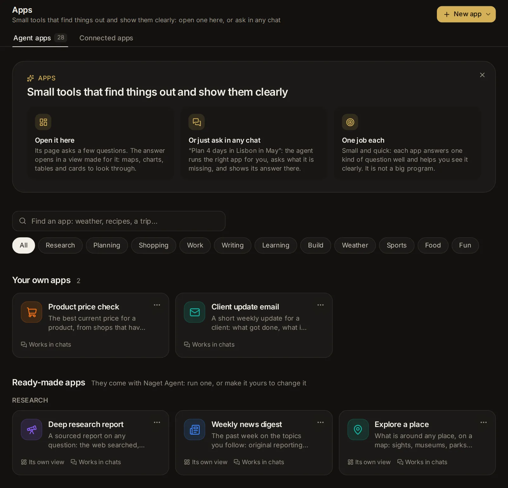

# Apps

An app is a task you run again and again: you fill in a short form, press Run, and an agent does the job and hands back the result, in a view made for it (pages to click through and act on, with maps, charts, pictures and videos) or as a card and tables. This topic covers the ready-made apps, running one, the keys an app needs, having an agent run one for you in any session, making your own (steps, a view, its own files, data, memory, a screen), sharing one (an API key, other agents, a public page, rows of a CSV) and passing one on as a file. The services agents connect to are beside the apps: see [Connected apps, keys and tools](/guide/connections).



## What an app is

An app is a small tool for one job that helps you see and find information: you answer a few questions, its steps look things up and work them out, and the answer shows in a view made for it (maps, charts, tables, cards). You use it two ways: open it on the Apps page, or just ask for what it does in any session, and the agent runs it for you there. Apps are small on purpose: each answers one kind of question well, rather than being a big program.

An app holds everything a task needs except the details that change each time:

- **The form**: the questions someone answers before each run ("Where to?", "How many days").
- **The task**: what the agent is asked to do, with the answers put in.
- **The answer**: the fields of the result (a summary, a list, a table) that the agent fills in when it is done. An app without answer fields gives the agent's reply instead.
- **Who does it**: the agent, its model, its mode, and the tools it may use.

Each time you run an app, Hydor starts a session with the filled-in task. The agent works through it from start to finish without stopping to ask you things: it makes sensible assumptions and says what they were. That one go is called a **run**. You can then ask for changes to the result, and the agent hands in an updated one.

Open the Apps page from the **Apps** tile at the bottom of the sidebar, or go to [/apps](/apps). On a phone the sidebar is a drawer: open it first. You can also find any app, yours or ready-made, by typing its name in the search box (Ctrl+K, ⌘K on a Mac).

## Find your way around the Apps page

The page is headed **Apps**, with two tabs: **Agent apps**, the apps this topic is about, and **Connected apps**, the services every agent can use, connected once, with the keys they use ([Open Connected apps](/guide/connections#open-connected-apps)). Each tab counts what it has. On **Agent apps**, **New app** is at the top: its menu has **Describe it to an agent**, **Start from scratch** and **Install from a file**. Below it:

- A short note on what apps are, in three parts: **Open it here**, **Or just ask in any chat** and **One job each**. **Got it** (✕) puts it away; **What are apps?**, beside the search box, brings it back.
- **Find an app**: a box that narrows the apps by their names, descriptions and kinds as you type, and under it chips for their kinds (**All**, then each kind, the ready-made apps' first).
- **Pick up where you left off**: your latest runs (four, with **All** for up to six), with the answers they were given, how they stand and when they ended. Runs from rows of a CSV and from public pages stay under their own app instead, as do those of an app that opens on its own page (Explore), which shows its latest there. Click one to open it.
- **Your own apps**: the ones you made or installed from a file, and the **Make an app** tile, which opens a new app.
- **Ready-made apps**: the ones that come with Hydor, installed, under their kinds (**Research**, **Planning**, **Shopping**, **Weather**, **Sports**, **Food**, **Fun** and the rest). Each card, yours too, has its icon, name and description, **Its own view** when its answer opens in a view of its own (maps, charts, tables), **Works in chats** when agents run it for you in your sessions, **Public** when its public page is open, and when it last ran. Its **More** (⋯, at its top right; on a computer it shows when you point at the card) has **Open** and **Download as a file**. When nothing matches what you typed, the page says "No app does that yet", with **Describe it to an agent**, which starts the App builder with your words.
- **Ready-made apps to install**: there once you uninstall a ready-made app. Each card shows its kind, what it does and what you get from it (the pages of its view, such as the Trip planner's **Your trip**, **Day by day**, **Book ahead** and **Budget**), and **Install** (see [Install or uninstall a ready-made app](#install-or-uninstall-a-ready-made-app)).
- **Building blocks** (folded): small apps made to be steps of your own (sum up a page, translate, answer from the web, sort into kinds, pull out the facts), with the blocks you made yourself; **Add a step** offers them in every app's steps.

A run's state shows as a badge: **Waiting** (in line), **Starting**, **Working**, **Needs you** (it waits for an approval or an answer), **Done**, **Failed** or **Stopped**.

Drop an app's file (`.hydor-app` or `.json`) anywhere on the page to install it: the card that says what it is opens first (see [Share an app as a file](#share-an-app-as-a-file)).

On a phone each part's apps are the rows of one list, and the kind chips scroll sideways.

## Use a ready-made app

These come with Hydor, installed: they are among **Your apps** from the start, and agents can run them for you in your sessions (see [Have an agent run an app for you](#have-an-agent-run-an-app-for-you)). Each works in steps: its page shows **How it works**, and **As a graph** (or **Make it mine**) opens them in the builder. Each hands back its answer in a view of its own, with pages for its parts and buttons that do things (see [Its view](#its-view)). Their agent steps run with Claude Code unless you pick another agent on their page; their quick steps ask the helper model (Settings → Models). The ones with a "Let me…" question wait for you partway only when you tick it and someone is there to answer: run from their form, or by an agent in one of your sessions.

- **Deep research report**: a sourced report on any question, with the web searched, facts cross-checked and every claim cited. You give the topic, what to focus on, the depth and who it is for. It plans the questions, searches them three at a time, ranks the sources, reads the best pages side by side, searches again where a question is short of sources, and writes the report with numbered citations; **Let me check the questions first** has it wait for you to keep or change them. Its view has **Summary** (the question, how sure it is, and the key findings, each with **Dig deeper**, which starts a report of its own on it), **Full report** (with **Copy the report**) and **Sources**, which you can show by publisher.
- **Trip planner**: a day-by-day plan checked against your dates (opening hours, events, travel times), with a budget and what to book ahead. It works out the dates, then looks up events and holidays, the weather (the forecast when the trip is ten days away or less), what to see and where to stay, and getting around, side by side, before it plans the days and adds up the budget; **Let me choose before it plans** has it ask you where to stay and what must be in. Its view has **Your trip** (the trip in numbers, the plan, the days at a glance and tips; **Relaxed**, **Balanced** or **Packed**, and **+ One more day**, plan it again that way), **Day by day** (a timeline where you tick off each morning, afternoon and evening, each day headed by a picture of its main sight, with a map of each day's area), a page for each day (its picture, with **Copy the day** and **Research** its area), **Map** (each day's area on a map, numbered and joined in order), **Book ahead** (a list to tick off as you book) and **Budget** (a chart and each estimate).
- **Compare products**: current prices, independent reviews and known problems, weighed against what matters to you, with a clear pick. When you describe a need instead of naming products, it finds the options first (**Let me pick which ones to compare**); then it looks into each, three at a time, scores them and ranks them by what matters to you. Its view has **The pick** (the product with its picture, its price and why, and the others it weighed), **Side by side** (each one's score out of 100 on a chart, then each with its picture, strengths and weaknesses, the pick marked), a page for each product (with **Research how it holds up**) and **Watch out**. Its answer names **The pick** too, as the comparison lists it, for programs.
- **Document Q&A**: answers from a document you attach, each with the exact passage and where it is. It reads the document, finds the passages for each question, answers three at a time with a summary beside them, and has an agent read all of it when a question is still unanswered. Its view has **Answers** (each with its passage and where it is; **Find a question** narrows them, and **Ask more about this document** runs it again with new questions and the same file) and **The document**.
- **Meeting notes to actions**: decisions, action items with owners and dates, open questions and a follow-up email, from raw notes or a transcript. It splits the notes, pulls out what was decided, works out the due dates from today, and asks you who takes the actions nobody took (**Ask me who takes what nobody took**). Its view has **Overview** (who came, the meeting in numbers, the summary and what was decided), **Actions** (tick each one off as it is done, or show one person's), **Follow-up email** (with **Copy the email**) and **Still open**.
- **Cover letter**: a letter for one job, built on real evidence from your background, with the gaps named honestly. It reads the posting, works out what the job asks for, looks the company up while it matches your evidence, writes the letter, then checks and revises it up to twice. Its view has **The letter** (on a page of its own, with **Copy the letter**; **Warm**, **Confident** or **Formal**, and **Short** or **Standard**, write it again that way), **Why you fit** (each requirement beside your evidence) and **Gaps to prepare for**, to tick off.
- **Lesson plan**: a timed lesson planned back from its goals, with activities, checks for understanding, support and stretch. It checks the facts it teaches and shares out the minutes so they add up. Its view has **Overview** (the objectives, and the materials to tick off as you get them ready), **Timeline** (the lesson as one strip, each activity as wide as its minutes, then each activity), **Support and checks** and **Whole plan** (with **Copy the plan**).
- **Weekly news digest**: the past week on the topics you follow, from original reporting, with duplicates merged and why each story matters. It searches each topic's week, three at a time, merges the same stories, reads the best and chooses which to keep. Its view has **Stories** (each with the picture from its own page; show one topic's, mark each one read, or **Research** one) and **The digest** (with **Copy the digest**).
- **Explain a contract**: what an agreement says in plain words: key terms, dates, what is unusual, and what to ask before signing. Attach the file or paste the text. It splits it into its clauses, reads the parts side by side, and has an agent take a second look at anything serious. Its view has **In short** (what it says, the red flags in numbers, and the questions to ask, with **Copy the questions**), **Red flags** (by how serious, to show one kind), **Key terms** and **Dates**.
- **Build a small web app**: a working app from a description, in plain HTML, CSS and JavaScript that opens from a file, tested before it is handed over. It plans the app (**Let me check the plan before it is built**), builds it, tests it and fixes it until the tests pass, twice at most. Its view has **What was built** (how to open it, its files, and **Build it again with a change**) and **Next steps**, to tick off.

The apps for everyday things are smaller and quicker: they get real data from free services where there is some (Open-Meteo for the weather, TheSportsDB, TheMealDB for recipes, TVmaze, CheapShark, Open Library, Wikipedia, OpenStreetMap), a program works out what must come out exact, and a quick model reads, picks and says it in plain words. None needs a key.

- **Weather outlook**: the days ahead anywhere: highs and lows and the chance of rain on charts, the next 48 hours, the best days for what you plan, what to wear and what to watch out for. Give a place (a town, or one with its region, like "Paris, Texas"). Its view has **Forecast** (the weather now, each day as a tile that opens its hours, and the charts; **In °F** or **In °C**, and **Look 14 days ahead**, run it again that way), **Next 48 hours** and **What to wear** (with **Copy the forecast**, **Best months to go**, and a map of the place).
- **Best time to go**: the weather month by month anywhere, averaged over the last five years: temperatures, rainy days and hours of sun on charts, each month scored for what you want to do there (city sightseeing, the beach, hiking, snow, escaping the heat). Its view has **Month by month** (a photo of the place across the top, the best months, the twelve months coloured by how well each suits, the charts; **Best for** picks another kind of trip), **When to go** (the best months and why, the months to avoid, tips) and **The numbers**.
- **Team tracker**: any team's next matches, latest results and form, where it stands, and the week's news. Its view has **The team** (its badge, its form as coloured letters, the next match with **Preview it**), **Results** (scored and conceded on a chart), **Fixtures** (each with **Preview**, which starts a Match preview) and **News**.
- **Match preview**: two teams before they meet: their form, their last meetings, team news and what the experts expect, with the chances of each result. Its view has **Preview** (both badges, the likely result, the chances as one bar), **Form and meetings** (who won their last meetings, on a chart) and **Team news** (with **Copy the preview** and **Follow** the team).
- **Cook with what you have**: recipes for what is in your fridge: what each uses of yours and what you would need, with photos, the steps timed out and a video when there is one. Say your diet and how long you have; salt, oil and spices count as there unless you say. Its view has **Recipes** (**Something quicker** runs it again), a page for each recipe (its steps as one strip of minutes, ticked off as you cook, its ingredients marked when you have them, **Copy the steps**) and **What to buy**.
- **Meal plan and shopping list**: dinners for a week (up to two) picked for your household, diet and likes, each with its recipe and photo, and one shopping list for all of them, the amounts added up, by aisle. Its view has **The week** (**Plan another week**), a page for each dinner (its ingredients, method and video), **Shopping list** (show one aisle, tick things off as you shop, **Copy the list**) and **Tips**.
- **Gift ideas**: thoughtful gifts for someone within your budget, things and experiences, each with why it suits them, its usual price and one to buy now, with its price and shop. Its view has **Ideas** (each with a picture of the one to buy, by kind; **☆ Keep** the ones you like, **More like this** runs it again) and **By price** (the price ranges on a chart).
- **What to watch**: films and shows picked for your mood tonight, with where each streams in your country (on your services first), its length, its trailer and why it fits. Its view has **Tonight** (the pick for tonight, then the others; a ▶ on a picture means it has a trailer), a page for each (its trailer playing there, with **Seen it: pick again**) and **Side by side**.
- **Game finder**: games picked for what you like and where you play (Nintendo Switch 2 among the choices), out now, coming soon (with when each comes out) or both, each with its picture and trailer, why it fits and how long it takes; for PC, today's best price and its lowest ever. Its view has **Games** (a ▶ on a picture means it has a trailer, and a game still to come says when it comes), a page for each (its trailer playing there, with its deal and **More like this**), **Prices** (now and at their lowest, on a chart) and **Time to finish**.
- **Quiz on any topic**: a quiz to play on its page, its facts read from Wikipedia: pick an answer and it shows whether you were right and why, with your score at the top; the answers are shuffled each time. Its view has **Play the quiz** (**Start over**, **A harder one**, **New questions**), **Answers** and **About the topic** (with **Copy the quiz**).
- **Book finder**: books you are likely to love, from the ones you did, each checked against Open Library for its cover, pages and rating. Its view has **Your shelf** (a page for each book, with **More like this**) and **Reading list** (**Mark read**).
- **What's on**: things to do in a city on the days you pick (the coming weekend unless you say): concerts, markets, exhibitions and family outings found on the web, with the weather for each day. Its view has **By day** (each event with the picture from its own page), **Map** (each venue numbered) and **By kind**; mark what you are going to (**Going?**), or **Copy the list**.
- **Savings plan**: how to reach a savings goal by a date: what to put aside each month with the interest added, the balance growing on a chart, and when you would get there saving 20% more or less. Its view has **The plan** (**Save 50 more a month** or **Save 50 less**, when you gave an amount), **Month by month** (the milestones and every month) and **Tips**.
- **Chart my data**: a spreadsheet, a CSV or numbers you paste, turned into up to three charts of the kind that suits them, with what they show in a few sentences. Its view has **Charts**, **What the data shows** (each finding, to copy) and **The data** (its columns summed up, and **Ask another question of this data**).
- **A topic as a timeline**: any topic as a timeline, read from Wikipedia: its key moments with dates (up to thirty **In depth**), its eras and the story in short. Its view has **The timeline** (show one strand; **Quiz me on it** starts a quiz on the topic) and **On a chart** (the moments by year, the turning points bigger, and the eras).
- **Explore a place**: what is around any place, on a map: sights, museums, parks and landmarks with a picture and a line each, the best for you picked out and put in walking order. Its view has **The walk** (the stops numbered and joined on the map, each to mark seen; **The weather there**) and **Everything around** (show one kind).

The apps for research and the lab keep up with your field, read and check papers, and look after your experiments and reports. Several open on their own page and can update by themselves, as Explore does; the [Research](/guide/researchers) topic tells how they fit together.

<!-- B1: one bullet per app (Paper radar, Citation alerts, New-model watch, Deadline radar, Living related work, Gap finder), as the bullets above. -->

<!-- end: apps-b1 -->

<!-- B2: one bullet per app (Reading list, Literature matrix, Reproduce a paper, Reviewer simulator, Rebuttal workbench, Paper to talk, poster and thread, Figure doctor). -->

<!-- end: apps-b2 -->

- **Annotation workbench**: you and a model label the same sample of texts. Give it the labels (up to nine), your guidelines, and the texts: a CSV or JSON lines file, a Hugging Face dataset by its name, or texts pasted; it takes a sample at random and has the helper model label it with your guidelines. Its run is where you label: **Label** (a text at a time, a big button and a key from 1 to 9 for each label, the model's label shown only once you have given yours), **Disagreements** side by side, **Agreement** (how often you agree, Cohen's κ and the confusion matrix) and **Export** (a download as CSV or JSON lines, or **Publish on Hugging Face** with the dataset's card). See [Run your lab's work](/guide/researchers#run-your-labs-work).
- **Research sprint**: a research question taken through a sprint on your own code: hypotheses, a plan and code on a branch of its own (in a worktree it makes), runs in [Experiments](/guide/experiments) within your GPU hours, an analysis notebook and a short report, waiting for you to keep the hypotheses and to start the runs. Its view has **The sprint** (each hypothesis with its verdict and evidence), **Runs** (with a results table against the baseline) and **Report**.
- **Sweep planner**: a hyperparameter sweep of a training script within a budget of runs or GPU hours: an agent reads the script's arguments and proposes the settings and values (or takes yours), Experiments runs them and stops bad trials early, and a program works out how much each setting mattered. Its view has **Results** (the best run, what it found, what to try next), **By setting** (a chart for each) and **All runs**.
- **Weekly progress report**: your week as an update for your advisor, your team or a manager (what got done, results with their numbers, problems and blockers, next week's plan, questions to ask), from your sessions (VS Code and terminal ones too), commits, runs and reading. It opens on its own page with this week's, with **Copy as Markdown**, **Copy as an email** and **Save as a document**, and the earlier weeks under it; with **Update automatically** on, a new one comes each Friday at 16:00. See [Reports: your week and your lab notebook](/guide/researchers#reports-your-week-and-your-lab-notebook).
- **Lab notebook**: a dated entry for each day you worked: what was tried, found and decided, and what is open, with links to the day's sessions, commits, runs and files. It opens on its own page with the entries, newest first, a search by words and meaning, and each entry's link to cite; with **Update automatically** on, it writes the day's entry each evening at 21:00.

<!-- end: apps-d -->

You can't change a ready-made app itself. To adjust one, open it and press **Make it mine** (on a phone, **Edit**): the builder opens with a copy that becomes your own app when you create it.

### Explore

**Explore** is a magazine made for you: articles and recent news on what you work on and care about. Open it from **Explore** at the top right of the start page, or from the Apps page. It has no form to fill in each time: it opens on its own page, on its latest edition, and agents don't run it in your sessions.

- **How it picks**: it reads your profile, the notes memory keeps about you and the titles of your latest sessions (leaving out sessions with memory off, the sessions agents start for parts of their work, and app runs nobody watched), and has the helper model choose about six topics you would enjoy now: about half from your work and half from the rest of your life, never anything private. For each, it searches news sites for stories of the past two weeks and looks for long reads (explainers, analyses, essays), reads the best pages side by side, sums each one up and finds its picture. A site that keeps programs out is summed up from what the search showed of it. An edition takes a minute or two.
- **An edition**: its date and cover line, a note from the editor, the topics (click one to show only its stories, **Everything** for all), the cover story, then a section for each topic. Each story has its picture, **News** or **Long read**, its source and date, what it says, and why it is in your edition. Click its picture or headline to read it on its site: it is then marked **✓ Read**, in later editions too. **Dig deeper** starts a deep research report on it. Under the edition, **Earlier** lists the ones before it, each opening as it was.
- **Update**, at the top, makes a new edition now. While it works, a line says what it is doing, with **Follow it**, and the edition you have stays until the new one is ready. Before the first one, **Make the first one** does the same.
- **Settings**, the sliders beside **Update**: **Update automatically** (off until you turn it on) has a new edition ready each morning; under it, pick the days (**Every day**, **On weekdays**, or **Once a week on** a day of your choice) and the time (07:00 unless you change it). It is a [scheduled task](/guide/tasks), so Settings → Scheduled tasks lists it too; turning it off removes it. Below it, **Recent sessions to read** (how many of your latest sessions' titles it reads: 1,000 unless you change it, at most 1,000), **Also cover** (topics always in it, one a line) and **Leave out** (topics or sites to skip, between commas). **Save** keeps them for every update, the daily ones included.
- **Make it mine** and **Uninstall** are in its **More** (⋯) menu.

Each edition asks the helper model about twenty quick questions and searches the web a dozen times; with Claude Code signed in, the questions come out of your plan.

### Install or uninstall a ready-made app

A ready-made app you don't use can go: open it, then **More** (⋯) → **Uninstall**, and confirm. It leaves **Your apps**, agents stop running it in your sessions, and it waits under **Ready-made apps to install** on the Apps page. Its runs stay.

To have it back, click its card there. A card shows what it is before anything changes: what it does, **What it asks you** (the optional questions marked), **What you get**, **How it works** in plain words, and **Agents can use it**, with a switch. **Install** puts it back among your apps and opens it. Its own page says "You uninstalled it", with **Install** too.

## Run an app

1. Open the app from the Apps page or the search box. Its page says what it does at the top, with **Your answers** (its form) under it, and beside them (under them on a phone) **What you get** (the pages its answer opens in, or its answer fields), **In your sessions** (whether agents may run it for you: see [Have an agent run an app for you](#have-an-agent-run-an-app-for-you)), **Latest runs** (each opens its run) and, for an app with steps, **How it works**: its steps in order, each with how it runs (**for each** item, several **at once**, **side by side**), and **As a graph**, which opens them in the builder.
2. Fill in the form. Questions marked with a red **\*** are needed.
3. The line under the form says who runs it, such as "Claude Code · Sonnet · high effort · Auto". On a ready-made app, **Change** shows the pickers (see below); on your own, change it with **Edit**.
4. Press **Run**. The run's page opens and follows the work live.

If something is missing, the page says "Fill in the questions marked first" and names the problem under each question ("Needed", "A number, please", "Choose a file").

### The kinds of questions

- **Short text** and **Long text**: a line, or a box that grows as you type.
- **Number**: plain numbers; "$1,250.50" is read as 1250.5.
- **Date**: a date picker.
- **Choice**: a few short choices show as chips; more show as a list. Click a picked chip again to clear an optional one.
- **Yes / no**: a switch.
- **File**: a file to attach.

A question may have a line of help under it, an example answer in the box, and a value filled in at first.

### Pick the agent, model, effort and mode

On a ready-made app, **Change** beside the line under the form shows the pickers (and **Done** folds them away):

- **Agent**: Claude Code, Codex, Custom (Hydor's own agent for any model) or another agent you added.
- **Model**: the agent's models.
- **Effort**: how hard the model thinks, for models that offer levels (not for Custom and the other added agents).
- **Mode**: what the agent may do without asking you. It starts at **Auto**, because nobody watches a run. A mode that asks before each step leaves the run waiting for you.

This browser remembers your last pick for the next ready-made app you run.

### Attach files

A file question shows **Choose a file**, or you can drop a file on it (on a computer). Each file may be up to 25 MB. The file is saved in the run's folder and the agent gets its path, so it can read PDFs, Word documents, spreadsheets and other files the way it reads any file. The **×** next to a chosen file removes it.

### Give it the keys it needs

Some apps work with a service that wants a key: an API key or a token (a weather service, a maps provider, an account of yours somewhere). An app names the keys it needs, never their values: you give each one once, and it is kept in your vault ([Keep keys in the vault](/guide/connections#keep-keys-in-the-vault)), where agents use it by name without seeing it.

- On the app's page, **A key it needs** (or **Keys it needs**) under the form lists each one: what it is, its name in the vault, a line on how to get it, a box to paste it into, and **Get one**, which opens the page where you get it. Press **Run**: the key goes to the vault first, then the run starts. A key the vault has already shows as **Saved**, with its last characters and **Change**; one the app can do without is marked **optional**.
- When you install an app from a file, its card asks for its keys too: give them then, or at its first run.
- When an agent runs it for you in a session, its card there asks for a key it lacks; the key goes straight to the vault, never into the conversation.

A run without a key it needs doesn't start: on its form you are asked for it ("Needed to run it"); from the API, a schedule or rows of a CSV, the run is refused and says which key to add (on its page, or in **Apps → Connected apps → Keys** under that name). When a key you saved already may not go to a site the app sends it to, its row says so, with **Allow it**.

Some apps use a model through OpenRouter (one that draws pictures, say). Those ask for your **OpenRouter API key** the same way, with **Get one**: it is kept in [Settings → Models](/settings?s=models) rather than the vault, for your other apps and Custom too, and the model is added to your models by itself when the app first runs. A model that runs on Ollama, vLLM or an endpoint is set up by hand in Settings → Models: until it is, a run is refused and says which model and how.

### Where a run works

Each run gets a new folder of its own, inside a `hydor-apps` folder in your home folder, named after the app and the time. An app can name a folder instead (see [Who does it](#who-does-it)); then every run works there.

The session of a run you start from the form shows in the sidebar's session list like any other, titled with the app's name and your first answers. Runs from the API, other agents, a public page or rows of a CSV are archived, so they stay out of the list and show under their app.

## Have an agent run an app for you

You don't have to open an app to use it: ask for what it does in any session ("Plan a 4-day trip to Lisbon in May for the two of us"), and the agent runs it there.

1. The agent finds the app that does what you asked, and puts in what you said: the place, the days, who's going. When your message clearly asks for what one of your apps does, the agent is told which app with your message, so it runs it rather than doing the work itself. With many apps, it searches them by what they do (by words, and by meaning when search by meaning is on) and picks from the twenty that fit best.
2. When the app needs something you didn't say, its card appears in the conversation, with the app's icon and name, **From your message:** and what it took from your words, and the questions left. A key it needs that you haven't given yet is asked for there too: it goes to your vault, not into the conversation. Fill in the ones marked with a red **\***, and leave the optional ones empty if you don't mind. A question it could not take as you said it ("in May" for a date) shows your words under it. **Run it** runs the app; **Not now** closes the card and runs nothing. While the card waits, the session shows **Needs you**, and the inbox lists it.
3. The app's card stays in the conversation, under the agent's reply, and follows the run: where it stands and the steps going by, then its answer as the app shows it (its view, with its pages and buttons; **Plain answer** shows the card and tables). A question one of its steps asks (a "Let me…" one) waits there too. **Open** goes to the run's page, and the app's name to the app.
4. The agent then says in a line or two what came of it; the run's own reply stays on the run's page. A long run goes on after the agent stops waiting: its card keeps following it, and when it ends the agent hears its answer (no message of yours shows for that) and replies, with the card moving under that reply.

Its runs show **From a session** in the app's runs.

Each app's page has **In your sessions** beside its form, with the switch **Agents can use it** (your own apps have it under **API & sharing** too). Turn it off, and agents no longer run that app; turn it on again whenever you like. Every app starts with it on. Building blocks, and apps made to be used on their own page (with a screen, or a view of what they keep), say so there instead, and agents don't run them. When an app of yours does the same as a ready-made one, agents prefer yours.

Each session is told of your apps: the few you run most with what they do, and the others by name, up to 40 in all. With more than that, agents find the others when a request calls for one.

## Follow a run and read its result

The run's page shows the app's name, the answers it was given in a line ("Lisbon · 2026-11-20 · 3"), where it came from ("From the form", "Test run", "From the API", "From another agent", "Public page", "Row 3") and when it started. Once it has ended, **Run again** at the top opens the form filled in the same way.

The status card at the top says where it stands:

- **Waiting its turn**, **Starting…**, or **Working** with the time so far. While it works, you see its latest steps ("Searched the web", "Read a page", "Updated the plan") and the start of what the agent said last.
- **It needs your approval in the session** or **It has a question for you in the session**: the agent is waiting for you. Open the session to answer; approvals also show in [the inbox](/inbox).
- **Done in** the time it took, with what it cost.
- **Stopped**, or **It did not finish** with the reason.

Below it comes the result. An app with a view shows it there (see [Its view](#its-view)); **Plain answer**, in the status card, shows it as the plain card and tables instead, and **Its view** goes back. Without a view:

- Short answer fields (text, numbers, dates, links, yes or no) sit together in one card.
- Long text, lists and tables each get a card under their heading. Long text has a **Copy** button; tables have **Copy** and **CSV** (a download), and a column of pictures shows them small (a click opens one large).
- Pictures, videos, sounds and files: pictures in a grid (a click opens one large, and the arrows go through the others), videos and sounds to play, other files to download. One on another site (a video on YouTube, a page) opens there.
- On a phone, a table too wide for the screen shows as a card for each row.

The agent's own reply follows. It is open, under **Answer**, when the app has no answer fields; otherwise it is folded under **The agent's reply**. **What was asked** (folded) lists the answers the run was given.

The agent is reminded once if it finishes without handing in the answer fields. A run that ends with neither a reply nor a result counts as failed ("The agent ended without an answer").

At the bottom, **Run again with these answers** opens the form filled in the same way, ready to change and run. Files are not carried over: choose them again.

**Open the session** (on a phone, **Session**) at the top opens the run's full conversation.

### Its view

An app's view is made for its answer: pages that show it in elements of their own (cards, timelines, charts, lists to tick off), and buttons that do things with it.

- **Pages**: the tabs at its top; the first opens first. Some pages open from a click (a day of a trip, a product) and have a way back at their top.
- **Ticks and choices**: what you tick off (a booking made, an action done) stays with the run, on every device; filters and picks (a topic, an owner) last while the page is open.
- **Buttons that run it again**: **Relaxed** or **+ One more day** on a trip, **Formal** on a letter, a box of new questions about the same document. Each asks first, then starts a new run with your other answers as they were (its files too) and opens it.
- **Buttons that start another app**: **Research** on a news story or a trip's area, **Dig deeper** on a finding: each asks first, then starts that app's run and opens it.
- **Copy**: a part to paste elsewhere (an email, a letter, the questions to ask).
- **Maps, plots, pictures and videos**: a map of the places in its answer (drag and zoom it; a place shows its name, and a click on it can open its page), a chart or a 3D plot (point at a bar or a point to read it, zoom in, turn a 3D one), pictures that open large, and videos and sounds to play, from a file or from YouTube or Vimeo. Maps, plots and a view's own drawings load their libraries (and maps their tiles, from OpenStreetMap) from the web, so they need this device online.
- On an app of your own, a view can also ask its agent for a change (an app without steps), run one of its other flows, or keep a record in what it keeps.

A view shows on the run's page, in its session's **Result**, and on the app's public page, where its pages and ticks work but nothing reaches the app (no run again, no new runs, nothing kept).

## Ask for changes to the result

A run is not final. At the foot of the run's page, a box says **Ask for a change to the result…** (or **Ask for a change…** when the app has no answer fields).

1. Type what to change: "Make day 2 less packed", "Add a column for opening hours", "Shorter, and warmer".
2. Press Enter, or the arrow button. Shift+Enter starts a new line. On a phone Enter starts a new line: tap the arrow to send.

The follow-up goes to the run's session. The agent does the work and hands in the whole updated result, which replaces the old one on the page. Each follow-up shows under **Follow-ups** with the agent's answer, and **Updated the result** when the result changed. The status card then reads **Updated in …**, or **Answered in …** when the follow-up only needed an answer (a question, a thanks).

If you send a follow-up while the agent is still working, it waits with the note "waiting its turn" and goes to the agent when the current turn ends. A follow-up can be up to 20,000 characters.

Runs from a public page take no follow-ups. Neither does a run whose session was deleted, or one whose session is open in another program (continue it there).

## Work with a run's session

Opened from the sidebar, a run's session shows **Result** first, the same view as the run's page, with a switch to **Conversation** at the top. (**Open the session** on the run's page goes straight to the conversation.) The session's message box then says **Ask for a change to the result…**: whatever you send there is a follow-up, just as on the run's page, and a draft you start in one place carries over to the other.

On the **Result** view, the agent's approval cards show under the result, so you can approve or deny there. When it has a question instead, a card says **It has a question for you.** with **Answer it**, which switches to the conversation.

In the conversation, the moment the agent hands in its result shows as **Result handed in**, with **Open the result**. If what it handed in did not fit the answer fields, it shows **The result did not fit the answer fields yet** and what was wrong; the agent fixes it and hands it in again.

## Stop a run, or remove it

- **Stop** (at the top while a run is going): a run waiting in line ends at once; a working one is interrupted and shows **Stopped**.
- Once a run has ended, the bin button (**Remove from the list**) asks "Remove this run?" and takes it off the app's list of runs. The session stays: delete it from the session's menu if you want it gone too.

## See all runs of an app

Your own app's page has four tabs: **Run**, **Runs**, **For each row** and **API & sharing**. **Runs** shows how many ran today, and lists every run, newest first: the answers it was given, where it came from, how long ago, its cost and its state. **Show older runs** loads more, 50 at a time.

Ready-made apps have no Runs tab: find their runs under **Latest runs** on the Apps page, or as sessions in the sidebar.

## Make your own app

There are four ways to start:

- **From scratch**: **New app** → **Start from scratch** on the Apps page, the **Make an app** tile under your own apps, or go to [/apps/new](/apps/new).
- **By describing it**: on the Apps page (or the New app page), write what it should do under **Describe an app, and an agent makes it** and press **Make it**. A session starts as the **App builder** ([Assistants](/guide/assistants)), which makes the app, tries it and hands it over.
- **From a ready-made app**: open it and press **Make it mine** (on a phone, **Edit**).
- **From a session that went well**: in the session's menu (⋯), choose **More** → **Save as an app**. The page says "Drafting an app from the session…" while the helper model turns the session's first request into a form, a task and answer fields, from what you asked and what the agent replied. The parts that would change from one use to the next become questions. The draft keeps the session's agent, model, effort, mode and assistant. When the agent called tools a step can call by itself (it read a page, searched the web), the draft has steps too: those calls as tool steps, with the form's answers where they go, then a model or agent step for the rest. Steps that do not check out are left out, and the task for one agent stays; check the steps and try it before you save it. If the helper model can't draft it, you get the request as it was, in one **Request** question, with a note saying why; the helper model is set in [Settings → Agents → Models](/settings?s=models&find=Helper%20model).

You can also ask an agent in any session to make an app for you (see [Ask an agent](#ask-an-agent)).

The builder opens under the title **New app**: its icon, name and description on top (click the name or the description to change it), then its parts as tabs, **What it does** first, then **Form**, **Answer**, **Design**, **Examples** and **Settings** (who does it, its tools, its limits, what it keeps, whether it is a block, and, once saved, its folder and versions, each folded to a line that says how it is set until you open it). Every tab is as wide as the others; on a computer the tabs stay at the top as you scroll, and on a phone they show in two rows. On a wide screen, **Form** and **Answer** have a **Preview** beside them that changes as you type: the form as the app's page asks it, and a made-up answer as a run shows it. Fill them in, try it with **Test run**, then press **Create**. The app's page opens, ready to run.

### Name, description and icon

- Click the icon to pick its colour (11 colours) and picture (32 icons).
- **Name** (needed, up to 60 characters), for example "Trip planner".
- A description: what it does, in a sentence (up to 300 characters).

The app's address comes from its name when you create it ("Trip planner" becomes `trip-planner`). Renaming it later keeps the address, so links, keys and the tool other agents call keep working.

### The form

The questions someone answers before each run. **Add a question** adds a row with:

- The question, as the person reads it ("Where to?").
- Its kind: **Short text**, **Long text**, **Number**, **Date**, **Choice**, **Yes / no** or **File**.
- **Needed**: the run can't start without it.
- For **Choice**: the choices, one per line (left empty, it offers Yes and No).
- **Help text, example, default…** opens three more boxes: **Help under the question**, **An example answer** (shown greyed in the empty box) and **Filled in at first**.

A question's **⋯** menu has **Move up**, **Move down** and **Remove**. Under each question you see its placeholder, such as `{{destination}}`: that is how the task refers to its answer, and the name programs use for it. A new question's placeholder follows its wording until the task uses it. An app can have up to 30 questions.

### The task

What the agent is asked to do, with the answers put in (up to 30,000 characters; needed). Write it as you would ask the agent yourself, and say how to work, not only what to make.

- **What it does** shows the app's work as **One task** (this box), a **List** of steps or a **Graph** of them; see [Apps with steps](#apps-with-steps).
- The **Insert** chips put a question's placeholder where the cursor is. Questions the task doesn't use yet are highlighted. **today**, **now** and **weekday** put in the date, the date and time, and the day of the week where you are.
- `{{question}}` is replaced by its answer.
- Text between `{{#question}}` and `{{/question}}` stays only when the question was answered (and not with No). Text between `{{^question}}` and `{{/question}}` stays only when it was left empty.
- **Preview**, at the end of the row of **Insert** chips, shows the task with each question's default, or its name in brackets, filled in. **Edit** goes back.

Warnings under the box tell you when a placeholder names no question (it stays as written) and when a needed question is never used in the task.

### The answer

The fields the agent fills in when it is done. They show as a card or a table, and programs get them back as JSON. With no answer fields, the agent's reply is the answer.

**Add an answer field** adds a row with:

- A heading ("Recommendation").
- Its kind: **Text**, **Long text** (formatted text), **Number**, **Yes / no**, **Date**, **Link**, **List**, **Table** or **Pictures, videos or files**.
- **Needed**: the agent must fill it in.
- **What goes here, for the agent (optional)**: a hint for the agent.
- For a **Table**: its **Columns**, each with a name and a kind (**Text**, **Number**, **Yes / no**, **Date**, **Link** or **Picture**). **Add a column** adds one; a table keeps at least one.

An answer field's **⋯** menu has **Move up**, **Move down** and **Remove**.

A **Pictures, videos or files** field (and a **Picture** column) takes what the agent found or made: an address on the web, or a file on this computer (a photo in your Pictures folder, a chart it drew, a recording), each with a caption. Hydor keeps a copy of a file on this computer, and of a picture on the web (up to 15 MB), so it shows wherever the answer does; videos on the web stay links. A public page's runs may only point at the web.

Hydor checks what the agent hands in: numbers must be numbers, dates real dates, links full web addresses. When something doesn't fit, the agent is told what to fix. An app can have up to 30 answer fields, and a table up to 16 columns. A new answer field takes its name for programs from its heading when you save; after that the name stays, so programs that read it keep working.

### Examples

Examples are answers to try the app with, and checks on what a run gives back, so you can try a change and notice when the app gets worse. **Add an example** adds one: give it a name if you like, fill in its answers, and **Add a check** for each thing a good run gives. A check is a rule on the run's values, as a step's rule is: `{{answer.unread}} > 0`, `{{find.count}} = 3`, `{{reply}} contains Lisbon`. The **{ }** button puts in a value: the form's answers, what the steps gave, **Its answer** (`{{answer.field}}`) and **Its reply**.

**Try them** runs every example as a test run, with the app as it is on screen, saved or not; the flask button beside one tries only that one. Each shows how its last try went, **Passed**, how many checks failed or **Did not finish**, with how long it took and what it cost; an open example says what each failed check saw ("answer.unread is 2").

### Who does it

The section reads: "Runs go ahead without anyone watching, so pick a mode that does not stop to ask (Auto, or one that allows edits)."

- **Agent**, **Model**, **Effort** and **Mode** pickers, as on a ready-made app. The mode starts at **Auto**.
- **Assistant**: **None**, or an assistant each run starts as (Researcher, Writer… or one of your own), with its instructions. See [Assistants](/guide/assistants).
- **Folder**: **A new folder for each run** by default. **Pick one** makes every run work in a folder you choose (it must exist when a run starts); **Use a new one each time** goes back. With a picked folder, attached files are kept in a separate folder of uploads rather than mixed into yours.

### Tools

What the runs may use from Hydor's own tools: web search, the browser, pages, memory and the rest. **All** is on at first. Turn it off to see a list with each tool's name and what it does, and tick the ones runs may use. The agent's own file and command tools follow its mode, not this list.

### Keys it needs

**Keys it needs** (in **Settings**) lists the keys its runs use, by their names in your vault: each with what it is, **Where it may go (hosts)**, **Where to get one**, a line on how, and switches for **It can run without it** and **Commands on this computer use it**. **Add a key it needs** adds one. Its runs are told each key's name and how to use it; whoever installs the app gives the values (see [Give it the keys it needs](#give-it-the-keys-it-needs)), which are never part of the app or its file.

### Limits

- **Runs a day (from anywhere)**: the most runs this app may do in a day, counting runs from the form, the API, other agents, rows of a CSV and the public page, and conversations on its screen, from midnight. Past it, a run is refused with "This app has run … times today, its limit". Empty: no limit.
- **Most one run may spend (US$)**: each run's spending cap. The run stops when it reaches it. Empty: no cap. See [Usage, limits and costs](/guide/usage).

### Test before you save

**Test run** (on a phone, the flask button) opens a dialog with the form as it is on screen, saved or not. Fill it in and press **Run the test**: the run plays out in the dialog. **Open the session** shows its conversation, and **Test again** returns to the form. Test runs of a saved app show in its **Runs** tab as "Test run". **Keep as an example** keeps a finished test run's answers as a new example, to give checks under **Examples**.

## Change, copy or delete an app

On your app's page:

- **Edit** opens the builder, titled **Edit** followed by the app's name. Press **Save** when done; until then, **Not saved yet** shows beside it. Changes apply to the next runs; runs already going keep the version they started with.
- **More** (⋯) → **Duplicate** makes a copy named with " copy" at the end, at an address of its own. Its screen comes along as a page of its own; its public page starts closed, and its keys and the records it keeps are not copied.
- **More** (⋯) → **Delete** asks "Delete …?": its runs, keys and public page go with it, and runs still going are stopped. The sessions it started stay. An app you installed from a file says **Uninstall** instead: it is deleted completely, the same way, and to have it again you install its file again.

A ready-made app's **More** (⋯) has **Uninstall**, which keeps it under **Ready-made apps to install** (see [Install or uninstall a ready-made app](#install-or-uninstall-a-ready-made-app)).

### Versions

Each save that changes what an app does is a version: **Versions**, near the end of its **Edit**, lists them newest first, each with what changed (or what the agent said it did), who saved it (**You**, **An agent**, **Its folder** or **Installed**) and when, and, for the versions its examples were tried with as saved, how many passed and what a run took and cost, so you can see whether a change made it better. **Bring it back** puts an earlier version on screen, and **Save** makes it the newest version again. Moving its steps about in the graph, and its screens (which have versions of their own), make no new version. Each run keeps the version it ran.

### Work on it as files

**Its folder**, near the end of a saved app's **Edit**, puts the app in a folder of files (**Make its folder**; by default in Hydor/Apps in your home folder), to change it in any editor or with a coding agent opened on that folder. app.json is the app (what it asks, does and gives back), instructions/ holds each step's instructions in Markdown, steps/ each code step as the function it runs, screens/ its screens, and graph.json where its steps sit; .naget/ has a schema of app.json and the types of a code step, so your editor completes and checks them. Each change you save there comes here as a version by **Its folder**, and the app open in its **Edit** changes with it (or says **It changed in its folder while you changed it here.**); a mistake there is said here and changes nothing. A save here writes the folder again, and **Stop keeping it in step** leaves the files where they are. Its data stays here, not in the folder.

On the computer Hydor runs on, the command line does the same, in its folder: `node dist/server/cli.js app new "Reading list"` makes an app and its folder, `app folder <app>` makes an app's, `app dev <app>` tries its examples each time you save a change there, `app try <app>` tries it once (and fails when a check does), and `app export` and `app import` carry it to another computer as one file, saying what it will do there before it is installed. `app help` lists them; they use a key of their own, which **Settings → Machines** lists as “This computer’s command line”.

## Call an app from your own programs

Scripts, shortcuts and other programs can run your app with a key and get its answer back. Open your app → **API & sharing** → **API**.

1. Press **New key**, say what will use it (to tell keys apart), and press **Make the key**.
2. Copy the key right away: "Your new key. Copy it now: it is not shown again."

A key opens this app only, nothing else in Hydor. The list shows each key's name, its first and last characters, and when it was last used. **Revoke** ends a key: programs using it stop working at once.

The tab shows an example call with your app's address and sample answers. For an app of yours named Trip planner, it looks something like this:

```bash
curl -X POST https://your-address/api/apps/trip-planner/run \
  -H "Authorization: Bearer napp_…" \
  -H "Content-Type: application/json" \
  -d '{"inputs": {"destination": "Lisbon", "start": "2026-11-20", "days": 4}, "wait": 300}'
```

- Send the form's answers under `inputs`, by their placeholder names. For a file question, give the path of a file on this computer, or send the file under `files` with its `name` and its contents in base64 as `data`.
- `wait` is how many seconds to wait for the answer, at most 900.
- The reply has the run's `status`, `result` (the answer fields), `reply` (the agent's last words) and `session` (a link to it), plus `error` and `costUsd` when there are any.
- A run still going can be asked about at `GET …/run/<run>?wait=60`.
- Behind a proxy that cuts long requests (Cloudflare's stops at 100 seconds), wait less and ask again.

A key may make up to 30 calls a minute, and the app's daily limit applies. More on Hydor's own API in [The app's API](/guide/api).

## Let other agents run an app as a tool

Claude Code, Cursor or another agent connected to Hydor's own MCP server (a standard way for agents to reach tools) can run your app as a tool. Under **API & sharing** → **Other agents**, the switch **Offer to other agents** offers it as a tool named after its address, like `app_trip_planner`. It is on for new apps. The agent fills in the form as the tool's input and waits for the answer; a long run comes back with its id, which the agent checks with a second tool, `app_run_status`. The address and the tokens such agents need are in [Settings → App → Connect other agents](/settings?s=connect).

## Open a public page anyone can use

A public page lets anyone with the link fill in the form and see the answer, without signing in and without access to anything else here. It is under **API & sharing** → **Public page**.

Public runs always use Custom, so first add a model for Custom in [Settings → Agents → Models](/settings?s=models). Then:

1. Turn on the switch. The state changes from **Closed** to **Open to anyone with the link**, and Custom's first model is picked for it (change it below).
2. Copy the link (Hydor's address followed by `/a/` and the app's address), or **Open** it.
3. Set the rest:
   - **Model (one of Custom's)**: the model public runs use.
   - **Search and read the web**: on at first. Off, the agent answers from what it knows.
   - **Runs per visitor, per hour** (5 at first), **Public runs a day** (50) and **Most they may spend a day** ($2). A line shows today's public runs and spend.

What visitors get: the app's name, icon, description and form, their run as it goes, and their own earlier runs (the last 10, told apart by a cookie in their browser). They never see the task, the settings, other people's runs, the session or the cost, and errors reach them in general words. Files they attach may be up to 3 MB, and their answers are kept shorter than yours. The page's footer reminds them that answers can be wrong.

What public runs can do: Custom with the chosen model, with no commands and no files, memory and connections off, in a throwaway folder that is deleted when the run ends. They can only hand in the answer fields and, when you allow it, search the web and read public pages. An attached file reaches the agent as its text. Each run's spending is capped by what is left of the day's budget.

To keep it calm: at most 3 public runs of one app go at once (8 across all apps), a visitor waits for their last run to finish before starting another, and one address gets at most 60 runs an hour across all pages. Public runs count toward the app's daily limit, and they take no follow-ups. Turn the switch off to close the page; visitors then see "This page is not open".

## Run an app once for each row of a CSV

Run your app on a whole list at once: one run per row of a spreadsheet saved as CSV. Open your app → **For each row**. (A ready-made app needs **Make it mine** first.)

1. **Choose a CSV file**, or drop it on the box. The first line names the columns. Commas, semicolons and tabs all work, up to 500 rows.
2. Under **Which column answers each question**, each question gets a column (the app guesses by name) or **The same for every row…** with one value. Needed questions need a column or a value.
3. Check **The first rows, as the form will get them**.
4. Read the cost estimate (see [What a run costs](#what-a-run-costs)) and choose how many run **At once**: 1, 2, 3, 4 or 6 (2 at first).
5. Press **Run** and the number of rows.

A file question takes its cell as text: a path on this computer, or a web address. A row whose values don't fit the form fails at once, with the reason in the table, so you know what to fix. If the rows would take the app past its daily limit, Hydor refuses before starting.

While the rows run, a table fills in: the row number, the first two questions, the state, up to four answer fields (or the reply), and a link to each run. Above it: how many are done, how many did not finish, the cost so far and how many run at once, with a progress bar.

- **Stop** ends the rows still waiting and interrupts the ones running.
- **CSV** downloads the results: each row's answers, every answer field, its state, any error, its cost and a link to its session. Cells a spreadsheet would treat as a formula start with an apostrophe.
- The **×** closes the table.

Rows keep going if Hydor restarts. **Earlier tables** lists your past runs of rows (the last 30) with their progress and whether they are **Running**, **Stopped** or **Finished**; click one to open its table again.

## Run an app by itself

An app can run by itself: at a time of day, every so often, once, when another service calls a webhook, or when a watcher sees a change (a feed, a page, a value, a folder). Each time, it runs with the answers you set, as if from its form, and the run joins its others under **Runs**.

- **To set one up**: open the app, then **Runs** → **When it runs by itself** → **Add a schedule**. Give it a name, fill in the answers each run gets, and pick when it runs, as for any [scheduled task](/guide/tasks#when-it-runs). **Test run** tries it once without saving.
- **Answers from outside**: a webhook's answers can take parts of the call (`{{body.title}}`, `{{headers.name}}`, `{{query.name}}`), and a watcher's `{{change}}`, what it saw change. The run takes them as data, never as instructions.
- Each run notifies you with what it gave back, or why it did not finish, and the notice opens the run. Its row under **When it runs by itself** pauses it, runs it now, shows its history or removes it; the task is in [Settings → Scheduled tasks](/settings?s=tasks) too.
- **An app that opens on its own page** ([Explore](#explore), the Weekly progress report, the Lab notebook) has it closer to hand: in its **Settings**, the sliders at the top of its page, **Update automatically** runs it with the answers kept there, **Every day**, **On weekdays** or **Once a week on** a day you pick, at a time you pick. A ready-made one may start on days of its own: the Weekly progress report on Fridays at 16:00, the Lab notebook each evening at 21:00.

## What a run costs

Each run's cost shows on its page once it ends, and in the **Runs** list. It is the figure the agent reports, or its use priced at API rates (for Custom, estimated from what it read and wrote); models running on this computer cost $0.

Before you run a CSV, Hydor estimates the whole batch: "About $… for … rows", from the middle cost of the app's last finished runs (up to 30). With a cap per run, it adds the most the rows could spend. When the app has never finished a run, it says "Run the app once to see what a run costs."

To keep costs in hand, set **Most one run may spend (US$)** and **Runs a day (from anywhere)** under the app's **Limits**, and, for a public page, its daily budget. See [Usage, limits and costs](/guide/usage) for what all sessions spend.

## Apps with steps

An app can also do its work in **steps**: an agent does one part, a quick question to a model sorts something out, a tool fetches a page, a rule decides which way to go, the same steps go through each item of a list. Each step hands what it found to the next, and the run gives back the answer fields at the end. Steps make an app cheaper, faster and surer than one agent doing everything, and let it do more: keep data between runs, call your other apps, run parts side by side.

You make an app with steps in its **Edit**, or by asking an agent. In **Edit**, **What it does** shows its work as **One task**, a **List** of steps or a **Graph** of them (on a computer, where it opens on the graph until you pick the list). For an app that is one task, **List** or **Graph** turns the task into a first step, an agent that does it, and **One task** turns a lone agent step back. **Add a step** picks a kind; a step opens to its settings when you click it, and its **⋯** menu moves it, copies it or removes it. The steps inside a **Decide**, a **Repeat** or **At the same time** show under it, each list with its own **Add a step**. A text box's **{ }** button (**Put in a value**) puts in a value: an answer from the form, what a step before it gave (`{{find.records}}`), or a built-in one: **Today** (`{{today}}`), **Now** (`{{now}}`, the date and time), **The day of the week** (`{{weekday}}`) and **The time zone** (`{{timezone}}`), all where you are, and **What started the run** (`{{run.source}}`: web for its form, api, task, screen, batch for a row…) and **The run** (`{{run.id}}`). **Where its answer comes from** says which value fills each answer field (left empty: the last step that gave one of its name). What needs fixing shows under its step as you go, and **Test run** tries what is on screen. **Graph** shows them as nodes and wires: the grey wires the order (a Decide's paths and the branches side by side, a Repeat's steps in a frame, what runs when a step fails in red), the coloured ones which step uses which values.

You can build in the graph too (on a computer; a phone keeps the list). It shows the whole run: **The form** at the top, with **Built in** beside it when steps use the built-in values, the steps below them, and **The answer** at the end; dashed wires go from the form and the built-in values to the steps that use them, and from the steps that give the answer to it. A click on **The form** or **The answer** opens its tab. A click on a step's node opens its settings beside the graph, with **More** (⋯) to move, copy or remove it; the **+** on a wire puts a new step there, and **Add a step** starts an empty path. Drag the dot on a node's right onto another step to put one of its values in that step (its instructions, a tool's input, a rule…), or let it go in empty space for a new step that uses it. Drag nodes to place them (the steps inside a Decide or a Repeat move along), double-click a value's wire to bend it there (drag the bend, or double-click it to take it away), and **Tidy: lay it all out again** lays them out by themselves; Shift-click several to **Group them, with a note**. Drag the background to move about, Ctrl and the wheel to zoom, and **Full screen** gives it the whole window.

**Try it**, among the graph's buttons, runs the app as it is on screen as a test run, there in the graph: each step lights up as it runs and as it ends, and the wires into the steps that ran light up with them; point at a value's wire to see what it carried, and a step's settings start with how it went **In the last try**. In a step's settings, **Pause a try before it** stops a try there until you press **Go on** (or **One step**, which pauses again before the next one), and the snowflake (**Freeze**) has a try give what the step gave in the last one, so the steps after an expensive one can be tried again and again at no cost.

**Collapse to a block**, among the graph's buttons when steps are picked (Shift-click several that follow one another), makes them an app of their own, a block, which a **Call an app** step runs in their place: what they used from outside (the form's answers, the values of the steps before them) becomes its form, which the call gives, and what the steps after them used of theirs becomes its answer. Other apps can call the block too, and a change to it is a change for all of them. Steps that keep data stay in the app, since a block keeps data of its own, and lists and tables reach a block as text.

Or ask an agent: "Make an app that reads each link I give it, sums it up with a quick model, and keeps it in a reading list." The agent writes the steps, checks them and tries them, and you can change them in **Edit** after. Agents have tools of their own for this, in any session: they read your apps, save one (checked first, its mistakes said in words; a whole app, a few parts of it, or one step), try its examples and wait for how they went, give it a screen, and read the records it keeps or add some (changing or removing them is up to you, on its screen, or asked of you first); before handing an app over, they say what a run costs.

In the conversation, each app the agent saves shows as a card, and on a wide screen the app opens beside the conversation as it is built (**Open beside** on the card opens it again, **Open its page** its own page). What you change and save there reaches the agent with your next message, so it builds on your version: an agent that saves after you changed it reads your version first. When the agent saves while you have changes of your own on screen, a note offers **Load it** or **Keep mine**. In the steps' **⋯** menu there, **Ask the agent about it** starts a message about that step in the conversation's message box.

The kinds of steps:

- **Ask an agent**: a session works on its part with its tools and hands in what it found. Each has a session of its own, which you can open from the run's page.
- **Ask a model**: one quick answer from a model, with no tools: sort, pull out, sum up. It costs little, and nothing with a model on this computer.
- **Use a tool**: one of Hydor's own tools with set inputs: search the web, read a page, find a picture (and a video) of each thing in a list, call an address with a saved key, read a document, make a picture, or send you a notification. Pictures found that way go in an answer's picture column, and videos (YouTube or Vimeo links) play in a view's video element.
- **Decide**: one way or the other, by a rule ("the price is under 100") or by a question in words that the helper model answers.
- **Repeat**: its steps once for each item of a list (a few at a time, if you like), or again until something holds.
- **At the same time**: branches that run side by side; the flow goes on when they have all ended.
- **Call an app**: another of your apps, as one step. Under the kinds, **Add a step** offers blocks: apps made to be steps of others, yours (those marked **A block**, under an app's answer fields, and those Collapse to a block makes) and the ready-made ones (**Sum up a page**, **Translate**, **Answer from the web**, **Sort into kinds** and **Pull out the facts**, each made yours as it goes in). A block goes in as a call with its form to fill in, its questions the app's own form has by the same name given already; a change to a block is a change for every app that calls it.
- **Keep data**: add, find, change or remove the records the app keeps (see below).
- **Ask a person**: the run waits for your answer, yes or no or a short form: a notice opens the run, where a card asks it, and the Inbox lists it. It waits a week unless you set another limit, then it fails.
- **Run code**: a program of yours, in JavaScript, TypeScript or Python, gets the values you give it and gives back the step's values (**What it gives** names them, for the steps after it). It runs in a sandbox: no network, and none of this computer's files but the packages the app installs. It reaches out only through `ctx`, each call a step of the run: `ctx.model` asks a model, `ctx.agent` an agent, `ctx.tool` uses one of the app's tools, `ctx.ask` waits for your answer, `ctx.data` keeps records and `ctx.app` runs another app. So a whole flow can be one program, with ifs and loops of its own; its calls show on the run's page like steps, and when the run starts again after a restart, the program runs again and the calls it made before give what they gave then, without running again. An app file with code steps says so on its install card.
- **Work out a value**: a value from another, at once and at no cost: the first or last item of a list, how many, a sum, average, smallest or largest (of a field of each), a field of each, the items joined into text, without repeats, sorted by a field, as a number, or a date some days later. It gives `{{id.value}}`, and shows in the graph as a small pill.

A step can run only when a rule holds, and say what happens when it fails: other steps instead, carry on without it, or (for a tool, model, code, data or app step) **An agent does its work**: an agent gets what the step was given and why it failed, hands in the values the steps after it use, and the run goes on. The run's page then says **An agent did its work** beside the step, with why it failed.

While a run works, its page lists the steps as they go. Once it ends, **Steps** shows each one with how it went, how long it took and what it cost; the session button opens an agent step's conversation. A run with steps takes no follow-ups: change the answers and run it again.

Once a run with steps has ended, each of its steps has **Run again from here** (↺): a new run with the same answers, in which the steps before that one give what they gave this time (marked **From the last run**, at no cost) and the rest run as the app is now. A **Test run** in **Edit** has it too, with what is on screen: change a later step and try it again without running the first ones.

### Firm it up

Over the steps in **Edit**, an app's latest runs tell you two things. A step that failed and had an agent do its work says in how many runs that happened, and why it failed the last time; **Ask an agent to fix it** asks the agent beside it (when the app is open beside a conversation) or starts a session with the **App builder**. An agent step that did the same in each of its last runs (it read the page it was given, then answered, say) offers **Firm it up**: fixed steps that could do it for less, a tool step for each call the agent made, with the values it made them with, then a model step with its instructions and what the tools gave. **Try them on its examples** (or **Try them**, with the answers of those runs, when it has no examples) runs them first and shows what a run takes and costs with its agent and with the steps; **Use these steps** puts them in its place on screen, and **Save** keeps them. The tool steps it makes have an agent do their work if they fail, so a run that worked before still works.

Agents that build an app see the same, with the steps to try.

### What an app keeps

An app can keep data between its runs: lists of records, like the links of a reading list or the clients of a small CRM. Its steps add, find and change them, and so do its agents, with a tool of their own. A list can say what each record holds (a title, a score, a date…), and the app then checks what goes in. In **Edit**, **What it keeps** lists them: **Add a list**, then give it a name and, if you like, the fields its records hold (without fields, any record goes in).

Steps and agents can also search the records for a question, the way your knowledge bases are searched: by their words, and by what they mean when [Search by meaning](/settings?s=memory&find=Search%20by%20meaning) is on, best first. A step can search your knowledge bases and memory notes too, with the knowledge_search and recall tools.

What an app keeps stays with it until you delete the app. Runs from its public page never reach it. Ready-made apps keep records too: the Annotation workbench its sets of texts with your labels, the Lab notebook its entries; theirs stay while you uninstall the app and come back with it.

### An app that remembers

An app can remember across its runs: its agents keep what later runs should know (a preference you showed, a source that works, a mistake to avoid) in a memory of the app's own, and each run starts with it. [Settings → Memory](/settings?s=memory) lists it as a project, under the app's name. Turn it on with **Remembers across runs**, under **What it keeps** in its **Edit**.

### What an app needs on this computer

An app can need things on this computer: Node or Python packages its agents use, and commands such as ffmpeg. The packages install in the app's own folder, never for the whole computer, as soon as you install or change the app, and its first run waits for them. On the app's page, a line says while they install or when they could not, with **Show the output** and **Install again**. A command it uses that this computer lacks is named there too: install that one yourself.

## Design how it looks

An app's view is how its answer looks: pages (tabs, and pages a click opens), elements made for its answer (a day card, a product with its strengths and weaknesses), and events, which say what a click does. Without one, its answer shows as a plain card and tables.

In an app's **Edit**, the **Design** tab shows its view with its latest run's answer; **Made-up answer** shows one in its shape instead, and what to fix in it is listed under it. In the preview, a click goes to pages and ticks things off; what reaches the app (asking its agent, running it again) works on a run's page.

- **Ask an agent to design it** (once the app is saved): a session starts as the **App builder** with a message about it, or, with the app open beside a conversation, the message goes to that agent. It writes the view, tries it with a run and fixes what does not fit.
- **Start from its answer**: a page with a block for each answer field, to change from there.
- **Ask an agent to change it**: as above, for a view it has.
- **Change it as code**: the view as JSON, its pages, elements (HTML with values such as `{{result.days}}`, and CSS) and events, as the guide's API topic describes them ([Apps: views](/guide/api#apps-views)); the preview follows what you type.
- **Remove its view**: its answer shows as a plain card again once you save.

A view's events can go to a page (with the item clicked), tick something off or set a filter (kept with the run when it says so), copy, open an address, ask the run's agent for a change (an app without steps), run one of its other flows, run it again with some answers changed, start another app, and add, change or remove a record it keeps. Pages marked for the app's own page show there in place of its form, with what it keeps and its latest run. Such a page has **Update** at its top, which runs the app now, and **Settings** beside it: the answers of its form, kept for those runs, and **Update automatically** (every day, on weekdays or once a week, at a time you pick), as [Explore](#explore) has. A view is part of the app: it has versions with it, travels in its file, and its elements are files of its own in its folder (ui/).

Besides its own elements, a view has built-in ones: text, lists to tick off, tables and bar charts, and these for media:

- **Pictures**: one, or several side by side, each with its caption.
- **Videos**: a file, played in the view, or a link to YouTube or Vimeo, which shows its still and plays over the page when you click it.
- **Sounds**: a recording or a song to play.
- **Maps**: the places in its answer, from their latitude and longitude, numbered and joined in order when the view says so.
- **Plots**: line, bar (stacked too), area, scatter, pie, histogram, box and heatmap, and in 3D points, lines and surfaces, drawn with Plotly.

A view can also have **widgets**: elements drawn by a script of their own (a 3D scene, a game, a chart from a library of your choice), which load the libraries they name, each at an exact version, from the web (jsDelivr). Everything in a view draws in the same sandbox as pages: it cannot reach this computer, your sign-in or your other apps, only do what its events allow.

**Its own files**, under the **Design** tab, holds pictures, videos, sounds and data that come with the app: **Add files** adds them (up to 100 MB each, 150 MB in all), a picture opens large, and the copy button gives the name a view shows it by (`asset:tram.jpg`, in a picture, video or sound block, or a template's `src`). They travel in its file. The preview fills the view with its latest run, or with a made-up answer whose pictures and videos are its own files.

## Give an app a screen

An app can have a screen of its own: a page in place of its form, that runs it and shows what it keeps. A reading list can show its links in a table you search and tidy, a small CRM its clients with a button that drafts a follow-up, a tracker a count of what it logged. The screen works live: what you send in its form runs the app, its answer shows when it is ready, and its tables change as its steps and agents change the records.

- **To give it one**: open your app, then **More** (⋯) → **Give it a screen**. The screen is made from its parts: its form, its answer, a table for each list it keeps (with a conversation with its agent under them), and its earlier runs. Its page then opens on the screen.
- **To change it**: **More** (⋯) → **Edit the screen** opens it in the Library's page editor, where you change it as any page ([Change a page yourself](/guide/library#change-a-page-yourself)): move and restyle its parts, or ask the agent. **Add** has an **App** tab with the app's own parts: **Its form**, **Its answer**, **Its runs**, **A conversation with its agent**, a form and a button for each of its other flows, and a table and a count for each list it keeps.
- **Or ask an agent**: "Give my Reading list a screen with the unread links on top and a button that makes this week's digest." Agents write screens with the same parts, and can give an app more flows for a screen's buttons to start.

**Talk with its agent.** A screen's conversation (**Ask its agent**, on a screen made from its parts) is a chat with the app's own agent, with its model and tools: write a message and press **Send** (or Enter), and it answers there. It can find and change what the app keeps, and run the app's flows for you and wait for what they give, so "add Piranesi, I've read it" or "which of these haven't I read?" just work. When you come back, the latest conversation is there; **New conversation** starts another, and **Earlier conversations** opens one you had before. Conversations are kept with the app, apart from its runs.

A screen is a page of the app's own: it does not show in your Library, it goes when you delete the app, and it travels in the app's file. To run the app from its form with earlier answers, use **Run again with these answers** on a run's page.

## Share an app as a file

An app can travel as one file, to keep or to install on another Hydor.

- **To download one**: open the app, then **More** (⋯) → **Download as a file**, or use **More** (⋯) on its card on the Apps page. Ready-made apps download the same way. The file (`.hydor-app`) holds everything it does and needs, its own files (pictures, videos, data), and the apps its steps call. When it keeps data, **Include the records it keeps** puts those in too. Its folder, keys and public page stay here: the keys it needs travel by their names only, and are asked for where it is installed.
- **To install one**: press **New app** on the Apps page, then **Install from a file**, and pick a `.hydor-app`, `.zip` or `.json` file (up to 160 MB); or drop the file on the Apps page. Before anything is made, a card shows what it is, in plain words: its name and what it does, **What it asks you** (the optional questions marked), **What you get**, **How it works**, **Agents can use it**, with a switch to keep agents from running it, and **A key it needs** (or **Keys it needs**), to give now or at its first run. **What it uses here** (folded, and open by itself when something needs a look) lists who does the work, its steps, its own files, its view's scripts and the libraries they load, its screens, the tools it may use, the models it uses, the apps that come with it, what it installs and the commands it uses, what it keeps, whether it remembers, and its limits. Each model is shown as set up here, here under another name, through OpenRouter (added to your models when it first runs, its key asked for with the app's keys), or not set up here: for those, pick one of your models to stand in, or leave it to the agent's default. Press **Install**.

Some things change on the way in, and the card says which: a folder it worked in elsewhere is left out (each run gets one of its own), a mode that allows every step without asking starts as **Auto** instead, and an assistant this computer lacks is dropped. An app that comes with it and is the same as one you have is used again; otherwise it installs beside yours. Its public page starts closed, and it has no API keys.

A ready-made app's file says which app it is: where you uninstalled that app, installing the file brings it back (**Installed again**); where you have it, the file installs as a copy of your own, to change as you like.

## Ask an agent

Agents in Hydor can make and run apps for you through its API, with your OK on a card. For example:

- "Make an app called Weekly report that asks for a project and a date range, and answers with a summary and a table of what changed."
- "Turn this session into an app I can run again."
- "Plan a 4-day trip to Lisbon in May for the two of us." (the Trip planner runs here, and asks for what it needs)
- "What's the weather in Zermatt this week? And what can I cook with eggs, spinach and potatoes?" (the Weather outlook and Cook with what you have run here, each showing its answer in its view)
- "Quiz me on the Roman Empire, ten hard questions."
- "Run the Trip planner app for Lisbon, four days from 20 November, and show me the result when it's done."
- "Run my Company research app for each of these 20 companies and give me the table."
- "Run my Trip planner every Friday at 18:00 for Lisbon, three days."
- "Open a public page for my Cover letter app, with at most $1 a day."
- "Stop all runs of my Price check app, and revoke its API keys."
- "Uninstall the Weekly news digest app, and stop agents from running my Price check app in sessions."
- "Make an app with steps that reads each link I send, sums it up with a quick model and keeps it in a reading list."
- "Add a step to my Competitor watch app that tells me only when something changed."
- "Install the app in reading-list.hydor-app from my Downloads folder."
- "Make an app that sums up the weather for a city from OpenWeather. It needs my OpenWeather API key."
- "Add a map of the stops and a chart of what each day costs to my City break app's view."
- "Add the photos in ~/Pictures/Lisbon to my City break app, and show them on its first page."
- "Give my Weekly report app's view a 3D chart of the numbers, as a widget with three.js."
- "Give my Reading list a screen with the unread links on top and a button that makes this week's digest."
- "Design a view for my Weekly report app: a page with the summary and the numbers on top, and a page that shows each change as a card I can tick off."
- "In my Price check app's view, add a button on each shop that runs it again for that shop only."
- "Firm up my Link digest app, and try it on its examples first."
- "Make the Look up its title step of my Link digest hand its work to an agent when it fails."
- "Have Explore make a new edition every morning at 6:30, always with Formula 1 in it."
