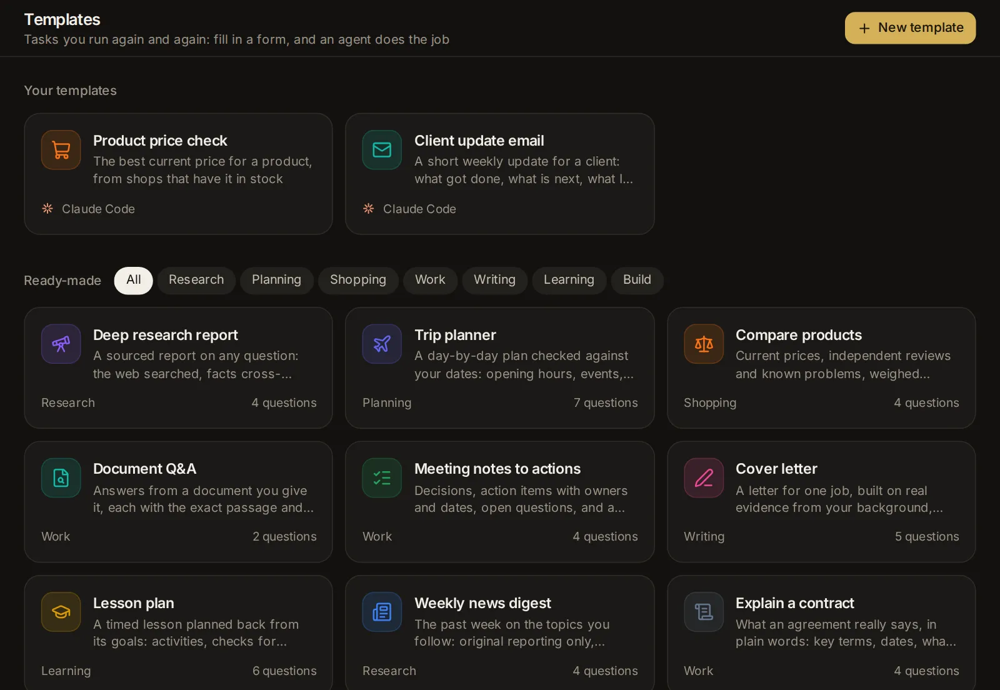

# Templates

A template is a task you run again and again: you fill in a short form, press Run, and an agent does the job on its own and hands back the result as a card or a table. This topic covers the ready-made templates, running one and refining its result, making your own (with steps, data, memory and a screen of its own too), sharing one through an API key, other agents, a public page or a spreadsheet of rows, and passing one on as a file.



## What a template is

A template holds everything a task needs except the details that change each time:

- **The form**: the questions someone answers before each run ("Where to?", "How many days").
- **The task**: what the agent is asked to do, with the answers put in.
- **The answer**: the fields of the result (a summary, a list, a table) that the agent fills in when it is done. A template without answer fields gives the agent's reply instead.
- **Who does it**: the agent, its model, its mode, and the tools it may use.

Each time you run a template, the app starts a session with the filled-in task. The agent works through it from start to finish without stopping to ask you things: it makes sensible assumptions and says what they were. That one go is called a **run**. You can then ask for changes to the result, and the agent hands in an updated one.

Open the Templates page from the **Templates** tile at the bottom of the sidebar, or go to [/apps](/apps). On a phone the sidebar is a drawer: open it first. You can also find any template, yours or ready-made, by typing its name in the search box (Ctrl+K, ⌘K on a Mac).

## Find your way around the Templates page

The page is headed **Templates**, with a **New template** button at the top. Below it:

- **Your templates**: a card for each template you made, with its icon, name and description, the agent that runs it, a **Public** badge when its public page is open, and how many times it ran today. With none yet, the page suggests starting from a ready-made one, building one from scratch, or using **More → Save as template** in a session's menu.
- **Latest runs**: your last six runs, with the answers they were given, how they stand, and when they ended. Runs from rows of a CSV and from public pages stay under their own template instead. Click one to open it.
- **Ready-made**: the templates that come with the app. Chips filter them by kind: **All**, **Research**, **Planning**, **Shopping**, **Work**, **Writing**, **Learning** and **Build**. Each card shows its kind and how many questions it asks.

A run's state shows as a badge: **Waiting** (in line), **Starting**, **Working**, **Needs you** (it waits for an approval or an answer), **Done**, **Failed** or **Stopped**.

On a phone the cards stack in one column and the kind chips scroll sideways.

## Use a ready-made template

These come with the app. They run with Claude Code unless you pick another agent on their page.

- **Deep research report**: a sourced report on any question, with the web searched, facts cross-checked and every claim cited. You give the topic, what to focus on, the depth and who it is for.
- **Trip planner**: a day-by-day plan checked against your dates (opening hours, events, travel times), with a budget and what to book ahead.
- **Compare products**: current prices, independent reviews and known problems, weighed against what matters to you, with a clear pick.
- **Document Q&A**: answers from a document you attach, each with the exact passage and where it is.
- **Meeting notes to actions**: decisions, action items with owners and dates, open questions and a follow-up email, from raw notes or a transcript.
- **Cover letter**: a letter for one job, built on real evidence from your background, with the gaps named honestly.
- **Lesson plan**: a timed lesson planned back from its goals, with activities, checks for understanding, support and stretch.
- **Weekly news digest**: the past week on the topics you follow, from original reporting, with duplicates merged and why each story matters.
- **Explain a contract**: what an agreement says in plain words: key terms, dates, what is unusual, and what to ask before signing. Attach the file or paste the text.
- **Build a small web app**: a working app from a description, in plain HTML, CSS and JavaScript that opens from a file, tested before it is handed over.

You can't change a ready-made template itself. To adjust one, open it and press **Make it mine** (on a phone, **Edit**): the builder opens with a copy that becomes your own template when you create it.

## Run a template

1. Open the template from the Templates page or the search box.
2. Fill in the form. Questions marked with a red **\*** are needed.
3. On a ready-made template, pick who does it (see below). Your own templates show a line such as "Claude Code · Sonnet · high effort · Auto" instead: change it with **Edit**.
4. Press **Run**. The run's page opens and follows the work live.

If something is missing, the app says "Fill in the questions marked first" and names the problem under each question ("Needed", "A number, please", "Choose a file").

### The kinds of questions

- **Short text** and **Long text**: a line, or a box that grows as you type.
- **Number**: plain numbers; "$1,250.50" is read as 1250.5.
- **Date**: a date picker.
- **Choice**: a few short choices show as chips; more show as a list. Click a picked chip again to clear an optional one.
- **Yes / no**: a switch.
- **File**: a file to attach.

A question may have a line of help under it, an example answer in the box, and a value filled in at first.

### Pick the agent, model, effort and mode

On a ready-made template, pickers sit next to **Run**:

- **Agent**: Claude Code, Codex, Custom (the app's own agent for any model) or another agent you added.
- **Model**: the agent's models.
- **Effort**: how hard the model thinks, for models that offer levels (not for Custom and the other added agents).
- **Mode**: what the agent may do without asking you. It starts at **Auto**, because nobody watches a run. A mode that asks before each step leaves the run waiting for you.

This browser remembers your last pick for the next ready-made template you run.

### Attach files

A file question shows **Choose a file**, or you can drop a file on it (on a computer). Each file may be up to 25 MB. The file is saved in the run's folder and the agent gets its path, so it can read PDFs, Word documents, spreadsheets and other files the way it reads any file. The **×** next to a chosen file removes it.

### Where a run works

Each run gets a new folder of its own, inside a `naget-apps` folder in your home folder, named after the template and the time. A template can name a folder instead (see [Who does it](#who-does-it)); then every run works there.

The session of a run you start from the form shows in the sidebar's session list like any other, titled with the template's name and your first answers. Runs from the API, other agents, a public page or rows of a CSV are archived, so they stay out of the list and show under their template.

## Follow a run and read its result

The run's page shows the template's name, where the run came from ("From the form", "Test run", "From the API", "From another agent", "Public page", "Row 3") and when it started.

The status card at the top says where it stands:

- **Waiting its turn**, **Starting…**, or **Working** with the time so far. While it works, you see its latest steps ("Searched the web", "Read a page", "Updated the plan") and the start of what the agent said last.
- **It needs your approval in the session** or **It has a question for you in the session**: the agent is waiting for you. Open the session to answer; approvals also show in [the inbox](/inbox).
- **Done in** the time it took, with what it cost.
- **Stopped**, or **It did not finish** with the reason.

Below it comes the result:

- Short answer fields (text, numbers, dates, links, yes or no) sit together in one card.
- Long text, lists and tables each get a card under their heading. Long text has a **Copy** button; tables have **Copy** and **CSV** (a download).
- On a phone, a table too wide for the screen shows as a card for each row.

The agent's own reply follows. It is open, under **Answer**, when the template has no answer fields; otherwise it is folded under **The agent's reply**. **What was asked** (folded) lists the answers the run was given.

The agent is reminded once if it finishes without handing in the answer fields. A run that ends with neither a reply nor a result counts as failed ("The agent ended without an answer").

At the bottom, **Run again with these answers** opens the form filled in the same way, ready to change and run. Files are not carried over: choose them again.

**Open the session** (on a phone, **Session**) at the top opens the run's full conversation.

## Ask for changes to the result

A run is not final. At the foot of the run's page, a box says **Ask for a change to the result…** (or **Ask for a change…** when the template has no answer fields).

1. Type what to change: "Make day 2 less packed", "Add a column for opening hours", "Shorter, and warmer".
2. Press Enter, or the arrow button. Shift+Enter starts a new line. On a phone Enter starts a new line: tap the arrow to send.

The follow-up goes to the run's session. The agent does the work and hands in the whole updated result, which replaces the old one on the page. Each follow-up shows under **Follow-ups** with the agent's answer, and **Updated the result** when the result changed. The status card then reads **Updated in …**, or **Answered in …** when the follow-up only needed an answer (a question, a thanks).

If you send a follow-up while the agent is still working, it waits with the note "waiting its turn" and goes to the agent when the current turn ends. A follow-up can be up to 20,000 characters.

Runs from a public page take no follow-ups. Neither does a run whose session was deleted, or one whose session is open in another program (continue it there).

## Work with a run's session

Opened from the sidebar, a run's session shows **Result** first, the same view as the run's page, with a switch to **Conversation** at the top. (**Open the session** on the run's page goes straight to the conversation.) The session's message box then says **Ask for a change to the result…**: whatever you send there is a follow-up, just as on the run's page, and a draft you start in one place carries over to the other.

On the **Result** view, the agent's approval cards show under the result, so you can approve or deny there. When it has a question instead, a card says **It has a question for you.** with **Answer it**, which switches to the conversation.

In the conversation, the moment the agent hands in its result shows as **Result handed in**, with **Open the result**. If what it handed in did not fit the answer fields, it shows **The result did not fit the answer fields yet** and what was wrong; the agent fixes it and hands it in again.

## Stop a run, or remove it

- **Stop** (at the top while a run is going): a run waiting in line ends at once; a working one is interrupted and shows **Stopped**.
- Once a run has ended, the bin button (**Remove from the list**) asks "Remove this run?" and takes it off the template's list of runs. The session stays: delete it from the session's menu if you want it gone too.

## See all runs of a template

Your own template's page has four tabs: **Run**, **Runs**, **For each row** and **API & sharing**. **Runs** shows how many ran today, and lists every run, newest first: the answers it was given, where it came from, how long ago, its cost and its state. **Show older runs** loads more, 50 at a time.

Ready-made templates have no Runs tab: find their runs under **Latest runs** on the Templates page, or as sessions in the sidebar.

## Make your own template

There are three ways to start:

- **From scratch**: **New template** on the Templates page, or go to [/apps/new](/apps/new).
- **From a ready-made template**: open it and press **Make it mine** (on a phone, **Edit**).
- **From a session that went well**: in the session's menu (⋯), choose **More** → **Save as template**. The page says "Drafting a template from the session…" while the helper model turns the session's first request into a form, a task and answer fields, from what you asked and what the agent replied. The parts that would change from one use to the next become questions. The draft keeps the session's agent, model, effort, mode and assistant. If the helper model can't draft it, you get the request as it was, in one **Request** question, with a note saying why; the helper model is set in [Settings → Agents → Models](/settings?s=models&find=Helper%20model).

You can also ask an agent in any session to make a template for you (see [Ask an agent](#ask-an-agent)).

The builder opens under the title **New template**. Fill in its parts, try it with **Test run**, then press **Create**. The template's page opens, ready to run.

### Name, description and icon

- Click the icon to pick its colour (11 colours) and picture (32 icons).
- **Name** (needed, up to 60 characters), for example "Trip planner".
- A description: what it does, in a sentence (up to 300 characters).

The template's address comes from its name when you create it ("Trip planner" becomes `trip-planner`). Renaming it later keeps the address, so links, keys and the tool other agents call keep working.

### The form

The questions someone answers before each run. **Add a question** adds a row with:

- The question, as the person reads it ("Where to?").
- Its kind: **Short text**, **Long text**, **Number**, **Date**, **Choice**, **Yes / no** or **File**.
- **Needed**: the run can't start without it.
- For **Choice**: the choices, one per line (left empty, it offers Yes and No).
- **Help text, example, default…** opens three more boxes: **Help under the question**, **An example answer** (shown greyed in the empty box) and **Filled in at first**.

The arrows move a question up or down, and the bin removes it. Under each question you see its placeholder, such as `{{destination}}`: that is how the task refers to its answer, and the name programs use for it. A new question's placeholder follows its wording until the task uses it. A template can have up to 30 questions.

### The task

What the agent is asked to do, with the answers put in (up to 30,000 characters; needed). Write it as you would ask the agent yourself, and say how to work, not only what to make.

- The **Insert** chips put a question's placeholder where the cursor is. Questions the task doesn't use yet are highlighted. **today** inserts today's date.
- `{{question}}` is replaced by its answer.
- Text between `{{#question}}` and `{{/question}}` stays only when the question was answered (and not with No). Text between `{{^question}}` and `{{/question}}` stays only when it was left empty.
- **Preview** shows the task with each question's default, or its name in brackets, filled in. **Edit** goes back.

Warnings under the box tell you when a placeholder names no question (it stays as written) and when a needed question is never used in the task.

### The answer

The fields the agent fills in when it is done. They show as a card or a table, and programs get them back as JSON. With no answer fields, the agent's reply is the answer.

**Add an answer field** adds a row with:

- A heading ("Recommendation").
- Its kind: **Text**, **Long text** (formatted text), **Number**, **Yes / no**, **Date**, **Link**, **List** or **Table**.
- **Needed**: the agent must fill it in.
- **What goes here, for the agent (optional)**: a hint for the agent.
- For a **Table**: its **Columns**, each with a name and a kind (**Text**, **Number**, **Yes / no**, **Date** or **Link**). **Add a column** adds one; a table keeps at least one.

The app checks what the agent hands in: numbers must be numbers, dates real dates, links full web addresses. When something doesn't fit, the agent is told what to fix. A template can have up to 30 answer fields, and a table up to 12 columns. A new answer field takes its name for programs from its heading when you save; after that the name stays, so programs that read it keep working.

### Who does it

The section reads: "Runs go ahead without anyone watching, so pick a mode that does not stop to ask (Auto, or one that allows edits)."

- **Agent**, **Model**, **Effort** and **Mode** pickers, as on a ready-made template. The mode starts at **Auto**.
- **Assistant**: **None**, or an assistant each run starts as (Researcher, Writer… or one of your own), with its instructions. See [Assistants](/guide/assistants).
- **Folder**: **A new folder for each run** by default. **Pick one** makes every run work in a folder you choose (it must exist when a run starts); **Use a new one each time** goes back. With a picked folder, attached files are kept in a separate folder of uploads rather than mixed into yours.

### Tools

What the runs may use from the app's own tools: web search, the browser, pages, memory and the rest. **All** is on at first. Turn it off to see a list with each tool's name and what it does, and tick the ones runs may use. The agent's own file and command tools follow its mode, not this list.

### Limits

- **Runs a day (from anywhere)**: the most runs this template may do in a day, counting runs from the form, the API, other agents, rows of a CSV and the public page, from midnight. Past it, a run is refused with "This template has run … times today, its limit". Empty: no limit.
- **Most one run may spend (US$)**: each run's spending cap. The run stops when it reaches it. Empty: no cap. See [Usage, limits and costs](/guide/usage).

### Test before you save

**Test run** (on a phone, the flask button) opens a dialog with the form as it is on screen, saved or not. Fill it in and press **Run the test**: the run plays out in the dialog. **Open the session** shows its conversation, and **Test again** returns to the form. Test runs of a saved template show in its **Runs** tab as "Test run".

## Change, copy or delete a template

On your template's page:

- **Edit** opens the builder, titled **Edit** followed by the template's name. Press **Save** when done. Changes apply to the next runs; runs already going keep the version they started with.
- **More** (⋯) → **Duplicate** makes a copy named with " copy" at the end, at an address of its own. Its screen comes along as a page of its own; its public page starts closed, and its keys and the records it keeps are not copied.
- **More** (⋯) → **Delete** asks "Delete …?": its runs, keys and public page go with it, and runs still going are stopped. The sessions it started stay.

## Call a template from your own programs

Scripts, shortcuts and other programs can run your template with a key and get its answer back. Open your template → **API & sharing** → **API**.

1. Press **New key**, say what will use it (to tell keys apart), and press **Make the key**.
2. Copy the key right away: "Your new key. Copy it now: it is not shown again."

A key opens this template only, nothing else in the app. The list shows each key's name, its first and last characters, and when it was last used. **Revoke** ends a key: programs using it stop working at once.

The tab shows an example call with your template's address and sample answers. For a template of yours named Trip planner, it looks something like this:

```bash
curl -X POST https://your-address/api/apps/trip-planner/run \
  -H "Authorization: Bearer napp_…" \
  -H "Content-Type: application/json" \
  -d '{"inputs": {"destination": "Lisbon", "start": "2026-11-20", "days": 4}, "wait": 300}'
```

- Send the form's answers under `inputs`, by their placeholder names. For a file question, give the path of a file on this computer, or send the file under `files` with its `name` and its contents in base64 as `data`.
- `wait` is how many seconds to wait for the answer, at most 900.
- The reply has the run's `status`, `result` (the answer fields), `reply` (the agent's last words) and `session` (a link to it), plus `error` and `costUsd` when there are any.
- A run still going can be asked about at `GET …/run/<run>?wait=60`.
- Behind a proxy that cuts long requests (Cloudflare's stops at 100 seconds), wait less and ask again.

A key may make up to 30 calls a minute, and the template's daily limit applies. More on the app's API in [The app's API](/guide/api).

## Let other agents run a template as a tool

Claude Code, Cursor or another agent connected to this app's own MCP server (a standard way for agents to reach tools) can run your template as a tool. Under **API & sharing** → **Other agents**, the switch **Offer to other agents** offers it as a tool named after its address, like `app_trip_planner`. It is on for new templates. The agent fills in the form as the tool's input and waits for the answer; a long run comes back with its id, which the agent checks with a second tool, `app_run_status`. The address and the tokens such agents need are in [Settings → App → Connect other agents](/settings?s=connect).

## Open a public page anyone can use

A public page lets anyone with the link fill in the form and see the answer, without signing in and without access to anything else here. It is under **API & sharing** → **Public page**.

Public runs always use Custom, so first add a model for Custom in [Settings → Agents → Models](/settings?s=models). Then:

1. Turn on the switch. The state changes from **Closed** to **Open to anyone with the link**, and Custom's first model is picked for it (change it below).
2. Copy the link (your app's address followed by `/a/` and the template's address), or **Open** it.
3. Set the rest:
   - **Model (one of Custom's)**: the model public runs use.
   - **Search and read the web**: on at first. Off, the agent answers from what it knows.
   - **Runs per visitor, per hour** (5 at first), **Public runs a day** (50) and **Most they may spend a day** ($2). A line shows today's public runs and spend.

What visitors get: the template's name, icon, description and form, their run as it goes, and their own earlier runs (the last 10, told apart by a cookie in their browser). They never see the task, the settings, other people's runs, the session or the cost, and errors reach them in general words. Files they attach may be up to 3 MB, and their answers are kept shorter than yours. The page's footer reminds them that answers can be wrong.

What public runs can do: Custom with the chosen model, with no commands and no files, memory and connections off, in a throwaway folder that is deleted when the run ends. They can only hand in the answer fields and, when you allow it, search the web and read public pages. An attached file reaches the agent as its text. Each run's spending is capped by what is left of the day's budget.

To keep it calm: at most 3 public runs of one template go at once (8 across all templates), a visitor waits for their last run to finish before starting another, and one address gets at most 60 runs an hour across all pages. Public runs count toward the template's daily limit, and they take no follow-ups. Turn the switch off to close the page; visitors then see "This page is not open".

## Run a template once for each row of a CSV

Run your template on a whole list at once: one run per row of a spreadsheet saved as CSV. Open your template → **For each row**. (A ready-made template needs **Make it mine** first.)

1. **Choose a CSV file**, or drop it on the box. The first line names the columns. Commas, semicolons and tabs all work, up to 500 rows.
2. Under **Which column answers each question**, each question gets a column (the app guesses by name) or **The same for every row…** with one value. Needed questions need a column or a value.
3. Check **The first rows, as the form will get them**.
4. Read the cost estimate (see [What a run costs](#what-a-run-costs)) and choose how many run **At once**: 1, 2, 3, 4 or 6 (2 at first).
5. Press **Run** and the number of rows.

A file question takes its cell as text: a path on this computer, or a web address. A row whose values don't fit the form fails at once, with the reason in the table, so you know what to fix. If the rows would take the template past its daily limit, the app refuses before starting.

While the rows run, a table fills in: the row number, the first two questions, the state, up to four answer fields (or the reply), and a link to each run. Above it: how many are done, how many did not finish, the cost so far and how many run at once, with a progress bar.

- **Stop** ends the rows still waiting and interrupts the ones running.
- **CSV** downloads the results: each row's answers, every answer field, its state, any error, its cost and a link to its session. Cells a spreadsheet would treat as a formula start with an apostrophe.
- The **×** closes the table.

Rows keep going if the app restarts. **Earlier tables** lists your past runs of rows (the last 30) with their progress and whether they are **Running**, **Stopped** or **Finished**; click one to open its table again.

## What a run costs

Each run's cost shows on its page once it ends, and in the **Runs** list. It is the figure the agent reports, or its use priced at API rates (for Custom, estimated from what it read and wrote); models running on this computer cost $0.

Before you run a CSV, the app estimates the whole batch: "About $… for … rows", from the middle cost of the template's last finished runs (up to 30). With a cap per run, it adds the most the rows could spend. When the template has never finished a run, it says "Run the template once to see what a run costs."

To keep costs in hand, set **Most one run may spend (US$)** and **Runs a day (from anywhere)** under the template's **Limits**, and, for a public page, its daily budget. See [Usage, limits and costs](/guide/usage) for what all sessions spend.

## Templates with steps

A template can also do its work in **steps**: an agent does one part, a quick question to a model sorts something out, a tool fetches a page, a rule decides which way to go, the same steps go through each item of a list. Each step hands what it found to the next, and the run gives back the answer fields at the end. Steps make a template cheaper, faster and surer than one agent doing everything, and let it do more: keep data between runs, call your other templates, run parts side by side.

For now, you make a template with steps by asking an agent: "Make a template that reads each link I give it, sums it up with a quick model, and keeps it in a reading list." The agent writes the steps, checks them and tries them. In your template's **Edit**, they show under **What it does**; to change them, ask an agent ("add a step that…"). The rest (the form, the answer, who does it, tools, limits) you change there yourself.

The kinds of steps:

- **Ask an agent**: a session works on its part with its tools and hands in what it found. Each has a session of its own, which you can open from the run's page.
- **Ask a model**: one quick answer from a model, with no tools: sort, pull out, sum up. It costs little, and nothing with a model on this computer.
- **Use a tool**: one of the app's own tools with set inputs: search the web, read a page, call an address with a saved key, read a document, make a picture.
- **Decide**: one way or the other, by a rule ("the price is under 100") or by a question in words that the helper model answers.
- **Repeat**: its steps once for each item of a list (a few at a time, if you like), or again until something holds.
- **At the same time**: branches that run side by side; the flow goes on when they have all ended.
- **Call an app**: another of your templates, as one step.
- **Keep data**: add, find, change or remove the records the template keeps (see below).

A step can run only when a rule holds, and say what happens when it fails: other steps instead, or carry on without it.

While a run works, its page lists the steps as they go. Once it ends, **Steps** shows each one with how it went, how long it took and what it cost; the session button opens an agent step's conversation. A run with steps takes no follow-ups: change the answers and run it again.

### What a template keeps

A template can keep data between its runs: lists of records, like the links of a reading list or the clients of a small CRM. Its steps add, find and change them, and so do its agents, with a tool of their own. A list can say what each record holds (a title, a score, a date…), and the app then checks what goes in.

Steps and agents can also search the records for a question, the way your knowledge bases are searched: by their words, and by what they mean when [Search by meaning](/settings?s=memory&find=Search%20by%20meaning) is on, best first. A step can search your knowledge bases and memory notes too, with the knowledge_search and recall tools.

What a template keeps stays with it until you delete the template. Runs from its public page never reach it.

### A template that remembers

A template can remember across its runs: its agents keep what later runs should know (a preference you showed, a source that works, a mistake to avoid) in a memory of the template's own, and each run starts with it. [Settings → Memory](/settings?s=memory) lists it as a project, under the template's name.

### What a template needs on this computer

A template can need things on this computer: Node or Python packages its agents use, and commands such as ffmpeg. The packages install in the template's own folder, never for the whole computer, as soon as you install or change the template, and its first run waits for them. On the template's page, a line says while they install or when they could not, with **Show the output** and **Install again**. A command it uses that this computer lacks is named there too: install that one yourself.

## Give a template a screen

A template can have a screen of its own: a page in place of its form, that runs it and shows what it keeps. A reading list can show its links in a table you search and tidy, a small CRM its clients with a button that drafts a follow-up, a tracker a count of what it logged. The screen works live: what you send in its form runs the template, its answer shows when it is ready, and its tables change as its steps and agents change the records.

- **To give it one**: open your template, then **More** (⋯) → **Give it a screen**. The screen is made from its parts: its form, its answer, a table for each list it keeps, and its earlier runs. Its page then opens on the screen.
- **To change it**: **More** (⋯) → **Edit the screen** opens it in Pages' editor, where you change it as any page ([Change a page yourself](/guide/pages#change-a-page-yourself)): move and restyle its parts, or ask the agent. **Add** has an **App** tab with the template's own parts: **Its form**, **Its answer**, **Its runs**, a form and a button for each of its other flows, and a table and a count for each list it keeps.
- **Or ask an agent**: "Give my Reading list a screen with the unread links on top and a button that makes this week's digest." Agents write screens with the same parts, and can give a template more flows for a screen's buttons to start.

A screen is a page of the template's own: it does not show in your Pages library, it goes when you delete the template, and it travels in the template's file. To run the template from its form with earlier answers, use **Run again with these answers** on a run's page.

## Share a template as a file

A template can travel as one file, to keep or to install on another Naget Agent.

- **To download one**: open your template, then **More** (⋯) → **Download as a file**. The file (`.naget-app`) holds everything it does and needs, and the templates its steps call. When it keeps data, **Include the records it keeps** puts those in too. Its folder, keys and public page stay here.
- **To install one**: press **New template** on the Templates page, then **Install a template from a file**, and pick a `.naget-app`, `.zip` or `.json` file. Before anything is made, a card says what it will do here: who does the work, its steps, the tools it may use, the models it uses, the templates that come with it, what it installs and the commands it uses, what it keeps, whether it remembers, and its limits. Each model is shown as set up here, here under another name, or not set up here: for those, pick one of your models to stand in, or leave it to the agent's default. Press **Install**.

Some things change on the way in, and the card says which: a folder it worked in elsewhere is left out (each run gets one of its own), a mode that allows every step without asking starts as **Auto** instead, and an assistant this computer lacks is dropped. A template that comes with it and is the same as one you have is used again; otherwise it installs beside yours. Its public page starts closed, and it has no API keys.

## Ask an agent

Agents in the app can make and run templates for you through the app's API, with your OK on a card. For example:

- "Make a template called Weekly report that asks for a project and a date range, and answers with a summary and a table of what changed."
- "Turn this session into a template I can run again."
- "Run the Trip planner template for Lisbon, four days from 20 November, and show me the result when it's done."
- "Run my Company research template for each of these 20 companies and give me the table."
- "Open a public page for my Cover letter template, with at most $1 a day."
- "Stop all runs of my Price check template, and revoke its API keys."
- "Make a template with steps that reads each link I send, sums it up with a quick model and keeps it in a reading list."
- "Add a step to my Competitor watch template that tells me only when something changed."
- "Install the template in reading-list.naget-app from my Downloads folder."
- "Give my Reading list a screen with the unread links on top and a button that makes this week's digest."
