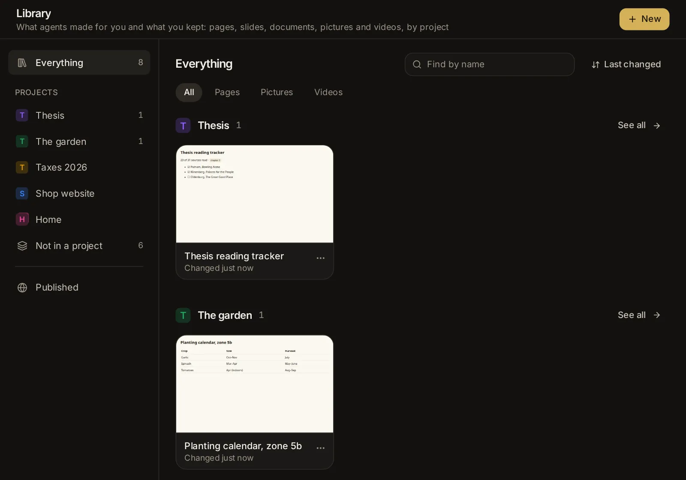

# Library: pages, images, videos and sites

Agents can answer with a page instead of plain text: a report, a chart, a table to compare options, or a small tool such as a tracker or a checklist. They also make slides, documents, spreadsheets and LaTeX documents you edit as in PowerPoint, Word, Excel or Overleaf. What you keep goes in your Library, sorted by project, with the pictures, videos and sounds you saved, each with a title and a description. This topic covers watching a page as it is written, changing it, keeping it (with its versions, its data and an address for your phone), keeping images, videos and sounds, making your own pages, exporting files, asking an agent to change what you have open, and publishing at a link.

## Pages in the conversation

When a picture says more than words, an agent shows a page: a report, a chart, a table, a diagram, a mock-up, or options to pick from. Any agent in the app can do this; ask for it in plain words ("show me this as a chart", "compare the three laptops in a table").

On a wide screen the page opens beside the conversation as the agent starts writing it (see [Watch a page as it is written](#watch-a-page-as-it-is-written)), and the conversation keeps a small card for it: its title, what it is ("A page · 24 KB", "Kept in the Library · version 2") and **Open**, or **Beside** for the one shown there. Click a card to show its page beside the conversation.

In a narrower window, on a phone, or with the panel beside the conversation closed, the page sits in the reply, as wide as the conversation, and grows to fit what it holds. A tall page stops at half the window's height, so the conversation around it stays in sight, and shows **See the whole page** at its bottom edge (slides always show whole). The bar above the page has:

- the page's title;
- **Keep**: puts the page in your Library (see [Keep a page](#keep-a-page));
- **Edit** (the pencil): opens it to change (see [Change a page yourself](#change-a-page-yourself));
- **Save as a file** (the download icon): saves the page as an `.html` file you can open in any browser, with its ready-made look;
- **Full screen** (the expand icon): opens the page over the app. Press Escape, tap the close button (✕) or click beside it to close it.

A page runs in a frame of its own, apart from the app: it can't reach the app, your files or your sign-in. It can load charting and other libraries from the web.

Pages look like part of the app: agents make them in its theme, light or dark as the app is, in your theme's colours (your own ones too) and the app's font, and an open page changes with it when you switch. A page written with light and dark looks of its own shows the one the app is in, whatever your device is set to. Ask for another look when you want one: "in our brand's colours", "a dark page with neon accents".

Slides an agent makes show in the conversation as a slideshow: click the slide or its arrows to go through it, the grid button to see every slide, and the full screen button to present it ([Slides](#slides)).

If you share the session with a read-only link, the person sees its pages too, but can't keep or change them, and what they pick on them goes nowhere ([Share a read-only link](/guide/sessions#share-a-read-only-link)).

## Watch a page as it is written

While an agent writes a page, you see it grow: headings, then the text, the tables and the cards, as they come. On a wide screen (1,100 pixels or more) it opens by itself in a panel beside the conversation, for the session on screen. The panel's top line says **Writing** with how much has come so far; the code button beside it shows the page's HTML coming in instead, and the eye button goes back to the page. In a narrower window, or on a phone, the page grows in its card in the conversation. Its scripts wait until the page is complete, then it runs.

The panel also opens for an HTML file an agent writes whole (a static site's `index.html`, say), with its pictures and styles from the file's folder.

- Drag the panel's left edge to make it wider or narrower; the app remembers the width on this device.
- When a conversation has several pages, click the page's title in the panel to switch to another.
- **More** (⋯) in the panel has **Open in the Library** (a saved page), **Show in Files** (an HTML file), **Save as a file** (or, for a saved page or slides, **Download as** a PDF, a Word document, a PowerPoint file or a web page), and **Open pages here as they are written**: turn it off, and pages wait for you to open them from their cards.
- Slides open in the panel in the slides editor ([Edit slides](#edit-slides)).
- ✕ closes the panel. **Details** in the session's header opens the session's details in its place.

## Change a page yourself

Any page an agent shows or saves, any page in your library and any HTML file an agent writes can be changed, in three ways. Pick one with the buttons at the top of the page (in the panel beside the conversation they are icons: the eye, the pencil and the code sign):

- **Use**: the page itself, working: type in its fields, tick its boxes, pick its options.
- **Edit**: change it by clicking on it. Its scripts are held back while you do, so the page stays still.
- **Code**: its HTML, with the page beside it (below it in a narrow panel) showing your changes a moment after you type.

Beside them, the screen buttons show the page as on a **Computer**, a **Tablet** or a **Phone** (in the panel and in a narrow window, one button with a menu). A page opens as wide as there is room for; a tablet's or a phone's width lasts while the page is open. In **Edit**, what you change with a tablet or a phone picked is for that size of screen ([Change it for phones and tablets](#change-it-for-phones-and-tablets)).

### Edit by clicking

1. Click a part of the page: a heading, a paragraph, a picture, a card, a table. It gets a frame with its name ("Heading 2", "Picture", "Card"), and a small bar beside it.
2. Click it again (or double-click it) to change its words where they are. A bar over the words has **Bold**, **Italic**, **Underline**, **Strike through**, **Make it a link** (Ctrl+K), **Not a link**, **Plain words** and **Done**. Enter starts a new line in a paragraph and finishes a heading; Esc finishes.
3. The bar beside a picked part: drag its handle (⠿) to move the part elsewhere on the page; **Pick the part around it** (Esc does the same); **Change the words**; **Move up** and **Move down**; **Duplicate** (Ctrl+D); **Delete** (the Delete key). Drag the small handles on its right edge, bottom edge and corner to make it wider or taller.

The keys work as in other editors: Ctrl+C, Ctrl+X and Ctrl+V copy, cut and paste the part picked (into another page too, while the app is open); Ctrl+G wraps it in a block and Ctrl+Shift+G takes out what is in it; the arrow keys pick the part above, below, around it or in it; Alt+↑ and Alt+↓ move it.

On a phone, tap a part to pick it and tap it again to change its words. The tabs below the page (**Part**, **Layers**, **Page**) open a drawer with what you can change; the arrow folds it, and it folds by itself while you type.

**Add** puts a new part after the one picked, inside it, or at the end of the page (pick where with **Put it**): **Basics** (a heading, text, a button, a link, a picture, a list, a quote, a divider, some empty space), **Layout** (a section, two or three columns, a card, cards, a table, numbers, a fold-out, a field) and ready-made **Sections** (an introduction, features, prices, steps, questions, praise, a call to act, a contact form, a footer). Its words are ready to type where that fits.

**Undo** (Ctrl+Z) and **Redo** (Ctrl+Shift+Z) step through your changes.

### Part, Layers and Page

Beside the page (under it in a narrow panel or on a phone), three tabs show what you can change.

**Part** is the part picked, with the parts around it above (click one to pick it). At the top: **Ask the agent** (in a conversation: it puts a note in your message box saying which part you mean, so you only say what to change; changes not saved yet are saved first, so the agent sees them), **Copy**, **Paste**, and **More** (⋯) with **Cut**, **Paste inside it**, **Wrap in a block**, **Take out what is in it**, **Duplicate**, **Show it on the page** and **Delete**. Under them, which parts the changes are for: **This part**, every part of its kind ("Every Heading 2") or every part with one of its classes ("Every .card"); and **Normal** or **Hover**, the look while the pointer is over it (the page shows that look while you change it). Then its groups, which fold:

- **Content**: its words; for a heading or text, its **Kind** (H1, H2, H3, Text, quote); for a link, where it **Goes to** and whether it opens in a **New tab**; for a picture, its address or **A picture from this device** (made small enough to live in the page) and its **Description**.
- **Text**: **Font**, size and weight, **Spacing** (the height of its lines, the space between its letters), **Colour**, **Align** and **Style** (italic, underlined, struck through, capitals).
- **Fill and border**: **Fill**, a **Picture** behind it, **See-through**, **Corners**, **Border** and **Shadow**.
- **Space**: the space **Outside** its border and **Inside** it, side by side as the part has them. Type a number, or drag one up or down.
- **Size**: its **Width** and how wide it may be at most, its **Height** and how tall at least, and how a picture **Fit**s its size.
- **Layout**: how the parts in it **Show** (one under another, in a row, in a column, in a grid, or hidden), how they line up and spread out, the gap between them, and its **Place**: where it falls, moved from there, on its block, on the screen, or stuck while the page scrolls.
- **Class, name and CSS**: its classes, its id, and what is set for it as CSS.

The name of a setting turns gold when something is set there; the ✕ beside it clears it. Drag a number's letter sideways to change it, or use the arrow keys (with Shift, by ten). The swatches are the page's own colours; the rainbow one picks any other.

**Layers** shows the page's parts as a tree, as they sit inside each other. Point at one to see it in the page; click it to pick it, even a part too small or too covered to click in the page.

**Page** is the whole page:

- **The page**: its **Title** (the name in a browser's tab), **Background**, **Width** (how wide its content runs on a big screen, in the middle: **Full**, **Wide**, **Medium** or **Narrow**), **Inside space** and **Language**.
- **Colours**: the colours the page names (its CSS variables; for a page made with the app's ready-made look, its **Background**, **Cards**, **Text**, **Accent** and the rest). They start as your theme's colours. Change one and everything that uses it changes with it, and it stays so in any theme.
- **Fonts**: the font of its **Text** and of its **Headings**: the device's own, or one of Google's, which the page then loads.
- **Text styles**: how **Text**, **Heading 1** to **Heading 3**, **Links** and **Buttons** look everywhere in the page. A part you changed on its own keeps its change.
- **Your CSS**: rules of your own for the whole page, kept in it as they are.

### Change it for phones and tablets

Pick **Tablet** or **Phone** at the top and the page shows at that width, with **For tablets** or **For phones** in the bar above it. What you change then is for screens that wide or narrower (900 pixels for tablets, 600 for phones), and the page stays as it was on a computer: a smaller heading on phones, two columns that sit one under another, a part hidden on phones (**Layout** → **Show** → **Hidden**). Pick **Computer** again to change it for every screen.

Changes on hover, for a size of screen and for every part of a kind go in a stylesheet the editor keeps in the page; a change to one part as it is goes in that part's own style. Either way it is part of the page you save, and an agent that changes the page later sees it.

### Save or discard

Once you changed something, a bar at the bottom says **Not saved yet**, with **Discard** and **Save** (Ctrl+S, also from inside the page). Switching between **Use**, **Edit** and **Code** keeps your changes.

- A saved page (in your library) gets a new version: the agent's versions stay, and you can go back to any of them ([Go back to an earlier version](#go-back-to-an-earlier-version)). If the page was saved again while you changed it (by an agent, say), the app asks before putting yours on top; the other stays among the versions.
- A page shown in the conversation and not kept yet says **Keep with changes**: it goes into the Library, the agent's page as version 1 and yours as version 2.
- An HTML file is saved in its place. If it changed on disk since you opened it, the app says so instead of writing over it.

### The agent hears of your changes

The agent that showed the page (and, for a saved page, the agent of the session that made it) hears of your changes with your next message to it: which page, its version, and what you changed, so it builds on your version instead of writing its own over it. The conversation shows a note, "You changed “Trip plan” (version 3) · the agent sees it with your next message", which turns to "the agent saw it" once the message went. Click the note to open the page again.

## Pick an option or fill in a form on a page

Some pages ask you something: which of three plans you prefer, the dates of a trip, which items to keep. Your answer goes to the message box, never straight to the agent:

- **Click an option**, and a line such as `Chose: B` or `Color: Blue` appears in the message box. Where the page lets you pick several, they go in together (`Color: Blue, Green`). Pick another option in the same group and its line takes the place of the first one; nothing piles up.
- **Fill in a form and submit it**, and its answers go in as a short list under the form's name, one line per field.

Add anything you like to the message, then send it as usual. The agent reads your picks as part of your message.

While a page is full screen, your picks wait and go into the message box when you close it (the message box is under the page).

## Keep a page

A page shown in the conversation lasts as long as the conversation. To come back to it later, keep it:

1. Click **Keep** in the bar above the page. When you have projects, a short menu asks where it goes (**Keep it in**): the session's own project first, marked **This session’s**, then your other projects, and **No project**.
2. "Kept in the Library" confirms it ("Kept in the Library, in Thesis" in a project). The button now reads **Kept**; click it to open the page in the Library.

Changing a shown page and saving it keeps it too (**Keep with changes**, see [Save or discard](#save-or-discard)).

What you entered on the page while it was in the conversation goes with it. Before you keep it, a page remembers what you enter only while it is on screen; once kept, it keeps its data for good (see [The data a page keeps](#the-data-a-page-keeps)).

You can also ask an agent for something to keep from the start: "make me a habit tracker I can use on my phone", "a checklist for moving house". The agent saves it in the Library itself (in the session's project, when the session is in one), and a card shows in the conversation with:

- the page's title and **Saved in the Library · version 2** (the version this reply saved: when the agent saves the page several times in one reply, the reply has one card, for the last version, and the earlier saves are listed among its steps);
- **Open**, which opens it in the Library, **Edit** (the pencil) and **Full screen**;
- the page itself, working, with its data, right in the card.

On a wide screen, while pages show beside the conversation, the card stays small and its page opens beside it.

When a newer version is saved later (in a later reply, or by you), the older card keeps to its title line and says **a newer one is there**: **Open** shows the newest. While the agent saves the page again in the same reply, its card keeps showing the version before, with **saving a new version…**. If the page was deleted, the card says so.

Agents can also change a page you kept: ask "add a notes column to my habit tracker" and the agent saves a new version of it. Your data stays, and the older versions stay as they were.

## Find your pages

**Library** in the sidebar ([/library](/library)) holds everything you kept, made and published. On a phone, open the sidebar with **Menu** (≡) first. You can also find a page, a picture or a video by its words in the search box (Ctrl+K, ⌘K on a Mac).

Beside the cards are the Library's places, each with how many things it holds (in a narrower window or on a phone, a row of chips above the cards):

- **Everything**: all you kept. With projects, each project's things show together under its name, the one changed most lately first, each with **See all** to show only that project, then those **Not in a project**.
- Your **Projects**, each by its mark and name: what agents saved in its sessions and what you put there (see [Sort it by project](#sort-it-by-project)). **Open the project**, beside its name, goes to the project's own page.
- **Not in a project**: what belongs to no project (there once you have projects).
- **Published**: the pages and folders you published, with their links (see [See and unpublish what you published](#see-and-unpublish-what-you-published)). [Open Published](/library?tab=published).

With no projects yet, a note under the places says what projects do for the Library, with a way to **Projects**.

Each thing is a card with a picture of it (a page as it opens, with its data; slides by their first slide; a document, a spreadsheet or LaTeX by the top of its first page or sheet; a picture or a video by a still; until the picture is taken, its first letter shows), its kind on the picture (**Slides**, **Document**, **Spreadsheet**, **LaTeX** or **Picture**; a video shows its length), its title and when it last changed, with a globe when it is published and a cylinder when it keeps data. While you search Everything, each card names its project too. Click a card to open it. Its **More** (⋯) has **Edit** (**Present** for slides), **Rename**, **Move to a project**, **Duplicate** (a copy without its data), **Download as** (see [Export to a file](#export-to-a-file)) and **Delete**; a picture's or a video's has **Start a session with it**, **Move to a project**, **Download**, **Write its title and description again** and **Delete**.

Above the cards:

- **Find by name** narrows them by their titles (and a picture's description).
- The button beside it sorts them by **Last changed**, **Name** or **Newest made**. The app remembers the order on this device.
- When a place holds more than one kind, **All**, **Pages**, **Slides**, **Documents**, **Spreadsheets**, **LaTeX**, **Pictures** and **Videos** show one kind at a time. [Show the pictures](/library?kind=image).

With nothing kept yet, the Library says "Your Library is empty", with **New page** and **New slides**.

## Sort it by project

Everything in the Library belongs to one project, or to none (see [Projects and knowledge](/guide/spaces)):

- What an agent saves (a page, slides, a document, a spreadsheet, a LaTeX document) goes in its session's project, when the session is in one.
- What you keep yourself (**Keep** on a page, **Save to Library** under a picture, a video or a sound) asks where it goes when you have projects, with the session's own project first; with no projects, it is kept at once.
- **New**, at the top right of the Library, makes it in the project you are looking at; pick another under **In a project** (see [Make a page](#make-a-page)).
- To move something, open its **More** (⋯) → **Move to a project**, on its card or on its own page, and pick a project or **No project**. "Moved to Thesis" confirms it. Moving it changes nothing else: its versions, its data and its addresses stay.

A project's own page shows what it holds in the Library too, on its **Overview** and **Library** tabs (see [A project's own page](/guide/spaces#a-projects-own-page)). Deleting a project keeps what it held in the Library, in no project.

## Images and videos in the Library

Pictures, videos and sounds agents make for you stay in the session's folder (see [Ask for a picture, or have one changed](/guide/documents-voice#ask-for-a-picture-or-have-one-changed), [Ask for a video](/guide/documents-voice#ask-for-a-video) and [Ask for music, a voice or a sound](/guide/documents-voice#ask-for-music-a-voice-or-a-sound)). To keep one, click **Save to Library** under it in the conversation (with projects, pick the one it goes in): a copy goes into your Library, where it stays after the session's folder is cleaned up, and a model writes its title and description (see [Titles and descriptions](#titles-and-descriptions)). The button then reads **In your Library** and opens it there.

They show among the Library's other things; **Pictures**, **Videos** and **Audio** above the cards show each kind alone ([Show the videos](/library?kind=video), [the audio](/library?kind=audio)). Each is a card with a still of it and its title (while it is being written, "Writing its title…"); a video's card shows its length on the still, and a sound's card shows its shape, with a round button to play it right there and its length beside it. Click a card to open it (see [Open an image, a video or a sound](#open-an-image-a-video-or-a-sound)). Its **More** (⋯) has **Start a session with it**, **Move to a project**, **Download**, **Write its title and description again** and **Delete**, which takes it out of your Library (the file it was saved from, if it is still there, stays).

The Library keeps pictures (PNG, JPEG, WebP, GIF, AVIF), videos (MP4, WebM, MOV) and sounds (MP3, WAV, M4A, AAC, OGG, OPUS, FLAC), up to 1 GB each and 5,000 in all, in the app's data folder. Agents can work from what you kept: ask "use the boat picture from my Library for a birthday card", and the agent finds it there.

## Titles and descriptions

Each image or video you keep gets a title and a description written by a model that sees images: it looks at the picture, or at ten frames of the video spread from its start to its end, put together on one picture, with the words it was made from as a hint. A sound it cannot hear: its title and description are written from what it was made from (its words, its lyrics or script, the model that made it), and nothing of the sound itself is sent to the model. They are written in the app's language.

Pick the model in **[Settings → Capabilities → Images, video and audio → Captions in the Library](/settings?s=images&find=Captions%20in%20the%20Library)**:

- **Where it runs**: **Automatic** (a cheap model through OpenRouter when you have an OpenRouter key, Google's Gemini Flash Lite first; else Claude Haiku through your Claude Code sign-in), **OpenRouter** (any model in its catalog that sees images: **Pick a model** opens the list to search), **Claude** (**Claude Haiku**, **Claude Sonnet** or **Claude Opus**, through your Claude Code sign-in), **Ollama** or **vLLM** (a model on this computer that sees images, from [Settings → Models](/settings?s=models)), or **Your endpoints** (an OpenAI-compatible endpoint's model; whether it sees images is not known, so it says "may not see images").
- **Model**: for Claude, Ollama, vLLM and your endpoints, the model to use.
- Under them, "Written by" and the model in use, or why no model can write them now.

Writing them costs a fraction of a cent through OpenRouter, and nothing on a model on this computer. A video's frames need ffmpeg on the computer the app runs on; without it, the section says so, and videos get their title and description from the words they were made from, and show without a still. ffmpeg also gives a sound its length and its shape; without it, a sound's card shows an icon instead.

When no model could write them, they come from the words the image, video or sound was made from (or its file's name), and its page says so, with **Try again** and **Pick the model**. You can also write your own: **Edit the title and description** on its page. What you write stays, until you choose **Write them again**.

## Open an image, a video or a sound

An image, a video or a sound opens at its own place in the Library. The bar at the top has the back arrow (**The Library’s pictures**, **The Library’s videos** or **The Library’s audio**), its title with "An image", "A video" or "Audio" and its length under it, **Start a session with it** (the start page opens with it in the message box, so the new session gets it with your first message: write what you want done with it, such as "make a poster from this", and send), **Download** and **More** (⋯): **Edit the title and description**, **Write them again**, **Open its session** (the conversation it was saved from), **Move to a project** (the project it is in shows beside it) and **Delete**.

Below, the picture (click it for full size), or the video or the sound, to play (a sound in a large player, its shape to move along, with the time and the speed), and beside it (under it on a phone):

- its title and description, with the pencil to change them, and the model that wrote them;
- **Made with** (the model that made it), **From the words** (what it was made from), its **Size**, its **Length** (a video, a sound), its **File** size and when it was **Kept**;
- for a video, **The frames its description was written from**: the ten frames the model saw (click for full size);
- for a sound, **Sung or spoken**: a song's lyrics, or the words read aloud.

## Make a page

**New**, at the top right of the Library (or **New page** [from the search box](/library?new=1)), makes a page of your own. At the top, pick what to make: **A page**, **Slides** (see [Make slides](#make-slides)), **Document**, **Spreadsheet** or **LaTeX** (see [Documents](#documents), [Spreadsheets](#spreadsheets) and [LaTeX documents](#latex-documents)). For a page:

1. Pick where it starts: **Blank page** (a heading and some words, to build on), **Notes** (a page to write in, kept as you type), **Checklist** (things to do, ticked off as you go) or **Tracker** (a number a day, with the last 30 days drawn).
2. Change **Its name** if you like. With projects, **In a project** beside it says where it goes (the project you are looking at, or **No project**): click it to pick another. Click **Make it**. A blank page opens in **Edit**; the others open ready to use.

A document, a spreadsheet or a LaTeX document starts empty but for its name (a LaTeX document with a short article to build on), or from a file of yours: **Open a Word or text file** (.docx, .md, .txt or .html), **Open an Excel or CSV file** (.xlsx, .ods, .csv or .tsv) or **Open a .tex or .zip file** (one LaTeX file, or a whole project in a .zip). The file becomes a page of its kind; the file itself stays as it was. To change the file itself, open it in Files: it opens in the same editor and saves back to the file (see [Edit Word, Excel, CSV and LaTeX files](/guide/files-git#edit-word-excel-csv-and-latex-files)).

Or describe what you want under **Or describe it, and an agent makes it** ("a packing list for a week of hiking", "a monthly budget for two") and click **Ask**: the start page opens with your words, for an agent to make it and keep it in your Library (with a project picked under **In a project**, the start page has that project picked too, so it lands there).

## Open a page

A page opens full screen inside the app, at its own place in the Library. The bar at the top has:

- the back arrow (**The Library**) to the list;
- the page's title, and under it its version, when it last changed and how much data it keeps. Click the title to rename the page;
- **Use**, **Edit** and **Code**, and the **Computer**, **Tablet** and **Phone** sizes (see [Change a page yourself](#change-a-page-yourself));
- **Versions** (the clock): its earlier versions (see [Go back to an earlier version](#go-back-to-an-earlier-version));
- **Export**: the page as a PDF, a Word document or a web page (see [Export to a file](#export-to-a-file));
- **Share**: its own address for your phone, and publishing it at a link (see [Use a page on your phone](#use-a-page-on-your-phone) and [Publish a page](#publish-a-page));
- **Ask**: an agent changes the page while you watch (see [Change it by asking an agent](#change-it-by-asking-an-agent));
- **More** (⋯): **What it keeps** (see [The data a page keeps](#the-data-a-page-keeps)), **Rename**, **Duplicate**, **Move to a project** (with projects; the project it is in shows beside it), **Open in a new tab** (opens the page at its own address) and **Delete**.

On a phone, **Use**, **Edit** and **Code** are icons, **Share** is the share icon, **Ask** is the sparkles icon, **Export** is under **More** (⋯) as **Download as**, and the sizes are left out (the phone is the size).

Slides, documents, spreadsheets and LaTeX documents open in their own editors instead, with the same bar (see [Edit slides](#edit-slides), [Documents](#documents), [Spreadsheets](#spreadsheets) and [LaTeX documents](#latex-documents)).

Pages made with the app's ready-made look follow the app's light or dark theme.

## Export to a file

**Export** at the top of an open page, slides, document, spreadsheet or LaTeX document (on a phone, **More** (⋯) → **Download as**), or **Download as** in a card's **More** (⋯) in the list, saves it as a file in your downloads:

- a page: **PDF** (as it shows, on A4 paper, or Letter where that is the usual size, with its data and its backgrounds), **Word document (.docx)** (its headings, paragraphs, lists, tables and links as Word's own, its charts and pictures as pictures, the values in its fields as text) or **Web page (.html)** (a file any browser opens, with its ready-made look);
- slides: **PowerPoint (.pptx)** (every slide with its text boxes, shapes, pictures, tables and charts still editable, the theme's colours and fonts, speaker notes, transitions and animations, ready for PowerPoint, Keynote or Google Slides), **PDF** (a slide a page) or **Web page (.html)** (the slideshow in one file, to present from any browser);
- a document: **Word document (.docx)** (its styles, lists, tables, pictures and links as Word's own, for Word, Google Docs or LibreOffice), **PDF** (on its own paper size and margins, with its page breaks), **Markdown (.md)** (its words, headings, lists, tables and links as plain text) or **Web page (.html)**;
- a spreadsheet: **Excel (.xlsx)** (every sheet, with its formulas, formats, column widths and frozen rows, for Excel, Google Sheets or LibreOffice), **CSV (.csv)** (the first sheet's values as they show) or **PDF** (every sheet as a table);
- a LaTeX document: **PDF** (typeset by LaTeX, as the preview shows it), **LaTeX source (.tex)** (the main file) or **LaTeX project (.zip)** (every file and picture, to typeset elsewhere, in Overleaf say).

An older version on view exports as it is. The PDF and Word files of pages, and the PDFs of slides, documents and spreadsheets, are made by the browser the app takes pictures with; without one, the app says so and **Settings → Browser** can download one ([Browser settings](/settings?s=browser)). Slides then still print as a PDF from your own browser: pick **Save as PDF** in its print window. A LaTeX document's PDF is made by LaTeX on the computer the app runs on (see [LaTeX documents](#latex-documents)).

Agents can export too: ask "send me the deck as a PowerPoint file", "make a PDF of the report page" or "give me the budget as an Excel file", and the agent hands the file over in the conversation.

## Slides

Slides are kept in the Library too, with versions, a picture in the list and an address of their own. You edit them as in PowerPoint or Google Slides, present them full screen or with a presenter's view, and save them as PowerPoint or PDF files.

### Make slides

- **Ask an agent**: "make me 8 slides on our first year, with a chart of the sales", "turn this report into a short talk with speaker notes". The agent makes the deck in the Library and it shows in the conversation as a slideshow.
- **New page** in the Library, then **Slides** at the top ([or New slides from the search box](/library?new=slides)): pick a look (**Daylight**, **Midnight**, **Ember**, **Forest**, **Ocean**, **Noir**, **Blossom** or **Slate**), **Wide (16:9)** or **Standard (4:3)**, a name, and **Make it**. Or describe the talk under **Or describe it, and an agent makes it**.

### Edit slides

The slides editor has the slides down the left (across under the slide on a phone or in a narrow window), the slide being edited in the middle, a toolbar above it, the side panel on the right (a drawer under the slide on a phone), and **Speaker notes** under the slide.

- **The slides**: click one to edit it; drag one to move it in the order; its **More** (⋯, or a right-click) has **A new slide after it**, **Duplicate**, **Skip it in the slideshow** (a skipped slide is dimmed, with a crossed eye) and **Delete**. **A slide** under the list adds one at the end.
- **The toolbar**: **Undo** and **Redo**; **New slide**, from a layout (**Title**, **Title and text**, **Two columns**, **Section**, **Text and picture**, **Picture**, **Big numbers**, **Cards**, **Steps**, **Quote**, **Chart**, **Table**, **Title only**, **Closing** or **Blank**); then **Text box**, **Shape** (twenty, from rectangles to arrows, stars and speech bubbles), **Picture** (**From this device** or **From a web address**), **Line or arrow**, **Table** and **Chart**. With words picked, it also has their font, size, **Bold**, **Italic**, **Underline**, **Strikethrough**, colour, alignment, **Bulleted list**, **Numbered list**, indent and **Link**.
- **Pick** a part by clicking it; Shift-click adds one, and a drag across the slide picks all it touches. Drag a part to move it: it snaps to the slide's middle and edges and to other parts, with pink guides (hold Alt to move it freely, Shift to keep it straight). Drag its handles to size it (a picture keeps its shape; Shift keeps any part's shape) and the round handle above it to turn it (Shift: by 15°). A line has a handle at each end.
- **Change words** by double-clicking them (or pick the part and press Enter). Tab and Shift+Tab move a bullet a level in or out; Esc or a click elsewhere finishes. Double-click a picture to put another in its place, a table's cell to type in it (Enter goes down, Tab to the next cell), a chart to change its numbers.
- **Keys**: Ctrl+C, Ctrl+X, Ctrl+V and Ctrl+D copy, cut, paste and duplicate parts (also into another deck while the app is open); Delete removes them; the arrow keys nudge them (with Shift, by ten); Ctrl+A picks them all; Ctrl+M adds a slide; with nothing picked, the arrow keys go to the next or the slide before. A picture pasted or dropped on the slide becomes a part of it. A right-click on a part or the slide has the same, and **Ask the agent about it**.
- **Every slide** (the grid button beside **Present**) shows all the slides at once, to drag them into order; click one to edit it.

Changes stay unsaved until **Save** (Ctrl+S) in the bar at the bottom, as a page's do; **Discard** drops them. Each save is a version.

### Format, Animate, Slide and Theme

The side panel's four tabs:

- **Format**: the part picked. Its name, **Lock it in place**, **Delete** and **Ask the agent about it**; for words, their **Font**, **Size**, colour, where they sit **Up and down**, their **Line spacing** (and the project after a paragraph), the project **Inside**, and **Smaller words when they don't fit**; its **Fill** (a colour, none, or fading into another), **Border** (colour, width, dashes, corners) and **Shadow**; a shape's kind; a picture's **Fit** (**Fill**, **Whole** or **Stretch**), corners, flips, border and description; a line's colour, width, style and what it **Starts with** and **Ends with** (an arrow or a dot); a table's rows, columns, header row, shaded rows and colours; a chart's **Kind** (columns, bars, line, area, pie or doughnut), title, legend, values, stacking, grid and its **Data**, a row per label and a column per series. Then **Place and size** (in pixels of the slide, 1280 across), the turn and how see-through it is, **On the slide** (to an edge or the middle) and the order front to back, and a **Link** (an address, or #3 for slide 3). With several parts picked: line them up, spread them evenly, or delete them.
- **Animate**: pick a part, then an effect under **Comes in** (**Appear**, **Fade**, **Fly**, **Float**, **Zoom**, **Wipe**, **Bounce**), **Stands out** (**Pulse**, **Spin**, **Grow**, **Shake**) or **Goes out**. **In order** lists the slide's animations with the click each starts on; open one to change its effect, the side it comes in **From** or goes out **To**, when it **Starts** (**On a click**, **With the one before** or **After the one before**), how long it takes and how long it waits first, and for words **A paragraph at a time**. The arrows move it earlier or later; **Play** shows the slide as it will play.
- **Slide**: its **Background** (the theme's, a colour, a colour fading into another, or **A picture**, made darker behind words), and **Use on every slide**; its **Transition** as it comes in (**Fade**, **Push in**, **Wipe**, **Cover**, **Zoom** or **Split**, from which side, how long), whether it **Goes on** **On a click** or **By itself** after some seconds, and **Use on every slide**; and **Skip this slide**.
- **Theme**: a **Ready-made** look, or the deck's own **Colours** (background, text, headings, quiet text, accent, on the accent, soft fill, and six for charts) and **Fonts** for headings and body; and the **Slide shape**. Parts coloured with the theme's colours change with it.

### Present

**Present** starts the slideshow from the slide you are on, full screen; its arrow has **From the beginning**, **From this slide** and **Presenter view, with notes**. In the slideshow:

- a click, →, ↓, Space or Page Down goes on (the next animation, then the next slide); ←, ↑ or Page Up goes back; on a touch screen, swipe or tap;
- a slide's number and Enter goes to it; Home and End go to the first and the last;
- **B** makes the screen black and **W** white (again to come back); **G** shows every slide, to jump to one;
- the controls at the bottom left show when the pointer moves; Esc ends it.

**Presenter view** shows the slide, the next one (or that more is coming on this one), the speaker notes (bigger or smaller with − and +), a timer you can pause and restart, the time, and **Back** and **Next**. **Open the audience's window** opens the slideshow in a window of its own: drag it to the other screen or the projector and double-click it for full screen. It follows the presenter's view, and the presenter's view follows it.

Slides also present from their own address on a phone or from a published link, and the **Web page** export plays them in any browser.

## Documents

Documents are kept in the Library too, with versions, a picture in the list and an address of their own. You write and edit them as in Word or Google Docs, on a page the size of their paper, and save them as Word, PDF or Markdown files.

- **Make one**: ask an agent ("write me a cover letter for this job ad", "turn my notes into a two-page report"), or **New page** in the Library, then **Document** ([or New document from the search box](/library?new=doc)): empty, or from a file of yours with **Open a Word or text file**.
- **The toolbar**: **Undo** and **Redo**; the paragraph's style (**Normal text**, **Title**, **Subtitle**, **Heading 1** to **Heading 4**, **Quote** or **Code**); the font and its size; **Bold**, **Italic** and **Underline**; **Text colour** and **Highlight**; **Link** (Ctrl+K); **Alignment**; **Bullets**, **Numbers** and **Checklist**; **Insert**: **A picture from this device**, **A picture from the web**, **A table** (pick its size on the grid), **A line across** or **A page break**; **Table**, while you are in one: **Insert a row above** or **below**, **Insert a column on the left** or **on the right**, **Header row**, and deleting the row, the column or the table; and **More formatting**: **Strikethrough**, **Superscript**, **Subscript**, **Less indent**, **More indent** and **Clear the formatting**. On a phone it scrolls sideways.
- **Keys**: Ctrl+B, Ctrl+I and Ctrl+U; Ctrl+Alt+1 to 4 for a heading and Ctrl+Alt+0 for normal text; Ctrl+Shift+7, 8 and 9 for numbers, bullets and a checklist; Tab and Shift+Tab to indent a list (in a table: the next cell, with a new row after the last); Ctrl+Enter for a page break. At the start of a line, `# `, `- `, `1. `, `[] ` and `> ` make a heading, a list, a checklist or a quote.
- **Pictures**: click one to pick it and drag a corner to size it; its bar puts it **On the left**, **In the middle** or **On the right**, gives it a **Caption** and a **Description** (for people who can't see it), puts **Another picture** in its place, or deletes it. A picture pasted or dropped on the page goes where you drop it.
- **Paste** from Word, Google Docs or a web page: headings, bold, italic, links, lists and tables come along, and the rest is left out.
- At the top: **Outline** (the headings, to go to one; beside the page on a wide screen) and **Page setup**: **Paper size** (**A4** or **US Letter**), **Margins** (**Narrow**, **Medium**, **Wide**, or in millimetres) and the document's **Font** and **Size**. The number of words shows at the bottom right.

Pick some words and **Ask the agent about it** shows above them. Changes stay unsaved until **Save** (Ctrl+S) in the bar at the bottom; **Discard** drops them. Each save is a version.

## Spreadsheets

Spreadsheets are kept in the Library too, with versions, a picture in the list and an address of their own. You work in them as in Excel or Google Sheets, with formulas, and save them as Excel, CSV or PDF files.

- **Make one**: ask an agent ("make me a monthly budget for two, with totals", "put these numbers in a spreadsheet and add a column with each one's share"), or **New page** in the Library, then **Spreadsheet** ([or New spreadsheet from the search box](/library?new=sheet)): empty, or from a file of yours with **Open an Excel or CSV file** (.xlsx, .ods, .csv or .tsv).
- **Cells**: click one, or drag across several (Shift-click adds to the range; click a column's letter or a row's number to pick it all). Type to replace what a cell holds, or double-click it (or F2) to change it; Enter goes down, Tab right, Esc cancels. A value that starts with = is a formula: `=SUM(B2:B9)`, `=B2*C2`, `=IF(C2>100,"high","ok")` (Excel's functions, about two hundred of them, from SUM, AVERAGE and IF to VLOOKUP, XLOOKUP, SUMIFS, TEXT, the dates and the loans). While you type one, click cells to put them in, and the names of functions that match show below it.
- **The name box** at the top left shows the cell picked; type a cell or a range (C12, B2:D9) and press Enter to go there. Beside it, the cell's formula or value, to change it there too.
- **The toolbar**: **Undo** and **Redo**; **How numbers show** (**Automatic**, **Number**, **Percent**, **Currency** in dollars, pounds or euros, **Date** or **Text**), with **Fewer decimals** and **More decimals**; **Type size**; **Bold**, **Italic**, **Underline** and **Strikethrough**; **Text colour** and **Fill colour**; **Align left**, **Align centre** and **Align right**; **Wrap words in the cell**; **Keep in view (freeze)**: **Nothing frozen**, **The first row**, **The first column**, or the rows or columns up to the cell picked; **Sort A to Z** and **Sort Z to A**, by the cell's column; and **Rows and columns**, to insert rows above or below, columns left or right, or delete them.
- **Keys**: Ctrl+C, Ctrl+X and Ctrl+V copy, cut and paste, also to and from Excel and Google Sheets (formulas pasted move with their cells, and one value pasted on several cells fills them all); Ctrl+D and Ctrl+R fill down and right; Ctrl+B, Ctrl+I and Ctrl+U; Delete clears; Ctrl+Z undoes; Ctrl and an arrow go to the edge of the data. A right-click on cells has **Cut**, **Copy**, **Paste**, inserting and deleting rows and columns, sorting, **Clear** and **Ask the agent about it**.
- **Columns and rows**: drag the edge of a column's letter or a row's number to size it; double-click it to fit what it holds.
- **Sheets**: the tabs at the bottom, with **Add a sheet** (+). A tab's menu has **Rename**, **Duplicate**, **Move left**, **Move right**, **Add a sheet from a CSV file** and **Delete this sheet**; double-click a tab to rename it.

With several numbers picked, the bar at the bottom shows their **Sum**, **Average** and **Count**. On a phone, tap a cell to pick it and tap it again to type; a long press has the menu, and the round handle stretches what is picked. Changes stay unsaved until **Save** (Ctrl+S) in the bar at the bottom, and each save is a version.

## LaTeX documents

A LaTeX document is its source (the main file, main.tex, and any others it reads, such as a .bib of references) and its pictures, typeset into pages by LaTeX on the computer the app runs on. You edit the source beside its typeset pages, as in Overleaf, and save the PDF, the .tex file or the whole project.

- **Make one**: ask an agent ("write up these results as a short paper in LaTeX, with the equations numbered"), or **New page** in the Library, then **LaTeX** ([or New LaTeX document from the search box](/library?new=tex)): a short article to build on, or your own with **Open a .tex or .zip file** (one file, or a project's folder in a .zip; PDF pictures in it become PNG ones).
- **The source** has a tab for each file and one for **Pictures** (to add, rename, put in a figure or remove them); **Add a file or a picture** (+) has **A new file**, **A file from this device** and **A picture**, and a file's tab renames or deletes it. As you type `\cite{`, `\ref{` or `\includegraphics{`, the document's own references, labels and pictures are offered.
- **The toolbar**: **Insert** (a section, a subsection, bold or italic words, a bulleted or numbered list, a figure with a picture, a table, an equation, aligned equations, a citation, a footnote or a link, where the cursor is), **Bold** and **Italic**, **Section heading**, **Equation**, **Figure with a picture**, **Outline**, **Find and replace** (Ctrl+F), **Show this line in the PDF** and **Ask the agent**.
- **Typesetting**: the pages follow what you type, a moment after you stop. **Recompile** (Ctrl+Enter) typesets at once, and its arrow has **Recompile as you type** (to turn that off), **Show the log** and **Open the PDF**. The engine at the top is **pdfLaTeX** (the usual one), **XeLaTeX** (any language, and this computer's fonts) or **LuaLaTeX**. The pages zoom in and out and **Fit the width**; double-click a place on a page to go to its line in the source.
- **Errors and warnings** show under the source and beside their lines: click one to go to it, or **Ask the agent to fix them**. **Log** shows all that TeX said.

On a phone, **Code** and **Preview** are two tabs. Changes stay unsaved until **Save** (Ctrl+S) in the bar at the bottom, and each save is a version.

LaTeX has to be installed on the computer the app runs on (TeX Live). Without it a LaTeX document is still kept and edited, not typeset, and the editor says what to install. TeX works in a folder of its own: a document cannot read or change other files or run programs, and where bubblewrap is installed, TeX runs in its sandbox too (LuaLaTeX only runs there).

## Change it by asking an agent

**Ask** at the top of an open page, slides, document, spreadsheet or LaTeX document opens a panel beside it (over it on a phone) where an agent changes it for you:

1. Pick what it is about: for slides, **This slide**, **Every slide** or **What's picked** (the parts picked on the slide); for a document, **The whole document**, **This section** (the one you are in), **The words picked** or **The picture picked**; for a spreadsheet, **The whole workbook**, **This sheet** or the cells picked; for a LaTeX document, **The whole document**, **This file**, **This section** or the lines picked; for a page, **The whole page** or **The part picked** (after **Ask the agent** on a part in **Edit**).
2. Say what should change ("make the titles shorter", "add a slide with a chart of these numbers", "make this section friendlier", "add a total row under the numbers", "fix the errors so it typesets") and send it. Changes not saved yet are saved first, so the agent works on them.
3. The agent starts with the agent and model you picked last on the start page; the panel shows its work and its answer, and what you have open changes in front of you as soon as it saves it. Each change is a version, so you can go back ([Go back to an earlier version](#go-back-to-an-earlier-version)).

Say more in the panel's message box; the buttons above it put which slide or part you mean in your message. **A new request** starts over, and **Open as a session** opens the conversation on its own page (it stays among your sessions). On a phone, **See the page** folds the panel away while the agent works; the button at the bottom brings it back.

**Ask the agent about it** opens the panel with what you picked: a part of a slide, a page's part in **Edit**, words or a picture in a document, cells in a spreadsheet (in their right-click menu), or lines in a LaTeX document (**Ask the agent** in its toolbar). **Ask the agent to fix them**, under a LaTeX document's errors, asks for them all to be fixed.

## Rename a page

Click the page's title at the top, or use **More** (⋯) → **Rename** in the page or in the list. Type the new name (up to 120 characters) and click **Rename**. The page's name is also the name it gets when you add it to a phone's home screen.

## Go back to an earlier version

Every save of a page is a version of its own: the first one (kept or made by you, or saved by an agent), each change an agent saves, each change you save in the editor, and each older version you bring back. Nothing is lost when a page changes.

1. Open the page and click **Versions**.
2. The list shows each version (`v3`), its title (**The latest** for the current one), when it was made, who made it (**by the agent**, **kept by you**, **changed by you**, **made by you** or **brought back**) and its size.
3. Click a version to look at it. A band above the page says "An older version, as it was 2 days ago. What it changes here is not kept." The older version works with the page's data, but anything you change in it is thrown away.
4. Click **Bring it back** to make it current, or **Back to the latest** to leave it.

Bringing a version back adds it as a new version on top ("Version 3 is back, as version 6"), so the versions after it stay too. The page's data is not touched.

A page keeps its newest 40 versions. Older ones go first, also when the versions together pass 24 MB; the current version always stays.

## The data a page keeps

A small tool needs to remember things: the workouts you logged, the boxes you ticked, your budget's entries. A kept page stores them with the app, on the computer it runs on, not in one browser. So it shows the same data wherever you open it: in the Library, in its card in the conversation, and at its own address on your phone.

- The list and the page's top bar show how much it keeps (`keeps 14 KB`).
- A page can keep about 2 MB in all, up to 512 KB in one entry and up to 1,000 entries. Past that, it can't save more.
- New versions and versions brought back keep the same data.
- Agents can read a page's data, to answer questions about it ("how many runs did I log this month?") or to change the page to fit it.
- A published copy of a page does not keep data (see [Publish a page](#publish-a-page)).

To see what a page keeps, open it and use **More** (⋯) → **What it keeps**. Each value is listed by its name, with its size and when it changed; click one to read it. Its bin removes that one value; **Download** saves them all as a `.json` file, and **Forget it all** empties the page's data (the page itself stays). Both ask first and can't be undone.

## Use a page on your phone

Every kept page has an address of its own. It opens just the page, with its data, on any device, without signing in to Hydor: handy for a tracker you fill in on your phone.

1. Open the page and click **Share**.
2. **On your phone** shows the address. Click the copy button, or the open button beside it to try it.
3. Open the address on your phone. To add it to the home screen:
   - **iPhone**: open it in Safari, then **Share** → **Add to Home Screen**.
   - **Android**: open it in Chrome, then **⋮** → **Add to Home screen**.

From the home screen the page opens full screen, like an app, under its own name. At its own address it follows the phone's light or dark setting.

Anyone who has the address can open the page and change what it keeps, so share it only with people you trust with that. Your phone also has to be able to reach the app's address ([Reach the app from another device](/guide/devices#reach-the-app-from-another-device)).

### Give a page a new address

If an address went somewhere it shouldn't, replace it:

1. Open the page, click **Share**, then **Give it a new address (the old one stops working)**.
2. Confirm **New address**. The old address stops working at once, also on home screens it was added to. "The page has a new address" confirms it.

Add the new address to your home screen again where you want it.

## Delete a page

Use **More** (⋯) → **Delete** on its card or in the open page, and confirm. The page goes with all its versions, the data it keeps and any published copy of it. Its address stops working.

The Library holds up to 1,000 pages and slides. One page's HTML can be up to 2 MB; slides' words up to 3 MB, their pictures apart (up to 12 MB each).

## Publish a page

Publishing puts a page at a link that people can open without the app's password. Use it to show someone a report or a small tool you made.

1. Open the page, click **Share**, then **Publish at a link others can open**.
2. Check the **Name** (up to 60 characters).
3. Pick the kind of link:
   - **Private link**: an unguessable link, so only people you give it to can open it.
   - **Public link**: a readable link made from the name (such as `/site/trip-plan/`), so anyone may find and open it.
4. Click **Publish**. The box shows the link with buttons to copy it and to open it. Click **Done**.

A published copy shows the page as it is now, and later versions show there too. It does not keep data: what someone enters is gone when they reload it. To use a page yourself on your phone, with its data, open it at its own address instead ([Use a page on your phone](#use-a-page-on-your-phone)).

The link starts with the address you reach the app at, so people can open it only if they can reach that address. If only your own devices can reach the app (with Tailscale, for example), only they can open the link ([Reach the app from another device](/guide/devices#reach-the-app-from-another-device)).

## Publish a website from a folder

You can also publish a website that a project builds, such as an app made with Vite or a static site generator: the folder its build writes, with an `index.html` in it.

1. Open [Library → Published](/library?tab=published) and click **Publish a folder**.
2. Pick **The folder**: a built site with an `index.html` (`dist/`, `build/` or `out/` after the build).
3. The **Name** fills in from the folder's name; change it if you like.
4. Pick **Private link** or **Public link**, then click **Publish**.

The site is served from the folder as it is on disk, so a new build shows at once, without publishing again. What can be published:

- the folder must hold an `index.html`;
- not your home folder, the folder above it, the top of the disk, the app's own data, or a folder inside a hidden folder (one whose name starts with a dot);
- at most 5,000 files and 300 MB;
- files and folders whose names start with a dot (`.env`, `.git`) are never served.

An address inside the site with no file behind it and no file extension (`/site/…/about`) gets the site's `index.html`, so apps that change pages by themselves keep working. If the folder is moved or deleted, the link shows that it is gone: publish it again.

### What a published site can do

A published site runs in a closed-off project of its own, apart from the app: no cookies, nothing of the app's sign-in or data, and what it saves in the browser is forgotten on reload. It has no server code of its own. It can load scripts from its own files and from three public script hosts (jsDelivr, unpkg and cdnjs), and call outside services over HTTPS. Private links are kept out of search engines.

Built sites that load their files from the root of the address (`/assets/…`) don't find them under the site's link. Build them with relative paths (in Vite, `base: './'`). An agent that asks to publish such a folder is warned to rebuild it first.

## When an agent asks to publish

Agents can publish too, but only with your yes. Ask "publish my site" or "put the trip plan online", and the agent shows a card in the conversation:

- **Publish "Trip plan"?**, with what it would publish: the saved page, or the folder with its number of files and size;
- **Private link** or **Public link** to pick, with what each means: "It opens in a sandbox, apart from this app; unpublish it any time in the Library.";
- **Publish** and **Not now**.

Nothing is published until you click **Publish**. The agent then gets a message with the outcome and the link. The card changes to **Published "Trip plan"** with the link to copy or open, to **Not published: "Trip plan"** when you clicked **Not now**, or to **"Trip plan" was not published** with the reason when it failed.

An agent can have up to five requests to publish waiting in one session.

## See and unpublish what you published

[Library → Published](/library?tab=published) lists everything published, the newest first. Each shows its name, **Private link** or **Public link**, what it serves (a page's title or a folder's path) and when it was published, with the link to copy or open.

To take one down:

1. Click **Unpublish** beside it.
2. Confirm **Unpublish**. "Its link stops working at once." "Unpublished" confirms it.

You can publish it again later; a private link is then a new one. Deleting a kept page also unpublishes it. Up to 200 sites can be published at a time.

With nothing published, it says "Nothing published", with **Publish a folder**, which is also at the top right while **Published** is open.

## Ask an agent

Agents can read and change what is in your Library for you, with your OK on a card. A few things to try:

- "Make me a workout log I can use on my phone, and keep it in my Library."
- "Move my packing list into the Trip project."
- "I changed the headings on the trip page; now add a map under them."
- "My budget tracker looked better yesterday: bring back the version from before your last change."
- "What did I log in my habit tracker this week? Sum it up."
- "Rename the page 'Untitled checklist' to 'Moving house'."
- "I sent my packing list's address to the wrong person: give it a new address."
- "Publish the trip plan at a private link", or "unpublish the site we made last week."
- "Make the headings on my landing page smaller on phones, and its buttons rounder."
- "Make me 10 slides for a talk on our first year, with a chart of sales and speaker notes."
- "On my 'Launch plan' slides, make every title shorter and add a closing slide."
- "Send me the 'Launch plan' slides as a PowerPoint file, and the report page as a PDF."
- "Write me a cover letter for this job ad and keep it in my Library: I'll change it myself."
- "In my 'Household budget' spreadsheet, add a column with each item's share of the total."
- "Turn these notes into a short paper in LaTeX, with the equations numbered."
- "Send me the 'Household budget' spreadsheet as an Excel file."
- "Which images did I keep in my Library this month? List their titles."
- "Rename the boat video in my Library to 'Lake test', and write its description again."
- "Make a birthday card with the tram picture from my Library."
- "Which sounds did I keep in my Library? List their titles and lengths."
