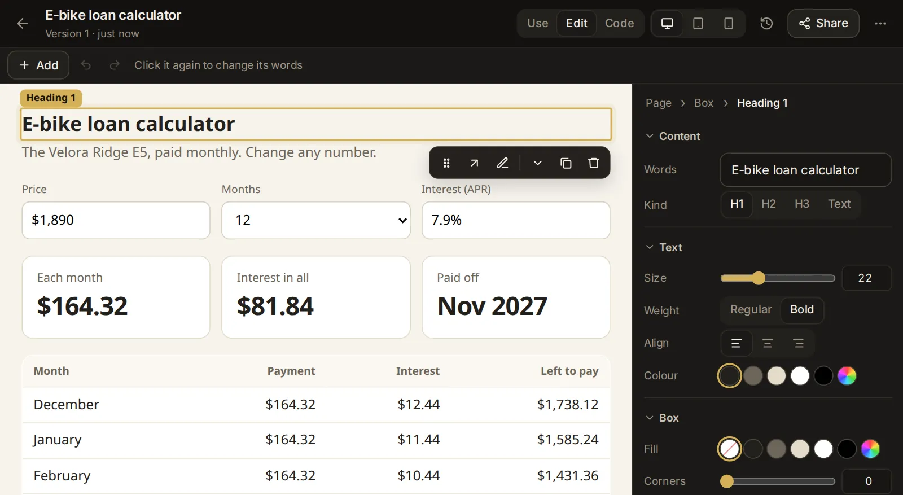

# Pages and published sites

Agents can answer with a page instead of plain text: a report, a chart, a table to compare options, or a small tool such as a tracker, a calculator or a checklist. This topic covers the pages agents show in a conversation and how you answer them, keeping a page in your Pages library (with its versions, the data it keeps and an address of its own for your phone), and publishing a page or a built website at a link others can open.

## Pages in the conversation

When a picture says more than words, an agent shows a page right in the conversation: a report, a chart, a table, a diagram, a mock-up, or options to pick from. Any agent in the app can do this; ask for it in plain words ("show me this as a chart", "compare the three laptops in a table").

The page sits in the reply, as wide as the conversation, and grows to fit what it holds. A very tall page stops at a set height and shows **See the whole page** at its bottom edge. The bar above the page has:

- the page's title;
- **Keep**: puts the page in your Pages library (see [Keep a page](#keep-a-page));
- **Save as a file** (the download icon): saves the page as an `.html` file you can open in any browser;
- **Full screen** (the expand icon): opens the page over the app. Press Escape, tap the close button (✕) or click beside it to close it.

A page runs in a frame of its own, apart from the app: it can't reach the app, your files or your sign-in. It can load charting and other libraries from the web.

If you share the session with a read-only link, the person sees its pages too, but can't keep them, and what they pick on them goes nowhere ([Share a read-only link](/guide/sessions#share-a-read-only-link)).

## Pick an option or fill in a form on a page

Some pages ask you something: which of three plans you prefer, the dates of a trip, which items to keep. Your answer goes to the message box, never straight to the agent:

- **Click an option**, and a line such as `Chose: B` or `Color: Blue` appears in the message box. Where the page lets you pick several, they go in together (`Color: Blue, Green`). Pick another option in the same group and its line takes the place of the first one; nothing piles up.
- **Fill in a form and submit it**, and its answers go in as a short list under the form's name, one line per field.

Add anything you like to the message, then send it as usual. The agent reads your picks as part of your message.

While a page is full screen, your picks wait and go into the message box when you close it (the message box is under the page).

## Keep a page

A page shown in the conversation lasts as long as the conversation. To come back to it later, keep it:

1. Click **Keep** in the bar above the page.
2. "Kept in Pages" confirms it. The button now reads **Kept**; click it to open the page in Pages.

What you entered on the page while it was in the conversation goes with it. Before you keep it, a page remembers what you enter only while it is on screen; once kept, it keeps its data for good (see [The data a page keeps](#the-data-a-page-keeps)).

You can also ask an agent for something to keep from the start: "make me a habit tracker I can use on my phone", "a checklist for moving house". The agent saves it in Pages itself, and a card shows in the conversation with:

- the page's title and **Saved in Pages · version 2** (the version this reply saved);
- **Open**, which opens it in Pages, and **Full screen**;
- the page itself, working, with its data, right in the card.

When a newer version is saved later, an older card says **a newer one is there**. It still shows its own version and reads the page's data, but what you change there is not kept. If that version is no longer kept at all, the card says "This version is no longer kept; Open shows the latest". If the page was deleted, the card says so.

Agents can also change a page you kept: ask "add a notes column to my habit tracker" and the agent saves a new version of it. Your data stays, and the older versions stay as they were.

## Find your pages

**Pages** in the sidebar ([/pages](/pages)) holds everything you kept and published. On a phone, open the sidebar with **Menu** (≡) first. You can also find a page by its title in the search box (Ctrl+K, ⌘K on a Mac).

The page has two tabs, each with a count:

- **Saved**: your pages, the latest changed first. Each shows its first letter in a coloured square, its title, when it last changed, its version and, when it stores data, how much (`keeps 14 KB`). **Open** opens it; **More** (⋯) has **Rename**, **Publish** and **Delete**.
- **Published**: the pages and folders you published, with their links (see [See and unpublish what you published](#see-and-unpublish-what-you-published)). [Open the Published tab](/pages?tab=published).

With nothing kept yet, the Saved tab says "No saved pages yet" and suggests keeping a page or asking an agent for a small tool.

## Open a page

A page opens full screen inside the app, at its own place in Pages. The bar at the top has:

- the back arrow (**All pages**) to the list;
- the page's title, and under it its version, when it last changed and how much data it keeps. Click the title to rename the page;
- **Versions**: its earlier versions (see [Go back to an earlier version](#go-back-to-an-earlier-version));
- **On a phone**: its own address, for your phone (see [Use a page on your phone](#use-a-page-on-your-phone));
- **Publish**: put it at a link others can open (see [Publish a page](#publish-a-page));
- **More** (⋯): **Rename**, **Open in a new tab** (opens the page at its own address) and **Delete**.

On a phone, **Versions**, **On a phone** and **Publish** are icons, without their words.

Pages made with the app's ready-made look follow the app's light or dark theme.

## Rename a page

Click the page's title at the top, or use **More** (⋯) → **Rename** in the page or in the list. Type the new name (up to 120 characters) and click **Rename**. The page's name is also the name it gets when you add it to a phone's home screen.

## Go back to an earlier version

Every save of a page is a version of its own: the first one (kept by you, or saved by an agent), each change an agent saves, and each older version you bring back. Nothing is lost when a page changes.

1. Open the page and click **Versions**.
2. The list shows each version (`v3`), its title (**The latest** for the current one), when it was made, who made it (**by the agent**, **kept by you** or **brought back**) and its size.
3. Click a version to look at it. A band above the page says "An older version, as it was 2 days ago. What it changes here is not kept." The older version works with the page's data, but anything you change in it is thrown away.
4. Click **Bring it back** to make it current, or **Back to the latest** to leave it.

Bringing a version back adds it as a new version on top ("Version 3 is back, as version 6"), so the versions after it stay too. The page's data is not touched.

A page keeps its newest 40 versions. Older ones go first, also when the versions together pass 24 MB; the current version always stays.

## The data a page keeps

A small tool needs to remember things: the workouts you logged, the boxes you ticked, your budget's entries. A kept page stores them with the app, on the computer it runs on, not in one browser. So it shows the same data wherever you open it: in Pages, in its card in the conversation, and at its own address on your phone.

- The list and the page's top bar show how much it keeps (`keeps 14 KB`).
- A page can keep about 2 MB in all, up to 512 KB in one entry and up to 1,000 entries. Past that, it can't save more.
- New versions and versions brought back keep the same data.
- Agents can read a page's data, to answer questions about it ("how many runs did I log this month?") or to change the page to fit it.
- A published copy of a page does not keep data (see [Publish a page](#publish-a-page)).

There is no button to clear a page's data; ask an agent to remove what you want gone, or delete the page.

## Use a page on your phone

Every kept page has an address of its own. It opens just the page, with its data, on any device, without signing in to Naget Agent: handy for a tracker you fill in on your phone.

1. Open the page and click **On a phone**.
2. The **Its own address** box shows the address. Click the copy button, or **Open** to try it.
3. Open the address on your phone. To add it to the home screen:
   - **iPhone**: open it in Safari, then **Share** → **Add to Home Screen**.
   - **Android**: open it in Chrome, then **⋮** → **Add to Home screen**.

From the home screen the page opens full screen, like an app, under its own name. At its own address it follows the phone's light or dark setting.

Anyone who has the address can open the page and change what it keeps, so share it only with people you trust with that. Your phone also has to be able to reach the app's address ([Reach the app from another device](/guide/devices#reach-the-app-from-another-device)).

### Give a page a new address

If an address went somewhere it shouldn't, replace it:

1. Open the page, click **On a phone**, then **New address**.
2. Confirm **New address**. The old address stops working at once, also on home screens it was added to. "The page has a new address" confirms it.

Add the new address to your home screen again where you want it.

## Delete a page

Use **More** (⋯) → **Delete** in the list or in the open page, and confirm. The page goes with all its versions, the data it keeps and any published copy of it. Its address stops working.

Pages holds up to 1,000 pages, and one page's HTML can be up to 2 MB.

## Publish a page

Publishing puts a page at a link that people can open without the app's password. Use it to show someone a report or a small tool you made.

1. Open the page and click **Publish**, or use **More** (⋯) → **Publish** in the list.
2. Check the **Name** (up to 60 characters).
3. Pick the kind of link:
   - **Private link**: an unguessable link, so only people you give it to can open it.
   - **Public link**: a readable link made from the name (such as `/site/trip-plan/`), so anyone may find and open it.
4. Click **Publish**. The box shows the link with buttons to copy it and to open it. Click **Done**.

A published copy shows the page as it is now, and later versions show there too. It does not keep data: what someone enters is gone when they reload it. To use a page yourself on your phone, with its data, open it at its own address instead ([Use a page on your phone](#use-a-page-on-your-phone)).

The link starts with the address you reach the app at, so people can open it only if they can reach that address. If only your own devices can reach the app (with Tailscale, for example), only they can open the link ([Reach the app from another device](/guide/devices#reach-the-app-from-another-device)).

## Publish a website from a folder

You can also publish a website that a project builds, such as an app made with Vite or a static site generator: the folder its build writes, with an `index.html` in it.

1. Open [Pages → Published](/pages?tab=published) and click **Publish a folder**.
2. Pick **The folder**: a built site with an `index.html` (`dist/`, `build/` or `out/` after the build).
3. The **Name** fills in from the folder's name; change it if you like.
4. Pick **Private link** or **Public link**, then click **Publish**.

The site is served from the folder as it is on disk, so a new build shows at once, without publishing again. What can be published:

- the folder must hold an `index.html`;
- not your home folder, the folder above it, the top of the disk, the app's own data, or a folder inside a hidden folder (one whose name starts with a dot);
- at most 5,000 files and 300 MB;
- files and folders whose names start with a dot (`.env`, `.git`) are never served.

An address inside the site with no file behind it and no file extension (`/site/…/about`) gets the site's `index.html`, so apps that change pages by themselves keep working. If the folder is moved or deleted, the link shows that it is gone: publish it again.

### What a published site can do

A published site runs in a closed-off space of its own, apart from the app: no cookies, nothing of the app's sign-in or data, and what it saves in the browser is forgotten on reload. It has no server code of its own. It can load scripts from its own files and from three public script hosts (jsDelivr, unpkg and cdnjs), and call outside services over HTTPS. Private links are kept out of search engines.

Built sites that load their files from the root of the address (`/assets/…`) don't find them under the site's link. Build them with relative paths (in Vite, `base: './'`). An agent that asks to publish such a folder is warned to rebuild it first.

## When an agent asks to publish

Agents can publish too, but only with your yes. Ask "publish my site" or "put the trip plan online", and the agent shows a card in the conversation:

- **Publish "Trip plan"?**, with what it would publish: the saved page, or the folder with its number of files and size;
- **Private link** or **Public link** to pick, with what each means: "It opens in a sandbox, apart from this app; unpublish it any time in Pages.";
- **Publish** and **Not now**.

Nothing is published until you click **Publish**. The agent then gets a message with the outcome and the link. The card changes to **Published "Trip plan"** with the link to copy or open, to **Not published: "Trip plan"** when you clicked **Not now**, or to **"Trip plan" was not published** with the reason when it failed.

An agent can have up to five requests to publish waiting in one session.

## See and unpublish what you published

[Pages → Published](/pages?tab=published) lists everything published, the newest first. Each shows its name, **Private link** or **Public link**, what it serves (a page's title or a folder's path) and when it was published, with the link to copy or open.

To take one down:

1. Click **Unpublish** beside it.
2. Confirm **Unpublish**. "Its link stops working at once." "Unpublished" confirms it.

You can publish it again later; a private link is then a new one. Deleting a kept page also unpublishes it. Up to 200 sites can be published at a time.

With nothing published, the tab says "Nothing published". **Publish a folder** is at the top right of this tab.

## Ask an agent

Agents can read and change your pages for you, with your OK on a card. A few things to try:

- "Make me a workout log I can use on my phone, and keep it in Pages."
- "My budget tracker looked better yesterday: bring back the version from before your last change."
- "What did I log in my habit tracker this week? Sum it up."
- "Rename the page 'Untitled checklist' to 'Moving house'."
- "I sent my packing list's address to the wrong person: give it a new address."
- "Publish the trip plan at a private link", or "unpublish the site we made last week."
