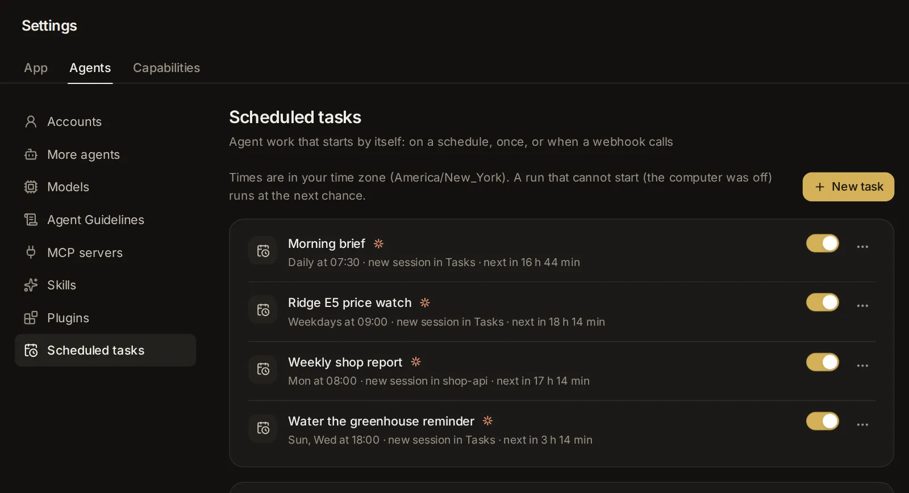

# Scheduled tasks

A scheduled task is agent work that starts by itself: at a time of day, every few minutes or hours, once, when another service calls its webhook, or when something you watch changes. Use one for a morning brief, a reminder, a price or a page to keep an eye on, a weekly report, a review of each new pull request or a look into each failed CI run, and the result comes to you without you having to start a session.

## What a scheduled task is

A scheduled task is a prompt with a trigger. Each time the trigger fires, the app starts a run: a new session with the task's agent, model and folder, whose first message is the task's prompt (or, if you choose, the prompt goes into a session you already have). The agent works as it does in any session. At the end it says how it went in one line, and the task's history keeps that line, the cost and a link to the session.

A task can start:

- **At a time**: a time of day on the days of the week you pick, or by a cron expression.
- **Repeating**: every so many minutes (at least 5) or hours.
- **Once**: at a date and time.
- **Watch**: when a watcher sees a change in a feed, a web page, a value in JSON, a folder or a command's output. A watcher looks without a model, so its checks cost no tokens; the agent wakes only when something changed.
- **Webhook**: when another service (GitHub, Gitea, a form, a script of yours) calls the task's own address.

A task can also run one of your apps in place of a prompt: each time its trigger fires, the app runs with the answers you set, and the task's history links to that run (see [Run an app by itself](/guide/apps#run-an-app-by-itself)).

Times are in your time zone, which the app takes from your browser. A run that could not start at its time, because the computer was off or the app was not running, runs at the next chance.

Your tasks are in [Settings → Scheduled tasks](/settings?s=tasks) (**Settings → Agents → Scheduled tasks**). The search box (Ctrl+K, ⌘K on a Mac) also finds a task by its name and opens it there. There are five ways to make one:

- **New task** in Settings, where you set every part yourself.
- **Start from an example**: a short form for a common task.
- Asking an agent in any conversation ("remind me Friday at 9"): it shows a card you confirm.
- **Make this an automation** in a session's menu: it drafts a task from a session that worked.
- **Add a schedule** on an app's **Runs**: a task that runs that app.

Continuing a session by itself once a plan's usage limit resets is a separate switch: [Settings → General → Resume after usage limits](/settings?s=general&find=Resume%20after%20usage%20limits) (see [Usage, limits and costs](/guide/usage)).

## See your scheduled tasks

[Settings → Scheduled tasks](/settings?s=tasks) has a group, **Your tasks**, whose line names your time zone (its (i) adds that a run that could not start, because the computer was off, runs at the next chance), and lists your tasks, oldest first. The list updates by itself as runs start and end. Each row shows:

- An icon for the trigger (a calendar, an eye for a watcher, a webhook sign), the task's name and its agent's icon.
- When it runs and where, such as "Weekdays at 09:00 · new session in reports · next in 14 h 20 min", or "posts into a session".
- For a watcher, its last look: "Looked 5m ago: 12 items, 2 new" (in amber when the look failed).
- When the task paused itself, why, with "Turn it on to try again."
- Dots for its latest runs (up to six, oldest first: green for done, amber for partly done or blocked, red for failed or an error, grey for nothing new) with **History** beside them; **Last run 3h ago** (in red, with the reason, when the last run could not start); and **Open**, which opens the last run's session.
- For a webhook task, its address with a copy button, and, for one made from an example, where to paste it in the service that calls it.

At the right of each row are a switch that pauses the task or turns it on, and the task's menu (⋯): **Run now**, **Edit**, **History**, **Duplicate**, **New address** (webhook tasks only) and **Delete**.

With no tasks yet, the list says "No scheduled tasks yet: start from an example below, or ask an agent to set one up".

## Make a new task

1. Open [Settings → Scheduled tasks](/settings?s=tasks) and select [**New task**](/settings?s=tasks&find=New%20task), the button beside the page's title. The **New scheduled task** form opens.
2. Type a name, pick the agent and the folder, and write the prompt.
3. Under **When**, pick when it runs.
4. Under **Each run**, pick where each run goes and its limits.
5. If you like, select **Test run** to try it once without saving (see [Try a task with a test run](/guide/tasks#try-a-task-with-a-test-run)).
6. Select **Create task**.

**Create task** and **Test run** wait until the task has a name and a prompt. A new task is set to run at 09:00 on weekdays, with the agent you picked last on the start page, in the app's default folder (usually your home folder).

### Name, agent and folder

- **Name** (the box that says "Name, e.g. Morning CI summary"): how the task shows in the list, in notifications and in the titles of its runs' sessions ("Morning brief · 3 Nov, 07:30"). Up to 120 characters.
- The agent chip: who runs it. Claude Code, Codex, Custom or another agent you added (see [Agents, accounts and models](/guide/agents-models)). Picking another agent clears the model and effort and sets that agent's usual permissions.
- The folder chip: the folder each run works in. Type a path or pick one, then select **Use this folder**. The folder must exist.

### Model, effort, permissions and other options

The row under them has the pickers of the start page:

- **Model** and **Effort**: the model and how hard it thinks. Left alone, the agent's defaults.
- **Permissions**: what the agent may do without asking you. A new task starts on **Ask** for Claude Code, **Auto** for Codex and **Auto** for Custom (routine steps go ahead, risky ones ask). Nobody may be watching when a run happens: a run that needs your approval waits for it, in its session and in the [inbox](/guide/inbox).
- **Agent**, **Memory** (when memory is on), **Spending cap**, **Swarm** and **Research**: each run's new session starts with these, as a session started from the start page would (see [Sessions](/guide/sessions), [Agents](/guide/agents) and [Memory](/guide/memory)). A task that runs as one of your agents is one of that agent's schedules: it shows on the agent's page, and its runs get the agent's tier and count towards its monthly budget. A run that fails or stops with an error on the agent's tier runs again a tier up, up to Best, unless the agent's **Step up when a check fails** is off. When the agent keeps a conversation of its own, each run posts into that conversation instead of starting a new session.

### The prompt

What the agent should do each time. Write it as complete instructions: a run starts fresh and cannot see the conversation where you had the idea. It can be up to 50,000 characters.

Each run's first message carries more than your prompt: a line naming the task, how often it runs, why this run started and the time now; a request to report how it went; and the task's notes from earlier runs. In the run's session all of this shows as one line, such as "Scheduled task Morning brief · Weekdays at 07:30". Select it to read the prompt and, under "Added by the app for this run", the rest.

### When it runs

**When** has five choices: **At a time**, **Repeating**, **Once**, **Watch** and **Webhook**. For the first three, a line under them ("Next: …") lists the next runs, up to three, in your time zone.

- **At a time**: a time of day and the days of the week (S M T W T F S). Select a day to turn it on or off; all seven means every day, and at least one always stays on.
- **Cron expression…** (under **At a time**) turns the time and days into a cron expression, a standard way of writing schedules, which you can then change; **A time of day instead** goes back. It has five fields: minute, hour, day of the month, month and weekday (0 or 7 is Sunday), in your time zone. `*/15 9-17 * * 1-5` runs every 15 minutes from 09:00 to 17:45 on weekdays. Month and day names (`jan`, `mon`) and the shortcuts `@hourly`, `@daily`, `@weekly`, `@monthly` and `@yearly` work too. An expression that does not work is refused, with the reason, when you save.
- **Repeating**: "Every [number] minutes" or "hours". The shortest interval is 5 minutes; a new repeating task runs every hour. The first run comes one interval after you save.
- **Once**: a date and time (an hour from now to start with). After its run the task turns itself off but stays in the list: you can run it again with **Run now**, or delete it.
- **Watch**: see [Watch for a change](/guide/tasks#watch-for-a-change).
- **Webhook**: see [Start runs from another service with a webhook](/guide/tasks#start-runs-from-another-service-with-a-webhook).

### Each run

- **Starts a new session** (the default), or **Posts into:** one of your recent sessions with the same agent (the 40 most recent that are not archived). Posting into a session keeps every run in one conversation, which uses its own model and settings. When the agent there is busy, the run's message waits in its queue until the turn ends, and the run's cost counts only its own part.
- **Stops past $**: a spending cap for each run, at API prices. The run's session stops once it has spent that much (checked after each model call). Empty means no cap. It is the same cap as the **Spending cap** chip above, and like it, applies to new sessions.
- **Pause after [3] failures in a row**: the task pauses itself after this many failed runs in a row, and tells you why. 0 means failures never pause it; the most is 50.

The line under them sums it up: "A run tells you how it went; one with nothing to report stays quiet, and failures always notify."

## Watch for a change

A watcher is a cheap check that runs every few minutes without a model and wakes the agent only when something changed. Pick **Watch** under **When**, then what to look at:

- **Feed**: the **Address** of an RSS or Atom feed (the list of new posts that many sites, blogs and code hosts publish). Each new item wakes the agent, with its title, link, date and summary (up to 25 at a time).
- **Page**: the **Address** of a web page, and **Which part** counts:
  - **Whole page**: any change to its readable text.
  - **Near a text**: only the lines with this text, and the line before and after each (for a price, "Price").
  - **Selector**: the part a simple CSS selector picks (the names a web page gives its parts): a tag, `#id`, `.class` or `[attribute=value]`, combined or nested, like `main .price`.

  The run gets the lines that appeared and the lines that went. The watcher reads the page as the server receives it, without running the page's scripts, so use **Test** to check that it sees what you see.
- **JSON**: the **Address** of a JSON answer (the data format many services' APIs give), **Value at** a path such as `data.price` or `data.items[0].price`, and **Wake when it** changes, equals, is not, is above, is below or contains a **Value**. Numbers compare as numbers. A condition wakes the agent when it starts to hold, not at every check while it holds.
- **Folder**: a **Folder** on this computer and, if you like, **Only files like** a pattern such as `*.pdf` (`*` stands for any text, `?` for one character). New files wake the agent, with their names, sizes and dates. Hidden files and subfolders are left out.
- **Command**: a **Command** that runs with your shell in the task's folder at each check, for a minute at most, and whether to wake **When its output changes** or **When its exit code changes** (the number a command ends with: 0 usually means it worked). The run gets the output and what changed in it.

Then:

- **Check every [number] minutes**: how often it looks, from 1 minute to a week. A new watcher looks every 15 minutes.
- **Allow addresses on this computer or its network** (feeds, pages and JSON): off unless you tick it, so a watcher reaches only public sites. Only you can allow this, here in the form; a watcher an agent proposes never reaches your own network.
- **Test**: shows what the watcher sees now, with a line such as "12 items (first look)" and a sample of what it read, or what went wrong.

How a watcher behaves:

- Its first look after you save only takes note; changes after that wake the agent. Changing what a task watches starts it afresh.
- What it read reaches the agent marked as outside data, to work with and never to follow as instructions.
- A change that comes while the run for the last one is still going waits for the next look.
- When a look fails (the site is down, the text is no longer on the page), the row says so. After as many failed looks in a row as **Pause after … failures in a row** allows, the task pauses: "Paused after its check failed 3 times in a row: …".
- **Run now** on a watcher task runs the agent with what the watcher sees now, rather than with a change.

## Start runs from another service with a webhook

A webhook is an address another service calls when something happens: GitHub when a pull request opens, a form when someone sends it, a script of yours. Pick **Webhook** under **When** and save the task to get its address ("Save the task to get its address; each call to it starts a run"). It shows in the task's row, with a copy button. The address works without signing in to the app, because the secret part of it is the permission: keep it private, and prefer a permissions mode that asks before changes. The service has to be able to reach this app at that address.

Parts of the call can go into the prompt:

- `{{body.path.to.field}}`: a value from what the service sent (JSON, a form or plain text), such as `{{body.pull_request.html_url}}`.
- `{{headers.name}}`: one of the call's headers. Headers that carry credentials (Authorization, cookies, signatures, tokens) are never filled in.
- `{{query.name}}`: a value from the address's query (the part after `?`).
- `{{body}}` for all of the body, `{{request}}` for the body, headers and query together.

They reach the agent marked as outside data. **Run now** on a webhook task sends its prompt as written, with no call to fill it in.

The options under the address:

- **Signing secret (optional)**: type one or select **Generate**, and give the same secret to the service. Calls must then carry an HMAC-SHA256 signature of their body made with it (a code only someone who knows the secret can make), as GitHub, Gitea and others send; GitLab's token header works too. Calls without it are refused.
- **Signature header**: shows once there is a secret. Leave it empty for the usual ones (X-Hub-Signature-256, X-Gitea-Signature, X-Signature-256…), or name the one your service uses.
- **Filter (optional)**: **Run only when** or **Skip when** a path into the call **is** a value: `body.action` is `opened`, `headers.x-github-event` is `push`, `query.kind` is `daily`. A path without `body.`, `headers.` or `query.` reads the body. A call the filter leaves out is answered and starts nothing.

What the address does with calls:

- A delivery sent again with the same Idempotency-Key or delivery id (GitHub, Gitea and GitLab give each delivery one) runs once. The ids are remembered for a week.
- A call within five seconds of the task's last run is turned away, so a burst of calls starts one run.
- A paused task refuses calls. A call can carry up to 2 MB.
- The call is answered at once, with a link to the run's session. Add `?wait=60` to the address to wait up to 60 seconds for the agent's reply in the answer (up to 300); a run still going by then answers with a link to it.

## Give a webhook task a new address

If the address leaked, or a service should stop calling it: the task's menu (⋯) → **New address**, then confirm **New address** ("The current address stops working. Update the services that call it."). Editing a webhook task keeps its address; a duplicate gets an address of its own.

## Start from an example

Below the list, [**Start from an example**](/settings?s=tasks&find=Start%20from%20an%20example) ("A short form each; change anything later") holds ready-made tasks as rows, the first four showing and the rest behind **Show all examples** (**Show fewer examples** folds them again). Here they are in three groups: **Everyday**, **Watch** and **Engineering**. Select one to open its short form, fill it in, pick who runs it under **Run by**, and select **Create task**. **More options…** opens the full task form with everything filled in instead. Fields marked (optional) can stay empty; the others are needed. Switches (such as **Open pull requests**) say what the agent may do: on or off, as you like.

**Everyday**

- [**Morning brief**](/settings?s=tasks&find=Morning%20brief): the weather, news on what you follow, and your day, each morning. You give the time (07:30 to start with), the days, the city for the weather and the topics for the news; it adds today's events and urgent mail when a calendar or mail account is connected.
- [**News on a topic**](/settings?s=tasks&find=News%20on%20a%20topic): what is genuinely new about a subject, with sources, at the time and on the days you pick (every day at 09:00 to start with); quiet when nothing is.
- [**Weekly report from a folder**](/settings?s=tasks&find=Weekly%20report%20from%20a%20folder): on a day of the week (Friday at 16:00 to start with), what changed in a folder or repository in the last seven days and what looks unfinished, with three suggestions for next week. It changes no files.
- [**Inbox digest**](/settings?s=tasks&find=Inbox%20digest): what came into your mail since the last run, the messages that need you first. It only reads, and it needs a connected mail account (see [Connected apps, keys and tools](/guide/connections)).
- [**Habit check-in**](/settings?s=tasks&find=Habit%20check-in): a friendly question about a habit at the time you pick (every day at 20:00 to start with), keeping your streak in the task's notes.
- [**Reminder**](/settings?s=tasks&find=Reminder): a nudge at a set time on the days you pick (weekdays at 09:00 to start with). For a single reminder, see [Reminders](/guide/tasks#reminders).

**Watch**

- [**Price watch**](/settings?s=tasks&find=Price%20watch): watches a product page every 60 minutes (only near a text such as "Price", if you give one) and tells you when the price changes, or when it is at or below the target you give.
- [**Page change alert**](/settings?s=tasks&find=Page%20change%20alert): watches a page, or the part near a text, every 30 minutes, and says what changed and whether it matters; trivial changes stay quiet.
- [**New releases**](/settings?s=tasks&find=New%20releases): watches a GitHub repository's releases (owner/name) every 6 hours and sums up what is new and what could break.
- [**Site up check**](/settings?s=tasks&find=Site%20up%20check): checks an address every 10 minutes. When the site goes down, the agent finds out why (DNS, certificate, HTTP status, time-out); when it comes back, it says so in a line.
- [**Disk space alert**](/settings?s=tasks&find=Disk%20space%20alert): checks a disk (`/` to start with) every 30 minutes. When it fills past a mark (90%), the agent finds what takes the space and suggests what to clean up, deleting nothing.
- [**New files in a folder**](/settings?s=tasks&find=New%20files%20in%20a%20folder): watches a folder every 15 minutes (only files like `*.pdf`, if you say so) and does what you write under **Then** with each new file, or tells you in a line what each one is.

**Engineering** (more in [Engineering](/guide/engineering))

- [**Review new pull requests**](/settings?s=tasks&find=Review%20new%20pull%20requests): a webhook task in a repository folder that GitHub or Gitea calls for each new pull request (it runs only when the call says `opened`). The agent reviews the change and suggests fixes, without pushing or merging. Once it is saved, copy its address into the repository's webhook settings, as its row says (only **Pull requests** under the individual events).
- [**CI doctor**](/settings?s=tasks&find=CI%20doctor): a failed run on GitHub Actions, GitLab CI, Buildkite or CircleCI wakes an agent that reads the logs, tells flaky from real, re-runs it or opens a draft pull request with a fix, as you allow, and sums it up. See [CI doctor](/guide/engineering#ci-doctor).
- [**Issue triage**](/settings?s=tasks&find=Issue%20triage): each new issue is labelled, checked for duplicates, answered with a kind request for what it lacks, and, when the fix is small, tried as a draft pull request. See [Issue triage](/guide/engineering#issue-triage).
- [**Dependency gardener**](/settings?s=tasks&find=Dependency%20gardener): once a week (Mondays at 09:00 to start with), upgrades in worktrees with the tests run, security fixes first, one pull request per level of risk, or a report. See [Dependency gardener](/guide/engineering#dependency-gardener).
- [**Incident first responder**](/settings?s=tasks&find=Incident%20first%20responder): an alert from Sentry, Grafana, Datadog, Better Stack or another service wakes an agent that tells you at once, finds the likely cause, and asks before any rollback. See [Incident first responder](/guide/engineering#incident-first-responder).

A webhook example's form says, under its fields, where its address will go; once the task is made, its row says the same under the address.

## Try a task with a test run

**Test run**, in the form's footer, runs the task once now, as the form has it, without saving it. It runs like a real run, in a session of its own titled "Test: <name> · <time>", and a strip in the form shows **Test run** with how it went once it ends, and **Open its session**. A test run never counts toward the failures that pause a task. Testing a task you are editing reads its notes and shows in its history as a **Test run**; a new task has no notes yet.

## Run a task now

The task's menu (⋯) → **Run now** starts a run at once, whether the task is on or paused, and opens its session.

## See how the runs went

The task's menu (⋯) → **History**, or **History** beside the dots, opens the task's runs, newest first (the latest 50 show; the app keeps 100 per task). Each run shows:

- How it went: **Running**, **Done**, **Partly done**, **Blocked** (the agent needs you: access, or a decision), **Failed**, **Nothing new** or **Error** (it could not start, or its turn stopped with an error).
- When it started, what started it (**On schedule**, **Webhook**, **Watcher**, **Run now**, **Re-run** or **Test run**), how long it took and what it cost.
- The agent's one-line summary. Select a long one to read the agent's whole last reply.
- **Open its session**, and **Run again with the same input**, which runs the task again with what that run got: the same webhook call, or the same change a watcher saw.

The outcome is what the agent reported at the end. When it reported nothing, the app decides: **Error** if the turn stopped with one, **Nothing new** if the reply begins with [SILENT] or only says there is nothing to report, and **Done** otherwise. In the run's session, the agent's report shows as a step: "Reported done: …".

## Notes a task keeps between runs

Under the history is the task's notepad, **Notes its runs keep**: what the next run should know, such as what was already reported, a running total or where it stopped. Each run reads it at the start, and the agent adds to it or rewrites it. Select **Edit** to change it yourself, then **Save** (or **Cancel**). It holds up to 8,000 characters; past that, the oldest lines go.

## Notifications from a task

A run tells you how it went with its session's usual notification, titled with the session's name and saying the agent's one-line summary. It follows your notification settings (see [Inbox and notifications](/guide/inbox)).

- A run with nothing to report sends nothing.
- A failed run, or one that ended with an error, always sends a failure notice.
- A blocked run sends a notice that it needs you, beginning "Blocked:".
- A run that could not start (its folder is gone, the session it posts into was deleted) sends a failure notice, "Could not start: …".
- A task that pauses itself sends a notice saying why.
- A run that posts into one of your conversations leaves that conversation's notices as they are.

An agent can also send you a notification while it works (its notify_user tool), for something that cannot wait for the run's end; so can any agent, and an app's step.

## Pause, turn on, edit, duplicate or delete a task

- **Pause or turn on**: the switch on the task's row. A paused task does not run or look, and its webhook refuses calls. Turning a task on again clears its count of failures and the reason it paused.
- **Pausing by itself**: after the set number of failures in a row, the task pauses and its row says why ("Paused after 3 failed runs in a row. The last: …").
- **Edit**: the task's menu (⋯) → **Edit** opens the form as **Edit task**; select **Save**.
- **Duplicate**: opens a new task form with a copy named "<name> (copy)", to change and save.
- **Delete**: asks first: "It stops running, and its history goes. Sessions it started stay."

## Let an agent set up a task

Ask in any conversation, in your own words: "remind me Friday at 9 to call the dentist", "every Monday morning, sum up last week's issues", "tell me when this page changes". The agent proposes the task, and a card shows it in the conversation. Nothing is saved until you answer.

The card asks **Schedule this task?**, with the task's name and **Waiting for you**, and shows:

- **When**: the schedule in words, with the next runs in your time zone. For a watcher, what it watches and how often, with the address or command, and "It looks right after you confirm, and the agent wakes only when something changed."
- **Does**: the prompt (**All of it** opens a long one).
- **Runs**: the agent, its model, and where: a new session in a folder, or in this conversation.

Then choose:

- **Schedule it**: saves the task and turns it on.
- **Edit…**: opens the task form with everything filled in, to change any part first; its button says **Schedule it** too.
- **Not now**: declines.

The agent hears your answer as a message, including any parts you changed, so you need not tell it. The card stays in the conversation with the outcome ("Scheduled", "Next run …", a link to **Scheduled tasks**), and shows the same on your other devices.

Unless you ask for something else, the task runs with the conversation's agent, model, permissions and folder, and each run's session starts with the conversation's settings: its agent, memory, spending cap, connected accounts and project. Ask for the runs to post here, and each one posts into this conversation instead of starting a new session.

Agents can also change, pause, turn back on or delete your tasks, always with a card first: **Change this task?** (the parts that change, the old value struck through above the new), **Pause this task?**, **Turn this task back on?** or **Delete this task?**, each with its own yes and no (**Change it** or **Keep it as is**, **Pause it** or **Keep it running**, **Turn it on** or **Keep it paused**, **Delete it** or **Keep it**). They can also list your tasks with when each runs next and how the last run went.

Some limits keep this in hand:

- One conversation can have up to five proposals waiting for your answer.
- An agent cannot propose a new task once you have 100.
- A scheduled run cannot schedule or change tasks; it is told to suggest one in its summary instead.
- A watcher an agent proposes never reaches addresses on your own computer or network.

## Turn a session into a task

When a session did something you want done again: the session's menu (⋯) → **More** → **Make this an automation**. The [helper model](/settings?s=models&find=Helper%20model) reads the conversation and drafts a task: a prompt that can run again by itself (without this time's one-off details, with your corrections folded in) and a trigger that fits. The agent, model, effort, permissions, folder and the session's settings come from the session; a session in a worktree runs in the repository it came from.

The form opens as **New automation from this session**, with a line saying why it picked that trigger. Change anything, try a test run, then save; the task is then in [Settings → Scheduled tasks](/settings?s=tasks). A session with no messages of yours cannot be turned into a task.

## Reminders

A reminder is a task whose run tells you something at a set time, as a notification and in its session. Three ways to set one:

- Ask an agent: "remind me tomorrow at 8 to take the bins out". It proposes a task that runs once, and you confirm it on the card.
- Use the [**Reminder**](/settings?s=tasks&find=Reminder) example for one that repeats on the days you pick.
- Make a **New task** with **Once** under **When**, and a prompt such as "Remind me, in one friendly line, to call the dentist."

## On a phone

[Settings → Scheduled tasks](/settings?s=tasks) works the same on a phone. The task form, the examples' forms and the confirmations (before **Delete** or **New address**) open as sheets from the bottom of the screen. The choices under **When** and a watcher's kinds scroll sideways when they do not fit, and the examples are one column of rows. To hear from your tasks with the app closed, turn on notifications for the phone (see [Inbox and notifications](/guide/inbox)).

## Ask an agent

- "Every weekday at 7:30, give me the weather in Athens and the AI news since yesterday."
- "Remind me on Friday at 9 to call the dentist."
- "Watch this product page and tell me when the price drops below €99."
- "Which of my scheduled tasks failed this week, and why?"
- "Pause my Morning brief", or "Run the weekly report now."
- "Make this conversation a task that runs every Monday at 9."
- "Run my Reading list app whenever this feed has a new post, with the post's link."
- "Set up a CI doctor for ~/code/shop on GitHub Actions that may re-run flaky jobs."
