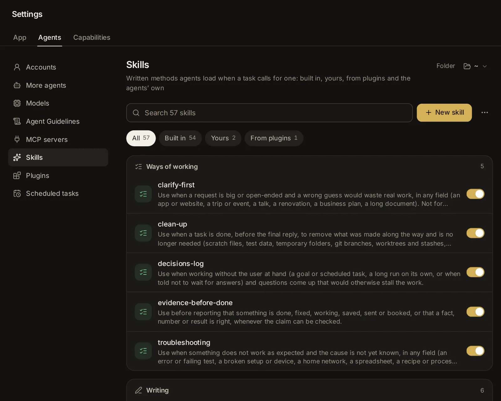

# Skills

Skills are written methods agents load when a task calls for one: how to research a question, track down a bug, plan a project, make a Word document or clean up after a task. Every skill agents can use is on one page, [Settings → Skills](/settings?s=skills): the ones that come with the app, yours, those your plugins bring, Claude Code's and Codex's own, and your projects'. Its switches are for every session; a project can switch any skill the other way for its own sessions. This topic covers them all, the skills agents learn with your approval, and keywords that bring a skill in for Custom.

## What a skill is

A skill is a short guide an agent follows for one kind of work. Each one is a folder with a file named SKILL.md in it: a name, one line on when to use it, then the steps, the checks and the mistakes to avoid. Some skills also bring files of their own: examples, templates or small scripts the steps use.

Agents don't read every skill all the time. At the start of a session an agent sees only each skill's name and its "when to use it" line. When a task fits one, it loads that skill and follows it. A greeting, a quick question or a small, clear change needs none.

## Where skills come from

The Skills page shows skills from five places, each marked on its row:

- **Built in**: the skills that come with the app (more than sixty). They update with the app.
- **Yours**: skills you wrote on this page, approved when an agent suggested them, or put in your skills folder yourself.
- **From plugins**: the skills of the [plugins](/guide/plugins) you turned on. They come and go with their plugin.
- **Claude Code and Codex**: the agents' own skills, in their own folders. Only that agent gets them.
- **In projects**: a project's own skills, which only its sessions get. You change them on the project's **Skills** tab: see [Give a project skills of its own](/guide/projects#give-a-project-skills-of-its-own).

The first three make up the skill library, which every agent the app starts gets. An assistant can also name skills it favors: when one of them fits the task, the agent loads it before it starts. See [Assistants](/guide/assistants).

## Which agents get which skills

Every session the app starts gets the skill library:

- **Claude Code** gets it as a plugin named "hydor", so its skills show with that name in front: hydor:research, hydor:writing and so on.
- **Codex** gets it as an extra folder of skills.
- **Custom**, the app's own agent, gets it in its list of skills. See [Custom](/guide/custom).
- **Other agents** (Gemini CLI, OpenCode and the rest) get the list of skills, each with the file to read when one fits.

Sessions started outside the app, in a terminal or in VS Code, don't see the library. Nothing of it is written into your Claude Code or Codex settings.

A session in a project gets the project's own skills with the library's, each as the project switches it (see [Turn a skill on or off for this project](/guide/projects#turn-a-skill-on-or-off-for-this-project)). A project's skill with the name of a library skill takes its place in that project's sessions.

Your own skills come before the built-in ones: one of yours with the name of a built-in skill takes its place. A plugin's skill with a name the library already has is left out, and its plugin's page says which skill agents get instead.

Custom reads skills from several folders, in this order: the project's own skills (in its `.claude/skills` and `.agents/skills` folders), Claude Code's and Codex's own skills in your home folder, then the library. Where two skills share a name, the first one found wins. So a skill you write for Claude Code or for Codex reaches Custom too.

## See when an agent uses a skill

When an agent loads a skill, a small pill shows in the conversation: **Using skill research**, with a spinner while the agent reads it. This works for Claude Code, Codex and Custom alike.

Click the pill to read the skill: what it says, when it applies and its history. If the skill isn't part of the app's library, the window says so: it comes from the agent's own skills folder, or the project's. In a project, the pill opens the project's own skill when that is the one the agent used: the window's badge shows the project's name, and **The project's skills** opens its Skills tab.

When your own words brought a skill into a Custom session, the pill says which words did it: "brought in by “research” in your message". See [Bring skills in by keywords](#bring-skills-in-by-keywords).

Each time an agent loads a skill counts as a use. A library skill's row shows how often it was used, and when last.

## Open the Skills page

Go to **Settings → Agents → Skills** ([open it](/settings?s=skills)). On a phone, open Settings, then tap **Skills** under Agents.

From the top, the page has:

- a box with the skills agents suggested, when there are some (see [Approve, edit or dismiss a proposed skill](#approve-edit-or-dismiss-a-proposed-skill));
- a search box, **New skill**, and the **⋯** menu: **Suggest skills that fit**, **Bring skills in by keywords**, **Your skills folder** (opens it in Files), **Get more with plugins** (opens [Settings → Plugins](/settings?s=plugins)) and **How agents get skills**;
- a row of filters: **All**, **Built in**, **Yours**, **From plugins**, **Claude Code and Codex** and **In projects**, each with how many skills it holds. Only the ones with skills show;
- the skills, in groups by what they are for: **Ways of working**, **Writing**, **Documents**, **Research and the web**, **Planning and decisions**, **Data and numbers**, **Design and pictures**, **Coding**, **AI models** and **This app**; then **Claude Code's own**, **Codex's own**, and a group for each project with skills of its own;
- at the bottom, your skills you removed, to bring back.

Claude Code's and Codex's own skills are listed as every folder has them: yours, and those that come with the agents. A project folder's own (in its `.claude/skills`) are on that project's **Skills** tab.

## Find a skill

Type in the search box: it matches skills' names, what they are for, and their plugin's or project's name. Press Esc, or the cross, to clear it. Pick a filter to see only skills of one kind.

You can also find a skill from the app's search box (Ctrl+K, ⌘K on a Mac): type its name or what it is for. Skills show under **Skills**, and picking one opens this page at it.

## Turn a skill on or off

Every skill of the library and of Claude Code and Codex has a switch at the end of its row. A skill turned off stays where it is, but agents no longer get it; its row is greyed and says **Off**. Turn it back on with the same switch. You can also switch it in its window.

- A library skill (built in, yours or a plugin's) turned off is left out for every agent, in every project that doesn't switch it on for itself.
- Claude Code keeps its own choice in its settings, by the skill's name; Codex keeps it in its own configuration.

The switches here are for every session. A project can switch any skill the other way for its own sessions, on its **Skills** tab: see [Turn a skill on or off for this project](/guide/projects#turn-a-skill-on-or-off-for-this-project). Then the skill's row here says so: "Off in Thesis", or "On in 2 projects".

A project's own skills have no switch here: change them on the project's **Skills** tab.

## Read a skill and its history

Click a skill's row, or a **Using skill** pill in a conversation. A window opens with:

- where it comes from, its group, and how often agents used it;
- its switch: **Agents get it**, or **Off: agents do not get it**;
- the projects that switch it the other way for their sessions, each with **On** or **Off**: click one to open its Skills tab;
- when to use it, and its keywords, if it has any ("Custom brings it in when you say" and the words);
- the instructions, as agents read them;
- **History**, when it has changes: every change, newest first, **Saved**, **Changed**, **Removed** or **Brought back**, how long ago, and how many lines were added and removed. Click a change to see it line by line;
- at the bottom, where its file is: click it to show it in Files.

The buttons at the bottom depend on the skill:

- Built in: **Make my own version** (see [Change a built-in skill](#change-a-built-in-skill)).
- Yours: **Change** and **Remove**.
- A plugin's: **Its plugin** (opens the plugin) and **Make my own version**.
- Claude Code's or Codex's: **Change** (or **Open**, for skills you can't delete), which opens its SKILL.md in an editor, and **Delete**.
- A project's: **The project's skills**.

On a phone the window opens as a sheet from the bottom of the screen. **Close** shuts it.

## The built-in skills

The app comes with these skills, in the groups the page shows them in. Open any of them to read it whole.

**Ways of working**

- **clarify-first**: for a big or open-ended request (a website, a trip, a renovation, a talk, a business plan). The agent first reads what is already there, asks one question at a time and says why, plays back what it understood, offers two or three ways to do it, and writes a short brief for you to approve before it builds anything.
- **clean-up**: at the end of a task. The agent lists what it made along the way, removes what is no longer needed (scratch files, test data, temporary folders, merged or abandoned branches, worktrees, processes it started), never removes what it didn't make, asks first about anything big or shared, and says in a line what it removed and what it left. While **Clean up after a task** is on in [Settings → Assistants](/settings?s=assistants&find=Clean%20up%20after%20a%20task) (it is unless you turn it off), every agent is told to do this at the end of a task.
- **decisions-log**: for work without you at hand (a goal, a scheduled task, "don't wait for me"). The agent settles ordinary questions itself, writes each decision down with why and what it costs if wrong, and carries on. It stops only before steps that can't be undone (sending, paying, deleting, publishing), anything touching passwords or access, or anything outside the work; its final message lists every decision it made.
- **evidence-before-done**: before the agent says something is done, fixed, saved, sent or true. It names the check that would prove it, runs it, reads the result, and reports the claim with its evidence, or says plainly what it could not check.
- **troubleshooting**: for anything that doesn't work as it should (an error, a device, a home network, a formula, a recipe). The agent makes the problem happen on purpose, gathers facts, tests one idea at a time, fixes the cause and shows that it is fixed.

**Writing**

- **writing**: for anything people will read (a report, an article, a letter, a speech). The agent settles who reads it and what for, outlines before it drafts, and edits in separate passes.
- **creative-writing**: stories, novels, memoir, poems and scripts: finding the story, planning, drafting without stalling, getting unstuck, revising in order, feedback, and getting published (query letters, synopses, agents, self-publishing and the traps to avoid), with the writer's voice kept theirs.
- **email**: sorts an inbox (what needs a reply, what can wait, what to archive) and writes the emails that need care: replies, chasers, apologies, declining or saying no, at the right length and tone.
- **plain-language**: rewrites an existing text to read clearly and humanly, without jargon, filler or stiff, AI-sounding phrasing, at the right reading level, keeping what it says.
- **translation**: translates documents, messages, pages, app texts and subtitles faithfully and naturally, with a glossary for terms and names, numbers and dates for the place it is for, and a check of the result.
- **social-media**: plans and writes posts for each platform (LinkedIn, X, Instagram, Mastodon, Bluesky…), adapts one message to several, and keeps a content calendar.
- **seo**: getting a website, shop or blog found in search engines and in AI answers: a check of its pages, titles and descriptions, indexing, structured data and AI crawlers, and honest measuring, with no promised rankings.
- **release-notes**: writes release notes and changelog entries from commits and pull requests, for the people reading them, and picks the next version number.

**Documents**

- **pdf**: makes PDFs (reports, invoices, certificates, flyers, forms), merges, splits, rotates, fills in or stamps them, turns Office files into PDFs, and reads PDFs, scanned pages included.
- **presentations**: makes or changes slides (.pptx) with one look throughout, charts, tables and speaker notes, looks at them as pictures before handing them over, and reads .pptx, .ppt and .odp files.
- **spreadsheets**: makes or changes workbooks (.xlsx) with formulas, number formats and charts, checks the formulas for errors, and reads .xlsx, .xls, .ods and .csv files.
- **word-documents**: makes or changes Word documents (.docx) with real headings, lists and tables, looks at the pages before handing them over, and reads .docx, .doc and .odt files.

**Research and the web**

- **research**: plans the searches a question needs, searches wide and then narrow (papers, patents, news, filings), checks each key claim against two independent sources or one primary source, and answers with citations, saying what it could not confirm.
- **spin-check**: whether an ad, a viral post, a pitch or a claim is true, misleading or a scam: claim by claim, each checked against the source that can settle it, the persuasion tricks named, and a verdict for each.
- **papers**: works closely with academic papers: who cites one, a legal full text, reading and summarising, a table comparing studies, judging a study's quality, and citing it properly.
- **blocked-pages**: when a page won't load or read (an error, a paywall, a cookie wall or bot check, a page that needs JavaScript), it tries the other ways to its content in order, and never gets round what you have no right to.
- **web-scraping**: collects structured data from websites (listings, tables, prices, a catalogue) into CSV or JSON politely and reliably, and checks it.
- **maps-and-places**: places without paid map services: the coordinates of an address, what is nearby, distances, routes and travel times, time zones, opening hours, and a map in a page.
- **watch-and-alert**: keeps an eye on something over days or weeks (a price, a product back in stock, news about a company, a page changing, a new release) with a scheduled task, and tells you only when it matters.

**Planning and decisions**

- **decision-brief**: helps you choose: the options (doing nothing among them, when it is real), what matters and how much, the trade-offs and risks, and a clear recommendation, on one page.
- **project-plan**: plans a project of any kind (an event, a move, a launch, a renovation): milestones, tasks with owners and dates, what depends on what, risks, and a timeline to keep up to date.
- **meetings**: whether to meet at all, an agenda written as questions, who to invite, chairing it, one-on-ones and the follow-up, and getting ready for a meeting someone else runs.
- **weekly-review**: a weekly reset: what is open and promised, what stalled, and next week's priorities and time.
- **brainstorming**: many ideas with named methods (reversal, constraints, analogies, the worst idea…), then sorting them and picking a few to try.
- **study-coach**: learning a subject or a skill: what you know already, a plan, explanations at your level, practice questions, and flashcards to come back to.
- **job-interviews**: getting ready for a job interview: what the role needs, a bank of true examples, mock interviews one question at a time with honest feedback, hard questions, and a review of how one went; for interviewers too.
- **solo-business**: a business of your own (freelancing, a service, a product, a side business): what you need from it, an offer tested with paying customers before building much, prices that pay for your time, and when to change course or stop.

**Data and numbers**

- **data-analysis**: answers questions from data (a CSV, an Excel sheet, an export): checks and cleans it, works it out in a way that can be checked, and says what the answer rests on.
- **dashboards**: the right chart for the question, and dashboards to come back to as a page in your Library, with their data kept or fetched live.
- **notebooks**: Jupyter notebooks that read well and run again: a text cell before each section, small cells, an environment to run them in (made beside the notebook when none fits), a full run from the top before one is handed over, and a card that opens it in the app's notebook page.
- **financial-model**: a business's numbers in a spreadsheet (revenue, costs, cash flow, break-even, scenarios), with the assumptions on a sheet of their own and formulas that can be followed.
- **sql-and-databases**: correct, safe SQL, schema changes and migrations that are safe on live data, indexes, and a backup before anything risky.

**Design and pictures**

- **image-prompts**: making pictures (and short videos) with the app's image models: what to describe, sizes, text in pictures, keeping a character or style the same across pictures, and editing one.
- **diagrams**: flowcharts, timelines, org charts, mind maps and architecture diagrams people can read, shown in the conversation or kept as a page.
- **infographics**: one-page visual explainers (an infographic, a poster comparing options, a process or timeline graphic): the message and sourced facts first, the structure that fits them, a style, then the real export checked at the size people will see it.
- **ui-mockups**: before a screen or page is built, two or three quick, clearly different mockups shown in the conversation to compare and pick from.
- **brand-kit**: a brand for a small business, club or project: who it is for, its voice, colours with their contrast checked, free fonts, logo ideas, and a brand card and book, put to use on profiles and cards.
- **youtube-thumbnails**: a thumbnail and title that make one honest promise: three different ideas, legible when tiny, previewed beside other videos, and tested with YouTube's Test & Compare.

**Coding**

- **debugging-code**: the root cause of a bug: a failing test first, the stack trace, narrowing it down (logs, a debugger, git bisect), the fix and a test that keeps it fixed.
- **test-first**: tests before the code, for new behaviour and bug fixes, at the right level, with what to mock and what not.
- **code-review**: reviewing a change, or the agent's own work before handing it over: correctness first, then security, tests and clarity, each finding with where, why and a fix.
- **refactoring**: changing code's structure without changing what it does, in small steps with the tests passing.
- **codebase-tour**: finding one's way in an unfamiliar codebase: how to build, run and test it, its parts and where things live, with a short overview and a diagram.
- **git-rescue**: getting out of Git trouble safely: undoing commits, finding lost work, settling conflicts, a secret committed by mistake, always with a backup first.
- **github**: pull requests, reviews, checks and their logs, issues and releases on GitHub, with the gh command or its API.
- **api-requests**: calling and debugging web APIs: sign-ins with your saved keys, error answers, pages of results, rate limits and retries.
- **frontend-polish**: making a web page look and feel finished: layout, spacing, type, colour and contrast, every state, phones, the keyboard, checked on real screenshots.
- **web-accessibility**: websites and web apps everyone can use (the keyboard, screen readers, zoom, contrast, captions, forms and dialogs), checked with tools and by hand, and reported honestly.
- **web-app-qa**: testing a web app like a demanding user, in the browser, and writing up the bugs found with steps and evidence.
- **docker**: Dockerfiles and compose files, building and debugging containers, and cleaning up carefully.
- **servers**: looking after a server or another computer over SSH (updates, a failing service, a full disk, users and keys, the firewall, backups), always with a way back in before touching access, one machine first and a check after each change.
- **security-check**: a practical security review: secrets, injections, who may do what, outdated packages, each problem reported by how serious it is.
- **performance**: making software faster by measuring first, finding the biggest cost, fixing it and measuring again.
- **mcp-servers**: building an MCP server so agents get new tools, designing its tools well, testing it, and adding it to an agent.
- **ci-doctor**: a failed CI run (GitHub Actions, GitLab CI, Buildkite, CircleCI): the first real error in the logs, flaky or real by the evidence, reproduced in a worktree, then re-run once, fixed in a draft pull request or reported, as allowed.
- **issue-triage**: a new issue labelled with the project's own labels, duplicates found in several wordings (and how sure), a kind request for what the report lacks, and a small fix tried as a draft pull request.
- **dependency-upgrades**: what is outdated and which dependencies have security advisories, upgraded by risk (security fixes, patch, minor, majors apart) in worktrees with the tests run and the release notes read, one pull request per group.
- **incident-response**: an alert or outage: you are told at once, then a timeline of errors, deploys and changes, the likely cause with its evidence, a rollback proposed and asked first, and a blameless postmortem afterwards.
- **git-bisect**: finding the commit that broke something with a check script and git bisect run in a worktree of its own, and why it broke things (see [Find what broke it](/guide/engineering#find-what-broke-it)).

**AI models**

- **hugging-face**: publishing and using models and datasets on the Hugging Face Hub: uploads, model and dataset cards, gated repositories, checking an upload.
- **fine-tuning**: whether fine-tuning a language model is worth it and how: the training data, LoRA and QLoRA, settings, the memory it needs, and an honest evaluation.
- **model-evaluation**: evaluating models fairly: the right test sets and measures, benchmarks, a model as judge with care, and how sure the results are.
- **local-models**: running open models on your own computer: which model and size fit, the memory they need, quantization, and Ollama, llama.cpp or vLLM.

**This app**

- **everyday-help**: for "what can you do for me?": a short conversation about your days, one question at a time, then one or two ideas matched to what the app really does, and one small thing set up if you say yes.
- **app-builder**: for making or changing one of your apps. The agent pins down what goes in and comes out, picks the cheapest step for each part, gives the app examples with checks and tries them before handing it over, saying what a run costs.
- **skill-authoring**: writing a good skill: when one is worth it, the line on when to use it, its structure and checks, and improving it after use.
- **plugin-authoring**: making, packing and sharing a plugin (see [Plugins](/guide/plugins)): what goes in it, its format, checking it and adding it.

The document skills (pdf, presentations, spreadsheets, word-documents) make files with small Python scripts. They need Python 3 on this computer. The first time one is needed, the libraries they use are downloaded into a private folder in the app's data folder (about 30 MB, once); nothing is installed for the whole system. If Python is missing, the agent tells you the command that installs it. To look at the pages as pictures before handing a file over, they use LibreOffice and Poppler when this computer has them. See [Documents, images, videos and voice](/guide/documents-voice).

Built-in skills can't be removed, but you can switch any of them off, or change one: your version takes its place.

## Write a skill of your own

1. Click **New skill** ([open it](/settings?s=skills&find=New%20skill)).
2. Type a **Name**: short, with dashes. "Invoice checks" is saved as invoice-checks.
3. Under **When to use it**, write one line, such as "Use when checking a supplier's invoice before it is paid". Agents see this line in every session and read the rest only when it fits.
4. Under **Instructions**, write the method: the steps in order, the checks, the mistakes to avoid. Markdown works.
5. Optionally pick its **Group**, and **Words that bring it in**: words in a request that bring the skill into Custom's turn by themselves, separated by commas (see [Bring skills in by keywords](#bring-skills-in-by-keywords)).
6. Under **Who gets it**, keep **Every agent**, or pick **Claude Code** or **Codex** for a skill only that agent gets.
7. Click **Add skill**.

A skill for every agent is saved in your skills folder (in the app's data folder, `~/.hydor/skills` unless your install keeps its data elsewhere) and shows under **Yours**. A Claude Code skill goes in `~/.claude/skills`, a Codex one in `~/.agents/skills`, which each reads in every folder. If a skill of that name is already there, the app says so and saves nothing. A skill for one project alone is written on that project's **Skills** tab: see [Give a project skills of its own](/guide/projects#give-a-project-skills-of-its-own).

To change one of yours, open it and click **Change**: the same fields, saved with **Save**. Each change is kept in its history. You can also put skills in your skills folder yourself: one folder per skill, named in lowercase letters, digits and dashes, with its SKILL.md inside. They show under **Yours**.

## Change a built-in skill

Open the skill and click **Make my own version**. The same fields open with its text; change what you like and click **Save**. Your version starts as a copy of the built-in skill's whole folder (with its examples and scripts), with your change made.

From then on agents use your version instead of the built-in one, even after the app updates the built-in skill. It shows under **Yours** as "Your version of a built-in skill". To go back to the built-in skill, remove your version (see [Remove a skill and bring it back](#remove-a-skill-and-bring-it-back)).

When you approve an agent's improvement to a built-in skill, it is saved as your version in the same way: the card says so before you approve.

## Remove a skill and bring it back

1. Open one of your skills and click **Remove**.
2. Confirm with **Remove**.

Agents stop getting it. If it was your version of a built-in skill, agents go back to the built-in one. The text stays in the skill's history, so you can bring it back: your removed skills are listed at the bottom of the page, after **Removed:**. Click a name there (hover over it to see when it was removed), and the skill comes back as it was.

Claude Code's and Codex's own skills: **Delete** in their window removes the skill's folder from disk, with every file in it, after you confirm. It is there for your own skills, and on a project's Skills tab for Claude Code also the project folder's. Built-in, admin and plugin skills of those agents can't be deleted: switch them off instead. A deleted one can't be brought back from the app.

## Approve, edit or dismiss a proposed skill

After a task that took real effort, an agent may propose keeping its method as a skill: a fix found after several tries, a workflow you had to explain, a process whose steps are easy to get wrong. It may also propose an improvement to a skill it followed, when it found a step missing, wrong or unclear. Agents are told not to propose one-off facts, your personal details or anything secret.

Nothing is saved until you approve it. The agent carries on with its work meanwhile, and your answer reaches it as a message.

### What the card shows

The proposal shows as a card in the conversation, outside the folded steps, while the agent goes on. At the top it asks **Keep this as a skill?**, **Improve this skill?** or **Improve this built-in skill?**, with the skill's name and a badge: **Waiting for you**, **Saved**, **Dismissed** or **Replaced**.

Below that:

- **Why**: what happened in this task that makes it worth keeping, in the agent's words.
- **When it applies**: the line agents read to decide when to use it. For an improvement that changes it, the old line shows struck through.
- Its keywords for Custom, if it has any: "Custom brings it in when you say" and the words.
- Warnings, if any (see [Warnings on the card](#warnings-on-the-card)).
- The text, with a switch between **Text** (for a new skill) or **Changes** (for an improvement, line by line) and **Skill** (the guide as it reads), and how many lines it adds and removes.
- In a project, **Keep it for**: **Every session** or the project's name (see [Skills agents propose in a project](/guide/projects#skills-agents-propose-in-a-project)).

### Approve it

Click **Approve**. The skill is saved into your library, and the card says it is in your skill library: every agent can use it. A **Your skills** link takes you to [Settings → Skills](/settings?s=skills).

With the project's name picked under **Keep it for**, it is saved in the project's skills instead: the card says it is in them, and **The project's skills** takes you there.

Custom has the skill from its next turn; Claude Code and Codex from their next sessions.

### Edit it first

1. Click **Edit…**. A window opens with the whole skill as text.
2. Change what you like. The lines at the top (between the `---` lines) hold its name, which must stay, and the line on when to use it. Everything below them is the guide agents follow.
3. Click **Save and approve**.

The card then says you edited it before saving, and shows the saved version. The app checks the edited text as it checks the agent's: it needs a line on when to use it, real steps, and no secrets.

### Dismiss it

1. Click **Dismiss…**.
2. Optionally, tell the agent why in the box that opens.
3. Click **Dismiss** (or **Cancel** to go back).

Nothing is saved. The agent hears that you dismissed it, with your note, and is told not to propose it again unless you ask.

### Warnings on the card

Skills are files every agent reads, so the app checks each proposal before you see it:

- **A secret stops it.** A proposal with something that looks like a password, a key or a token (an API key, a private key, a password written out or inside an address) never reaches you as a card. The agent is told to take it out and say where the secret is kept instead.
- **Text that tries to steer agents is pointed out.** The card shows **Look at these lines before approving**, with the line number and the text, when a line the proposal adds: tells agents to ignore their instructions, tries to replace who the agent is, tells agents to keep something from you, tries to get around approvals, sends keys or private files somewhere, runs a script straight from the internet, changes agent settings or startup files, deletes or overwrites far outside a project, hides instructions in an HTML comment, or has characters you can't see.

Approving a proposal with warnings asks once more: **Save it with these warnings?** Click **Save it** only if the flagged lines are what you want agents to follow.

### Answer from Settings or the inbox

A proposal waits in three places, and an answer in any one of them shows everywhere, on every device:

- the card in its conversation;
- the box at the top of [Settings → Skills](/settings?s=skills), "An agent suggests a skill" (or how many it suggests). Each row says **New skill** or **Change to** and the name, how long ago, which conversation it came from (click to open it), and "has warnings" when it has any. **Review** opens the same card in a window;
- the [inbox](/inbox), as "Suggests a new skill: …" or "Suggests a change to the … skill". **Open** takes you to its conversation, where the card is. See [Inbox and notifications](/guide/inbox).

### Limits

- A proposal holds at most 20,000 characters. Longer guides are refused, and the agent is asked to keep the main steps.
- A new skill needs a name not in use. The name is short lowercase words with dashes, like release-notes.
- At most five proposals from one conversation wait for you at a time.
- When the agent proposes the same skill again before you answer, the newer proposal takes the older one's place, which shows **Replaced**.
- If a skill of that name was saved, or the skill changed, after the proposal was made, approving fails with a message. Dismiss it and ask the agent again.
- Agents can improve only skills in the app's library and a project's own skills. Claude Code's and Codex's own skills are not changed this way: change those in [Settings → Skills](/settings?s=skills).
- Answered proposals stay on their cards in old conversations for half a year.

## Skills that fit a new session

When a session starts with a message, its agent also hears which skills fit that message, if any clearly do: up to three, each with what it is for, and how that agent loads one (Claude Code with its Skill tool, Codex and other agents by reading its SKILL.md, Custom with its skill tool). The agent loads the one that fits before it starts, or carries on when none does. It hears this once, in the instructions it starts with, not with every message.

The skills are found the way memory finds notes (see [What an agent starts with](/guide/memory#what-an-agent-starts-with)): by their words, a skill's name counting most, then its keywords and what it is for; and, with search by meaning on in [Settings → Memory](/settings?s=memory&find=Search%20by%20meaning), by what they mean, so a request in other words, or in another language, still finds its skill. Only clear matches count: by words, at least two of yours and well ahead of the rest; by meaning, the closest skill alone, when it is alike enough. Common words of a request, such as "help", "need" or "after", don't count toward a match. Small talk, short replies and requests that no skill fits get none.

It is in the **⋯** menu of [Settings → Skills](/settings?s=skills&find=Suggest%20skills%20that%20fit): **Suggest skills that fit**, ticked while it is on. It is on unless you turn it off. It doesn't come with a session that goes on, or with an app's runs.

## Bring skills in by keywords

Some models rarely load a skill by themselves. For them, Custom can bring a skill in when your message uses its keywords: the skill's text comes along with your message, and the agent follows it where it fits.

It is in the **⋯** menu of [Settings → Skills](/settings?s=skills&find=Bring%20skills%20in%20by%20keywords): **Bring skills in by keywords**, ticked while it is on. It is on unless you turn it off. It only affects Custom; Claude Code and Codex load skills themselves. With it off, Custom still sees its list of skills and loads one when a task fits.

When keywords bring a skill in, a pill shows in the conversation under your message: **Using skill research**, "brought in by “research” in your message". Click it to read the skill.

### How keywords match

- A keyword matches whole words, in any case: "research" doesn't match "researchers".
- A keyword ending in * also matches longer words: "renovat*" matches renovate and renovation; "debug*" matches debugging.
- Messages shorter than four words bring nothing in, so "ok, go on" never loads a skill.
- At most two skills are brought in at a time: those with the most keywords in your message come first.
- A skill brought in stays for that message and the next two, so a process like asking first or researching can run over several turns. A newer message's skills take the place of older ones.
- A long skill is cut to fit what the model can take; the agent is told to load the rest itself.

The built-in skills with keywords are app-builder ("make a template", "make an app", "automate"…), clarify-first ("plan a trip", "business plan", "renovat*"…), clean-up ("clean up after", "leftover files"…), decisions-log ("while I'm away", "overnight"…), evidence-before-done ("double-check", "verify"…), research ("research", "find sources", "literature review"…), troubleshooting ("not working", "keeps crashing", "debug*"…) and writing ("draft a", "proofread", "cover letter"…). Most of the others have a few too, and the document skills have none: Custom loads them when a task fits. You see a skill's keywords when you open it.

### Give a skill keywords

A skill's keywords are a list in the lines at the top of its SKILL.md, for example `triggers: [weekly report, status update, standup]`. An agent can propose up to 12 keywords with a new skill, each 3 to 40 characters. Custom also matches keywords in skills of your own folders and a project's, since it reads those too.

## Claude Code's and Codex's own skills

Claude Code and Codex also read skills from folders of their own: yours, which they read in every folder, and a project's, which they read only there. They show on the Skills page under **Claude Code's own** and **Codex's own** (the filter **Claude Code and Codex** shows only them). Each row says where the skill comes from:

- **this folder**: a project folder's own skills, on that project's Skills tab.
- **this repository**: Codex skills that come with the repository.
- **all folders**: your own skills, for every folder.
- **a plugin**: skills that come with one of the agent's own plugins (see [Claude Code's and Codex's own plugins](/guide/plugins#claude-codes-and-codexs-own-plugins)).
- **built into it**: skills that come with Codex.
- **set by an admin**: skills an administrator set up for Codex.

For Claude Code, Settings → Skills lists your skills (in `~/.claude/skills`); for Codex, what Codex itself reports for every folder. A project's **Skills** tab lists those of the project's folder too, with switches for that project alone. When some could not be read (Codex not answering, a skill file it can't read), a line under the list says so.

Write one with **New skill**, picking **Claude Code** or **Codex** under **Who gets it** (see [Write a skill of your own](#write-a-skill-of-your-own)). Open one to read it; **Change** opens its SKILL.md in an editor: change it, click **Save**, then **Done**. **Open the folder in Files** shows the skill's folder, with any other files in it.

## Ask an agent

- "Which skills in the library have agents used, and how often?"
- "Show me the skill proposals waiting for me, and what each would change."
- "Turn off the email skill for every agent."
- "Write a skill for every agent on how we check invoices, from these three examples."
- "Make my own version of the research skill that always cites page numbers."
- "Remove my skill invoice-checks", or "Bring back the skill I removed yesterday."
- "Turn off bringing skills in by keywords for Custom."
- "Stop suggesting skills at the start of new sessions."
- "In my Shop website project, turn off Claude Code's deploy skill, and turn the docker skill on there only."
