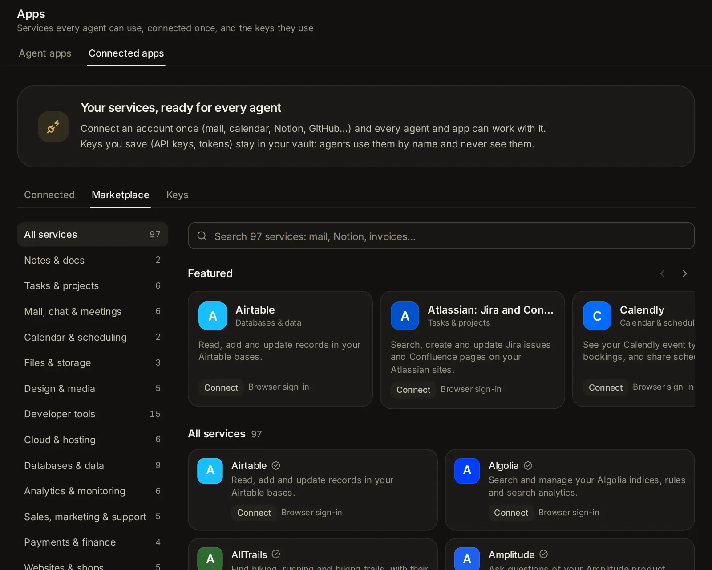

# Connections, keys and tools

Connect the apps and services you use (Notion, Gmail, GitHub, Stripe, a folder on this computer…) once, and every agent can work with them. Keep API keys and sign-ins in an encrypted vault that agents use without ever seeing them, add tool servers to Claude Code and Codex, and plugins to Claude Code. Use this when you want agents to act in your own accounts, call a service with your key, or have tools they don't come with.

## What connections, keys and tools are

Agents can do more when you give them tools. There are three places to do that:

- **Connections** ([Settings → Connections](/settings?s=connections)): apps and services from a marketplace, connected once for every agent: Claude Code, Codex, Custom and the agents that speak ACP. Each connected app gives the agents its tools.
- **The vault** (the **Keys** tab of the same page): API keys, tokens and the passwords of sign-ins. An API key is a password a service gives you so that programs can use your account. Agents use these to call a service, sign in to a site or run a program, but never see them.
- **MCP servers and plugins** ([Settings → MCP servers](/settings?s=mcp) and [Settings → Plugins](/settings?s=plugins)): tool servers you set up yourself in Claude Code's and Codex's own settings, and add-ons for Claude Code.

MCP (the Model Context Protocol) is the common way an app offers tools to agents. A connected app is an MCP server that Naget Agent sets up and signs in to for every agent. The MCP servers in Settings → Agents are ones you set up by hand, with a command or an address.

## Open Connections

Go to [Settings → Capabilities → Connections](/settings?s=connections). It has three tabs:

- **Marketplace**: every app you can connect.
- **Connected**: the apps you connected, and how each one is doing. The number on the tab counts them.
- **Keys**: the vault. The number on the tab counts your keys.

The page opens on **Connected** when you have connected something, and on **Marketplace** when you haven't. On a phone, Settings is a list of sections: tap **Connections** and it opens on its own page. Dialogs rise from the bottom of the screen.

## Find an app in the marketplace

Open [the Marketplace tab](/settings?s=connections&find=Marketplace).

- The search box ("Search … apps: mail, Notion, invoices…") looks in names, descriptions, keywords and categories. Every word you type has to match.
- The chips under it show one category at a time, each with how many apps it has: **All**, **Notes & docs**, **Tasks & projects**, **Mail, chat & meetings**, **Calendar & scheduling**, **Files & storage**, **Design & media**, **Developer tools**, **Cloud & hosting**, **Databases & data**, **Analytics & monitoring**, **Sales, marketing & support**, **Payments & finance**, **Websites & shops**, **Search & the web**, **AI & automation**, **Travel & everyday** and **On this computer**. On a phone they scroll sideways.
- **Featured**: a row of larger cards for well-known apps (Notion, Linear, GitHub, Figma, Stripe, Zapier…). It shows while you haven't searched or picked a category. **All apps** follows.

Each card shows the app's name, what an agent can do with it, and how it connects:

- **Browser sign-in**: you sign in to your account in the browser.
- **API key**: you paste a key the service gives you.
- **No sign-in**: there is nothing to enter.
- **Runs on this computer**: a program Naget Agent starts here when an agent needs it.
- **Runs here, with a key**: the same, with a key you give it.

A check mark beside the name means someone checked that the app's server answers as its entry says. **not checked** means nobody has yet. Apps you connected show **Connected** (or **Sign in again**) where the others show **Connect**.

Some of what is there:

- **Notes, tasks and projects**: Notion, Craft, Linear, Asana, Atlassian (Jira and Confluence), ClickUp, monday.com, Todoist.
- **Mail, chat and calendars**: Gmail, Slack, Fireflies, Granola, Google Calendar, Calendly.
- **Files and design**: Google Drive, Dropbox, Box, Figma, Canva, Miro, Gamma, Cloudinary.
- **Developer tools and hosting**: GitHub, GitLab, Sentry, CircleCI, Postman, Cloudflare, Vercel, Netlify, Railway, Context7, DeepWiki.
- **Data and analytics**: Airtable, Supabase, Neon, PostgreSQL, MongoDB, SQLite, PostHog, Mixpanel, Amplitude, Datadog.
- **Business**: Stripe, PayPal, Plaid, Square, HubSpot, Intercom, Attio, Klaviyo, Webflow, Wix, WordPress.com.
- **Search and the web**: Exa, Perplexity, Tavily, Brave Search, Firecrawl, Wolfram, a Playwright browser.
- **AI and everyday life**: Hugging Face, Zapier, AllTrails, Kiwi.com, trivago, Strava.
- **On this computer**: Files on this computer (the folders you choose), Git, Time and a memory graph.

When no app matches, the page says **No app matches**. You can add the app yourself: see [Add an app to the marketplace](/guide/connections#add-an-app-to-the-marketplace). New apps arrive with the app's updates.

## Connect an app

1. Click the app's card. A dialog shows what it does, its category, how it connects, and **Checked** with a date (or **Address not checked yet**). **Website** and **Docs** link to the service. A box shows where it runs: the server's address, or the command it runs here. It also says that every agent gets the app's tools under the app's short name (Notion's under "notion"), and that you can turn it off per session.
2. Read the note in the yellow box, if there is one. It says what to know first, like "Needs uv (uvx) on this computer." or that a service needs your own sign-in client.
3. Fill in what the dialog asks, then click **Connect**, or **Sign in to** and the app's name.

After it connects, the app moves to the **Connected** tab and is tested in the background. What the dialog asks depends on the app.

### Apps with nothing to enter

Click **Connect**. Some ask for a setting first. GitLab asks for its address (gitlab.com, unless you run your own). Files on this computer asks for the folders it may use, as full paths, one per line; it can read and change files only inside them. SQLite asks for the database file. Fields marked **optional** can stay empty. **Get one** next to a field links to where you get that value.

### Apps that take a key

An app on the internet has a **Key** field, with **Get a key** linking to the page where the service makes one. An app that runs here asks for its key in one or more fields of its own (a token, a connection string). Paste the key and click **Connect**.

The key goes into the vault, encrypted. From then on you only see its last characters. GitHub, for example, takes a fine-grained personal access token: a key you can limit to the repositories and permissions you want agents to have.

### Apps you sign in to in the browser

1. Click **Sign in to** and the app's name.
2. On a computer, a small window opens. On a phone, the service's sign-in page opens in the same tab instead.
3. Sign in and allow access. While you do, the dialog says "Waiting for you to finish signing in…".
4. When you are done, a notice says the app is connected. On a phone you come back to Settings → Connections.

The tokens stay encrypted on this computer and renew by themselves; agents never see them. A sign-in has to be finished within 15 minutes; after that, start again. If you refuse access, you're told "You did not allow access".

Some services only let you sign in through a sign-in client (an OAuth app) of your own: Asana, Box, HubSpot, Slack and Google's apps, for example. Their dialog opens **Your own client ID (this app needs one)**, with what to do. Other browser sign-ins offer the same as **Use your own client ID (optional)**, which also opens by itself when a service turns out not to let apps register on their own.

1. Make the client in the service's developer settings.
2. Give it the address under **Callback address to give it** (it has a copy button).
3. Paste its **Client ID**, and its **Client secret** if it has one.
4. Click **Sign in to** and the app's name.

### Apps that run on this computer

These start a program here (with npx or uvx) for each session's agent. The first test can take a while if the program has to download first. A key such an app needs goes into its environment from the vault when it starts. It never appears on a command line, where other programs could read it.

## Check that an app works

On the **Connected** tab, each app says how it is:

- **Working**, when it was last checked, and how many of its tools are on ("12 of 14 tools on").
- **Not tested yet**.
- **Needs signing in again**: its sign-in ended and could not renew.
- **Not working**, with the reason.

**Test** connects to the app the way agents will and lists its tools. A notice says the app works and how many tools it has, or what went wrong: "The key was refused", or "The sign-in was refused: connect again" (the app then shows **Needs signing in again**). Apps are tested by themselves right after you connect them.

## Turn an app or some of its tools off

- **Every session** (on a phone, just the switch): when it's on, every session's agent gets the app, unless a session turns it off. When it's off, no session gets it unless that session turns it on. A newly connected app starts on.
- **Tools**: once a test has listed an app's tools, this button opens them, each with a switch and what it does. Turn off the ones agents should not use, such as deleting or sending. An agent that tries a tool you turned off is told it is off.

## Change a connection or sign in again

- **Change** (for apps with a key or settings) opens the dialog again with what you entered. Settings keep their values. The key and secret fields say "Saved: leave empty to keep it": type a new one to replace it, then click **Save**.
- **Sign in again** (for browser sign-ins) signs in afresh. When an app shows **Needs signing in again**, agents stop getting it until you do.

If the marketplace changes an app's address or how it signs in after you connected it, the app says "The catalog has a new address or sign-in for it. It keeps using the old one until you connect again." Your key or sign-in never goes to a new address until you connect again yourself.

## Disconnect an app

Click **Disconnect** (an unplug icon on a phone) and confirm. The app's sign-in or key is deleted here, and agents stop getting its tools. For a browser sign-in, Naget Agent also tells the service that the tokens are no longer wanted, when the service offers a way to.

## Choose the apps one session uses

Every session gets the connected apps whose **Every session** switch is on. To change that for one session:

1. Open the session's menu (⋯) → **Session settings** → **Connected apps**.
2. Turn apps on or off for this session. Each app says where it stands: "On, as in every session", "Off, as in every session", "On here only" or "Off here only".
3. Click **Done**.

Apps on the internet follow the change at once. Apps that run on this computer follow it when the agent next starts. With nothing connected yet, the dialog offers **Open Settings → Connections**.

An assistant can also turn apps on for the sessions that start as it: see [Assistants](/guide/assistants).

## How agents use connected apps

- Every kind of agent gets a connected app the same way: Claude Code, Codex, Custom and the ACP agents get its tools under the app's short name.
- At the start of a session, the agent is told which of your apps are connected and to use them when a task involves them. It can also list what is connected and which keys are saved, by name only.
- An agent only gets the apps that are on for its session and signed in. Sign-ins renew in the background, even for apps no session is using, so long sessions keep working.
- Keys and tokens never go into an agent's settings or command line. Known key values are masked in whatever the app's tools send back.
- The search box (Ctrl+K, ⌘K on a Mac) finds your connected apps too.

## Add an app to the marketplace

Anyone can add an app to the marketplace, or fix one, with a pull request to Naget Agent's repository on GitHub. **How to add one**, at the bottom of the Marketplace tab, opens the guide for it.

1. Write a small JSON file for the app in the repository's `catalog/` folder, as the guide there describes. It holds the app's name, one plain sentence on what an agent can do with it, its category, icon and colour, homepage and docs, its server (an address, or a command that runs here) and how it signs in (nothing, a browser sign-in, or a key), plus any fields people fill in.
2. Use the service's own MCP server at its documented address when there is one. A program that runs here is welcome when there is no such server, or for things only a local one can do, like files on this computer.
3. Put no keys or tokens in the file. People enter their own, into the vault.
4. Run the check the guide describes. It tests the file against the rules and can ask the server how it answers.
5. Send the pull request. Once it is merged, the app reaches everyone's marketplace with the next update.

## Keep keys in the vault

Open [the Keys tab](/settings?s=connections&find=Add%20a%20key). The vault holds API keys, tokens and the passwords of sign-ins, which agents use without seeing them. They are encrypted on this computer and never shown again, here or to an agent: only their last characters.

Agents use them through Naget Agent's own tools: its web request tool, its browser, and commands on this computer where you allow that. The app puts the key in itself, and only where you allow.

Each key in the list shows:

- its name and a masked hint of the value (like "…f3a9");
- its note;
- the hosts it may be sent to, and **in commands** when commands on this computer may use it (**No hosts allowed yet** when neither);
- when it was last used ("not used yet" until then), and when it was added or its value last changed.

With no keys yet, the tab says you can add one here or let an agent ask for one.

### Add a key

1. Click **Add a key**.
2. **Name**: what agents call it, like WEATHER_API_KEY: capitals, digits and underscores, 2 to 64 characters, starting with a letter. What you type is turned into such a name ("github token" becomes GITHUB_TOKEN), and the field says so.
3. **Value**: paste the key. It has to be one line, unless it is a block that starts with -----BEGIN (a certificate or private key).
4. **Hosts it may be sent to**: the service's addresses, separated by commas, like api.example.com (up to 20). The key goes only to those hosts and their subdomains, over https. Until you add one, agents can't use the key.
5. **Commands on this computer may use it** (off at first): turn it on for a key a program here needs, like a database's password or a token for git. See [Commands that use a key](/guide/connections#commands-that-use-a-key).
6. **Note**: what the key is for. Agents see this note.
7. **How it is sent** (optional): by default the key goes in the Authorization header, after "Bearer ". You can change the **Header** (like X-Api-Key) and what goes **Before the key** (nothing, for other headers), or send it **Or as a query parameter** instead (like api_key).
8. Click **Save**.

A name that is already in the vault is refused: give that key a new value instead.

### Give a key a new value

Click the circular arrow (**New value**) beside the key, paste the new value into **New value**, and click **Replace it**. The hosts, note and how it is sent stay as they were.

### Change where a key may go

Click the pencil (**Hosts, note and how it is sent**), change the hosts, whether commands may use it, the note or how it is sent, and click **Save**. The value stays.

### Delete a key

Click the bin (**Delete**) and confirm. Agents can no longer use the key, and its value is gone for good.

### What agents can and cannot do with a key

- Call a service with it by its name. The app puts the key into the request: where it is set up to go, or where the agent writes its name in double braces (like {{GITHUB_TOKEN}}) in the address, a header or the body, or as the user name and password of a basic sign-in.
- Type it into a site's sign-in page in its browser, by its name: only into a one-line field, on a page of one of the key's hosts, over https (or on this computer). The field then shows dots, and the agent only sees that it was filled from the vault.
- Give it to a command on this computer, when you turned on **Commands on this computer may use it**, and only once you allow the command (see [Commands that use a key](/guide/connections#commands-that-use-a-key)).
- On the web, only to the hosts you allowed and their subdomains, only over https, and never to this computer or its local network. A redirect to a host the key may not go to is not followed.
- Change, for one call, which header or query parameter the key goes in.
- See the keys' names, hosts and notes. Never their values: answers, pages and what commands print come back with the key masked.

## When an agent asks for a key

Agents are told never to ask you to type a password, token or key into the chat. When a task needs a key that isn't saved, the agent shows a card in the conversation instead: **The agent asks for a key**, with the key's name and why it needs it (often where to get it).

1. Paste the key into the field.
2. Check **Only sent to**: the hosts the agent suggested. Change them if you need to. Without a host, agents can't use the key.
3. Click **Save to the vault**.

The key goes straight to the encrypted vault, never into the conversation. The card turns into a note that the key is saved, and the agent gets a message that it is there (never what it is), so it can carry on.

- **Not now** declines. The agent is told you'd rather not give it now, and to carry on without it or say what else would work. The card then says you did not give it, with **Enter it after all** in case you change your mind.
- While a card waits, it also shows in the [Inbox](/guide/inbox) as "Asks for a key" with the key's name. **Open** takes you to the session.
- If a key by that name is already in the vault, the agent is told to use it, and the card only says it's in the vault. When a saved key stopped working, the agent can ask again: the field then says it replaces the saved one.
- When the agent needs the key in commands on this computer, the card also has **Commands on this computer may use it**, on to start with. Turn it off if you'd rather not; the agent can still use the key on its hosts. For a key that is already saved, the card reads **The agent asks to use a key in commands**: leave the field empty to keep the value, and click **Save to the vault**.

### A sign-in in several fields

To sign in to a site or a service, an agent asks for everything at once: **The agent asks for a sign-in**, with a field for each part, such as an email and a password, or a database's address, user and password. Passwords and other secrets hide as you type; the eye shows them.

1. Fill in the fields. One marked **optional** can stay empty.
2. Check **Only sent to**: the hosts the sign-in is for.
3. Click **Save to the vault**.

Each secret goes to the vault as a key of its own, named after the sign-in (a Voltaro password becomes VOLTARO_PASSWORD). A field marked **The agent sees this one** is a detail that isn't secret, like a server's address: the agent gets what you type there, and it isn't kept in the vault. A field the vault already has says so: leave it empty to keep what is saved. Once saved, the card lists the keys, and the agent can sign in with them in its browser, on those hosts only, without seeing them.

## Commands that use a key

Some work needs a password or a token in a program on this computer: pushing to GitHub with a token, reading a database with its password, a script that calls a service. For these, agents have a tool that runs one command with keys from the vault in its environment, each under its own name. What the command prints comes back to the agent with the keys masked.

- Only keys with **Commands on this computer may use it** turned on can go to a command. Turn it on in the key's pencil dialog, or on the card when an agent asks.
- Before such a command runs, a card shows it: **Run a command with** the keys' names, then the command, with what it is for. **Allow** runs it once. **Allow for this session** also lets this session's later commands with the same keys run without asking, until the app restarts. **Don’t** stops it, and you can tell the agent what to do instead.
- A session with full access runs these commands without asking, as it does its other commands. In Plan mode none run.
- A command can do anything a program can, sending the key elsewhere included: allow only commands you understand, and turn this on only for keys a program here needs.
- A command stops after two minutes, unless the agent gives it longer (up to ten).

## Fill in a form a connected app asks for

Some apps need something from you partway through a task: a date, a choice, a yes or no, or a page to open. Whichever agent is working, the request shows as a card in the session, beside the agent's own approvals, and in the [Inbox](/guide/inbox). The card's title says what the app wants:

- **…asks you to fill in a form**: the app's message, then its fields, as a form. There are text boxes, longer text, numbers, dates, a switch for yes or no, and chips or a list to pick from (chips you can pick several of, when the app allows more than one). Click **Send**. Empty fields it needs ("Needed") and numbers that aren't numbers are marked before anything goes. An answer the app can't take (too long, not an email address, too few picked) is refused with what to fix, and the card stays.
- **…asks you to open a page**: a link. **Open it** opens the page in a new tab (to approve something or sign in there) and tells the app you did.
- **…asks to go ahead**: a plain yes or no. **Allow** says yes.

**Decline** says no. **Not now** cancels this time. A connected app's card waits up to an hour; if the agent's turn ends first, the request is cancelled. MCP servers you set up for Codex ask in the same kind of card.

## Set up MCP servers for Claude Code and Codex

Open [Settings → Agents → MCP servers](/settings?s=mcp). These are tool servers in Claude Code's and Codex's own settings, for tools the marketplace doesn't have or servers you run yourself. New sessions load them; sessions already running pick up changes when they restart. Custom, the app's own agent, uses them too, all but the SSE ones (see [Custom](/guide/custom)).

The page lists Claude Code's servers and Codex's in two parts. The **Folder** chip at the top picks the folder whose servers you see, since Claude Code can keep servers for one folder as well as for all of them.

Each server shows:

- its name and its type: **Command** (a program this machine runs), or **HTTP** or **SSE** (a server at an address; SSE is the older kind);
- for Claude Code, where it applies: **All folders**, **This folder, only you** or **This folder, shared**;
- **Off**, for a Codex server turned off in Codex's own settings;
- its command or address, and the names of its environment variables, headers or bearer token variable. Their values stay on the server and are never shown;
- after a check, how the server is doing.

### Add a server

Click [Add server](/settings?s=mcp&find=Add%20server). The **Add an MCP server** dialog asks:

- **Add to**: Claude Code, Codex, or both (both at first).
- **Name**: letters, digits, dots, dashes or underscores, up to 64, starting with a letter or digit. The agents show its tools as the name, a slash and the tool.
- **Type**: **Command**, **HTTP** or **SSE**. Codex doesn't support SSE, so picking SSE leaves Codex out.
- For a command:
  - **Command**: the whole command line, like `npx -y @modelcontextprotocol/server-github`. It runs on this machine when a session starts. Quote arguments that contain spaces. A ~ at the start of an argument means your home folder.
  - **Environment**: one KEY=value per line (lines starting with # are skipped). The values go into the agents' config files and are never shown here again.
- For HTTP or SSE:
  - **URL**: the server's address, starting with http:// or https://.
  - **Headers** (for Claude Code): one "Name: value" per line, for servers that take an API key. Servers that use a sign-in in the browser (OAuth) need none: sign in from the list after adding.
  - **Bearer token variable** (for Codex, optional): the name of an environment variable whose value Codex sends as the bearer token.
- **Where Claude Code uses it** (**Where it is used** when only Claude Code is picked):
  - **All folders**: every Claude Code session on this machine. This is the default.
  - **This folder**: only sessions in the folder picked at the top, kept in your own Claude Code settings.
  - **Shared .mcp.json**: saved to a .mcp.json file in that folder, so everyone working in the repository gets it.

  Codex servers always apply to every folder.

Click **Add server**. Naget Agent adds it through each agent's own command, so their settings stay the way they expect. If an agent refuses, the dialog shows that it did not add the server, with what the agent said. Fix what's wrong and click **Add server** again: only the agents that failed are tried.

### Check which servers connect

[Check connections](/settings?s=mcp&find=Check%20connections), beside Claude Code or Codex, starts every server the way a new session would and shows how each did:

- **Connected**, with its number of tools;
- **Needs sign-in**;
- **Still connecting**;
- **Failed**, with the reason ("The server did not start or did not answer." when there is none);
- **Off**.

No model is used. It can take up to a minute or two. For Claude Code, it runs in the folder picked at the top, so that folder's own servers count.

### Sign in to a server

A server at an address that signs in with OAuth needs signing in once. Click **Sign in** (shown when a check says it needs a sign-in), or the sign-in icon on its row. A terminal opens in the app, running the agent's own sign-in for that server: follow its steps there.

### Remove a server

Click the bin beside a server and confirm with **Remove**. The agent stops loading it. Sessions already running keep it until they restart.

## Add plugins to Claude Code

Open [Settings → Agents → Plugins](/settings?s=plugins). Plugins are add-ons for Claude Code that bundle skills, commands, agents, hooks and MCP servers. They come from marketplaces: catalogs of plugins, kept in a GitHub repository, another git repository or a folder. They work for Claude Code only; for know-how every agent uses, see [Skills](/guide/skills).

### Installed plugins

[Installed](/settings?s=plugins&find=Installed) lists the Claude Code plugins on this machine. New sessions load them. Each shows its name, its marketplace, its version and what it does.

- The switch turns a plugin off or on without removing it.
- The bin uninstalls it, once you confirm. New Claude Code sessions stop loading its skills, commands and servers.

### Find and install a plugin

[Browse](/settings?s=plugins&find=Browse) lists every plugin you can install from your marketplaces, most installed first, with how many installs each has. **Search plugins** narrows the list. It shows 40 at a time: **Show more** adds 40 more.

Click **Install** and confirm. The plugin installs for every Claude Code session. Plugins can add hooks and servers that run commands on this machine, so install only plugins you trust.

Naget Agent asks Claude Code for the list of plugins at most every 10 minutes, and again after each change. The first time can take a while.

### Plugin marketplaces

[Marketplaces](/settings?s=plugins&find=Marketplaces) lists the catalogs Claude Code installs plugins from.

- To add one, type a GitHub owner/repo, a git URL or a folder into the box under the list, and click **Add**.
- To remove one, click its bin and confirm. Plugins installed from it are uninstalled too.

## Ask an agent

Agents can do these for you, with your OK on a card. They never type a key's value into the app: for a key or a sign-in, they show the card where you enter it.

- "Which apps are connected? Test Notion and tell me if it works."
- "Connect Context7 so agents can look up library docs."
- "Turn Gmail off for every session, but keep it on in this one."
- "Show me Notion's tools and turn off the ones that delete pages."
- "Add an MCP server for Claude Code and Codex that runs npx -y @modelcontextprotocol/server-memory, then check that it connects."
- "Show me the most installed Claude Code plugins, then install the one I pick."
- "Sign in to my Voltaro account and download this year's bills into this folder." (The first time, it asks for the sign-in on a card.)
- "Push this branch to GitHub with the token in the vault."
