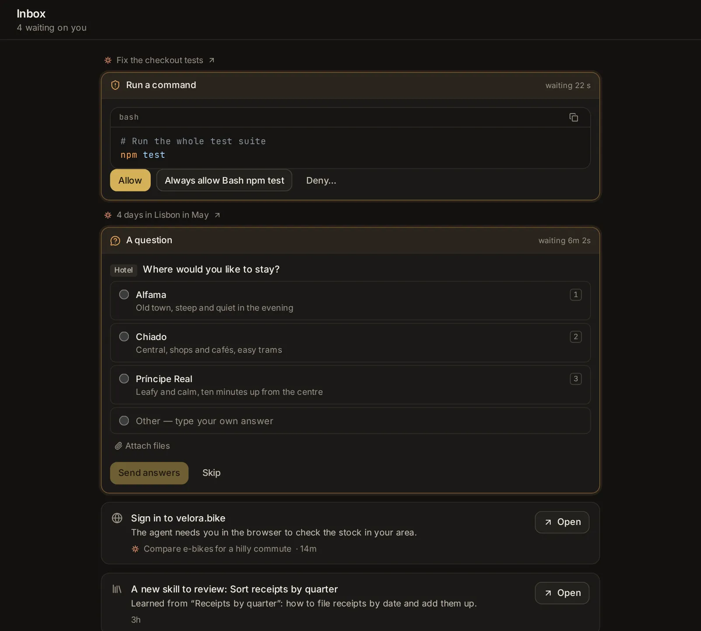

# Inbox and notifications

Agents work on their own, but now and then they need you: an approval, an answer, a form, a key. This topic covers the inbox, which gathers everything waiting on you from every session and machine so you can answer it in one place, and the notifications that tell you when a session finishes, fails or needs you, in the app, on your computer or on a phone with the app closed.

## Open the inbox

The inbox is the tray button at the top of the sidebar, beside the name Hydor. On a phone, open the sidebar with **Menu** (≡) first: the button is at the top of the drawer. You can also type "inbox" in the search box (Ctrl+K, ⌘K on a Mac). [Open the inbox](/inbox).

Its header says how many things wait on you ("3 waiting on you"). The newest are at the top. The list updates by itself as sessions start and stop waiting, and checks again every few seconds while you look at it.

When nothing waits, it says "Nothing is waiting on you".

## What shows in the inbox

Everything an agent is waiting on you for, from every session on this machine, including the sessions that scheduled tasks and apps start, and from your other machines:

- **Approvals**: a command the agent wants to run, a file it wants to change, a tool it wants to use.
- **Questions** the agent asks you, and **plans** waiting for your approval.
- **Forms** a service asks you to fill in partway through ("Notion asks you to fill in a form"), or a page it asks you to open.
- **A browser that needs you**: "Needs you in the browser: …" (to log in or get past a check), "Stopped before paying or ordering: …", or "Wants to open …, on this machine or its network".
- **A key an agent asked for**: "Asks for a key: OPENWEATHER_KEY", with why it needs it.
- **A skill an agent suggests**: "Suggests a new skill: …" or "Suggests a change to the … skill", with its reason.
- **A session waiting for you elsewhere**: "Waiting for you in VS Code" (or in a terminal), for sessions running outside the app.
- **An app's question**: a run of one of your apps waiting at an **Ask a person** step.
- **A comment from someone you shared a project or a thing with**: "Maria commented on “Thesis, chapter 3”", with what they wrote, until you or an agent reply or it is resolved. **Open** opens the document, the picture, the video or the sound.

Each item shows which session it waits in (with the agent's icon) and how long it has waited.

## Answer approvals, questions and forms right in the inbox

Approvals, questions and forms show as the same card you see in the session, so you can answer them without opening it. Above each card is the session's name; click it to open the session. The card's top line says what is asked and how long it has been waiting.

- **An approval** shows what the agent wants to do: the command, the change to a file (as a diff), or the tool's input. Click one of its buttons: **Allow**, an "always" choice when the agent offers one (such as **Allow all edits this session** or **Allow for this session**), or **Deny**. Clicking **Deny…** first opens a box, "Optional: tell the agent what to do instead"; write a word to the agent if you like, then click **Deny**.
- **A plan** (from Claude Code) shows the plan with **Approve, auto-accept edits**, **Approve, ask before edits** and **Keep planning**.
- **A question** shows its choices: pick one (or several, where allowed), or type your own under **Other — type your own answer**; you can attach a file to an answer. Then click **Send answers**, or **Skip**.
- **A form from a service** shows the service's message and its fields. Fill them in and click **Send**, or **Decline**, or **Not now**. A form with nothing to fill in asks **Allow** instead of **Send**. When the service asks you to open a page, **Open it** opens it in a new tab.

Once answered, the item leaves the inbox and the agent goes on. What each choice means is explained in [Approve or deny what the agent wants to do](/guide/sessions#approve-or-deny-what-the-agent-wants-to-do) and [Answer questions and approve plans](/guide/sessions#answer-questions-and-approve-plans).

## Open the rest where it waits

The other items are answered where they wait. Each has an icon, what is asked, a line of detail, the session and the time, and **Open**, which takes you there:

- **A browser that needs you** opens the session, where its browser shows above the message box for you to take over ([Search and the browser](/guide/web)).
- **A key** or **a sign-in** opens the session with the card where you enter it ([Connected apps, keys and tools](/guide/connections)).
- **A skill suggestion** opens the session with its card to approve or decline, or **Settings → Skill library** when that session is gone ([Skills](/guide/skills)).
- **A session waiting in VS Code or a terminal** opens it here so you can see what it waits for; answer it in the program it runs in.
- **An app's question** opens its run, where a card asks it: **Yes** or **No**, or its form and **Send the answer** ([Apps](/guide/apps#apps-with-steps)).

## Things waiting on your other machines

If you added other machines running Hydor ([Use other machines from one app](/guide/devices#use-other-machines-from-one-app)), the inbox asks each one that is online and lists what waits there too. The list is then grouped by machine, under each machine's name; **shown now** marks the machine the app is showing at the moment. You answer approvals, questions and forms from another machine right here, as you would for this one.

A machine that can't send its list (one running an older version, for example) shows as one line instead, "2 sessions wait on you there", with **Open** to go to that machine.

## The number on the inbox button

A small number on the corner of the inbox button counts the sessions waiting for your approval or answer: on this machine, and on your other machines that are online. Past 99 it shows **99+**. Point at the button to read "Inbox: 3 waiting on you".

The number counts sessions, not items, so a session with two approvals counts once. Some things in the inbox don't add to it: a key asked for, a browser that needs you, a skill to review.

## The count in the browser tab

While sessions on the machine the app shows wait for your approval or answer, the browser tab's title starts with their number: "(2) Hydor". You see it from other tabs, without switching back.

## How the app tells you

When a session finishes, fails or needs you, the app tells you in the way that fits where you are:

- **The app is in view**: a small card slides in at the bottom of the screen (bottom right on a computer). It shows the agent's icon with a coloured dot (green when finished, amber when it needs you, red when it failed), the session's name, and the status with the start of the reply. Click it to open the session, or ✕ to close it. It leaves after a few seconds, but stays while the pointer rests on it. A newer notice about the same session takes the place of the older card.
- **The app is open in a tab you are not looking at**: a notification from your system, once you turned on **Notify this device**.
- **The app is closed**, or the phone is in your pocket: a push notification, once you turned on **Notify this device** on that device.
- **A desktop app (Mac, Windows, Linux)**: your computer's own notification (on a Mac, in Notification Center), whether the app's window is in front, behind other windows or closed (the app stays in the menu bar, the notification area or the system tray), and also when the app started at login without opening its window. Click it to open that session in the app's window. A newer one about the same session takes the place of the older one. The small cards inside the window show only when your system is not showing the app's notifications.

You get no notice about the session you are looking at right now. A session you snoozed that needs you comes back from its snooze at once. In hands-free mode, the app also says out loud when the session it follows finishes or needs you ([Documents, images, videos and voice](/guide/documents-voice)).

## What each notification says

A notification's title is the session's name (cut short when it is long). Its text says what happened:

- **Finished**, then the start of the agent's last reply. It comes after a turn that took at least ten seconds, so a quick back-and-forth stays quiet.
- When the session needs you, what it needs:
  - for a plain yes-or-no approval, what the agent wants to do, with its first line ("Run a command: npm test");
  - otherwise "Needs your approval" or "Has a question for you";
  - for its browser, what the browser needs: "Needs you in the browser: …", "Stopped before paying: …", "Asks to open …" or "The page asks: …";
  - for a session in VS Code or a terminal, "Waiting for you in VS Code", sent only if it still waits a minute later (you are likely right there).
- **Failed**, then the error.

A session working on a goal says "Goal met: …" when the goal holds, and "The goal needs you: …" or "Goal paused: …" when it stops ([Give the session a goal](/guide/sessions#give-the-session-a-goal)).

A scheduled task's run says how it went, in a line the agent wrote. A run with nothing new to report stays quiet, a failed run always tells you, a blocked run reads "Blocked: …", and a task paused after failures in a row says so ([Scheduled tasks](/guide/tasks)).

Notices from your other machines come through this one, so one device hears from all of them: the notification's text starts with the machine's name, and the card in the app says "on" that machine.

## Turn on notifications for this device

[Settings → App → Notifications](/settings?s=notifications) has, in its **This device** group, two switches, set on each device (each browser) for itself, and a test:

- [**Notify this device**](/settings?s=notifications&find=Notify%20this%20device): a notification when a session finishes, fails or needs your answer, even with the app closed. Turning it on asks the browser for permission to show notifications. Each device turns it on for itself: your phone and your computer separately. In a desktop app (Mac, Windows, Linux) it is always on: they come as Mac, Windows or your desktop's notifications while the app runs, even with its window closed. On a Mac, macOS asks once whether Hydor may send notifications: allow it, and use **System Settings → Notifications → Hydor** to choose how they show. When the system is not showing them, the row says so, and meanwhile they show inside the app; its **(i)** says where to allow them (on Windows, **Settings → System → Notifications**).
- [**Sound**](/settings?s=notifications&find=Sound): a short chime with each notice while the app is open, rising when a session finishes and falling when it needs you or failed. Off at first; turning it on plays the chime once. In a desktop app the chime plays only with notices the app shows inside its window; the system's notifications make their own sound.
- [**Send a test**](/settings?s=notifications&find=Send%20a%20test) (the **Try it** row, shown once **Notify this device** is on): sends a notification to every device that turned notifications on. It says "Notifications work on this device." and shows when the app is not in view, so switch away from it to see it. A message tells you how many devices it was sent to, or "No device got it." In a desktop app, **Try it** shows from the start: **Send a test** shows a notification on this computer right away, even with the app in front. If the system does not show it, a message says "It didn’t show. Allow notifications for Hydor in the system’s settings."

To set it up on a phone:

1. Open the app on the phone. It has to be served over HTTPS for this ([Reach the app from another device](/guide/devices#reach-the-app-from-another-device)).
2. On an iPhone or iPad, first add the app to your Home Screen (**Share** → **Add to Home Screen**) and open it from there. Until then the setting says so, and can't be turned on.
3. Open **Settings → App → Notifications** and turn on **Notify this device**. Allow notifications when the phone asks.
4. Tap **Send a test**, then leave the app to see it arrive.

If the setting says notifications are "Blocked for this site in the browser settings", allow them for the app's address in the browser's settings first, then turn it on. If it says "This browser cannot receive notifications here", the browser can't take them at this address, often because the app is opened over plain HTTP rather than HTTPS.

If the switch is off again one day, the browser's push service dropped this device: turn it on again. When a phone is off or offline, a notification waits for it for up to a day. A newer notification about the same session takes the place of an older one on the device.

To stop them, turn **Notify this device** off on that device.

## Approve or deny from the notification

When a session waits on a plain yes-or-no approval (a command, a file change or a tool; not a question, a form or a plan), its notification carries two buttons with the card's own words, such as **Allow** and **Deny**, where the browser shows buttons on notifications.

- Tap one to answer without opening the app. A quiet notification confirms it, such as "Allow: Run a command".
- If the answer can't go through (the browser was signed out, or you already answered elsewhere), the session opens so you can answer there.
- Tap the notification itself to open the session, in a window of the app that is already open when there is one.
- A desktop app's notifications have no buttons: click one to open the session, and answer there.

Approvals from your other machines can be answered the same way: the answer goes to that machine through this one.

## Ask an agent

Agents can read what waits on you and send a test notification. They can't answer other sessions' approvals for you. A few things to try:

- "What's waiting on me right now? Most urgent first."
- "Which sessions are asking me for a key, and what for?"
- "Sum up what each waiting session needs from me, in a line each."
- "Send a test notification so I can check my phone gets them."
