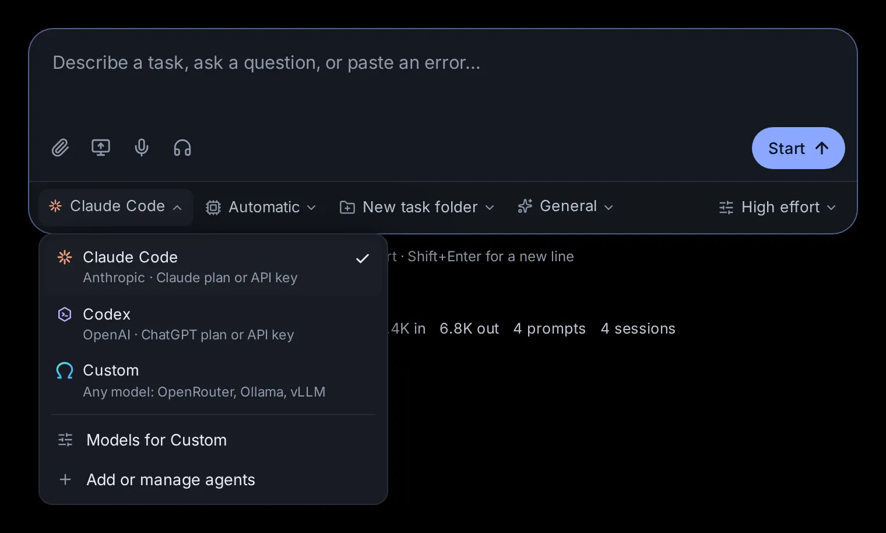

# Agents, accounts and models

Hydor runs several AI agents: Claude Code, Codex, Custom (the app's own agent, for any model) and other agents that speak ACP, such as Gemini CLI or OpenCode. This topic explains how they differ, how their programs install and stay current, how to sign them in (more than one account too), and where Custom's models come from: OpenRouter, Ollama, Hugging Face models run on this computer, or any OpenAI-compatible endpoint.

## Which agent should I use?

An agent is the program that does the work in a session: it reads your message, uses tools (files, commands, the web) and answers. The model is the AI behind it. Every agent here gets the same help from the app (web search, the browser, memory, skills, your connections), but they differ in where their models come from.

- **Claude Code** (Anthropic). Runs on your Claude plan, or bills an Anthropic API account. Its models are Anthropic's (Opus, Sonnet, Haiku). It has its own usage limits, which the [Usage page](/usage) shows.
- **Codex** (OpenAI). Runs on your ChatGPT plan. Its models are OpenAI's. It has usage limits too, shown on the Usage page. Codex comes with the app.
- **Custom**, the app's own agent. It runs any model you add in [Settings → Agents → Models](/settings?s=models): models through OpenRouter, models on this computer (with Ollama or vLLM), or any OpenAI-compatible endpoint. Use it for open models, cheaper models, or models that never leave your computer. See [Custom, the app's own agent](/guide/custom).
- **Agents that speak ACP**: Gemini CLI, OpenCode, Qwen Code, Goose, Kimi CLI, Auggie, or a command of your own. ACP (the Agent Client Protocol) is a common way for an app to talk to an agent program. Each signs in once in its own program and uses its own models.

What each can do in the app:

- Goals (the agent keeps working until a condition holds) and forks (a copy of the session from an earlier reply): Claude Code, Codex and Custom. Not the other ACP agents.
- **Continue in…** (hand the conversation to another agent): from Claude Code or Codex, to the other one or to Custom.
- Effort (how hard the model thinks): Claude Code and Codex, for models that offer it.
- More than one account: Claude Code and Codex.
- Plan usage limits and limit resets: Claude Code and Codex.

## Pick the agent and model for a new session

On the start page (`/`), the row under the message box says who does the work.

1. Click **Agent**. The list shows **Claude Code** ("Anthropic · Claude plan or API key"), **Codex** ("OpenAI · ChatGPT plan or API key"), **Custom** ("Any model: OpenRouter, Ollama, vLLM") and every agent you added in Settings → More agents ("ACP agent · " and its command). At the bottom, **Models for Custom** opens Settings → Models, and **Add or manage agents** opens Settings → More agents.
2. Click **Model** and pick one. The list shows only that agent's own models. The agent's default is marked "default". Older versions of a model wait behind a line such as "2 older models"; click it to see them. When there are more than eight models, a **Search models** box sits at the top: type a few letters and press Enter to take the first match.
3. Under **Options** you find **Effort** (for agents and models that have it: Default, Low, Medium, High and so on) and **Permissions** (what the agent may do without asking you). Shift+Tab in the message box switches permissions too.

The start page remembers what you picked, per agent, on every device: next time it opens with the same agent, model, effort and permissions.

An ACP agent other than Custom shows its **Model** and **Permissions** choices only after its first session: they list what the agent offered when it last ran.

On a phone, each of these menus opens as a sheet from the bottom of the screen.

## Switch models in the middle of a session

In a session, the model, effort and permissions sit under the message box. They are one chip that reads like "Opus 5.5 · High · Plan": click it for **Model**, **Effort** and **Permissions**.

Pick another model and the session carries on with it:

- Claude Code switches at once.
- Codex uses the new model from its next turn on.
- Custom uses it from its next step, even in the middle of a turn.
- Another ACP agent switches if it offers a choice of models.

The model menu only lists the session's own agent's models. To move a conversation to another agent, use the session's menu (⋯) → **Continue in Codex**, **Continue in Claude Code** or **Continue in Custom Agent** (from Claude Code and Codex sessions; Custom appears once it has a model). Your next message then starts a new session of that agent in the same folder, with the conversation so far. A stopped session picks up again on the model it last used, unless you pick another one before you send.

## Agent programs install and update themselves

Claude Code, Codex, Gemini CLI and the others are programs on this computer. You don't have to install them by hand.

Open [Settings → Agents → Accounts](/settings?s=accounts&find=Agent%20programs) and scroll to **Agent programs**. It lists Claude Code, Codex, Gemini CLI, OpenCode, Qwen Code and Auggie, each with the version the sessions run and where it comes from:

- **your own install**: you installed it yourself.
- **installed by the app**: the app installed it in its own folder.
- **comes with the app**: Codex ships with the app.
- **not here: installs by itself when you first use it**: missing. Click **Install** to get it now.

A row also says "… is out" when a newer version is out. Codex's row adds "yours in the terminal: …" when you have a Codex of your own too: the sessions run the app's, and a terminal runs yours.

A missing program also installs by itself the first time it is needed: Claude Code when you sign in to it or start a Claude Code session, an ACP agent when you add it in Settings → More agents or start a session with it. The app installs them with npm into its own folder, so you need no administrator rights.

Goose and Kimi CLI aren't in this list: install them yourself (Settings → More agents shows where to get them).

## Keep the agent programs up to date

With [**Update automatically**](/settings?s=accounts&find=Update%20automatically) on, under **Agent programs** (it is on unless you turn it off), the app brings each agent program up to its newest version once a day. The first run comes about ten minutes after the app starts.

- The copies the app installed update with npm, in its own folder. Codex switches to a copy newer than the one the app came with.
- Your own installs update with their own updater: `claude update` for Claude Code, `codex update` for Codex (the one your terminal runs), `opencode upgrade` for OpenCode.
- Gemini CLI, Qwen Code or Auggie that you installed with `npm install -g` update with npm, when your user may write to that folder. Anything installed another way is left for you to update the way you installed it.
- Claude Code follows its own release line: the stable one when its settings say `"autoUpdatesChannel": "stable"`, else the latest.
- If you turned Claude Code's own updates off with `DISABLE_AUTOUPDATER=1` (the Docker image does), the app doesn't update your Claude Code by itself either. **Update now** still does.

The app keeps a new version only once it works the way the sessions use it. Claude Code must answer as a session starts and list its models, Codex must start its app server and list its models, and the others must start and say their version. None of this needs a sign-in or uses any of your plan. A version that fails is undone:

- A copy the app installed, or one of yours it updated with npm, goes back to the version before.
- For your own Claude Code, the sessions keep running the version before, which Claude Code's installer keeps beside the new one. The `claude` command in a terminal stays on the new one. The row says "… did not work here".
- A version that failed isn't tried again by itself, but the next one is, and **Update now** tries it again.

Under the switch, the section says when the app last looked, like "Up to date · checked 2h ago", with **Check now** to look again. When newer versions are out it says so, with **Update now** to install them at once; it shows which program it is updating while it works. The line below says what the last update changed, like "Claude Code 2.1.308 → 2.1.316", or why a version could not be installed.

Sessions that are running carry on with the version they started with; new sessions use the new one. With **Update automatically** off, the app still looks once a day and shows what is out, but installs nothing until you click **Update now**.

## Sign Claude Code and Codex in

Claude Code and Codex need a sign-in before they can work. Open [Settings → Agents → Accounts](/settings?s=accounts) (on a phone, Settings is a list of sections: tap **Accounts** under Agents; the title at the top takes you back). **Your accounts** ("The Claude Code and Codex sign-ins your sessions use. Add another subscription, a work and a personal one say, and pick one when you start a session.") lists each agent's own sign-in first, then any accounts you added for it. Each shows a green check with the email, plan and sign-in method, or a red cross with "Not signed in" or what went wrong.

To sign in:

1. Click **Sign in** next to the agent.
2. Pick how:
   - Claude Code: **Claude subscription** (your Claude plan) or **Console (API billing)** (an Anthropic API account).
   - Codex: **Device code** or **Browser redirect**.
3. Click **Get sign-in link**.
4. Follow the steps the dialog shows:
   - Claude Code: open the link (**Open sign-in page**), approve access in your browser, then paste the code the page shows into **Paste the code from the page** and click **Finish sign-in**.
   - Codex, Device code: open the link on any device, sign in to ChatGPT and enter the one-time code shown in the dialog. The dialog notices by itself when you are done.
   - Codex, Browser redirect: after you sign in, your browser tries to open a "localhost" page and fails. Copy that page's address, paste it into **Paste the localhost address from your browser** and click **Finish sign-in**.

When it works you see "Claude Code is signed in" (or Codex). If it fails, the dialog says why; click **Try again**.

Once signed in, the button reads **Switch account**: it starts the same sign-in for another account. **Sign out** is in the row's **⋯** menu: it signs the program out on this computer, for every terminal and editor that uses it, after you confirm.

The welcome tour (from **Help** in the sidebar) asks which agents and models you want to use and walks you through these sign-ins too.

## Add a second account (work and personal)

You can sign in more than one Claude Code or Codex account, for example a work plan and a personal plan, and pick one per session.

1. Open [Settings → Agents → Accounts](/settings?s=accounts&find=Your%20accounts).
2. Click **Add an account**, at the top of **Your accounts**.
3. Choose **Claude Code** or **Codex**, type a name (up to 40 characters, like "Work" or "Personal") and click **Add and sign in**.
4. The sign-in dialog opens for the new account. Sign in as described above.

Each added account signs in on its own and keeps its own session history. Your settings, instructions, skills and plugins are shared with the agent's main sign-in, so changes apply to both. Two accounts of the same agent can't have the same name.

Each added account has its own row, under the agent's own sign-in, with **Sign in** or **Switch account**; its **⋯** menu has **Sign out**, **Rename** and **Remove**:

- **Rename** asks for a new name.
- **Sign out** stops the sessions that run as this account from working until it signs in again.
- **Remove** takes the account out of the app. Its sessions leave the list, but their history stays on disk, unless you also tick **Also delete its sign-in and the history of its sessions**. You can't remove an account while sessions are running as it: stop them first.

The [Usage page](/usage) shows a card for every added account, with its own limits.

## Pick the account a session runs as

When the agent you picked has added accounts, the start page's **Options** shows an **Account** row. Click it:

- **Your sign-in** is the program's own account (the first one for that agent under Your accounts).
- Each added account is listed by name.
- **Manage accounts** opens Settings → Accounts.

The start page remembers your choice for that agent. A session running as an added account shows that account's name, with a person icon, at the top of the session. If that account hits a usage limit, the limit notice above the message box is about that account. The account is set when the session starts. It changes by itself only with **Switch accounts at a limit** (below).

## Use all your accounts: switch at a limit

With two or more accounts for the same agent, the app can use them all: when one runs out of usage, your work carries on with another. Open [Settings → Agents → Accounts](/settings?s=accounts&find=Switch%20accounts%20at%20a%20limit) and find **Switch accounts at a limit**, at the bottom of **Your accounts** once you have added an account ("When a session's account runs out of usage, the session moves to another of that agent's accounts with usage left and carries on. New sessions skip an account at its limit."). It is on from the start (turn it off there if you would rather pick the account yourself), and it works while no browser is open.

- When a turn stops because the session's account hit its usage limit, the app picks another signed-in account of the same agent that still has usage (the least used one), moves the session there with all its history, and sends "… reached its usage limit, so this session now runs on …. Continue where you left off." A note at the top of the app says which account it moved to.
- Your main sign-in and each added account all count. Claude Code accounts take over from Claude Code accounts, Codex from Codex.
- A Codex goal moves with the session and keeps going.
- When every account is at its limit, nothing moves. With **Resume after usage limits** on, the session continues when the first account resets, on that account. More in [Usage, limits and costs](/guide/usage#continue-sessions-automatically-after-a-limit).
- A new session started on an account that is at its limit starts on one with usage left instead, and a message you send to a session whose account is at its limit moves the session first, so the message isn't turned away.
- Sessions open in VS Code or a terminal stay on their account.
- The app's own quick questions to Claude Code or Codex (the helper model on **Automatic**, an app's quick model steps, pull-request descriptions, command suggestions) go to your next signed-in account the same way when one is at its limit, or signed out.

## Add Gemini CLI, OpenCode and other ACP agents

Open [Settings → Agents → More agents](/settings?s=agents&find=Agents%20that%20speak%20ACP).

- **Your agents** ("They show next to Claude Code and Codex when you start a session") lists Custom first, then the agents you added. Each shows a check when its program is installed here.
- **Agents that speak ACP** ("Install one, sign in once in its own CLI, then add it here") lists the known ones you haven't added yet: Gemini CLI, OpenCode, Qwen Code, Goose, Kimi CLI and Auggie. A row with a cross isn't installed yet, and says how to get it.

To add one:

1. Click **Add** next to it. The button stands out when the program is already installed.
2. If the app knows how to install it (Gemini CLI, OpenCode, Qwen Code, Auggie), it installs it now, in the background. Goose and Kimi CLI you install yourself, from the address in their row.
3. Sign in once in the agent's own program: open the [Terminal](/terminal), run its command (for example `gemini`) and follow its sign-in. If you skip this, a session tells you: "Gemini CLI is not signed in. Run gemini once in a terminal and sign in there, then try again."

The agent now shows in the start page's **Agent** list.

To change an added agent, click **Edit**. To take it out, click the bin icon and confirm: its sessions stay listed, but continuing them needs the agent set up again. Custom is built in: its row says "Built in: models from OpenRouter, Ollama and vLLM, in Settings → Models" and has a **Models** button instead of Edit and Remove.

### Add an agent of your own

Any program that speaks ACP can run here.

1. In **Your agents**, click **Add your own**.
2. Fill in:
   - **Name**: how it shows in the lists, for example "Gemini CLI".
   - **Command**: the program to start, for example `gemini`, or a full path.
   - **Arguments**: what starts it in ACP mode, for example `--experimental-acp`.
   - **Environment (optional, NAME=value per line)**: settings the program needs, such as an API key variable.
3. Click **Save**.

The command must start the agent in ACP mode, talking over its standard input and output.

### What ACP agents can and can't do here

The app opens a session in the folder you pick, shows the agent's messages and steps, and asks you whenever the agent asks for permission. Some things work differently from Claude Code and Codex:

- It takes one message at a time. A message you send while it works waits in the queue above the message box and goes out when the turn ends. (Custom works this way too.)
- An agent that can't reopen earlier sessions starts afresh when you continue an old one, without the conversation above it. The session says so.
- Pictures you attach reach it only if it accepts images.
- Goals, forks and hand-offs aren't available (Custom has goals and forks).

## Where Custom's models come from

Custom runs any model you set up in [Settings → Agents → Models](/settings?s=models), with the same tools, skills and MCP servers as the other agents. Pick Custom on the start page, then the model. The page has five parts, from top to bottom:

- **Helper model**: the model for the app's small jobs.
- **On this machine**: what this computer has, and the models installed here.
- **Add a model from Hugging Face**: search, check and install open models.
- **OpenRouter**: hundreds of models through one key.
- **Runtimes and endpoints**: Ollama, vLLM, other OpenAI-compatible servers, and a Hugging Face token.

In Custom's **Model** menu, hover over a model to see where it runs and how much it reads at once, for example "OpenRouter · 128K context" or "vLLM, on this machine · 32K context · starts when used". The lists refresh by themselves every minute.

## Choose the helper model

The helper model does small jobs beside your sessions, outside any conversation:

- checking steps in Custom's Auto mode, and checking a Custom goal after each turn;
- tidying up memory each night;
- answering one question about a web page the browser has open;
- describing pictures for a Custom model that can't see them;
- summing up a long reply from a child session;
- drafting an app or a scheduled task from a session;
- hands-free voice mode.

Open [Settings → Agents → Models](/settings?s=models&find=Helper%20model) and click the menu next to **Helper model**:

- **Automatic** (the default): Claude Haiku through Claude Code, or Codex when Claude Code can't answer. An account at its usage limit hands the question to your next signed-in account first (with **Switch accounts at a limit** on). When nothing answers, the error says why for each: "You've hit your weekly limit", a model your Codex plan doesn't offer…
- Any of Custom's models, with where it runs (openrouter, ollama, vllm or endpoint) and "sees images" for those that can see.

Automatic can't look at pictures. If you use Custom with a model that doesn't see images, pick a helper model that sees images, or Custom can't have your pictures described.

## See what this computer can run

The **On this machine** section of [Settings → Agents → Models](/settings?s=models&find=On%20this%20machine) starts with a summary of this computer:

- **Graphics**: the graphics cards (GPUs) and their memory, or "No GPU" (models then run on the processor).
- **Memory**: total and free.
- **Disk**: free space, and how much the installed models take.
- Whether **Ollama** and **vLLM** are installed, with their versions, or a link to install them.
- With a graphics card, how big a model fits: "Fits about 30B parameters at 4-bit on one GPU". Parameters are a measure of a model's size; 4-bit is a common compressed form that needs about a quarter of the memory.

Below it:

- **Downloads in progress**, each with a progress bar, how much is done, and whether it's for Ollama or vLLM. **Cancel** stops one. A failed or cancelled one shows why, with **Dismiss**.
- **Installed models**, each with its runtime (Ollama or vLLM), size, details (such as its size and compression for Ollama models), "sees images" where it can, and whether it's running.
  - A vLLM model has **Start** and **Stop**. It starts by itself when a session first uses it (the first start takes a minute or two), on the graphics card with the most free memory, and keeps running, even when the app restarts, until you click **Stop**. If it can't start, the reason shows under it.
  - **Remove** deletes the model's files from this computer, after you confirm. You can install it again later.

When there are none yet: "No models here yet: add one from Hugging Face below."

## Add a model from Hugging Face

Hugging Face is the main site for open models. The [Add a model from Hugging Face](/settings?s=models&find=Add%20a%20model%20from%20Hugging%20Face) section ("Search, see how each would run here, and install it") searches it and tells you, before anything downloads, how each model would run on this computer.

### Search and filter

1. Type in **Search Hugging Face, or paste org/name**: a name such as `qwen3`, or a model's full name (`org/name`) or its huggingface.co address. Before you type, it suggests a few names, or **see the most downloaded**.
2. Narrow the list with the filters (you can combine them):
   - **Runs well here**: only models that would run well on this computer.
   - **GGUF · Ollama**: models in GGUF form, which Ollama runs.
   - **vLLM**: models in safetensors form, which vLLM runs on a graphics card.
   - **Sees images**: models that also read pictures.
3. Change the order with the menu on the right: **Most downloaded**, **Trending**, **Most liked** or **Newest**.

You get up to 40 models. A model you named in full shows first, even when the search doesn't list it, and pressing Enter checks it straight away.

Each row shows the maker and name, its form (**GGUF** or **vLLM**), **Images** if it sees pictures, **Gated** if its maker asks you to accept terms first, its size in parameters, downloads in the last 30 days, likes, and when it last changed.

### The first verdict

Under each model, a coloured label gives a first guess from its size alone:

- **Runs well with vLLM** or **Runs well with Ollama**, with a rough speed ("about 40 tokens/s"; a token is a piece of a word): it fits in your graphics card's memory.
- **On the processor, slowly** or **On the processor, very slowly**: it only fits in the computer's memory, so it runs on the processor. Only Ollama can do that.
- **Too big for this computer**: it doesn't fit, or the download doesn't fit on the disk.
- **At 4-bit with Ollama: runs well…**: the model as stored is too big, but its compressed 4-bit version would run well with Ollama.

Hover over the label for the numbers behind it.

### Check before you download

Click **Check** on a model to see exactly how it would run here. The panel shows its size, how much it reads at once (its context), whether it sees images, and then:

- For a GGUF model: "Runs with Ollama", and each available size (smaller files trade a little quality for speed and memory), smallest first. Each line gives its verdict, the memory it needs, about how fast it would run, and the download size, with an **Install** button. Install is greyed out while Ollama isn't running here, or for a size that is too big.
- For a vLLM model: "Runs with vLLM, which starts it on a GPU when a session uses it", the same figures, notes on which graphics card it would use, and a **Download** button. If vLLM isn't installed, or your vLLM can't run this kind of model yet, it says so, and when a GGUF version exists it offers **check** for that one instead.
- For anything else: "No weights this app can run (safetensors for vLLM, GGUF for Ollama)."

The figures assume a conversation of up to about 32,000 tokens, the length a model on this computer is given. **Close** folds the panel.

### Install, and what happens next

Click **Install** (Ollama) or **Download** (vLLM). The download shows under **On this machine** with its progress. When it finishes, the model appears in Custom's **Model** menu. A vLLM download that was cut off picks up where it stopped when you try again.

### Gated and private models

Some makers ask you to accept their terms first; their models show **Gated**. Accept the terms on the model's page on huggingface.co, then add a Hugging Face token (see [Hugging Face token](#hugging-face-token)). Private models need the token too.

## Use models through OpenRouter

OpenRouter (openrouter.ai) gives you hundreds of models from many makers through one key, paid per use.

### Add your key

1. Get a key at openrouter.ai (the section links there).
2. In [Settings → Agents → Models](/settings?s=models&find=OpenRouter), paste it into **Your OpenRouter key: sk-or-…** and click **Save**.

The section then shows **Connected to OpenRouter** with the start and end of your key. **Remove** forgets the key. The key stays on the server and is never shown again.

### Search the catalog

Type in **Search OpenRouter: deepseek, qwen, claude…**, or click one of the suggested names, or **see the newest**. Filters:

- **Tool calls**: models that call tools natively, the way Custom uses them best (Best match puts these first).
- **Sees images**
- **Reasoning**: models that think before they answer.
- **Free**

The menu on the right orders the results: **Best match** (while you search by name), **Newest**, **Cheapest** or **Longest context**. You get up to 50 models.

Each model shows its maker, name and labels: **Latest** (always the maker's newest version), **New** (listed in the last three weeks), **Free**, **Reasoning**, **Images**, and **No native tools** (Custom then describes its tools in the instructions and reads its calls from its text). Below: how much it reads at once ("128K context"), its longest reply ("16K out"), its price per million tokens in and out, the month it was listed, a short description and its OpenRouter name.

### Add models to the pickers

Click **Add** on a model. Its row then says **Added**, and the model appears under **Your models · in the pickers** at the top of the section and in Custom's **Model** menu. Click the × on one of Your models to take it out of the menus. Until you add at least one, OpenRouter offers no models ("Add at least one model to use OpenRouter.").

## Connect Ollama, vLLM or another endpoint

The **Runtimes and endpoints** section connects the programs that run models. Open it at [Settings → Agents → Models](/settings?s=models&find=Runtimes%20and%20endpoints).

### Ollama

Ollama is a free program that runs models on your computer, on the graphics card or the processor. The line says "running" with its version, or "not running at this address" with an **Install Ollama** link. Its address is `http://127.0.0.1:11434` unless you change it: type another one and click **Save**. Every model in that Ollama shows in Custom's model list, including ones you pulled outside the app.

### vLLM

vLLM is a fast server for models on NVIDIA graphics cards. The app finds it by itself on the PATH or in a conda or venv environment, and shows its version and where it is. If it says "not found (pip install vllm), or give its command", install it, or type the full path of its `vllm` command and click **Save**. Leave the field empty to let the app look by itself.

### Other OpenAI-compatible endpoints

Many programs and services answer the same way OpenAI's API does: LM Studio, llama.cpp's server, other providers. To add one:

1. Type a **Name**, its address (like `http://localhost:1234/v1`), and a **Key (optional)**.
2. Click **Add**.

The endpoint shows with its address and how many models it offers. Its models appear in Custom's list as "model (name)". The × removes it. Adding another endpoint with the same name replaces the first.

### Hugging Face token

A [Hugging Face token](/settings?s=models&find=Hugging%20Face%20token) lets the app download gated or private models ("Only for gated or private models."). Create one in your Hugging Face account settings, paste it into the field (it starts with `hf_`) and click **Save**. The section then shows its start and end, with **Remove**.

## Ask an agent

- "Which agent programs are installed here? Install Gemini CLI."
- "Are Claude Code and Codex up to date? Update them now."
- "Add OpenCode to my agents."
- "Find a model on Hugging Face that runs well on this computer and sees images, check it, and install the best size."
- "Add the newest DeepSeek model from OpenRouter to my models." (once your OpenRouter key is set)
- "Make the helper model one that sees images."
- "Stop the vLLM model that's running, to free the graphics card."
- "Use all my Claude accounts: when one hits its limit, carry on with another."
