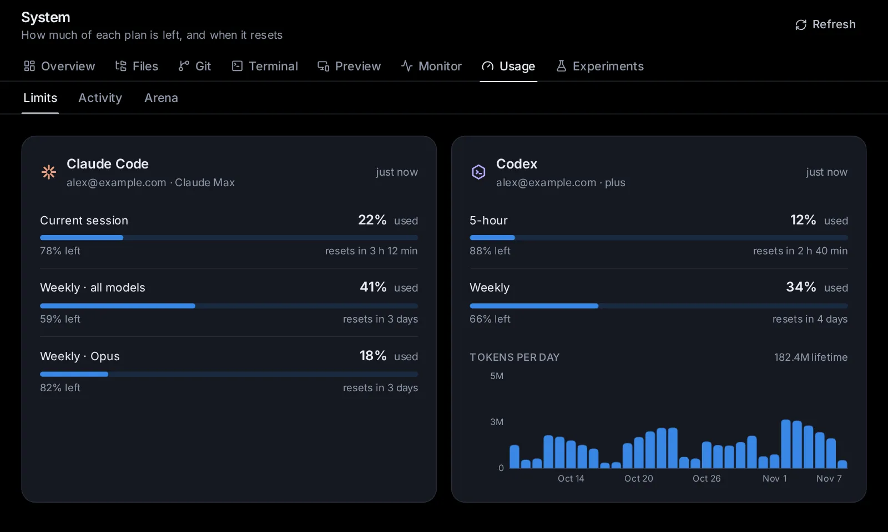

# Usage, limits and costs

Claude Code and Codex run on plans with usage limits, and every model call has a price. This topic shows where to see how much of each plan you've used and when it resets, what happens at a limit (and how to have sessions continue by themselves), what the agents did over time, and how the app estimates costs, including prices you set yourself.

## Open the Usage page

Open **System** in the sidebar (on a phone, open the sidebar first) and click its **Usage** tab. A thin bar under the System icon shows at a glance how much is left across all your paid Claude Code and Codex subscriptions, each counted by the limit it is closest to; if you only have free subscriptions it counts those, and with none it does not show. It turns red when nothing is left. Hover over it to see what each subscription has left.

The [Usage page](/usage) has three tabs:

- **Limits** (`/usage`): how much of each plan is left, and when it resets.
- **Activity** (`/stats`): lines changed, tokens and sessions over time.
- **Arena** (`/arena`): which models win on your own tasks.

The app reads your usage when you open the page, and every five minutes while the app is open; on the Limits tab, **Refresh** reads it again now.

## Read a plan's limits

The **Limits** tab has a card for Claude Code, one for Codex, and one for each account you added in [Settings → Agents → Accounts](/settings?s=accounts). On a wide screen they sit two to a row; on a phone, one under the other.

Each card shows the account's email and plan, how long ago the numbers were read, and one row per limit (a window of time with a cap on use):

- Claude Code: **Current session (5 h)**, **Weekly · all models**, and weekly limits for one model, such as **Weekly · Sonnet only**.
- Codex: **5-hour window**, **Weekly**, or windows of other lengths. When Codex has several limits, each row starts with the limit's name.

Each row gives the percentage used, a bar, the percentage left, and when it resets ("resets in 2 h 15 min"; hover for the exact time). A warning sign appears at 90% or more.

Depending on the plan, the card also shows:

- **Extra usage** (Claude): whether paid use beyond the plan's limits is on, and how much of its monthly limit is spent.
- **Credits** (Codex): your credit balance, or "Unlimited".
- **Limit resets**: resets you can use now (see [Use a limit reset](#use-a-limit-reset)).
- **This week by surface** (Claude): how this week's use splits between the places you use Claude.
- **Tokens per day** (Codex): a chart of the last 30 days, with your lifetime total. A token is a piece of a word; models count their reading and writing in tokens.

When something is wrong, the card says so:

- "Not signed in" with **Sign in in Settings**;
- "No usage limits reported for this plan";
- an error with **Check the sign-in in Settings**;
- "Showing the last known numbers: …" when the latest read failed.

## What happens when you hit a limit

When a plan's usage runs out, the agent's turn stops. A notice says whose limit it hit, which limit it is and when it resets: "You've hit the Claude Code usage limit" (or Codex) with one account of that agent, "All your Claude Code accounts have hit their usage limit" when you have several and none has usage left, or the account by its name ("Work has hit its usage limit") when another still has some. It shows:

- on the start page, above the message box, for the agent (and account) you picked;
- in a session, above the message box;
- on that plan's card on the Usage page.

The notice offers what you can do:

- **Resume at reset** (in a session, while **Resume after usage limits** is off): the session continues by itself a minute after the limit resets, with the message "Continue where you left off." The notice then says "This session continues by itself when it resets", with **Cancel**.
- **Use a reset**, when the account holds a limit reset you can use now ("2 resets available").

Once usage is back but a session is still due to continue, the notice reads "Continues by itself in …", with **Cancel**.

## Continue sessions automatically after a limit

To have every session that hits a limit continue by itself, open [Settings → App → General](/settings?s=general&find=Resume%20after%20usage%20limits) and turn on **Resume after usage limits** ("When a turn stops because a plan's usage ran out, the session continues by itself a minute after the limit resets"). It is off until you turn it on. It works while no browser is open. With it on, a session shows no warning when a limit stops it: a line above the message box says whose limit it hit (as the notice does), which limit and "Continues by itself in …", with **Use a reset** when the account holds one, and **Cancel**.

How the timing works, with the switch or with **Resume at reset**:

- The session is due a minute after the limit resets, as the provider last reported it. The app reads the usage now and then while a session waits, more often as the reset nears, and moves the time if the provider moves the reset.
- If the limit lifts early (you used a reset, or signed in with another account), the session continues right away. If it was continued early in the last 15 minutes and hit the limit again, it waits for the reset instead.
- Only a turn the limit really stopped is continued, not one that finished just as the plan's usage reached 100%. A planned continue is dropped when the session goes on without it: you send a message or press **Stop**, or a turn gets through normally. A turn the agent starts by itself while it waits (when a background helper of its own stops at the same limit) does not drop it. A session you stopped with **Stop** is never continued by itself, even when the limit's error came first, until you send it a message.
- **Cancel** on the notice stops a planned continue.

With more than one account for the agent, [**Switch accounts at a limit**](/settings?s=accounts&find=Switch%20accounts%20at%20a%20limit) carries the session on with another account right away instead, and waits only when every account is at its limit (see [Agents, accounts and models](/guide/agents-models#use-all-your-accounts-switch-at-a-limit)). For Claude Code, [**Use API credit at a limit**](/settings?s=accounts&find=Use%20API%20credit%20at%20a%20limit) can carry it on then, billed to an Anthropic API key you saved, instead of waiting (see [Use API credit when every account is at its limit](/guide/agents-models#use-api-credit-when-every-account-is-at-its-limit)).

## Use a limit reset

Some plans give you limit resets: Codex reset credits and Claude reset grants. Using one clears the plan's usage limits now instead of waiting for them to reset.

Each card lists them under **Limit resets**, with how many you have. Each reset shows its name (and how many uses are left on it), "Expires in …" (in warning colour when less than a day away) or "Does not expire", and notes such as "Works once you hit a limit" or "Not usable yet". A reset another limit holds back says which, and when it lifts: "Blocked while your weekly limit is used up (usable in …)". Some Claude resets clear only part of your allowance, so they cannot be used while your weekly limit is used up; they become usable once it resets. When there are none: "No limit resets right now", with when the next one comes, if the plan says. The app checks a Claude account's resets about every ten minutes, since Anthropic refuses checks that come more often, and shows the list it last read in between, even after the app restarts. So a reset can take a few minutes to show as usable. One you use leaves the list at once.

1. Click **Use** next to a reset, or **Use a reset** on a limit notice (it takes the first reset in the list that works now).
2. Read the confirmation. It says which reset it uses, when that expires, and how many will be left. If you aren't at a limit, it warns you ("You are not at a limit right now").
3. Click **Use reset**.

The app says how it went, for example "Codex usage limits are reset.", "Claude is not at a usage limit right now, so nothing was reset.", "Resets are cooling down. Try again later." or "That reset was already used." When it works, a session waiting for the limit continues right away.

Claude resets need Claude Code signed in with a Claude subscription (not API billing).

## See what the agents did over time

The **Activity** tab (`/stats`) counts what the agents did, from the sessions the app knows on this computer.

At the top:

- **Daily** (the last 30 days), **Weekly** (26 weeks), **Monthly** (12 months, or since your history starts) or **Yearly** (by year). The page remembers your pick.
- **All**, or one agent: **Claude**, **Codex**, **Custom**, and any other agent that has done something here (Gemini CLI, OpenCode…).
- A model's chip, when you picked one model in **By model** below: the page then counts that model alone. Click the chip (its **✕**) to see every model again.
- **Charts** or **Table**.

The line beside them names the range and your time zone. Days, weeks and months follow your time zone.

The tiles show the totals for the range:

- **Lines added** and **Lines removed**
- **Input tokens** (what the models read: fresh and cached) and **Output tokens** (what they wrote)
- **Output speed**: tokens per second, while replies were being written
- **API cost (est.)**: what the same tokens would cost through the API
- **Prompts** (with the number of turns), **Sessions**, **Commands** (with the number of tool calls) and **File edits**

The small arrow on a tile compares with the same length of time just before ("arrows compare with the previous 30 days"). It's neutral: more isn't better or worse.

**Charts** shows lines changed (added up, removed down), input tokens (fresh and cached), output tokens, output speed, and small charts for prompts, sessions, commands and file edits, one bar per day, week, month or year. **Table** lists the same numbers per period, newest first, with a total.

Below, in both views:

- **By agent**: each agent by name (Claude Code, Codex, Custom, Gemini CLI and the others that did something), with sessions, prompts, lines, input and output.
- **Top projects**: the folders with the most lines changed.
- **By model**: each model's sessions, prompts, input, cached input, output and API cost, Custom's models (OpenRouter, Ollama, vLLM…) as much as Claude's and Codex's. Click a model to see the whole page for it alone. A model without a known price shows **set a price** instead. Hover over a model for its price per million tokens and where it comes from ("your price" or "public price table").

On a phone the tiles sit two to a row, and some table columns are left out.

The start page shows today's numbers under the message box once the agents did something today: lines added and removed, input and output tokens, prompts and sessions. Click them to open Activity.

## How costs are estimated

Claude and ChatGPT plans are flat-rate, so the app shows what the same work would cost at API prices (pay-per-use prices). This tells you how much use you get from a plan, and what a model through the API would cost.

- The prices come from a public price table (LiteLLM's), which the app fetches at most once a day and keeps for when it is offline.
- Prices you set yourself win over the table.
- Each session's tokens are priced at its model; a session that changed models is priced at the one it used last.
- Cached input (text the model read before, served from its cache) is priced at the cached price, or at the input price when there is none.
- Models with no known price (a family name alone, such as "opus", or a model the table doesn't list) count for nothing in the totals, and show **set a price** in By model.

OpenRouter models use prices fetched automatically from OpenRouter, including cached input prices. You do not need to enter them. If OpenRouter has no price available, **By model** shows a dash rather than asking you to set one.

Spending caps use the same prices, but take an agent's own figure where it reports one: Claude Code's cost, or what OpenRouter says each Custom call cost. A model on this computer costs nothing there.

## Set your own price for a model

1. On the **Activity** tab, click **Model prices** at the top of **By model**, or **set a price** next to a model.
2. The **Model prices** dialog lists the models in view, and any you priced before. Each has **Input**, **Cached** and **Output**, in dollars per million tokens. Empty fields use the public table's price, shown in grey.
3. Type your prices. Input and output are both needed; cached is optional (it then costs the input price).
4. To price a model that isn't listed, type its ID in **Another model ID** and click **Add**.
5. Click **Save prices**.

The bin icon on a row (**Use the table's price**) clears your price for that model. To count a model on this computer as free, give it 0 for input and output.

## Every session is kept

The app keeps every session and its numbers, whatever the agent's own program does. Claude Code deletes its conversations after 30 days unless told otherwise, so the app tells it to keep them (in every Claude Code account whose settings don't say how long), and the app keeps its own link to every conversation file of Claude Code and Codex: a conversation the agent's program (or anyone) deletes comes back, listed and openable as before. The link is the same file under a second name, so it takes no extra disk space.

What goes is what nobody uses: sessions inactive for a year are deleted, unless you change that in [Settings → General → Delete inactive sessions](/settings?s=general&find=Delete%20inactive%20sessions) (see [Delete inactive sessions](/guide/app#delete-inactive-sessions)). Their numbers stay in Activity.

Conversations Claude Code deleted before this, while the app wasn't keeping them, can't come back; Activity's history starts where the app first counted them.

## Cap what a session spends

A spending cap stops a session once it has spent a set amount at API prices, whatever plan you pay with. Child sessions it starts count too.

- For a new session: on the start page, **Options** → **Spending cap**. Pick $1, $5, $10 or $25, or type an amount and click **Set**. **No cap** takes it off.
- For a running session: the session's menu (⋯) → **Session settings** → **Spending cap**. The dialog shows what it has spent so far. Type a cap (from $0.01) and click **Set the cap** or **Change**; **Remove the cap** takes it off.

While a cap is set, a bar above the message box shows "$1.20 of $5.00", with **Change**. When the cap is reached, the agent stops right after the model call that reached it, a note under the turn says "Stopped at the spending cap", and new messages wait until you raise the cap (**Raise the cap…**) or remove it. See [Sessions](/guide/sessions) for more.

## The Arena tab

The **Arena** tab (`/arena`) shows which models win on your own tasks. On the start page, **Options** → **Arena** sends your prompt to one or two more models as well; you keep the best answer. The tab ranks the models by a rating (an Elo rating, starting at 1000) over the matches you decided, with how often each was kept and its win rate, and lists recent matches, decided or still open. See [Deep research, second opinions and several agents](/guide/research).

## Can I reset the numbers?

There is no button to clear Activity. Deleting a session yourself (its menu → **Delete session**) takes its numbers out of Activity too; sessions deleted because they were inactive keep theirs. The limits on the Limits tab are your plans' own: they reset on the provider's schedule, or with a [limit reset](#use-a-limit-reset).

## Ask an agent

- "How much of my Claude plan is left this week, and when does it reset?"
- "Turn on resuming sessions after usage limits."
- "Continue my session 'Refactor auth' when the Codex limit resets."
- "What would last month's work have cost at API prices, by model?"
- "Count my Ollama models as free in the cost estimates."
- "How much did Custom do this month, and with which models?"
- "Delete sessions after two years of inactivity instead of one."
- "Show my OpenRouter usage and costs without entering model prices."
