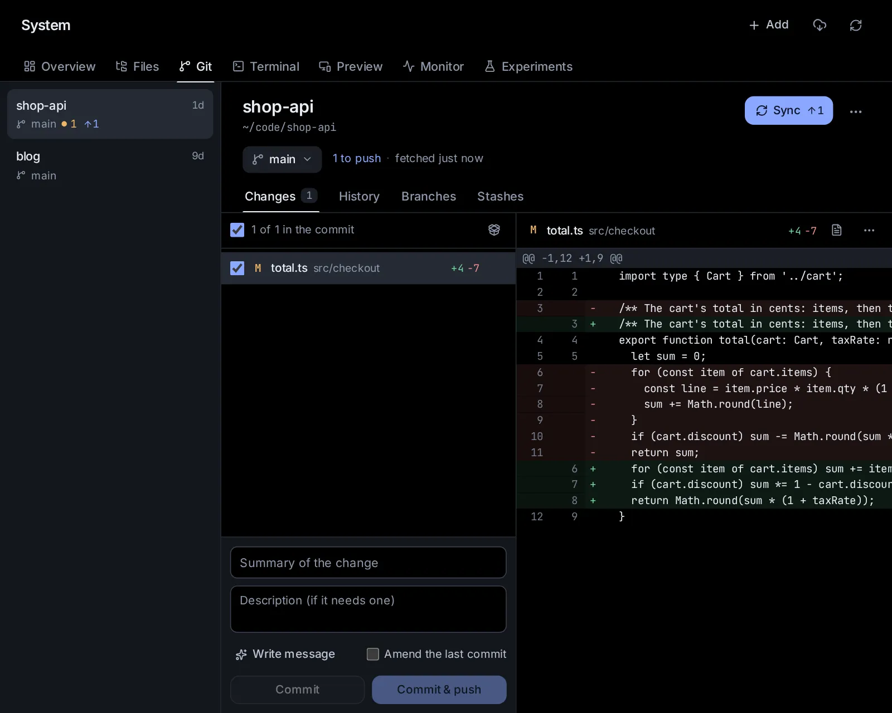

# System: files, Git, Terminal and Preview

**System** in the sidebar is this computer: browse, find, open and edit its files, add them to projects and to new sessions, search inside them, run Jupyter notebooks, commit and push with Git, open pull requests and review what a branch changes. Terminals, previews of the web apps running here, before and after screenshots of an agent's changes to one, and a live view of how the computer is doing (Monitor) are here too, so you can check and finish an agent's work without leaving the app.

## Open System

Click **System** in the sidebar's tools, or go to [System](/system). A row of tabs under its title takes you to each part, and each keeps its own address:

- **Overview** ([open it](/system)): the computer at a glance, and what each tool holds now (see [The overview](#the-overview)).
- **Files** ([open it](/files)): the files on this computer (see [Open the Files page](#open-the-files-page)).
- **Git** ([open it](/git)): your repositories (see [See your repositories on the Git page](#see-your-repositories-on-the-git-page)).
- **Terminal** ([open it](/terminal)): shells on this computer (see [Use the terminal](#use-the-terminal)).
- **Preview** ([open it](/preview)): the web apps running here (see [Look at a dev server with Preview](#look-at-a-dev-server-with-preview)). It shows only on this machine's own pages, not while you look at another machine.
- **Monitor** ([open it](/system/monitor)): how busy the computer is (see [Watch this computer in Monitor](#watch-this-computer-in-monitor)).

On a phone the tabs scroll sideways under the title. A tab's own buttons (Git's **Add**, Preview's refresh) sit at the right of the title.

## The overview

**Overview** shows, at the top, the computer's name, its system and how long it has been up, with four meters: **Processor**, **Memory**, **Disk** (the main disk, with its free space) and **Graphics** (when it has NVIDIA graphics cards). A meter turns red as it nears full. Click them to open **Monitor**.

Below, a card for each tool; its title, or **Open**, opens its tab:

- **Files**: a box that searches file names and the words inside them (from your home folder), the files you opened lately, and **Home folder**, **Recent files** and **Trash**.
- **Git**: your repositories, those with changes or commits to send first, each with its branch and how many files changed. Click one to open it on the Git tab.
- **Terminal**: the shells running, and **New** for another.
- **Preview**: the web apps running here, each with its port. Click one to look at it.

## Open the Files page

Click **System**, then **Files**, or go to [Files](/files). On a computer the page has two parts:

- On the left, the **places**: the files you opened lately, your home folder, folders you pinned, your projects' folders, the folders sessions worked in, and the trash (see [Places](/guide/files-git#places)).
- On the right, the folder you are in, with what is in it (see [Browse a folder](/guide/files-git#browse-a-folder)). Files you open show there too, each in a tab: the first tab goes back to the folder.

In a small window, the places fold into a button at the right of the title: it names the folder you are in, and a click on it lists the places.

On a phone the folder fills the screen. Its name at the top right opens the places, from the bottom of the screen; **‹** with the folder above's name, under the title, goes up a folder, and your phone's Back goes to the folder you were in before. A file opens on a page of its own, with **Back**.

Other ways in:

- Click the folder under a session's title, or use the session's menu (⋯) → **Folder and code** → **Browse the folder**: Files opens at that folder.
- A file an agent changed or handed you, or a link to a file in its reply, opens in a window over the conversation, so you keep your place. **Open in Files** moves it to the Files page; ✕ or Esc closes it (if you changed it without saving, it asks "Discard your changes?" first).
- A project's **Files** tab shows the project's own folders (see [Projects and knowledge](/guide/projects)).

## Places

- **Go to a folder**: find a folder by its name, or type its path (`~/code/shop`); the projects and pinned folders come first. Tab, or the arrow at a row's end, lists the folders inside one.
- **Recent files**: the files you opened lately in this browser, the last first, each with its folder. Those no longer there say so; **Clear those gone** takes them off the list.
- **Home folder**: your own folder, where your files are. The folder new sessions start in shows below it when it isn't your home folder.
- **Pinned**: folders you pinned, the same on every device. To pin one, use its menu or the folder's ⋯ → **Pin to Places**; to unpin it, point at it and click ✕, or use **Unpin from Places**.
- **Projects**: each project's own folder.
- **Sessions worked in**: the folders sessions worked in lately.
- **Trash**: what you deleted (see [Delete and put back](/guide/files-git#delete-and-put-back)).

On a computer, drop files or rows on a folder among the places to put them there.

## Browse a folder

The bar over the folder holds, from the left:

- **The folder above** (the up arrow).
- The folder's path, in steps: a house for your home folder, then **code › shop**; a folder outside your home folder starts from **Computer** (`/`). Click a step to go there, or drop rows on it to move them there. A long path folds its middle into **…**, which lists the folders between. The last step, or the small arrow beside it, opens **Go to a folder**.
- **Find in** *the folder*: narrows the list to the names that hold what you type, as you type. Enter, or the line **Search everything in … for "…", inside files too** at the top of the list, searches every folder under this one, file names and what is in the files (see [Search files](/guide/files-git#search-files)).
- **New**: **New folder**, **New file**, **New notebook**, **Upload files** and **Upload a folder**.
- **As a list** or **As tiles, with pictures**: tiles show pictures as themselves, a good way to look through photos.
- **More** (⋯): **Sort by** (**Name**, **Date changed**, **Size** or **Kind**, and **The other way round**), **Show hidden files**, **Pin to Places**, **New session in this folder**, **Open a terminal here**, **Copy path**, **Download as .zip** and **Refresh**.

The list puts folders first. For each thing it shows its name, when it changed ("just now", "5 min ago", the time for today, "Yesterday", or the date) and its size. Click a column's title to sort by it, and again for the other way round. In a narrow window the bar keeps the field behind a search button, and **As a list** and **As tiles, with pictures** move under **More**; the date and size columns give way to the names.

- Click a folder to go into it, or its arrow to open it in place, as in a tree; the folder remembers which of its folders were open.
- Click a file to open it.
- The line at the bottom counts the folders and files and adds up their size.
- The list refreshes every 5 seconds while you look at it, so files the agents make appear on their own.

On a phone each row shows the size and date under the name; the search button opens the field, **More** holds **As a list**, **As tiles, with pictures** and **Pick several** too, and the **+** button at the bottom right adds a folder, a file or uploads.

Each folder has an address of its own, so the browser's Back goes to the folder you were in. The folder shown is also the one other parts of the app mean by "the folder open in Files". It is kept in this browser, separately for each machine you use (see [Other machines](/guide/devices#use-other-machines-from-one-app)).

### What the letters beside files mean

Inside a git repository (a folder whose history git keeps), files with changes since the last commit carry a letter and a colour:

- **M**: changed.
- **A**: new, and already added to git.
- **U**: new, and not yet in git.
- **D**: deleted.
- **R**: renamed.
- **C**: a conflict to resolve.
- **•** on a folder: something inside it changed.

## Work with files and folders

Every row has a menu. Point at the row and click **More** (⋯) at its end, or right-click it; on a phone, tap its ⋯. It holds:

- **Open**.
- **Start a session with it** (a file; see [Start a session with files](/guide/files-git#start-a-session-with-files)), or **New session in this folder** (a folder: the start page, with that folder picked).
- **Add to a project** (see [Add files to a project](/guide/files-git#add-files-to-a-project)).
- **Pin to Places** or **Unpin from Places** (a folder).
- **Rename** (F2), **Duplicate**, **Move to** and **Copy to**.
- **Open a terminal here** (a folder): a new shell in that folder, in the bottom panel on a computer or on the Terminal page on a phone.
- **Copy path**: the full path, to paste anywhere.
- **Download**, or **Download as .zip** for a folder.
- **Delete** (the Delete key).

### Pick several

To act on several things at once, pick them:

- On a computer, click the box at the start of a row (it shows when you point at the row), Ctrl+click (⌘+click on a Mac) to add one, Shift+click to pick everything from the last one picked, or press Ctrl+A for all.
- On a phone, press and hold a row, then tap the others; or **More** → **Pick several**.

The bar then says how many are picked, with **Start a session**, **Add to a project**, **Move to**, **Delete**, and **More** (⋯) for the rest of the menu: **Copy to**, **Copy paths**, **Download as .zip** and so on. ✕ (or Esc) unpicks them all.

### Use the keyboard

With the list in use (click it first), on a computer:

| Keys | What they do |
| --- | --- |
| ↑ ↓ | Move to the row above or below (Shift picks as it goes) |
| → ← | Open or close a folder in place; in tiles, the tile beside |
| Enter | Open |
| Space | Pick or unpick |
| Backspace | The folder above |
| Delete | Delete |
| F2 | Rename |
| Ctrl+A | Pick all |
| Esc | Unpick all, then empty the field |

Typing a letter starts **Find in** with it.

### Make a file or folder

1. Click **New** → **New folder**, **New file** or **New notebook** (on a phone, the **+** button).
2. Type the name in the field that appears in the list and press Enter. Esc cancels.

A new file is empty and opens in the editor at once. A new notebook is called `Untitled.ipynb` (`Untitled 2.ipynb` when that is taken) until you type another name; it starts with one empty code cell and opens as a notebook. A new file whose name ends in `.ipynb` starts as an empty notebook too. If the name is taken, the app says so and makes nothing.

### Rename or move

- **Rename** turns the name into a field. Enter keeps the new name, Esc leaves it as it was.
- **Move to** lists your projects and pinned folders first, then the folders used lately, with a field to find any folder by name or type its path. Pick one, and the file or folder moves there. A message says where it went, with **Undo**.
- On a computer, drag rows onto a folder (in the list, a step of the path or among the places) to move them there; files picked together move together. Hold Alt (Option on a Mac) as you drop to copy instead.

A folder can't go into itself, and moving replaces nothing: if the place already has something with that name, the move stops.

### Duplicate and copy

- **Duplicate** makes a copy beside it, named with "copy" after the name (`report copy.pdf`, then `report copy 2.pdf`).
- **Copy to** copies into another folder, picked as for **Move to**. If the name is taken there, the copy is named the same way. **Show** on the message opens that folder.

### Delete and put back

**Delete** moves the file, or the folder with everything in it, to the trash at once, and a message says so with **Undo**. Nothing is lost until you empty the trash.

**Trash**, among the places, lists what you deleted, the last first: each with where it was, when it went and its size.

- **Put back** returns it to where it was. If something else took its place since, it comes back beside it with "copy" after its name. Things deleted before the app kept where they came from ask for a folder instead.
- Its **More** (⋯) has **Put it in another folder** and **Delete for good**.
- **Empty the trash** deletes everything in it for good, once you say so.

The trash is a folder in the app's data folder (for example `~/.hydor/trash`); its page says where. Your home folder and the top folder (`/`) can't be deleted. Something on another disk than the app's data folder can't go to the trash: the app asks "Delete … for good?" first.

### Download

A file downloads as itself. A folder, or several things picked together, download as one .zip file, made as it downloads. A .zip leaves out `.git` and `node_modules` folders, and holds up to 4 GB and 65,000 files.

## Add files to a project

A project keeps a project's files in its folder, and can work with other folders of yours where they are (see [Projects and knowledge](/guide/projects)). To add to one:

1. Open the menu of a file or folder (or pick several), and click **Add to a project**.
2. Pick the project, or **New project** to make one for them first.

A file is copied into the project's folder. A folder isn't copied: it joins the folders the project works with, where it is. A message says what was added, with **Show**, which opens the project's **Files** tab. Something already in the project stays as it is.

**Add to a project** is also in a file's **More** (⋯) in the editor, in the window a file opens in over a session, on the cards of files an agent handed you, and on pictures an agent made.

Sessions you start in the project then find the files there: each is told what the project's folder holds and which other folders it works with.

## Start a session with files

To have a new session start with some files:

1. Open the menu of a file (or pick several) and click **Start a session with it** (or **Start a session**, on the bar of what is picked).
2. The start page opens with them in the message box, each marked "on this computer". Remove one with its ✕, add files from your device with the paperclip, pick the agent and folder as usual.
3. Type what to do with them and press **Start**.

Nothing is uploaded: the message names each file by its path, so the agent opens it where it is, and pictures (PNG, JPEG, GIF and WebP up to 5 MB) also go to the model to look at. Up to 20 files go with one message.

For a folder, **New session in this folder** opens the start page with the session set to work in it.

**Start a session with it** is also in a file's **More** (⋯) in the editor, in the window a file opens in over a session, on the cards of files an agent handed you, and on pictures an agent made.

## Upload files and folders

- **New** → **Upload files** or **Upload a folder** uploads into the folder you are in. On a phone, the **+** button → **Upload files** picks files or photos from the phone.
- On a computer, drag files or whole folders from your desktop onto the folder, onto a folder in it, or onto a place ("Drop files here to upload them"). Empty folders come along too.

Uploads show in the **Uploads** panel at the bottom right: how much has gone, file by file. **Cancel** stops one, and ✕ clears a finished one from the panel. Big files go up in 32 MB pieces.

Before anything is sent, the app checks for files with the same names in that folder. If some exist, the panel lists them ("3 already exist") with three choices:

- **Replace**: upload them over the existing ones.
- **Skip existing**: upload only the new ones.
- **Cancel**: upload nothing.

## Open and edit a file

Click a file in the folder. It opens in the editor, in a tab of its own. The first tab goes back to the folder (or the search, the recent files or the trash) you opened it from. The last 12 files you opened stay as tabs: click one to go back to it, and close it with its ✕ or a middle click. **Recent files**, among the places, lists the ones you opened lately.

The editor numbers the lines, colours the text by the file's language, matches brackets and, on a computer, folds blocks and suggests completions as you type. Tab indents.

To save, click **Save** (it lights up once you change something) or press Ctrl+S (⌘S on a Mac). A dot beside the file's name means there are unsaved changes, and leaving the page with unsaved changes makes the browser ask first.

### The editor's tools

On a computer, the bar above the file shows its path and these buttons:

- **Preview** (Markdown files): the file as it reads, with headings, tables, its own images (from beside the file) and links to other files. Click it again to edit. Markdown files open as a preview first.
- **Show as a page** (HTML files): runs the page in a frame sealed off from the app, able to load the files next to it. HTML files open as a page first. The page's link lasts an hour; after that, open the file again.
- **Changes since the last commit**: the file's differences from its last commit, added lines in green and removed ones in red. It says "No changes" when the file matches its last commit or isn't in a git repository.
- **Word wrap**: wraps long lines instead of scrolling sideways. The choice is remembered.
- **Ask**: asks an agent to change the file, or about it ([below](#ask-an-agent-about-the-file)).
- **Terminal in this folder**: a new shell in the file's folder.
- **Download**.
- **More** (⋯): **Start a session with it**, **Add to a project**, **Show in its folder** and **Copy path**.
- **Save**.

To find text in the file, press Ctrl+F (⌘F on a Mac) while the cursor is in it: a find bar opens at the top, with replace.

On a phone the bar shows **Back**, the file's name over its folder, **Preview** or **Show as a page**, **Ask an agent** (✨), **Save** (once you change something) and **More** (⋯), which holds **Find**, **Word wrap**, **Changes since the last commit**, **Terminal in this folder**, **Download**, **Start a session with it**, **Add to a project**, **Show in its folder** and **Copy path**. Phones wrap long lines unless you turn **Word wrap** off.

### Ask an agent about the file

Click **Ask** in the editor's bar (✨ on a phone) and say what should change ("Find and fix any bugs", "Add a summary at the top"), or ask a question about the file. The panel opens beside the file (over it on a narrow screen), with examples to start from, and shows the agent and model you picked last on the start page.

- Unsaved changes are saved first, so the agent works on them.
- The agent starts in the file's folder, knows which file you mean, and changes that file itself. You watch each change arrive in the editor as soon as it is written, the changed lines tinted for a moment, with your place in the file kept.
- The conversation goes on in the panel: write back to ask for more. **A new request** starts again, and **Open as a session** opens it in full; it is in your sessions too. On a phone, **See the file** folds the panel away to watch the file, and the bar at the bottom brings it back.
- The panel stays open as you switch between files' tabs, each with its own conversation. It works the same in the Word, Excel, CSV and LaTeX editors. As with [asking from the Library](/guide/library#change-it-by-asking-an-agent), the agent's remembered model and permissions stay as they were.

### When the file changes while you have it open

Agents and terminals change files all the time. Every few seconds (every second while an agent is working) the editor checks the file:

- With nothing unsaved, it puts in the new version by itself, where you are reading: only the lines that changed change, tinted for a moment.
- With unsaved changes of yours, a bar says "The file changed on disk since you opened it." Choose **Reload (discard mine)** to take the new version, or **Overwrite with mine** to save yours over it.

Saving never writes over a newer version without this question.

### Files the editor doesn't edit

- Files over 10 MB: "File is too large to edit here". Download it, or open it in a terminal. (Notebooks may be up to 40 MB.)
- Binary files (anything that isn't text): "Binary file". Download it to open it on your device.
- Word, Excel, CSV and LaTeX files open in editors of their own (the next section); images, PDFs, video, audio and other Office documents show as previews (the one after).

## Edit Word, Excel, CSV and LaTeX files

These files open in the editors the [Library](/guide/library#documents) has for them, and saving writes the same file again, in its own format:

- **Word documents** (.docx) open in the document editor, as in Word or Google Docs, on a sheet of their paper.
- **Excel files** (.xlsx), **CSV** and **TSV** files open in the spreadsheet editor, with their sheets and working formulas.
- **LaTeX files** (.tex) open in the LaTeX editor, the source beside its typeset pages. The files the document reads (chapters it puts in with `\input`, its bibliography) open with it, each in a tab, and it is typeset among the rest of its folder (its pictures, styles and data), which TeX reads but never changes. A chapter opens the document that reads it, on the chapter's own tab.

Change it as in the [Library](/guide/library#documents), then click **Save** in the bar at the bottom, or press Ctrl+S (⌘S on a Mac); **Discard** goes back to the file as it was. The bar above has the file's path, **Ask** ([ask an agent](#ask-an-agent-about-the-file)), **Download** and **More** (⋯): **Edit as text** (CSV, TSV and LaTeX files) or **Show as a preview** (Word and Excel files) shows the file as before, with a button in the bar to come back to the editor, and the Files page's **Start a session with it**, **Add to a project**, **Show in its folder** and **Copy path**. A file opened at a line, from a search, opens as text.

What saving keeps of the file:

- **CSV and TSV**: the rows and cells you didn't change keep their text exactly as it was, and the file its separator, quotes and line ends. A CSV file holds one sheet's values: when you added formulas, sheets or formatting, the first save asks first, and formulas are saved as the values they give.
- **LaTeX**: only the files you changed are written, each with its own line ends. A file you add in the editor goes into the folder; one you delete goes to the [Trash](#delete-and-put-back).
- **Word and Excel** files are written again from what the editor holds. Where a file has what the editor doesn't keep (a Word file's headers and footers, footnotes, comments, tracked changes or equations; an Excel file's charts, pivot tables or merged cells), a bar above says so: "Saving replaces the file without what this editor does not keep", and which. The first save asks before replacing the file, and **Save as a copy**, in that bar, writes your changes to a new file beside it instead ("report (edited).docx"). The first time you save a Word or Excel file, the file as it was goes to the [Trash](#delete-and-put-back), where **Put back** brings it back beside the new one.
- A file too long for the editor shows its start, to read only: **Edit as text** or **Show as a preview** shows all of it.

When an agent or a terminal changes the file while it is open, the editor takes the new version if you changed nothing, or asks, as the text editor does: **Reload (discard mine)** or **Overwrite with mine**.

PowerPoint files, older Office files (.doc, .xls, .ppt), OpenDocument files, RTF and EPUB show as a preview, as the next section explains.

## See images, PDFs, documents and web pages

The file viewer shows files as they look:

- **Images** (PNG, JPEG, GIF, WebP, SVG, ICO, BMP, AVIF): shown whole, on a checkerboard where they are see-through.
- **PDFs**: in your browser's own PDF viewer.
- **Video** (MP4, WebM, MOV and M4V; MKV and OGV where your browser plays them): in the app's own player (see [Watch a video](#watch-a-video) below). **Audio** (MP3, WAV, OGG) plays in place.
- **Office documents**: PowerPoint (.pptx, .ppt), older Word and Excel files (.doc, .xls and the like), OpenDocument (.odt, .ods, .odp), RTF and EPUB; and Word (.docx) and Excel (.xlsx) files from **More** (⋯) → **Show as a preview** in their editors. A switch at the top picks the view:
  - **Pages**: the document as LibreOffice lays it out, page by page ("Laying out the pages…" the first time). This view is there only when LibreOffice is installed on this computer, and not for EPUB books.
  - **Text**: its text, sheets and slides as the app reads them.

  Phones start on **Text**, which scrolls and zooms better there. If a document can't be read, it says "No preview for this file": download it instead.
- **Markdown** and **HTML**: see **Preview** and **Show as a page** above.

**Download** is always in the bar.

### Watch a video

A video opens in the app's own player, which fills the viewer:

- **Play and pause**: the round button in the middle, the button at the bottom left, a click on the picture, or Space (K works too). A double click on the picture fills the screen.
- **Move through it**: drag along the bar at the bottom, or click a point on it; resting the pointer on the bar shows the time there, and its paler part is what has loaded. ← and → move 5 seconds, J and L 10 seconds, Home and End go to the start and the end, 0 to 9 jump to that tenth of the video, and , and . step one frame while it is paused.
- **Sound**: the speaker mutes and unmutes it (M). On a computer, rest the pointer on the speaker for a volume slider; ↑ and ↓ change the volume too.
- **Speed**: the **1×** button picks from 0.5× to 2× (**Normal** is 1×).
- **Loop** plays it again from the start each time it ends, **Picture in picture** keeps it playing in a small window over everything else (where your browser has it), **Download** saves the file, and **Full screen** (F) fills the screen; the same button, or Esc, comes back.
- The controls fade while it plays and come back when you move the pointer. The player remembers your volume and speed for the next video.
- **On a phone**: tap the picture to show or hide the controls, and double-tap its left or right side to go back or forward 10 seconds. On an iPhone, full screen uses the phone's own video player.
- A video your browser can't play (MKV and AVI files often use codecs browsers don't) says "This video can’t play here", with **Download** to watch it in a video app.

## Find a file by name

Press Ctrl+P (⌘P on a Mac) on any page. "Go to file in …" searches the folder open in Files by name: type a few letters of the name in order (`invq3` finds `invoices/q3-report.xlsx`). Files whose own name holds what you typed come first. Move with ↑ and ↓, open with Enter or a click. It lists up to 60 files, hidden ones included.

The search box (Ctrl+K, ⌘K on a Mac) finds files by name too, from the same folder, once you type two letters.

## Search files

One search finds files by their names and by the text inside them, everywhere under a folder. Type in a folder's **Find in** field and press Enter, or go to [Search in files](/search).

1. Type what to look for in "Search names and the text inside files". Results come as you type.
2. Under the field, **In** says where it searches: at first the folder you came from. Click it to search somewhere else: a project's folder, a pinned folder, one sessions worked in, your **Home folder**, or any folder you find by name or type the path of.
3. Narrow it down if you like:
   - **All kinds of files** picks the kind: **Text and notes**, **Code**, **Data and settings**, **Web pages** or **Notebooks**. Or type names like these in the same menu, separated by commas (`*.md, *.py`); a `!` in front leaves those out (`!dist/**`).
   - **Hidden files too** searches files and folders whose names start with a dot.
   - In the field, **Match case** matches capitals exactly (without it, a search in lower case ignores case, and one with a capital letter in it matches case), and **Regular expression** reads what you type as a pattern (`colou?r`) instead of plain text.

The results come in two parts:

- **Files by that name**: up to 30 files whose names hold what you typed, each with its folder.
- **Inside files**: the matching lines, grouped by file, each file with its number of matches. Click a line to open the file at that line, or a file's name to open it.

Each result's **More** (⋯) has **Show in its folder**, **Start a session with it**, **Add to a project** and the rest of a file's menu.

The search is in the page's address, so Back and a reload keep it. It skips files the folder's `.gitignore` leaves out and files over 4 MB. It stops at 50 matches in a file and 1,000 in all, or after 15 seconds, and shows the first 30 matching lines of each file. PDF, Word and other documents are found by their names, not the text inside them; for agents to search inside them, add them to [knowledge](/guide/projects#shared-knowledge-documents-every-session-can-search).

## Run a Jupyter notebook

A notebook (`.ipynb`) opens as a notebook: its cells, each with its output. The bar at the top holds the kernel button, **Run all cells**, **Interrupt (I, I)**, **Restart the kernel (0, 0)**, **Clear all outputs**, **View the notebook file (JSON)**, **Download** and **Save**. On a phone, the less used ones are under **More**: **Restart the kernel**, **Restart and run all**, **Clear all outputs**, **View the file (JSON)** and **Download**.

Make one with **New** → **New notebook** in a folder (see [Make a file or folder](/guide/files-git#make-a-file-or-folder)), or ask an agent for one: it writes the notebook, runs it from the top so its outputs are there, sets up an environment to run it in when none fits, and hands it over as a card that opens it here.

### Pick where the code runs

The kernel button (a dot and a name, or "No kernel") opens **Run this notebook with**: the Python environments on this computer. It lists virtual environments named `.venv`, `venv` or `env` in the notebook's folder or the folders above it, conda environments, the system Python, and Jupyter kernels registered here (other languages too). Each shows its version, and the one the notebook asks for (or a virtual environment beside it) is marked **suggested**.

- An environment marked "needs ipykernel" has an **Install** button: it runs `pip install ipykernel` in that environment, after you confirm, and nothing else in it changes.
- Running a cell with no kernel yet starts one in the suggested environment. If that fails, the list opens so you can pick another.
- With a kernel running, the button's menu shows its state (Starting, Idle, Running, Restarting or Stopped), when it started, and **Interrupt**, **Restart** and **Shut down**. Picking another environment asks first, since the running kernel's variables are lost.

Kernels keep running after you close the notebook, and through restarts of the app: open it again and the outputs of what ran meanwhile are there. Shut one down from its menu, or from the [System](/system) page, where running kernels are listed.

### Write and run cells

A cell is **Code**, **Text** (Markdown) or **Raw**. Click a code cell to edit it, or double-click a text cell. While a cell runs it shows `[*]` and a timer; afterwards its run number, `[3]`.

- Point at a code cell and a run button takes the place of its number ("Run (Ctrl+Enter)"; while the cell runs, it interrupts the kernel). Its tools show in the corner: **Edit** (text cells), the cell type, **Move up**, **Move down**, **Add a cell below** and **Delete the cell**. On a phone, tap a cell: its tools show above it, **Run** included.
- On a computer, pointing between two cells shows **+ Code** and **+ Text**. The same two buttons sit below the last cell.
- When code asks for input (Python's `input()`), a field appears under the cell: "Type, then Enter". Passwords stay hidden.
- While you edit code, Tab after a name asks the running kernel for completions.

Outputs show text, errors in colour, images and charts, tables, HTML (in a sealed-off frame), Markdown and formulas. "Interactive widgets do not run here", and neither does JavaScript output. Progress bars show as they last stood, and text a cell prints bit by bit shows as one block, as in Jupyter.

### Keys

While you edit a cell:

- Shift+Enter: run it and go to the next cell (a new one after the last).
- Ctrl+Enter (⌘Enter on a Mac): run it and stay.
- Alt+Enter: run it and add a cell below.
- Esc: stop editing.

When no cell is being edited:

- Enter: edit the selected cell. ↑ / ↓ (or K / J): move between cells.
- A / B: add a cell above / below. D, D: delete the cell. Z: bring back the last deleted cell.
- M, Y, R: make the cell Text, Code or Raw.
- I, I: interrupt the kernel. 0, 0: restart it.

Ctrl+S (⌘S on a Mac) saves. As with other files, if the notebook changes on disk while you have unsaved changes, a bar offers **Reload (discard mine)** or **Overwrite with mine**. **View the notebook file (JSON)** shows the file as text in the editor; **Open as a notebook** goes back.

## See your repositories on the Git page

Click **System**, then **Git**, or go to [Git](/git). On the left it lists your git repositories, the most recently used first: those your sessions worked in (a session's folder, or a file a session edited; throwaway places such as `/tmp` are left out) and those you added yourself. Once there are more than six, a field at the top finds one by name.

Each repository shows its name and branch, and small marks when there is something to do:

- **● 3**: three files changed and not committed yet.
- **↑ 2**: two commits to push. **↓ 1**: one commit to pull.
- **Merging** or **Rebasing**: a merge stopped on files that clash (see [When a merge stops on conflicts](/guide/files-git#when-a-merge-stops-on-conflicts)).
- On the right, how long ago the last commit was made.

At the top of the page, **Fetch every repository’s remote** (the cloud) asks every remote what is new, and **Refresh** reads the list again.

Click a repository to open it beside the list. At its top: its name and folder, the branch you are on, a line on where it stands against the remote, **Sync** and a ⋯ menu. Under them, four tabs: **Changes**, **History**, **Branches** and **Stashes**. On a computer the repository you used last opens when you come to the page. In a small window the list folds into the page's title (click the repository's name to pick another); on a phone the list is a page of its own, and a repository opens over it with a back arrow.

### Add a repository

**Add** at the top of the page has two ways:

- **Add a folder on this computer**: type or pick a project's folder and click **Add**. A folder inside a repository adds that repository. A folder git doesn't keep yet can start a repository of its own: **Start a repository here** (git's `git init`).
- **Clone from a link**: paste the address of a repository on GitHub, GitLab or another git server (`https://…`, `ssh://…` or `git@host:owner/project`). **Where it goes** suggests a folder of its own (in `~/code` if you have one); it must not exist yet, or be empty. **Clone** shows how far it got; you can close the dialog and it carries on. The repository opens when it is done.

What you add stays on the list until you take it off: ⋯ → **Remove from the list**. Its folder stays as it is.

## Sync with the remote

The remote is where the repository is shared, such as GitHub. The line under the branch says where yours stands: "2 to push · 1 to pull · fetched 5m ago", **Up to date**, **Not on the remote yet** or **No remote**.

**Sync** does what is needed in one click: it asks the remote what is new, brings those commits in, then sends yours up. Its arrows show how many go each way (**Sync ↑2 ↓1**). A branch the remote doesn't have yet shows **Publish branch** instead: it puts the branch there and keeps the two in step from then on.

When your branch and the remote's have both moved on, Sync changes nothing yet and asks how to put them together:

- **Put my commits on top**: your commits go after the remote's, as if you had made them later, so the history stays one straight line (git calls this a rebase).
- **Merge**: a merge commit joins the two lines; every commit stays as it was.

Then Sync sends yours up. If both sides changed the same lines, it stops so you can settle them (see [When a merge stops on conflicts](/guide/files-git#when-a-merge-stops-on-conflicts)). If your uncommitted changes touch files that changed on the remote, it says so: commit them or put them aside in a stash first.

The ⋯ menu has the steps one at a time, and the rest:

- **Fetch** asks the remote what is new without changing anything here. **Pull** brings it in (when both sides moved on, it asks the same question). **Push** sends your commits up.
- **Open a terminal here**, **Show in Files** and **Copy path**.
- **Remotes**: the repository's remotes and their addresses. A repository without one says **No remote · Add one**: paste an address and click **Add remote** (it is called origin), then **Publish branch**.
- **Push tags**, when the repository has tags.

When something doesn't go through, a red box says what happened, in plain words when it can, with **What git said** for git's own message. The app's git never asks for a password: pushing and pulling use this computer's SSH keys or saved git credentials, and say so when those don't work without a prompt.

## Commit changes

**Changes** lists every file changed since the last commit, with the letters the Files page uses (see [What the letters beside files mean](/guide/files-git#what-the-letters-beside-files-mean)), its name in bold with its folder after it, and the lines added and removed. Click a file to see its changes beside the list (on a phone, on a page of their own). Where there is room, **Unified** and **Side by side** show the old and new lines one under the other or next to each other.

There is no separate staging step: each file has a box that puts it in the next commit (all of them at first), and the box at the top ticks or unticks them all ("3 of 4 in the commit").

- **Discard this part**, at the top of each part of a file's changes, puts just those lines back as they were in the last commit (after a question).
- A file's ⋯ menu: **Open the file**, **Show in Files**, **Discard the changes** (for a new file, **Delete the new file**; both ask first and can't be undone), and **Ignore it** (a new file) or **Stop tracking and ignore** (a file git keeps: the next commit takes it out of the repository, and it stays on this computer). Both add it to `.gitignore`.
- The box icon at the top of the list puts every change aside in a stash (see [Put changes aside with a stash](/guide/files-git#put-changes-aside-with-a-stash)).

To commit, at the bottom of the list:

1. Write a summary of the change, and a description if it needs one. Or click **Write message**: a model reads the changes you ticked and drafts both, in the style of the repository's recent commits (Claude when Claude Code is signed in, Codex otherwise).
2. Click **Commit**, or **Commit & push** to send it to the remote straight away (that publishes the branch if the remote doesn't have it yet). Ctrl+Enter commits too.

Only the ticked files go in, even if others were staged elsewhere.

**Amend the last commit** shows while no remote has the last commit yet: tick it to change that commit instead of making a new one. Its message fills in for you to edit, the files you tick join it, and the buttons become **Amend** and **Amend & push**.

When everything is committed, Changes says **Nothing to commit** and shows the last commit: click it to open it in History.

## When a merge stops on conflicts

When both sides changed the same lines (a Sync that brings commits in, merging a branch, reverting a commit), git stops part way, and the repository says so above its tabs: "Merging origin/main into main stopped: 1 file clashes". The files that clash are listed there and marked **C** in Changes; click one to see it.

In each such file, git has put both versions between markers: `<<<<<<<` and yours, `=======`, then theirs up to `>>>>>>>`. Open the file, keep what should stay and delete the markers. A file shows as settled, with a tick, once no markers are left. Then:

- **Ask an agent to resolve them** opens the start page with a prompt for this repository: an agent settles the files, checks that they still work and tells you what it chose. Nothing starts until you send it.
- **Continue**, once every file is settled, finishes what stopped (the merge's commit, or the rest of your commits put on top).
- **Stop the merge** (or **Stop putting them on top**, **Stop the revert**) puts everything back as it was before it began, after a question. What you changed to settle the files is lost.

Until then, Sync and the commit box wait: Continue makes the commit.

## Look through the history

**History** lists the commits, newest first, with a graph on the left of how branches split and join: each line is a branch and each dot a commit; a ring is a commit the remote doesn't have yet. Labels show the branches (yours outlined), the remote's branches (with a cloud) and the tags on each commit, then its message, who made it and when.

- **This branch** shows the history that led to the branch you are on; **All branches** shows every branch's, the remote's too.
- **Find a commit** finds commits by words in their message, their author's name or address, or their hash.
- **Load more**, at the end, shows older commits.

Click a commit to open it beside the list (on a phone, on a page of its own): its whole message, author, date and hash (click the hash to copy it), the branches and tags on it, and the files it changed, each opening to its diff. A merge says which commits it joined.

- **Explain** opens the start page with a prompt that asks an agent to explain the commit in plain words.
- **Undo this commit** shows on the last commit while no remote has it: the commit goes away, and what it changed goes back to Changes, ready to commit again.
- The ⋯ menu also has **Copy hash**, **New branch from here** (a branch that starts at this commit; you switch to it), **Tag this commit** (a name such as `v1.2.0` and, if you like, a message; **Push tags** in the repository's ⋯ menu sends tags to the remote) and **Revert this commit**: a new commit that undoes what this one changed, after a question. The commit itself stays in the history.

## Work with branches

Click the branch's name under the repository's to switch: the branches here come first, newest first, with ↑↓ against their branch on the remote, then those **Only on the remote**. Type to find one; a name that is no branch yet offers **New branch “…” from here**. With uncommitted changes the app asks first: they come along, and if they clash with that branch, git refuses and nothing changes. A branch only on the remote becomes a branch here that tracks it.

**Branches** shows the branch you are on first, then the others, each with its last commit and marks: **merged** (its work is in your branch already), **only here** (not on the remote), **gone from the remote**, and ↑↓ against its branch on the remote. **New branch** makes one from where you are and switches to it. Each branch has **Switch** and a ⋯ menu:

- **Merge into** *your branch*: its work joins yours. If both changed the same lines, the merge stops so you can settle them.
- **Compare with** *your branch*: the commits each has that the other lacks. Click one to open it.
- **Publish** puts a branch that is only here on the remote.
- **Rename**: its branch on the remote keeps its name.
- **Delete**: a merged branch goes at once, as nothing is lost. For one not merged, the question lists the commits no other branch has, and **Delete anyway** deletes it with them.

Folded under **Only on the remote** are the remote's branches with none here: **Check out** makes one here that tracks it, and switches to it.

## Put changes aside with a stash

A stash puts your uncommitted changes aside, so you can work on something else and bring them back later. **Stash changes** (on the **Stashes** tab, or the box icon at the top of Changes) asks what the changes are and whether to **Take new files too**; the files then go back to how they were at the last commit.

**Stashes** lists them with their message, the branch they were made on, when, and how many files. Click one to see what it holds, file by file:

- **Apply and remove** brings the changes back and takes the stash off the list.
- **Apply** brings them back and keeps the stash.
- The bin drops it, after a question. This can't be undone.

If the changes clash with what the files hold now, the files that clash are marked **C** in Changes: settle them as after a merge, and commit.

## Open a pull request from a session

A pull request asks the people who look after a repository to take a branch's changes in. You can open one on GitHub or Gitea straight from the session that made the changes.

What it needs:

- A GitHub or Gitea account in [Settings → App → Source control](/settings?s=scm) for the server the repository lives on (see [Add a GitHub or Gitea account](/guide/devices#add-a-github-or-gitea-account)).
- The session's folder is in a git repository with a remote, on a branch of its own. A session working on the main branch itself can't open one: start the session in a worktree (a separate copy of the repository on a new branch), or switch to a new branch first.

To open one:

1. In the session's menu (⋯), choose **Folder and code** → **Open a pull request**.
2. The dialog shows the branch and where it goes (`my-branch → main on owner/repo`), how many commits and files it holds, and whether the branch is pushed ("the branch is pushed when you open it" if not).
3. If there are uncommitted changes, tick **Commit the … uncommitted changes first, with the title as the message** to include them. Otherwise they stay out. (It's ticked for you when the branch has no commits yet.)
4. Write a title and a description (Markdown), or click **Write it for me**: a model reads the commits, the changes and the task the session was given, and writes both. It needs at least one commit.
5. Tick **Draft** to open it as a draft. (Gitea marks a draft with "WIP:" before the title.)
6. Click **Open pull request**. The app pushes the branch, opens the pull request, links it to the session and opens it in a new tab.

If the branch already has an open pull request, the dialog says so and offers **Link it to this session**. To link any other one, click **Link a pull request that already exists…**, paste its address and click **Link**.

### Follow a pull request

Once linked, the pull request's number shows beside the session in the sidebar and in the session's header, with an icon for its state (open, draft, merged or closed) and a dot for its checks (the tests the server runs on it: running, passed or failed). The app checks every few minutes, and tells you when it is merged or its checks finish.

Click the number in the header (or **Pull request #12** in the session's menu → **Folder and code**) for its dialog:

- **Open on GitHub** (or Gitea).
- **Review the changes**: the review page, below.
- **Check now**: asks for its state and checks at once.
- **Unlink**: takes it off the session (the pull request itself stays).

## Review what a branch changes

The review page shows everything a session's branch changes since it left its base branch, committed or not, new files included. Open it from the session's menu (⋯) → **Folder and code** → **Review the changes**, from a pull request's dialog, or from a worktree's dialog (**Review its changes**).

At the top: "Review:" and the session's title, the branch and its base, how many files and how many are "not committed", a link to the pull request if there is one, and **Session** to go back.

Each changed file shows its status letter (A added, M changed, D deleted, R renamed), its path, a "not committed" tag where that applies, the lines added and removed, and its changes below.

- Tick **Viewed** on a file you've read: it folds away and counts towards "… of … viewed". The mark lasts until the file changes again, and is kept in this browser.
- On a wide screen, a list of the files sits on the left with a progress bar: click a file to jump to it.
- **Guide me through it**: a model reads the changes and writes a short summary, an order that is easy to follow (the core idea first, then what uses it, tests and documentation last) and a note on each file about what changed and what to look at closely. Then **Guided order** and **By path** switch between that order and the files by name. The guide is kept for exactly these changes, so it is there next time until the branch changes.
- **Reload** reads the changes again.

New files git doesn't track yet are shown when they are small text files. Binary files say "A binary file: no text changes to show."

## Use the terminal

Click **System**, then **Terminal**, or go to [Terminal](/terminal): real shells on this computer. If none is open, one starts in your home folder.

- Each terminal is a tab, named after its folder and the program running in it. **New terminal** (+) opens another, also in your home folder.
- Double-click a tab to rename it.
- ✕ closes a terminal. If a program is still running in it, the app asks first, since closing ends the shell and everything it runs.
- Links in the output open in a new tab.

Terminals run in the app's own private tmux server, so they keep running when you leave the page, reload it or close the browser, and through restarts of the app: come back and they're as you left them.

To open one in another folder, start it from there: on the Files page, a folder's menu or **More** (⋯) for the folder you're in (**Open a terminal here**), the editor (**Terminal in this folder**), a repository on the Git page (**Open a terminal here**) and the session's menu → **Folder and code** → **Open a terminal here**.

### The terminal panel

On a computer, `` Ctrl+` `` (also on a Mac) shows or hides a terminal panel at the bottom of any page, with the same terminals as the Terminal page. Drag its top edge to make it taller or shorter, and click **Hide panel** to close it. The search box's **Show or hide the terminal panel** does the same. Terminals opened from other pages appear in this panel.

### Grey suggestions

While a shell waits for a command, the likeliest rest of what you're typing shows in grey after the cursor:

- → or End takes all of it; Ctrl+→ (or Alt+→) takes the next word.
- Suggestions come from commands you typed before (those run in the same folder first, and recent and frequent ones before old ones), your shell's own history and commands agents ran lately.

Ctrl+Space (also on a Mac), or **Suggestions** in the tab bar, opens a list with more:

- earlier commands that start with what you typed;
- what fits the word you're typing: git commands and branches, the project's scripts (`npm run …`), make targets, SSH hosts, folders and files;
- once you've typed a few letters, **Write a command for "…"**, below.

↑ and ↓ choose, Enter or a click puts the command on the line, and Esc closes the list. Nothing ever runs by itself: you still press Enter in the shell.

Suggestions work only at a shell's prompt, not inside a program such as an editor or Python. Commands that start with a space, and ones that look like they hold a password or key, aren't remembered. Turn the grey text off in [Settings → App → General → Terminal suggestions](/settings?s=general&find=Terminal%20suggestions); the Ctrl+Space list works either way.

### Ask for a command in words

Type what you want in plain words at the prompt, such as `find the biggest files here`, press Ctrl+Space and pick **Write a command for "find the biggest files here"**. A model (Claude when Claude Code is signed in, Codex otherwise) writes up to three commands that fit your shell and folder, each with a short note on what it does. Pick one to put it on the line, read it, and press Enter yourself to run it.

### On a phone

The Terminal page adds a row of keys phones lack: **Ctrl** and **Alt** (they apply to the next key you type), **Suggestions**, ^C, ^D, ^Z, ^L, ^R, Esc, Tab, the arrows, `|`, `/`, `-`, `~`, Home and End. There is no bottom panel on a phone: terminals opened from other pages open on the Terminal page.

## Look at a dev server with Preview

When you or an agent run a web app's dev server here (`npm run dev`, a Python server), Preview shows it, on this computer or any other device that reaches the app. Click **System**, then **Preview**, or go to [Preview](/preview).

On the left, **Web apps** lists the servers on this computer that answer with a web page: each with its project's name (its package's, else its folder's), its port, the page's title, what serves it when the app can tell (Vite, Next.js, Python…) and its folder. **Other servers**, folded, lists the rest: APIs, databases and the like. **Another port** opens one that isn't listed. The list refreshes every 5 seconds; the refresh button reads it at once.

Click a web app to show it on the right. On a computer the first one shows at once; on a phone it fills the screen, with **All servers** to go back. Above it:

- **Back**, **Forward** and **Reload**, and the address bar with the port and the page's path. It follows the links you click inside the app; type another path and press Enter to go there.
- **Computer**, **Tablet** and **Phone**: the app at that screen's width (a phone's is 390 pixels), scaled down to fit.
- **More** (⋯): **Open in a tab of its own**, **Ask an agent about this screen** (the start page opens with a picture of the screen attached, set to work in the app's folder, and "About this screen of …" for you to finish), **Save a picture of it**, and **Show it as a picture** or **Show it live**.

### Live, or as pictures

Preview shows a dev server live through the app's preview port (8791 unless your install set another), which keeps the dev server apart from the app: your sign-in never reaches it, and hot reload works. A browser previews one server at a time: showing another moves the preview port to it.

When your browser can't reach the preview port (you reach the app through a tunnel or a proxy with one hostname, say), the page opens in a browser on this computer instead, at the size you picked, and streams to Preview live: click, type, scroll and paste in it as in any page, and hot reload shows there too. On a phone, tap and drag; **Type** under the page brings up the keyboard, beside keys phones lack (Tab, Enter, Esc, the arrows). The page reaches that dev server only, not the other servers on this computer. Coming back to Preview finds it where you left it; after 15 minutes with nobody looking it closes, and opens again when you do. **Save a picture of it** and **Ask an agent about this screen** take the page as it is on screen.

To have the page itself in your browser rather than streamed:

- on the same network, or over a VPN such as Tailscale or WireGuard, open the app at this computer's own address: the port works directly;
- behind a tunnel or a proxy, give the preview port a hostname of its own (preview.example.com → localhost:8791) and start the app with `PREVIEW_ORIGIN` set to it.

**Show it as a picture** in **More** (⋯) shows still pictures taken on this computer instead; **Reload** then takes a new one. Streaming and pictures need a Chromium on this computer: the one the browser uses ([Settings → Capabilities → Browser](/settings?s=browser) can download one). "Previews are off" means the app was started with `PREVIEW_PORT=0`. Preview is there only for the machine you opened the app on, not for other machines you switch to.

## Review an agent's changes to a web app

When an agent changes how a web app looks or works (a site or an app with a dev server, or HTML files), it shows you screenshots to review: before its first change, a picture of each screen it will change, and when it is done, the same screens again. It starts the app's dev server first when it isn't running.

- A **Before** card shows the screens as they were, in small pictures: the screenshots of one reply show together, in one card. In a **Before and after** card, a screen's pair is marked **Before → after**, its before and after split down the middle. A phone sign marks a screen the agent took on a phone's size too. When a reply has more screens than fit in a row, the card shows the first row with **Show all** under it (**Show fewer** folds them again).
- Click a picture to review it: on a wide screen it opens beside the conversation, as pages do; in a narrower window or on a phone, over the app. The arrows at its top go to the reply's other screens.
- A screen's before and after show one over the other: drag the slider (or press ← and →) to sweep between them, or pick **Side by side**. The computer and phone buttons switch between the two sizes when the agent took both. **See them large** opens the pictures over the app. **Looks good** and **Change something** put a line about the screen in the message box, for you to finish and send.
- On a wide screen, a screen's after opens beside the conversation by itself when it comes.
- An after picture without a before one shows alone, with "No before picture to compare with"; the agent is told to take the before one first next time.

You can also ask for a screenshot any time: "show me the settings page on a phone". The pictures are taken on this computer by a Chromium ([Settings → Capabilities → Browser](/settings?s=browser)) and kept with their session: they go when the session is deleted, and the oldest go first past 500 MB in all.

## Watch this computer in Monitor

Click **System**, then **Monitor**, or go to [Monitor](/system/monitor). At the top: the computer's name, its processor, how many threads it has, how long it has been up, and its operating system.

The tiles at the top show, with a small chart of the last two minutes:

- **CPU**: how busy the processor is, and the load averages.
- **Memory**: how much is used, of how much.
- **GPU × n** (when there are NVIDIA GPUs): average use, and graphics memory used.
- **Network**: data in and out per second.
- **Disk I/O**: data read and written per second.

Below, in more detail:

- **CPU**: a chart, every core's load, and the temperature when known.
- **Memory**: a chart, RAM used with cache and buffers, swap, and how much is available.
- One card per **GPU**: use, graphics memory, power against its limit, temperature, fan, performance state and clock speed.
- **Network**: download and upload, and each network connection.
- **Storage**: reads and writes, and every disk with its free space, filesystem and how full it is.
- **Sensors**: temperatures, red from 85 °C.
- **Notebook kernels** (while any run): each with its environment, state, memory and **Shut down**.
- **Processes**: the 12 busiest programs by **CPU** or **Memory** (or **GPU**, for those using one), with process ID, user, CPU and memory. Point at a row for its full command.

It takes a reading every 2 seconds while the page is open and keeps the last 10 minutes.

## Ask an agent

- "In the file I have open, add a comment over each function saying what it does."
- "Copy the PDFs in ~/Downloads from this week into my Taxes 2026 project."
- "Which files in ~/code/shop mention the checkout, and what does each do with it?"
- "Add a column to ~/Documents/people.csv with each person's share of the total."
- "Make a notebook in ~/code/ml that trains a small image classifier, run it, and set up an environment I can run it in."
- "Open a pull request for this session's branch, with a title and description written from the commits."
- "Link https://github.com/acme/site/pull/42 to this session."
- "Have the checks on this session's pull request passed yet?"
- "Write a reading guide for what this branch changes."
- "Resolve the merge conflicts in ~/code/shop-api: keep what each side meant, then tell me what you chose."
- "What changed in ~/code/shop-api this week? Sum up the commits in plain words."
- "Which dev servers are running on this computer right now?"
- "Make the checkout page's button bigger, and show me before and after on a phone."
- "What's using the most memory on this computer?"
