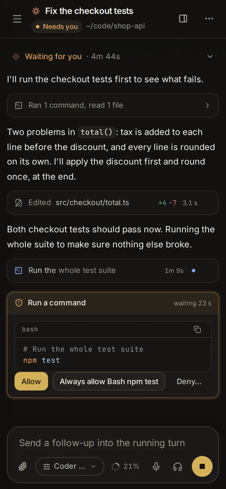

# Phones, other machines and sharing

Hydor works from any browser: on your phone, on another computer, and across several machines that each run it. This topic covers using it on a phone, reaching it safely from elsewhere, working with other machines from one app, sharing a session with a read-only link, letting agents elsewhere start and steer sessions here, and adding the GitHub or Gitea accounts that pull requests open with.

## Use the app on a phone

The app on a phone is the same app as on a computer, laid out for a small screen (a narrow window on a computer gets this layout too). What changes:

- **The sidebar is a drawer.** Tap **Menu** (≡) at the top left of a page or session to open it. It fills the screen, with your sessions, the inbox and the tools; tap a session or a tool to go there, or **Close menu** (✕) to go back.
- **Pickers open as sheets.** On the start page, the menus for the program, the model, the folder, the agent and **Options** rise from the bottom of the screen, clear of the keyboard, with the page dimmed behind; a setting under **Options** opens over its sheet. In a session, the message box's chip for the model (and its effort and permissions) opens a sheet the same way. Dialogs rise from the bottom too.
- **One thing at a time.** Settings is a list, each section on a page of its own. Files shows one folder, named at the top (tap the name for the places, **‹** for the folder above), then a file on its own page with **Back**. The Git page lists your repositories, then opens one with a back arrow.
- **Touch instead of a mouse.** In Files, a row's ⋯ opens its menu, and pressing and holding a row picks it, to act on several at once. The editor wraps long lines. The Terminal page adds a row of keys phones lack (Ctrl, Alt, Esc, Tab, the arrows and more).

To reach the app on your phone at all, it has to be reachable from outside this computer: see [Reach the app from another device](/guide/devices#reach-the-app-from-another-device).

### Add it to your home screen

Installed on your home screen, the app opens full screen with its own icon, like any other app. This needs the app to be served over HTTPS (see [Reach the app from another device](/guide/devices#reach-the-app-from-another-device)).

- **iPhone or iPad**: open the app in the browser, tap **Share**, then **Add to Home Screen**. Open Hydor from its new icon from then on.
- **Android**: open the app in your browser and use its menu's option to install the app or add it to the home screen.

### Get notifications on your phone

A notification can reach your phone when a session finishes, fails or needs your answer, even with the app closed.

1. On the phone, open [Settings → App → Notifications](/settings?s=notifications&find=Notify%20this%20device).
2. Turn on **Notify this device** and allow notifications when the browser asks. Each device turns this on for itself.
3. **Send a test** checks that it works (it shows when the app is not in view).

On an iPhone or iPad, add the app to your Home Screen first and open it from there: the browser can't receive them otherwise. If notifications are blocked for the site, allow them in the browser's settings first. A plain yes-or-no approval comes with **Approve** and **Deny** on the notification itself, where the phone shows buttons. More in [Inbox and notifications](/guide/inbox).

## Talk to your agents from Telegram, Discord and Slack

From a chat in Telegram, Discord or Slack, on any phone or computer, you can start sessions, read their replies and answer what agents ask. Each works through a bot or app of your own, set up in [Settings → App → Chat apps](/settings?s=chat). Hydor connects out to them (it asks Telegram for new messages, and opens a WebSocket to Discord's Gateway and to Slack's Socket Mode), so none of them needs the app to have an address on the internet.

### Connect a bot or app

Open [Chat apps](/settings?s=chat) and press the row of the one you want: its steps are there. What you paste is kept in the vault, encrypted, and never shows in the app again.

- **Telegram**: in Telegram, open @BotFather, send `/newbot` and give the bot a name and a username. Paste the token it answers with, like `123456789:AA…`, under [Telegram](/settings?s=chat&find=Telegram), and press **Connect**.
- **Discord**: in the Developer Portal (discord.com/developers/applications) make a **New Application**. Under **Bot**, press **Reset Token** and copy it, and turn on **Message Content Intent** so the bot can read what you write. Paste the token under [Discord](/settings?s=chat&find=Discord) and press **Connect**. Then add the bot to a server of yours with **More → Add the bot to a server** (Discord only lets you message a bot you share a server with, so a small server of your own does). The invitation asks for View Channels, Send Messages and Read Message History, and Hydor makes its slash commands known.
- **Slack**: at api.slack.com/apps choose **Create New App → From a manifest**, pick your workspace and paste the manifest that **Copy manifest** (under [Slack](/settings?s=chat&find=Slack)) copies: it turns on Socket Mode, subscribes to direct messages and mentions, adds the `/hydor` command and asks for the bot scopes `app_mentions:read`, `chat:write`, `commands`, `im:history`, `reactions:write` and `users:read`. Under **Basic Information → App-Level Tokens** generate a token with the `connections:write` scope (it starts with `xapp-`); under **Install App** install the app to your workspace and copy the Bot User OAuth Token (it starts with `xoxb-`). Paste both and press **Connect**.

Connected, a row shows the bot's name and what it is doing ("Listening for messages", or what is wrong: Discord's Message Content Intent off, a scope Slack's app lacks). **More → Change token** (**Change tokens** for Slack) puts in others (another bot's chats link again); **More → Disconnect** takes it out of Hydor, and the bot or app stays yours.

### Link a chat

Only the chats you link can use the bot: anyone else who finds it is told it is someone's own.

1. Open the row and press [Link a chat](/settings?s=chat&find=Link%20a%20chat). It shows a code that works once, for ten minutes.
2. In Telegram, press **Open in Telegram** and then **Start** in the chat that opens, or send the bot the code. In Discord and Slack, send the bot or app the code in a direct message, or mention it with the code in a channel. The chat shows in the row with its name.

A channel links to the person who sent the code: only they are heard there, and only when they mention the bot. **Unlink** beside a chat takes its use of your agents away.

### What a chat can do

- **Send what you want done**: it goes to the session the chat is in, or starts a new one, in a task folder of its own as the start page does, with the agent set under **More** (**New sessions use Claude Code** or **New sessions use Codex**). What you send while the agent works waits in the session's queue.
- **The reply** comes back when the agent's turn ends, formatted for the app (Telegram's formatting; Discord's Markdown, in messages of 2,000 characters; Slack's mrkdwn in blocks), in up to ten messages when it is long (the rest stays in the session). Telegram and Discord show "typing…" while it works; Slack puts an hourglass on your message. **Open in Hydor** opens the session in the app, when the app has an address on the internet.
- **What an agent asks**: a plain yes-or-no question comes with buttons that answer it; anything more (a form, a plan) comes with a link to answer it in the app.
- **Commands**: `/new` starts a new session (`/new` and what it should do starts it at once), `/sessions` lists the latest to go on with one, `/stop` stops the agent, `/status` says which session the chat is in and what it is doing, and `/help` lists them. Discord lists them as slash commands; in Slack they come after `/hydor` (`/hydor new`, and `/hydor` with other words is a message to the session); in Discord and Slack `!new`, `!status` and the rest also work typed as a message.
- **Notices**: with **Notices from every session** on under **More**, as it is unless you turn it off, every session that finishes, fails or needs you says so in your chats, not only the ones a chat started.

Pictures, files and voice messages don't reach the agents from a chat yet: send words.

## Reach the app from another device

Out of the box, the app answers only on the computer it runs on (port 8790 of `127.0.0.1`). Anyone who can reach it and knows the password can run any command as your user there, so treat access to it like SSH access to the computer. To use it from your phone or another computer, put HTTPS in front of it rather than opening the port to the network:

- **Tailscale**: on this computer, `tailscale serve --bg 8790` serves the app at `https://<machine>.<tailnet>.ts.net`, reachable only from your own devices.
- **Cloudflare Tunnel**: point a tunnel at `http://localhost:8790`. Cloudflare Access can add a second login in front.
- **Your own reverse proxy**, such as Caddy, sending a hostname of yours to `127.0.0.1:8790`.

If the proxy changes the `Host` header, tell the app the address people open it at: `ALLOWED_ORIGINS=https://agents.example.com`. Settings like this go in `~/.config/hydor.env` (one `NAME=value` per line) for an app installed as a service, or in `.env` for Docker Compose; restart the app afterwards.

HTTPS is also what phones need to install the app and receive push notifications. Previews of dev servers use a port of their own (8791); see [Look at a dev server with Preview](/guide/files-git#look-at-a-dev-server-with-preview).

The password guards everything. A browser stays signed in for 30 days after you sign in. Wrong passwords are counted by the address they come from, over the last hour:

- After three, the sign-in page also shows a picture of five characters to type into **Characters in the picture**, so a program can't go on guessing. Typing them wrong costs nothing, and **New picture** (the round arrow beside it) brings another.
- After ten, that address can't sign in for an hour, not even with the right password. The page says how long is left.
- After ten from anywhere, everyone gets the picture; after sixty, no one can sign in until the hour is up.

Behind one of the proxies above, the address counted is the visitor's own, as the proxy passes it on. If you lock yourself out, sign in from another network (a phone's mobile data, say), wait, or set a new password on the computer itself, which lifts every pause. See [Change your password](/guide/app#change-your-password).

## Use other machines from one app

If Hydor runs on more than one machine (a desktop, a GPU server, a cloud computer), you can use them all from one of them. Each machine keeps its own sessions, files, terminals, sign-ins and settings; the app you open shows one machine at a time, and the sidebar switches between them.

This is set up in [Settings → App → Machines](/settings?s=machines). Its **Machines** list starts with this machine ("This server", with its version), followed by the ones you added, each with:

- a dot: green when it answers, grey while connecting, red when it doesn't;
- how it is reached (`ssh gpu-box` or its address) and how it is doing: "Online", "2 need you · 1 working", "Connecting…" or "Not reachable" (with the reason);
- **Open** (its pages), **Edit**, and **Remove**. A machine that doesn't answer also has **Try again now**.

### Add a machine

1. **On the other machine**, install Hydor and make an access token for this one: in its own [Settings → App → Machines](/settings?s=machines&find=Access%20from%20other%20machines) → **New token**, or by running `node dist/server/cli.js access-token "my laptop"` in its Hydor folder. Copy the token (it starts with `acm_`).
2. **Here**, open [Settings → App → Machines](/settings?s=machines&find=Add%20a%20machine) and click **Add a machine**.
3. Give it a **Name** ("GPU box").
4. Under **Reach it**, pick how this machine gets there:
   - **Over SSH**, the simplest: the **SSH host** (a name from your `~/.ssh/config`, or `user@host`) and **Its port**, the port Hydor listens on there (8790). This machine opens the connection with its own SSH keys, which must work without a passphrase prompt. The other machine keeps listening only on its own `127.0.0.1`: nothing there needs opening.
   - **By its address**, on a private network, a VPN such as Tailscale or WireGuard, or behind HTTPS: for example `http://100.64.0.5:8790`. The app there must listen where this machine reaches it (its `HOST` setting).
5. Paste the **Access token** and click **Connect**.

The app checks that the machine answers before it keeps it. If it doesn't, the dialog says why ("Could not use GPU box: …") and nothing is added.

### Switch between machines

Once you have added a machine, a row with the current machine's name appears at the top of the sidebar, above **New session**. Click it to see every machine with its state and a check on the one shown; pick one to move to its pages. **Add or change machines** opens Settings → Machines.

On another machine's pages the row is highlighted, so you know where you are, and a dot on it means sessions on the other machines wait for you. If the machine doesn't answer, a page says "… is not reachable" with **Try again**, a button back to your own machine, and **Settings → Machines**.

### What works across machines

- **Everything on a machine's pages is that machine's**: its sessions, folders and files, Git, terminals, agents' sign-ins, models and settings.
- **Some things always come from the machine you opened the app on**: your password and sign-in, the list of machines, notifications, the themes you made, and the welcome tour and its tips.
- **Notices from every machine reach you.** A notice from another machine names it, push notifications come through your own machine, and the [Inbox](/guide/inbox) lists what waits on you on every machine. The sidebar's inbox count includes them.
- **Read-only links** work for sessions on other machines too (see [Share a session with a read-only link](/guide/devices#share-a-session-with-a-read-only-link)).
- **Not on other machines**: Preview, which opens dev servers on the machine you opened only, and Connect other agents, since each machine's own server is reached at its own address.
- Your browser remembers the Files page's folder, the open files and the terminal you last used for each machine on its own.

### Change or remove a machine

- **Edit** changes the name, how it is reached or the access token. Leave the token empty to keep the one it has. A change in how it is reached is checked again before it is kept.
- **Remove** asks first. The machine's sessions stay on that machine; this app stops showing them.

### Let other machines use this one

Under **Access from other machines** (on another machine's pages: **Access to** that machine), you make the tokens other machines use to reach this one. Another Hydor with one of these tokens can do all you can here, running commands included, so make one for each machine that connects.

1. Click **New token**.
2. Say **Which machine will use it?** ("My laptop") and click **Make token**.
3. Copy the token and paste it into the other machine's Settings → Machines. It is shown only now.

Each token shows when it was made and last used. **Revoke** (after a question) cuts that machine off at once.

## Share a session with a read-only link

A read-only link lets someone without your password follow one session as it happens. Open the session's menu (⋯) → **Share a read-only link**. To share a whole project with someone instead (its documents, sessions, runs and reading list, with comments under their name), see [Share a project with people](/guide/projects#share-a-project-with-people); to share one thing of the Library (a document, a page, a picture, a video…) to comment on or edit, see [Share with people](/guide/library#share-with-people).

1. Under **Works for**, choose **A day**, **A week**, **A month** or **Until turned off**.
2. Click **Make a link**.
3. Copy the link and send it. It is shown once; you can make another any time.

**Links that work now** lists the session's live links, each with when it was made, when it ends ("no end" for those that run until turned off) and how many times it was opened, and when last. **Turn off** (the bin) stops a link at once.

### What the person sees

The link opens the session alone, without the sidebar or anything to type in. It shows the session's title, which agent works in it, "read-only, shared from Hydor", and "working now" while the agent works. Below is the conversation: your messages, the agent's replies, its steps by name (with the lines each file change added and removed, and the changes themselves a click away) and pages the agent showed. It follows along by itself, every few seconds while the agent works.

They don't see command output, the agent's thinking, the images you attached (only that there were some) or anything else in the app, and they can't type or change anything. A link that ended or was turned off says "This link has expired or was turned off".

## Connect other agents to this app

Agents running elsewhere (Claude Code on your laptop, Codex, Cursor or any client that speaks MCP, the protocol agents use to call tools) can list, read, start and steer sessions on this machine through the app's own MCP server. Each needs a token, made in [Settings → App → Connect other agents](/settings?s=connect). An agent with a token can start and steer sessions here, as you can.

1. Click [**New token**](/settings?s=connect&find=New%20token).
2. Under **Name it after where it goes**, type something like "Claude Code on my laptop" and click **Make token**.
3. Copy what you need now (it is not shown again):
   - **Token**, the token itself.
   - **Claude Code**: a command that adds the server, `claude mcp add --transport http hydor <address>/mcp --header "Authorization: Bearer <token>"`.
   - **Codex**: lines for `~/.codex/config.toml`, with the token in the environment variable `HYDOR_TOKEN`.
   - **Other clients (JSON)**: the usual MCP server entry.

The address is the one your browser has open, so an agent on another machine must reach the app the same way your browser does (see [Reach the app from another device](/guide/devices#reach-the-app-from-another-device)).

The **Tokens** list shows each token's name, when it was made and when it was last used. Make one for each agent or machine, so you can **Revoke** them one at a time; revoking cuts that agent off at once.

### What they can do

[**What they can do**](/settings?s=connect&find=What%20they%20can%20do) lists the tools an agent with a token gets:

- **list_sessions** and **read_session**: find a session and catch up on it (its messages, and its steps by name).
- **start_session**: a new Claude Code or Codex session with a first message, in any folder, optionally in a worktree of its own. It answers with a link you can open.
- **send_message**: steer a session. If its agent is busy, the message waits in the session's queue until the turn ends.
- **list_models**: the models a new session can use.

Apps you offer to other agents (the app's **Offer to other agents** switch, see [Apps](/guide/apps)) come as tools too, and run the app with its form's fields.

Sessions started in this app need none of this. The section shows only on the machine you opened the app on, not on other machines' pages.

## Add a GitHub or Gitea account

Pull requests open with an account in [Settings → App → Source control](/settings?s=scm). Each account covers the repositories on its server: GitHub, a GitHub Enterprise server or a Gitea server. Pushing itself uses this computer's own git setup (its SSH keys or saved credentials); the account is for opening the pull request and following its checks.

1. Click [**Add an account**](/settings?s=scm&find=Add%20an%20account).
2. Pick **GitHub** or **Gitea**.
3. For GitHub: if the GitHub CLI on this computer is signed in, **Use its sign-in** adds the account in one click and you're done. Otherwise paste an **Access token**: a fine-grained token with Pull requests (read and write), Contents (read) and Commit statuses (read) on your repositories (**Make one** opens the page on GitHub). Fill in **Server address** only for GitHub Enterprise.
4. For Gitea: the **Server address** (`https://gitea.example.com`) and an **Access token** made in Gitea under Settings → Applications → Generate token, with repository read and write.
5. Click **Add**. The app checks the token by asking the server who it belongs to, then lists the account under that user name.

A second account for the same server replaces the first. Each account shows its user name, the server and "through the GitHub CLI" where that applies, with a link to open the server. **Remove** asks first: pull requests already linked to sessions stay linked, but their state stops updating.

How pull requests are opened and followed: [Open a pull request from a session](/guide/files-git#open-a-pull-request-from-a-session).

## Ask an agent

- "Make a read-only link to this session that works for a week."
- "Turn off every share link on this session."
- "Which of my machines are offline? Try reconnecting them."
- "Rename the machine called gpu-box to Studio GPU."
- "List the tokens other agents use to reach this app, and revoke the one named old laptop."
- "Add my GitHub account using the GitHub CLI's sign-in."
- "Send my chats in Telegram, Discord and Slack the notices of every session, not only the ones they started."
- "Which chats are linked to this app, in each chat app?"
- "Make new sessions from my Discord chat use Codex."
- "Disconnect the Slack app."
