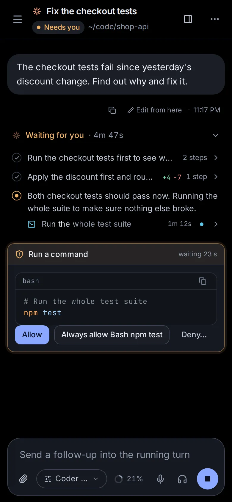

# Phones, other machines and sharing

Hydor works from any browser: on your phone, on another computer, and across several machines that each run it. This topic covers using it on a phone (reached privately through Tailscale, set up in a few clicks), reaching it safely from elsewhere, working with other machines from one app, sharing a session with a read-only link, letting agents elsewhere start and steer sessions here, and adding the GitHub or Gitea accounts that pull requests open with.

## Use the app on a phone

The app on a phone is the same app as on a computer, laid out for a small screen (a narrow window on a computer gets this layout too). What changes:

- **The sidebar is a drawer.** Tap **Menu** (≡) at the top left of a page or session to open it. It fills the screen, with your sessions, the inbox and the tools; tap a session or a tool to go there, or **Close menu** (✕) to go back.
- **Pickers open as sheets.** On the start page, the menus for the program, the model, the folder, the agent and **Options** rise from the bottom of the screen, clear of the keyboard, with the page dimmed behind; a setting under **Options** opens over its sheet. In a session, the message box's chip for the model (and its effort and permissions) opens a sheet the same way. Dialogs rise from the bottom too.
- **One thing at a time.** Settings is a list, each section on a page of its own. Files shows one folder, named at the top (tap the name for the places, **‹** for the folder above), then a file on its own page with **Back**. The Git page lists your repositories, then opens one with a back arrow.
- **Touch instead of a mouse.** In Files, a row's ⋯ opens its menu, and pressing and holding a row picks it, to act on several at once. The editor wraps long lines. The Terminal page adds a row of keys phones lack (Ctrl, Alt, Esc, Tab, the arrows and more).

To reach the app on your phone at all, it has to be reachable from outside this computer. [Settings → App → Use on your phone](/settings?s=phone) does that in a few clicks, privately, with Tailscale: see [Use it on your phone with Tailscale](/guide/devices#use-it-on-your-phone-with-tailscale).

### Add it to your home screen

Installed on your home screen, the app opens full screen with its own icon, like any other app. This needs the app to be served over HTTPS, as Use on your phone does. Opened on the phone, [Use on your phone](/settings?s=phone&find=Add%20to%20Home%20Screen) shows the steps for the phone in your hand under **On this phone → Add to Home Screen**, with an **Install** button where the browser offers one.

- **iPhone or iPad**: open the app in the browser, tap **Share**, then **Add to Home Screen**. Open Hydor from its new icon from then on.
- **Android**: open the app in your browser and use its menu's option to install the app or add it to the home screen.

### Share to Hydor from other apps

Installed, Hydor shows in the share sheet of your phone or computer like a messaging app does. Share a photo, a PDF, a web page or a few lines of text from any other app, pick **Hydor**, and the start page opens with what you shared already in its message box: the words and the link as text, the files as attachments. Add a word on what to do with it, pick the agent if you like, and send.

- **Android**: works in Chrome, Edge and other browsers built on Chromium, once the app is installed from the browser's menu (**Install app** or **Add to Home screen**).
- **A computer**: works in Chrome and Edge once the app is installed (the install button in the address bar, or the browser's menu → **Install Hydor**), from apps that share through the system's share sheet.
- **iPhone and iPad**: Safari doesn't let web apps take shares. Send a photo or a file to your agents from a chat app instead (see [What a chat can do](/guide/devices#what-a-chat-can-do)). For text and links, a shortcut does it: in the Shortcuts app make one that shows in the share sheet and takes text and URLs, add **URL Encode** for its input, then **Open URLs** with your app's address followed by `/?prompt=` and the encoded text (like `https://hydor.example.com/?prompt=` and the result). It opens the start page in Safari with the text in the box.

A share needs you to be signed in on that device: one made while signed out doesn't reach Hydor, and the start page says so. Up to 25 MB of files go with a share, as with the message box, saved where the message box keeps its attachments.

### Get notifications on your phone

A notification can reach your phone when a session finishes, fails or needs your answer, even with the app closed.

1. On the phone, open [Settings → App → Notifications](/settings?s=notifications&find=Notify%20this%20device).
2. Turn on **Notify this device** and allow notifications when the browser asks. Each device turns this on for itself.
3. **Send a test** checks that it works (it shows when the app is not in view).

Opened on the phone, [Use on your phone](/settings?s=phone) has the same **Notify this device** switch under **On this phone**, after **Add to Home Screen**, and its **Send a test** goes to that phone only.

On an iPhone or iPad, add the app to your Home Screen first and open it from there: the browser can't receive them otherwise. If notifications are blocked for the site, allow them in the browser's settings first. A plain yes-or-no approval comes with **Approve** and **Deny** on the notification itself, where the phone shows buttons. More in [Inbox and notifications](/guide/inbox).

## Talk to your agents from Telegram, Discord and Slack

From a chat in Telegram, Discord or Slack, on any phone or computer, you can start sessions (as one of your own agents too), send them photos, files and voice messages, read their replies and answer what agents ask. Each works through a bot or app of your own, set up in [Settings → App → Chat apps](/settings?s=chat). Hydor connects out to them (it asks Telegram for new messages, and opens a WebSocket to Discord's Gateway and to Slack's Socket Mode), so none of them needs the app to have an address on the internet.

### Connect a bot or app

Open [Chat apps](/settings?s=chat) and press the row of the one you want in the **Bots** group (it says **Set up** until it is connected): its steps open under it. What you paste is kept in the vault, encrypted, and never shows in the app again.

- **Telegram**: in Telegram, open @BotFather, send `/newbot` and give the bot a name and a username. Paste the token it answers with, like `123456789:AA…`, in the box of the [Telegram](/settings?s=chat&find=Telegram) row, and press **Connect**.
- **Discord**: in the Developer Portal (discord.com/developers/applications) make a **New Application**. Under **Bot**, press **Reset Token** and copy it, and turn on **Message Content Intent** so the bot can read what you write. Paste the token in the [Discord](/settings?s=chat&find=Discord) row and press **Connect**. Then add the bot to a server of yours with its **Add the bot to a server** row (Discord only lets you message a bot you share a server with, so a small server of your own does). The invitation asks for View Channels, Send Messages and Read Message History, and Hydor makes its slash commands known.
- **Slack**: at api.slack.com/apps choose **Create New App → From a manifest**, pick your workspace and paste the manifest that **Copy manifest** (in the [Slack](/settings?s=chat&find=Slack) row's steps, and a row of its own once connected) copies: it turns on Socket Mode, subscribes to direct messages and mentions, adds the `/hydor` command and asks for the bot scopes `app_mentions:read`, `chat:write`, `commands`, `files:read` (for the files you send it), `im:history`, `reactions:write` and `users:read`. Under **Basic Information → App-Level Tokens** generate a token with the `connections:write` scope (it starts with `xapp-`); under **Install App** install the app to your workspace and copy the Bot User OAuth Token (it starts with `xoxb-`). Paste both and press **Connect**.

Connected, the first row under it shows the bot's name and what it is doing ("Listening for messages", or what is wrong: Discord's Message Content Intent off, a scope Slack's app lacks). **Connect** turns a token down only when the service itself says no to it: when Telegram, Discord or Slack is slow to answer or can't be reached just then (as can happen in a new bot's first minutes), Hydor keeps the token, the row says **Connecting…** and why, and the bot connects by itself as soon as the service answers. A Telegram bot gets its messages in one place only, so when another copy of Hydor or another program uses the same bot, the row says so. The row's **⋯** menu has **Change token** (**Change tokens** for Slack), which puts in others (another bot's chats link again), and **Disconnect**, which takes it out of Hydor, and the bot or app stays yours.

### Link a chat

Only the chats you link can use the bot: anyone else who finds it is told it is someone's own.

1. Open the row and press its [Link a chat](/settings?s=chat&find=Link%20a%20chat) row. It shows a code that works once, for ten minutes.
2. In Telegram, press **Open in Telegram** and then **Start** in the chat that opens, or send the bot the code. In Discord and Slack, send the bot or app the code in a direct message, or mention it with the code in a channel. The chat shows in the row with its name.

A channel links to the person who sent the code: only they are heard there, and only when they mention the bot. The trash button (**Unlink**) beside a chat takes its use of your agents away.

### What a chat can do

- **Send what you want done**: it goes to the session the chat is in, or starts a new one, in a task folder of its own as the start page does, with the agent set in the **New sessions use** row (**Claude Code** or **Codex**), as the agent of yours in the **New sessions as** row if you picked one. What you send while the agent works waits in the session's queue.
- **Photos, files and voice messages**: send them as you would to a person, with a caption if you like: the caption goes with them, and several sent at once (an album) arrive together. Each is saved in the folder of the session it goes to, under its own name (photos and voice messages are named by when they came, like `photo-2026-11-15-0930.jpg`), and reaches the agent as the message box's attachments do: pictures to look at, other files to open. A voice message reaches the agent as words when [Speech recognition on the server](/settings?s=voice&find=Speech%20recognition%20on%20the%20server) is on in Settings → Capabilities → Voice, and its recording stays in the folder; without it, the recording goes as a sound file, and the chat says how to turn it on. Telegram lets bots fetch files of up to 20 MB, and Hydor takes files of up to 25 MB from Discord and Slack: the chat says when one is too big. What files hold, and messages forwarded from someone else, reach the agent marked as outside data, to work with, never as instructions. In Slack, files need the `files:read` scope: an app made from an older manifest needs it added under **OAuth & Permissions**, then installed again (the chat says so when a file can't come through).
- **Your own agents**: `/as` and an agent's name starts a new session as one of your [agents](/agents), like `/as Bookkeeper add this to October` with a photo of a receipt. `/as` and the name alone makes the chat's next new session start as it, and `/agents` (or `/as` alone) lists them with a button each, your own first. An agent that keeps one conversation of its own takes the chat into that conversation. Discord completes the agent's name as you type `/as`; in Slack, write `/hydor as Bookkeeper …`. The [New sessions as](/settings?s=chat&find=New%20sessions%20as) row makes every new session from that chat app start as one of your agents.
- **The reply** comes back when the agent's turn ends, formatted for the app (Telegram's formatting; Discord's Markdown, in messages of 2,000 characters; Slack's mrkdwn in blocks), in up to ten messages when it is long (the rest stays in the session). Telegram and Discord show "typing…" while it works; Slack puts an hourglass on your message. **Open in Hydor** opens the session in the app, when the app has an address on the internet or is served on your tailnet (see [Use it on your phone with Tailscale](/guide/devices#use-it-on-your-phone-with-tailscale)).
- **What an agent asks**: a plain yes-or-no question comes with buttons that answer it; anything more (a form, a plan) comes with a link to answer it in the app.
- **Commands**: `/new` starts a new session (`/new` and what it should do starts it at once), `/as` and `/agents` start one as one of your agents (above), `/sessions` lists the latest to go on with one, `/stop` stops the agent, `/status` says which session the chat is in and what it is doing, and `/help` lists them. Telegram shows them in its menu of commands, and Discord as slash commands; in Slack they come after `/hydor` (`/hydor new`, and `/hydor` with other words is a message to the session); in Discord and Slack `!new`, `!as`, `!status` and the rest also work typed as a message.
- **Notices**: with the **Notices from every session** row on, as it is unless you turn it off, every session that finishes, fails or needs you says so in your chats, not only the ones a chat started.

Stickers, polls and locations don't reach the agents: the chat asks for words, photos, files or voice messages instead.

## Reach the app from another device

Out of the box, the app answers only on the computer it runs on (port 8790 of `127.0.0.1`). Anyone who can reach it and knows the password can run any command as your user there, so treat access to it like SSH access to the computer. To use it from your phone or another computer, put HTTPS in front of it rather than opening the port to the network. The simplest way is built in: [Use it on your phone with Tailscale](/guide/devices#use-it-on-your-phone-with-tailscale), below. HTTPS is also what phones need to install the app and receive push notifications.

### Use it on your phone with Tailscale

Tailscale is a free app that links your own devices in a private network of their own, called a tailnet. [Settings → App → Use on your phone](/settings?s=phone) publishes Hydor on it, at an address like `https://laptop.tail1234.ts.net`. Only phones and computers signed in to your Tailscale account can open that address, never the public internet, and the app still asks for its password. It never turns on Tailscale Funnel, which would make the app public.

1. Install Tailscale on this computer and sign in ([tailscale.com/download](https://tailscale.com/download)). The section's **Tailscale on this computer** row says when it is ready ("Signed in. This computer is laptop on you@example.com."). Until then it says what is missing (not installed, not running, not signed in, turned off) with **Get Tailscale** or the one thing to do, and **Check again**.
2. Press [**Serve it on my devices**](/settings?s=phone&find=Serve%20it%20on%20my%20devices). The **Address** row shows the app's address, with **Copy** and **Open**. The app accepts that address by itself: there is no file to edit.
3. Install Tailscale on your phone too, signed in to the same account.
4. Scan the QR code under [**Open it on your phone**](/settings?s=phone&find=Open%20it%20on%20your%20phone) with the phone's camera (or type the address), and sign in with the app's password.
5. The phone opens at **Use on your phone**, with **On this phone**: **Add to Home Screen** (on an iPhone, in Safari: Share → **Add to Home Screen**, which notifications need there; on Android, **Install**, or Chrome's menu → **Install app**), then **Notify this device**, and **Send a test**, which sends a notification to that phone only.

**Stop serving** takes the app off your tailnet again. It undoes exactly what **Serve it on my devices** did: the one address it published, and the address it added to the ones the app accepts. Anything else you serve with Tailscale stays as it was. If you had already served the app with Tailscale by hand, the section shows it ("Set up outside this page, with Tailscale itself"), and **Stop serving** turns it off too.

While the app is served, the links it hands out start with this address, so they open on your phone too: a session's **Open in Hydor** in a chat app, and the links agents give you to sessions and kept pages. If `ALLOWED_ORIGINS` names an address of its own (see [Other ways to reach it](/guide/devices#other-ways-to-reach-it)), links keep using that one.

In a terminal, `hydor machines phone` says the same and draws the QR code; `hydor machines phone serve` and `hydor machines phone stop` do the rest (see [The terminal](/guide/terminal)).

### When something stands in the way

The section says what happened in a sentence, with the one thing to do:

- **Serve and HTTPS certificates aren't turned on in your tailnet yet.** Tailscale gives a link that turns them on: **Turn them on** opens it (you sign in to Tailscale and confirm once), then **Try again**.
- **On Linux, Tailscale lets only its operator change what it serves.** Run the command shown, once, in a terminal (`sudo tailscale set --operator=$USER`, with your user name in it), then **Try again**.
- **Something else is already published at the address.** Hydor never replaces it: **Serve on port 8443** publishes the app at `https://laptop.tail1234.ts.net:8443` instead.
- **Funnel is on for this address.** Tailscale Funnel was turned on by hand, so anyone on the internet can reach it: the section says so, with the command that turns it off.
- **HTTPS certificates are off in your tailnet.** **Turn them on** opens Tailscale's DNS settings, where you turn on MagicDNS and HTTPS Certificates.

### Other ways to reach it

To set it up yourself instead, any of these work too:

- **Tailscale by hand**: on this computer, `tailscale serve --bg 8790` serves the app at `https://<machine>.<tailnet>.ts.net`, reachable only from your own devices.
- **Cloudflare Tunnel**: point a tunnel at `http://localhost:8790`. Cloudflare Access can add a second login in front.
- **Your own reverse proxy**, such as Caddy, sending a hostname of yours to `127.0.0.1:8790`.

If the proxy changes the `Host` header, tell the app the address people open it at: `ALLOWED_ORIGINS=https://agents.example.com`. Settings like this go in `~/.config/hydor.env` (one `NAME=value` per line) for an app installed as a service, or in `.env` for Docker Compose; restart the app afterwards.

Previews of dev servers use a port of their own (8791); see [Look at a dev server with Preview](/guide/files-git#look-at-a-dev-server-with-preview).

### The password guards everything

The password guards everything. A browser stays signed in for 30 days after you sign in. Wrong passwords are counted by the address they come from, over the last hour:

- After three, the sign-in page also shows a picture of five characters to type into **Characters in the picture**, so a program can't go on guessing. Typing them wrong costs nothing, and **New picture** (the round arrow beside it) brings another.
- After ten, that address can't sign in for an hour, not even with the right password. The page says how long is left.
- After ten from anywhere, everyone gets the picture; after sixty, no one can sign in until the hour is up.

Behind one of the proxies above, the address counted is the visitor's own, as the proxy passes it on. If you lock yourself out, sign in from another network (a phone's mobile data, say), wait, or set a new password on the computer itself, which lifts every pause. See [Change your password](/guide/app#change-your-password).

## Use other machines from one app

If Hydor runs on more than one machine (a desktop, a GPU server, a cloud computer), you can use them all from one of them. Each machine keeps its own sessions, files, terminals, sign-ins and settings; the app you open shows one machine at a time, and the sidebar switches between them.

This is set up in [Settings → App → Machines](/settings?s=machines). Its **Machines** group (with **Add a machine** beside its title) starts with this machine ("This server", with its version), followed by the ones you added, each with:

- a dot: green when it answers, grey while connecting, red when it doesn't;
- how it is reached (`ssh gpu-box` or its address) and how it is doing: "Online", "2 need you · 1 working", "Connecting…" or "Not reachable" (with the reason);
- **Open** (its pages), and a **⋯** menu with **Edit** and **Remove**. A machine that doesn't answer also has a **Try again now** button.

### Add a machine

1. **On the other machine**, install Hydor and make an access token for this one: in its own [Settings → App → Machines](/settings?s=machines&find=Access%20from%20other%20machines) → **New token**, or by running `node dist/server/cli.js access-token "my laptop"` in its Hydor folder. Copy the token (it starts with `acm_`).
2. **Here**, open [Settings → App → Machines](/settings?s=machines&find=Add%20a%20machine) and click **Add a machine**.
3. Give it a **Name** ("GPU box").
4. Under **Reach it**, pick how this machine gets there:
   - **Over SSH**, the simplest: the **SSH host** (a name from your `~/.ssh/config`, or `user@host`) and **Its port**, the port Hydor listens on there (8790). This machine opens the connection with its own SSH keys, which must work without a passphrase prompt. The other machine keeps listening only on its own `127.0.0.1`: nothing there needs opening.
   - **By its address**, on a private network, a VPN such as Tailscale or WireGuard, or behind HTTPS: for example `http://100.64.0.5:8790`. The app there must listen where this machine reaches it (its `HOST` setting).
5. Paste the **Access token** and click **Connect**.

The app checks that the machine answers before it keeps it. If it doesn't, the dialog says why ("Could not use GPU box: …") and nothing is added.

### Switch between machines

Once you have added a machine, a row with the current machine's name appears at the top of the sidebar, above **New session**. Click it to see every machine with its state and a check on the one shown; pick one to move to its pages. **Add or change machines** opens Settings → Machines.

On another machine's pages the row is highlighted, so you know where you are, and a dot on it means sessions on the other machines wait for you. If the machine doesn't answer, a page says "… is not reachable" with **Try again**, a button back to your own machine, and **Settings → Machines**.

### When a machine has an older Hydor

The app you open shows another machine's pages in its own version, whatever Hydor that machine runs. A machine with an older Hydor can lack what its pages need, and some of them can stop working. So when you pick a machine whose Hydor is older than this app's, a page comes first: "… has an older Hydor". It says both versions, that its pages open here in this app's version, and that some can stop working with an older one. It has three buttons:

- **Update …** (with the machine's name) updates that machine from here, as the **Update now** button of its version row in [Settings → App → General](/settings?s=general&find=Check%20now) does (see [Keep the app up to date](/guide/app#keep-the-app-up-to-date)): a copy installed from git, or the Docker image, gets the new version, builds it and restarts; a desktop app downloads the new version and restarts into it. It takes a few minutes, and agents working there carry on. The page shows each step ("Getting the new version", "Installing packages", "Building", "Restarting, this page reconnects by itself"; for a desktop app, how much of the new version has downloaded, with a bar) and opens that machine's pages by itself once it is back. A copy from git or Docker older than 0.78.0 can't update itself past Hydor's rewritten history ("Not possible to fast-forward, aborting."): the page then says so, with the command to run on that machine once (see [Update an older copy by hand](/guide/app#update-an-older-copy-by-hand)).
- **Open anyway** opens its pages as they are. This browser tab doesn't ask again for that version.
- **Open** followed by your own machine's name goes back to your own machine.

When it can't update from here, the page says why instead: a desktop app that can't replace itself where it is ("Move Hydor to your Applications folder to update it."), a copy with nowhere to update from ("… has nowhere to update from by itself (it was not installed from git with an upstream): update Hydor there, or open it anyway."), an update that failed ("The update did not work: …"), one that must restart first ("It has the new version: restart Hydor on … to use it."), or one that is already as new as where it updates from.

If a page of another machine fails to draw, you see "This page stopped working" with what went wrong, **Reload**, and **Open** your own machine, instead of an empty window. The sidebar stays, and moving to another page tries again. On a machine with an older Hydor the page offers **Update …** as above; on a machine with a newer Hydor than this app, it says to update this app, then open the machine again.

### What works across machines

- **Everything on a machine's pages is that machine's**: its sessions, folders and files, Git, terminals, agents' sign-ins, models and settings.
- **Some things always come from the machine you opened the app on**: your password and sign-in, the list of machines, notifications, the themes you made, and the welcome tour and its tips.
- **Notices from every machine reach you.** A notice from another machine names it, push notifications come through your own machine, and the [Inbox](/guide/inbox) lists what waits on you on every machine. The count on the rail's **Inbox** includes them.
- **Read-only links** work for sessions on other machines too (see [Share a session with a read-only link](/guide/devices#share-a-session-with-a-read-only-link)).
- **Not on other machines**: Preview, which opens dev servers on the machine you opened only, and Connect other agents, since each machine's own server is reached at its own address.
- Your browser remembers the Files page's folder, the open files and the terminal you last used for each machine on its own.

### Change or remove a machine

- **Edit** changes the name, how it is reached or the access token. Leave the token empty to keep the one it has. A change in how it is reached is checked again before it is kept.
- **Remove** asks first. The machine's sessions stay on that machine; this app stops showing them.

### Let other machines use this one

In the **Access from other machines** group (on another machine's pages: **Access to** that machine), you make the tokens other machines use to reach this one. Another Hydor with one of these tokens can do all you can here, running commands included, so make one for each machine that connects.

1. Click **New token** beside the group's title.
2. Say **Which machine will use it?** ("My laptop") and click **Make token**.
3. Copy the token and paste it into the other machine's Settings → Machines. It is shown only now.

Each token shows when it was made and last used. **Revoke**, in its **⋯** menu (after a question), cuts that machine off at once.

## Share a session with a read-only link

A read-only link lets someone without your password follow one session as it happens. Open the session's menu (⋯) → **Share a read-only link**. To share a whole project with someone instead (its documents, sessions, runs and reading list, with comments under their name), see [Share a project with people](/guide/projects#share-a-project-with-people); to share one kept thing (a document, a page, a picture, a video…) to comment on or edit, see [Share with people](/guide/library#share-with-people).

1. Under **Works for**, choose **A day**, **A week**, **A month** or **Until turned off**.
2. Click **Make a link**.
3. Copy the link and send it. It is shown once; you can make another any time.

**Links that work now** lists the session's live links, each with when it was made, when it ends ("no end" for those that run until turned off) and how many times it was opened, and when last. **Turn off** (the bin) stops a link at once.

### What the person sees

The link opens the session alone, without the sidebar or anything to type in. It shows the session's title, which agent works in it, "read-only, shared from Hydor", and "working now" while the agent works. Below is the conversation: your messages, the agent's replies, its steps by name (with the lines each file change added and removed, and the changes themselves a click away) and pages the agent showed. It follows along by itself, every few seconds while the agent works.

They don't see command output, the agent's thinking, the images you attached (only that there were some) or anything else in the app, and they can't type or change anything. A link that ended or was turned off says "This link has expired or was turned off".

## Connect other agents to this app

Agents running elsewhere (Claude Code on your laptop, Codex, Cursor or any client that speaks MCP, the protocol agents use to call tools) can list, read, start and steer sessions on this machine through the app's own MCP server. Each needs a token, made in [Settings → App → Connect other agents](/settings?s=connect). An agent with a token can start and steer sessions here, as you can.

1. Click [**New token**](/settings?s=connect&find=New%20token), beside the title of the **Tokens** group.
2. Under **Name it after where it goes**, type something like "Claude Code on my laptop" and click **Make token**.
3. Copy what you need now (it is not shown again):
   - **Token**, the token itself.
   - **Claude Code**: a command that adds the server, `claude mcp add --transport http hydor <address>/mcp --header "Authorization: Bearer <token>"`.
   - **Codex**: lines for `~/.codex/config.toml`, with the token in the environment variable `HYDOR_TOKEN`.
   - **Other clients (JSON)**: the usual MCP server entry.

The address is the one your browser has open, so an agent on another machine must reach the app the same way your browser does (see [Reach the app from another device](/guide/devices#reach-the-app-from-another-device)).

The **Tokens** list shows each token's name, when it was made and when it was last used. Make one for each agent or machine, so you can **Revoke** them one at a time (in a token's **⋯** menu); revoking cuts that agent off at once.

### What they can do

The [**What they can do**](/settings?s=connect&find=What%20they%20can%20do) row, under the tokens, has an (i) that lists the tools an agent with a token gets:

- **list_sessions** and **read_session**: find a session and catch up on it (its messages, and its steps by name).
- **start_session**: a new Claude Code or Codex session with a first message, in any folder, optionally in a worktree of its own. It answers with a link you can open.
- **send_message**: steer a session. If its agent is busy, the message waits in the session's queue until the turn ends.
- **list_models**: the models a new session can use.

Apps you offer to other agents (the app's **Offer to other agents** switch, see [Apps](/guide/apps)) come as tools too, and run the app with its form's fields.

Sessions started in this app need none of this. The section shows only on the machine you opened the app on, not on other machines' pages.

## Add a GitHub or Gitea account

Pull requests open with an account in [Settings → App → Source control](/settings?s=scm). Each account covers the repositories on its server: GitHub, a GitHub Enterprise server or a Gitea server. Pushing itself uses this computer's own git setup (its SSH keys or saved credentials); the account is for opening the pull request and following its checks.

1. Click [**Add an account**](/settings?s=scm&find=Add%20an%20account), beside the title of the **Accounts** group. A dialog opens.
2. Pick **GitHub** or **Gitea**.
3. For GitHub: if the GitHub CLI on this computer is signed in, **Use its sign-in** adds the account in one click and you're done. Otherwise paste an **Access token**: a fine-grained token with Pull requests (read and write), Contents (read) and Commit statuses (read) on your repositories (**Make one** opens the page on GitHub). Fill in **Server address** only for GitHub Enterprise.
4. For Gitea: the **Server address** (`https://gitea.example.com`) and an **Access token** made in Gitea under Settings → Applications → Generate token, with repository read and write.
5. Click **Add**. The app checks the token by asking the server who it belongs to, then lists the account under that user name.

A second account for the same server replaces the first. Each account is a row with its user name, the server and "through the GitHub CLI" where that applies. Its **⋯** menu has **Open the server** and **Remove**, which asks first: pull requests already linked to sessions stay linked, but their state stops updating.

How pull requests are opened and followed: [Open a pull request from a session](/guide/files-git#open-a-pull-request-from-a-session).

## Ask an agent

- "Make this app reachable from my phone with Tailscale."
- "What's this app's address on my tailnet? Is anything stopping my phone from opening it?"
- "Stop serving the app on my tailnet."
- "Make a read-only link to this session that works for a week."
- "Turn off every share link on this session."
- "Which of my machines are offline? Try reconnecting them."
- "Rename the machine called gpu-box to Studio GPU."
- "List the tokens other agents use to reach this app, and revoke the one named old laptop."
- "Add my GitHub account using the GitHub CLI's sign-in."
- "Send my chats in Telegram, Discord and Slack the notices of every session, not only the ones they started."
- "Which chats are linked to this app, in each chat app?"
- "Make new sessions from my Discord chat use Codex."
- "Make new sessions from my Telegram chat start as my Bookkeeper agent."
- "Disconnect the Slack app."
