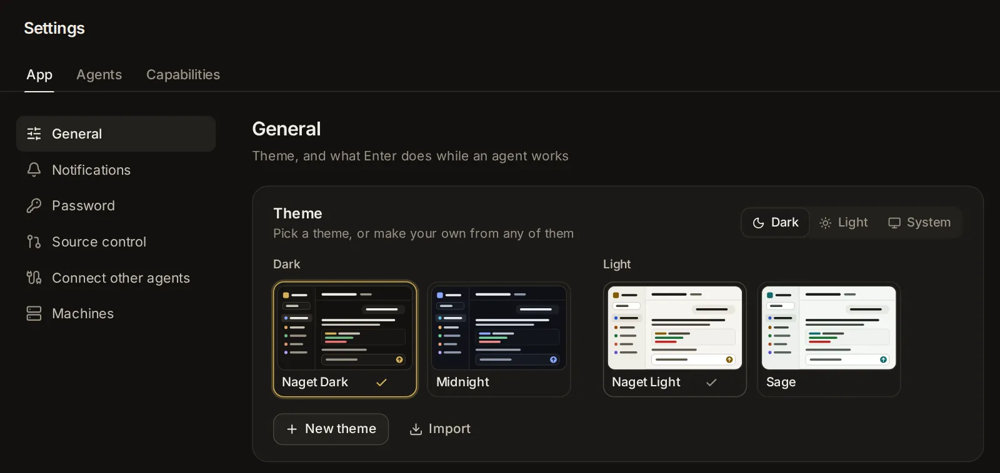

# Look, language and updates

How the app looks and behaves for you, and how it keeps itself up to date: dark or light mode, the built-in themes and your own, the language, what Enter does while an agent works, starting with the computer, updates and release notes. It also covers your password, signing out, and where the app keeps its data.

## Pick dark, light or your device's mode

Open [Settings → App → General](/settings?s=general&find=Appearance). The **Appearance** group has a switch beside its title:

- **Dark**: always a dark theme.
- **Light**: always a light theme.
- **System**: follows your device, a dark theme when it is set to dark (at night, say) and a light one otherwise.

The mode is kept in this browser, so your phone and your computer can differ. The search box (Ctrl+K, ⌘K on a Mac) has **Switch between light and dark**, which turns the mode to light or dark at once.

## Choose a theme

Under the title, in the group's box, the themes show as small pictures of the app in their colours, in two rows: **Dark** and **Light**. Four come with the app:

- **Hydor Dark**: pure black behind your sessions, cool blue-black panels and a periwinkle accent. The dark theme at first.
- **Midnight**: pure black behind your sessions, warm near-black panels and a gold accent.
- **Hydor Light**: warm off-white with a deep gold accent. The light theme at first.
- **Sage**: a cool green-grey paper with a deep teal accent.

Click a theme to use it. It becomes the theme for its mode, and the mode switches to it (unless the mode is **System**: then it shows whenever your device is in that mode). Each mode keeps its own pick, so you can have Midnight at night and Sage by day. With **System** on, the rows say which one is "showing now". Typing a theme's name in the search box finds it too, and picking it switches to it.

Each picture has a menu (⋯, shown when you point at it on a computer):

- **Make a copy to edit**: opens the theme editor with a copy of it.
- **Copy to share**: copies the theme as text, to import elsewhere.
- **Edit** and **Delete**: only for themes you made. Deleting asks first, and devices using it go back to the Hydor theme.

Which theme shows is chosen in each browser. Themes you make are kept by the app and offered on every device you use.

## Make your own theme

1. Click [**New theme**](/settings?s=general&find=New%20theme) under the pictures. The editor opens with a copy of the theme showing now, named "My theme" (or use **Make a copy to edit** on any theme).
2. Name it, and pick **Dark** or **Light** as its base. The base sets the colours of code and the colours programs print in the terminal, and fills in any colour the theme leaves out.
3. Change any colour: click its swatch to pick one, or type a hex code such as `#1e3a2f`.
4. Click **Save theme**. The app uses it straight away.

While you edit, the whole app shows your changes, so you see each colour where it is used. Nothing is kept until you save: **Cancel**, ✕ (**Close without saving**) or Esc put the theme you had back. **Copy** copies the theme as text, like **Copy to share**. The editor is a panel on the right on a computer, and a sheet from the bottom on a phone.

You can have up to 40 themes of your own; **New theme** and **Import** turn grey at that point.

### The colours you can set

- **Backgrounds**: Page (behind everything), Sidebar, Cards (the message box, settings cards, panels), Menus and dialogs, Fields (inputs and quiet fills), Hover (rows under the pointer, chips), Selected (the open row, secondary buttons).
- **Text**: Text, Secondary text, Muted text (hints, times, labels).
- **Borders**: Borders, Strong borders (inputs and outlined buttons).
- **Accent**: Accent (main buttons, links, focus, selection), Text on accent.
- **Status**: Working; Needs you, warnings; Done, added lines; Failed, removed lines; Information.
- **Agents**: Claude, Codex.
- **Code and terminal**: Code blocks, Terminal background, Terminal text.

A text colour that gets hard to read on the backgrounds it sits on shows a warning, "hard to read", with its contrast (for example 2.8:1). 4.5:1 reads well, or 3:1 for muted text.

## Share a theme or import one

To give a theme to someone, or to another Hydor of yours:

1. In the theme's menu (⋯), choose **Copy to share** (or **Copy** in the editor). The theme is copied as a short piece of text.
2. Send that text.

To add a theme you were given:

1. Click [**Import**](/settings?s=general&find=Import) under the theme pictures.
2. Paste the text into **Import a theme** and click **Add theme**.

The theme is added to your own and used at once. If the text isn't a theme, the app says "That is not a theme" and asks for what **Copy to share** gave you.

## Change the language

[Settings → App → General → Appearance → Language](/settings?s=general&find=Language) is a menu with the languages the app is shown in:

- **English**
- **中文（简体）** (Chinese, Simplified)
- **Ελληνικά** (Greek)

Picking one reloads the page in that language. The choice is kept in this browser; at first the app follows your browser's language when it has it, and English otherwise.

Only the app's own words change, and dates and times are written the way that language writes them. What people and agents wrote stays as it was: conversations, memory notes, the names and descriptions you gave things, files, code and terminals.

Agents write to you in the language you pick: they are asked to, unless you write to them in another language or ask for one, and code, commands and file names stay as they are. This reaches each agent when it starts or resumes. Notifications come in the language too, on your phone as well. The app tells agents its language each time it opens, so if your devices are set to different languages, agents and notifications follow the one opened last.

## Decide what Enter does while an agent works

In the **Sessions** group, [**Sending while an agent works**](/settings?s=general&find=Sending%20while%20an%20agent%20works) decides what happens when you send a message while the agent is in the middle of a turn:

- **Join the turn** (at first): Enter adds your message to the turn in progress, so the agent takes it into account right away. Ctrl+Enter (⌘Enter on a Mac) waits for the turn to end instead.
- **Wait for it**: Enter puts your message in the queue, and it goes out when the turn ends. Ctrl+Enter (⌘Enter on a Mac) adds it to the turn in progress instead.

The choice is kept in this browser. More about the queue in [Sessions](/guide/sessions).

## Turn terminal suggestions on or off

In the **Terminals** group, [**Terminal suggestions**](/settings?s=general&find=Terminal%20suggestions) (on at first) shows grey text after the cursor in the app's terminals with the likeliest rest of the command; → takes it. Turning it off hides the grey text only: Ctrl+Space still lists suggestions. It is kept in this browser. See [Grey suggestions](/guide/files-git#grey-suggestions).

## Resume sessions after a usage limit

[**Resume after usage limits**](/settings?s=general&find=Resume%20after%20usage%20limits) (off at first): when a turn stops because a plan's usage ran out, the session continues by itself a minute after the limit resets. It is kept by the app, so it works with no browser open. More in [Usage, limits and costs](/guide/usage).

## Delete inactive sessions

The app keeps every session, whatever the agent's own program does (see [Every session is kept](/guide/usage#every-session-is-kept)), until nobody has used it for a long time. [**Delete inactive sessions**](/settings?s=general&find=Delete%20inactive%20sessions) (on at first) deletes sessions inactive for **1 year**, a few hundred a day at most.

- Pick how long a session may stay inactive in the menu beside the switch in its row: **After 3 months**, **After 6 months**, **After 1 year**, **After 2 years** or **After 5 years**.
- Turn the switch off to keep every session for good.
- A session counts as inactive from the last time anything happened in it.
- Some sessions always stay: pinned ones, and ones that are at work, waiting for you, have messages queued, are snoozed, are due to resume after a limit, run in VS Code or a terminal, or have an open pull request.
- A deleted session leaves the list and its conversation is gone, but its numbers stay in [Activity](/stats).

It is kept by the app, so it works with no browser open.

## Limit each session

[**Limit each session**](/settings?s=general&find=Limit%20each%20session) caps what one session may use: its agent's program and everything it runs (commands, the servers it starts). Pick the memory (**2 GB of memory** up to **16 GB of memory**, or **No memory limit**) and the processors (**1 processor** up to **8 processors**, or **No processor limit**).

- Limits hold from the next time a session's agent starts; sessions already running keep the ones they started with.
- Over its memory, the program that asked for more is stopped, not the app and not another session: the agent sees its command end and can go on. The session's Info and System → Monitor say so: "one stopped at its memory limit".
- At its processors, the session's programs run slower, and the rest of the computer stays free.
- Limits work on Linux, through your user's systemd: each session runs in a scope of its own. Elsewhere, or with no user systemd running, the menus are off and the row's (i) says why; what each session uses still shows in [Monitor](/system/monitor).

## Start the app when the computer starts

In the **Startup and updates** group, [**Start when this computer starts**](/settings?s=general&find=Start%20when%20this%20computer%20starts) brings the app back after the computer restarts, and after a crash. It is on at first: the installer sets the app up as a service, and a copy started by hand from a git clone sets one up the first time it runs. What the switch can do depends on how the app runs, and the line under it (and its (i)) says which:

- **As a service of your user** (the usual install): the switch turns it on or off. It starts at boot even before anyone logs in; if the line says it starts only once you log in, run `sudo loginctl enable-linger $USER` once on the computer to change that.
- **As a system service**: changing it needs administrator rights on the computer.
- **In Docker**: its restart policy brings it back (`restart: unless-stopped`), and the switch can't change it.
- **In a desktop app**: it opens in the background when you log in, with its icon in the menu bar (on Windows in the notification area of the taskbar, on Linux in the system tray) and its window closed. It is on from the first time you open it (the Mac app from the Applications folder).
- **Started some other way**: turning it on sets it up as a service of your user. Where that isn't possible (no systemd for your user), the line says so.

While the app loads, in a browser or while a desktop app starts, its logo shows with water rising in the Ω. As soon as the app is ready it is there under the logo, which fades away as the water drains from the Ω and the screen around it clears. You can click and type straight away. If your device asks for reduced motion, the logo simply goes.

## Keep the app up to date

A copy installed from git (the installer's, or Docker's) looks for a newer version a few minutes after it starts and then once a day; the desktop apps look a minute after they open and then every 4 hours. The version row, the last row of **Startup and updates** in [Settings → App → General](/settings?s=general&find=Check%20now), is named after the version you run (**Hydor …**) and shows how things stand:

- "Up to date · checked … ago", with **Check now** to look again at once.
- When a newer version is out: "… updates out", the latest change's title, and **Update now**. It gets the new version, builds it and restarts the app; running agents carry on through the restart, and this tab reloads into the new version by itself. If the app can't restart itself, it gets and builds the new version, and you restart the app to use it.
- While it updates: "Getting the new version…", "Installing packages…", "Building…", then "Restarting, this page reconnects by itself…".
- For a week afterwards, how the last update went: when it updated (and from which version to which), or why it failed.

When a newer version is out, a dot shows on **Settings** in the sidebar. A copy not installed from git can't check: **Check now** says so. The row's (i) says where sessions run and where their history comes from.

[**Update automatically**](/settings?s=general&find=Update%20automatically) (on at first, the row above the version) installs a newer version by itself: a copy installed from git after 5 hours without a message from you, at most once a day; the desktop apps as soon as one is out, after a minute's notice (the Linux .deb asks for your password first). Running agents carry on. It needs an app that can restart itself (the installer's service, Docker, or a desktop app that can replace itself, such as the Mac app in the Applications folder); otherwise the switch is off and says why.

Other pages open on your devices notice when the app has a newer version than they run, and offer **Reload** ("Hydor was updated").

### Updates in the desktop apps

The desktop apps (Mac, Windows and Linux) go by released versions instead. With [**Update automatically**](/settings?s=general&find=Update%20automatically) on, it downloads a new version as soon as it is out and checks that it is the build the release names, without waiting for you to be away. Then it tells you, in two places:

- A notification: "Hydor … is ready", restarting in a minute to install it. Clicking it opens the app; its **Restart Now** button installs the new version at once.
- A note in the corner of every open page of the app that counts down the seconds ("Restarting in 42 s to install it"), with **Restart now** and **Later**.

When the minute is up, the app restarts into the new version: running agents carry on, and its window comes back by itself. **Later** puts it off for 4 hours, when the notification and the note come back. Until then, **Restart to Update to …** in the menu of the app's icon (in the menu bar, the notification area or the system tray, and in the app's own menu) installs it whenever you like, and so does **Restart now** in the version row, which says "Version … is ready to install" and when it asks again.

With **Update automatically** off, nothing downloads by itself: the version row says "Version … is out", and **Update now** downloads it, checks it and opens it in place of the one you run ("Downloading the new version…", then "Opening the new version, this page reconnects by itself…").

A download that breaks off carries on from where it stopped: when the computer goes to sleep, or the connection drops or goes quiet for a minute, it picks up again as soon as it can. If it still gets no further after a couple of minutes, it keeps what it has, the line under the version row says how far it got, and it tries again an hour later, carrying on from there; so does **Update now**.

On Windows, the new version's installer runs without its window, installs over the app and opens it again. The Linux .deb asks for your password to install: a version that downloaded by itself waits, and **Restart to Update** (or **Restart now**) asks for the password and opens the new version.

If the new version of the Mac app or an AppImage does not start, the version before comes back by itself and the line under the version row says why; that version then installs only when you press **Update now**. The Mac app can update itself only from the Applications folder (or another folder you can write to): opened from the disk image, it says to move it there. An AppImage likewise needs a folder you can write to, such as your home folder.

## Read the release notes

Every version has release notes: what changed for the people using it.

- In the version row at the bottom of **Startup and updates** in [Settings → App → General](/settings?s=general), click **Release notes**.
- Or type "release notes" or "what's new" in the search box.

The notes list every version, newest first, each with its date; the one you run is marked "This version", and Settings opens the notes there.

Once after the app updates, a note in the corner says "Updated to Hydor …" with **What's new**, which opens the notes at that version. Each browser shows it once, and a browser's first visit doesn't.

## Take the tour

The welcome tour is made for people new to AI. It opens with a short film of a request being done (you ask in your own words, the agent works step by step, the result is ready), then asks what should do the work: **Claude** or **ChatGPT** (with the plan you already pay for), **Pay as you go** (models from every company through OpenRouter), **Free, on this computer** (models that run here), or **Other agents**. It sets each one you pick up on pages that fill the screen, each with its picture and its words in the same place and nothing to scroll: signing in, adding your OpenRouter key and picking the models for your agent, then the models that make pictures, music, voices and videos, or installing one of the models suggested for this computer with one click. The picture beside each page shows what you picked as streams flowing into a pool around the Ω, which fills as you pick more; small dots at the bottom show where you are, over a sea whose waves drift gently. When another agent's folder is on this computer (Claude Code, Codex or another), one more page, **Coming from another agent?**, names what it found and opens [Bring in](/guide/memory#bring-in-from-other-assistants) over the tour; with none of them here, there is no such page. Then it shows you around the app part by part, with something to try on the way: a first task you can put in the message box with one click. Its step **Hear when it’s done** turns on notifications for this device; in a desktop app, **Turn on notifications** shows a test notification, or, when your system isn't showing Hydor's notifications yet, opens its settings where you allow them (on a Mac, System Settings at Hydor's notifications) and checks again when you come back. It opens by itself the first time you use the app.

To take it again: [Settings → App → General → Help → Welcome tour → **Take the tour**](/settings?s=general&find=Take%20the%20tour), **Take the tour** in the search box, or **Take the tour** at the top of **Help** in the sidebar. More in [Getting started](/guide/start).

After the tour, tips show you the rest of the app as you come to it. The first time a part of the app is on your screen (the inbox, a session's menu, the Git page, **Settings → Memory**…), a small card beside it says what it is for, and **Learn more** opens this guide where it says more. Tips come one at a time and a while apart, never while you type or have a menu open.

- **Got it**, or using the part it points at, puts a tip away for good, on every device.
- **Skip tips** stops them all, on every device. **Skip the tour** on the tour's first page does too; closing the tour with ✕ leaves them on.
- Separately, the first time you pick a mode that costs several times what one agent does (**Swarm**, **Campaign**, **Deep research** or **Arena**), a dialog explains what it is for and what it costs before it is on. It shows once for each mode, on every device, whether tips are on or not; ask an agent to show the tips again and it comes back too.
- To turn them on or off again: [Settings → App → General → Help → **Tips**](/settings?s=general&find=Tips).

## Change your password

The app has one password, chosen when it was installed. To change it, open [Settings → App → Password](/settings?s=security&find=Change%20password) and click **Change…** in the **Change password** row. A dialog opens:

1. Type your **Current password**.
2. Type the **New password** (at least 10 characters) and **Repeat new password**.
3. Click **Change password** (it stays grey until the current password is typed and the new one has 10 characters).

Changing it signs out every other browser: phones, other computers, everywhere but this one. If the current password is wrong, or the two new ones differ, nothing changes and the app says why.

If you have forgotten it, run this on the computer the app runs on, in the app's folder: `node dist/server/cli.js set-password` (with Docker: `docker compose exec -it hydor node dist/server/cli.js set-password`). Every browser is signed out, and addresses paused after wrong passwords can sign in again.

## Sign out of this browser

[Settings → App → Password → This browser → Sign out of this browser](/settings?s=security&find=Sign%20out%20of%20this%20browser) → **Sign out** signs this browser out, and only this one. You need the password to come back.

## Where the app keeps its data

The app keeps its own data in one folder, its data folder: `~/.hydor` in your home folder (`~/.web-agent` on installs from before version 0.5, or wherever the `DATA_DIR` setting points). Files you delete on the Files page go to the trash in it; **Trash**, among the Files page's places, says where. It holds:

- the password, as a hash (the password itself is never stored);
- the database with the session list, search, settings and the app's other records;
- logs of the agents running now;
- attachments waiting to be sent (the app's copies are deleted after 14 days, and kept under 2 GB in all);
- the trash of the Files page;
- notebook kernels and the private server the terminals run in;
- once search by meaning is on, its private Python environment.

Conversations themselves stay where the agents write them, `~/.claude/projects` for Claude Code and `~/.codex/sessions` for Codex: the app reads them there (the (i) beside the version in Settings → General says so). With Docker, all of this lives in the container's `/home/node`, kept in its data volume.

### What each browser keeps

Some choices belong to the browser you make them in, so each device can differ:

- the mode (dark, light or system) and which dark and light theme show;
- the language;
- what Enter does while an agent works;
- terminal suggestions, the notification sound, and whether this device gets notifications;
- the Files page's folder, open files, recent files, and how folders show (a list or tiles, and their order); pinned folders are kept on the server, the same on every device;
- files marked **Viewed** when reviewing a branch;
- whether the "What's new" note was shown.

The rest is kept by the app and is the same on every device: themes you made, **Resume after usage limits**, **Delete inactive sessions**, **Start when this computer starts**, **Update automatically**, whether the tour was taken, and the tips (on or off, and which were shown).

## Ask an agent

- "Make me a dark theme with a deep green background and an orange accent."
- "Delete my theme called Test."
- "Is there a newer version of Hydor? What changed in it?"
- "Install the new version of Hydor that is waiting, now."
- "Turn off automatic updates."
- "Make sure the app starts when this computer starts."
- "Turn on resuming sessions after usage limits."
- "Turn the tips back on, and show them all again from the start."
