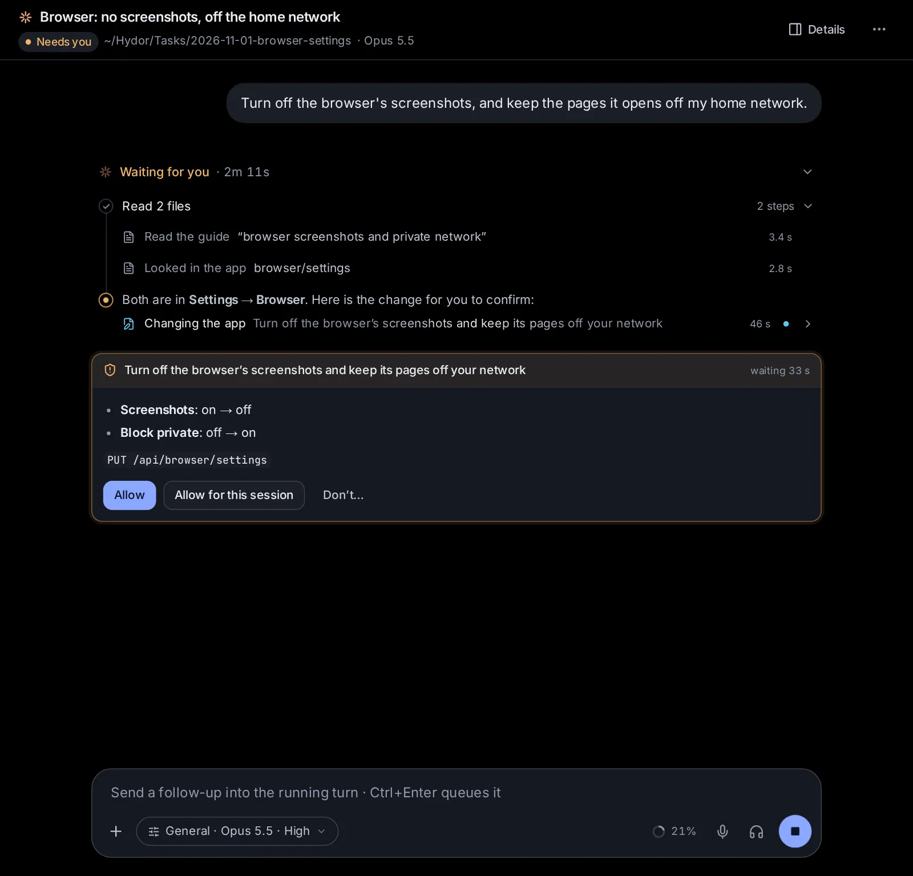

# Let agents work the app for you

Every agent here knows this guide and can work the app for you. Ask how something works and it answers from the guide, with a link to the right place. Ask it to change a setting or set something up (a project, an assistant, a scheduled task) and it does it, after you confirm on a card. When it needs details from you, it shows a form to fill in.

## Ask how to do something

In any session, with any agent, ask about the app the way you would ask a person: "How do I share this session with a colleague?", "Where do I turn on notifications on my phone?", "What does Auto mode do?". The agent looks the answer up in this guide, so it describes the app as it is now, and its links open the place it names.

You can also read the guide yourself: **Help** in the sidebar, or search it from the search box (Ctrl+K, ⌘K on a Mac), where its sections show under **Guide**. On Help, a question typed in the box at the top goes to an agent when you press Enter, and the answer shows beside the guide (see [Get help](/guide/start#get-help)).

## Ask an agent to change a setting or set something up

Agents can do in the app what you could do in its pages. Some examples of what you can ask:

- "Turn on search by meaning."
- "Make a project called Thesis for my dissertation, with the Researcher assistant."
- "Every weekday at 8, give me a news brief on renewable energy."
- "Add to my guidelines that answers should be short."
- "Use Brave Search before DuckDuckGo."
- "Delete the memory notes about my old job."
- "Which apps do I have? Run the trip planner for a long weekend in Lisbon."
- "Switch this device to the light theme."

The agent first reads how things are now, then asks you to confirm the change on a card in the conversation. Reading never asks: an agent can always look at your settings, projects, tasks and the rest to answer you.

## Have an agent do what an editor does

Agents change what is in your Library as you would in its editors: they write slides, documents, spreadsheets, LaTeX documents and notebooks, and do in one go what an editor does to the whole of one in a click:

- **Slides**: animate every slide (**Subtle**, **Lively** or **Striking**, or take every animation off), put right what **Check accessibility** finds, describe the pictures that have no description, make the deck PowerPoint compatible or put it back in the web format, give it a ready-made theme or one of yours, make the slides wide or standard, bring in slides from another deck, and update the charts made from a spreadsheet.
- **Documents**: accept or reject the suggested changes, change the page setup, and put in a header, a footer and page numbers.
- **Spreadsheets**: sort a table, take out its duplicate rows, fill down or right, clear cells, trim spaces, split words into columns, sum a table up on a new sheet (as **Data → Summarize by** does), put in or take out rows and columns, and rename, copy, move or delete sheets; formulas follow, as they do in the editor.
- **LaTeX documents**: rename or move files, pictures and folders, the lines that name them following.
- **Notebooks**: clear the outputs.
- **Any of them**: a copy in the Library, or another kind made from it (**Turn it into**).

Each keeps a new version (the one before stays among the versions), the editor open on it shows it at once, and your own changes and comments stay. They are free and instant, but for describing pictures, which a model does. The agent beside a page ([Change it by asking an agent](/guide/library#change-it-by-asking-an-agent)) knows them all, and exactly what you picked. For example:

- "Animate every slide of my 'Launch plan', lively, and fix what the accessibility check finds."
- "Make my 'Launch plan' slides PowerPoint compatible."
- "Accept Maria's suggestions in the 'Budget' document and reject the rest."
- "In my 'Sales' spreadsheet, sort the table by revenue, highest first, and take out the duplicate rows."
- "In my LaTeX thesis, move the pictures from figures/ to img/."

## The card: confirming a change

Before an agent changes anything, a card shows in the conversation (and in your [inbox](/inbox), with a notification if you're away). It says:

- **What the change is**, in the agent's words: "Make the project “Thesis”".
- **What changes**, field by field: a setting as it is now and as it will be ("**Results**: 10 → 20"), or what a new thing will be made with.
- **The call itself**, in small print (for example `PUT /api/search/settings`), so you can see exactly what will happen whatever the agent says.

Then you choose:

- **Allow** makes the change.
- **Allow for this session** makes it, and lets this session make more changes of the same everyday kind without asking again. Changes that ask every time (below) still ask.
- **Don’t** (or **Decline**) changes nothing. You can say why, or what to do instead, and the agent reads it.

Some changes ask every time, even after **Allow for this session**: deleting anything, starting a session or a scheduled task's run, sending a message to another session, adding an MCP server, adding, turning on or changing a plugin, changing what agents may do in Custom or the browser, adding a machine or an account, downloading a model, setting up the picture tools on this computer, updating the app. For a deletion the button says **Delete**.

A card waits about nine minutes. If you don't answer by then, it goes away and the agent asks you in its reply instead.

## When an agent needs details: forms

When an agent needs several things from you, it can show a form in the conversation instead of a list of questions: a trip's dates and budget, a new app's name and fields. Fill it in and click the button (**Send**, or what the agent called it); **Not now** closes it, and the agent carries on without it or asks in words.

A form waits as long as you need. If you haven't answered within about nine minutes, the agent ends its turn there and the form stays in the conversation, even when the agent stops or the app restarts. When you fill it in, your answers go to the agent as your next message ("My answers to …"), and it carries on from there; if they can't reach it, the form stays for you to send again. A form taller than the screen opens at its top, with **Latest** to go to its end.

A card for a change can carry a form too: "Make a project" can show the name, description and guidelines the agent guessed, for you to correct before you click **Save**.

## What agents can't do in the app

Some things stay yours. An agent that tries gets told where you do it:

- your password and signing in and out ([Settings → Password](/settings?s=security), [Accounts](/settings?s=accounts));
- the values of keys and sign-ins: an agent asks for them with a card where you type them into the vault, and never sees them ([Connected apps, keys and tools](/guide/connections)); the OpenRouter key has a card of its own, which puts it straight into Settings → Models ([When an agent needs the OpenRouter key](/guide/documents-voice#when-an-agent-needs-the-openrouter-key));
- making access tokens for other machines or agents, and an app's API keys;
- answering approval cards, its own or another session's, and deciding on cards that ask you (a proposed skill, a scheduled task, publishing);
- a session's permissions and its spending cap;
- files, commands, terminals and git through the app: agents use their own tools for those, which ask you as the session's permissions say;
- the editors' own AI tools and the picture and video editors: agents make, find, change and edit pictures, drawings, plots and videos with tools of their own, which save what they make in the session's folder ([Documents, images, videos and voice](/guide/documents-voice)), and narrate slides with a voice-over of each slide's notes.

## Permissions and the cards

What a session's permissions allow decides how much the cards ask:

- **Plan** (and Codex's **Read only**): the agent can read the app's settings and answer questions, but changes nothing. It tells you what it would change.
- **Ask**, **Accept edits**, **Auto** and the like: changes ask on a card, as above.
- **Bypass** (Claude Code) and **Full access** (Codex): no cards; the agent makes the changes you ask for. A form still shows when the agent needs details.
- Custom's **Full access**: only the changes that ask every time show a card.

## Settings kept on each device

A few settings belong to each device rather than the app: the theme, the language, the notification sound, what Enter does while an agent works, terminal suggestions and whether the sidebar shows. An agent can change these on the device you're talking to it from (the pages showing that session), without a card: "Switch to the dark theme", "Use the Sage theme", "Show the app in Greek". Your other devices keep their own.

## Ask an agent

- "How do I get notifications on my phone?"
- "Make a project for my garden projects and give it the guideline: we live in a cold climate."
- "Turn the browser's screenshots off."
- "Show me which scheduled tasks I have, and turn off the price watch."
- "Switch this device to the light theme."
