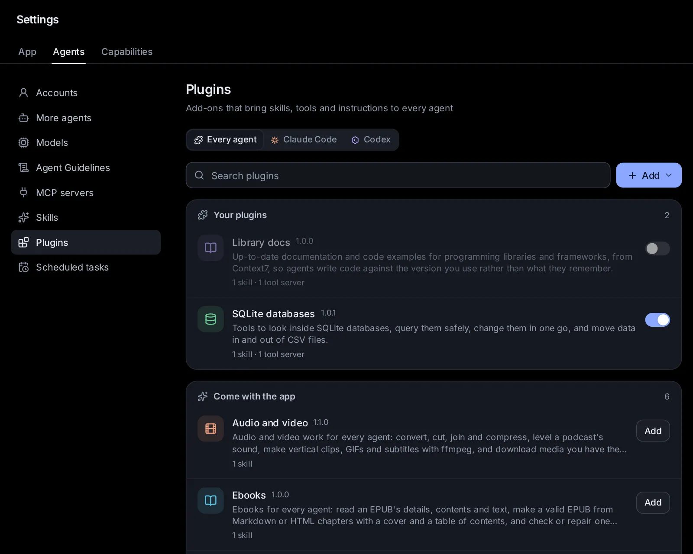

# Plugins

A plugin brings agents what they need for one kind of work, all at once: skills, tools, a few lines of instructions, files of its own, and whatever it needs installed. Every agent the app starts gets the plugins you turn on: Claude Code, Codex, Custom and the others alike. This topic covers the plugins that come with the app, adding others from a link, a file or a folder, making and sharing your own, and Claude Code's and Codex's own plugins.

## What a plugin is

A plugin is a folder that can hold:

- **Skills**: written methods agents load when a task calls for one. They join the [skill library](/guide/skills) while the plugin is on.
- **Tools**: tool servers (MCP servers) that give agents new abilities, such as reading text in pictures or querying a database. A server runs on this computer, or is a service at an address.
- **Instructions**: a few lines added to every agent's own instructions while the plugin is on.
- **Files of its own**: data, templates, pictures or scripts its skills and tools use.
- **What it needs**: other plugins, Python or Node packages, programs on this computer, files to download, and keys from your vault.

Plugins are in the open Agent Plugins format, which other tools (VS Code, Cursor, Codex, OpenHands…) read too. Plugins made for Claude Code can be added here as well: their skills and tools reach every agent.

## Open the Plugins page

Go to **Settings → Agents → Plugins** ([open it](/settings?s=plugins)). On a phone, open Settings, then tap **Plugins** under Agents.

At the top, three tabs: **Every agent** (the plugins of this app, for every agent), **Claude Code** and **Codex** (each agent's own plugins: see [Claude Code's and Codex's own plugins](#claude-codes-and-codexs-own-plugins)).

Under **Every agent**:

- a search box, and **Add**, with **Make a plugin**, **Make one with an agent**, **From a link**, **From a .zip file** and **From a folder**;
- while a plugin is being added or set up, its steps, as they happen;
- **Your plugins**: the ones you added, each with its switch;
- **Come with the app**: the built-in plugins not added yet, each with **Add**.

Each plugin shows its name and version, what it is for, what it brings ("1 skill · 1 tool server"), and anything that stops it from working fully: setting it up failed, a program it needs is missing, a key is not saved. Click a plugin to open it.

You can also find plugins from the search box (Ctrl+K, ⌘K on a Mac): they show under **Plugins**.

## Add a plugin that comes with the app

1. Under **Come with the app**, click **Add** on its row, or open it and click **Add**.
2. Its steps show at the top of the page: adding it, then setting it up (its packages and downloads). It is on as soon as it is ready.

A plugin that needs other plugins brings them along: they are added first, and the plugin's page says which before you add it.

## The plugins that come with the app

- **Audio and video**: convert, trim, join, compress and inspect audio and video, pull out the sound, even out a podcast's loudness, shorten long pauses, cut a recording from a list of the parts to keep, make vertical clips, GIFs and thumbnails, add subtitles, and download media you have the right to. It needs ffmpeg on this computer (its page says how to get it), and installs yt-dlp in its own environment.
- **Ebooks**: read an EPUB's details, contents and text, make a valid EPUB with a cover and a table of contents from a manuscript in Markdown or HTML, and check or repair one before it goes to Kindle, Apple Books or Kobo. It installs the Python packages it needs in its own environment; with EPUBCheck on this computer it also runs the check the stores use, and with pandoc it takes Word files too.
- **Library docs**: current documentation and code examples for programming libraries and frameworks, from Context7's service, so agents write code for the version you use. Nothing is installed; the questions go to Context7.
- **Meeting recordings**: from a recording of a meeting, call or interview to notes: a summary, decisions, action items with owners and dates, open questions and a follow-up email, each with the time it was said. It brings **Speech to text** along.
- **Python for data**: a Python of its own with pandas, NumPy, SciPy, Matplotlib, openpyxl and PyArrow, to analyse tables and make charts without installing anything into your own Python.
- **Speech to text**: recordings, voice notes and videos become text and subtitles on this computer, with Whisper, in about 100 languages: on an NVIDIA graphics card when there is one (its setup then adds NVIDIA's CUDA libraries, about 1.3 GB), else on the CPU, and on the CPU too when the card fails, saying why. A Mac transcribes on its CPU: this Whisper has no Apple GPU support. It brings **Audio and video** along; its models download once, the first time each is used.
- **SQLite databases**: tools to look inside SQLite databases, query them safely, change them in one go, and move data in and out of CSV files. It needs only Python 3.
- **Text from pictures**: reads the text in pictures, photos of documents, screenshots, receipts and scanned PDFs, on this computer: on its graphics card when there is one (an NVIDIA card, for which its setup adds ONNX Runtime's GPU build with NVIDIA's CUDA libraries, about 2 GB; or a Mac's, through Core ML), else on the CPU, and on the CPU too when the card fails, saying why.

## Open a plugin

Click a plugin. Its window shows:

- where it comes from (**Comes with the app**, a link, a file, **Made here** or a folder), its author, license and website;
- its switch, once added: **On for every agent**, or **Off**;
- what it is for;
- **What it gives agents**: its skills (with when each is used), its tool servers (what each runs, or where it is), and its instructions; and which agents get it;
- **What it needs**, each with a tick or a cross: other plugins, Python and Node packages, files to download, programs on this computer (with how to get a missing one), and keys (with **Add it** for one not saved yet);
- its own files, problems in its folder if any, and **About it**: its own description;
- for a plugin you added, its folder and its data folder.

A plugin you added has a **⋯** menu at the bottom: **Change it** (for plugins you made, or use from a folder), **Get the latest version** (for one from a link), **Set it up again**, **Pack into a .zip**, **Show its folder** and **Remove**.

## What a plugin needs, and its setup

When a plugin needs packages or downloads, adding it sets them up in a data folder of its own, never for the whole computer:

- Python packages go in a Python environment of its own (made with uv when this computer has it, otherwise with Python's own tools). On a computer with an NVIDIA GPU, a plugin can add the packages it needs to run there, such as NVIDIA's CUDA libraries; if those fail to install, it works on the CPU.
- Node packages go in a folder of its own, installed without running their install scripts.
- Files are downloaded into its data folder, and checked against their fingerprint when the plugin gives one.

Agents are told where its Python, packages and files are, and its tool servers find them first. A plugin's tools reach agents only once its setup is done.

If setting it up fails, the plugin's row says so; its window shows why, with **Try again**, and **Show what it printed** shows the full output. When a plugin's needs change (an update of the app, or of the plugin), it is set up again: the built-in ones by themselves, the others when you click **Set it up again**.

Programs it needs (such as ffmpeg) are not installed for you: a missing one shows with how to get it. A key it needs comes from your vault, by its name: add it in [Apps → Connected apps → Keys](/apps/connected?tab=keys). Its tool servers get the key; agents never see it.

## Turn a plugin on or off

Use the switch on its row, or in its window. Off, agents stop getting its skills, tools and instructions from their next session; it stays added, with its setup, to turn on again.

- Turning off a plugin others need turns those off too: the app asks first, and names them.
- Turning on a plugin turns on the plugins it needs.

## Add a plugin from a link, a file or a folder

1. Click **Add**, then **From a link**, **From a .zip file** or **From a folder**.
2. Give it:
   - **From a link**: a Git repository holding a plugin, as owner/repo (for GitHub) or its address, or a link to the plugin's folder on GitHub. **A branch, or a folder inside the repository…** takes a branch or tag, and a folder.
   - **From a .zip file**: a plugin packed into a .zip, here or elsewhere. Choose it or drop it on the box.
   - **From a folder**: a folder on this computer. The plugin is used where it is: changes made in its folder reach new sessions, which suits a plugin you are making.
3. Click **Look at it**. You see what the plugin gives agents and what it needs, which built-in plugins it brings along, and any it needs that the app does not have (then it can't be added until you add those).
4. Click **Add** (or **Replace it**, when a plugin with its name is here already; its data stays).

Its steps show while it is set up. A plugin with the name of a built-in one can't be added: rename it in its plugin.json.

## Make a plugin of your own

1. Click **Add**, then **Make a plugin**.
2. Give it a **Name** and what it is for, and click **Make it**. It is added, on, and its editor opens.
3. Fill in its tabs, then click **Save**:
   - **About**: the name people see, its version (raise it when you share a new one), what it is for, its group and its picture.
   - **Skills**: **Write a skill** (its name, group, when to use it and its instructions), or **Copy one of yours** from your skills. Click a skill to change it.
   - **Tools**: **Add a tool server**: **A program here** (the program to start, its arguments one per line, and its environment as NAME=value lines), or **An address** (an MCP server's address, and headers). Use `${PLUGIN_ROOT}` for the plugin's folder and `${PLUGIN_DATA}` for its data folder: a server's arguments become `${PLUGIN_ROOT}/files/server.py`, say.
   - **Needs**: Python packages, Node packages, programs, keys, other plugins and files to download, one per line.
   - **Files**: **Add files** puts files in it (each up to 50 MB, 200 MB together); the bin removes one. Files are added and removed at once, without **Save**.
   - **Instructions**: a few lines every agent gets while the plugin is on.

Saving checks everything first: a skill must say when to use it, a tool server's program is one program (not a shell line), and so on; the app says what to fix. When its packages changed, it is set up again.

Plugins you make are kept in the app's data folder (plugins/mine). To change one later, open it and pick **Change it** in its **⋯** menu.

**Make one with an agent** opens a new session with the start of a request ("Help me make a plugin for Hydor that…"): say what it should do, and the agent writes it, checks it, and adds it from its folder with your yes.

## Share a plugin

- **As a file**: open the plugin, then **⋯ → Pack into a .zip** (or **Pack into a .zip** in its editor). Anyone adds it with **Add → From a .zip file**. Its setup is not packed: it is done again where it is added.
- **As a link**: put its folder in a Git repository (on GitHub, say). Anyone adds it with **Add → From a link**, and gets your new versions with **Get the latest version**.

Other tools that read the Agent Plugins format can use its skills and tool servers too; the parts only this app reads (what it needs, its instructions) are kept in its `com.naget.agent` part, which they pass over.

## Update or remove a plugin

- The built-in plugins update with the app.
- A plugin from a link: **⋯ → Get the latest version** downloads it again and sets it up if its needs changed.
- A plugin from a .zip file: add the newer file; it replaces the old one.
- A plugin from a folder: changes in the folder reach new sessions by themselves.

To remove one: **⋯ → Remove**, then confirm. Plugins that need it are removed too (the app names them first). Its packages and downloads are deleted. A plugin you made here is deleted with its folder: pack it into a .zip first to keep a copy. A plugin used from a folder of yours stays in its folder.

## Which agents get a plugin

Every session the app starts gets the plugins that are on, set up, and whose plugins they need are on too:

- their **skills** through the skill library, like the others (see [Which agents get which skills](/guide/skills#which-agents-get-which-skills)). A skill with a name the library already has is left out: its plugin's window says which skill agents get instead;
- their **tool servers** as MCP servers, started in the plugin's folder with its own packages;
- their **instructions**, with a line on where their packages and files are.

A plugin can be for some agents only; its window says which. Sessions that are already running get a plugin's changes from their next start.

## Claude Code's and Codex's own plugins

Claude Code and Codex have plugins of their own, from their marketplaces, which only they use. Each has a tab on the Plugins page:

- **Claude Code**: **Installed** (each with its switch and **Uninstall**), **Browse** (search the marketplaces, most installed first, **Install**), and **Marketplaces** (add one by owner/repo, a Git address or a folder; remove one).
- **Codex**: **Added to Codex** (each with **Remove**), **Find more** (search Codex's marketplaces, **Add**), and **Marketplaces** (add, **Refresh** or remove one).

Their skills show on the Skills page under the agent's own skills. To use a Claude Code plugin with every agent, add it to this app's plugins with **Add → From a link**.

## Plugins and safety

A plugin's tool servers run programs on this computer as you, and every agent gets its instructions. Add only plugins from people you trust, and look at what a plugin gives and needs before you add it: the app shows it before anything is installed. The plugins that come with the app are made and checked with it.

Keys never go in a plugin: a plugin names the keys it needs, and its servers get them from your vault while they run.

## Ask an agent

- "Which plugins do I have, and what does each give agents?"
- "Add the Speech to text plugin and transcribe ~/Recordings/standup.m4a."
- "Turn off the Library docs plugin."
- "Make a plugin with our team's three writing skills and pack it into a .zip."
- "Add the plugin at github.com/acme/agent-tools/tree/main/plugins/invoices."
- "Why does the Text from pictures plugin say its setup failed?"
