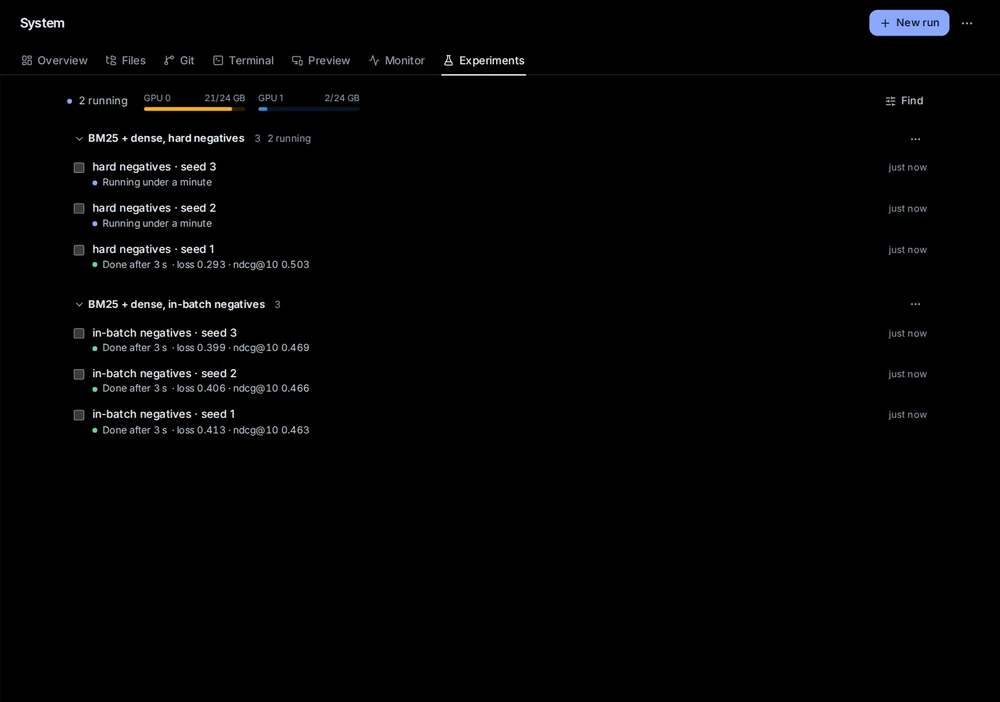

# Experiments

Experiments runs your training and evaluation jobs for you. A job waits for a GPU with enough free memory on one of your machines (or takes its turn in a cluster's queue), runs on its own, and is kept as a record: its code, hyperparameters, environment, log and metrics, and what the agent on call did when something went wrong. Each experiment (the runs you compare together) has a title, a description and a category, and its page shows the runs as a table, their metrics as charts and which hyperparameters matter. Compare runs, or make a results table with significance tests for your paper. Agents use it too: ask any agent to train something on a free GPU, and it starts a run here.

## Open Experiments

Click **Experiments** on the rail, or go to [Experiments](/experiments).

The first time you open the page, a short tour written for people new to experiments shows you around. It comes while tips are on, after the welcome tour. A card in plain words says what an experiment and a run are, then each part of the page lights up in turn with a card of its own: **New run**, the queue and GPUs, your experiments by category, following a run live, comparing runs and results tables, and letting an agent do the work. Move with **Next** and **Back**; **Done** ends it, and **Skip** or Esc closes it sooner. **Show me around** (the compass button at the top right of the page) starts it again any time.

On a computer, a column at the left stays beside everything you open here:

- The queue line at the top says what is happening ("2 running · 1 waiting", or "Nothing running now"). Under it, this computer's GPUs as small meters: the memory each one uses, in the accent colour when one of your runs holds it (point at one to see how busy it is and which run holds it; click it to open that run).
- **Find an experiment** filters the list by what you type: an experiment's title, description, category and name, and the names and commands of its runs. One that matches only by its runs says how many ("3 runs match").
- **Overview** brings you back to the page described below.
- Then the experiments, grouped by category (a small heading for each, the category with the newest run first; experiments without one come under **Other experiments**, and there are no headings at all while none has a category). Each shows its title and, under it, how many runs it has and how many are going ("6 runs · 1 running"), or when its last run was ("23 runs · 2 h ago"). In a category the experiment with the newest run is first. **Runs without an experiment** is the last entry, when there are such runs.

The **Overview** shows:

- **Running now**, when something runs or waits: a card for each run with its status, name, experiment, how far it has got ("54% · about 41 min left"), its main metric with a small curve, and its GPUs. A waiting run says why. Click a card to open the run. When more than 12 are going, **Show all N** shows them all.
- **Experiments**: a card for each, with its category, title and description, how many runs it has, how many are going and when the last one was, and the best value of its main metric ("Best dev_bpb 1.599"). Click one to open it.
- **Latest runs**: a table of the 10 latest runs across your experiments. **Show all N runs** shows them all, with **Find a run** above.

On a narrow screen there is no column: the Overview itself starts with the queue line, the GPUs and **Find an experiment**, and shows the experiments as cards.

With no runs yet, the page says what Experiments is, with **New run**, or "ask any agent: “train this on a free GPU and tell me when it’s done”".

## An experiment's page

Click an experiment in the column or on the Overview. At the top:

- Its category and its name (the name its runs carry, as you typed it in **Experiment**), then its title in large letters, and its description. A description longer than three lines has **More**.
- A line of counts: "23 runs · 1 running · 2 waiting · 9 done · 6 failed · last run 2 h ago" (only what is more than zero).
- At the right, a ⋯ menu, **This experiment**: **Edit the title and description** and **Write them again** (see [Titles, descriptions and categories](#titles-descriptions-and-categories)), **New run in this experiment**, **New sweep in this experiment**, **Make a table** (of its finished runs: see [Results tables for your paper](#results-tables-for-your-paper)), **Compare the latest 6** and **Pick them all** (ticks every run). On a phone, an arrow at the left of the title goes back.

Under it are three tabs: **Runs** (with how many), **Charts** and **Hyperparameters** (once the experiment has two runs or more that differ in a hyperparameter). The tab you picked last opens first the next time, on this device.

### The runs table

The **Runs** tab lists the experiment's runs as a table, a row each: its name, its status ("Running 54%", "Done", "Failed", "Waiting for a GPU"; point at a status that waits to see why), a column for each metric (its last value; the best in each column in bold) and for each hyperparameter, then **Runtime** and **Started**. When the experiment's runs are in more than one place, a **Where** column says where. The runs going now come first, then those waiting, in the order they will start, then those that ended, the latest first. Click a column's name to sort by it (a metric's first click puts the best first; click again to reverse it, and a third time to go back to that order). The table scrolls sideways, and each run's checkbox and name stay in view.

Above the table:

- **Find a run** looks in the runs' names, commands and tags.
- **Filter**: by **Status** (**Every run**, **Running and waiting**, **Done**, **Failed or lost**, **Stopped**) and, when runs are in more than one place, **Where**. While a search or a filter is on, **× N shown** clears it.
- **Columns**: tick the metrics and hyperparameters to show (a box finds one; a hyperparameter that differs between the runs says **Differs**). **Reset** goes back to the ones the page chose: the metrics that say most about the runs and the hyperparameters that differ. Each experiment keeps its own columns on this device.

Click a row to open the run. Tick the boxes to compare runs (see [Compare runs](#compare-runs)). The table shows 50 rows; **Show N more** shows the rest.

### Charts

The **Charts** tab draws every metric the runs print over steps, a chart each, with a line for each run. At the left (above the charts, on a phone) are the runs on the charts: **On the charts** with how many ("6 of 23"), then every run of the experiment, with a coloured dot when it is shown and an empty ring when it is not. Click a run to show or hide it. Up to 8 runs show at once ("Up to 8 runs show at once: hide one first"). A run keeps its colour while it is shown, whatever else you hide or show, so you can follow one run through your changes; the same colour marks it in the runs table. The ⋯ menu (**Which runs show**) has **Show the latest 8**, **Show the best 8** (by the experiment's main metric), **Show the picked runs** (the ones you ticked in the table) and **Hide them all**. At first, the first 8 runs that have curves show. Each experiment keeps its choice on this device.

The charts come in sections by the start of a metric's name: **dev** (or val, validation, eval, test…), **train**, any other prefix that two or more metrics share before a slash (`eval/…`), then **Metrics** for the ones that say how well a run does, and **Other** for the rest (folded until you open it). Click a section's name to fold it or open it. Above the charts:

- **Find a metric** shows only the charts whose name has what you type, in every section.
- **Smoothing**: a slider from 0 (the curves as they are) to 0.99, a moving average as TensorBoard and Weights & Biases draw it; the raw curve stays faintly behind.
- **Chart options** (the sliders button): **X axis** (**Step**, or another metric that only grows, such as tokens or time), **Log scale** and **Ignore outliers** (a chart's range follows most of the values instead of one spike). They are kept on this device, for every chart.

Point at a chart to read each run's value at that step. With a mouse, drag across a chart to zoom in; double-click it (or **Reset zoom**) to go back. On a touch screen, a tap or a drag across shows the values. **Bigger**, at a chart's top right, opens it large, with a table of each run's **Last**, **Best**, **Min** and **Max**.

### Hyperparameters

The **Hyperparameters** tab shows how the runs' hyperparameters go with one metric, which is how you read a sweep. Choose the metric (the main one at first) and whether each run counts by its **Last** or its **Best** value; the page says whether lower or higher is better for it. When the runs are a sweep, a line says so: "A sweep of 12 runs · every combination · 9 done · 2 going · 1 stopped early · stopped early on dev_loss". Below it:

- **Best** run: "Best dev_bpb", its value, the run and the values of the hyperparameters that differ. Click it to open the run.
- **Parallel coordinates**: a line for each run across the hyperparameters (the ones that matter most first, up to 8) and, last, the metric. The stronger the line, the better the run did. Point at a line to see which run it is; click it to open the run.
- **Which hyperparameters matter**: a bar for each hyperparameter that differs, the strongest first. For a number, ρ (from −1 to 1) says how its order goes with the metric's: a bar to the left of the middle means a higher value goes with a lower metric, and the words say "higher is better" or "lower is better". For other values (a name, true or false), η (from 0 to 1) says how much the groups differ, with "best:" and the value whose runs did best on average. Under it, how many runs it was worked out from. It is a correlation, not proof of a cause: other hyperparameters change at the same time, and with few runs a bar can come by chance. A hyperparameter that is the same in every run, or that fewer than 3 runs have, is left out.
- **Each hyperparameter against** the metric: a chart for each, a dot per run, the best one ringed (on a log scale when the values span a lot, as learning rates do).

At the end, **Make a table** and **Compare the best 6**.

## Start a run

1. Click [**New run**](/experiments?new=1) at the top right.
2. Type the **Command**, as you would in its folder: `python train.py --lr 3e-4`.
3. Pick the **Folder** it runs in, and **Where it runs**: **This computer**, one of your other machines, or a cluster (see [Where runs go](#where-runs-go)).
4. Set the **GPUs** it needs (0 runs it without one) and **Free memory each (GB)**. Left empty, it waits for a GPU nobody uses.
5. Give it a **Name** if you like (the name of its script otherwise) and an **Experiment**: the runs of one experiment are listed, charted and compared together (the box suggests the ones you have).
6. Click **Start**.

**More options** holds the rest:

- **Hyperparameters**: name=value lines (`lr=3e-4`), kept with the run, shown as columns in its experiment's runs table and compared in tables. Hyperparameters in the command itself are read by themselves: `--name value`, `--name=value`, and `name=value` words after the program (as Hydra takes them). `{name}` in the command takes a hyperparameter's value.
- **Seed** (`{seed}` in the command takes it; `--seed` in the command is read too), **Priority** (higher goes first) and **Time limit (hours)** (it is stopped after this long).
- **Metrics file**: a file the run writes metrics to as JSON lines, besides what it prints. **Per-example scores**: a file of scores per example (see [Results tables for your paper](#results-tables-for-your-paper)).
- **Tell me**: **When it is done** and **When it fails** (both on unless you untick them), and **When a metric crosses a value** ("val_acc > 0.9").
- **Agent on call**: see [The agent on call](#the-agent-on-call).
- On a SLURM cluster: **Processors**, **Memory (GB)** and **Partition**.

The new run opens, so you can watch it start. To add a run to an experiment you are looking at, use **New run in this experiment** in its ⋯ menu: **Experiment** is filled in. Soon after the first run of an experiment, the helper model gives it a title, a description and a category (see [Titles, descriptions and categories](#titles-descriptions-and-categories)).

## How the queue chooses

- Jobs go by priority, then by age. A job that needs GPUs takes those with at least its free memory that no other run of yours holds, the freest first. Until enough are free it waits, and says why: "Waiting for 1 GPU with 20 GB free: the most free now is 12 GB, on GPU 2; your other runs hold GPU 0". A smaller job behind it may start first, when what it needs is free.
- Jobs without a GPU start at once, a few at a time; how many is set in [Where runs go](#where-runs-go) (at first a quarter of the computer's threads, from 1 to 4).
- A job that asks for more GPUs than the computer has, or for one on a computer without NVIDIA GPUs, fails at once and says so.
- A run sees only its own GPUs (CUDA_VISIBLE_DEVICES); one without a GPU sees none. It also gets HYDOR_RUN (its id), HYDOR_RUN_DIR (its folder) and HYDOR_SEED, and Python prints at once (PYTHONUNBUFFERED), so its log follows as it goes.
- Runs go on in tmux (or in the background, where there is no tmux) when the app restarts or updates. When the app is back, it finds them again, reads what they printed meanwhile and sees which ended; one whose process went missing is marked **Went missing**.

## What a run records

- **Its code**: when it starts, the commit and branch of its folder's Git repository and whether there were changes not committed; if there were, a patch of them (binary files left out, at most 2 MB), and how many files Git does not track.
- **Its environment**: the computer; the Python the command runs with and the versions of PyTorch, Transformers, JAX, TensorFlow and NumPy in it (read from the packages, nothing is imported); with GPUs, the CUDA and driver versions and the GPUs' names.
- **Its hyperparameters and seed**, its **log**, its **exit code**, and its own folder in the app's data (its log, patch, exit code and metrics).
- **Its metrics**, read from its output as it grows: `key=value` pairs (`loss=0.42`, as Lightning's progress bars print them), a JSON object on a line (`{"step": 100, "loss": 0.42}`), Python's printed dicts (as Hugging Face's Trainer prints them), Keras' "loss: 0.41 - accuracy: 0.87", and the metrics file. The step comes from `step`, `global_step`, `iter` or `epoch`. For each metric it keeps the last value, the best (lower is better for losses, errors, perplexity and the like by their names, higher for the others) and a series for the charts. A metric it prints again and again is a curve; a number it prints once is a value (its hyperparameters at the start, its results at the end). It keeps up to 100 metrics: when a run prints more, its curves are kept before numbers it printed once.
- **How far it has got**, when its output says so: a progress bar (tqdm's, as Hugging Face's Trainer draws it, or one named for training or steps), "step 120/1000", or a total of steps it prints (`total_steps`, `max_steps`, `num_training_steps`…) beside its steps.

## A run's page

Click a run (in a table, on a card, or a GPU's meter). On a computer it opens in the place of the experiment, with the column still at the left; on a narrow screen it takes the whole screen, with an arrow back. The way back is the link at the top left, named for the run's experiment (**Overview** for a run without one).

- The header: the run's name; **Stop** while it runs or waits ("Stopping" while it does); **Run again**, which opens New run filled in with its hyperparameters, to change before you start it; and **More** (⋯): **Copy the command**, **Its folder in Files**, **Show in Finder**, **Show in File Explorer** or **Show in folder** (in the desktop app; see [Work with files and folders](/guide/files-git#work-with-files-and-folders)), and once it has ended **Delete the record** (its record, log, patch and metrics go; the files the job made in its own folder stay). On a phone, **Run again** is in the ⋯ menu.
- The status line: its status, with how long it took once it has ended, its exit code when that is not 0, where it runs, its GPUs and when it started. While it runs and its output says how far it has got: a bar, the steps done of all of them ("9,120 of 10,878 · 84%") and about how long is left, worked out from how long it has taken so far. A run that waits or failed says why.
- Three tabs: **Overview**, **Charts** (with how many curves it has) and **Log**.

**Overview** holds:

- **How it ended**, first, for a run that failed or went missing: the last lines of its log, and **Open the log**.
- **Key metrics**: a tile for each of up to six metrics that say how well it does (never bookkeeping such as the learning rate or token counts), with the last value, the best when it differs, and a small curve. Click a tile to open the **Charts** tab at that metric.
- **Hyperparameters**: the ones it was given or that were read from its command (a box finds one when there are many).
- **Values**: the numbers it printed once, by name: its hyperparameters at the start, its results at the end. **All N** shows more than twelve, with a box to find one.
- **Details**: its experiment (a link to it), status, when it started and ended, how long it took, where it runs, GPUs, seed, priority, the session that started it and the run it is a new run of.
- **Code**: the commit and branch, **See the changes** for the patch (or "Nothing changed since"), and how many files Git does not track.
- **Command**: the command and the folder, with **Its folder in Files**. **Environment**: the computer, Python, packages and GPUs.
- **What happened**: its events, with their times: when it waited, started and ended, and what the agent on call saw and did, with **Open its session**.

**Charts** draws the run's curves as an experiment's tab does (see [Charts](#charts)), this run alone, and reads them again every few seconds while it runs. **Log** shows its output, newest at the bottom. While it runs, **Follow** keeps the newest in view; scroll up to read and it stops following. **Find in the log** shows only the lines that match ("12 lines match"), and following pauses meanwhile.

**Stop** sends Ctrl-C to the run's programs, then stops them harder if they have not ended after 10 seconds. A run that only waited is taken out of line at once.

## The agent on call

Under **More options** → **Agent on call**:

- **Off** (to start with): what goes wrong is still noted on the run's page.
- **Tell me**: a notification when it happens.
- **An agent looks into it**: an agent starts a session in the run's folder with what happened, the end of the log, the run's record and **What the agent may do**, your rules for it. It acts within them, then tells you in a few lines what happened and what it did. The run's page links to its session.

It watches for (all of them unless you untick some): **NaN** (a metric becoming NaN or infinite, or a NaN loss in the log), **Out of memory** (CUDA's messages, `OutOfMemoryError`, or the program killed with exit code 137), **A stall** (no new output for 30 minutes, or the minutes you set), **A crash** (an exit code other than 0, or a process that died) and **Divergence** (a loss more than twice its best, five readings in a row).

Left empty, the rules are: "Read the log and the code. If a fix is clear and safe, run it again with experiment_run (from the last checkpoint if there is one), changing as little as possible. Never delete files or checkpoints. Then tell the user in a few lines what happened and what you did." The agent is the one that started the run (when an agent did), else the agent and model you picked last on the start page. One agent looks into a run at a time, and at most three go on call in an hour: past that, you are told instead.

## Notifications

You hear when a run is done or fails (unless you untick them), when a metric crosses the value you set, and from the agent on call. A notification opens the run's page. A sweep tells you once, when all its runs have ended, with its best run; its notice opens the sweep's experiment on its **Hyperparameters** tab. At most eight notices about runs come in ten minutes; past that, one tells you how many more there were.

A run an agent started with "tell me when it ends" (report) also sends that session a message when it ends, so its agent can go on from there.

## Titles, descriptions and categories

Each experiment has a title (a few plain words: what is trained or evaluated, on what, and what is varied), a description (one to three sentences) and a category (one to three words naming the area or the task, such as "Language modelling"). They show on its page, in the column and on the Overview's cards, so a name like `e7-pretrain` becomes a line you understand, and the search box (Ctrl+K) and **Find an experiment** find an experiment by them.

Who writes them:

- **The helper model** ([Settings → Agents → Models](/settings?s=models&find=Helper%20model)) writes them for an experiment that has none, soon after its first run (and for your older experiments, a little after the app starts). It reads the names, commands, hyperparameters and metric names of some of its runs. When it wrote them and the experiment has grown to twice its runs (at least 4), it writes them again, at most once in six hours.
- **An agent** that starts runs gives the experiment a title, a description and a category when it starts the first runs, and again when what it tests changes (the experiment_describe tool).
- **You**: **Edit the title and description** in the experiment's ⋯ menu opens a window with **Title**, **Description** and **Category** (it suggests the categories already in use). **Write them again** asks the helper model for a fresh version, which replaces what is there.

What you or an agent wrote is never written over automatically; only **Write them again** does that. The runs of a [confidential session](/guide/sessions#keep-a-session-confidential) are read only by a helper model that runs on this computer; with none, their experiment stays as it is.

## Compare runs

Tick the box of each run you want in a runs table (the box in the table's head ticks every run shown). A bar at the bottom says "3 picked" and offers **Compare** (for 2 runs or more, up to 8), **Make a table** and × to untick them all. The runs you ticked stay ticked while you move between experiments, so you can compare runs of different ones. **Compare** opens a window, "Compare 3 runs", with:

- The runs, each with the colour of its line.
- **Metrics**: every metric any of them has, a column for each run, the best of each row in bold. The first 15 show; **All N** shows the rest.
- **Hyperparameters**: the experiment, command, folder, where it ran, commit, seed and GPUs, and each hyperparameter, side by side. **Only what differs** (on to start with) leaves out the rows that are the same in every run; a difference is marked.
- **Charts**: the runs' curves, one chart for each metric, a line for each run.

An experiment's ⋯ menu also has **Compare the latest 6**, and its **Hyperparameters** tab **Compare the best 6**.

## Results tables for your paper

**Make a table** (from ticked runs, an experiment's ⋯ menu or its **Hyperparameters** tab) shows the table as you choose:

- **Columns**: the metrics. Click one to add or remove it, and its arrow to switch which way is better.
- **Rows**: **A row per experiment**, or a row per value of a hyperparameter that differs between the runs (**A row per value of lr**).
- **Baseline**: the row the others are tested against (the first row unless you pick one).
- **Test against the baseline**: **Pick for me** (paired over examples when the runs kept per-example scores, else paired over seeds when the rows' runs share their seeds, else Welch's t-test over seeds), **Welch’s t-test over seeds**, **Paired t-test (by seed or by example)**, **Paired bootstrap over examples** or **No test**.
- **Caption**.

Each cell is the mean ± the standard deviation over the row's runs (its seeds); the best of each column is in bold; a dagger (†) marks a cell that is better than the baseline at p < 0.05, after Holm's correction for testing several rows. Hover over a cell for its p-values. A line under the table says which test was made, and what was left out (runs that have not ended, or without these metrics).

Then:

- **Copy LaTeX**: a `table` with booktabs' rules (add `\usepackage{booktabs}` to your preamble), the best in `\textbf`, `$\pm$` and daggers, and a caption that says how the cells read.
- **Copy Markdown** and **Download CSV** (each metric's mean, standard deviation, number of runs and p-values).
- **Put it in a LaTeX document**: pick one of your LaTeX documents (kept in a project's files, or with its conversation), then one of its files. The table goes before `\end{document}` (or at the end of a file without it), or in place of the table it made there before, keeping your own caption and label. It is saved as a new version of the document, as your own edits are.

A table is kept when you copy it or put it in a document. Its LaTeX carries a line `% hydor:table <id>` just above its tabular: keep it there, so the check before you submit can work the numbers out again from the runs and say which changed. **Results tables**, in the menu (⋯) at the top of the page, lists the tables kept: open one to copy or place it again, or **Work it out again** from its runs as they are now.

For paired tests over examples (queries in retrieval, sentences in translation), a run writes a file of per-example scores and gives it under **Per-example scores**: JSON lines with an `id` (or `qid`, `query`, `example`) and a number per metric, such as `{"id": "q12", "ndcg@10": 0.53}`, or trec_eval -q's lines. It may have `{name}` placeholders, as the command; the file is kept with the run when it ends.

## Sweeps

A sweep is one command with a placeholder for each hyperparameter, run once for each combination of their values. Click **More** (⋯) at the top, then [**New sweep**](/experiments?new=sweep) (or **New sweep in this experiment** in an experiment's menu, or **A sweep** in New run):

1. Type the command with `{name}` where each hyperparameter's value goes: `python train.py --lr {lr} --batch {batch}`.
2. Under **Hyperparameters and their values**, give each hyperparameter its values: `lr` and `0.001, 0.0003, 0.0001`. **Add a hyperparameter** for another.
3. Choose **Every combination**, or **A random sample** of them (**at most** N runs).
4. To stop the runs that will not win, set **Stop runs early on** a metric and which way is better: a run whose metric at a step is worse than the median of the other runs at that step is stopped (**Stopped early**), once three others have reached that step.
5. Give its **Experiment** a name, and click **Start N runs**.

The sweep's runs are one experiment like any other: its runs table has a column for each hyperparameter, its **Charts** tab draws the curves, and its **Hyperparameters** tab shows how the sweep went: its best run (by the metric you pick, each run's best or last value), which hyperparameters matter most and each one against the metric. From there, **Make a table** or **Compare the best 6**. The notice that says a sweep has ended opens that tab.

## Where runs go

**More** (⋯) at the top → [**Where runs go**](/experiments?places=1):

- **This computer**: its GPUs, and **Jobs without a GPU: at most N at once**.
- **Other machines**: those in [Settings → Machines](/settings?s=machines) that are connected. A run sent to one is kept and watched there: its agent on call and its notices are that machine's (its notices come to you here, as all of that machine's do), and this page follows it. The list here shows every connected machine's runs too, marked with where they run; opening one reads it there, and Stop stops it there.
- **Clusters**: computers you reach over SSH, where nothing needs installing.

### Add a cluster

Click [**Add a cluster**](/experiments?cluster=new) and give:

- **Name**, and **SSH host**: as you would type it after `ssh`, an entry of your `~/.ssh/config` or `me@login.cluster.edu`. The app's server connects with its own SSH keys and never asks for a password, so it needs a key there that works without one (`ssh-copy-id`), and the cluster's host key known (connect once with `ssh` from a terminal).
- **SLURM** or **Plain SSH**.
- **Folder there for runs’ logs** (`~/hydor-runs` to start with), and for SLURM its **Partition** and **Account**.
- **Setup lines**, run before each job there: `module load cuda/12.1`, `source ~/venvs/ml/bin/activate`.

**Check** tries `ssh host true`, then `sinfo` (it lists the partitions) for SLURM, or `nvidia-smi` and tmux for plain SSH. **Add** keeps it; in the list each cluster has **Check** and **Remove**.

A job for a cluster runs in a folder there (the code must be there already: clone it there). On **SLURM**, the app writes a batch script with the job's needs (its GPUs as `--gres=gpu:N`, processors, memory, the hours as `--time`, the partition and account), your setup lines and the command, and submits it with sbatch. While it waits, its status says why, in SLURM's word and in plain ones ("other jobs come first (Priority)"). The app follows it with squeue and sacct, copies its log here as it grows, and **Stop** cancels it with scancel. On **plain SSH**, GPUs are chosen there as here, and the run goes into tmux there. One SSH connection per cluster is kept open, so following runs costs little.

## On a phone

There is no column: the Overview starts with the queue, the GPUs and **Find an experiment**, and lists the experiments as cards. An experiment and a run open in its place, with an arrow back. A runs table scrolls sideways, each run's checkbox and name staying in view; the runs on the charts are a row of chips above them, and **Smoothing** is in the **Chart options** menu. A run's log wraps to the screen's width, and **Follow** works as on a computer. New run, Compare and the tables open from the bottom of the screen.

## Ask an agent

- "Train this on a free GPU and tell me when it's done."
- "Run eval.py on the Unity cluster with 2 GPUs for 4 hours."
- "Sweep the learning rate over 1e-4, 3e-4 and 1e-3 with seeds 1, 2 and 3, and stop the bad runs early."
- "Why did my last run fail? If the fix is clear, run it again."
- "Put an agent on call for this training run: if it runs out of memory, halve the batch size and resume from the last checkpoint."
- "Make a LaTeX table of the lora experiments: accuracy and F1 against the baseline, with significance, and put it in my paper."
- "Which of my runs this week had the best validation loss, and what were its hyperparameters?"
- "Give my experiments clearer titles and descriptions, and sort them into categories."
- "In my learning-rate sweep, which hyperparameters matter most for the dev loss?"
- "Show me the curves of the best 5 runs of the lora experiment."
