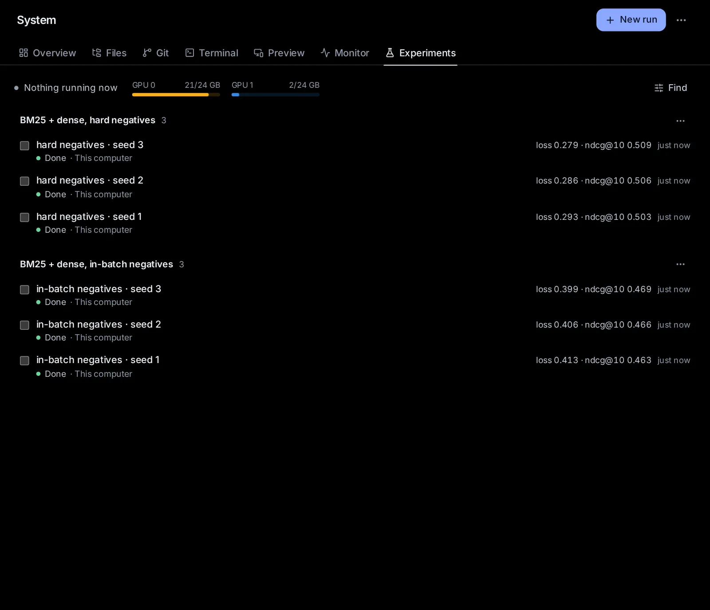

# Experiments

Experiments runs your training and evaluation jobs for you. A job waits until a GPU with enough free memory is free on one of your machines (or takes its turn in a cluster's queue), runs on its own, and is kept as a record: what ran (the code and its changes, the settings, the seed, the environment), how it went (its log and its metrics) and what the agent on call did when something went wrong. Tick runs to compare them, or make a results table with significance tests, ready for your paper. Agents use it too: ask any agent to train or evaluate something on a free GPU, and it starts a run here instead of tying up its conversation.

## Open Experiments

Click **System** in the sidebar, then the **Experiments** tab, or go to [Experiments](/system/experiments). The **Experiments** card on [System's overview](/system) lists the runs going now; click one to open it.

The line at the top says what the queue is doing ("2 running · 1 waiting for a GPU"). Beside it, this computer's GPUs as small meters: the memory each one uses, in the accent colour when one of your runs holds it (click it to open that run).

Below, your runs, grouped by experiment, the experiment with the newest run first. Each row shows the run's name, its key metrics (the last values of the first few it prints), when it started, and under them its status (a dot and a few words) and where it runs. The words for a status:

- **In line**: it has just been added. **Waiting for a GPU**, **Waiting** or **In the cluster’s queue**: its turn has come, but what it needs is not free yet; hover over the row to see why.
- **Starting**, **Running 2 h 13 min**, **Stopping**.
- **Done** (it ended with exit code 0), **Failed**, **Stopped**, **Stopped early** (a sweep's early stop), **Lost** (its process went missing, for example when the computer restarted).

**Find**, at the right above the list, opens a search (by name, experiment or command) and filters by status and by where runs run. While a filter is on, **× N shown** beside it clears it.

With no runs yet, the page says what Experiments is, with **New run**, or "ask any agent: “train this on a free GPU and tell me when it’s done”".

## Start a run

1. Click [**New run**](/system/experiments?new=1) at the top right.
2. Type the **Command**, as you would in its folder: `python train.py --lr 3e-4`.
3. Pick the **Folder** it runs in, and **Where it runs**: **This computer**, one of your other machines, or a cluster (see [Where runs go](#where-runs-go)).
4. Set the **GPUs** it needs (0 runs it without one) and **Free memory each (GB)**. Left empty, it waits for a GPU nobody uses.
5. Give it a **Name** if you like (the name of its script otherwise) and an **Experiment**: the runs of one experiment are listed and compared together.
6. Click **Start**.

**More options** holds the rest:

- **Settings**: name=value lines, kept with the run and compared in tables. Settings in the command itself are read by themselves: `--name value`, `--name=value`, and `name=value` words after the program (as Hydra takes them). `{name}` in the command takes a setting's value.
- **Seed** (`{seed}` in the command takes it; `--seed` in the command is read too), **Priority** (higher goes first) and **Time limit (hours)** (it is stopped after this long).
- **Metrics file**: a file the run writes metrics to as JSON lines, besides what it prints. **Per-example scores**: a file of scores per example (see [Results tables for your paper](#results-tables-for-your-paper)).
- **Tell me**: **When it is done** and **When it fails** (both on unless you untick them), and **When a metric crosses a value** ("val_acc > 0.9").
- **Agent on call**: see [The agent on call](#the-agent-on-call).
- On a SLURM cluster: **Processors**, **Memory (GB)** and **Partition**.

The new run opens, so you can watch it start.

## How the queue chooses

- Jobs go by priority, then by age. A job that needs GPUs takes those with at least its free memory that no other run of yours holds, the freest first. Until enough are free it waits, and says why: "Waiting for 1 GPU with 20 GB free: the most free now is 12 GB, on GPU 2; your other runs hold GPU 0". A smaller job behind it may start first, when what it needs is free.
- Jobs without a GPU start at once, a few at a time; how many is set in [Where runs go](#where-runs-go) (at first a quarter of the computer's threads, from 1 to 4).
- A job that asks for more GPUs than the computer has, or for one on a computer without NVIDIA GPUs, fails at once and says so.
- A run sees only its own GPUs (CUDA_VISIBLE_DEVICES); one without a GPU sees none. It also gets HYDOR_RUN (its id), HYDOR_RUN_DIR (its folder) and HYDOR_SEED, and Python prints at once (PYTHONUNBUFFERED), so its log follows as it goes.
- Runs go on in tmux (or in the background, where there is no tmux) when the app restarts or updates. When the app is back, it finds them again, reads what they printed meanwhile and sees which ended; one whose process went missing is marked **Lost**.

## What a run records

- **Its code**: when it starts, the commit and branch of its folder's Git repository and whether there were changes not committed; if there were, a patch of them (binary files left out, at most 2 MB), and how many files Git does not track.
- **Its environment**: the computer; the Python the command runs with and the versions of PyTorch, Transformers, JAX, TensorFlow and NumPy in it (read from the packages, nothing is imported); with GPUs, the CUDA and driver versions and the GPUs' names.
- **Its settings and seed**, its **log**, its **exit code**, and its own folder in the app's data (its log, patch, exit code and metrics).
- **Its metrics**, read from its output as it grows: `key=value` pairs (`loss=0.42`, as Lightning's progress bars print them), a JSON object on a line (`{"step": 100, "loss": 0.42}`), Python's printed dicts (as Hugging Face's Trainer prints them), Keras' "loss: 0.41 - accuracy: 0.87", and the metrics file. The step comes from `step`, `global_step`, `iter` or `epoch`. For each metric it keeps the last value, the best (lower is better for losses, errors, perplexity and the like by their names, higher for the others) and a series for the charts.

## A run's page

Click a run. On a wide screen it opens beside the list; on a narrow one in its place, with an arrow back.

- At the top: its name; **Stop** while it runs or waits; **Run again**, which opens New run filled in with its settings, to change before you start it; and **More** (⋯): **Copy the command**, **Its folder in Files**, and once it has ended **Delete the record** (its record, log, patch and metrics go; the files the job made in its own folder stay).
- Its status and why, where it runs, and when it started or ended.
- **Metrics**: each metric over steps, with its last value and its best. **All N** shows more than four.
- **Log**: the end of its output, newest at the bottom. While it runs, **Follow** keeps the newest in view; scroll up to read and it stops following.
- **What it ran**: the command, the folder, the code (commit, branch, and **See the changes** for the patch), its settings, seed and environment, the run it is a new run of, and the session that started it.
- **What happened**: its events, with their times: when it waited, started and ended, and what the agent on call saw and did, with **Open its session**.

**Stop** sends Ctrl-C to the run's programs, then stops them harder if they have not ended after 10 seconds. A run that only waited is taken out of line at once.

## The agent on call

Under **More options** → **Agent on call**:

- **Off** (to start with): what goes wrong is still noted on the run's page.
- **Tell me**: a notification when it happens.
- **An agent looks into it**: an agent starts a session in the run's folder with what happened, the end of the log, the run's record and **What the agent may do**, your rules for it. It acts within them, then tells you in a few lines what happened and what it did. The run's page links to its session.

It watches for (all of them unless you untick some): **NaN** (a metric becoming NaN or infinite, or a NaN loss in the log), **Out of memory** (CUDA's messages, `OutOfMemoryError`, or the program killed with exit code 137), **A stall** (no new output for 30 minutes, or the minutes you set), **A crash** (an exit code other than 0, or a process that died) and **Divergence** (a loss more than twice its best, five readings in a row).

Left empty, the rules are: "Read the log and the code. If a fix is clear and safe, run it again with experiment_run (from the last checkpoint if there is one), changing as little as possible. Never delete files or checkpoints. Then tell the user in a few lines what happened and what you did." The agent is the one that started the run (when an agent did), else the agent and model you picked last on the start page. One agent looks into a run at a time, and at most three go on call in an hour: past that, you are told instead.

## Notifications

You hear when a run is done or fails (unless you untick them), when a metric crosses the value you set, and from the agent on call. A notification opens the run's page. A sweep tells you once, when all its runs have ended, with its best run. At most eight notices about runs come in ten minutes; past that, one tells you how many more there were.

A run an agent started with "tell me when it ends" (report) also sends that session a message when it ends, so its agent can go on from there.

## Compare runs

Tick the box of each run you want: a bar at the bottom offers **Compare**, **Make a table** and × to untick them all. **Compare** shows one chart per metric, with a line per run, and the runs' settings side by side, with what differs between them marked.

Each experiment's menu (⋯ beside its name) has **Make a table** (from its finished runs), **Compare the latest 6** and **Pick them all**.

## Results tables for your paper

**Make a table** (from ticked runs, or an experiment's menu) shows the table as you choose:

- **Columns**: the metrics. Click one to add or remove it, and its arrow to switch which way is better.
- **Rows**: **By experiment**, or by a setting that differs between the runs (**By lr**).
- **Baseline**: the row the others are tested against (the first row unless you pick one).
- **Test against the baseline**: **Pick for me** (paired over examples when the runs kept per-example scores, else paired over seeds when the rows' runs share their seeds, else Welch's t-test over seeds), **Welch’s t-test over seeds**, **Paired t-test (by seed or by example)**, **Paired bootstrap over examples** or **No test**.
- **Caption**.

Each cell is the mean ± the standard deviation over the row's runs (its seeds); the best of each column is in bold; a dagger (†) marks a cell that is better than the baseline at p < 0.05, after Holm's correction for testing several rows. Hover over a cell for its p-values. A line under the table says which test was made, and what was left out (runs that have not ended, or without these metrics).

Then:

- **Copy LaTeX**: a `table` with booktabs' rules (add `\usepackage{booktabs}` to your preamble), the best in `\textbf`, `$\pm$` and daggers, and a caption that says how the cells read.
- **Copy Markdown** and **Download CSV** (each metric's mean, standard deviation, number of runs and p-values).
- **Put it in a LaTeX document**: pick a LaTeX document of the [Library](/library), then one of its files. The table goes before `\end{document}` (or at the end of a file without it), or in place of the table it made there before, keeping your own caption and label. It is saved as a new version of the document, as your own edits are.

A table is kept when you copy it or put it in a document. Its LaTeX carries a line `% hydor:table <id>` just above its tabular: keep it there, so the check before you submit can work the numbers out again from the runs and say which changed. **Results tables**, in the menu (⋯) at the top of the page, lists the tables kept: open one to copy or place it again, or **Work it out again** from its runs as they are now.

For paired tests over examples (queries in retrieval, sentences in translation), a run writes a file of per-example scores and gives it under **Per-example scores**: JSON lines with an `id` (or `qid`, `query`, `example`) and a number per metric, such as `{"id": "q12", "ndcg@10": 0.53}`, or trec_eval -q's lines. It may have `{name}` placeholders, as the command; the file is kept with the run when it ends.

## Sweeps

A sweep is one command with a placeholder for each setting, run once for each combination of their values. Click **More** (⋯) at the top, then [**New sweep**](/system/experiments?new=sweep), or **A sweep** in New run:

1. Type the command with `{name}` where each setting's value goes: `python train.py --lr {lr} --batch {batch}`.
2. Under **Settings and their values**, give each setting its values: `lr` and `0.001, 0.0003, 0.0001`. **Add a setting** for another.
3. Choose **Every combination**, or **A random sample** of them (**at most** N runs).
4. To stop the runs that will not win, set **Stop runs early on** a metric and which way is better: a run whose metric at a step is worse than the median of the other runs at that step is stopped (**Stopped early**), once three others have reached that step.
5. Give its **Experiment** a name, and click **Start N runs**.

Its runs are listed under its experiment, with **Sweep** beside the name. That opens the sweep: how its runs went, its best run (by the metric you pick, each run's best or last value) and each setting against the metric, a dot per run (on a log scale when the values span a lot, as learning rates do), the best one ringed. From there, **Make a table** or **Compare the best 6**.

## Where runs go

**More** (⋯) at the top → [**Where runs go**](/system/experiments?places=1):

- **This computer**: its GPUs, and **Jobs without a GPU: at most N at once**.
- **Other machines**: those in [Settings → Machines](/settings?s=machines) that are connected. A run sent to one is kept and watched there: its agent on call and its notices are that machine's (its notices come to you here, as all of that machine's do), and this page follows it. The list here shows every connected machine's runs too, marked with where they run; opening one reads it there, and Stop stops it there.
- **Clusters**: computers you reach over SSH, where nothing needs installing.

### Add a cluster

Click [**Add a cluster**](/system/experiments?cluster=new) and give:

- **Name**, and **SSH host**: as you would type it after `ssh`, an entry of your `~/.ssh/config` or `me@login.cluster.edu`. The app's server connects with its own SSH keys and never asks for a password, so it needs a key there that works without one (`ssh-copy-id`), and the cluster's host key known (connect once with `ssh` from a terminal).
- **SLURM** or **Plain SSH**.
- **Folder there for runs’ logs** (`~/hydor-runs` to start with), and for SLURM its **Partition** and **Account**.
- **Setup lines**, run before each job there: `module load cuda/12.1`, `source ~/venvs/ml/bin/activate`.

**Check** tries `ssh host true`, then `sinfo` (it lists the partitions) for SLURM, or `nvidia-smi` and tmux for plain SSH. **Add** keeps it; in the list each cluster has **Check** and **Remove**.

A job for a cluster runs in a folder there (the code must be there already: clone it there). On **SLURM**, the app writes a batch script with the job's needs (its GPUs as `--gres=gpu:N`, processors, memory, the hours as `--time`, the partition and account), your setup lines and the command, and submits it with sbatch. While it waits, its status says why, in SLURM's word and in plain ones ("other jobs come first (Priority)"). The app follows it with squeue and sacct, copies its log here as it grows, and **Stop** cancels it with scancel. On **plain SSH**, GPUs are chosen there as here, and the run goes into tmux there. One SSH connection per cluster is kept open, so following runs costs little.

## On a phone

The list fills the screen, each run's metrics on a line of their own. A run opens in the list's place, with an arrow back; its log wraps to the screen's width, and **Follow** works as on a computer. New run, Compare and the tables open from the bottom of the screen.

## Ask an agent

- "Train this on a free GPU and tell me when it's done."
- "Run eval.py on the Unity cluster with 2 GPUs for 4 hours."
- "Sweep the learning rate over 1e-4, 3e-4 and 1e-3 with seeds 1, 2 and 3, and stop the bad runs early."
- "Why did my last run fail? If the fix is clear, run it again."
- "Put an agent on call for this training run: if it runs out of memory, halve the batch size and resume from the last checkpoint."
- "Make a LaTeX table of the lora experiments: accuracy and F1 against the baseline, with significance, and put it in my paper."
- "Which of my runs this week had the best validation loss, and what were its settings?"
