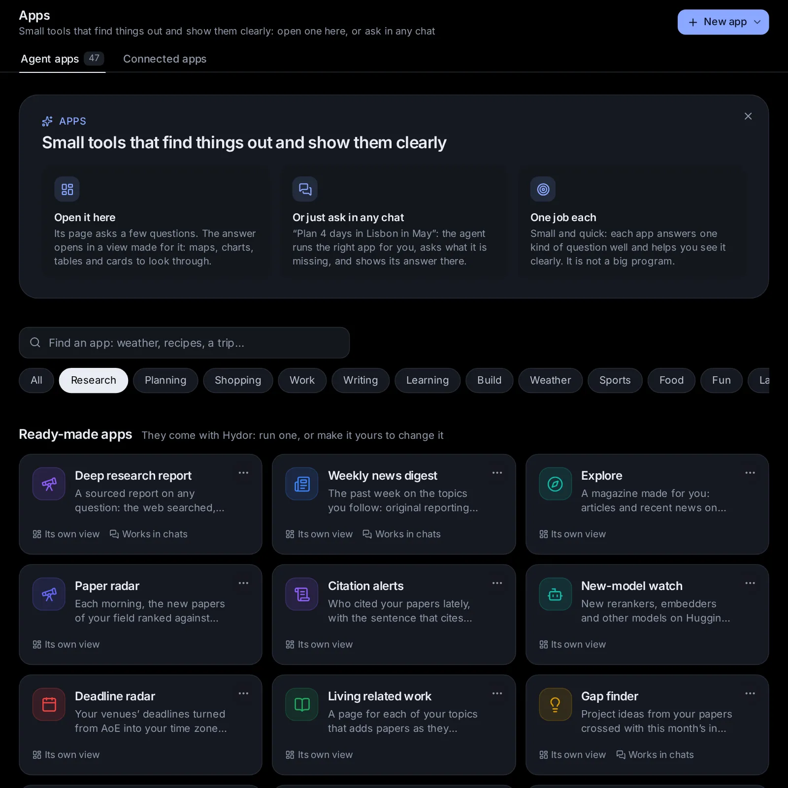

# Research: papers, writing and the lab

Hydor helps with the work around research: keeping up with your field, reading and organising papers, checking a paper before it goes out, answering reviews and presenting your work, and your lab's experiments and reports. Most of it comes as ready-made apps under **Research**, **Writing**, **Lab** and **Work** on the [Apps](/apps) page, which agents also run for you when you ask; the checks for a paper are in the [LaTeX editor](/guide/library), and your training runs in [System → Experiments](/guide/experiments). Reviewing someone else's submission? Use a [confidential session](/guide/sessions#keep-a-session-confidential).

## Keep up with your field

Six ready-made apps keep you up with your field: they are on the Apps page under **Research** (open [Apps](/apps) and pick the **Research** chip). Five of them open on a page of their own and can update by themselves every day: **Paper radar**, **Citation alerts**, **New-model watch**, **Deadline radar** and **Living related work**. The sixth, **Gap finder**, runs when you ask, with a form, and agents can run it for you in any session.

They read open services, gently: arXiv, OpenAlex, Semantic Scholar, Hugging Face, and the deadline lists ccfddl and ai-deadlines on GitHub. None needs a key, but two help: an **OpenAlex API key** (free: without it OpenAlex is asked at most twice an update, from a small budget everyone on your network shares) and a **Semantic Scholar API key** (free on request: without it Semantic Scholar is often busy, and OpenAlex answers instead, without the sentences that cite you). Give them in the app's settings, the sliders at the top of its page, under **Keys it needs**: they go to your vault, and only to those services.

On an app's own page, **Update** at the top makes a new one now, and the sliders hold its settings: **Update every day** (off until you turn it on), the time, and its questions. Under the page, **Earlier** lists the ones before, each opening as it was. Before the first one, the page asks only what the app cannot do without (your name as an author, your venues); **Make the first one** keeps your answers as its settings. Once it updates every day, Settings → Scheduled tasks lists it too (see [Scheduled tasks](/guide/tasks)).

### Paper radar

[Paper radar](/apps/t/paper-radar) brings you each morning the new papers of your field, ranked against what you work on, each with a line on what it does and why it matters to you.

- **What it reads**: arXiv's new papers in the categories you follow (a few hundred at most, sent in the last three days, more after a gap), those on your topics from any field, and those of the people you follow; OpenAlex's on your topics too (journals and proceedings). A paper an earlier update looked at never comes again.
- **How it ranks**: against your projects (their names, descriptions and latest sessions), your topics and your profile. By meaning with the embedding model on your computer when [Search by meaning](/settings?s=memory&find=Search%20by%20meaning) is on, else by their words. The papers you save pull the ranking toward them; those you put aside push it away. Papers by people you follow always come first.
- **The page**: **Today**, the day's papers under the project or topic each fits best (pick one at the top, or **All**). Each card has where and when it came out, its title (a link to it), its authors, what it does in a sentence and why it is for you, with **☆ Save**, **Cite** (copies its BibTeX), **PDF**, **Dig deeper** (a [Deep research report](/apps/t/deep-research) on it, of a few minutes) and **Not for me** (it folds away, with **Undo**). **Saved papers** lists what you saved, newest first, with **Copy all as BibTeX**, and for each **Cite**, **Add to Reading list**, **Dig deeper** and **Take it out**.
- **Its settings**: **Fields to follow** (arXiv's categories, by name or code: Information Retrieval or cs.IR, Computation and Language or cs.CL; a field that is no category is taken as a topic), **Topics** (one a line), **People to follow** (one a line, as their papers print their names) and **How many papers** (15 unless you change it, between 5 and 40). Left empty, it works out fields and topics from your profile and projects.

An update asks the helper model one or two quick questions (what each paper means for you) and takes a minute or two.

### Citation alerts

[Citation alerts](/apps/t/citation-alerts) tells you who cited your papers since it last looked, with the sentence that cites you and whether it builds on, compares with or disputes your work.

- **The page**: **New**, the new citations by your paper: how each cites you (**builds on**, **compares with**, **disputes** or **mentions**, picked from the sentence by the helper model; show one kind at the top), the sentence with your paper's mention marked, a word on what it says of your work, and the citing paper (a link), its authors, where and when, with **Copy the sentence**. **Your papers** lists your papers with their citations and how many are new.
- **How it finds them**: it finds you on Semantic Scholar (or OpenAlex when it is busy), takes your papers that have citations (the most cited and the latest, thirty an update), and asks who cited each lately. The citations it has seen are kept, so each update shows only what is new; the first time, only last month's count as new. A citing paper with no sentence is one the service has not read in full.
- **Its settings**: **You, as an author** (your name as your papers print it, or your Semantic Scholar id, digits, or OpenAlex id, A and digits) and **Only these papers** (titles, DOIs or arXiv ids, one a line; empty: all of yours). Once a week is often enough for most people: turn on **Update every day**, or ask an agent to make it weekly.

### New-model watch

[New-model watch](/apps/t/new-model-watch) watches Hugging Face for new models of a kind (rerankers, embedders and others), checks them against your limits, and runs your own evaluation on each, so you hear only of those that beat your best.

- **What it looks at**: the newest models of the kind (with the words you give in their names), once they are as old as you said (7 days unless you change it) and have enough downloads by then; the eight most downloaded an update (the rest wait for the next). Copies of a model in another format (GGUF, ONNX, quantized) are left out unless your words ask for them. It reads each one's page and model card for its licence, its size and what it is, and leaves out those your licences or size rule out.
- **Your evaluation**: give a command with `{model}` where the model's name goes (`python eval.py --model {model}`), its folder, the score it prints (`ndcg@10`), whether higher or lower is better, and your best so far. Each new model worth trying then runs in [Experiments](/system/experiments) (group "New-model watch", a GPU each, in its queue), which tells you when one does better than your best; the next update reads each run's score. Without a command it only lists the new models.
- **The page**: **Models**, each with where it stands (**new**, **evaluating**, **evaluated**, **beats** your best, **not run**, **skipped**, **too new**), what its card says, its size, licence, downloads and likes, and its score; those that beat your best come first. **Your evaluation** says what runs, with **Open Experiments**.

### Deadline radar

[Deadline radar](/apps/t/deadline-radar) puts your venues' deadlines on one timeline in your time zone, reminds you before each, and links the call for papers, its page limit and its template.

- **Where the dates come from**: two open lists on GitHub, ccfddl's and ai-deadlines', joined. Each deadline is turned from the time zone its call gives (most say AoE, Anywhere on Earth, which is UTC−12) into yours, which the app takes from your browser.
- **The page**: **Timeline**, each deadline ahead with its day and time where you are, what is due, as the call gives it, where the conference is, **Call for papers** and **Template** links and its page limit, and how long is left (as you look); the next abstract or paper deadline of each venue stands out. Show one venue at the top; **Copy the deadlines** copies them as lines; **Show the past ones** unfolds those of the last few months. **Conferences** shows each venue in full, its rank, its next deadline and its site, and the names neither list knows.
- **Reminders**: each update sends you a notification for the deadlines at the days you gave (14, 3 and 1 unless you change them), each reminder once, all of them in one notification. Turn on **Update every day** so they come in time.
- **Its settings**: **Your venues** (as you say them, between commas: SIGIR, ACL, EMNLP, NeurIPS, The Web Conference, KDD…) and **Remind me** (days before, between commas; empty: no reminders). To find each call's page limit and template, it searches for the call once per conference and reads it (the helper model notes them).

### Living related work

[Living related work](/apps/t/living-related-work) keeps a page for each of your topics that grows as papers appear: each paper summed up, said how it relates, grouped into themes, the new ones marked.

- **How it grows**: the first time, it takes arXiv's best papers on each topic and its latest of the past year, and OpenAlex's most cited; after that, what came out since. The papers citing your seed papers come in for every topic. The helper model keeps those a related-work section should cite, sums each up in a sentence, says how it relates (to the topic and your seeds) and puts it in a theme.
- **The page**: **Related work**, each topic with its papers theme by theme, newest first, those the latest update added marked **New** (pick one topic at the top). Each paper has its cite key, **BibTeX** (copies its entry) and **Not related** (it leaves the topic for good). **Draft the related work** has an agent write the topic's section in LaTeX, a paragraph a theme, with `\cite` keys from your papers: it shows with **Copy the LaTeX** and **Copy the .bib** when it is done (a few minutes; it goes on if you leave). **Export BibTeX** gathers all the topic's entries to copy. **New this time** lists what the latest update added.
- **Its settings**: **Topics** (one a line), **Seed papers** (titles, arXiv ids or DOIs, one a line) and **Most papers a topic** (80 unless you change it).

### Gap finder

[Gap finder](/apps/t/gap-finder) crosses your papers with this month's in an area for project ideas, checks each for prior work and sizes it to the compute you have. It runs from its form, or an agent runs it for you in a session.

- **What you give**: **Your papers** (your name as an author, which brings your latest and most cited papers, or their titles or arXiv ids, one a line), **The area** (in words, or an arXiv category: conversational search, cs.IR), **The compute you have** (one 24 GB GPU unless you say) and **How many ideas** (5).
- **What it does**: it reads your papers and the past month's in the area, ranks the month's against yours, and has the helper model propose ideas that cross them. For each idea it searches arXiv and Semantic Scholar for prior work and has the helper model judge it: **new**, **partly done** or **already done**, with the closest paper; the first experiment to run, what it takes on your compute, and whether it **fits**, is **tight** or is **too big**.
- **The view**: **Research ideas**, new ones first (show one verdict at the top), each with what it crosses, why its verdict, the closest work (a link), the first experiment and its cost, and **Plan it** (opens the Research sprint app with the idea as its question), **Dig deeper** (a deep research report on the work near it) and **Copy**. **What it crossed** lists your papers and the month's it used.

## Read and organise papers

Three ready-made apps, under **Research** on [the Apps page](/apps), help with the papers you read: the **Reading list** keeps them, the **Literature matrix** compares several in a spreadsheet, and **Reproduce a paper** checks that a paper's numbers hold by running its code. Open them there, or ask for what they do in any session ("Add 1706.03762 to my reading list"), and the agent runs them for you ([Have an agent run an app for you](/guide/apps#have-an-agent-run-an-app-for-you)).

They find a paper however you give it: a DOI, an arXiv id, a link (arXiv, a DOI's, the ACL Anthology, OpenReview, a publisher's page or a PDF), its title, or a PDF on this computer. They read papers from open copies only (arXiv, the open copies OpenAlex knows of, the paper's own page), never past a paywall: a paper without one is read from its abstract, and the app says so.

### Reading list

[The Reading list](/apps/t/reading-list) opens on your papers rather than on a form: it is a place to work in.

- **Add a paper**: **+ Add**, then **The paper** (a DOI, an arXiv id, a link or its title), and if you like its **Project**, **Tags** (between commas) and **Status**. **Add it** looks it up and keeps it with its authors, year, venue, abstract, links to it and to an open PDF, and its BibTeX entry. A paper you have already is not added again (the same DOI, arXiv id or title): what it lacked is filled in, and your notes, tags and status stay as they were. One that nothing finds is kept with the title you gave and an entry made from it: check that one.
- **Find your papers**: the top says how many you have to read, are reading and have read (click one to show only those), and in how many projects. **Search your papers** finds them by any of their words, and **All**, **To read**, **Reading now** and **Done reading** show one status. Each paper shows its authors, venue and year, its project and tags (click one to show only its papers; its **✕** shows them all again), and **To read**, **Reading now** and **Done reading**, to change where it stands: **Done reading** notes the day.
- **A paper's own page**: click its title. It has **Its page** and **The PDF** (or **Open the PDF**, for one on this computer), where it stands, its abstract, its project and tags (each with **Save**), your **Notes** (**Save the notes**), its BibTeX (**Copy the BibTeX**) and **Remove it from the list**. **Reproduce it** opens [Reproduce a paper](#reproduce-a-paper) with the paper filled in.
- **By project**: each project with how many papers it has and how many you have read; click one to show its papers. Name one of your [projects](/guide/projects) and its papers go with that project (they follow it when you rename it), or use any name you like.
- **More** has **Import a .bib** (paste it, or give the path of a .bib file on this computer, with a project and tags for the papers it adds: those you have already are completed, yours kept), **Export a .bib** (**Those shown**, as your search and filters show them, or **All of them**: a file to download, or **Copy it**) and **Sync with Zotero** (below).
- **Make a literature matrix**: tick papers (the box at their left), and a bar says how many you picked, with **Make a literature matrix**, which starts the [Literature matrix](#literature-matrix) with them, and **Clear**.

When an agent adds a paper for you, its card shows **The paper**: the paper as the list has it now, whether it was new, **Open your reading list**, and its BibTeX to copy.

### Keep it in step with Zotero

**More** → **Sync with Zotero** → **Sync now** keeps the list and your Zotero library in step.

1. The first time, the page asks for your **Zotero API key**: **Get one** opens Zotero's page of keys, where you make one that may read your library (and write to it, for papers to go there too). Paste it and press **Save**: it goes to your vault, for Zotero alone ([Keep keys in the vault](/guide/connections#keep-keys-in-the-vault)). **Zotero user ID** can stay empty: it is found from the key (for a group's library, give `groups/` and the group's number). Then press **Sync now** again.
2. What is in Zotero comes in: new papers are added, and the ones you have are completed, matched by DOI, arXiv id or title. Zotero's details win where they differ, and your status, notes and project stay yours.
3. Papers only here go to Zotero, as new items.

Each sync after the first moves only what changed since the last one. A paper you delete in Zotero stays here, no longer linked, and is never sent back. A line at the top of your papers says when it last synced and what it did ("12 new from Zotero, 3 sent to it"), with **Sync again**.

### Literature matrix

[The Literature matrix](/apps/t/literature-matrix) reads several papers side by side and fills in a spreadsheet: a row for each paper, a column for each thing you compare, and in each cell what the paper says, with where it says it (its page or section).

- **The papers**: one a line (thirty at most), each a DOI, an arXiv id, a link, a title or a PDF on this computer. Or from your reading list: a line such as "my reading list, tag: dense" (or a project, or a status: "my reading list, to read"). **Make a literature matrix** on the Reading list fills it in with the papers you picked.
- **The columns**: one a line; **Task**, **Data**, **Method**, **Metrics**, **Results** and **Limits** until you change them.
- **Project**: the project of yours its spreadsheet goes in. A line "my reading list" with nothing after it then takes that project's papers.

It reads three papers at a time (the whole paper from an open copy, or its abstract when there is none), has a quick model fill in each row, writes what the papers say together, and keeps the matrix as a spreadsheet in your [Library](/guide/library#spreadsheets), with a second sheet that lists the papers. Its view has **The matrix** (how many it read, **Open in the Library**, **Copy as a table**, the matrix itself, the papers it could not read and why, and **Another column**: name one, and **Make it again with it** runs it again with that column too), **Papers** (each with what it does in a sentence, and what it was read from) and **Across the papers** (where they agree and disagree and what is still open, with **Copy it**).

### Reproduce a paper

[Reproduce a paper](/apps/t/reproduce-paper) runs a paper's own code to see whether its numbers hold: it finds the code, builds its environment, gets its data and checkpoints, runs its evaluation, compares the numbers with the paper's table, and says what it took.

- **The paper** (or **Or upload it**), **Its code** (a link or a folder on this computer; left empty, it is looked for), **What to reproduce**, as the paper names it ("Table 2, the BM25 + monoT5 row on MS MARCO dev"), **Limits** (the time, disk and GPUs it may use: "At most 4 hours, 100 GB of disk and 1 GPU" until you change it) and **Where to work** (a folder; a new one for each run when empty).

It reads the paper and looks in it for its code; when the paper names none, it searches GitHub and the web side by side and picks the likeliest repository. A quick model works out the exact setting (the data and split, the model and checkpoint, the settings) and the numbers to match, as printed. Then an agent does the work the way the **reproduce-paper** skill says: a clean environment as the repository says (venv, conda or Docker), the data and checkpoints, a run on a small slice first, then the real run, with every change it makes written down and why, and a report, `REPRODUCTION.md`, in the work folder. A real run that needs a GPU or hours goes to [Experiments](/guide/experiments), which waits for free GPUs and keeps the run's record and log: the app waits for its runs to end without keeping a session busy, then an agent reads their numbers and finishes the report. Last, each number goes beside the paper's: within half a point on a 0–100 scale (0.005 on a 0–1 scale) counts as reproduced.

Its view has **Did it reproduce?** (the verdict, how many numbers came close, the hours it took and the fixes it made, its repository, **Open the folder**, its runs in Experiments, and **Try again** when it did not reproduce; then the paper's numbers beside ours with the difference, the close ones in green, and the setting as the paper gives it), **What it took** (each step with its minutes, and every change and fix) and **Report** (with **Copy the report**).

It runs code on this computer and can take hours: it keeps within your limits, and when one would be passed it stops and reports what it has. Code it cannot get, or data that is not public, it says plainly.

**Highlight papers as you read them.** Open a paper's PDF in Files and press **Highlight**: select a passage, or drag a box around an equation or a figure, to highlight it in one of four colours and write a note on it. **Ask** asks an agent about just that part ("What does this equation say?"), and **Notes** lists everything you marked, page by page. **Keep in a project** puts your highlights and notes into a project's knowledge as one document named after the paper, kept up to date, so the project's sessions find them; **Save into the PDF** writes them into the file for other apps. See [Read and highlight a PDF](/guide/files-git#read-and-highlight-a-pdf).

## Check a paper before you submit

Before a paper goes out, the LaTeX editor checks it as a venue's desk and its reviewers would: its references, whether it gives you away, its pages and fonts, the parts the venue asks for, and the numbers in its tables. Open your paper ([your LaTeX documents](/library?kind=tex)) and pick **Tools → Check before submitting**.

1. Pick where it goes: **ACL Rolling Review** (a long or a short paper; **EMNLP** and **NAACL** take papers through it), **SIGIR** (full or short), **CIKM**, **WSDM**, **TheWebConf**, **KDD**, **NeurIPS**, **ICLR**, **ICML**, **AAAI**, **An IEEE journal**, **An ACM journal**, or **Other**, with a page limit and **Reviewed anonymously** of your own. A line under it says what the venue asks: its page limit, what does not count toward it, whether it reviews anonymously and the parts it requires. Venues change their rules every year, so the line links to the call for papers too. The check remembers the venue for each paper, and the first time picks the one the paper's own style points to.
2. **Check** typesets the paper, reads its PDF, looks its references up online and shows what it finds as it comes. Only the references' titles, DOIs and arXiv ids are sent, to Crossref, arXiv, OpenAlex, Semantic Scholar and DBLP; what the services said is kept a few days, and one that did not answer is named under the findings. OpenAlex and Semantic Scholar answer programs more readily with a free key of your own: add it in [Keys](/apps/connected?tab=keys) as OPENALEX_API_KEY (for api.openalex.org) or SEMANTIC_SCHOLAR_API_KEY (for api.semanticscholar.org), and the check uses it.

What it finds comes in five groups, each finding marked **Must fix**, **Check it** or **For your information**:

- **References**: keys cited but in no entry of the bibliography (or cited with other capitals than their entry's), entries never cited, the same paper under two keys, and entries without what their kind needs (an article's journal, a paper's proceedings, a year). Every cited entry is looked up by its DOI, its arXiv id or else its title, and compared with what the services list: its title, its authors, its year and where it appeared. A preprint is looked for in a published version, which reviewers expect you to cite. A paper found nowhere is said to perhaps not exist: check it yourself, as the services can miss things too.
- **Anonymity**, where reviewing is anonymous: your names, when the template is in its final version (ACL's, NeurIPS's, ICML's, ICLR's and acmart's have an anonymous one); **\thanks** notes; an acknowledgements section; links that may name you or your lab (your own repository, a personal page); "our previous work" next to a citation; and the PDF's own Author and Title fields.
- **Format**: the pages that count against the limit (up to where the references begin, or the parts the venue does not count, such as ACL's Limitations), the references' pages and the pages in all where the venue caps them; Type 3 fonts and fonts not embedded; changes to the template's margins, fonts and spacing, and negative **\vspace**s (as hints: some are allowed); references and citations that show as ??; **TODO**, **XXX** and **\todo** marks; lines far into the margin; and the errors, when it does not typeset.
- **Required parts**: an abstract, and what the venue asks for: ACL's Limitations section, the NeurIPS Paper Checklist (and its answers still **\answerTODO**), ICML's Impact Statement, ICLR's AI use statement, CIKM's GenAI disclosure, IEEE's Index Terms, ACM's CCS concepts and keywords.
- **Numbers**: see [Numbers that match your runs](#numbers-that-match-your-runs).

The button with a finding's file and line shows it in the source. Where a change is safe, **Fix** makes it: the entry as the services list it, under the same key, so your citations stay as they are (**The entry** shows it first), the published version of a preprint, the template switched to its anonymous version, the acknowledgements commented out, the PDF's Author field cleared, a **\todo** note taken out, the bold moved, a table updated. A fix is a change in the editor like any other: **Undo** takes it back, and **Save** keeps it as a new version. Where no change is safe, **Ask the agent** asks the agent beside the editor, with the finding in the request; **Ask the agent to fix them** asks for all of them at once.

**Add as comments** puts the open findings on their words as the document's comments (see [LaTeX documents](/guide/library#latex-documents)), so you, the people you share the paper with and agents see each where it is; an agent asked to answer the comments fixes them and resolves them. Check again, and it says how many are fixed since the last check, how many are left and how many are new; **Add as comments** then resolves the comments of those fixed.

Agents run the same check on a paper of your Library or a LaTeX project of yours: "check my paper for ACL before I submit it".

### Numbers that match your runs

The check reads every table of the paper, number by number:

- **Bold on the best value.** In each column, bold should mark the best value. Which way is better comes from the column's header: loss, error, latency or perplexity lower; accuracy, F1, nDCG or BLEU higher; an arrow (↓ or ↑) says it outright. Where the header does not say, higher is taken as better, and the finding says so. Bold on the best of each block of rows (between two rules), ties, and tables with their metrics in rows are fine. **Move the bold** puts it on the best value.
- **Tables made by Experiments.** A table you put in the paper from [Experiments](/system/experiments) (**Make a table**, then **Put it in a LaTeX document**) has a line `% hydor:table …` above it. The check works it out again from its runs as they are now, and flags every number that changed since, and significance marks that came or went. **Update the table** puts in the new one.
- **The other tables.** Their numbers are looked for in the finished runs of the paper's project (or its folder), rounded as the table rounds them, and as percentages. How many were found is said for your information, never as a problem: a number may come from another paper, or a run made elsewhere.

### The arXiv package

**Export → arXiv package (.zip)**, at the top of an open LaTeX document (on a phone, **More** (⋯) → **Download as**), makes a .zip of the saved paper to upload to arXiv, which publishes the source as you send it. What it will do is ticked:

- **Take out the comments**, safely: `\%` stays, and so does what TeX takes as it is (verbatim text, listings, **\verb**, the addresses of **\url** and **\href**); `\begin{comment}` blocks go, and with **Take out \iffalse … \fi blocks too**, those as well.
- **Only the files the paper uses**: the pictures **\includegraphics** shows, the files it reads, its own styles and classes.
- **Add the .bbl and leave the .bib out**: the bibliography as it was typeset here, which arXiv uses. Untick it to send the .bib and let arXiv run BibTeX.
- **Put \input and \include files into main.tex** and **Put \pdfoutput=1 first** (arXiv's old way of asking for pdfLaTeX), when you tick them.

Names with spaces get dashes, and the source follows. **Make the package** typesets the package as it is, in the same sandbox as any document, to see it builds, and downloads it. The dialog says what is in it, what was left out or renamed, how it typeset, its size against arXiv's limit of 50 MB, and which processor to pick on arXiv. It remembers your choices.

### Camera-ready, another template, and your paper in the apps

**Tools → Your paper** has the rest:

- **Make it camera-ready** asks the agent beside the editor for the final version, written from the venue's rules: the template's final version, the authors and their affiliations back, the acknowledgements back, the copyright or rights block, what the final version adds, and its page limit. Give it the authors, their affiliations and the acknowledgements if they are not in the source.
- **Move to another template** asks the agent to move the paper to another venue's template (or Springer's LNCS, Elsevier's, a plain article), as its version for review or its final version, keeping its words, figures, tables and references.
- **arXiv package (.zip)**, as above.
- **Review it as reviewers would**, **Answer reviews** and **Make a talk, poster and thread** open those apps with your paper filled in (its PDF, or for the talk the folder of its sources): see [Review, answer and present your paper](#review-answer-and-present-your-paper).

What is not saved yet is saved first, so each gets the paper as you see it.

## Review, answer and present your paper

Four ready-made apps, under **Writing** on [the Apps page](/apps), help with your own paper: the **Reviewer simulator** reviews your draft as a venue's reviewers would, the **Rebuttal workbench** drafts your answer to the reviews you got, **Paper to talk, poster and thread** makes what you present it with, and the **Figure doctor** makes its plots fit for print. The first three read your paper from a PDF, a .tex file or a LaTeX project's folder on this computer, a link, or a LaTeX document of your Library (paste its address); **Or upload it** takes a PDF instead.

### Reviewer simulator

[The Reviewer simulator](/apps/t/reviewer-simulator) reviews your draft before the real reviewers do, on the venue's own review form and scores, and lists what they are likely to ask for, the most dangerous first.

- **Your paper**, **The venue** (**ACL Rolling Review**, **SIGIR**, **NeurIPS**, **ICLR**, **ICML**, **KDD**, **CIKM**, **WSDM**, **TheWebConf**, **A journal** or **Other**, each with its form as of 2025), **How many reviewers** (1 to 5; 3 unless you change it) and **Anything to focus on**.

It seats the reviewers, each with an angle of their own (in order: the method's expert, the area's expert, a sceptical empiricist, a careful reader from a neighbouring field and a reproducibility reviewer), and each fills in the venue's form, side by side. Then an area chair writes the meta-review with the likely outcome, and the weaknesses are ranked by how likely each is to sink the paper. The reviews come from a model: they find weak spots before real reviewers do, and are no forecast of the decision.

Its view has **The reviews** (the venue, the likely outcome, the average overall score, then each review: its reviewer and angle, scores, summary, strengths, weaknesses and questions), **Meta-review** (with **Copy it** and **Copy every review**; then **What could sink it, the most dangerous first**: each weakness with why, how likely and what fixes it), **Baselines and ablations** (what reviewers will ask for, why, and the work it takes) and **Before you submit** (a list to tick off, and **Answer these reviews**, which starts the Rebuttal workbench with them, to rehearse your rebuttal).

### Rebuttal workbench

[The Rebuttal workbench](/apps/t/rebuttal-workbench) drafts your answer to the reviews you got, point by point, within the venue's limit.

- **The reviews** (paste them all, each under its reviewer: "Reviewer 1", "R2", OpenReview's "Reviewer xYz1"…), **Your paper** (or **Or upload it**; optional, for the replies to point at its sections), **The limit** (as the venue sets it: characters or words, per reviewer, per point or in all; "2,500 characters per reviewer" unless you change it) and **Tone** (**Courteous and firm**, **Warm and grateful** or **Brief and to the point**).

It splits the reviews by reviewer, pulls out each one's points side by side, merges the same point raised by several reviewers, and sorts them: misread (your paper answers it already), needs an experiment, needs words (a clarification, a justification, a citation), or minor. It finds what your paper says on each, drafts each reply within its share of the limit, and puts the rebuttal together, counted against the limit. A reply that needs a new result leaves [placeholders] for you to fill in: it never makes results up.

Its view has **Points raised** (the rebuttal in a line; **All points**, **Misread**, **Need an experiment**, **Need words** and **Minor** show one kind; each point with who raised it, in their words, its draft reply, its length against its share, and **Copy**), **To do** (the experiments to run and the changes to make in the paper, to tick off) and **Whole rebuttal** (each reviewer's reply against the limit, and **Copy the whole rebuttal**).

### Paper to talk, poster and thread

[Paper to talk, poster and thread](/apps/t/paper-to-talk) makes what you present your paper with: slides with its real figures and equations, timed, with what to say; an A0 poster; posts for X, Bluesky and LinkedIn; and a project page.

- **Your paper** (its LaTeX project's folder is best, for its figures; from arXiv, its source is fetched for them), **The talk's length, in minutes** (15 unless you change it), **Audience** (**Researchers in the field**, **Researchers in other fields** or **A general audience**), what to make (**Slides**, **An A0 poster**, **A thread (X, Bluesky, LinkedIn)** and **A project page**) and **Project** (the project of yours what it makes goes in).

It plans the talk (about a slide a minute, one idea each, from the problem to the take-away), a program shares out the minutes so they add up to the length, and then it makes what you asked for side by side: the slides, which you edit and present in the Library ([Slides](/guide/library#slides)), the poster as a LaTeX document ([LaTeX documents](/guide/library#latex-documents)), the posts, and the project page, ready for you to publish ([Publish a page](/guide/library#publish-a-page)).

Its view has **What was made** (the talk's message and an opening line, then each thing made, with **Open it**), **The talk** (the talk as one strip, each slide as wide as its minutes, then each slide: its minutes, title, points, figure, equation and what to say) and **Thread** (**X**, **Bluesky** and **LinkedIn** show each one's posts, numbered, each with **Copy**, and **Copy the thread**; LinkedIn's one post has **Copy the post**).

### Figure doctor

[The Figure doctor](/apps/t/figure-doctor) makes your paper's plots fit for print: as wide as the column, in the paper's font, in colours colour-blind readers can tell apart, saved as vector PDFs with their fonts embedded, all with one style file.

- **Your plotting code** (a script, a notebook or a folder of them on this computer, made with matplotlib or seaborn), **The venue's template** (**ACL, EMNLP, NAACL**, **ACM (SIGIR, KDD, CIKM, WSDM, TheWebConf)**, **IEEE**, **ICML**, **NeurIPS, ICLR**, **Springer LNCS** or **Other (give the width)**), **Width** (**One column** or **Both columns**), **Or the width in inches** (for another template) and **The paper's font** (**As the template**, **Times New Roman**, **Computer Modern**, **Linux Libertine** or **Helvetica**).

A program works out the style (the width in inches, the font and its sizes, a palette for colour-blind readers), and an agent changes your scripts where they are, after copying each one beside itself (name.orig.py) and keeping a picture of each figure as it was. Every script then uses one style file, `paper.mplstyle`, beside them; each figure is saved as a vector PDF, and its fonts are checked: all embedded, none of Type 3, which many venues refuse. It runs your scripts, so it needs what they need on this computer (Python, matplotlib and their data).

Its view has **Before and after** (the size, font and colours it used, then each figure as it was and as it is now, with **Open the PDF** and what changed), **Style file** (`paper.mplstyle`, with **Copy it** and how to use it) and **What changed** (every change, and what the fonts check found).

Agents in your sessions know these crafts too, from skills that come with Hydor (**peer-review**, **reproduce-paper** and **figures-for-papers**: see [Skills](/guide/skills)): ask one to review a paper with you, answer one reviewer, or fix a single figure, and it works the same way.

## Run your lab's work

Three ready-made apps, under **Lab** on the [Apps](/apps) page, help with a lab's daily work: labelling data and checking a model against your labels, testing an idea on your own code from hypotheses to a report, and tuning a model's settings. The sprint and the sweep run their jobs in [Experiments](/guide/experiments), so they need it to have a computer (or a cluster) with GPUs.

### Annotation workbench

**Annotation workbench** has you and a model label the same sample of texts, so you see where you disagree and how far the model can be trusted with the rest. Open it from **Apps** and fill in:

- **The labels**, between commas: up to nine, one for each key from 1 to 9. **How to label**: your guidelines, in your own words; the model labels with them too.
- The texts: **a CSV or JSON lines file**, **a Hugging Face dataset** by its name (as stanfordnlp/imdb) or its address, with **Its split** when it has several (and its configuration before a slash, as plain_text/test), or texts pasted, one a line. **The column with the text** is found by itself (one called text, review or sentence, else the one with the longest texts): name it when the guess is wrong.
- **How many to label**: taken at random, 100 unless you change it, at most 1,000.

It reads the texts (a dataset through Hugging Face's datasets server, a few pages of rows from random places), takes the sample in a random order, and has the helper model label them twenty at a time, each with a short reason. The run's page is then where you work:

- **Labelling**: a text at a time, with a big button for each label. Press one, or its key (**1** to **9**): only then does the model's label show, in a line above the next text (with its reason when you disagree), so it never sways you. **Skip for now** (**S**) sends a text to the end, **Change** (**Z**) takes back the last one, and a note (**N** to start one) stays with its text. The bar shows how far you are.
- **Disagreements**: each text you and the model labelled differently, your label and notes beside the model's label and reason. **Label it again** sends it back to **Labelling**.
- **Agreement**: how often you gave the same label, Cohen's κ (that agreement beyond what chance alone would give: 1 is perfect, 0 no better than chance, above 0.6 substantial) and what chance alone would give, and the confusion matrix: your labels down the side, the model's across the top.
- **Export**: **CSV** or **JSON lines** downloads the texts you labelled, each with your label, the model's and its reason, and your notes. **Publish on Hugging Face** makes a dataset of its own there (private unless you choose **Everyone**), with the data and a card that says how it was labelled, with your guidelines and how well you and the model agreed. It needs a Hugging Face token that can write: the app does without it otherwise, so the first time you publish it says so; add it under the app's form (**Hugging Face token**, marked optional) or in **Apps → Connected apps → Keys** as HF_TOKEN. **Remove its texts** deletes a set's texts and labels.

Each set is a run of its own, and keeps its texts and your labels as the app's records: the app's page lists your sets among its latest runs, and each opens where you left off.

### Research sprint

**Research sprint** takes a research question through a short sprint on your own code, with you approving each step. Fill in **Your research question**, **The repository** (a Git repository on this computer), **What it should know** (the metric that matters, the baseline and its numbers, how to train and evaluate, what not to change), **GPU hours it may use** (8 unless you change it, for all its runs together) and **How many hypotheses** (one to five). Then:

1. The helper model proposes hypotheses from your question and the repository's README, each with what would support it and what would count against it, and the experiment that tests it.
2. With **Let me approve each step** ticked (it is unless you untick it), the run waits for you: keep them, or write the ones to test instead, one a line. The question shows on the run's page, in your inbox and as a notice.
3. An agent makes a worktree of the repository on a new branch (sprint/…), beside your checkout, which it never changes. There it writes the plan (SPRINT.md) and the code the runs need, commits them, and lists the runs: a baseline and each hypothesis's, with seeds. Those that would go past your GPU hours are left out, and named.
4. It waits for you again, before any GPU time is spent: start the runs, or say no, and the sprint stops there (the plan and the code stay on the branch).
5. Experiments runs them, tagged with the sprint, and the sprint waits for them all to end.
6. A results table compares each condition with the baseline, with significance; an agent analyses the runs in a Jupyter notebook, saved in your [Library](/library), decides each hypothesis (supported, not supported or unclear, with its evidence) and writes a short report.

Its view has **The sprint** (the question, how it went, its branch, and each hypothesis with its verdict and evidence), **Runs** (the results table, and each run with its metric) and **Report** (to read and copy, with **Open the notebook** and what to try next). Run from the API or a schedule, nobody is there to approve, so it goes straight through.

### Sweep planner

**Sweep planner** plans a hyperparameter sweep of a training script within a budget, starts it, stops bad trials early, and writes up what mattered. Fill in **The script or command**, **Its folder**, **The metric** (as the script prints or writes it: metric=value lines, or JSON) and **Which way is better**, **Settings to tune** (one a line, with the values to try, as lr: 1e-4, 3e-4, 1e-3; leave it empty to have them found), the **Budget** (runs or GPU hours: "20 runs", "10 GPU hours") and **Stop bad trials early**.

- An agent reads the script, without running or changing it: its arguments, how long a run takes and when a bad run shows. It proposes the settings and values to try (yours, when you gave them), and a program fits them to the budget: every combination when they fit, else as many random draws as it allows.
- With **Let me check the plan first**, the run waits for you: start it as it is, or write changes, one setting a line (lr: 3e-4, 1e-3 for other values, drop dropout to leave one out).
- Experiments runs the sweep as one experiment; with **Stop bad trials early**, a run clearly worse than the best so far is stopped, to save its GPU time.
- When the runs have ended, a program finds the best run and how much each setting mattered (the share of the metric's spread across runs that its values account for), and the helper model says what that means and what to try next.

Its view has **Results** (the best run's settings and metric, what it found, what to try next, and a bar for each setting's weight), **By setting** (the metric for each of a setting's values, as boxes) and **All runs**.

## Reports: your week and your lab notebook

Two ready-made apps, under **Work** on the [Apps](/apps) page, write up what you did from what Hydor knows of your work: your sessions (those here, and the Claude Code and Codex sessions in VS Code or a terminal that Hydor reads), your commits in the Git repositories they worked in, your Experiments runs, what you made in the Library and the papers you marked read in your Reading list. Sessions with memory off and Confidential sessions are left out, and so is the work of sessions agents start for parts of a task (it counts as their parent's). Both open on a page of their own, and can update by themselves.

### Weekly progress report

**Weekly progress report** turns your week into an update for your advisor, your team or a manager: what got done, results with their numbers, problems and what blocks you, next week's plan, and questions to ask. It opens on its own page with this week's report (the seven days up to the day it is written): its title and summary, the week in numbers, then **Done this week**, **Results**, **Problems and blockers**, **Next week** and **Questions**.

- **Copy as Markdown**, and **Copy as an email** (a subject line, then a short note that opens and closes as yours would), put it on your clipboard; **Save as a document** keeps it in your Library, to change and export as Word or PDF.
- **Update** writes this week's report now. **Earlier**, under it, lists the earlier weeks, each a click away.
- **Settings**, the sliders at the top: **Update automatically** (off until you turn it on) writes a new one each Friday at 16:00; under the switch, pick other days (**Every day**, **On weekdays**, **Once a week on** a day) and the time. It is a [scheduled task](/guide/tasks), so [Settings → Scheduled tasks](/settings?s=tasks) lists it too. Below it: **Who it is for** (your advisor, your team or a manager: it writes for them), **Projects** (all of them, or some, by name) and **What to include** ("research only, no costs").

### Lab notebook

**Lab notebook** keeps a dated entry for each day you worked: what was tried, what was found and decided, and what is still open, with links to that day's sessions, commits, runs, files and Library items. Its entries are the app's own records, kept apart from [memory](/guide/memory). It opens on its own page with them, newest first:

- **Search the notebook** finds entries by their words and by what they mean (when [Search by meaning](/settings?s=memory&find=Search%20by%20meaning) is on), best first; **All entries** brings them all back.
- **Copy its link**, under each entry, copies the address of its own page, which shows the entry as it was written: to cite it in a paper, a report or a note.
- **Update** writes today's entry now, and **Write an earlier day** a day you missed. A day written again takes the place of its entry; a day you did nothing gets none.
- **Settings**: **Update automatically** (off until you turn it on) writes the day's entry each evening at 21:00, on the days and at the time you pick; **Projects** keeps it to some projects.

## Ask an agent

- "Set up Paper radar to follow cs.IR and cs.CL, with dense retrieval and query performance prediction as topics, and have it update every day at 7:30."
- "What did Paper radar find for me today? Which papers touch my Hydor project?"
- "Turn on Citation alerts for my papers (I publish as Chris Samarinas) and tell me who cited ProCIS lately."
- "Add SIGIR, ACL and EMNLP to Deadline radar and remind me 21, 7 and 2 days before each deadline."
- "Watch Hugging Face for new rerankers under 1B parameters with an Apache or MIT licence, and run my evaluation on each: python eval.py --model {model} in ~/rerank-eval, ndcg@10, my best is 0.512."
- "Start a living related work on learned sparse retrieval, seeded with SPLADE and ColBERT, and draft its related-work section."
- "Find gaps between my papers and this month's work on conversational search; I have one 24 GB GPU."
- "Add 2104.08663 and the ColBERT paper to my reading list, in the project Dense retrieval."
- "Import ~/papers/refs.bib into my reading list, tagged survey."
- "Sync my reading list with Zotero."
- "Which papers in my reading list are still to read for the Dense retrieval project?"
- "Make a literature matrix of the papers tagged dense in my reading list, with a column for whether their code is released."
- "Reproduce Table 2 of the BEIR paper, BM25 on SciFact, in at most an hour and without a GPU."
- "Open Reproduce a paper filled in for 2104.08663, but don't run it yet."
- "Review my draft in ~/papers/draft as three SIGIR reviewers would, and tell me what could sink it."
- "Here are my ARR reviews: draft a rebuttal of at most 2,500 characters per reviewer."
- "Make a 12-minute talk, an A0 poster and a thread from my paper in ~/papers/colbert, in the project ColBERT."
- "Fix the plots in ~/papers/colbert/plots for an ACL paper, one column wide, in Times."
- "Check my paper for ACL before I submit it, and fix what you safely can."
- "Are all the references in my LaTeX paper real, with the right authors and years? Correct the ones that are not."
- "Has any preprint my paper cites been published since? Cite the published versions."
- "Make my NeurIPS paper anonymous for review: names, links, acknowledgements, the PDF's own fields."
- "Is my paper within EMNLP's page limit? If it is over, tighten it to fit."
- "Do the numbers in my results tables still match my runs?"
- "My SIGIR paper was accepted: make it camera-ready."
- "Move my paper to the ICLR template, as the version for review."
- "Load 200 texts from the sentiment part of tweet_eval on Hugging Face into the Annotation workbench, with the labels positive, negative and neutral and these guidelines: …"
- "How well do I agree with the model on my latest annotation set? Which labels do we confuse most?"
- "Run a research sprint on whether a curriculum from short to long queries helps the retriever in ~/code/retriever, with 6 GPU hours."
- "Plan a sweep of the learning rate and batch size of ~/code/model/train.py within 10 GPU hours; lower val_loss is better."
- "Turn on my weekly progress report: for my advisor, Fridays at 15:00, only the Retriever project."
- "What did I decide about hard negatives last week? Look in my lab notebook."
- "Write my lab notebook's entry for last Tuesday."
