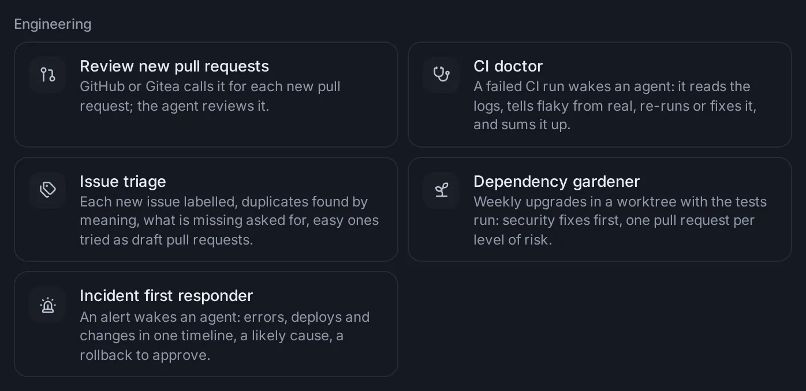

# Engineering: CI, issues, dependencies and incidents

Agents can look after a codebase while you do something else: look into a failed CI run, triage each new issue, keep the dependencies up to date and respond to an alert, each as a scheduled task made from a short form. Git's **Find what broke it** has an agent find the commit that broke something, and a **Campaign** splits one big change into parts that several agents make at once, each in a worktree of its own.

## How the engineering tasks work

The four tasks are examples in [Settings → Scheduled tasks](/settings?s=tasks) (**Settings → Agents → Scheduled tasks**), under **Start from an example** → **Engineering**, beside [**Review new pull requests**](/settings?s=tasks&find=Review%20new%20pull%20requests). Each opens a short form; fill it in, pick who runs it under **Run by**, and select **Create task** (or **More options…** for the full task form). See [Scheduled tasks](/guide/tasks) for everything a task can do.

What they have in common:

- **A repository folder**: the copy of the repository on this computer that the agent works from. It reads it, and makes any change in a new worktree (a separate copy on a branch of its own), so your own copy and its branch stay as they are.
- **A skill each**: the agent follows a written method, a built-in skill you can read and change in [Settings → Skills](/settings?s=skills): **ci-doctor**, **issue-triage**, **dependency-upgrades** and **incident-response**.
- **What it may do**: switches in the form, such as **Open a draft pull request with a fix**. Whatever you leave off, the agent tells you what it would have done instead. None of them ever pushes to the default branch, force-pushes or merges.
- **Webhooks**: CI doctor, Issue triage and the incident responder start when a service calls the task's own address. Once the task is made, its row in the list shows the address with a copy button and, under it, where to paste it in that service ("In the repository on GitHub: Settings → Webhooks → Add webhook…"). The form says the same before you create it. A filter on each lets only what it is for start a run (a failed run, a newly opened issue, an alert that is not a "resolved" notice); the others are answered and start nothing.
- **Access**: the agent works with GitHub through the gh command when it is signed in on this computer, and otherwise through a key in your vault or a connected app (GitHub, GitLab, Buildkite, CircleCI, Sentry, Grafana, Datadog, Better Stack: see [Connected apps, keys and tools](/guide/connections)). When it needs a key it does not have, it asks you for one.
- **Each run** reports how it went in one line, in its notification and in the task's history, and keeps notes for the next run (the flaky tests it saw, the upgrades it held back, the incidents so far). A run that needs your approval waits for it, in its session and in the [inbox](/guide/inbox). Nobody may be watching when a run starts, so for these tasks pick, under **More options…** → **Permissions**, a mode that lets routine steps go ahead and asks about risky ones (**Auto**), or the run waits for you at its first command.

## CI doctor

A failed run on GitHub Actions, GitLab CI, Buildkite or CircleCI wakes an agent. It reads the failed jobs' logs and finds the first real error, looks at the same job's recent runs to tell a flaky failure from a real one, reproduces it in a worktree, then acts as you allowed and sums it up in a few lines.

### Set it up

1. In [Settings → Scheduled tasks](/settings?s=tasks), select [**CI doctor**](/settings?s=tasks&find=CI%20doctor) under **Engineering**.
2. Pick the **Repository folder** and the **CI**: **GitHub Actions**, **GitLab CI**, **Buildkite** or **CircleCI**.
3. Choose what it may do:
   - **Re-run jobs that look flaky** (on to start with): once, when the evidence says the run failed rather than the code (a time-out, a download that failed, a test known to come and go).
   - **Open a draft pull request with a fix** (on): for a real failure, the smallest fix on a branch of its own, with the failing test run, as a draft for you to look at.
   - **Comment on the commit or pull request** (off): one short comment with the cause and the fix or the next step.
4. Select **Create task**. The task is named for its CI, such as "CI doctor · GitHub Actions".
5. Copy its address from its row into the CI, as the line under the address says:
   - **GitHub Actions**: the repository's **Settings → Webhooks → Add webhook**; the address as the Payload URL, application/json, and only **Workflow runs** under the individual events.
   - **GitLab CI**: the project's **Settings → Webhooks → Add new webhook**, with only **Pipeline events**.
   - **Buildkite**: **Settings → Notification Services**, **Add** on Webhook, with the event build.finished.
   - **CircleCI**: the project's **Project Settings → Webhooks → Add Webhook**, with **Workflow Completed**.

Only a failed run starts it (on GitHub a workflow run whose conclusion is failure; on GitLab, Buildkite and CircleCI, one whose status is failed). Each run gets the run's essentials (the workflow, its address, the branch, the commit and its message, the pull request), and its one-line report says flaky or real, the cause, and what it did: "Flaky: a registry time-out in npm ci; re-ran it", or "Real: the date parser breaks on leap years; draft pull request #42".

## Issue triage

Each issue opened on GitHub (or Gitea) wakes an agent that triages it: it reads the issue and the project's contributing guide, labels it with labels the repository has, looks for the same problem among open and recently closed issues in several wordings (saying how sure it is), asks the reporter in a kind comment for what the report lacks (the version, the steps, the logs), and, when the fix is small and clear, tries it in a worktree and opens a draft pull request that refers to the issue.

1. Select [**Issue triage**](/settings?s=tasks&find=Issue%20triage) under **Engineering**.
2. Pick the **Repository folder**, and what it may do: **Label it**, **Comment on it** and **Try easy ones as draft pull requests** (all on to start with).
3. Select **Create task**, then copy its address into the repository's **Settings → Webhooks → Add webhook** on GitHub, with only **Issues** under the individual events (on Gitea: Issues events).

Only a newly opened issue starts a run. The agent never closes, locks, transfers or deletes an issue (it labels a sure duplicate and lets a maintainer close it), never assigns people, and keeps to what the project allows: a project that refuses pull requests made with AI gets none. A security problem reported in public is not discussed there: the agent points the reporter to the project's private way of reporting and tells you at once.

## Dependency gardener

Once a week the agent looks after the repository's dependencies (npm, pnpm, yarn, pip, uv, poetry, cargo and go): what is outdated, and which have security advisories. Security fixes come first; then patch, minor and major upgrades, each group apart and majors never mixed with the rest. Each group is made in a worktree of its own, with the release notes of what changed read for breaking changes and the tests run. An upgrade that breaks the tests is held back, with the reason in the task's notes so it is not proposed again every week.

1. Select [**Dependency gardener**](/settings?s=tasks&find=Dependency%20gardener) under **Engineering**.
2. Pick the **Repository folder**, the day under **On** (Monday to start with) and the time under **At** (09:00).
3. **Open pull requests** (on): one draft pull request per group whose tests pass, with the highlights, the advisories it fixes and what to watch. Off, it pushes nothing and reports each group with the commands that apply it.
4. Select **Create task**.

A week with everything up to date and no advisory open stays quiet.

## Incident first responder

An alert from Sentry, Grafana, Datadog, Better Stack or another service wakes an agent. Within minutes it tells you what is wrong, since when and how bad, with a notification. Then it puts the errors, logs, recent deploys and the changes since the last good release on one timeline, finds the likely cause with its evidence, and proposes the safest step, usually a rollback. It never rolls back, restarts or deploys anything without your yes: it asks on a card in the run's session, and when nobody answers in time, the run reports that it needs you, with the command waiting. Once it is over, ask it in the same session for the postmortem.

1. Select [**Incident first responder**](/settings?s=tasks&find=Incident%20first%20responder) under **Engineering**.
2. Pick **The service’s repository folder** and where **Alerts come from**: **Sentry**, **Grafana**, **Datadog**, **Better Stack** or **Another service**.
3. **How to roll back** (optional): a command the agent may run once you say yes, such as `kubectl rollout undo deployment/web`. Left empty, it asks you how.
4. Select **Create task**, then point the service's alerts at its address, as its row says:
   - **Sentry**: **Settings → Developer Settings → Create New Integration → Internal Integration**, the address as the Webhook URL and **Alert Rule Action** on; then add the integration to your alert rules' actions.
   - **Grafana**: **Alerting → Contact points → Add contact point**, the Webhook integration with the address; then send alerts to it from a notification policy.
   - **Datadog**: **Integrations → Webhooks → New**, with the address, and `"transition": "$ALERT_TRANSITION"` added to its payload; then mention `@webhook-` and its name in your monitors' messages.
   - **Better Stack**: **Incidents → Integrations → Exporting data → Outgoing webhooks → Configure**, then **Add** on Incident, with only the events for an incident created or reopened.

Notices that a problem is resolved or recovered start nothing (Sentry's, Grafana's and Datadog's, by the filter); any that come through anyway are noted in the task's notes and stay quiet. With a connected app for the alerting service, the agent reads the errors and logs through it.

## Find what broke it

When something worked in an earlier version and is broken now, an agent can find the commit that broke it: it tries the commits in between with git bisect, halving them each time (a thousand commits take about ten tries), names the first bad one, and explains what in its change broke things and why.

1. On the [Git page](/git), open the repository and its **History**.
2. Open the commit where it last worked and choose **Find what broke it** in its ⋯ menu, or select the **Find what broke it** button beside **Find a commit** at the top of the list.
3. In the **Find what broke it** form:
   - **Worked at**: the commit you opened it from (by its tag when it has one), or else the latest tag. Type any tag, branch or commit; the latest tags are suggested as you type. Under it shows the commit it stands for, with its message and age, or "No commit or tag by that name".
   - **Broken at**: `HEAD` to start (the latest commit on the branch you are on).
   - **What is broken**: in your own words, as precisely as you can ("Exporting a document with pictures to PDF fails with “image too large”").
   - **How to check (optional)**: a command that fails while it is broken, such as `npm test -- export`. Without one, the agent writes a check of its own.
   - **Run by**: the agent, with the model and permissions you last used with it on the start page.
4. Select **Start**. It waits until both ends are commits, not the same one, and **What is broken** is filled in.

A new session opens at once, in a new worktree of the repository, so your own copy stays as it is. Its agent follows the **git-bisect** skill: it writes a small check script (it exits 0 when it works, 1 when it is broken, 125 for a commit it cannot test, such as one that does not build), tries it on both ends first, runs `git bisect run` with it, then shows the first bad commit and the part of its change that broke things, proves it by undoing just that commit, and suggests a fix. It changes nothing on your branches. When you are done, the session's menu → **Settle: done for now** offers to remove its worktree (see [Work in a worktree](/guide/sessions#work-in-a-worktree)).

The search box (Ctrl+K) finds **Find what broke it** too: it opens the form for the repository you used last.

## Campaigns: a big change in many parts

A campaign makes one big, mostly mechanical change across a codebase (moving every package to a new logger, a framework upgrade, renaming an API everywhere) with several agents at once. A lead agent splits the change into parts (packages, modules, folders), and members each make one part in a worktree of their own, with its tests. It is the second kind of [Swarm](/guide/research#set-a-swarm-on-a-hard-problem): one setting, **Swarm size**, says how many work at once for both.

### Start one

1. On the start page, pick the repository's folder. A campaign needs a git repository.
2. Open **Options**, pick **Swarm**, and choose **Campaign** ("One big change in parts, each in a worktree").
3. Say the change and how it is checked ("Move every package from Jest to Vitest; npm test must pass in each"), and press **Start**.

The Swarm row reads "Campaign · 5 at once" (your swarm size). As with a swarm, it is not kept for your next session, and a deep research and a campaign can't both be on. A spending cap set in the same menu covers the lead and every member. A scheduled task's editor has the same choice.

### How it works

1. The lead works out the change and how it is checked, and splits it into parts that can each be done and tested on their own. It posts the plan to the board: the parts, by name, in the order to do them (shared code first).
2. It starts a member for each part, at most your swarm size at once, the next as others finish. Each member works on a branch of its own in a new worktree made from the branch the lead's folder is on.
3. A member changes only its part, runs its checks, commits on its branch, and posts its part as done (with the branch and the checks) or failed (with what went wrong).
4. A failed part gets one more try with what was learned. If it fails again, it stays failed.
5. The lead merges the finished branches into the branch it works on, one at a time in a sensible order, running the checks after each, and removes each merged part's worktree. Ask for pull requests in your message, and it opens one per part instead and merges nothing. It never pushes to the default branch.
6. At the end it reports what changed, what failed and why, and what is left to do by hand.

To keep the whole change on a branch of its own, turn on the folder menu's **New worktree** for the lead as well: the members then branch from the lead's branch, and the merges land there.

### Follow it: the bar and the board

The lead's session has a bar above the message box: **Campaign** · "planning its parts" at first, then "12 of 40 parts done · 2 failed · 3 working", and **Board**. Each member's session has a bar too: "In the campaign of" and the lead's title, with **Board** and **Lead**. In the sidebar the members sit under the lead, folded into a line like "40 campaign members · 3 working".

**Board** opens the **Campaign board** (from the bottom of the screen on a phone):

- **Parts**: how many are done and failed, then each part in the plan's order with how it stands (**Waiting**, **Working**, **Done**, **Failed**, **Trying again** or **Failed 2 times**) and the latest word on it, or what its member is doing now. Click a part to open its member's session. **Stop all**, there while members work, stops every member still working.
- **Working now**: the members at work, at most your swarm size.
- **Posts**, beside the parts on a wide screen: everything posted, newest first, each with its kind (**Plan**, **Progress**, **Done**, **Failed**, **Finding**, **Question**, **Note**) and the part it is about.

Posts to everyone don't wake members in a campaign (a member whose part is done stays done); a message to one member wakes it.

## Ask an agent

- "Set up a CI doctor for ~/code/shop on GitHub Actions: it may re-run flaky jobs, but no pull requests."
- "Why did the last CI run on main fail in acme/shop? Was it flaky?"
- "Triage the issues opened in acme/shop this week: label them and find duplicates."
- "Every Monday at 9, look after ~/code/api's dependencies and open pull requests for what passes the tests."
- "Set up an incident responder for checkout's Grafana alerts, rolling back with kubectl rollout undo deployment/checkout."
- "Write the postmortem for yesterday's checkout outage."
- "It worked in v1.2.0: find what broke the PDF export in ~/code/docs."
- "Start a campaign in ~/code/shop that moves every package from Jest to Vitest, with a pull request for each package."
