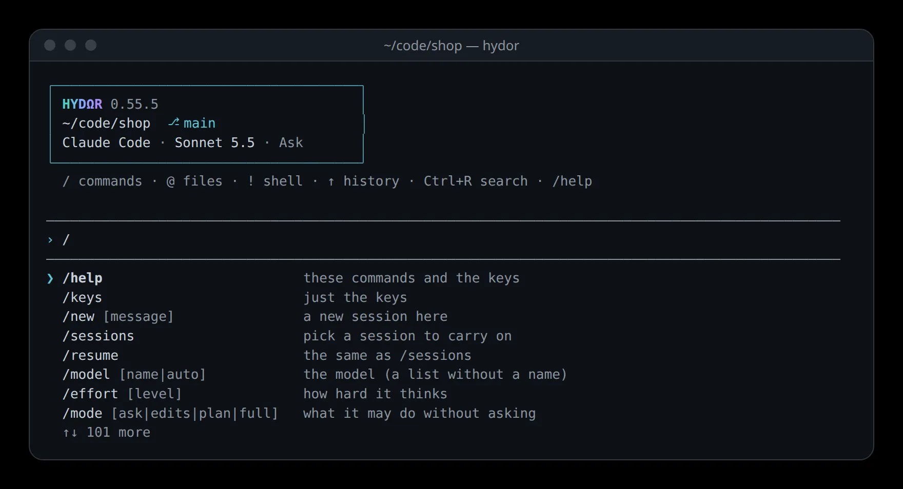

# Hydor in a terminal

The `hydor` command does in a terminal what you do in the app's pages, for what makes sense without them: talk to an agent and follow its work as it happens, approve what it asks and answer its questions, run one request from a script and get the answer back, and look after your sessions, models, tiers, agents, scheduled tasks and usage. It uses the same Hydor as the app, so a session started in the terminal shows in the app, and one started in the app carries on in the terminal.



## Get the command

- **Installed with the installer** (`./install.sh`): the installer links `hydor` into `~/.local/bin` when that folder is on your PATH, and says so. Otherwise it says where the command is: `bin/hydor.mjs` in Hydor's folder, which you can run as it is or link where you keep commands.
- **With Docker**: the image has it. Run `docker exec -it hydor hydor` to talk to an agent inside the container.
- **The desktop apps** do not put the command on your PATH. From a copy of Hydor on another computer, you can still use theirs: see [Use another computer's Hydor](#use-another-computers-hydor).

`hydor help` lists everything it does. The maintenance commands work under the same name: `hydor service status`, `hydor setup-token`, `hydor update` and the rest (`node dist/server/cli.js …` keeps working too).

You don't have to start Hydor first. When nothing answers on this computer, the command starts it in the background, says **Starting Hydor…** and leaves it running when it ends, so your sessions go on. `hydor status` says which Hydor it uses, its version, whether it runs as a service, and what is working.

## Talk to an agent

In a folder, run `hydor`, or `hydor` followed by your message (`hydor fix the failing test`). The first message starts a session in that folder. The head of the conversation names the folder and what will answer you: the program (**Claude Code**, **Codex** or **Custom**), the model (**Automatic** when the model goes by the job, on a Hydor with tiers) and the permissions mode.

What you see stays in the terminal's own history, so you can scroll back and copy from it, over SSH and in tmux too:

- **Your messages**, after a `›`.
- **The agent's text** as it comes, with its headings, lists, quotes, tables, links (the address after the words) and code (never re-wrapped, so what you copy runs).
- **Each step** on one line: what it read, searched, edited (with the lines added and removed), ran (with the time it took, and its exit code when it failed, with the first line of the error under it).
- **Thoughts** as one dim line, such as "Thought for 8 s". Start with `--thinking` to see them in full, and with `-v` to see the first lines of each step's output.
- **Helpers**: "Helper started" when the agent hands part of its work to a [child session](/guide/research#let-an-agent-hand-work-to-child-sessions), and "Helper finished" (or stopped, or failed) when its reply comes back. Claude Code can also run its own helpers and commands in the background and end its turn while they work: the bottom lines say what is at work in the background, "Finished in the background" shows as each one ends, and the agent carries on by itself. `/helpers` lists them all with what each is doing (and what a helper cost).
- **The end of each turn**: how long it took, what it cost, the model, and how many helpers worked.

At the bottom, a few lines change while the agent works: the text still being written, the step under way, the helpers at work, a spinner with the time so far, and your input line. Press Esc or Ctrl+C to stop the turn.

### Answer what the agent asks

When the agent needs your approval, the request shows with what it is about (the command, the change to a file, the plan), and its choices under it:

- Press **y** for the first choice that allows it, **n** to deny it, or the **number** of any choice (such as "Always allow").
- To deny it and tell the agent what to do instead, type that and press Enter.

A question shows its choices numbered: press a number to pick one (several, for a question that takes several, then Enter), or type your own answer and press Enter. Esc skips it. A form asks its fields one by one: type each answer and press Enter, or press Enter to keep what it shows. A file is asked for by its path on this computer.

Some requests need the app: one about a signature, or a key for one of your apps. The terminal says so and gives the session's address in the app.

### While it works

Your input line stays yours. A message you send while the agent works waits in the session's queue (it shows as **queued**) and goes when the turn ends, as in the app.

### Keys

- **Enter** sends. **Alt+Enter**, **Ctrl+J**, or a `\` at the end of the line before Enter, adds a line. A paste comes in whole, with its line breaks.
- **↑** and **↓** go through your earlier messages (the last 500 are kept); in a message of several lines they move between its lines first.
- **←**, **→**, **Home**, **End**, **Ctrl+A** and **Ctrl+E** move; **Alt+←** and **Alt+→** move a word at a time; **Ctrl+W** deletes the word before the cursor, **Ctrl+U** and **Ctrl+K** the rest of the line before and after it.
- **Tab** completes commands, files and folders after `@` (from the session's folder), and model names after `/model`.
- **Esc** stops the turn. **Ctrl+C** stops the turn when one runs, clears the line when there is text, and otherwise leaves when you press it twice. **Ctrl+D** on an empty line leaves. **Ctrl+L** clears the screen.

When you leave, the session goes on: the terminal tells you how to come back to it.

### Commands

Type them in the input line:

- `/help`: the commands and the keys.
- `/new` (and a message): a new session in the same folder.
- `/sessions`: pick another session to carry on.
- `/model`, `/effort`, `/mode`: change the model, how hard it thinks, and what it may do without asking. Without a name, each shows a numbered list to pick from.
- `/agent`: work as one of [your agents](/guide/agents), from the next message on.
- `/helpers`: the helpers and what works in the background, what each is doing (and what a helper cost); `/helpers 2` shows the second helper's conversation.
- `/tiers`, `/usage`, `/cost`: which model each tier means, your plans' usage and limits, and what this session and its helpers cost.
- `/stop`, `/rename`, `/open`, `/quit`: stop the turn and what works in the background, rename the session, show its address in the app, leave.

Any other `/command` goes to the agent as it is, for the program's own commands and skills.

## Carry on a session

- `hydor -c` carries on the latest session of the folder you are in.
- `hydor resume` lists your latest sessions to pick one; `hydor resume 6f1e2a3b` carries on that one.

The last few turns show first, each with its work folded into one line ("Ran 3 commands, read 4 files"); `hydor show` prints all of it.

## Choose how a session starts

These go with `hydor`, `hydor run` and `hydor resume`:

- `--agent claude`, `codex`, `custom`, or the name of [another agent program](/guide/agents-models): which program answers.
- `--model` (a model's name, or `auto` for Automatic), `--effort`, and `--mode ask`, `edits`, `plan` or `full` (or the program's own name for a mode).
- `--as Researcher`: start as one of [your agents](/guide/agents).
- `--cwd` (a folder; the folder you are in when you leave it out), `--worktree` (a branch and folder of its own), `--cap 2` (spend at most $2), `--no-memory`, `--title`.

What you leave out comes from what the app's start page picked last, then from the app's defaults.

## One request from a script

`hydor run "…"` (or `hydor -p "…"`) starts a session with your message, follows it until the work is done, prints the agent's last reply, and ends. Done means the turn ended, no helper is still working or still owes its reply, nothing works in the background (the agent's or a helper's), and nothing waits in the queue: an agent that ends its turn to wait for its helpers, or for what it runs in the background, is woken by their replies or their ends, and the run waits for that turn too. On `--timeout` or Ctrl+C, what works in the background is stopped with the turn. With nothing after it, it reads the message from what is piped in: `git diff | hydor run "review this change"`.

- On a terminal, short lines on the side say what happens (each step, helpers starting and finishing); `-q` turns them off.
- Nobody is there to answer, so an approval or a question stops the run, says what it was asked, and the session waits for you in the app or with `hydor resume`. With `--mode full` (or `-y`) the agent asks nothing.
- `--json` prints one object at the end: `key`, `url`, `status`, `reply`, `model`, `costUsd` (with its helpers'), `tokens`, `durationMs`, `turns`, `children` (each helper's `title`, `label`, `tier`, `costUsd`, `status`) and `error` when it failed. `--stream-json` prints a line for each change as it happens (`item`, `live`, `note`), then that object as its last line.
- `--timeout 300` stops the turn after 300 seconds.

It ends with an exit code a script can check:

| Code | What happened |
| --- | --- |
| 0 | Done |
| 1 | The session failed (an error, or the plan's usage limit, which it names), or Hydor refused |
| 2 | The command was not used right |
| 3 | It needs an answer from you |
| 124 | It took longer than `--timeout` |
| 130 | You pressed Ctrl+C (the turn was stopped first) |

## Look after things

- `hydor sessions`: your latest sessions, what each is doing (**Working**, **Needs you**, **Finished**), their program and model, folder and when. The first column is what the other commands take to name one; `--all` lists helpers too.
- `hydor show 6f1e2a3b`: a session's conversation.
- `hydor send 6f1e2a3b "…"`: a message to a session, queued when it is working. `hydor stop 6f1e2a3b` stops its turn.
- `hydor models` (or `hydor models claude`): the models each program offers, their efforts, and its modes.
- `hydor tiers`: which model each [tier](/guide/agents-models#tiers-a-model-for-each-kind-of-job) means for each program. `hydor tiers set claude best opus --effort high` changes one, `hydor tiers reset` puts them back.
- `hydor agents`: your agents, the built-in ones first.
- `hydor tasks`: your [scheduled tasks](/guide/tasks); `hydor tasks run <id>` runs one now.
- `hydor usage`: each plan's usage and limits, and when they reset.
- `hydor open` prints the app's address (`hydor open 6f1e2a3b` a session's); `--browser` opens it.
- `hydor serve` runs Hydor here, in the foreground, until Ctrl+C.

Each of them takes `--json`, which prints what the app's API gives, for scripts.

## Use another computer's Hydor

Make an access token on that computer (in its [Settings → App → Machines](/settings?s=machines&find=Access%20from%20other%20machines) → **New token**, or `hydor access-token "my laptop"` there), then name it with its address:

```bash
hydor --server https://hydor.example.com --token acm_… sessions
```

or set `HYDOR_URL` and `HYDOR_TOKEN` once. Folders are that computer's: a session starts in its default folder unless you give `--cwd` with a folder there. On this computer, the command makes a token of its own the first time, which [Settings → App → Machines](/settings?s=machines&find=Access%20from%20other%20machines) lists as "This computer's command line".

## Colours and pipes

Colours are on in a terminal and off when the output goes to a file or another program, and with `NO_COLOR` set or `--no-color`; `FORCE_COLOR` turns them on. When what you type is piped in (`echo "…" | hydor`), it works as `hydor run`. When only the output is piped, the conversation prints without colours or the changing lines, and each line you type is sent.

## Ask an agent

- "How do I talk to an agent from my terminal?"
- "Give me a script that runs a review of my staged changes with hydor run and fails the commit when it finds a bug."
- "What does exit code 3 from hydor run mean?"
- "Set up the hydor command on my laptop to use this computer's Hydor."
