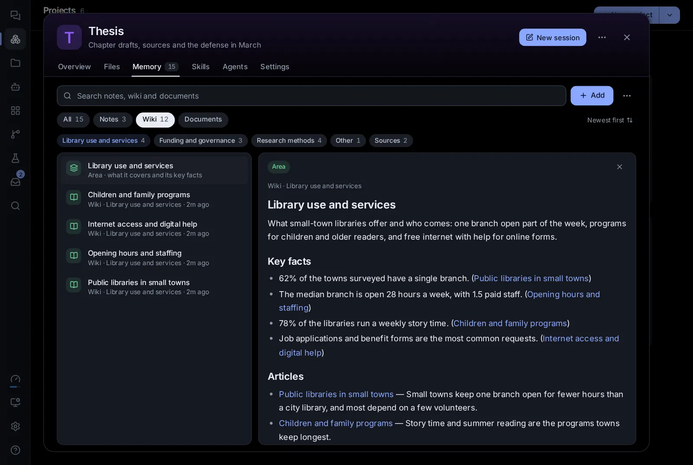

# Wiki memory

Wiki memory is a set of linked articles that agents keep for each of your projects, and one shared set, in plain Markdown files. The articles are written from the project's documents and its work, and each one lists the sources it came from. It is one part of Hydor's memory, beside memory notes and documents. This topic covers how the three fit together, where wiki memory is kept, how new documents and a project's own work update it, what you see on a project's Memory tab, and what agents can and cannot do with it. Use it to let what a project learns build up over time instead of being found again each session.

## How it sits beside notes and documents

Memory has three parts. Each is for something else, and they work together:

- **Memory notes** are short facts every agent starts with: about you, about a project, about a session (see [Memory](/guide/memory)).
- **Wiki memory** is articles: longer, linked, with their sources, kept for a project (and one shared wiki). Agents read them when they need the detail, and add to them as they work.
- **Documents** are the files themselves, which agents search and cite (see [Projects and knowledge](/guide/projects#give-a-project-documents-of-its-own)).

The idea comes from a wiki that an AI agent maintains: keep the original sources, then bring what they say together in articles that point back to them. When something new arrives, the agent updates the articles instead of starting again, so you can build on earlier work and check where a claim came from.

When a document is added or changed, Hydor can read it and add what it says to the other two parts: a few memory notes (for a project's documents) and updates to the wiki (see [Learn from new documents](#learn-from-new-documents)). About once a day, Hydor also reads the project's recent conversations and adds what is worth keeping to the wiki (see [Learn from the project's work](#learn-from-the-projects-work)).

## Turn it on or off

Wiki memory is on for every project unless you turn it off. Two places decide:

- [Settings → Capabilities → Memory → Wiki memory](/settings?s=memory&find=Wiki%20memory) has the default: the **Wiki memory** switch. It also decides the shared wiki, the one that belongs to no project.
- Each project's own **Settings** tab has a **Wiki memory** choice: **As in Settings (On)** (or **(Off)**, as the default is now), **On** or **Off**. It saves at once. Pick **On** or **Off** to make this project differ from the default.
- Under it, **Most documents to read into its wiki** has **As in Settings (100)** (the number [Settings](/settings?s=memory&find=Most%20documents%20to%20read%20into%20the%20wiki) has now) or **A number of its own**, with a box to type it in. It saves at once too. See [Learn from new documents](#learn-from-new-documents) for what it does.

With wiki memory off for a project, its Memory tab says "Wiki memory is off for this project", agents' wiki tools there say it is off, and nothing is written. What is already in the folder stays.

In chat options, **Wiki memory** and **Auto lessons learned** apply to that chat. Their defaults are in **Settings → Memory → Wiki memory**. Automatic lesson suggestions also need Memory; saving a reviewed suggestion needs your confirmation. A native agent started before Wiki memory was turned on needs a restart to register its checkpoint hook.

Learning from documents, learning from a project's work and session checkpoints also need [Memory](/guide/memory#turn-memory-off-for-all-sessions) itself to be on: with Memory off, new documents add nothing and no checkpoints are saved.

## Where wikis are kept

By default, in one folder: **Wiki folder** in [Settings → Memory → Wiki memory](/settings?s=memory&find=Wiki%20folder). It starts as `.wiki` in Hydor's task folder (for example `~/Hydor/.wiki`). The shared wiki is that folder, and each project's wiki is a folder of its own inside it, under `projects/`, made when first needed. The folder is named after the project and kept even if you rename the project. Nothing is written into your project folders, which are often Git repositories.

The folder is an absolute path on the computer running Hydor (when Hydor runs in a container, a path the container can reach). Press **Browse** to pick it: the desktop app opens the system folder dialog; in a browser or on another machine, Hydor shows the folders of the machine running it, and you can make a folder there.

**Project wikis** can instead be **In each project’s folder**. Each project then keeps its wiki in its own folder, at **Folder inside each project** (`.wiki` at first; a path inside the project, never `.git`). **Leave it out of Git** adds that folder to the project's `.gitignore` when the wiki is written, for wikis kept in the project's folder and in Git repositories only. It is off at first; turning it off later keeps an entry already added, and files Git already tracks stay tracked.

A project can also name its wiki folder itself: a line in its `AGENTS.md` such as ``- Wiki: `knowledge/wiki` `` makes that folder, inside the project, its wiki. That wins over the settings above. A path that is absolute, starts with `~`, climbs out with `..`, goes through a Git or hidden Hydor folder, leaves the project through a link or leads to the shared wiki itself is ignored. Only projects have a wiki of their own: in a folder that is not one of your projects, agents use the shared wiki, whatever that folder holds.

Whatever the settings say, every wiki is a folder inside the wiki folder or inside its own project, never anywhere else.

Inside a wiki, `wiki/` holds the articles, `raw/` the sources they came from, `index.md` lists the articles, and `log.md` says what changed and when. They are ordinary Markdown files, so other tools can read them too.

## Learn from new documents

With **Learn from new documents** on (in Settings → Memory → Wiki memory, on at first), a document added to knowledge, or changed there, updates memory by itself:

- A project's documents update **that project's** wiki and add notes to **its** memory.
- Documents in the shared knowledge update the shared wiki. They add no memory notes, because they belong to no project.

The helper model (set in [Settings → Models](/settings?s=models)) does the reading, a little at a time:

- A document is read once its knowledge base has had no new files for about half a minute, one document at a time, and at most 40 an hour. The rest wait for the next hour.
- It reads up to the first 40,000 characters of a document and says so in the source it keeps if it cut it.
- It keeps the document's text, with passwords and keys taken out, as a source in the wiki's `raw/` folder, then picks up to three articles to add to, up to two new articles, and up to three short notes for the project.
- The articles keep only what matters: what the document is for, its key facts, findings, decisions, names and numbers. Detail, examples and tables row by row stay in the document, which agents search.
- An article only grows: a rewrite that drops a fifth or more of what the article said is refused, and an article over 20,000 characters is left as it was. Anything that holds a secret is left out. The notes are short, new, and never repeat one the project has.
- A document with the same text is not read twice. A change to a document reads it again.
- Documents already in a project's knowledge are read too, once, at the same pace (the newest first, up to 400 a project, the shared knowledge counting as one), so an existing project's wiki fills in over a few hours. A project is looked at again every ten minutes, so one that was not ready (its wiki memory was off, or it had too many documents, see below) is read once it is.
- Wiki memory's own folder is a knowledge base too, but never digests itself.

If the helper cannot be reached or finds nothing worth adding, nothing is lost: the update is listed with the reason, and the document is tried again when it changes.

### When a project has too many documents

Reading every file of a big collection (a thousand papers, a whole documentation site) would take the helper model days and cost a lot, and the wiki would be too full to help. So the wiki reads only the documents of a project that holds **no more than a limit**: **Most documents to read into the wiki** in [Settings → Memory → Wiki memory](/settings?s=memory&find=Most%20documents%20to%20read%20into%20the%20wiki), 100 at first (a whole number from 0 to 100,000). A project with more documents than that keeps all of them out of its wiki: none is read, no update is listed for them, and agents still find and cite them with their ordinary document search. The count is the indexed documents in the project's own knowledge, not the wiki's own files. The shared wiki counts the shared knowledge the same way.

- A project can have a number of its own: on its **Settings** tab, **Most documents to read into its wiki** (see [Turn it on or off](#turn-it-on-or-off)). It wins over the one in Settings; **As in Settings** follows it again.
- A limit of 0 reads no documents at all. To stop reading documents for every project, turn off **Learn from new documents** instead.
- Change a limit and the project is looked at again within ten minutes: raise it, or delete documents until the project is under it, and its documents are read then, the newest first, as above. Documents that arrived while it was over the limit are read too.
- The project's Memory tab says when it is over: "This project has 240 documents, more than the 100 its wiki reads: agents search them instead of reading them into the wiki."

### Large data files

A large data file, such as a CSV or TSV file, a spreadsheet or JSON data (more than 40,000 characters of text, or bigger than 256 KB), doesn't read well as text, so the helper analyses it with code instead:

- It writes short Python programs, and Hydor runs each one in a sandbox with no network that sees only that file (read-only) and a scratch folder: up to four runs, a minute each. The helper reads what they print, then writes its findings: what the file holds, its size and columns, key numbers and patterns.
- Only the findings are kept as the source and go into the articles. The file stays in knowledge, where agents search it.
- This needs a sandbox for code, which Hydor has on Linux with bubblewrap. Elsewhere (macOS and Windows for now), large data files are searched only, and **Recent updates** says so.

In a session, an agent that may run commands can analyse such a file itself, loading it from its path in a script.

## Learn from the project's work

About once a day, with Memory's [Learn from conversations](/settings?s=memory&find=Learn%20from%20conversations) on (it is at first), the helper model reads a project's recent conversations and adds what is worth keeping to that project's wiki. It reads only what you and the agents said: your own words (not files you attached or text you pasted) and each agent's last reply to you, never the output of tools. It never reads a Confidential session, a session with memory off, a helper session or a scheduled run.

- It runs when the last time was a day ago or more and nobody has written to an agent for ten minutes, so it does not get in the way of your work. The first time, it looks back two weeks, so a project that already has sessions gets its wiki soon after you update. Each time after, it reads only what is new: it keeps where it stopped in each session, so a conversation it has read is never read again, and when one goes on, only its new turns are read. A session an agent is still working in waits for the next time, and so does one it had no room for.
- For each conversation it keeps the text, with passwords and keys taken out, as a source in the wiki's `raw/` folder, named after the session and its day, then adds to or updates articles, or starts a new one. It keeps lasting knowledge about the project: decisions and why they were made, how things work, conventions, commands that worked, pitfalls and their fixes, results, and open questions. "Nothing worth keeping" is a fine answer.
- It never keeps personal details about you, secrets, instructions for agents, or a step-by-step log of what an agent did. An article only grows, as with documents.
- It reads at most four conversations for a project and twelve in all each time, the latest first, and skips short ones. It adds no memory notes: those come from [Learn from conversations](/guide/memory#learn-from-conversations) in the tidy-up.

Each conversation shows up under **Recent updates** on the project's Memory tab, and you can open the session from there. To stop it, turn off [Learn from conversations](/settings?s=memory&find=Learn%20from%20conversations) (this also stops memory's own learning from conversations), or turn wiki memory off for the project.

## A project's Memory tab

Open [Projects](/projects), pick a project and open its **Memory** tab. It replaces the Knowledge and LLM Wiki tabs of earlier versions, and its count adds up the notes, articles and documents. A switch at the top moves between three parts:

- **Notes**: the project's memory notes, as in Settings → Memory, with **Add a note** and a search field, and the folder they belong to.
- **Wiki**: the project's articles and sources. Select one to read it, follow its links, and open its listed sources. It is read-only here: agents write it. If wiki memory is off, the tab says so and has **Open its Settings**; if nothing is in it yet, "Nothing here yet. Agents add to it as they work, and new documents update it." The wiki's folder is shown under the list.
- **Documents**: the project's own documents and whether its sessions search the shared knowledge too, as before (see [Give a project documents of its own](/guide/projects#give-a-project-documents-of-its-own)). A line says when new and changed documents also update the project's notes and wiki, and another when the project has more documents than its wiki reads (see [When a project has too many documents](#when-a-project-has-too-many-documents)). The Wiki part says that too, under the articles.

Under the articles, **Recent updates** lists what new and changed documents and the project's conversations did lately, newest first, up to 20: the document, or **Session:** and the session's title (click it to open the session), how long ago, the articles it added or changed, how many notes it added, or "Nothing to add", or why it did nothing or what went wrong. Click an article to read it.

The Overview tab's **Memory** card sums it up ("12 notes · 8 articles · 5 documents"). On a phone, the switch is the same and the lists stack.

## What agents can do with it

In a project, an agent gets a few tools for the project's wiki, and nothing for another:

- It can see where the wiki is and whether anything is in it, and read an article or a source.
- It can keep a text or a document as a source (a document file up to 20 MiB, kept as it is, with its text next to it; the text may be incomplete) and write articles, `index.md` and `log.md`. To change a file it must have read it first, so two writers cannot overwrite each other. It cannot write a source after it is kept.
- It can check the articles: that the sources they list and the links between them exist.
- It can name "the shared wiki" to work in that one instead, when it is on.
- It finds what is in a wiki with its ordinary document search, so an answer can cite the article.

**Plans.** Ask an agent to adopt a plan (one you give it, or a document already in the wiki) and it shows you the exact text, where it goes (`output/projects/<name>/plan.md` in the project's wiki), its execution register (what is implemented, deployed and accepted, each its own state, with evidence or what blocks it) and the plans already there, and waits for your OK. To change a plan it shows the old and the new text and the reason, and waits again; the old text is first kept in a protected snapshot, so every earlier revision stays, and the plan's identity and its work item numbers stay. Approving a plan or a change to one never starts carrying it out. No other tool can write in `output/projects/`, whatever a file is called: plans change only this way. What was done, deployed or accepted is recorded in `output/evidence/<plan>/` with the ordinary wiki write, and nothing there is ever a plan. A plan is shown read-only on the Memory tab with the articles and sources.

What it cannot do: reach another project's wiki; read or write hidden files and folders, Git and archive folders, retired or archived articles, or a link that leads out of the wiki; keep text with passwords or keys in it; or use wiki memory at all in a Confidential session. Ask the agent to check the wiki and it reports a basic problem list; it does not change the files for that.

## Checkpoints and lessons learned

With wiki memory and memory both on, Hydor's Custom agent can save a checkpoint of a session when it compacts its own context, to carry on from afterwards. There is one checkpoint per session, written over each time, in the shared wiki folder. It holds a redacted summary or only the event: never a full transcript. For Claude Code and Codex, Hydor attempts a checkpoint when you start compaction from Hydor and, when its native hook is registered, before automatic compaction. Existing or hidden hooks, plugins, policy or unavailable hook discovery can prevent registration. Just before an automatic compaction, the last messages of the session go to the helper model to write the summary, which can take up to about 14 seconds; the compaction waits for it, and goes on without a checkpoint when it takes longer. A checkpoint can contain only metadata when no summary is available. For Codex, Hydor trusts only its own hook (an exact command it made itself, handed to that session alone); a hook of yours is never trusted this way, and Hydor looks for it once for each Codex version rather than at every start. Check the session details to see its latest outcome. A failed checkpoint does not stop compaction. Turning memory off for a session, or all of it, prevents checkpoints and their use; existing ones stay.

Ask an agent to preview lessons learned from a session: it writes nothing. It uses the indexed messages, so the latest may be missing. Saving selected lessons asks for your confirmation first.

With **Auto lessons learned** on for a chat, the helper looks at each turn's last exchange (about once a minute at most, never in a Confidential chat or with memory off) and, when it finds something worth keeping, adds a suggestion as a card in the chat: the lessons, with their evidence and the place they would go. Nothing is written until you keep it there, and what you keep is exactly what you saw; or you dismiss it. Agents cannot keep or dismiss a suggestion for you, and they ask you before they change either of a chat's two switches. The switch is off at first: turn it on for every chat in Settings, or for one chat in its options.

## Move the wiki folder

When the current **Wiki folder** has files, changing it opens a review. You can leave them where they are, or move them. If the new folder has files too, you can combine the two folders or replace the destination, and for files in both, keep the source's, the destination's or the older one by modification time. Hydor keeps a complete copy of each original folder as a hidden backup beside it and shows where. The old folder is kept, not deleted. Pause other programs that write to either folder meanwhile, and update any other tool set to the old path. Moving the shared wiki's folder moves the project wikis kept in it. Changing the folder inside each project does not move any project's files.

## Ask an agent

- "Is wiki memory on for this project? Turn it off for the Taxes 2026 project only."
- "Turn wiki memory on for every project except my thesis."
- "Keep each project's wiki in its own folder, in `.wiki`, and leave it out of Git."
- "Adopt this plan into the project's wiki."
- "Move the wiki folder to ~/Notes/wiki."
- "Stop reading my new documents into memory."
- "Why is this project's wiki not reading my documents? How many does it have?"
- "Let the wiki read up to 300 documents in the Papers project, and keep the 100 for the others."
- "Why is this project's wiki still empty?"
- "What did my last documents add to this project's wiki?"
- "Which conversations did this project's wiki learn from this week?"
- "Add this paper to the project's wiki, then write what it says about retrieval in an article."
- "Check this project's wiki for broken links and missing sources."
- "Preview the lessons learned in this session, and save the first two."
