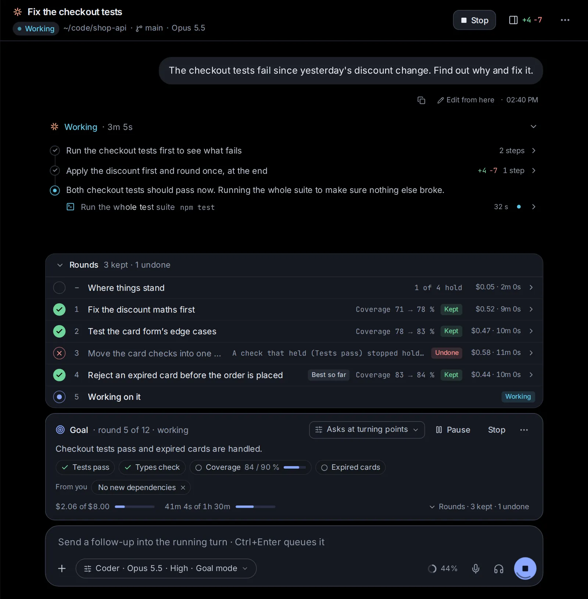

# Goals

A goal keeps an agent working, round after round, until checks you have agreed hold. You and the agent first agree what "done" means as a short list of checks. Then the app itself runs those checks after every round and decides whether the round got things closer, so the agent saying "done" changes nothing: only the checks can end a goal. It works for every agent (Claude Code, Codex, Custom and the other agents you add), because the app's own loop drives it.

## Set a goal

To set a goal, open the session's menu (⋯) → **Set a goal**, say what is true when the work is done ("npm test passes and the upload page handles 2 GB files"), pick **How much it asks you** and press **Draft the checks** (or Ctrl+Enter). Or start a session with it: on the start page open **Options** → **Goal** → **Until it is done**, and your first message is the goal. A goal cannot be set in a session another session started (a Hydor subagent: its menu has no **Set a goal**), in one that runs in VS Code or a terminal (continue it in the app first), in Plan mode, where the agent changes nothing, in a session that leads a campaign, a deep research or an arena match ("This session leads a campaign: a goal works with a swarm, not with a campaign yet.", and the same for the others), or in a session that has a `/goal` of its program's own (clear it first with `/goal clear`). If a session you start with **Goal** cannot have it, it goes on as a plain session and a notice says why ("The goal was not set: …"). A session has one goal at a time, and a goal costs many turns: the limits you agree below keep it in check. A goal stops by itself when its session is archived, or replaced by **Edit from here**.

A target mark in the sidebar shows which sessions have a goal; point at it to see the round and how many checks hold, and the session's own Options chip says "Goal mode". The first time you turn a goal on from the start page, a short note says what it does and what it costs.

## Agree what "done" means

The agent reads the project and proposes the checks, the paths it may not change and the limits. You see them on a card, **Is this what done means?**, above the message box. **Done when** lists the checks; each has a tag for its kind:

- **Command**: a command that must pass ("npm test").
- **Measured**: a command that prints a number, with a target: at least or at most ("search p95 under 200 ms"). A round may fall a little behind the best value so far (a tenth of it) and still count.
- **Score**: the project's evaluation in [Experiments](/experiments) scores the work its own sealed way, and the score must beat the evaluation's baseline by at least the gain you agree ("better than the baseline by at least 0.02"; 0 means any gain that is more than the noise of its seeds). The evaluation must be able to score the session's folder (its own folder, a folder inside it, or a worktree of the same repository) and have a baseline, which only you measure, on the evaluation's page. When you press **Start** the target is fixed from the baseline of that moment, and the files the evaluation protects join the paths the agent may not change. A score never runs before you press **Start**, whatever the session's permissions (its runs may take a GPU): until then the card shows "Scored once you start · baseline 0.412", and the first score, taken right after **Start**, is where it starts from. Its value is the score's mean; with three seeds or more on both sides a gain within the noise does not hold ("0.431 against 0.412: within the noise of 3 seeds"). A score that is refused because the evaluation's files changed, or that fails, does not hold. If the evaluation is sealed again or gets another baseline while the goal runs, its scores can no longer be compared with the one agreed: the goal stops there and asks you, and **Go on against it as it is now** fixes the check again from the evaluation as it is then. **Change…** and **Add a check** → **A score** offer the folder's evaluations, with a link to an evaluation whose baseline is not measured yet. The goal never runs an evaluation's final test: when it is reached, its report says the evaluation has one and links to its page, where you may run it.
- **Reviewer**: a sentence a reviewer must find true. The reviewer is a model that did none of the work: it reads what changed, the files or the output the check names (a folder named there shows its files), and says whether the sentence holds, with its reason. It is for what no command can show, such as "the settings page has a dark mode". If it cannot tell without seeing a file, it says which, the app shows it that file and asks once more; a file git ignores is never shown that way.
- **You**: something only you can confirm. It waits for you when everything else holds.

**Kept safe** shows the paths the agent cannot change (the tests, the test data, the checks' own scripts) and where it works. **Limits** are the most rounds, money (at API prices) and time it may use; the rounds come from [Rounds a goal may run](/settings?s=goals&find=Rounds%20a%20goal%20may%20run) (30 unless you change it), and money and time are open until you set them. Under **How much it asks you** you can still change how often it asks. If the session's spending has no price (a model without one), the card says the money limit cannot stop it, and the rounds and the time still do.

The app measures where things stand before any round, so the card says "measured 3 min ago · 3 of 5 hold". It does this right after the proposal only when the session's permissions already let the agent run commands without asking (Claude Code's **Bypass**, Codex's and Custom's **Full access**) and the session is not confidential. Otherwise nothing runs yet, the card says "not measured yet" and "The checks run for the first time when you press Start": the commands are the agent's proposal, and you agree to them first. A check that could not run counts as not holding; the card says so and the button reads **Start anyway**.

The checks run as the session's own commands would, never more freely, with the environment agents get. In a confidential session they always run inside the app's sandbox without network, and cannot run at all on a computer with no sandbox (the check says "No sandbox on this computer to run it in"). In a Custom session in Auto mode with the sandbox on, they run in the sandbox too, kept to the folder; in a Codex session below **Full access** they run in the sandbox, kept to the folder and without network unless Codex's own sandbox policy allows it; otherwise they run directly.

- **Start**: agrees the checks. If they all hold already, the goal is reached at once; otherwise round 1 begins.
- **Change…**: turns the rows into fields. Remove a check, edit its label, command, target or sentence, **Add a check** of a kind, edit the protected paths (one per line) and the limits, then **Start**. **Cancel changes** puts the card back.
- **Not now**: stops the goal.

If the agent proposes nothing after being asked twice, the app proposes one check for it: a reviewer reading the change against your goal.

## Rounds: kept or undone

In a round the agent gets what to work on: where each check stands, what the last round did, what was already tried and undone from where it starts, what you asked of it and what not to change. It works as it would on any message, with the permissions the session has, and ends its turn after telling the app what it did and what remains. Your own messages still go first: they are ordinary turns inside the round.

When the turn ends (and nothing the agent started, such as a Hydor subagent, is still at work), the app runs every check. A command left running, such as a dev server, is waited for 10 minutes after the turn ends, and then the checks run anyway. A command one of its Hydor subagents left running is waited for the same way. A score runs after the commands and numbers, through the Experiments queue, where it may wait for a GPU and take hours: the bar says so ("scoring: waiting in the queue", "scoring: 2 of 3 runs done"). It waits at most 6 hours unless the check says otherwise (48 at most), and never past the goal's time limit: when that runs out while a score is waited for, the goal stops at its limit. If the app restarts in the middle, it waits for the same score again rather than starting another. What you changed in the files between rounds is never judged as the round's, and never undone with it. A round is **Kept** when things got closer and nothing broke. It is **Undone** when:

- it changed a path it may not change;
- it broke a rule of yours (see [Steer it whenever you want](#steer-it-whenever-you-want));
- a check that held stopped holding;
- a measured number fell far behind its best; or
- nothing got closer.

An undone round goes back to the files as they were when it started (the best round so far, which the list marks **Best so far**, unless you changed something between rounds). This needs a session that works in a worktree (the start page's **New worktree**); the card tells you which you have, "It works on a branch of its own" or "It works in your folder, where a round cannot be undone". In your own folder a worse round is marked **Left as it is** and the next round is told what got worse, to put it right.

The app puts the files back by itself only when nobody else worked in the folder since the round started (another session in the same folder, a fork for example) and this session has been quiet since the round ended. Before it does, it saves everything that is in the folder, the checks' own output and any edit of yours included, as the round's own files, so **Keep anyway…** on that round brings it all back. If another session worked in the folder, or a commit was made, the round is **not undone**: it stays, marked **Left as it is** with the reason ("It was not undone: another session (“…”) was working in the folder"), the goal goes on, and the next round is told the files were not put back. If it was your own message that arrived while the checks ran, the round is simply checked again when the session is quiet (after three times the goal pauses: "Round 4 could not be checked: the session kept working in the folder while its checks ran. Resume to check it again."). The app never tries twice: if putting the files back does not finish (it fails, or the app restarts in the middle), the goal pauses once and says "Putting round 4’s files back did not finish, so the files may be partly put back. Everything that was in the folder is saved: **Keep anyway…** on round 4 brings it back. Resume goes on from the files as they are." A file a kept round deleted stays deleted after a later undo.

A bar above the message box shows the goal, what it is doing ("round 7 of 12 · working", "running the checks", "asking you", "paused"), a pill for each check (a tick when it holds, "0.73 / 0.80" with a small meter for a number, a hollow dot for one that does not hold yet, an amber mark for one that could not run), the money and time against their limits, and **Rounds · 3 kept · 2 undone**. That opens the list of rounds: what each did, what moved ("Relevance 0.61 → 0.68"), whether it was **Kept** or **Undone**, what it cost and how long it took. Open a round to see what the agent reported, each check's result and why it ended as it did. The messages the loop sends the agent show in the conversation as one quiet row, "Goal · round 5 of 12"; click it to read the message.

The same rounds can be seen as a **Map**: switch between **List** and **Map** at the top of the card (each session remembers your choice on that device). It reads from left to right by round number: **Start**, the kept rounds joined as one line, and each round that was undone (or left as it is) hanging below the round it started from, on a dashed line. **Another way from here** shows as a second line leaving the earlier round. The round at work and the **Best so far** are marked, and at the right end stands the goal with how many checks hold. Each box says what the round tried, with the number that moved most or why it was not kept. Tap a round to see under the map what its row in the list opens to, your say on it included. A long map scrolls sideways inside the card and starts at the latest round.

A check that held and now cannot run (a reviewer that is down, a timeout, a missing tool) has not stopped holding: it runs once more, and if it still cannot, the goal pauses ("“Tests pass” could not run: … Resume to check the round again") and the round is neither kept nor undone. If the reviewer cannot read your rules, the round goes on and its row says "Your rules could not be checked this round".

When every check holds, the app does not trust it at once: it runs the commands and numbers a second time (not a score: its seeds already speak for the noise, so the score of those same files counts), and a reviewer reads the whole change (and the files the checks name or their reviewers asked for) to see that no test was weakened or skipped, no answer was written into the code and the goal is really met. Only then is the goal reached. If that fails, the next round is told what the final check found, and from then on a round is kept when nothing broke and the files changed, and undone as "No change" when they did not. A **You** check then asks you: **It holds** or **Not yet**, with a note, and "Not yet" works the same way.

## How much it asks you

**How much it asks you** has three settings, on the start page, in the **Set a goal** dialog, on the card and in the bar's chip:

- **On its own** (the chip reads "Works on its own"): only when it cannot go on without you (something only you can give, or a check only you can confirm).
- **At turning points** (the default; the chip reads "Asks at turning points"): when it is about to change its approach, which it does after two rounds in a row without progress.
- **Every round** ("Asks every round"): after each round it shows what it found and its pick for the next.

When it asks, a question card shows two to four ways to go on, each with why, what it should bring, what it costs and **Its pick** on the agent's own. Tick a way, or several, and they are followed one after the other, in the order you ticked them. **Something else: say which way** takes a way of your own, and **A note for the agent (optional)** goes into the next round. The main button reads **Go this way**, or **Follow these 2, in this order**; **Only its pick** takes the agent's pick. Keys 1 to 4 tick a way.

With no answer, it goes on with its pick after 10 minutes (a whole number of minutes, 0 to 1,440, where 0 waits), or waits for you: **If you don’t answer** has both. The card counts down ("goes on with its pick in 9 min") and **Wait for me** stops the clock. A check only you can confirm, or something only you can give, always waits for you.

What a new goal starts from (its rounds, how much it asks you, and the minutes before it goes on with its pick) is set for every new goal in [Settings → Capabilities → Goals](/settings?s=goals); here you change it for one goal.

## Steer it whenever you want

You can steer a goal at any time.

- **Message the agent** as always: your message goes first, and the round carries on from there.
- **Pause** and **Resume** in the bar. A round that is running is finished and checked first, as any round (the bar says "pausing after this round", and **Resume** there takes the pause back); then the goal waits and nothing more is sent until you resume. While a score is waited for, **Pause** does not wait for it: its runs stop at once, the goal pauses with the round unchecked, and **Resume** scores it again. **Stop** stops a score's runs too. That is the moment for your say on a round (below). To stop the agent at once instead, stop it in the session: the goal pauses with that round unchecked, and **Resume** checks what it did. The Hydor subagents it started stop with it, and a report one still had on its way waits in the session's queue and goes to the agent when you resume the goal. **Stop** ends the goal (see below).
- **Add a rule…** in the bar's ⋯ menu pins something for every round from now on ("No new dependencies"). The reviewer checks each round against your rules; a round that breaks one is undone. Rules show under **From you**, each with a × to remove it.
- **Change the checks…** in the same menu edits checks, paths and limits while it runs; a check you add or change is measured again. A check you change only in its target (or its unit, its slack, its time limit or its name) keeps its values: it is judged again against the new target, not measured again. A change to limits counts at once. A change to checks or paths while a round runs waits until that round has been judged by the checks it started with (the bar says "Your change to the checks takes effect after this round."), and otherwise takes effect with the next round.
- **Your say** on a round, when the session works in a worktree and the goal is not in the middle of a round (pause it, or wait). It is refused, with a sentence that says what is in the way, while this session's agent is at work ("This session’s agent is at work: wait for its turn to end, then try again."), while another session is at work in the folder, after a commit made in the folder since the goal last left the files (move it to a branch of its own first), and when files were changed outside the goal since it last left them: the message names those files (up to five) and gives the commands, to run in the worktree's top folder, that put your changes to those files aside in a stash and put back the goal's own version of them (`git stash push --include-untracked -- <files>`, then `git restore --source=<checkpoint> --worktree -- <files>`; for more than ten files, the same for the whole folder), so your own changes are never lost. A goal paused while a round ran holds that round's unchecked work in the folder: the message then says so, and **Resume** has the app check that round first:
  - **Keep anyway…** on a round that was undone or left as it is keeps its files and makes it the best. For each measured check that is not met you can keep the target or change it to what the round reached, and give a reason.
  - **Undo** on a kept round puts the files back to the round kept before it, and what it tried is not tried again.
  - **Another way from here** keeps the round's files and has the next round take another way from there; say what to try instead if you like.

## A goal for a swarm

A session that leads a [swarm](/guide/research#set-a-swarm-on-a-hard-problem) can have a goal too: turn on both **Goal** and **Swarm** in **Options** on the start page, set a goal in a session that already leads a swarm, or turn its swarm on while the goal runs. A campaign, a deep research and the arena do not go with a goal.

- **A round is the whole swarm's work.** The app sends the round's message to the lead, which puts its members on what does not hold yet: one angle or one check each. They all work in the lead's folder.
- **A round is over when everyone has finished**: the lead's turn has ended, no member is still at work and nothing between them is on its way. Until then the bar says "waiting for 2 members". Then the app runs the checks on the lead's folder, as for one agent, and the round is kept or undone. An undone round takes the members' changes with it.
- **Members stay between rounds** and remember their work: the lead gives them their next step, starts a new one for a new angle and stops one whose angle is used up. A round's row says how many members worked in it.
- **Limits are the team's.** The money counts what the lead and every member spend, the time is the time the team is at work, and a limit reached in the middle of a round stops the members as well as the lead. What a member reports after the stop waits in the lead's queue instead of waking it, and goes to it when the goal goes on.
- **Pause** waits for the round as always, which here means for every member. **Stop all** on the swarm's board stops the lead and its members at once, and the goal pauses ("You stopped the swarm. Resume checks what it did.").
- Only the lead asks you a question; a member with something to ask posts it to the board.

A round of a swarm costs what all its members spend: several times a round of one agent. Give the goal a money limit that fits.

## When it stops, and giving it more

A goal stops by itself when it is reached, when you press **Stop**, or at a limit (its rounds, its money or its time). It also pauses, and tells you why, when you stop the agent, a turn fails, the app cannot save the files, or putting a round's files back did not finish (as above), a check cannot run, a round could not be checked because the session kept working, its message cannot be sent, a restart of the app cuts the agent's turn short a second time (the first time the app sends the round's message again, saying so), or the app restarted just as a message of the loop was going out (after two minutes with nothing started it sends the message again once, then pauses and says so), or the agent stopped at its plan's usage limit and the app will not carry it on by itself. When the session's queue is on hold, the goal asks you to press **Resume** there. After a restart of the app the goal looks at once at where it stands, without waiting. A card then shows the report: **Goal reached**, **Stopped at its limit** or **Stopped by you**, with the rounds, money and time, a summary, a table of each check at the start, now and what it needs (a check you added or changed while the goal ran shows "—" at the start, with the round after which it was first measured as its title), and the final review's reason. **See the changes** opens the session's changes. **Dismiss** removes the report so you can set a new goal.

A goal that stopped at a limit shows **Give it more…**: raise what ran out (rounds, money or time) and press **Go on**; it carries on from where the files stand, as after any round. While it waits at a limit you can still add or remove a rule and change how much it asks: they count when it goes on. If a limit is still hit, the dialog says what the goal has used ("It has run 4 rounds: give it more than that.", and the same for money and time) and nothing changes. Nothing is put back after a limit: a round that a money or time limit stopped midway stays in the folder as the agent left it. The Hydor subagents the agent started are stopped with it; one still at work when the round's files were saved is named in the report ("The subagent “Cache” was still at work when round 4’s files were saved: what it writes after that is in the folder but not in the round."); what they report after the stop waits in the session's queue until you give the goal more. It is recorded as a round of its own (**Left as it is**, "Stopped at the limit midway") with its files, and the report says "Round 4 was stopped midway and its work is still in the folder. Keep anyway… on round 3 puts the files back to the best round." **Give it more…** goes on from the files as they are. A goal that was reached or that you stopped stays over.

Notices: while a goal is at work you get one when the checks are ready for you, when a check could not run, when it asks you something or needs you, when it pauses, when it stops at a limit and when it is reached ("Goal reached: …"), instead of one "Finished" per round; while it waits for you, "Finished" notices are not held back. See [What each notification says](/guide/inbox#what-each-notification-says).

## A /goal typed in Claude Code or Codex

Typing `/goal` followed by a condition in a Claude Code or Codex chat is that program's own, simpler goal: the program keeps going until it judges the goal met (Claude Code checks after each turn; Codex decides itself). It has no agreed checks, rounds or undo, and shows in the older small bar above the message box with **Pause** and **Resume** (Codex) and **Clear**. The session's menu **Set a goal** is the app's own goal and works for every agent. In a Custom session or another agent's, `/goal` is plain text. A session cannot have both: **Set a goal** is refused while the program's own goal is set, and a `/goal` typed while the app's goal runs goes to the program as any message does, and nothing notices it.

## Ask an agent

- "Give the session 'Fix upload' the goal: npm test passes and uploads of 2 GB work, and propose the checks for me."
- "Why did round 4 of the goal in 'Fix upload' get undone, and what did it try?"
- "Ask less on the goal in 'Fix upload': switch it to On its own, and add a rule: no new dependencies."
- "The goal in 'Fix upload' stopped at its limit: give it 10 more rounds."
- "Give every new goal at most 15 rounds, and have it wait for my answer instead of going on with its own pick."
- "Set a goal: beat the baseline on my evaluation by 1 point of nDCG@10, in at most 10 rounds."
