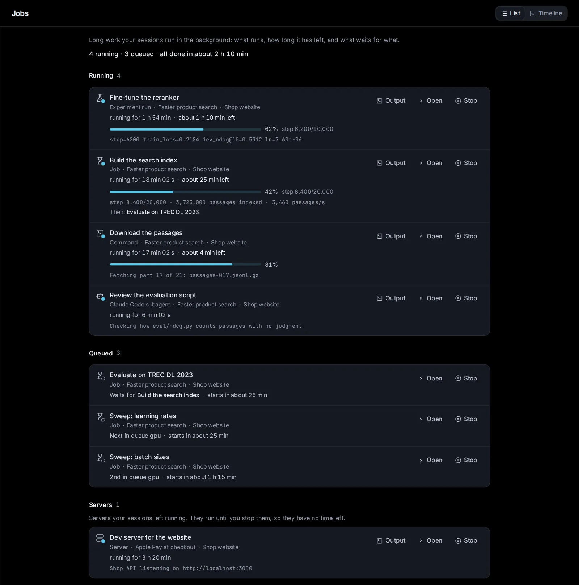

# Jobs

Jobs shows the long work that your sessions run in the background, all in one place: builds, training runs, indexing, downloads and subagents. For each one you see how long it has run, how far it has got and roughly how long it has left, what is waiting to start and what it waits for, and how the finished ones ended. You can read a job's output and stop it from there, and you can ask an agent to run one thing after another.

## What Jobs shows

Click **Jobs** on the rail, or go to [Jobs](/jobs). On a phone it is among the tools at the bottom of the drawer. A number on its icon says how many jobs are running.

A job is any of these:

- a background task of one of your sessions: a command, a monitor (a watch on a log or a program) or a subagent of the agent's own program, such as Claude Code's. Sessions you run outside Hydor, in VS Code or a terminal, show theirs too;
- work an agent started as a job (see [How agents put work here](#how-agents-put-work-here));
- a run of [Experiments](/guide/experiments) that is running or waiting in its queue;
- a Hydor subagent, a session that another session started for part of its job, while it works (see [Subagents](/guide/sessions#subagents)).

The line at the top sums it up, such as "3 running · 2 queued · all done in about 2 h 10 min". The end time is there only when every job has an estimate, leaving out subagents, which never have one. Below are the sections **Running**, **Queued**, **Servers** and **Finished**, each there when it has something to show. The number on the rail, the line at the top and the end time leave servers out. The page updates by itself.

Each row has an icon with a dot for its state and the job's name; point at the name to see its command. Under it are what it is (**Command**, **Monitor**, **Claude Code subagent**, **Hydor subagent**, **Experiment run**, **Job** or **Server**), the session that started it and its project, each a link. On the right, **Output** shows what it prints, **Open** goes to its run or its session, and **Stop** ends it.

When nothing runs or waits, you read "Nothing runs in the background now."

## Running

A running job says how long it has run ("running for 12 min 05 s"). When the job says how far it is, there is a progress bar with a percentage, and often the job's own count beside it, such as "step 120/500". The muted line under it is the last thing it printed.

### Time left

When there is something to go by, the row says "about 1 h 12 min left". The app takes the first of these that it has:

1. the time left that the job itself printed, as many progress bars do;
2. how fast its progress has moved so far;
3. the estimate the agent gave when it started the job;
4. how long the same command took in the same folder before, when it finished well in the last week.

Point at the time to see which one it is. **(a guess)** beside it means it is a rough one: a single progress reading, the agent's estimate or an earlier run. When a job has run longer than expected, it says **over its estimate** instead. With nothing to go by, no time is shown.

## Queued

A queued job has not started yet. Its row says why:

- **Waits for** and the names of other jobs: it starts once they have all finished well. Click a name to find its row. The jobs that others wait for say **Then:** and who comes next;
- **Next in queue** and the queue's name, or its place, such as "3rd in queue gpu": a queue runs one job at a time, in the order they came, across all your sessions. The first in line may still be waiting for another job, and the ones behind it wait too;
- **Waiting for a free GPU** or **Waiting for a free slot**: an Experiments run waits for room (see [How the queue chooses](/guide/experiments#how-the-queue-chooses)).

When the jobs ahead of it have estimates, it also says when it should start, such as "starts in about 40 min".

**Stop** on a queued job means it never starts, and neither do the jobs that wait for it. If a job that another waits for fails or is stopped, the waiting one never starts either.

## Servers

Some commands never finish by themselves: a development server, a web or API server, a notebook or a model server that a session left running in the background. Jobs tells them apart by their command and lists them under **Servers**, with how long each has run and no time left. They run until you stop them, with **Stop** as on any other command. They are not counted among the jobs that run, and the **Timeline** view does not draw them. Once one ends it goes to **Finished**.

## Finished

**Finished** keeps what ended in the last 7 days, newest first: the ten latest, and **Show all** for the rest. Each says how it ended, when, and how long it took:

- **Done**: it finished well;
- **Failed**, with its exit code when there is one (the number a program ends with; anything but 0 means something went wrong);
- **Stopped**: you or an agent stopped it;
- **Never started**, and the reason, such as a job it waited for having failed;
- **Ended**: work that was already running when it was added to Jobs has ended, and nobody saw whether it went well.

The × at the end of a row (**Remove from this list**) takes one out, and **Clear** takes them all out after asking. This only tidies the list: your sessions and runs of Experiments stay.

## The Timeline view

Switch between **List** and **Timeline** at the top right; the app remembers your choice in this browser. The timeline draws one bar for each job that runs or waits, along the clock:

- **Run so far** is solid, and **Estimated** is the striped part beyond it;
- **Queued** jobs are dashed, where they should start;
- a bar with **No estimate** fades out;
- the line marked **Now** is the present, and thin lines join a job to the ones that wait for it.

A job over its estimate turns amber. Point at a bar to read its state and times, and click it to see its output, or to open it when it has none to show. On a narrow screen the chart scrolls sideways and the names stay put. The finished jobs are listed under it.

## Output and Stop

**Output** opens a panel with the end of what the job has printed, refreshed every few seconds while it runs; the newest lines stay in view unless you scroll up. For a subagent it lists its steps. Some jobs, such as Hydor subagents and Codex's background tasks, have no output here: use **Open**.

**Stop** asks first, then ends the job: a job or a command stops, an Experiments run is stopped as on its own page, and a Hydor subagent's session is stopped. What the job has done so far stays. Work that runs in a session outside Hydor, and Codex's background tasks, can't be stopped from here, so they have no **Stop**.

## How agents put work here

You do not need to set anything up. A background task that a session starts shows here by itself. Every session the app starts also has a command called `job`, and agents are told to use it for long work (anything over about ten minutes), so that it shows here with a name, its progress and its time left (see [Four commands every agent has](/guide/agents#four-commands-every-agent-has)).

Say what you want in plain words, and the agent does the rest:

- **One after another**: "run the evaluation after the index build finishes". The second job waits for the first, and never starts if the first fails;
- **One at a time**: "put these sweeps in a queue". Jobs with the same queue name take turns;
- **How long it should take**: an agent can give its own estimate, which is used until the job's progress says more;
- **Work already running**: "show the training you started earlier in Jobs". The agent adds it without restarting it (`job adopt`); this is not available on Windows. When it ends, it says **Ended**, as nobody can tell how it went.

While a job that a session started still waits or runs (one it ran with `job`, or a run of Experiments it started), that session is not finished: its dot keeps breathing blue and its status reads "Working · 1 in background", also after its agent has stopped, and its **Finished** notice comes only once the job ends. The Stop button by its message box leaves these jobs running: stop them here.

If the app can't be reached when an agent starts a job, the command runs anyway; it just does not show here.

## Ask an agent

- "Run the evaluation as a job after the index build finishes."
- "Show the training you started earlier in Jobs."
- "Run these three sweeps one at a time in a queue."
- "What is still running, and when will it be done?"
- "Stop the download and run the tests as a job instead."
- "Why did the last build fail? Check its job's output."
