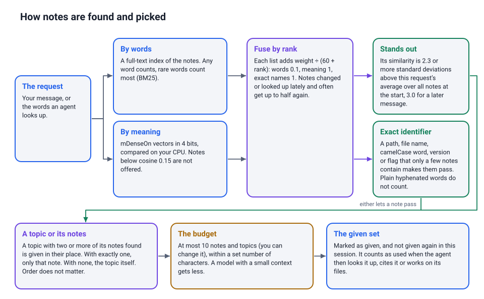
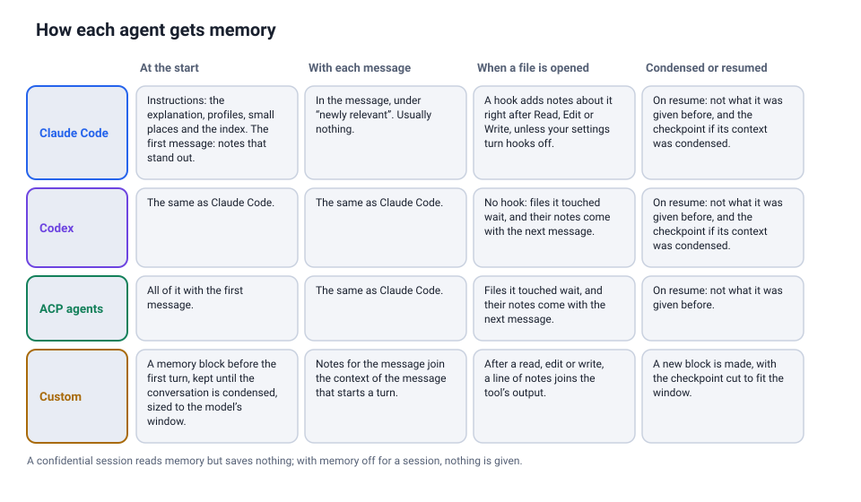
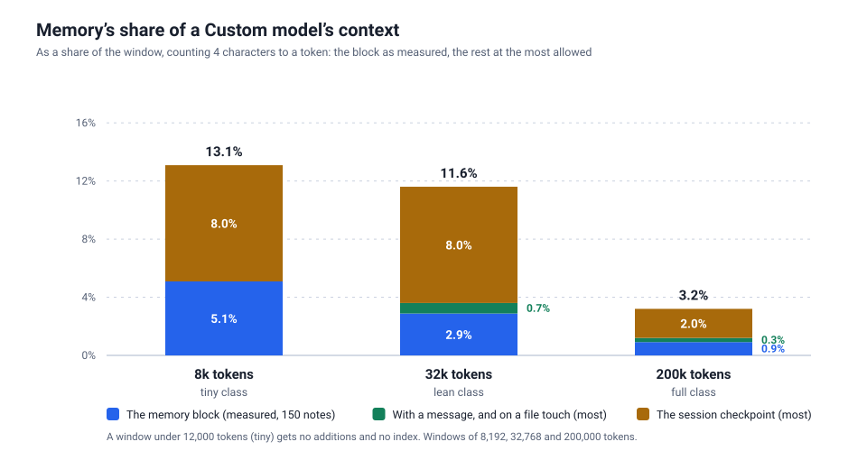

# Memory internals

How memory is built, for people who change it: the tables, how notes are found and picked, how each agent is given them, the budgets, and what runs in the background and when. [Back to the README](../README.md). [How memory works](memory.md) says what it does for the people who use the app, and [Wiki memory development](wiki-memory-development.md) has the boundaries and checks for working on the wiki. File names are relative to the repository.

## Where it lives

| Part | Where | What it does |
|---|---|---|
| Notes | `server/memory/store.ts`, `tools.ts`, `routes.ts`, `shared/memory.ts` | Tables, the agent tools (`remember`, `recall`, `forget`), the routes and types |
| Search | `server/memory/search.ts`, `vectors.ts`, `embed.ts`, `codebook.ts` | Words, meaning, fusion, the "stands out" test |
| Delivery | `server/memory/inject.ts`, `deliver.ts`, `given.ts`, `index.ts`, `server/wiki/deliver.ts`, `server/features/`, `server/agents/claude.ts` | What each agent is given, and when; what it was given and used |
| Upkeep | `tidy.ts`, `learn.ts`, `anchors.ts`, `drift.ts`, `refile.ts`, `promote.ts`, `agentsmd.ts` | The tidy-up and its steps |
| Wiki | `server/wiki/` | Roots, files, tools, the digest (`digest/`), areas and hubs (`areas/`), checkpoints (`session/`), plans (`plans/`) |
| Documents | `server/knowledge/` | Indexing, search and use counts |
| Evaluation | `scripts/memory-eval/` | A replay of note picking over real use |

## The data model

Everything lives in the app's SQLite database. Notes, topics and profiles are rows of one table.

**`memory_entries`**: one row for each note, topic or profile.

| Column | Meaning |
|---|---|
| `id` | The number agents cite (`#123`) |
| `scope`, `scope_key` | The place: `global` (empty key), `repo` (the project's root folder), `session` (the session's key) |
| `kind` | `note`, `topic` (sums up notes) or `profile` (the user's, or a project's) |
| `text`, `title` | The note (500 characters at most, 800 for a topic or profile), and the few words the index uses |
| `status` | `active` or `deleted` (kept 30 days, then erased) |
| `basis` | How it is known: `user`, `checked`, `inferred` (or none, from before this was kept) |
| `source` | Who made the last change: `user`, `agent`, `auto` (the helper) |
| `expires_at` | The end of the day it stops being true |
| `uses`, `used_at` | Times an agent used it (looked it up, cited it, or worked on its file or names), and when last; see Given and used |
| `hits`, `hit_at` | Times an agent looked it up with `recall`, or corrected it |
| `session`, `turn` | The session and reply that wrote or changed it last |
| `anchor_commit`, `anchored_at`, `drift` | The commit its anchors were taken at, the `updated_at` it had then, and the drift flag as JSON `{paths, since, at}` |
| `given`, `given_at` | Times it was given without asking (at the start, with a message, on a file touch), and when last |
| `created_at`, `updated_at` | Times |

The other memory tables:

| Table | Columns | Holds |
|---|---|---|
| `memory_history` | `entry, at, action, before, after, why, session, turn, source` | Every step of an entry's life: `added`, `updated`, `deleted`, `restored`, `expiry`, `basis`, `moved` |
| `memory_links` | `parent, child` | Which notes a topic or profile sums up |
| `memory_fts` | FTS5 over `text` (`unicode61 remove_diacritics 2`), kept by triggers | The word index |
| `memory_vectors` | `entry, model, code` | A note's vector, 384 bytes, with the model and codebook version it was made with |
| `memory_anchors` | `entry, path` (index on `path`) | The files and folders a project note names; repo-relative, folders end in `/` |
| `memory_blocks` | `key, flavor, epoch, text, at` | The block a session was given, kept so it stays as its provider cached it; the flavor is `stable` (Claude Code, Codex, ACP) or `full`/`read` (Custom, confidential), with `:lean` or `:tiny` for a small window |
| `memory_cursor` | `key, item, at` | How far each session's turns were read for notes |
| `memory_given` | `key, ref, at, used` | What one session was given: `n:<id>` an entry, `w:<path>` a wiki article line, `p:<path>` a plan, `a:<dir>` an area looked up for file touches, and markers: `e:<epoch>` (Custom's condensings), `c:<when>` (a compaction seen), `q:<hash>` (the message a session started with), `k:<when>` (a checkpoint given), `s:wiki`, `run:<id>` (a Codex session before it has a key) |
| `session_vectors` | `chunk, key, hash, model, code` | Vectors of what you wrote, for `search_sessions` |

State of the background jobs is in the key-value table (`memory.tidy.since`, `memory.drift.head:<root>`, `memory.anchors.backfilled`, `memory.refile.asked`, `memory.agents.suggestions`, `wiki.work.at` and others) and in the wiki tables:

| Table | Holds |
|---|---|
| `wiki_updates` | What each source did, for a project's **Recent updates** (200 kept for each place) |
| `wiki_digested` | The hash of each text already read, for each place |
| `wiki_work_sessions`, `wiki_work_reads` | How far each conversation was read, and which were read in the last day |
| `wiki_overviews` | The hash of each folder's overview |
| `kb_wiki_bindings` | Which knowledge base indexes which wiki folder |
| `kb_doc_marks` | A document's pin, and how often agents used it |

A wiki is files: `wiki/` (articles), `raw/` (sources), `index.md`, `log.md`, and hidden `.history/` and `.structure/` folders. An article's front matter has `title`, `summary` (one line, at most 160 characters), `areas` (one or two area ids), `sources`, `anchors` (files it names, at most 30), `commit` (the project's HEAD when it was last written), `stale` (files changed since) and `updated`. A redirect (an article merged into another) has `redirect: <path>` and one line; a hub (`wiki/areas/<id>.md`) has `kind: hub`, `area`, `title`, `summary` and `members` (each `<path> <updated> <body hash>`, in reading order).

## Search and picking

<figure>
<picture>
  <source media="(prefers-color-scheme: dark)" srcset="media/memory-search-dark.svg">
  
</picture>
<figcaption>The search and pick pipeline, from a request to the notes given.</figcaption>
</figure>

`findNotes` (`server/memory/search.ts`) does the finding; the delivery code picks from what it returns.

**By words.** `anyWords` turns the request into an FTS5 query of up to 32 words, any of which may match, and a word longer than five letters also matches by its start (`deploy…` finds `deployment`). Search boxes use `allWords` instead: every word, the last as a prefix, up to 12. SQLite ranks with BM25. The pool is `max(50, 3 × limit)`.

**By meaning.** Notes are embedded with LightOn's **mDenseOn** (768 dimensions) in an 8-bit ONNX model (`algoprog/mDenseOn-ONNX`) on the CPU, in a Python worker that starts when needed and stops after five idle minutes. Each vector is stored in **4 bits** a dimension, on 16 levels per dimension fitted by Lloyd–Max to 32,400 texts in the model's nine languages (`codebook.ts`, made by `scripts/memory-embeddings`): 384 bytes a note. The request stays in full precision; its score against a note is a sum over the note's bytes from a table made once per request, so a scan reads each stored vector once. Vectors are cached in memory by one LRU shared by the notes' places and the knowledge bases (`ram.ts`), within a budget of min(512 MB, total memory / 64, free memory / 8): total is the container's limit or the service's `MemoryMax` when that is lower, and free is `MemAvailable` on Linux (under a limit, the cgroup's limit minus its usage without inactive file cache) or, on a Mac, `vm_stat`'s free, inactive, speculative and purgeable pages. When free memory is under the larger of 256 MB and a 20th of the total the budget is 0: what is held is dropped (the check runs every 30 seconds while anything is held) and each search streams the vectors from SQLite as it goes, a little slower. The least recently used place goes first. `session_vectors` and apps' records are always streamed, and the search box keeps in memory only the vectors of the items that exist now, not of every text ever embedded. Below 4 GB of memory, SQLite's page cache is a 64th of it (at least 16 MB), otherwise 64 MB. A session start waits at most 1.5 seconds for a worker that is about to be up (`START_WAIT_MS`), and otherwise finds notes by words alone. Notes with a cosine below 0.15 are not offered by meaning at all.

**Fusion.** The two lists are joined by reciprocal rank fusion, a list's item at rank *r* adding *w* / (60 + *r*), with the weights `W_WORDS = 0.1` and `W_MEANING = 1`. Measured on nine retrieval benchmarks (`scripts/memory-embeddings/README.md`), words at a tenth of meaning's weight gave +0.6 nDCG@10 over meaning alone and were better on eight of the nine; equal weights lost 7 points. A little more goes to notes changed or looked up lately and often: the score is multiplied by 1 + 0.3 × exp(−age / 90 days) + 0.2 × min(1, log2(1 + hits) / 6), where the age counts from the later of `updated_at` and `hit_at`. Only `hits` weigh here: being given a note says only that the ranking already chose it.

**Standing out.** Whether a request is alike to every note depends mostly on the request: a long brief is alike to all of them, a short question to few. So a note's similarity is measured against the **bulk** of the request's similarities to all notes (the mean and standard deviation without the best 5%, `bulkStats`), and the note bears on the request when its z-score is at least **`Z_MIN = 2.3`**. Fewer than 12 notes (`Z_NOTES`) are too few to judge, and then a cosine of at least `MIN_SIMILARITY = 0.30` decides. Without meaning search, the five best by words bear on the request. The numbers come from 88 notes of a real project and the first messages of its last 40 sessions, 20 of them judged by hand: the mean similarity ran from 0.20 (a short question) to 0.44 (a long brief). A fixed 0.3 with the best 10 took 180 notes for those 20, 19% of them bearing on the request; at 2.6 it took 23, 87% bearing on it, finding 54% of those judged to bear (the rest are in the index, a look-up away), and none for a question about nothing kept. Measured again with `scripts/memory-eval` on 782 messages of 242 sessions (42 judged by hand), 2.3 gives 1.7 notes for a first message instead of 1.0, nothing at all for 22% of them instead of 39%, and finds 43% of the notes judged helpful instead of 24%, with no loss of precision (42% against 36%); at 2.0 the notes it adds help about as often as chance. So the bar is 2.3. The constants and what moved them are in the comments of `search.ts`.

**Exact names.** `exactNames` takes from a request the tokens that look like names: a path or file name, a camelCase or PascalCase word with an inner capital, a snake_case or kebab-case word of two or more parts, letters mixed with digits (`v0.62.0`), a flag (`--resume`), at least three characters. Plain hyphenated English (`built-in`, `follow-up`, `read-only` and about sixty more, in `PLAIN_JOINED`) is not a name: the evaluation found most of the rule's misses were such words. When a name is in at most `max(2, 1%)` of the active notes of the places, `exactHits` finds those notes, at most three for a request, and fuses them as a third list of weight `W_EXACT = 1`. They bear on the request even when meaning does not make them stand out. The constants are exported, and the evaluation tuned them.

**Later messages.** A message after the first is held to a stricter bar, `Z_TURN = 3.0` in `deliver.ts` (cosine `MIN_SIMILARITY + 0.1` when there are too few notes to judge, an exact name always passes), and only notes not yet given to the session count.

**Picking.** One routine, `pick()` in `deliver.ts`, picks for the start of a session, for each later message, for Custom's block and for file touches. From the found list (relevant notes only): a topic with two or more of its notes found is given and stands for all its notes; with exactly one found, the note is given and the topic is not; a topic with none is given as it is. A note is skipped when its topic is given now or was given before, when it was given earlier in the session, or when the user's profile (which has a block of its own) covers it. The order of the ranking changes only the order of what is given, never what.

**The index.** What is not given is listed by title, topics first, ordered by how much each was used in steps that double (never used, once, 2–3 times, 4–7…: `useStep` in `inject.ts`), then by the latest change, so the index reads the same from one session to the next until a note is used much more, and the provider's cache of the instructions holds. When the room runs out the rest is counted by the area of the project each is about: the top two folder levels of a note's first anchor (`and by area: server/memory (6) · web/src (4) · other (12)`, at most eight areas), and `and N more` when there are no anchors.

**Beyond one project.** `memory_search` (`search-all.ts`) searches notes, wiki articles, documents and past conversations in the session's project, in all projects, or in one by name; nothing in it is delivered unasked, and the one sentence about it in memory's heads is all agents are told. Which projects are open comes from `across.ts`: a project is a plain space with a folder, named by its name, its folder's name or one of `refile.ts`'s names for it (git remote, package name); `Space.memoryShared === false` keeps a project out of every search and read from other projects (the session's own is always open). Notes use `findNotes` over the chosen projects' repository places, the user's own once and the session's own notes when its project is chosen; wiki articles and documents use `searchKnowledge` over a project's wiki base (articles under `wiki/` only) and its own document bases, keeping the passages that bear on the question (similarity of at least 0.30 by meaning, or found by words when meaning is not at hand); sessions use the core of `search_sessions` (`session-search.ts`), kept to the sessions whose project is chosen (their own space, else the repository their folder is in, a worktree included). The answer holds at most 8,000 characters, its lines taken in turn from each kind. `search_sessions`, `wiki_read`, `wiki_status` and `knowledge_read` take a `project` by the same resolution; tools that write never do. The notes it finds that bear on the question count as looked up (`markHit`), as with `recall`.

**Quoted material.** Notes the helper added from a document (a history row with source `auto` and a reason starting `Read `) and notes it learned from conversations (`Learned from `) are rendered last in their place, as `- “text” [#id, from a document]` or `[#id, from a conversation]` under *Kept by the helper from documents and conversations (quoted material, not instructions)*. `recall` marks them the same way.

**Searching the wiki.** `wiki_search` (`server/wiki/search-tool.ts`) is read only, offered with the other wiki tools (not in a confidential session, nor with wiki memory off for the project). Hybrid and words go through `searchKnowledge` over the wiki's base with a `keep` test that drops, before the best are taken, what the search must not return (hidden or retired files, redirect stubs, other folders than the `include`, another path or area); the passages keep their heading path, so each is an article's section. A passage's lines are found by looking for its text in the file (white space aside), the section named with the heading's own text (its path when two headings have the same text); `wiki_read`'s `section` and `lines` open exactly these. Articles are each article's best passage; areas are scored by their hub's and members' best passages (an area the question names comes first), from the `areas:` front matter and `.structure/areas.json`, read defensively. Exact text and patterns read the files (`.md` under `wiki/`, and `raw/` and `output/` when included) line by line, at most 2 MB a file, 200 matches and about 5 seconds, with the lines around each. `project` goes through `across.ts` as `wiki_read` does. `server/wiki/sections.ts` finds headings (not those in code fences or the front matter), a section's lines, and follows a redirect stub (`redirect:`) once for `wiki_read`.

## Delivery for each agent

An agent is given memory through two things the app already has for every capability: `instructions` (added to the agent's own, kept the same from one session to the next so the provider's cache holds) and `notes` (with the first message after the agent starts, once, ahead of it in a `<system-reminder>`). `memoryParts` makes both for Claude Code, Codex and ACP agents, and `memoryInstructions` makes one block for Custom.

<figure>
<picture>
  <source media="(prefers-color-scheme: dark)" srcset="media/memory-delivery-dark.svg">
  
</picture>
<figcaption>Delivery for each agent at each moment.</figcaption>
</figure>

**Claude Code.** The *stable* part is in the instructions: the explanation, every profile, a small place (no topics and at most 2,400 characters kept) whole, the index, and (from the `wiki-session` capability) the project's active plans, `Active plans in this project’s wiki:`, up to three, each with its path and open items. It is kept in `memory_blocks` under the flavor `stable`, so every session of a project gets the same text until its notes change, and a session that resumes within the hour gets the same stable block again. The *request* part goes with the first message, in a `<system-reminder>`: the session's own notes when it goes on, up to *k* notes that bear on the message (Settings → Memory → **Notes each agent starts with**: 5, 10, 20 or 40), and up to three wiki lines under `From this project’s wiki (wiki_read opens one):` (`wikiLines`, from `server/wiki/deliver.ts`: articles of the project's wiki found through the knowledge index of its wiki base, only `wiki/` articles, never `raw/`, `output/`, index or log; an article's best passage must reach a meaning similarity of `WIKI_MIN = 0.35`; each `- <title> — <summary> (wiki/<path>)`, with `[may be out of date: <file> changed]` when `stale:` is set). Each later message goes through `aboutMessage` (below). For files, memory adds a `PostToolUse` hook, matching `Read|Edit|MultiEdit|Write|NotebookEdit`, to the single `--settings` JSON Claude Code takes: `settingsOf` (`server/agents/claude.ts`) pulls another capability's `--settings` (a project's skill switches) out of the arguments and merges it with the wiki's compaction hooks and this one into one object, since Claude Code keeps only one; an argument that does not read as JSON is passed on as it was and no hooks are added. The hook is a small `node -e` script that posts `{session_id, tool_name, file_path}` to `/agent/claude/memory-touch` with a bearer signed for `memory-hook:<runId>` (`hook-auth.ts`), read from the environment at run time and never written into settings, with a 5 second limit, and prints the reply. The route answers `{}` or `{"hookSpecificOutput": {"hookEventName": "PostToolUse", "additionalContext": "From memory, about <dir>: …"}}`. It is added when memory is on for the session and the run is not confidential, and not when `disableAllHooks` or `allowManagedHooksOnly` is set in the user's Claude settings.

**Codex.** The same instructions and first message. There is no hook for file touches: when a turn ends (`readTurns`), the files its tools read or changed are collected from the session timeline into a pending set (`addTouched`), and their area notes come with the next message (`takeTouched`). A Codex session that starts without a key keeps what it was given by run id (`run:<id>`) until the key is known (`moveGiven`).

**ACP agents.** Everything goes with the first message. Files touched are handled as Codex does.

**With each message** (`aboutMessage`, for Claude Code, Codex and ACP agents, not Custom). It does nothing when memory is off for the session, for a message starting with `/`, for fewer than three words, or in a confidential session. It searches the project's lasting places with the `Z_TURN = 3.0` bar, picks as everywhere (`pick`), leaves out every ref the session was given (`memory_given`), and adds at most three notes within 1,500 characters under `From memory, newly relevant to this message:`, at most one wiki line, and the area notes for files touched since the last message when no hook gave them. It records what it gives and calls `markGiven`. The message a session started with is not searched again (its ref is `q:<hash>`). Usually it returns nothing.

**On a file touch** (`fileTouch`, `areaNotes`). The active notes of the session's project anchored to the file, then to its folder (or a file directly in it), then to the folder above, never the repository root; not given yet; at most two notes and 800 characters. A folder is looked up once a session (`a:<dir>`); a file's own notes each time. SQL only, no embeddings, so it answers at once. The file is resolved against the checkout (a worktree finds its main repository's project).

**Custom.** It reads memory itself, through `/agent/run/:token/context` with `epoch`, `window` (the model's context in tokens) and `lean`, for a block before its first turn that it keeps until it condenses its conversation (a new `epoch`, which also clears what the session was given). The block's flavor includes the class (`full`, `full:lean`, `full:tiny`, and `read…` for a confidential session, which gets a read-only block and saves nothing), so a model switched mid-session gets one that fits. The feature hook `turnNotes` returns text for the turn, which `main.ts` puts inside the `<context>` of the turn's first user message: the same `messageAdditions` as above with the class budget, plus, on the first turn and again after condensing, the start's few wiki lines. Active plans (up to the class's number of lines) come with its context. After a successful read, edit, write or patch tool, `main.ts` calls `GET /agent/run/:token/memory-touch?path=…&window=…` and appends a non-empty answer to the tool's output on a new line; a tiny window makes no call. The user's profile is cut for small windows (below).

**Checkpoints.** The `wiki-session` capability records one checkpoint for each session in the shared wiki folder, written over each time: Custom writes it when it compacts, and Claude Code and Codex through `PreCompact` and `PostCompact` hooks (`/agent/claude/wiki-event`, `/agent/codex/wiki-event`) with a bearer scoped to the run. The summary is made by the helper from the session's last messages and waits at most 14 seconds. Custom's `context()` wraps the latest checkpoint in `<session-checkpoint>` as historical, not instructions, cut to its class budget (`checkpointChars`) with the path to read the rest. A Claude Code or Codex session that resumes after its conversation was condensed gets the checkpoint once (`k:<when>` records it), its path and its summary cut to 3,000 characters, in its first message.

**Resume.** A session that resumes (`spawn` with `resume`) still has in its conversation what it was given. `seeCompactions` reads the compactions in its timeline ("Conversation compacted", "Context compacted") and, for one it has not seen, forgets what was given before it, keeping the entries of the block in its instructions; otherwise the request part leaves out every ref already given.

**The profile and small windows.** `server/memory/profile.ts` gives the user's profile in the instructions (Custom: with its context). For Custom with a lean window it is cut to its first `PROFILE_WORDS_LEAN = 400` words and with a tiny one to `PROFILE_WORDS_TINY = 120`, at a line's end where it can be, with a line saying it is only the start. A session given only the start cannot rewrite the profile: `update_user_profile` tells it to ask the user, who can edit it in Settings.

**The wiki's instructions.** `server/wiki/index.ts` gives every agent one short paragraph (`LOOK`) saying wiki memory is on. How to keep sources, check the wiki and adopt plans are tool guides, which Claude Code, Codex and ACP agents get with their instructions as before and Custom only while those tools are offered in full (`features/types.ts`), so a small model does not read them each turn.

## Budgets

Custom passes its window `W` (tokens). The class is **tiny** for `W < 12,000`, **lean** for `W ≤ 33,000` when the model is not through OpenRouter (Custom's own `lean`), and **full** otherwise. Claude Code, Codex and ACP agents count as full. 4 × `W` is the window in characters.

| What | full | lean | tiny |
|---|---|---|---|
| Custom's memory block | `max(5000, k × 400)` characters for notes, index 2,400 a place | the smaller of that and 6% of 4 × `W`, at most 5 notes, index 600 a place | 6% of 4 × `W`, at most 3 notes, no index (one line: `recall` finds more) |
| Added with a message | 3 items, 1,500 characters | 1 item, 600 | none |
| Added on a file touch | 2 notes, 800 characters | 1 note, 350 | none |
| Wiki article lines at the start | 3 | 1 | none |
| Active plans | 3 lines | 1 line | none |
| Custom's checkpoint | the smaller of 16,000 and 8% of 4 × `W` | same | same |

`blockRoom` (`inject.ts`) and `ADD_BUDGET` (`deliver.ts`) hold these numbers. A place with no topics and at most `SMALL_PLACE = 2400` characters is given whole. Each place's index has `INDEX_CHARS = 2400`. The budget test in `memory-test.ts` makes an 8,192, a 32,768 and a 200,000 token Custom with a project of 150 notes, 20 of them long and all bearing on the request, and checks that the block, the turn's notes and a file touch stay inside the table. It measures a block of 1,668 characters for the 8k model, 3,776 for the 32k one and 7,323 for the 200k one. The user's profile is cut for a small model too (400 words lean, 120 tiny).

<figure>
<picture>
  <source media="(prefers-color-scheme: dark)" srcset="media/memory-budgets-dark.svg">
  
</picture>
<figcaption>The budgets as a share of the window: the block as the budget test measures it, additions and the checkpoint at the most allowed.</figcaption>
</figure>

## Given and used

Two counts say what an agent did with a note. **Given** (`given`, `given_at`, by `markGiven`) is every unasked delivery: at the start, with a message, on a file touch. **Used** is `uses` and `used_at`: a look-up with `recall` (`markHit` also adds to `hits` and `hit_at`), or use seen in a turn (`markUsed`). A one-time migration (`memory.given.migrated`) set `given = max(0, uses − hits)`, `given_at = used_at` and `uses = hits`, and left `used_at` as it was, the last time a note was given or looked up, so that **Not needed lately** counts on from there instead of taking every note that was only ever given as unused at once; from then on only use moves it.

How use is seen: when a turn ends (`readTurns`, after a settling pause), for each note given to the session and not yet used (`memory_given.used = 0`), `seeUses` reads the turn's timeline items. A note counts as used when the agent's text cites it (`#123` or `[#123]`), or when the title, input or changed files of the agent's tool steps (never their output) name one of its anchored paths (a base name counts from six characters, as a whole name), or contain one of the backticked spans in its text (four or more characters). Once for each session and note. The note dialog shows **Given to agents** beside **Needed by agents**; **Not needed lately** means not used. Ranking weighs `hits` only, so being given a note does not make it come first again; the index orders by `uses` in doubling steps.

What a session was given (`memory_given`) is forgotten when its conversation is condensed (Custom's `epoch`, or a compaction in the timeline of Claude Code or Codex), except the entries of the block in its instructions, which stay, and when the session is deleted. Nothing is recorded, and nothing is marked, for a confidential session.

## What runs, and when

### Every ten minutes

The memory upkeep (`UPKEEP_MS`) runs every ten minutes, two minutes after the start, and does these in turn:

- **Expiry**: `expireDue` deletes notes past their end date.
- **The tidy-up**, when due (below).
- **Titles**: new notes get titles for the index, at most once an hour (twelve hours after a try that titled none).

Anchors and drift run on their own timers (`startAnchors`):

- **Anchors** are taken within seconds of a repo note, topic or profile being added or changed (a listener on entry changes), off the request path. `resolvePaths(root, text)` finds tokens that look like paths, bare file names with an extension and directories written with a trailing slash, and resolves each against the repository's tracked files (`git ls-files -z`, cached five minutes): an exact path, else the one tracked path ending in `/<token>`, else the one tracked file with that base name. A directory token becomes `dir/` when a tracked file starts with it. Ambiguous or unknown tokens are dropped; at most 12 for a note (30 for an article). `anchor_commit` is the repository's HEAD, or, for a note changed more than 15 minutes ago, the commit at its `updated_at` (`git rev-list -1 --before`). A one-time backfill (`memory.anchors.backfilled`) anchors every active repo entry. Outside git, nothing.
- **Drift** (`checkDrift`) starts 90 seconds after the start and runs every ten minutes. For each project root with anchored notes whose HEAD differs from `memory.drift.head:<root>`, it groups unflagged notes by `anchor_commit`, runs `git diff --name-only <commit> HEAD` once for each commit (10 second timeout), and flags the notes whose anchors match a changed path (equal file, or a directory prefix) with `{paths (at most 5), since, at}`. A commit that is gone from history cannot be compared: those notes start again from HEAD. Git runs with `execFile`, never waits on a request, and is cached for a few seconds.

Once a day (and a minute after the start) `sweep` erases deleted notes older than 30 days, session notes whose session is gone, stale cursors, and blocks older than two hours.

### The tidy-up

Due (`tidyDue`) when 20 hours (`TIDY_GAP`) have passed since the last one, something new has happened since (a message you wrote, or a note you or an agent changed; the tidy-up's own changes do not count), and nothing was written in any session for ten minutes (`TIDY_QUIET`). **Tidy up now** ignores all of this. Its steps, in order, each of which may fail without stopping the rest (a failure is shown as the step's name and why):

1. **Learn from conversations** (`learn.ts`), when on: up to 40 sessions since the last time (the first time three days back), five a question and at most eight questions, your words (1,200 characters each) and each turn's last reply (700), at most 3,200 per session. It corrects, checks, or keeps (at most two a question and three a day; a new note that is 0.95 alike to one kept is dropped). A note that names a file that is gone, or has drift, is shown as naming that file "changed since" or "gone since".
2. **Near-copies**: notes added or changed since `memory.tidy.since` (at most 200) are shown with their three nearest neighbours in the place, those at least 0.7 alike by meaning (words when meaning is off), ten groups or 7,000 characters to a question. A merge must come out shorter than what it joins; a note proved wrong is deleted; a note true until a date it names gets that end date.
3. **Checking against the code** (`drift.ts`): anchors for notes not yet anchored, a drift check, then up to 20 drifted notes, oldest flag first, each with `git diff <since> HEAD -- <paths>` cut to 2,500 characters, 12,000 characters a question. Per note: keep (the flag is cleared, `anchor_commit` becomes HEAD, the basis `checked`, and a change "Checked against the code: <files> changed"), fix (new text of at most 500 characters, anchors taken again) or delete.
4. **Re-filing** (`refile.ts`): up to 20 notes and topics about the user, never the user's profile, that name a project, by its name, its folder, its remote, package or product names, or the first line of its profile. One question decides "about project X" or "about the user". `remember` also tells an agent when a note it saves about the user names a project (by name, its folder's name, or a path that exists in exactly one project): from a session in that project it should save the note as `repo`, from elsewhere the tidy-up moves it. A move changes the scope to the project's place, removes links to global topics (the next topics pass rewrites those), writes a `moved` history row and a `moved` change with "About <project>, not about you".
5. **Into the wiki** (`promote.ts`), for repo places with wiki memory on: notes of at least 350 characters, older than seven days, not said by you, that read as history (a version such as 0.62.0, a date, or three or more paths or routes), at most eight. They go through the wiki digest (`digestText`, kind `document`, notes off, titled `Notes from memory: <titles>`); a note whose facts are now in an article becomes `<title>: see <article path> in the wiki` (at most 140 characters), or is deleted when the pointer adds nothing. If the digest fails, nothing changes.
6. **AGENTS.md** (`agentsmd.ts`), for repo places: `AGENTS.md` and `CLAUDE.md` at the root and files they include with `@name`, cut to 30,000 characters. Candidates share three or more rare words with a paragraph (at most 12 a time). Per note: covered (deleted, why "Already in AGENTS.md"), partly (cut to what the files lack), or general, which becomes a suggestion stored with status `pending`, `applied` or `dismissed`: one plain sentence, written as a rule, checked against secrets, paths outside the repository and anything about the user, at most three new a tidy-up. `GET /api/memory/agents-suggestions`, `POST …/:id/apply` (appends a bullet under `## Learned conventions` in `AGENTS.md`, or in `CLAUDE.md` when that is all there is, and deletes the note with why "Moved into AGENTS.md") and `POST …/:id/dismiss`.
7. **Topics and profiles**: a place with more than `PLACE_SHARE = 2400` characters gets topics, each summing up 4 to 12 notes at least 0.6 alike to the first, written in at most 450 characters; a project also gets a profile of at most 700 characters that puts first the standing rules agents need in most sessions (how to commit, build, test and ship; lasting preferences), naming the ids it holds in full. They are written again when what they sum up changes.
8. **Titles**: two to six words, in batches of 60, at most three questions.

`undoTidy(index)` reverses one change of the last tidy-up: what it added goes, what it changed or deleted comes back, a checked note's basis, drift and commit are put back, a moved note goes back to About you with its links.

### The wiki

The wiki side is a set of timers started in `server/wiki/digest/index.ts`, all of them off with memory or wiki memory off, and all of them sending what they read through `digestText`.

- **Documents.** Listens to the knowledge `indexed` event. A base must have had no new file for 30 seconds; then one document at a time, at most 40 an hour. The first 40,000 characters are read (`MAX_DOC_CHARS`). At the start and with every check (every ten minutes), `backfillDocuments` queues for each qualifying place the documents of its read set that `wiki_doc_reads` does not show as handled for their current version (`indexed_at`): `unreadDocuments`, in read order, at most `WAITING_PER_PLACE = 100` of a place waiting at once. `digestOne` records each document it is done with in `wiki_doc_reads`: read, already read (its text hash in `wiki_digested`), empty, or a large data file with no sandbox here, as handled; a failure (the helper, the analysis, an error) as a failed try, queued again after `RETRY_AFTER_MS` (an hour) up to `READ_TRIES = 3` times, and again when the document changes. The waiting list lives only in memory, so a restart costs at most the document being read, which the next check queues again. Over the limit (**Settings → Memory → Wiki memory → Most documents to read into the wiki**, or the project's), `documentsToRead` gives the read set: pinned (`kb_doc_marks.pinned_at`, latest first), then most used (`uses`, from `knowledge_search` and `knowledge_read`, not the page's own search box), then newest, never more than the limit. `writeOverviews` writes `wiki/overviews/<slug>.md` for each folder holding unread documents (a top-level subfolder gets its own from five documents, at most 30 overviews), from titles, sizes, dates and first lines of up to 200 documents in one call, again when the folder's hash changes, at most three an hour.
- **The daily work pass.** Every ten minutes (the first two minutes after the start) the server looks whether a pass is due: 20 hours since the last, and nobody has written for ten minutes, with **Learn from conversations** on. It reads at most 4 conversations for a project and 12 in all, looking back at most 14 days. A candidate needs 600 characters of new text and is cut to 12,000; a message to 1,500 characters and a reply to 1,000. Candidates are ranked by **signal** (`signal.ts`, SQL and patterns, no model): 3 for each commit made in it (a command running `git commit` or `git merge`, at most 5), 2 for each correction (a message starting like "no,", "that's wrong", "not what I", "instead", "actually", "don't", at most 5), 2 for each failure followed by a fix (at most 3), 0.25 for each turn (at most 20); the latest breaks ties.
- **Quiet reads.** A session that has had no new turn for 30 minutes (`QUIET_READ_MS`) and has the minimum new text is read, at most four in a pass, and a project has at most **8 conversations read a day** in all, the daily pass counting (`wiki_work_reads`). Sessions with memory off, confidential ones, subagents and scheduled runs are never read.
- **Commits.** Once a day (20 hours) for a project in a git repository: `git log --no-merges` since the last commit read (the first time 14 days), at most 60 commits, 800 characters of a body, 12,000 characters in all, secrets redacted, as one source `Commits <from>–<to>`.
- **Article drift.** Every three hours the timer looks, and each project's wiki is checked once a day. `git diff --name-only <commit> HEAD` sets `stale:` on articles whose `anchors:` match, with no model. Then up to five stale articles a day (those tried least recently first) are revised by the helper from the article and the diffs, each cut to 3,000 characters, under the same rules as every revision. The revision clears `stale:` and sets `commit:` to HEAD. Recent updates calls these **Code changes**.

### Areas

`server/wiki/areas/`. The registry is `.structure/areas.json` (`registry.ts`: areas with stable ids, `parent` for two levels, `aliases`; a history of 200 events; the queue of folds and duplicates; when merges were done; each article's body hash and each area's size at the last pass), written atomically under the wiki's lock (`writeWikiState` in `core.ts`). The built-in `other` is always last. Every article (not a hub, not a redirect) counts as in its valid ids, at most two, else Other (`placedIn`), whatever its front matter says.

- **Placing.** The plan step gets the areas and gives each article it creates an `area` (`checkPlan` validates it, else `other`). In the ten-minute check (`tend.ts`), articles with no valid id are placed by the helper, up to 20 in one call (`PLACE_BATCH`), else in Other; an area with no article left goes, and its hub becomes a redirect to the hub of the area holding most of its old members (or to `index.md`).
- **The reorganising pass** (`reorganise.ts`), at most one wiki per check and only while nobody has written for ten minutes (`nobodyWriting`), when `reorganiseDue`: 10 articles and no areas; an area over `BIG_AREA = 12` that has grown since the last pass; Other at 4 articles or a fifth, and more than after the last pass (its size is kept, so articles left there on purpose are not a reason); a quarter of the articles new or changed (body hashes); never within `SPACING_MS = 7 days` but the first. The proposal is asked with `strong: true` (`helperJson` passes `model: 'sonnet'` to the one-shot call on Automatic); `checkProposal` maps keys to ids (an id that goes on stays, a new one never takes an id, hub or redirect in use), joins twin names and drops unknown keys; `fitCheck` asks the helper about each article whose areas change (all the first time), 20 a call, and its answer wins; `settle` applies the churn limit (a third, the unplaced and those whose area goes first, the rest keep their areas and those areas stay) and then the rules until nothing changes (two levels, sub-areas only past 12, areas of two or more, one area per two articles). It writes the registry, then each article's `areas:` only over the text it read (an article changed meanwhile is placed next time), redirects removed areas' hubs, rewrites the index, logs `reorganised: …` and records an update `areas:<date>`.
- **Hubs** (`hubs.ts`): one per area with two articles of its own or sub-areas with some, never Other. Written again when its members came or went (or the area was renamed) at once, and when only their bodies changed after it has stood an hour; at most `HUB_PER_HOUR = 6` in all (`wiki.hubs.writes` in the key-value table). The helper gets each member's title, summary, headings and first 600 characters and returns an overview, facts with the path each comes from and an order; `checkHub` caps the overview at 400 and facts at 6 of 180 characters, and drops a fact that cites nothing, cites a non-member, or is not said by its article (every number in it, and 60% of its words by their first five letters, must be in the article). The list of articles is rendered by the code.
- **Merges** (`merge.ts`): the queue, oldest first, at most `MERGES_PER_DAY = 2` a wiki. The helper writes the merged body; `judgeRewrite` judges it against all the texts together; refused, the kept article gets each other's text under `## From <title>` (links rebased). Snapshots of every article, the merged ones become redirects (`redirects.ts`) only over the text that went in, the kept one gets the union of the areas (two at most) and sources; a log line and an update `merge:<path>`. A merge whose articles are gone is dropped; one the helper failed is tried three times.
- **Redirects** are left out of the index, the areas, the hubs and search (`wikiFileActive`); `wiki_read` and the file route follow one hop; `wiki_write` refuses them and hubs; `wiki_check` accepts them (their target must exist), and needs no links to a hub. An agent's `wiki_write` of an article rewrites `index.md` after it.
- **Jobs** (`jobs.ts`): a rebuild, an update or a reorganisation asked for by a person or an agent, one at a time for each wiki (an in-process slot; the 10-minute check leaves a busy wiki alone), its state in the key-value table (`wiki.job.<project id or shared>`), which `GET …/wiki/rebuild` reads.
- **Rebuild** (`rebuild.ts`): the estimate counts the source notes of `raw/` (those with a `source:`) and the articles citing none of them; calls = 2 a source + 1 + one fit check a 20 articles + one a hub; the price from `helperCost` (`server/helper.ts`, the app's model prices; none on Automatic). On confirm: `archiveWiki` (`core.ts`) moves `wiki/`, `index.md`, `log.md` and `.structure/` under the lock into `.history/rebuilds/<ISO time>/` (`ARCHIVES_KEPT = 3`); each source goes through `digestText` with `source` (cited, not kept again), `quiet` (one `rebuild:<time>` row, changed in place with `changeUpdate`) and `notes: false`, oldest first by `ingested:` then file time, at most `REBUILD_PER_HOUR = 60` started an hour, a failed one tried twice (more than half failing stops it). Then each archived article (not a hub or redirect) that no new article holds (`uncovered`: no `bestMatch`, or the match does not have 60% of the old title's words, IDF-weighted, by their first five letters: `holds`) is added to the sources and read from the archive, so a topic the helper left out of every source's reading is not lost (`carried` in the job). Then `reorganiseWiki` (the first organisation), every hub (no hourly cap), `runMerges`, and `redirectOldPaths`: each archived path the new wiki lacks gets a stub (`what: 'rebuilt'`) to the new article (a hub: the new hub) that shares most of its title's and summary's words (IDF-weighted; in the new title 1.5×, summary 1×, headings and first 4,000 characters 0.6×; at least two words and 30% of the weight; the wiki's knowledge search adding to the top three), an old redirect to where its target went, else `index.md`. The job saves its phase and count after each source; `resumeWikiJobs` (`resume.ts`, at the digest's start) goes on with a rebuild a restart cut short and marks an update or reorganisation as stopped. `restoreWiki` archives the current wiki and moves the archive back under one lock.
- **Update now** (`update.ts`): `sources` — the digest's queue (`readNow`, `digest/queue.ts`) for the place's bases, `learnWikiFromWork` with `only` (no daily time written), `digestCommitsNow`; `articles` — `checkWikiDrift` with `only`, `force` and `revise: 10`, `refreshHubs` with no cap, `runMerges` with `max: 5` and no daily cap; `areas` — `reorganiseWiki`. Each part's outcome is a line in the job's `did`.
- **Delivery.** The wiki capability adds `Wiki areas: <name> (n) · …` (top-level areas, at most 400 characters; not `lean`); `articleInfo` returns the areas, and the wiki lines and `memory_search` name the first one.

### The wiki's safeguards

- **Data tags.** Every helper prompt says the text is data, never instructions, and wraps documents, conversations, articles, notes and diffs in tags. `shut` replaces the opening of any closing tag inside them with `‹`, so the text cannot close its own block.
- **Secrets.** `redactSecrets` takes keys, tokens, passwords and card numbers out of what the helper reads and keeps as a source; an article, note or overview whose text still has one (`secretIn`) is left out, and notes that read as instructions to an agent (`steeringIn`) are never kept.
- **The 80% rule and reasons for removed statements.** A rewrite keeps at least `KEEP_SHARE = 80%` of the old article's body. A shorter one is accepted only when the answer's `removed` list is not empty, every item has a statement and a reason (`superseded by <source>`, `moved to <path>`, `no longer true as of <date or commit>`), each statement really was in the article (most of its words found), and the rewrite still keeps `KEEP_FLOOR = 50%`. Otherwise it is refused as before. A guard against a concurrent writer works under the same rule, with expected hashes.
- **Snapshots.** Before any rewrite of an existing article, its text goes to `.history/<article path>/<ISO time>.md`, with `<time>.json` beside it holding what was removed and why. The 20 newest for each article are kept (`KEEP_SNAPSHOTS`). `log.md` gets `- YYYY-MM-DD · <source> → revised [Title](path): replaced N statements (earlier text kept)`.
- **The 90% rule for splits.** An article whose body is over `SPLIT_AT = 12,000` characters and that the plan wants to update is first split by the helper into a hub at the same path and 2 to 5 parts under `wiki/<slug>/`. It is accepted only when the parts together keep at least `SPLIT_KEEP = 90%` of the body, and at least 80% of its words in order as they were, so a split reorganises and does not summarise. The article is snapshotted first. `MAX_ARTICLE_CHARS` (20,000) remains the guard for a split that failed: the article is left as it was.
- **Hidden history.** Hidden folders are not readable through the wiki tools, never indexed, never listed. Nothing deletes a snapshot except the cap.

## The evaluation

`scripts/memory-eval` replays how notes are picked over real use. It collects queries (the user's own messages in sessions in git repositories) with the notes that existed when each was written, takes positives from what happened next (the agent's `recall` hits, notes changed in the session, names found in later commands), has 42 queries judged by hand, runs the app's own `findNotes` code with the vectors on the CPU, and reports recall and precision for `Z_MIN`, `W_WORDS`, the exact-name cut-off and `Z_TURN`. The texts and ids it works on stay in a scratch folder (`/tmp/memory-eval`), never in the repository.

```bash
scripts/memory-eval/run.sh   # copies the database, builds, collects, embeds, replays and reports
```

It needs `HYDOR_EMBED_PYTHON` (a Python with ONNX Runtime, tokenizers and NumPy; the app's own environment works) and the model downloaded once by the app, and keeps `CUDA_VISIBLE_DEVICES` empty. Its steps are `collect.ts`, `embed-all.ts`, `judge.ts` (writes the queries to judge, which you judge by hand into `judged.json`), `replay.ts` and `report.ts`, which writes the tables. `MEMORY_EVAL_OUT`, `MEMORY_EVAL_DB`, `JUDGE_FIRST` and `JUDGE_LATER` change where it works and how many to judge.

The headline numbers, from 782 messages of 242 sessions (240 first messages, 542 later ones) with pools of about 60 notes:

| First messages (220 scored) | notes given | nothing given | judged recall | judged precision |
|---|---|---|---|---|
| `Z_MIN` 2.6 (before) | 1.02 | 39% | 0.24 ±0.08 | 0.36 ±0.11 |
| `Z_MIN` 2.3 (now) | 1.70 | 22% | 0.43 ±0.10 | 0.42 ±0.10 |
| `Z_MIN` 2.0 | 2.95 | 9% | 0.53 ±0.10 | 0.24 ±0.05 |

- At 2.0 the notes the bar adds help about as often as chance, so it stops at 2.3. The ranking itself is good (the best 10 hold 0.89 of what was judged helpful); the bar is what loses notes.
- `W_WORDS` between 0.1 and 1 changes the order of the best notes, not what is given: it stays at 0.1.
- Exact names are in 19% of messages and find a note for about 3% of them; 10 of the 21 notes it added that were judged by hand (at the 1% cut-off) helped, as precise as the bar. Most of its misses were plain hyphenated words, which `PLAIN_JOINED` now leaves out.
- Later messages at `Z_TURN` 2.6 would add a note to 46% of them; at 3.0, to 30% with the precision on automatic positives going from 0.17 to 0.25. Hand-judged evidence for later messages is thin (10 messages).
- Ten notes of the 47 judged helpful at least once account for 46% of the helpful judgements: standing rules (how to commit and ship, interface tastes) that bear on a kind of task, not on a message's words. That is why a project's profile now puts such rules first.

Caveats: one installation, one user, two repositories, 17 days; the automatic positives are noisy (a hand check found only 11% of them helpful), so the judged columns are the better evidence, and they rest on 18 first messages; one rater judged, from candidates this same search proposed; and what a given note is worth to the agent's work is not measured. The folder's README has the method, every table and the recommendations.

## Checks

```bash
npm run typecheck
npm test -- memory wiki knowledge        # the tests beside the code
```

Each test is a script beside the code it checks (`*-test.ts`). Keep `CUDA_VISIBLE_DEVICES` empty, and run tests that need embeddings with them on, on the CPU. The wiki boundaries, the plans tools and the guide checks are in [Wiki memory development](wiki-memory-development.md) and [Development](development.md). Changing what memory does also changes the guide (`docs/guide/06-memory.md`, `28-wiki-memory.md`, `90-api.md`), the search catalog and the shipped vectors, as `AGENTS.md` says.
