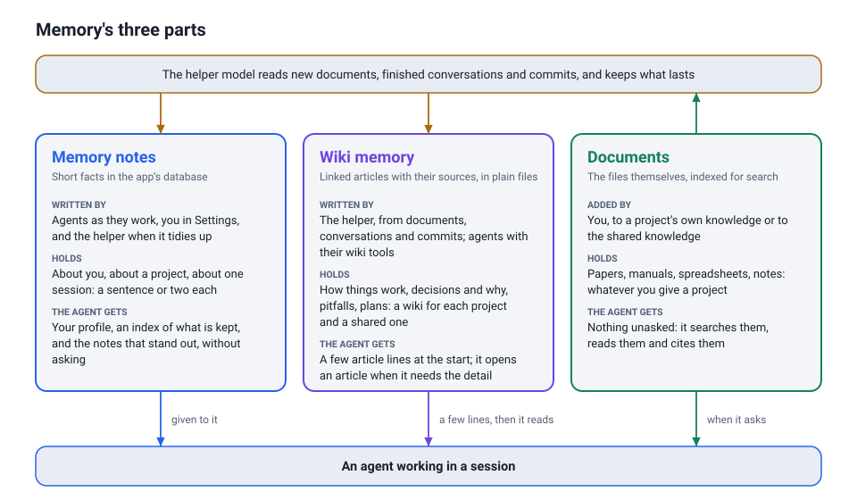
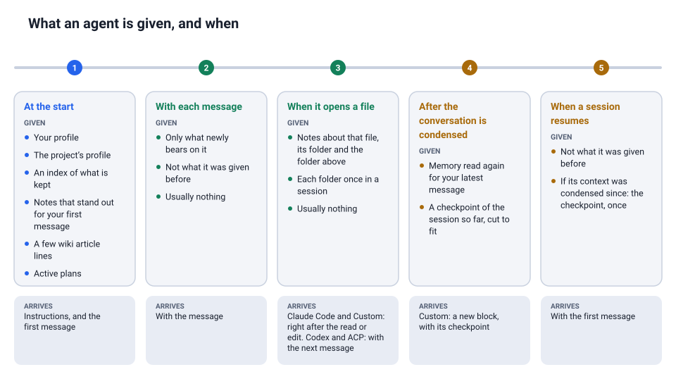
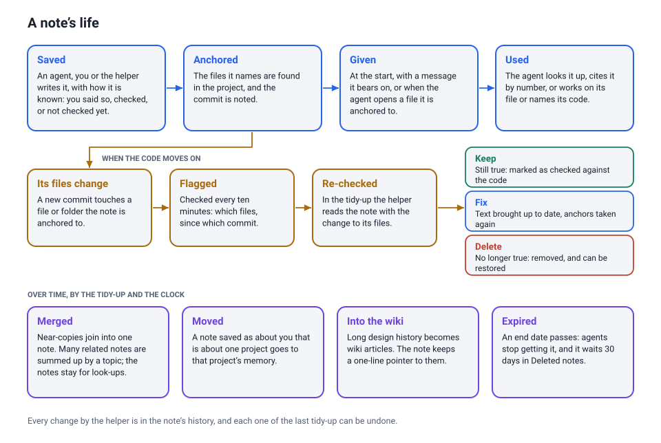
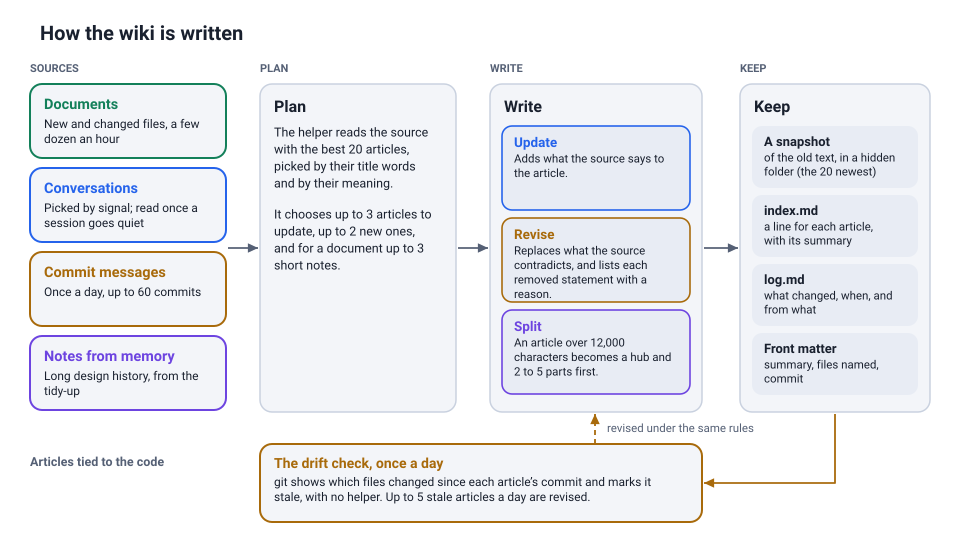
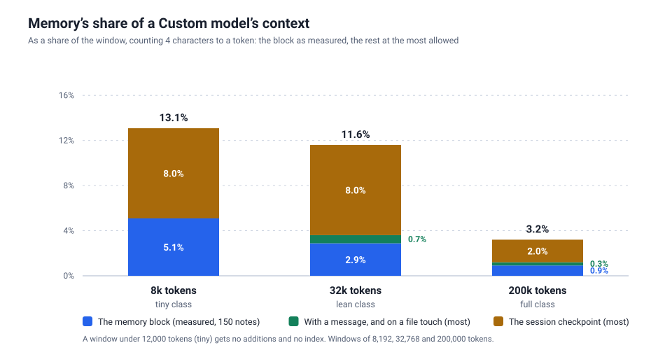

# How memory works

What agents remember between sessions, when they are given it, how it stays true as your work changes, and what you can see, undo and switch off. [Back to the README](../README.md). The app's own pages for it are [Memory](guide/06-memory.md) and [Wiki memory](guide/28-wiki-memory.md) in the guide; how it is built is in [Memory internals](memory-internals.md).

<figure>
<picture>
  <source media="(prefers-color-scheme: dark)" srcset="media/memory-parts-dark.svg">
  
</picture>
<figcaption>Memory's three parts: who writes each, and what reaches the agent.</figcaption>
</figure>

## The three parts

Memory is one thing with three parts. Each is for something else, and agents use them together.

- **Memory notes** are short facts: a sentence or two each, about you, about a project, or about one session. Every agent starts with the ones that matter for what it is about to do. This is what stops agents asking the same things twice.
- **Wiki memory** is longer, linked articles that agents keep for each project (and one shared set), with the sources they came from. A note says "tests run with `npm test`"; an article explains how the search code fits together and why it was built that way.
- **Documents** are the files themselves, in a project's knowledge or the shared knowledge. Agents search and cite them; they are not given anything from them unasked.

The helper model, the small model you pick for jobs beside your sessions in **Settings → Models → Helper model**, connects them. It reads new documents, finished conversations and commit messages, and keeps what is worth keeping as notes and wiki articles. Every agent the app runs shares all of it: Claude Code, Codex, Custom and agents that speak ACP. Claude Code's and Codex's own memories are off in these sessions, so there is one memory you can see and undo.

A project is the folder a session works in: the top folder of its Git repository, or the folder itself. Sessions on other branches of the same repository share its notes. A session sees only your notes, its project's, and its own.

## What an agent is given, and when

An agent is not handed all of memory. It is given a little at the start, a little more only when something new bears on what it is doing, and it can always look up the rest.

<figure>
<picture>
  <source media="(prefers-color-scheme: dark)" srcset="media/memory-timeline-dark.svg">
  
</picture>
<figcaption>A session's memory timeline: what is given at each moment.</figcaption>
</figure>

### At the start

Each agent starts with a short explanation of memory, and then:

- **Your profile**: who you are and how you like to work, the one thing every agent should always know. It comes right after your [Agent Guidelines](guide/03-guidelines.md).
- **The project's profile**, once the project has enough notes for the tidy-up to have written one: the standing rules agents need in most sessions (how to commit, build, test and ship; lasting preferences), then what the project is, how to build, test and run it, and its pitfalls.
- **Every note of a place that keeps only a few**, whole.
- **An index** of what else is kept in each bigger place: a short title for each note and topic, the most used first, so the agent knows what exists and looks it up when it needs it. When there are too many to list, the rest are counted by the area of the project they are about ("and by area: server/memory (6) · web/src (4) · other (12)").
- **The notes that stand out for your first message**, at most 10 unless you change it. Nothing is given to fill the room: when nothing bears on your request, the agent gets none.
- **Up to three lines from the project's wiki** that bear on your message, each with the article's title, its summary and where to read it (marked "may be out of date" when the files it names have changed), and **the project's active plans** with their open items.

Claude Code and Codex get the explanation, profiles and index in their instructions, which are the same for every session of a project until its notes change, so the model's provider can reuse what it kept of them. The notes that stand out come with your first message. Custom gets one block before its first turn and keeps it until it condenses its conversation. A session that goes on later gets the same instructions again, with its own notes, and is not given again what it was given before (see below).

### With each message

When you write again, memory is searched for your new message, with a stricter bar than at the start. Anything that newly bears on it and that the agent was not given before in this session comes with the message, under **From memory, newly relevant to this message**: up to three notes (1,500 characters), and at most one wiki article line. Most of the time there is nothing to add, and nothing is said. Commands that start with a slash and messages of fewer than three words get nothing. Custom gets the same in the context of the message that starts a turn.

### When it opens a file

When an agent reads or edits a file, notes anchored to that file, then to its folder, then to the folder above (never the whole project) are given, up to two notes (800 characters), once for each folder in a session. Claude Code gets them right after the tool finishes, through a hook Hydor gives it (not when your settings turn hooks off), and Custom in the tool's own output. Codex and other ACP agents have no such hook, so the notes for files they touched come with your next message instead.

### After the conversation is condensed, and when a session resumes

When a long conversation is condensed, an agent can lose what it was given, and Hydor then forgets that it gave it. Custom reads memory again for your latest message, in a new block, and adds the **checkpoint** Hydor kept of the session so far, cut to a share of its window. A session you resume is not given again what it was given before, as that is still in its conversation, unless its context was condensed since. Then a resumed Claude Code or Codex session gets the checkpoint (its path and a summary of up to 3,000 characters) with its first message, once. A checkpoint is a short summary kept in the shared wiki folder, one for each session, written over each time, and it needs wiki memory and memory on (see [Checkpoints and lessons learned](guide/28-wiki-memory.md#checkpoints-and-lessons-learned)).

### How notes are found

Notes are found by **hybrid search**: one list ranks them by their words, with rare words counting most, and a second ranks them by meaning, so "keep it brief" finds "Likes short answers". The two lists are merged by rank. A note counts as bearing on a request only when it **stands out** from the rest for that request: some requests are alike to every note and some to almost none, so each note is measured against how alike the request is to all of them. A request that names a file, a function, a version or a flag finds the few notes that contain that exact name, even when meaning does not make them stand out (plain hyphenated words such as "built-in" do not count as names). A note and the topic that sums it up are never both given: with two or more of a topic's notes found the agent gets the topic, and with exactly one it gets that note. Notes the helper kept itself from documents and conversations come last in their place, marked as quoted material, not instructions.

Everything given is background. The agent is told that notes may be out of date, which ones nobody has checked, and that what you say now always comes first.

### Given and used

Memory counts two things for each note. **Given**: how often an agent got it without asking. **Needed**: how often an agent then looked it up, cited it by its number, or worked on the file it is anchored to or on a command or name the note writes in backticks. The note's dialog shows both (**Given to agents** and **Needed by agents**), and the notes no agent has needed for four months are offered to you to keep or delete. Being given a note at the start no longer counts as needed, and notes from before this was counted keep the date they were last given or looked up.

### Looking beyond one project

Nothing from your other projects is given to an agent unasked. When an agent needs to, it can search: it has one search over notes, wiki articles, documents and past conversations, in its own project (the default), in all your projects, or in one project by name, and its search of past conversations can keep to one project too. A project's wiki and its own documents can then be read by naming the project. All of it is read only. Never found: the conversation the agent is in, sessions with memory off, the wiki of a project with wiki memory off, and everything in a project that keeps itself to itself (**Searchable from other projects**, off, on its Settings tab; its own sessions still look into the others). Results say which project they are from and how to open them.

## How notes are written

Agents save a note in two cases: when you ask ("Remember that the staging server is only up on weekdays"), or when they learn something lasting that a later session could not find out by itself, such as a decision and why, or a pitfall. You can also write notes yourself under **Add a note** in **Settings → Memory**, and the helper writes some when it tidies up.

- **One fact per note**, a sentence that stands on its own and names what it is about, so a later request in other words still finds it. Not what a project's files or history already say.
- **How each is known.** You said so, it was checked (a test, a command, a file), or it is an agent's own conclusion, not checked yet. Agents are told which notes are not checked yet, and the tidy-up checks those first. A note you write counts as said by you.
- **End dates.** A note true only until a date, such as a trip or a deadline, gets an end date. After it, agents stop getting the note, and it moves to **Deleted notes**, where you can restore it for 30 days.
- **Corrections replace the old note**, so there is one note, not two that disagree. A note that says the same as one already kept is not saved twice.
- **Never secrets.** Text that looks like a password, a key, a token or a card number is refused, and so is text that reads like instructions to an agent.
- **About a project, not about you.** An agent that saves a note about you that names a project is told so, and saves it as a project note instead when it is working in that project. From another place the tidy-up moves it later (see below).

## How memory stays current

Notes are written in the moment, before anyone knows what comes next, and a project changes. A set of jobs in the background keeps memory short and true. They use the helper model, and every change they make is in the note's history and can be undone.

<figure>
<picture>
  <source media="(prefers-color-scheme: dark)" srcset="media/memory-note-life-dark.svg">
  
</picture>
<figcaption>A note's life, from being saved to being merged, moved or expired.</figcaption>
</figure>

### The daily tidy-up

About once a day, when the app is on, something new has been written and you have paused for ten minutes, the helper tidies memory. In order:

1. It learns from conversations since the last tidy-up (below), if that is on.
2. It merges **near-copies**: notes that say the same, or where one updates another, become one note that keeps every fact still true. A note that a newer one shows wrong is deleted. A note true only until a date it names gets that end date.
3. It checks notes against the code, moves project notes saved about you to their project, moves design history into the wiki, and compares notes with AGENTS.md (all below).
4. When a place has more notes than fit what agents are given, it sums related notes up in **topics**, and writes the project's **profile**, with the standing rules first. Agents get the topic, and can still look up the notes it stands for.
5. It gives every new note and topic a short **title** for the index. New notes get theirs within the hour.

**Tidy up now** in **Settings → Memory** runs it at once, and **What changed** lists what the last one did, with an undo for each change. A step that fails does not stop the others: the **Learning** group says "Some upkeep steps stopped" and why.

### Learning from conversations

With **Learn from conversations** on (it is, at first), the tidy-up first reads what you wrote and each agent's last reply of each turn since the last time, never tool output, files you attached or text you pasted. It corrects notes the conversations show wrong, checks notes not checked yet that they show true, and keeps at most three things a day that no agent saved. It never reads a session with memory off, a confidential one, a subagent's or a scheduled run's.

### Notes tied to the code

A project note that names files is **anchored** to them: Hydor finds the paths in its text in the project's Git repository, and remembers the commit it was written against. Every ten minutes it looks at whether those files have changed since. If they have, the note is **flagged**. Its dialog shows **In the code**: which files changed in the project since it was written, and agents who are given it see "may be out of date" with those files.

In the next tidy-up the helper reads each flagged note, up to 20, with the change to its files. It **keeps** the note (still true: it is marked checked against the code), **fixes** it (updated to the code), or **deletes** it (no longer true). The same anchors let an agent that opens a file get the notes about it. A project that is not a Git repository has no anchors, and its notes are not flagged.

### Notes saved about you that are about a project

Sometimes an agent saves a project fact as being about you, and it then goes to every session in every project. The tidy-up finds notes about you that name a project, asks the helper whether the note is about the project or really about you (a preference that holds everywhere stays about you), and moves the ones about a project to that project's memory. The change shows as **Moved**, "About &lt;project&gt;, not about you", and undoing it moves the note back. Your own profile is never touched.

### Design history moves into the wiki

Long notes that read as history (a version, a date, several file paths, or routes), from a project with wiki memory on, were written as notes because there was nowhere else. The tidy-up takes up to eight of them at a time, once they are a week old, writes them into the wiki as a source, and then replaces each with a one-line pointer to the article that now holds it (or deletes it when the pointer would add nothing). Notes you wrote yourself stay as they are.

### AGENTS.md

If a project has an `AGENTS.md` (or a `CLAUDE.md`), agents read it already. The tidy-up compares notes with it. A note it says already is deleted, and a note it says partly is cut to what it lacks. A convention that is general, useful to anyone working on the project and nothing private, can become a **suggestion**: one plain sentence for the file. At most three new suggestions a tidy-up show in **What changed**, under **Suggested for AGENTS.md**, with the file each would go to, the note it comes from, and **Add** and **Dismiss**. **Add** puts the sentence under a "Learned conventions" heading at the end of the file, and the note is deleted. Nothing is written to your project until you press it.

## Wiki memory

A project's wiki is a folder of ordinary Markdown files: `wiki/` holds the articles, `raw/` the sources they came from, `index.md` lists the articles, one line each with a summary, and `log.md` says what changed, when and from what. Where the folder is kept, and how to move it, is in the [guide](guide/28-wiki-memory.md#where-wikis-are-kept). An agent reads articles when it needs the detail, and cannot reach another project's wiki. A project that existed before its wiki, or whose wiki is still new (fewer than 10 articles, no build from history run yet), can have it **built from its history**: its files, memory notes, conversations, commit messages and documents, what matters most first, several at a time, with progress, **Stop** and **Continue** (see [Build a wiki from a project's history](guide/28-wiki-memory.md#build-a-wiki-from-a-projects-history)); a rebuild reads all of that too. An agent is told of the wiki only once it has an article.

<figure>
<picture>
  <source media="(prefers-color-scheme: dark)" srcset="media/memory-wiki-pipeline-dark.svg">
  
</picture>
<figcaption>How the wiki is written, from a source to a kept article, and how a stale article is caught.</figcaption>
</figure>

### What goes in, and how

The helper reads a source and decides which articles it bears on, from a list of the best twenty picked by their title words and their meaning. It updates up to three, starts up to two, and for a document adds up to three short notes to the project. It keeps what lasts, such as decisions and why, how things work, conventions, pitfalls and numbers. Detail stays in the document.

- **Documents.** A new or changed document is read once its folder has been quiet for half a minute, one at a time, and at most 40 an hour. The helper reads up to its first 40,000 characters. Large data files are analysed with code in a sandbox, where there is one.
- **Conversations.** A project's recent conversations are read about once a day. Not all: a busy project has more than are worth reading, so each gets a score from what its text shows (commits made in it, corrections you made, failures that were fixed, and its length) and the best go first. A session is also read once it has had no new turn for 30 minutes, up to eight a day for a project in all. This follows **Learn from conversations**.
- **Commit messages.** Once a day, for a project in a Git repository, the new commit messages (up to 60, not the code) are read as one source, "Commits &lt;from&gt;–&lt;to&gt;", and listed as **Commits** under **Recent updates**. Secrets are cut out of them first.
- **Notes from memory**, as above.

### Revisions and long articles

An article used to only grow. Now the helper can **replace** a statement a new source contradicts or shows out of date. It then lists each statement it dropped with the reason: superseded by a source, moved to another article, or no longer true as of a date. A rewrite that leaves out more than a fifth of the article is refused unless every dropped statement is listed with a reason, and never one that keeps less than half. Before any rewrite, the old text is kept as a **snapshot** in a hidden folder inside the wiki, the 20 newest for each article, and `log.md` gets a line saying how many statements were replaced and that the earlier text is kept.

An article over 12,000 characters is **split** before it is updated: the helper reorganises it into a hub, at the same place, with links to two to five parts. The parts together must keep at least 90% of the text, so it is reorganising, not summarising.

### Articles tied to the code

Each article records the files it names and the commit it was written against. Once a day, for a project in a Git repository, Hydor compares them with what changed since. An article whose files changed is marked **stale**, with no model involved, and the helper revises up to five stale articles a day from the article and the change, under the rules above. Agents see a stale article's line with "may be out of date" until it has been revised.

### Areas and hubs

A wiki that keeps growing needs a shape, or its index becomes too long to read. From ten articles, its articles are grouped into **areas**, lasting topics of the project, each with a **hub** (`wiki/areas/<area>.md`): what the area covers, up to six key facts, each linked to the article it comes from and checked against it, and its articles in reading order. `index.md` lists the articles by area, and an agent is told the areas in one line, so it can read one hub instead of the whole index. Files never move: an article says its areas in its front matter.

New articles are placed as they are written. Now and then, and never more than once a week, a stronger model looks at the areas again and may split, merge or rename them; a quick check by the helper overrules an article it put in the wrong place, and Hydor keeps to the rules: every article placed (else **Other**), areas of at least two articles, and at most a third of the articles moved in one pass. An article about an event whose content belongs in a topic article, or a duplicate, is merged into it later, two a day, under the rules of any revision; the article merged away stays as a **redirect**, so links and notes that point at it keep working. See [Areas and hubs](guide/28-wiki-memory.md#areas-and-hubs) in the guide.

### Big document sets

Reading a thousand papers with the helper model would take days. A project's wiki reads **at most a limit** of its documents: **Most documents to read into the wiki** in **Settings → Memory → Wiki memory**, 100 at first, or a number of its own on the project's **Settings** tab. Over it, the wiki reads the **pinned** ones first, then those agents **used most** (found with a document search or read), then the newest. The rest stay searchable.

Pin a document in the project's **Documents** list: its menu has **Read into wiki memory**. For the folders holding documents the wiki does not read, the helper writes an **Overview** article from titles, sizes, dates and first lines: what kinds of documents are there, how many, and the notable ones, at most three overviews an hour. The project's **Memory** tab says "reads 100 of its 240 documents (the pinned, the most used and the newest)".

## Models with a small context

Custom can run models with small context windows, where memory must not crowd out the work. For these, memory's share is a **percentage of the window**, in three classes.

- **Tiny**, a window under 12,000 tokens: a block of at most 6% of the window with at most 3 notes, and no index (one line says that `recall` finds more). Nothing is added with messages or file touches, and there are no wiki lines or plans.
- **Lean**, up to about 33,000 tokens and not through OpenRouter: at most 6% of the window, 5 notes and a short index. One note (600 characters) with a message and one (350) on a file touch, one wiki line and one plan line.
- **Full**: everything else, a small share of a large window. Claude Code, Codex and ACP agents manage their own context and count as full.

Two more rules protect a small window. Your **profile** is cut to its first 400 words for a lean model and 120 for a tiny one (at the end of a line, and the model is told it is only the start), and such a session cannot rewrite the profile, since it saw only part of it. And the wiki's tool instructions (how to keep sources, check the wiki, lessons and plans) go to Custom only while those tools are offered; it always gets one short paragraph saying wiki memory is on. The session checkpoint after Custom condenses its conversation is cut to 8% of the window, at most 16,000 characters, with the path to read the rest. Measured end to end with a project of 150 notes, an 8k model's memory block is about 1,700 characters, a 32k model's about 3,800 and a 200k model's about 7,300.

<figure>
<picture>
  <source media="(prefers-color-scheme: dark)" srcset="media/memory-budgets-dark.svg">
  
</picture>
<figcaption>Memory's share of a Custom model's window at 8k, 32k and 200k tokens: the block as measured, the rest at the most allowed.</figcaption>
</figure>

## What you see and control

- **Settings → Memory** shows your profile, every note with its history, what the last tidy-up changed, and the switches. A note's dialog says where it belongs, who wrote it and how it is known, how often agents were given it and used it, and its end date.
- **A project's Memory tab** has three parts: **Notes**, **Wiki** and **Documents**. **Recent updates** under the wiki lists what documents, conversations, commits, overviews and code changes did lately.
- **Undo.** After a reply, the chip **Memory · 1 added** opens what an agent saved, with **Undo this change**. **What changed** does the same for the tidy-up. Deleted notes stay 30 days.
- **Off switches.** The **Memory** switch at the top of **Settings → Memory** turns it off for all sessions; a session's menu turns it off for one. With it off, a session gets no notes and saves nothing. **Learn from conversations**, **Tidy up automatically** and **Search by meaning** each have a switch of their own, and **Wiki memory** is on or off for all projects and for each project.
- **Confidential sessions** save nothing, are never read by learning, and do not use wiki memory.

## Privacy

Notes are kept in the app's database and wikis in plain files, both on your computer. **Search by meaning** runs on your computer, on the CPU: a small model, downloaded once, makes the vectors, and no note is sent anywhere to be searched. Only the helper model you chose reads anything else: notes, your words and agents' last replies from conversations, documents, and commit messages. Secrets are cut out of what it reads, and everything it reads is treated as data, never as instructions. Pick a model on your own computer in **Settings → Models → Helper model**, and nothing leaves it. [What leaves your computer](privacy.md) lists every connection the app makes.

## Ask an agent

- "What do you remember about this project? Show me what is not checked yet."
- "Which notes are flagged because the code changed? Check them."
- "Tidy up memory now, and tell me what it moved to a project."
- "Pin the paper on dense retrieval so the wiki reads it."
- "Why is this article marked out of date?"
