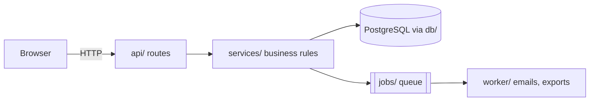

# Codebase tour

Build a working picture of an unfamiliar codebase quickly: how to build, run and test it, where execution
starts, the main parts and how data flows between them, the conventions a change must follow, and where
the thing you need lives. Check what you learn by running things, and write it down so nobody has to
work it out again.

## 1. Set the goal and the depth

- A specific task ("add a field to the invoice export") needs one path: the entry point, the feature, its
  tests, and the closest existing example. A general request ("explain this repo") needs breadth first.
- Decide which before reading, and stop when you have what the goal needs.

## 2. Read what the project says about itself

Quickly, in this order:

- `README*`, `CONTRIBUTING*`, `ARCHITECTURE.md` or `DESIGN.md`, `docs/`, decision records (`docs/adr/`).
- Notes for agents and editors: `CLAUDE.md`, `AGENTS.md`, `.cursorrules`, `.github/copilot-instructions.md`.
  They often hold the rules that matter most (tests to run, files to update together).
- Manifests: `package.json` (scripts, `main`, `bin`, `workspaces`), `pyproject.toml`, `go.mod`,
  `Cargo.toml`, `pom.xml` or `build.gradle`, `Gemfile`, `composer.json`: language, framework, entry points,
  commands.
- Build and run files: `Makefile`, `justfile`, `Dockerfile`, `compose.yaml`, `Procfile`, `.env.example`.
- CI: `.github/workflows/*.yml`, `.gitlab-ci.yml`. These are the commands that really build and test it,
  with the versions they use. When the README and CI disagree, CI is usually right.

Treat docs as claims to check: they go stale.

## 3. Map the territory

```bash
git ls-files | head -100                                                      # tracked files only
git ls-files | sed 's|/[^/]*$||' | sort | uniq -c | sort -rn | head -20       # the busiest folders
git ls-files | grep -Eo '\.[A-Za-z0-9]+$' | sort | uniq -c | sort -rn | head  # languages by file count
git log --oneline -15                                                         # what is happening lately
git log --format= --name-only --since=6.months | grep . | sort | uniq -c | sort -rn | head -20  # hot spots
git shortlog -sn --no-merges HEAD | head                                      # who works on it
git ls-files -z -- '*.py' '*.ts' '*.go' | xargs -0 wc -l | sort -rn | head -15  # the largest source files
```

- A repository not on disk yet: `git clone --filter=blob:none <url>` brings the history these commands
  need and fetches file contents only as they are read; `--depth=1` is quicker but has no history.

- Sort the top-level folders into app code, tests, scripts, config, docs, and generated or vendored code.
  Skip generated and vendored code (`dist/`, `build/`, `vendor/`, `node_modules/`, generated clients).
- A monorepo: find the workspace list (`workspaces` in `package.json`, `pnpm-workspace.yaml`, `go.work`,
  `[workspace]` in `Cargo.toml`) and treat each package as a small tour of its own.
- Hot spots (files changed most often) are where the important and fragile code usually is. The largest
  files are often the core, or the most tangled; a file that is both is where changes are hardest.

## 4. Build, run and test it

- Follow the documented setup. If a step fails, that is a finding: note it and how you got past it.
- Record the commands that worked and the versions (`node --version`, `python3 --version`).
- Run the tests once: how many, how long, which already fail.
- Start the app and use it once (open a page, send a request, run the command). Seeing it work anchors
  everything you read afterwards.
- Use the project's own tooling (lock files, virtual environments, containers). Do not install anything
  system-wide or change global settings to get it running without asking.

## 5. Follow one path end to end

Pick one real flow (a request, a command, a background job) and trace it:

- **Entry:** `main`, `index`, `app` or `server` files; `bin` in `package.json`; `[project.scripts]`;
  `if __name__ == "__main__"`; `func main()`; the framework's routing (a routes folder, `urls.py`,
  `config/routes.rb`, controllers).
- **Inward:** routing, then the handler, the business logic, data access, storage. **Outward:**
  serialisation, the response, side effects (queues, emails, events, files).
- Search instead of scrolling: `git grep -n "createOrder"`, `git grep -n "/api/orders"`. Read the tests of
  each module on the path: they show intended use.
- Confirm the path by running it: a temporary log line or breakpoint that you see hit (remove it after).
- For a task, find the most similar existing feature and follow its shape.
- What changes along with a file:
  `git show --format= --name-only $(git log --format=%H -30 -- src/orders.ts) | grep . | sort | uniq -c | sort -rn | head`
  counts the files touched in the same commits as its last 30 changes (its tests, types, docs,
  translations). A change to it will probably need the same.

## 6. Note the conventions

What a change here must match: language and framework versions; folder and file naming; how errors are
raised, handled and logged; how config and secrets are read; how the database is reached and migrated;
the test layout and helpers; formatting and lint rules (`.editorconfig`, `.prettierrc`, `eslint.config.*`,
`ruff.toml`); commit message style (`git log --oneline`); docs, translations and changelog rules.

## 7. Write the overview

Use `references/overview-template.md`. Keep it to a page or two:

- What it is, in two sentences, and the exact build, run and test commands that worked.
- The main parts, one line each, with their folders.
- A Mermaid diagram of the parts and how data flows between them:



- Where to make common changes ("a new API route: ...; a new page: ...").
- The outside services it needs (database, queue, payment, email, AI APIs, file storage), found in
  `.env.example`, the config and the dependencies, and what is sent to each.
- For the main kinds of data, where the real copy lives and which copies are made from it (caches,
  search indexes, exports): a change to the data has to reach each.
- Conventions, gotchas and open questions.
- Mark what you checked by running it, what you only read, and what you guessed from names and
  structure; a guess that matters goes under open questions.

Give it in the reply, or save it where the user wants it. Do not add files to the repository unasked.

## Pitfalls

- Reading files top to bottom instead of following a path.
- Trusting the README over CI and the code.
- Studying generated, vendored or build output.
- Describing what the code "probably" does without running it.
- An overview that lists folders but not how data moves between them.
- Changing the project during a tour: upgrades, reformatting, "quick fixes".
