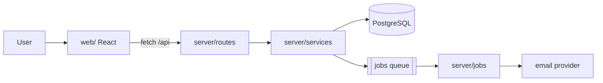
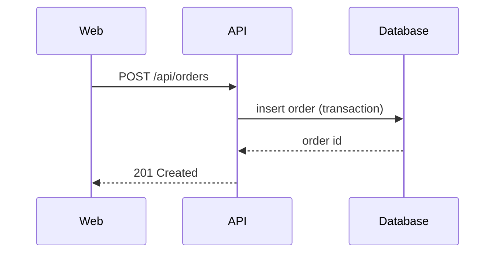

# Architecture overview template

Copy this, fill in what you found, and delete sections that do not apply. Mark each claim **(ran)** when
you saw it work, **(read)** when it comes from docs or code you did not run, or **(guess)** when you
inferred it from names and structure.

````markdown
# <Project name>: how it fits together

<Two sentences: what it does and for whom.>

## Run it

| Step | Command | Notes |
| --- | --- | --- |
| Install | `npm ci` | Node 22 (from .nvmrc) (ran) |
| Configure | copy `.env.example` to `.env` | needs DATABASE_URL (read) |
| Run | `npm run dev` | http://localhost:5173 (ran) |
| Test | `npm test` | 412 tests, 40 s, 2 already failing: ... (ran) |
| Lint and types | `npm run lint && npx tsc --noEmit` | (ran) |

## The parts

| Part | Folder | What it does |
| --- | --- | --- |
| Web app | `web/` | React pages, talks to the API over HTTP |
| API | `server/routes/` | HTTP routes, validation, auth |
| Domain | `server/services/` | business rules: pricing, orders, refunds |
| Storage | `server/db/` | queries and migrations (PostgreSQL) |
| Jobs | `server/jobs/` | queued work: emails, exports |

## How data flows



One request, end to end: <e.g. "POST /api/orders: routes/orders.ts validates, services/orders.ts prices
and saves in one transaction, jobs/receipt.ts sends the email">.

## Outside services and data

| Service | Used for | Configured by | What it is sent |
| --- | --- | --- | --- |
| PostgreSQL | all app data | `DATABASE_URL` | everything (read) |
| Stripe | payments | `STRIPE_SECRET_KEY` | order totals, customer email (read) |
| Resend | email | `RESEND_API_KEY` | addresses, receipt text (guess) |

Where the real copy of each kind of data lives, and the copies made from it: <e.g. "orders: the
`orders` table; copied into the search index by `jobs/reindex.ts` and into the nightly CSV export">.

## Where to make common changes

- A new API route: `server/routes/<area>.ts`, registered in `server/routes/index.ts`; test in
  `server/routes/<area>.test.ts`.
- A new page: `web/src/pages/`, route in `web/src/router.tsx`.
- A schema change: a new file in `server/db/migrations/` (`npm run migrate:new <name>`).

## Conventions

- Errors: services throw `AppError(code, message)`; routes map codes to HTTP statuses.
- Config: read once in `server/config.ts` from environment variables; never `process.env` elsewhere.
- Tests: next to the code, `*.test.ts`; the database tests use a transaction rolled back per test.
- Commits: `area: what changed`, present tense.

## Gotchas

- <Things that surprised you: a step the README misses, a slow test, a generated file not to edit.>

## Open questions

- <What you could not find out, and who or what might know.>
````

## Mermaid tips

- `flowchart LR` (left to right) suits request flows; `flowchart TD` (top down) suits layers.
- Node shapes: `["label"]` box, `[("label")]` database, `[["label"]]` queue or subroutine,
  `(("label"))` circle for an external actor.
- Quote labels that contain slashes, parentheses or spaces, as above.
- Keep it to the 5 to 12 parts that matter; a diagram of every file explains nothing.
- `subgraph Server` ... `end` groups parts by where they run (browser, server, outside services).
- For a sequence of calls in one request, a sequence diagram is clearer:


